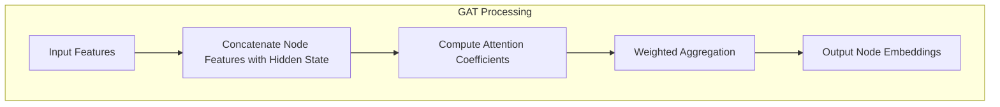
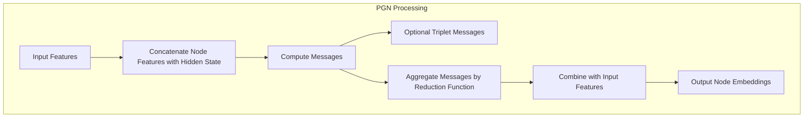
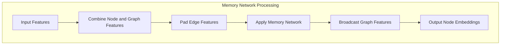
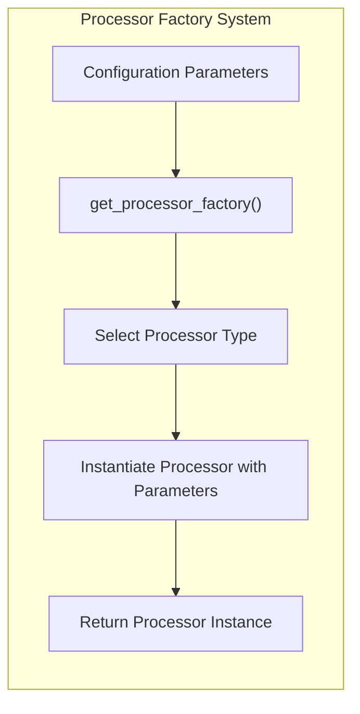
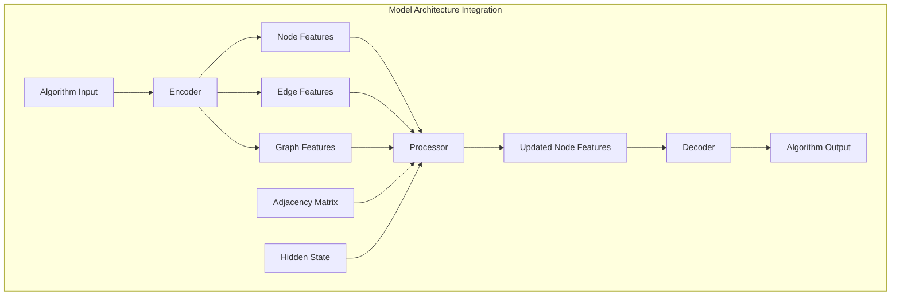

<!-- source: DeepWiki mcp.deepwiki.com · repo google-deepmind/clrs · page 6 Processors · fetched 2026-10-26 -->

# Processors

<details>
<summary>Relevant source files</summary>

The following files were used as context for generating this wiki page:

- [clrs/_src/processors.py](clrs/_src/processors.py)
- [clrs/_src/processors_test.py](clrs/_src/processors_test.py)

</details>


## Purpose and Scope

This document details the processor components within the CLRS benchmark. Processors are specialized neural network modules that operate on graph-structured data to implement various forms of message passing and information aggregation. They serve as the core computation engines for the baseline models, enabling the neural networks to reason about algorithms represented as operations on graphs. For information about how processors are used in the overall model architecture, see [Baseline Models](#2).

Sources: [clrs/_src/processors.py:16-16]()

## Processor Base Class

The CLRS benchmark defines an abstract `Processor` base class that establishes the interface for all processor implementations.

```mermaid
classDiagram
    class "Processor" {
        +__init__(name: str)
        +__call__(node_fts, edge_fts, graph_fts, adj_mat, hidden, **kwargs) Tuple[Array, Optional[Array]]
        +inf_bias: bool
        +inf_bias_edge: bool
    }
    
    "Processor" <|-- "GAT"
    "Processor" <|-- "GATv2"
    "Processor" <|-- "PGN"
    "Processor" <|-- "MemNetMasked"
    "PGN" <|-- "DeepSets"
    "PGN" <|-- "MPNN"
    "PGN" <|-- "PGNMask"
    "MemNetMasked" <|-- "MemNetFull"
    "GAT" <|-- "GATFull"
    "GATv2" <|-- "GATv2Full"
    "GATv2" <|-- "GATv2FullD2"
```

All processor implementations must implement the `__call__` method, which takes:
- `node_fts`: Features for each node in the graph
- `edge_fts`: Features for each edge in the graph
- `graph_fts`: Global graph features
- `adj_mat`: Adjacency matrix defining graph connectivity
- `hidden`: Hidden state from previous steps

The method returns updated node embeddings and optional edge embeddings.

Sources: [clrs/_src/processors.py:34-66]()

## Types of Processors

### Graph Attention Networks (GAT)

The `GAT` processor implements the Graph Attention Network architecture from Velickovic et al. (ICLR 2018). It uses attention mechanisms to weigh the importance of neighbor node features when aggregating information.



Key features:
- Multi-head attention mechanism
- Masked attention through adjacency matrix
- Optional residual connections and layer normalization

Sources: [clrs/_src/processors.py:77-161]()

A variant called `GATFull` uses a fully connected adjacency matrix, ignoring the graph structure provided.

Sources: [clrs/_src/processors.py:164-170]()

### Graph Attention Networks v2 (GATv2)

`GATv2` is an improved version of GAT from Brody et al. (ICLR 2022), offering more expressive attention mechanisms.

Sources: [clrs/_src/processors.py:173-289]()

Variants include:
- `GATv2Full`: Uses a fully connected adjacency matrix
- `GATv2FullD2`: A specialized variant with D2 symmetry support

Sources: [clrs/_src/processors.py:292-356]()

### Pointer Graph Networks (PGN)

`PGN` implements Pointer Graph Networks from Veličković et al. (NeurIPS 2020), allowing the model to learn to generate pointers to graph elements.



Key features:
- Flexible message aggregation using configurable reduction functions (max, mean)
- Optional triplet messages for higher-order interactions
- Gated update mechanism for better information flow
- Support for layer normalization

Sources: [clrs/_src/processors.py:388-502]()

Variants include:
- `PGNMask`: A masked version that enables bias for infinity values
- `MPNN`: Message Passing Neural Network that uses a fully connected adjacency matrix
- `DeepSets`: A processor that operates on sets (uses identity adjacency matrix)

Sources: [clrs/_src/processors.py:505-533]()

### Memory Networks (MemNet)

The `MemNetMasked` processor implements End-to-End Memory Networks inspired by Sukhbaatar et al. Memory networks maintain an external memory that can be read and written to.



Key components:
- Position encodings for sequence data
- Multi-hop attention mechanism
- Embedding layers for input/output encoding
- Optional layer normalization

Sources: [clrs/_src/processors.py:536-720]()

`MemNetFull` is a variant that uses a fully connected adjacency matrix.

Sources: [clrs/_src/processors.py:723-729]()

## Processor Factory

The CLRS benchmark provides a factory function `get_processor_factory` to create processor instances based on configuration parameters. This factory simplifies the process of selecting and instantiating the appropriate processor for a given task.



The factory function takes these key parameters:
- `kind`: The type of processor to create (e.g., 'gat', 'pgn', 'mpnn')
- `use_ln`: Whether to use layer normalization
- `nb_triplet_fts`: Number of triplet features for processors that support them
- `nb_heads`: Number of attention heads for GAT-based processors

The function returns a factory that can create processor instances with a specified output size.

Sources: [clrs/_src/processors.py:732-902]()

## Processor Integration with Neural Networks

Processors are integrated into the baseline model architecture to enable learning on algorithm execution traces.



During training, processors transform the graph representation at each step of algorithm execution, learning to mimic the algorithm's behavior.

Sources: [clrs/_src/processors.py:34-66]()

## Detailed Processor Feature Comparison

The following table summarizes the key features of different processor types:

| Processor Type | Graph Connectivity | Attention Mechanism | Triplet Messages | Gated Updates | Layer Norm Support |
|----------------|-------------------|---------------------|-----------------|--------------|-------------------|
| GAT            | Adjacency Matrix  | Multi-head          | No              | No           | Yes               |
| GATFull        | Fully Connected   | Multi-head          | No              | No           | Yes               |
| GATv2          | Adjacency Matrix  | Improved Multi-head | No              | No           | Yes               |
| GATv2Full      | Fully Connected   | Improved Multi-head | No              | No           | Yes               |
| PGN            | Adjacency Matrix  | No                  | Optional        | Optional     | Yes               |
| PGNMask        | Adjacency Matrix  | No                  | Optional        | Optional     | Yes               |
| MPNN           | Fully Connected   | No                  | Optional        | Optional     | Yes               |
| DeepSets       | Identity Matrix   | No                  | No              | Optional     | Yes               |
| MemNetMasked   | Adjacency Matrix  | Memory-based        | No              | No           | Yes               |
| MemNetFull     | Fully Connected   | Memory-based        | No              | No           | Yes               |

Sources: [clrs/_src/processors.py:734-902]()

## Implementation Details

### Triplet Messages

For processors that support triplet interactions (like `PGN` with `use_triplets=True`), the system computes higher-order messages between triplets of nodes. This enables capturing more complex graph relationships and is implemented via the `get_triplet_msgs` function.

Sources: [clrs/_src/processors.py:359-385]()

### Position Encoding

Memory Networks use position encodings to incorporate sequence information. The position encoding is computed by the `_position_encoding` function.

Sources: [clrs/_src/processors.py:905-914]()

---

