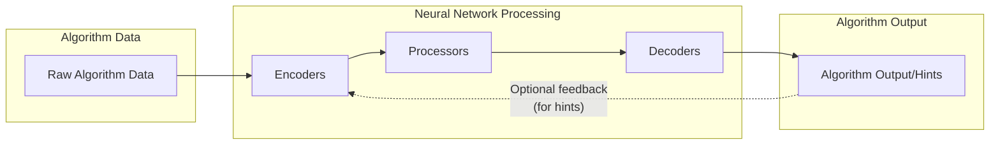
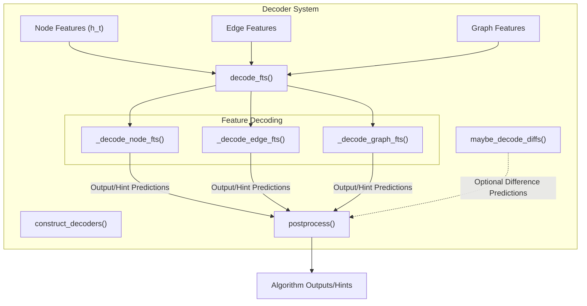
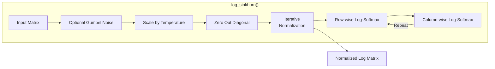
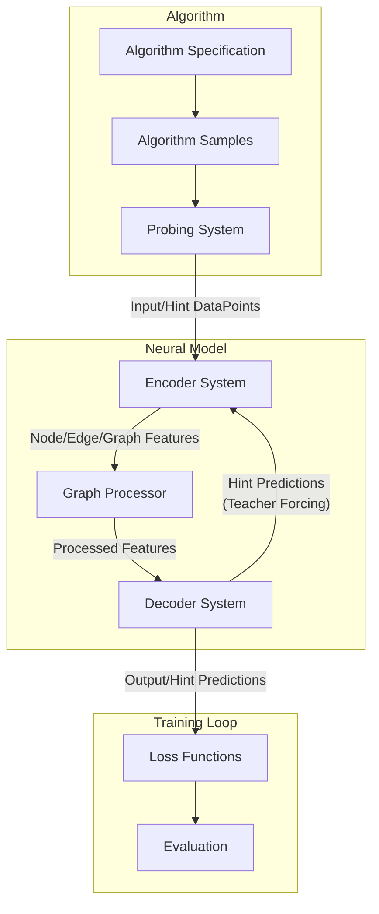

<!-- source: DeepWiki mcp.deepwiki.com · repo google-deepmind/clrs · page 6.1 Encoders and Decoders · fetched 2026-10-26 -->

# Encoders and Decoders

<details>
<summary>Relevant source files</summary>

The following files were used as context for generating this wiki page:

- [clrs/_src/decoders.py](clrs/_src/decoders.py)
- [clrs/_src/encoders.py](clrs/_src/encoders.py)

</details>


This document provides technical documentation on the encoder and decoder systems in the CLRS benchmark. These components are responsible for transforming algorithm data structures into neural network representations and vice versa. For information about the graph processors that operate on these encoded representations, see [Processors](#6).

## Purpose and Components

Encoders and decoders serve as the interface between algorithmic data structures and neural network representations:

- **Encoders**: Transform algorithm data (nodes, edges, graph attributes) into feature vectors for neural network processing
- **Decoders**: Transform neural network outputs back into algorithm-specific data structures



Sources: [clrs/_src/encoders.py:15-16](), [clrs/_src/decoders.py:15-16]()

## Data Types and Locations

Both encoders and decoders handle various data types and locations that represent algorithm elements.

### Types

| Type | Description | Encoding/Decoding Approach |
|------|-------------|----------------------------|
| `SCALAR` | Numerical values | Direct encoding/decoding |
| `MASK` | Binary masks | Sigmoid for soft values, thresholding for hard |
| `MASK_ONE` | Single-selection masks | One-hot encoding/softmax |
| `CATEGORICAL` | Categorical data | One-hot encoding/softmax |
| `POINTER` | Pointers to other elements | One-hot encoding/softmax |
| `PERMUTATION_POINTER` | Pointers representing permutations | One-hot with Sinkhorn normalization |
| `SOFT_POINTER` | Soft pointers | Already in distribution form |

### Locations

| Location | Description |
|----------|-------------|
| `NODE` | Features associated with nodes in a graph |
| `EDGE` | Features associated with edges in a graph |
| `GRAPH` | Features associated with the entire graph |

Sources: [clrs/_src/encoders.py:24-29](), [clrs/_src/decoders.py:27-32]()

## Encoder System

The encoder system transforms algorithm data into neural network feature representations.

```mermaid
flowchart TD
    subgraph "Encoder System"
        preproc["preprocess()"]
        construct["construct_encoders()"]
        encode["_encode_inputs()"]
        
        subgraph "Feature Accumulation"
            adj["accum_adj_mat()"]
            edge["accum_edge_fts()"]
            node["accum_node_fts()"]
            graph["accum_graph_fts()"]
        end
        
        dataPoint["DataPoint"] --> preproc
        preproc --> encode
        construct --> encode
        encode --> adj
        encode --> edge
        encode --> node
        encode --> graph
    end
    
    adj --> |"adj_mat"| outputFeatures["Neural Network Features"]
    edge --> |"edge_fts"| outputFeatures
    node --> |"node_fts"| outputFeatures
    graph --> |"graph_fts"| outputFeatures
```

Sources: [clrs/_src/encoders.py:32-51](), [clrs/_src/encoders.py:54-80](), [clrs/_src/encoders.py:83-139]()

### Encoder Construction

Encoders are built as linear layers with specific configurations based on the data type and location:

```python
# Example of encoder construction (simplified)
encoders = [hk.Linear(hidden_dim)]
if loc == _Location.EDGE and t == _Type.POINTER:
    # Edge pointers need two-way encoders
    encoders.append(hk.Linear(hidden_dim))
```

The encoder weights can be initialized using different strategies, with special treatment for scalar hint encoders.

Sources: [clrs/_src/encoders.py:32-51]()

### Data Preprocessing

Before encoding, data points undergo preprocessing to ensure they're in the appropriate format:

- `POINTER` types are expanded to one-hot representations
- `SOFT_POINTER` types are treated as regular `POINTER` types for encoding
- All data is converted to float32

Sources: [clrs/_src/encoders.py:54-80]()

### Feature Accumulation Functions

The encoded features are accumulated into three main feature matrices:

- **Adjacency Matrix**: Built from node pointers and edge masks
- **Edge Features**: Built from node pointers and edge data
- **Node Features**: Built from node data and graph pointers
- **Graph Features**: Built from graph data

Sources: [clrs/_src/encoders.py:83-139]()

## Decoder System

The decoder system transforms neural network outputs back into algorithm-specific data structures.



Sources: [clrs/_src/decoders.py:67-111](), [clrs/_src/decoders.py:198-382]()

### Decoder Construction

Decoders are constructed as a series of linear layers, with the number and configuration depending on the data location and type:

- **Node decoders**: 1-4 linear layers depending on type
- **Edge decoders**: 3-5 linear layers depending on type
- **Graph decoders**: 2-3 linear layers depending on type

Specialized "diff decoders" can also be constructed to predict differences between states.

Sources: [clrs/_src/decoders.py:67-121]()

### Feature Decoding

The `decode_fts` function orchestrates the decoding process by:
1. Selecting the appropriate decoder based on data name and spec
2. Routing to the appropriate decoding function based on location
3. Separating outputs and hints based on their stage in the spec
4. Returning dictionaries of predictions

Sources: [clrs/_src/decoders.py:198-235]()

### Type-Specific Decoding

Each location type (node, edge, graph) has its own decoding function:

- **Node decoding**: Handles scalar values, categorical data, and pointers
- **Edge decoding**: Processes edge relationships and properties
- **Graph decoding**: Handles global properties and graph-level outputs

Each type of data (SCALAR, MASK, CATEGORICAL, POINTER, etc.) is decoded differently.

Sources: [clrs/_src/decoders.py:238-327]()

### Sinkhorn Operation for Permutation Pointers

For permutation pointers, a special Sinkhorn operation is applied to ensure the output is a doubly stochastic matrix (a relaxation of a permutation matrix):



Sources: [clrs/_src/decoders.py:36-64](), [clrs/_src/decoders.py:262-270]()

### Postprocessing

The `postprocess` function handles the final transformation of decoder outputs:

- In "hard" mode (for evaluation):
  - SCALAR: Stop gradient
  - MASK: Threshold at 0
  - MASK_ONE/CATEGORICAL: Argmax and one-hot
  - POINTER: Argmax
  - PERMUTATION_POINTER: Convert to permutation matrix

- In "soft" mode (for hint feedback):
  - SCALAR: Pass through
  - MASK: Sigmoid
  - MASK_ONE/CATEGORICAL: Softmax
  - POINTER: Softmax (becomes SOFT_POINTER)
  - PERMUTATION_POINTER: Sinkhorn normalization

Sources: [clrs/_src/decoders.py:127-195]()

## Integration with CLRS Pipeline

The encoder and decoder systems integrate with the larger CLRS benchmark pipeline as follows:



### Data Flow Through Encoders and Decoders

1. Algorithm samples generate `DataPoint` objects containing algorithm data
2. Encoders preprocess these data points and convert them to feature vectors
3. Graph processors update these feature vectors
4. Decoders convert processed features back to algorithm outputs
5. Postprocessing transforms raw decoder outputs to final predictions
6. For teacher forcing, hint predictions are fed back to encoders

Sources: [clrs/_src/encoders.py:15-140](), [clrs/_src/decoders.py:15-382]()

## Usage in Model Training

During model training, encoders and decoders interact with other components as follows:

1. The model constructs encoders and decoders for each data type in the algorithm specification
2. Input data is encoded to produce initial feature representations
3. The processor updates these representations over multiple steps
4. At each step, decoders produce output and hint predictions
5. Hint predictions may be fed back to the model via encoders (teacher forcing)
6. Loss is computed between predictions and ground truth
7. During evaluation, "hard" postprocessing is used to generate final predictions

This architecture allows the model to learn algorithmic reasoning by processing graph-structured data and gradually refining its predictions based on feedback.

Sources: [clrs/_src/encoders.py:15-140](), [clrs/_src/decoders.py:15-382]()

---

