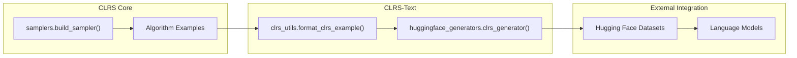
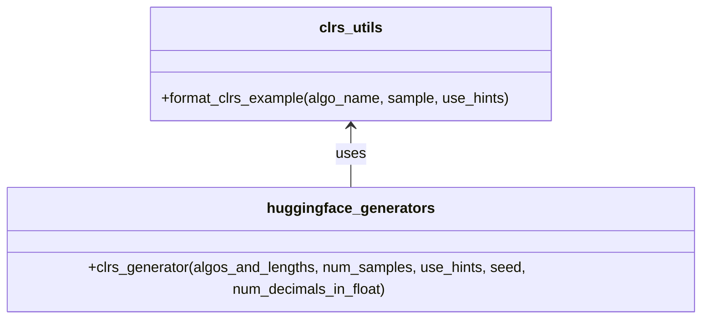
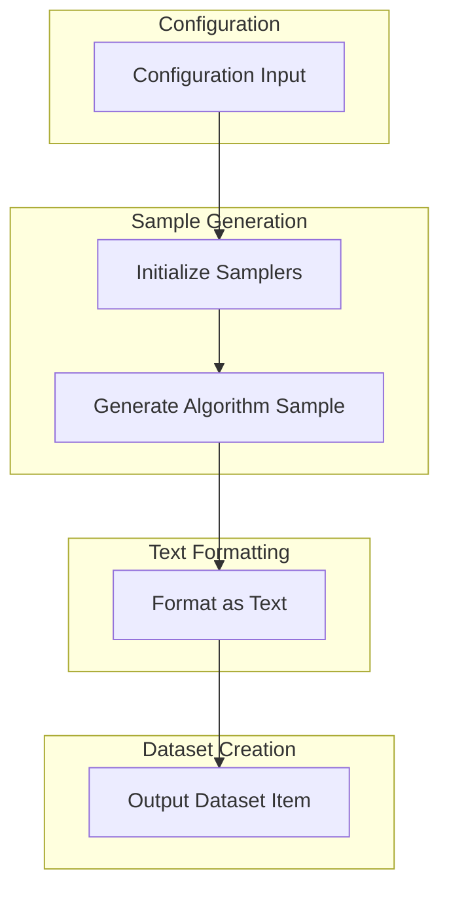
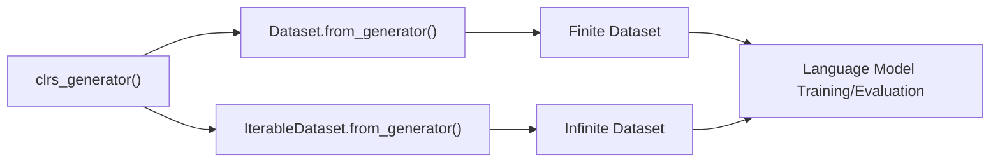
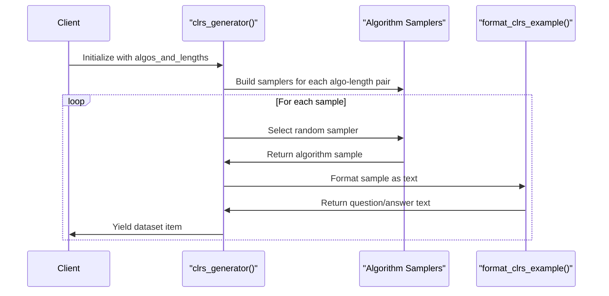
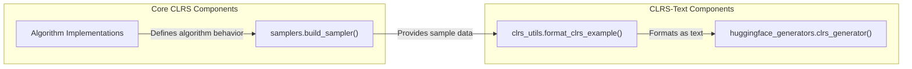

<!-- source: DeepWiki mcp.deepwiki.com · repo google-deepmind/clrs · page 7 CLRS-Text · fetched 2026-10-26 -->

# CLRS-Text

<details>
<summary>Relevant source files</summary>

The following files were used as context for generating this wiki page:

- [clrs/_src/clrs_text/__init__.py](clrs/_src/clrs_text/__init__.py)
- [clrs/_src/clrs_text/huggingface_generators.py](clrs/_src/clrs_text/huggingface_generators.py)

</details>


## Purpose and Scope

CLRS-Text is a specialized variant of the CLRS algorithmic reasoning benchmark that transforms algorithm samples into textual representations for use with language models. While the core CLRS benchmark primarily targets graph neural networks, CLRS-Text creates natural language descriptions of algorithmic tasks to enable the evaluation of large language models (LLMs) on algorithmic reasoning. This module provides seamless integration with the Hugging Face ecosystem for dataset creation and model evaluation.

For information about the core algorithm samplers that generate the data underlying CLRS-Text, see [Algorithm Samplers](#4). For details on Hugging Face integration specifics, see [Hugging Face Integration](#7.1).

Sources: [clrs/_src/clrs_text/__init__.py:15-19]()

## System Architecture

CLRS-Text builds upon the core CLRS benchmark system, acting as a bridge between algorithmic reasoning tasks and language models. It leverages the existing algorithm samplers to generate examples, then transforms them into text format suitable for language models.



*CLRS-Text System Architecture*

Sources: [clrs/_src/clrs_text/huggingface_generators.py:15-22](), [clrs/_src/clrs_text/__init__.py:15-19]()

## Core Components

CLRS-Text consists of two primary components:

1. **CLRS Utils**: Provides utilities for formatting algorithm examples into text, responsible for transforming structured algorithm data into natural language descriptions.

2. **Hugging Face Generators**: Offers integration with the Hugging Face ecosystem, providing generator functions that can create both finite and infinite datasets.



*CLRS-Text Component Structure*

Sources: [clrs/_src/clrs_text/__init__.py:17-18]()

## Data Flow Process

CLRS-Text transforms algorithm samples into textual representations through a well-defined data flow process:



*CLRS-Text Data Flow Process*

The process begins by configuring which algorithms and input lengths to include. For each algorithm-length pair, a sampler is initialized. When generating dataset items, the system:

1. Randomly selects a sampler
2. Generates a single algorithm sample
3. Formats the sample into question and answer text
4. Yields a complete dataset item

Sources: [clrs/_src/clrs_text/huggingface_generators.py:87-129]()

## Hugging Face Integration

CLRS-Text provides a generator function compatible with Hugging Face's dataset creation tools. The `clrs_generator` function can be used to create both finite datasets using `Dataset.from_generator()` and infinite datasets using `IterableDataset.from_generator()`.



*Hugging Face Integration Options*

Each generated dataset item contains the following fields:
- `text`: Complete text (question + answer)
- `question`: Problem statement text
- `answer`: Solution text
- `algo_name`: Name of the algorithm
- `length`: Input length
- `use_hints`: Whether hints were included

Sources: [clrs/_src/clrs_text/huggingface_generators.py:24-86](), [clrs/_src/clrs_text/huggingface_generators.py:122-129]()

## Usage Examples

CLRS-Text can be used to create datasets for training and evaluating language models on algorithmic reasoning tasks. Here are the two primary usage patterns:

### Finite Dataset Creation

For creating a dataset with a fixed number of examples:

```python
algos_and_lengths = {"insertion_sort": [16]}
ds = datasets.Dataset.from_generator(
    clrs_generator, 
    gen_kwargs={
        "algos_and_lengths": algos_and_lengths,
        "num_samples": 100
    }
)
```

### Infinite Dataset Creation

For creating an infinite stream of examples (useful for ongoing training):

```python
algos_and_lengths = {"insertion_sort": [16]}
ds = IterableDataset.from_generator(
    clrs_generator,
    features=Features({
        "text": Value(dtype="string", id=None),
        "question": Value(dtype="string", id=None),
        "answer": Value(dtype="string", id=None),
        "algo_name": Value(dtype="string", id=None),
        "length": Value(dtype="int32", id=None),
        "use_hints": Value(dtype="bool_", id=None),
    }),
    gen_kwargs={"algos_and_lengths": algos_and_lengths},
)
```

Sources: [clrs/_src/clrs_text/huggingface_generators.py:31-65]()

## Configuration Options

When using the CLRS-Text generator, several configuration options are available:

| Parameter | Type | Default | Description |
|-----------|------|---------|-------------|
| `algos_and_lengths` | Dict[str, List[int]] | Required | Maps algorithm names to lists of input lengths |
| `num_samples` | Optional[int] | None | Number of samples (None = infinite dataset) |
| `use_hints` | bool | False | Whether to include algorithm hints in the text |
| `seed` | int | 0 | Random seed for reproducibility |
| `num_decimals_in_float` | int | 3 | Number of decimal places for float values |

Sources: [clrs/_src/clrs_text/huggingface_generators.py:24-76]()

## Internal Implementation Details

The CLRS-Text generator works by:

1. Creating samplers for each algorithm-length combination
2. Randomly selecting a sampler to generate an example
3. Formatting the example into question and answer text
4. Yielding the formatted example as a dataset item



*CLRS-Text Generator Sequence*

Sources: [clrs/_src/clrs_text/huggingface_generators.py:87-129]()

## Integration with Core CLRS

CLRS-Text builds upon the core CLRS benchmark infrastructure, particularly its algorithm samplers. The text generators use these samplers to create examples, which are then transformed into textual format.



*CLRS-Text Integration with Core CLRS*

Sources: [clrs/_src/clrs_text/huggingface_generators.py:92-99]()

---

