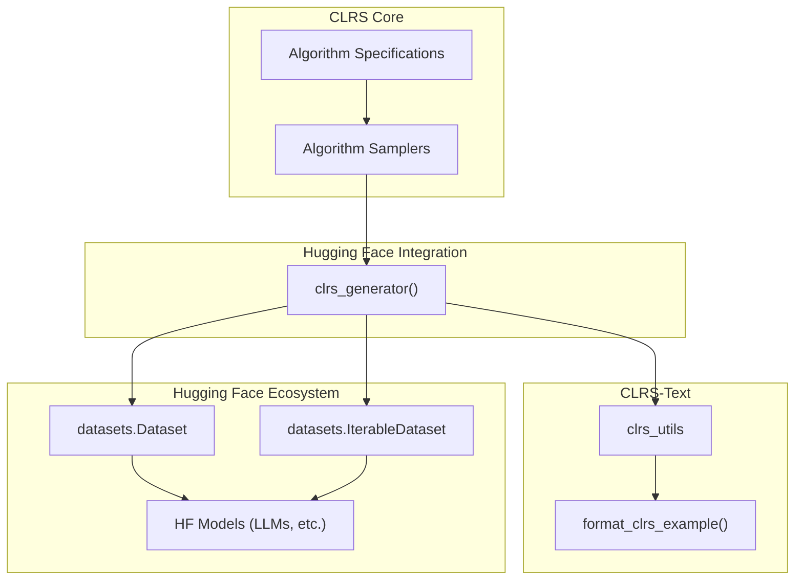
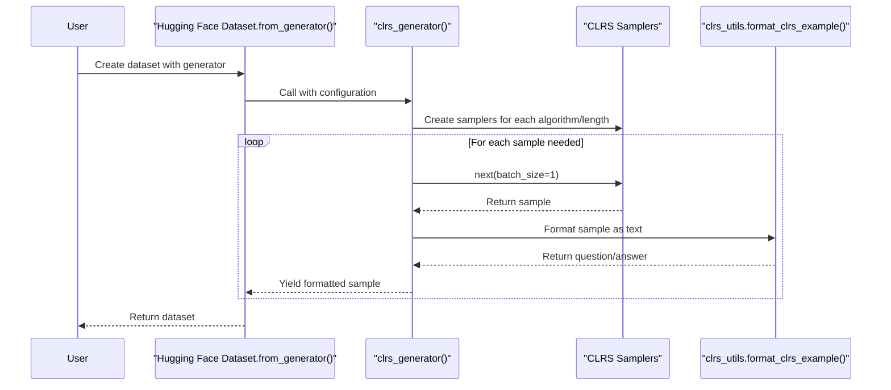
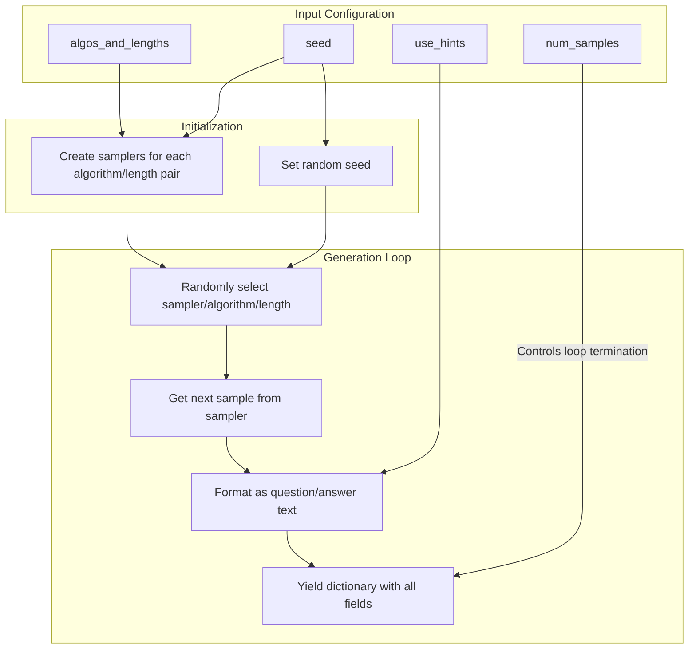
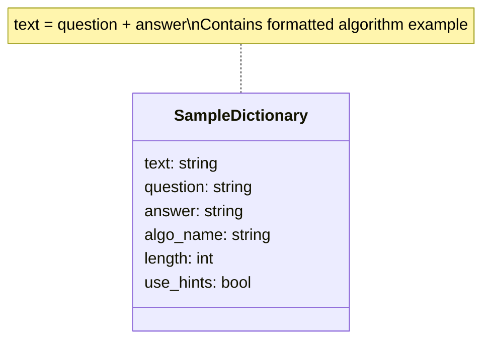

<!-- source: DeepWiki mcp.deepwiki.com · repo google-deepmind/clrs · page 7.1 Hugging Face Integration · fetched 2026-10-26 -->

# Hugging Face Integration

<details>
<summary>Relevant source files</summary>

The following files were used as context for generating this wiki page:

- [clrs/_src/clrs_text/huggingface_generators.py](clrs/_src/clrs_text/huggingface_generators.py)
- [clrs/_src/clrs_text/huggingface_generators_test.py](clrs/_src/clrs_text/huggingface_generators_test.py)

</details>


## Purpose and Scope

This document details the integration between the CLRS benchmark and the Hugging Face ecosystem. It explains how to generate CLRS-Text datasets in formats compatible with Hugging Face's dataset libraries, allowing users to leverage algorithmic reasoning tasks with language models. For general information about CLRS-Text, see [CLRS-Text](#7), and for details on text formatting, see [Text Formatting](#7.2).

## Architecture Overview

The Hugging Face integration provides a bridge between the CLRS algorithm samplers and Hugging Face's dataset infrastructure. This enables the creation of both finite and streaming datasets containing algorithm examples formatted as text.



Sources: [clrs/_src/clrs_text/huggingface_generators.py:15-130](), [clrs/_src/clrs_text/huggingface_generators_test.py:15-22]()

## Generator Function

The `clrs_generator` function is the core component that enables Hugging Face integration. It creates a generator function that produces algorithm examples in a standardized format compatible with Hugging Face's dataset creation functions.



Sources: [clrs/_src/clrs_text/huggingface_generators.py:24-129]()

## Usage Options

The Hugging Face integration supports two primary ways of creating datasets:

### 1. Finite Dataset Creation

Use `Dataset.from_generator()` to create a finite dataset with a specified number of samples:

```python
from datasets import Dataset
from clrs._src.clrs_text.huggingface_generators import clrs_generator

# Create a finite dataset with 100 samples
algos_and_lengths = {"insertion_sort": [16]}
dataset = Dataset.from_generator(
    clrs_generator,
    gen_kwargs={
        "algos_and_lengths": algos_and_lengths,
        "num_samples": 100
    }
)
```

### 2. Streaming Dataset Creation

Use `IterableDataset.from_generator()` to create an infinite streaming dataset:

```python
from datasets import IterableDataset, Features, Value
from clrs._src.clrs_text.huggingface_generators import clrs_generator

# Create an infinite streaming dataset
algos_and_lengths = {"insertion_sort": [16]}
dataset = IterableDataset.from_generator(
    clrs_generator,
    features=Features({
        "text": Value(dtype="string", id=None),
        "question": Value(dtype="string", id=None),
        "answer": Value(dtype="string", id=None),
        "algo_name": Value(dtype="string", id=None),
        "length": Value(dtype="int32", id=None),
        "use_hints": Value(dtype="bool_", id=None),
    }),
    gen_kwargs={"algos_and_lengths": algos_and_lengths}
)
```

Sources: [clrs/_src/clrs_text/huggingface_generators.py:31-59]()

## Configuration Parameters

The `clrs_generator` function accepts several parameters to customize the generated dataset:

| Parameter | Type | Description |
|-----------|------|-------------|
| `algos_and_lengths` | Dict[str, List[int]] | Dictionary mapping algorithm names to lists of input lengths |
| `num_samples` | Optional[int] | Number of samples to generate (None for infinite streaming) |
| `use_hints` | bool | Whether to include algorithm execution traces as hints |
| `seed` | int | Random seed for reproducibility |
| `num_decimals_in_float` | int | Number of decimal places to include in floating-point values |

Sources: [clrs/_src/clrs_text/huggingface_generators.py:24-76]()

## Data Flow Process

The following diagram illustrates the data flow process within the `clrs_generator` function:



Sources: [clrs/_src/clrs_text/huggingface_generators.py:87-129]()

## Output Structure

Each generated sample is a dictionary with the following fields:



Fields in detail:

| Field | Description |
|-------|-------------|
| `text` | The complete text (question and answer concatenated) |
| `question` | The formatted algorithm problem statement |
| `answer` | The expected answer/output for the algorithm |
| `algo_name` | The name of the algorithm (e.g., "insertion_sort") |
| `length` | The input length used for this example |
| `use_hints` | Boolean indicating whether hints were included |

Sample output formats differ based on whether hints are included:

With hints (for supported algorithms):
- Question includes "initial_trace" and "trace" schema
- Answer includes trace identifier ("|" symbol)

Without hints:
- Question contains only the algorithm input
- Answer contains only the algorithm output

Sources: [clrs/_src/clrs_text/huggingface_generators.py:78-129](), [clrs/_src/clrs_text/huggingface_generators_test.py:70-89]()

## Testing and Validation

The integration includes comprehensive tests that verify:

1. Output format correctness for all algorithm types
2. Proper handling of hints and trace information
3. Correct field values in the generated samples
4. Dataset size limitations for finite datasets

These tests ensure the generator produces consistent, correctly formatted data for use with Hugging Face models.

Sources: [clrs/_src/clrs_text/huggingface_generators_test.py:33-146]()

---

