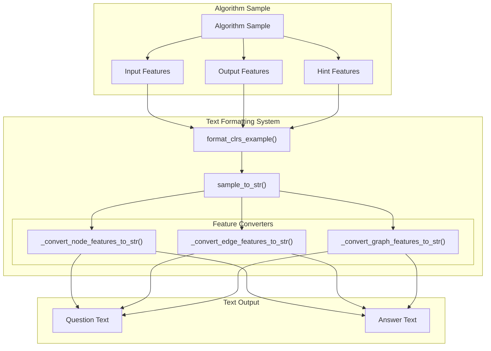
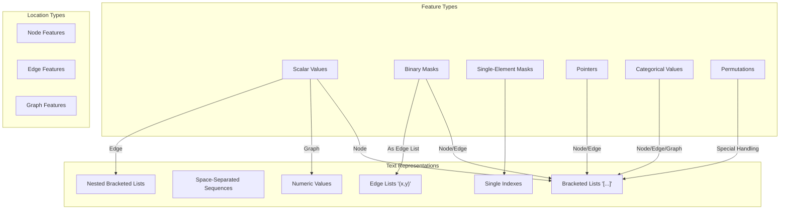
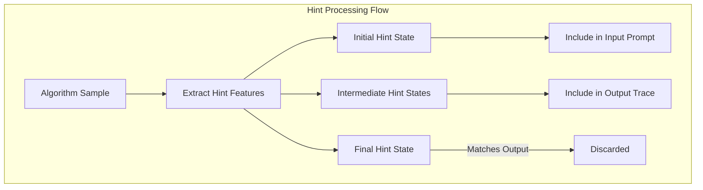
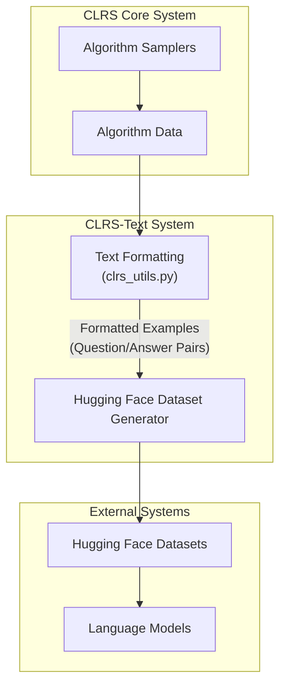

<!-- source: DeepWiki mcp.deepwiki.com · repo google-deepmind/clrs · page 7.2 Text Formatting · fetched 2026-10-26 -->

# Text Formatting

<details>
<summary>Relevant source files</summary>

The following files were used as context for generating this wiki page:

- [clrs/_src/clrs_text/clrs_utils.py](clrs/_src/clrs_text/clrs_utils.py)
- [clrs/_src/clrs_text/clrs_utils_test.py](clrs/_src/clrs_text/clrs_utils_test.py)

</details>


## Purpose and Scope

This document details the text formatting system within the CLRS-Text module. This system is responsible for converting algorithm samples from their internal numerical representation to human-readable text formats suitable for use with language models. The primary purpose is to transform algorithm inputs, outputs, and execution traces into well-formatted text strings that can serve as prompts and answers for language model training and evaluation.

For information about using the generated text data with Hugging Face models, see [Hugging Face Integration](#7.1). For the complete dataset generation process using this formatting system, see [Dataset Generation](#7.3).

Sources: [clrs/_src/clrs_text/clrs_utils.py:14-16]()

## System Overview

The text formatting system provides utilities to convert numerical CLRS data samples into standardized text representations. These representations maintain the semantic meaning of the original data while making it accessible to language models.



The system transforms algorithm examples into structured text prompts that consist of a question component (containing algorithm inputs) and an answer component (containing expected outputs), with optional intermediate steps when hint tracing is enabled.

Sources: [clrs/_src/clrs_text/clrs_utils.py:79-110](), [clrs/_src/clrs_text/clrs_utils.py:158-251]()

## Formatting Examples

### Input and Output Structure

Each formatted example follows a consistent structure:

```
algorithm_name:
input1: [value1], input2: [value2], ...
output_name:
output_value
```

With hints enabled, the structure expands to include execution traces:

```
algorithm_name:
input1: [value1], input2: [value2], ..., initial_trace: [initial_state]
trace | output_name:
[intermediate_state1] | [intermediate_state2] | ... | [final_state]
```

Sources: [clrs/_src/clrs_text/clrs_utils.py:107-108](), [clrs/_src/clrs_text/clrs_utils.py:231-251]()

### Feature Representation Types

The formatting system handles different types of data representations depending on the algorithm features:



Sources: [clrs/_src/clrs_text/clrs_utils.py:406-573]()

## Text Formatting Details

### Node Feature Formatting

Node features are formatted based on their type specification:

- **Permutations**: Represented as the original "key" input values rearranged according to the permutation
- **Masks with Single Element**: Represented as the index of the non-zero element
- **Scalars**: Represented as bracketed space-separated values
- **Masks/Pointers/Categorical**: Represented as bracketed space-separated integers

Example:
```
Scalar array [0.549, 0.715, 0.603] → "[0.549 0.715 0.603]"
Permutation → Input values rearranged in permutation order
```

Sources: [clrs/_src/clrs_text/clrs_utils.py:469-507]()

### Edge Feature Formatting

Edge features are formatted in different ways depending on the feature type:

- **Masks/Pointers/Categorical**: Represented as nested bracketed lists
- **Scalars**: Represented as nested bracketed lists of values
- **Binary Masks as Edge List**: Represented as a list of tuples for non-zero entries

Example:
```
Adjacency matrix → "[[0 1 0], [1 0 1], [0 1 0]]"
Edge list representation → "(0,1), (1,0), (1,2), (2,1)"
```

Sources: [clrs/_src/clrs_text/clrs_utils.py:536-573]()

### Graph Feature Formatting

Graph-level features are formatted based on their type:

- **Scalars**: Represented as the raw value
- **Categorical**: Represented as the index of the maximum value
- **Other Types**: Represented as their integer value

Example:
```
Graph scalar value 0.5 → "0.5"
Categorical [0.1, 0.8, 0.1] → "1"
```

Sources: [clrs/_src/clrs_text/clrs_utils.py:510-533]()

## Algorithm Trace Formatting

The system can include intermediate algorithm execution traces through the hint system. These traces provide step-by-step outputs of the algorithm's execution.

### Hint Structure



Hints are formatted differently based on the algorithm type:

1. **String Matching Algorithms**: Use special formatting for string matching tasks like 'naive_string_matcher'
2. **Search Algorithms**: Use special formatting for search algorithms like 'binary_search'
3. **Algorithms with Parentheses Traces**: Use parentheses format for certain algorithms

Sources: [clrs/_src/clrs_text/clrs_utils.py:307-403]()

## Special Cases and Algorithm-Specific Formatting

The system handles several special cases for different algorithm types:

### Algorithm Categories with Special Handling

| Algorithm Category | Example Algorithms | Special Handling |
|-------------------|-------------------|------------------|
| String Matching | naive_string_matcher, kmp_matcher | Replace output with 's' |
| Search Algorithms | binary_search, find_maximum_subarray_kadane, quickselect | Custom output field names |
| Parentheses Traces | binary_search, find_maximum_subarray_kadane | Format with parentheses instead of brackets |
| Sorting Algorithms | bubble_sort, heapsort, insertion_sort, quicksort | Special permutation handling |

Sources: [clrs/_src/clrs_text/clrs_utils.py:22-73](), [clrs/_src/clrs_text/clrs_utils.py:113-128]()

### Example Outputs

Here are example formatted outputs for different algorithm types:

1. **Insertion Sort**:
   - Without hints: `insertion_sort: key: [0.549 0.715 0.603 0.545 0.424] pred: [0.424 0.545 0.549 0.603 0.715]`
   - With hints: `insertion_sort: key: [0.549 0.715 0.603], initial_trace: [0.549 0.715 0.603] trace | pred: [0.549 0.715 0.603] | [0.549 0.603 0.715]`

2. **Binary Search**:
   - Without hints: `binary_search: key: [0.424 0.545 0.549 0.603 0.715], target: 0.646 return: 4`
   - With hints: `binary_search: key: [0.549 0.603 0.715], target: 0.545, initial_trace: (0, 2) trace | (low, high): (0, 1) | (0, 0)`

Sources: [clrs/_src/clrs_text/clrs_utils.py:163-195]()

## Implementation Details

### Constants and Separators

The system uses consistent separators and markers throughout the formatting process:

| Constant | Value | Purpose |
|----------|-------|---------|
| DEFAULT_SEPARATOR | `, ` | Separates most elements |
| INPUT_TRACE_MARKER | `initial_trace:` | Marks the beginning of a trace in input |
| TRACE_ANSWER_SEPARATOR | ` \| ` | Separates trace steps in output |
| OUTPUT_TRACE_MARKER | `trace` | Marks trace output |
| PERMUTATION_SEPARATOR | `->` | Used in permutation formatting |
| SEQUENCE_SEPARATOR | ` ` | Separates elements in sequences |

Sources: [clrs/_src/clrs_text/clrs_utils.py:69-74]()

### Helper Functions

Several helper functions facilitate the text formatting process:

- `predecessors_to_order`: Converts a list of predecessors to an ordered list of node indices
- `_bracket`: Adds brackets around a string
- `_is_binary`: Checks if a numpy array contains only binary values
- `_get_feature_by_name`: Retrieves a feature by name from a collection
- `_do_not_include_input_in_text`: Determines if an input should be omitted from text

Sources: [clrs/_src/clrs_text/clrs_utils.py:456-603]()

## Integration with CLRS-Text

The text formatting system serves as a critical component in the broader CLRS-Text module, enabling the transformation of algorithm data into a format suitable for language models.



The formatted text serves as the foundation for creating datasets that can be used to train and evaluate language models on algorithmic reasoning tasks.

Sources: [clrs/_src/clrs_text/clrs_utils.py:15-16](), [clrs/_src/clrs_text/clrs_utils.py:79-110]()

---

