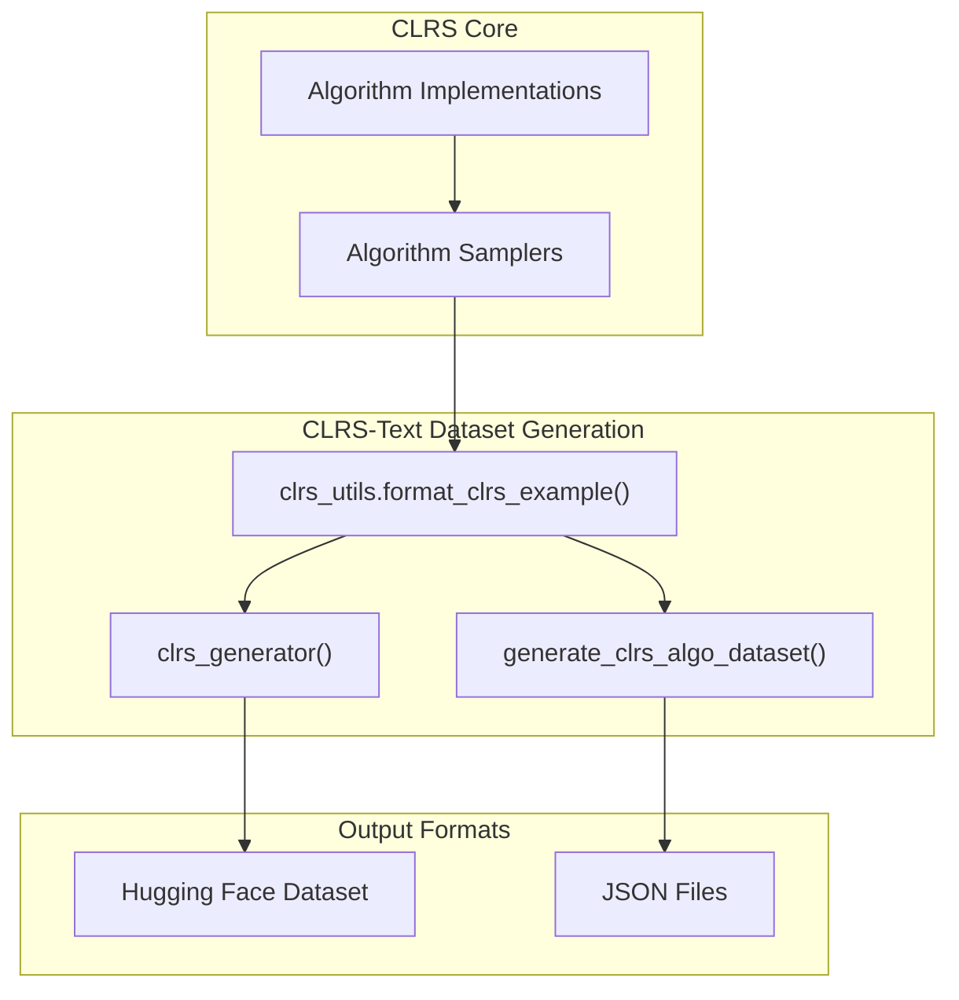
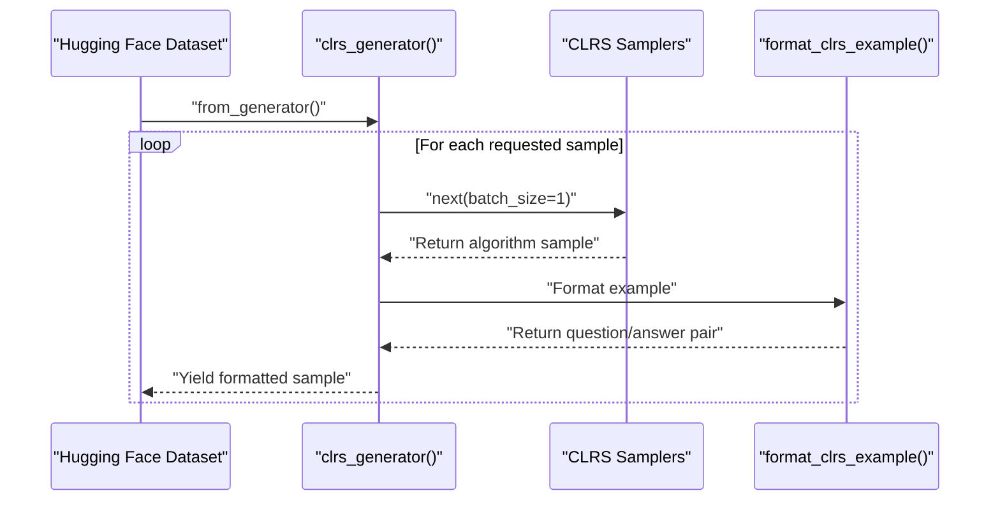
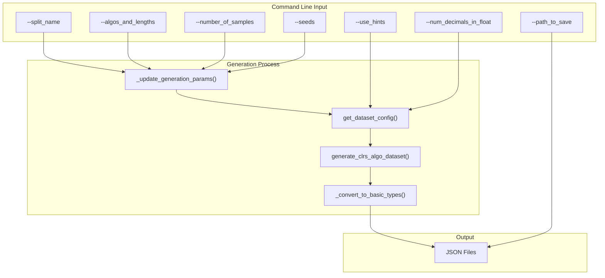
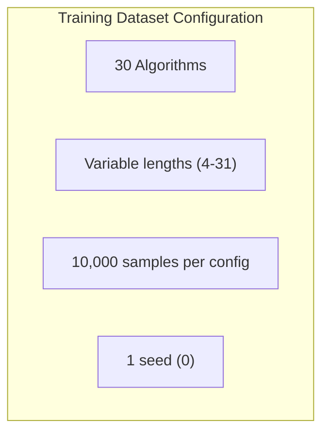
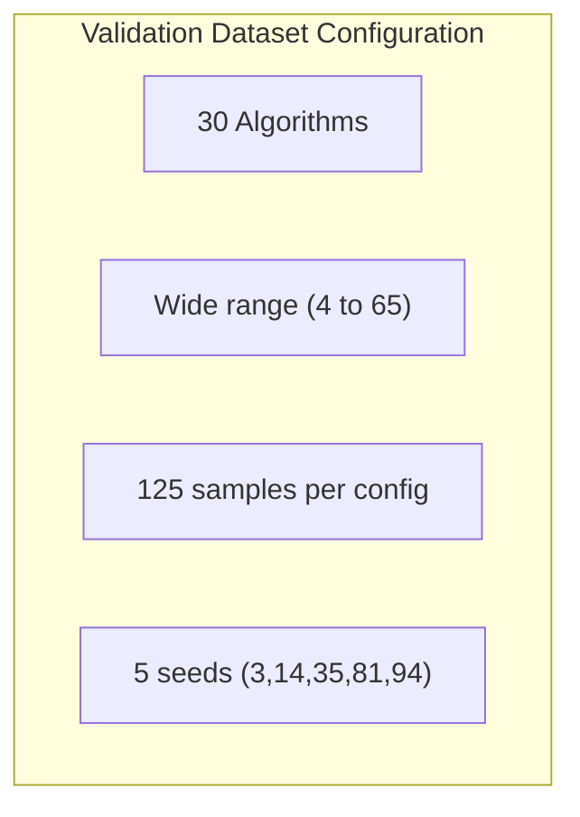
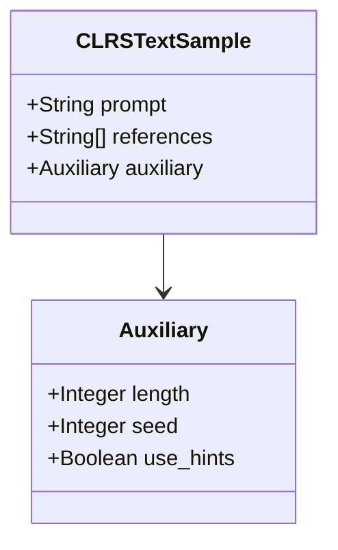
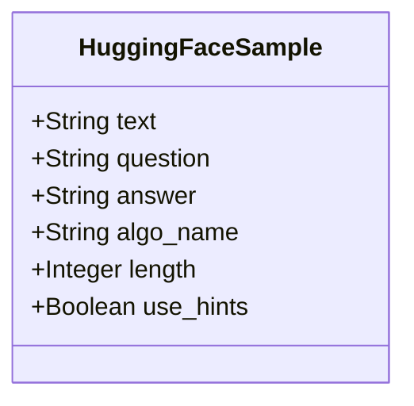
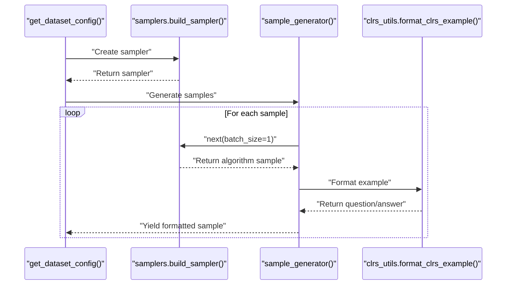

<!-- source: DeepWiki mcp.deepwiki.com · repo google-deepmind/clrs · page 7.3 Dataset Generation · fetched 2026-10-26 -->

# Dataset Generation

<details>
<summary>Relevant source files</summary>

The following files were used as context for generating this wiki page:

- [clrs/_src/clrs_text/generate_clrs_text.py](clrs/_src/clrs_text/generate_clrs_text.py)
- [clrs/_src/clrs_text/huggingface_generators.py](clrs/_src/clrs_text/huggingface_generators.py)

</details>


This document outlines the dataset generation process for CLRS-Text, which is a textual version of the CLRS algorithmic reasoning benchmark designed for language models. For information about the core CLRS dataset system, see [Dataset System](#5).

The CLRS-Text dataset generation system provides tools for creating text-based algorithmic reasoning datasets that can be used to train and evaluate language models. It offers both programmatic generation through Hugging Face integration and command-line generation for creating standalone datasets.

## Dataset Generation Architecture

The CLRS-Text dataset generation system builds upon the core CLRS algorithm samplers to produce text-based versions of algorithmic reasoning problems. The system converts the graph-based algorithm representations into natural language descriptions with corresponding answers.



Sources: [clrs/_src/clrs_text/huggingface_generators.py:24-129](), [clrs/_src/clrs_text/generate_clrs_text.py:235-311]()

The architecture follows a modular design where:
1. Core CLRS algorithm samplers generate algorithm input/output examples
2. Formatting utilities convert these examples to text format
3. Generator functions create datasets in different formats (Hugging Face datasets or JSON files)

## Hugging Face Integration

The CLRS-Text system provides seamless integration with the Hugging Face ecosystem through the `clrs_generator` function, which can be used to create both finite and infinite datasets.



Sources: [clrs/_src/clrs_text/huggingface_generators.py:24-129]()

### Usage Examples

For a finite dataset with Hugging Face's `Dataset` class:

```python
algos_and_lengths = {"insertion_sort": [16]}
ds = datasets.Dataset.from_generator(
    clrs_generator, 
    gen_kwargs={
        "algos_and_lengths": algos_and_lengths,
        "num_samples": 100
    }
)
```

For an infinite dataset with Hugging Face's `IterableDataset` class:

```python
algos_and_lengths = {"insertion_sort": [16]}
ds = IterableDataset.from_generator(
    clrs_generator,
    features=Features({
        "text": Value(dtype="string", id=None),
        "question": Value(dtype="string", id=None),
        "answer": Value(dtype="string", id=None),
        "algo_name": Value(dtype="string", id=None),
        "length": Value(dtype="int32", id=None),
        "use_hints": Value(dtype="bool_", id=None),
    }),
    gen_kwargs={"algos_and_lengths": algos_and_lengths},
)
```

Sources: [clrs/_src/clrs_text/huggingface_generators.py:30-60]()

## Manual Dataset Generation

For creating standalone datasets, the system provides a command-line script `generate_clrs_text.py` that generates JSON files containing CLRS-Text examples.



Sources: [clrs/_src/clrs_text/generate_clrs_text.py:394-452]()

### Usage Examples

To generate a training dataset:
```
python generate_clrs_text.py --split_name train
```

To generate an evaluation dataset:
```
python generate_clrs_text.py --split_name val
```

Sources: [clrs/_src/clrs_text/generate_clrs_text.py:15-32]()

## Default Dataset Configurations

The script provides default configurations for both training and validation datasets:

### Default Training Dataset



Sources: [clrs/_src/clrs_text/generate_clrs_text.py:53-86](), [clrs/_src/clrs_text/generate_clrs_text.py:337-346]()

### Default Validation Dataset



Sources: [clrs/_src/clrs_text/generate_clrs_text.py:88-121](), [clrs/_src/clrs_text/generate_clrs_text.py:356-359]()

## Configuration Options

The dataset generation system offers several configuration options:

| Parameter | Description | Default |
|-----------|-------------|---------|
| `algos_and_lengths` | Dictionary of algorithms and their input lengths | Predefined sets for train/val |
| `use_hints` | Whether to include algorithm execution hints | False |
| `number_of_samples` | Number of samples to generate per configuration | 10,000 (train), 125 (val) |
| `seeds` | Random seeds to use for generation | [0] (train), [3,14,35,81,94] (val) |
| `num_decimals_in_float` | Number of decimal places to display in float values | 3 |
| `path_to_save` | Directory to save the generated dataset | './tmp/clrs_text' |
| `split_name` | Dataset split (train/val) | 'train' |

Sources: [clrs/_src/clrs_text/huggingface_generators.py:67-76](), [clrs/_src/clrs_text/generate_clrs_text.py:123-154]()

## Dataset Format

The generated datasets follow a standardized format:



For Hugging Face datasets, the output format is slightly different:



Sources: [clrs/_src/clrs_text/huggingface_generators.py:78-85](), [clrs/_src/clrs_text/generate_clrs_text.py:157-165]()

### Example Dataset Structure

When generated as JSON files, the datasets follow this structure:

```
{
  "name": "clrs_text_insertion_sort",
  "examples": [
    {
      "prompt": "...",
      "references": ["..."],
      "auxiliary": {
        "length": 16,
        "seed": 0,
        "use_hints": false
      }
    },
    ...
  ]
}
```

The output directory structure when using the command-line script looks like:

```
./tmp/clrs_text/
  ├── train/
  │   ├── insertion_sort.json
  │   ├── binary_search.json
  │   └── ...
  └── val/
      ├── insertion_sort.json
      ├── binary_search.json
      └── ...
```

Sources: [clrs/_src/clrs_text/generate_clrs_text.py:439-447]()

## Implementation Details

### Sampler Integration

The dataset generation system integrates with the core CLRS samplers to generate algorithm examples:



Sources: [clrs/_src/clrs_text/generate_clrs_text.py:236-272](), [clrs/_src/clrs_text/generate_clrs_text.py:286-294]()

### Format Conversion

The system converts TensorFlow tensors to basic Python types for JSON serialization:

```python
def _convert_to_basic_types(
    sample: dict[str, Any],
    converters: dict[str, Callable[[Any], Any]],
) -> dict[str, Any]:
    # ...
```

Sources: [clrs/_src/clrs_text/generate_clrs_text.py:178-199]()

## Related Systems

- The dataset generation system relies on the core CLRS [Algorithm Samplers](#4) for generating algorithm examples
- The generated datasets can be used with language models through the [Hugging Face Integration](#7.1) system
- The text formatting is handled by utilities described in [Text Formatting](#7.2)

---

