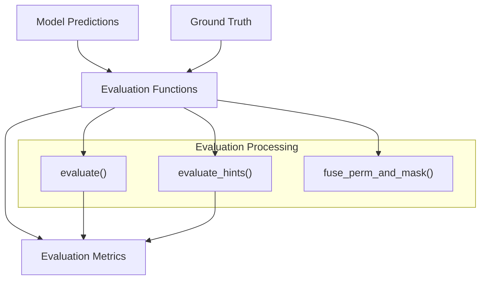
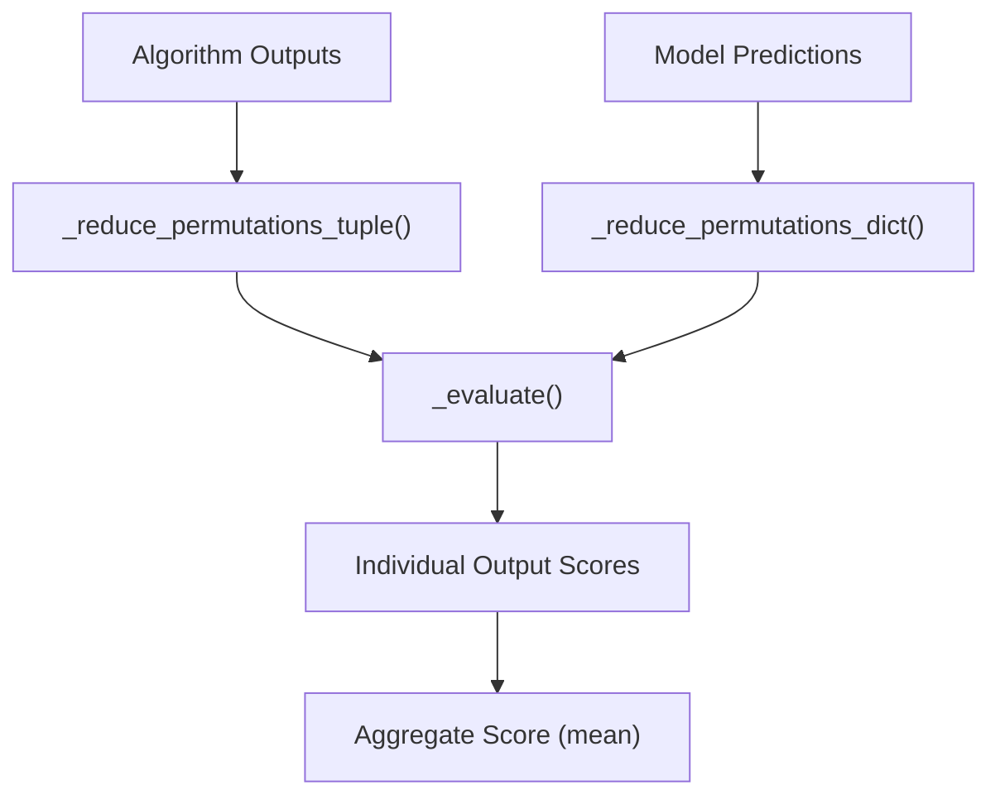
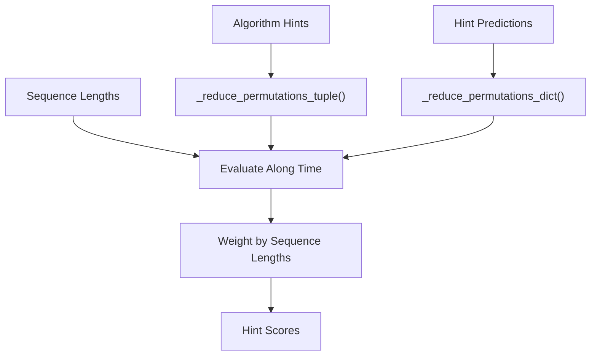
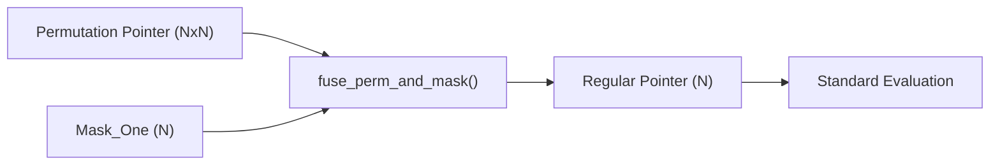
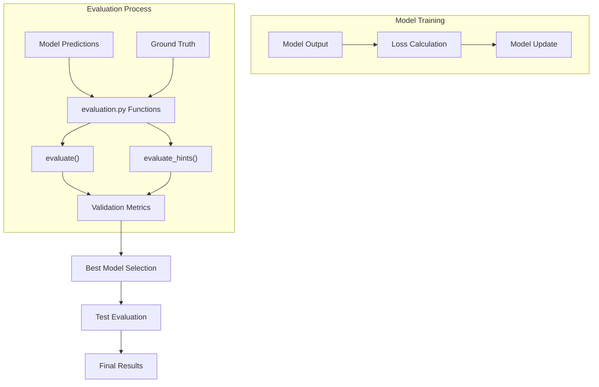
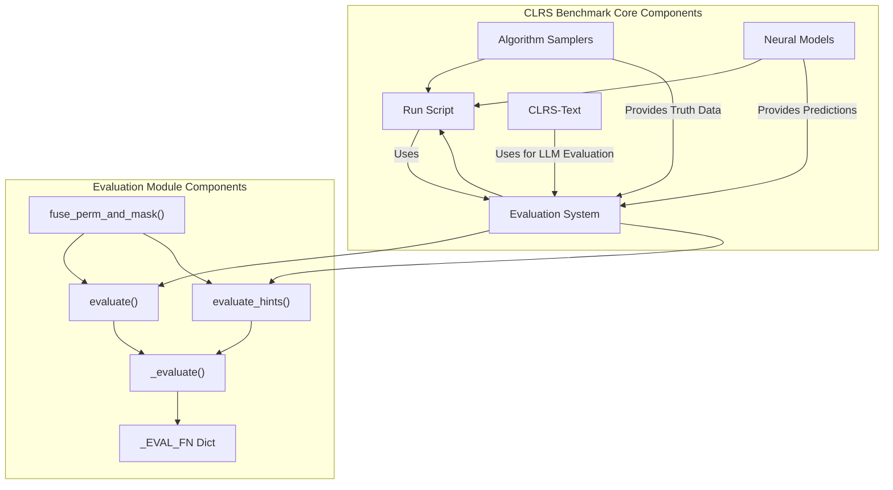

<!-- source: DeepWiki mcp.deepwiki.com · repo google-deepmind/clrs · page 8 Evaluation · fetched 2026-10-26 -->

# Evaluation

Relevant source files

The following files were used as context for generating this wiki page:

- [clrs/_src/clrs_text/colabs/accuracy_data.csv](clrs/_src/clrs_text/colabs/accuracy_data.csv)
- [clrs/_src/clrs_text/colabs/accuracy_graphs.ipynb](clrs/_src/clrs_text/colabs/accuracy_graphs.ipynb)
- [clrs/_src/decoders_test.py](clrs/_src/decoders_test.py)
- [clrs/_src/evaluation.py](clrs/_src/evaluation.py)
- [clrs/_src/evaluation_test.py](clrs/_src/evaluation_test.py)
- [clrs/_src/losses_test.py](clrs/_src/losses_test.py)

The Evaluation system in the CLRS benchmark measures the accuracy of model predictions against ground truth values. It provides metrics that quantify how well neural models learn algorithmic reasoning tasks across different data types and structures. This page documents the evaluation components, metrics, and workflow.

For information about loss calculation used during training, see [Loss Functions](#2.2).

## Overview of the Evaluation System

The evaluation system assesses model predictions for both outputs (final results of algorithms) and hints (intermediate states during algorithm execution). It supports multiple data types and provides specialized handling for data structures like permutations and masks.

Sources: 
- [clrs/_src/evaluation.py:125-139]()
- [clrs/_src/evaluation.py:100-122]()
- [clrs/_src/evaluation.py:29-56]()

## Evaluation Components

### Data Type Handling

The evaluation system handles various data types defined in the CLRS specs, each with its own evaluation metric:

| Data Type | Description | Evaluation Metric | Implementation |
| --- | --- | --- | --- |
| SCALAR | Continuous numerical values | Mean Squared Error | `lambda pred, truth: np.mean((pred - truth)**2)` |
| MASK | Binary masks | F1 Score | `_mask_fn` function |
| MASK_ONE | One-hot masks | Accuracy | `_eval_one` function |
| CATEGORICAL | Categorical data | Accuracy | `_eval_one` function |
| POINTER | Index pointers | Accuracy | `lambda pred, truth: np.mean((pred == truth) * 1.0)` |

Sources:
- [clrs/_src/evaluation.py:192-202]()
- [clrs/_src/evaluation.py:160-190]()

### Output Evaluation

Output evaluation assesses the final predictions of a model against the expected outputs of an algorithm. The `evaluate` function processes all outputs and computes a single scalar score representing the overall performance:

The output evaluation returns a dictionary with individual scores for each output and an aggregate 'score' key that represents the mean of all output scores.

Sources:
- [clrs/_src/evaluation.py:125-139]()
- [clrs/_src/evaluation.py:142-157]()

### Hint Evaluation

Hint evaluation assesses predictions for intermediate states during algorithm execution. The `evaluate_hints` function evaluates predictions at each timestep and computes metrics that account for the variable length of algorithm executions:

The hint evaluation returns a dictionary with scores for each hint and additional '_along_time' metrics showing performance across timesteps.

Sources:
- [clrs/_src/evaluation.py:100-122]()
- [clrs/_src/evaluation.py:142-157]()

## Permutation Handling

The evaluation system provides specialized handling for permutations, which are represented as a combination of permutation pointers and masks. The `fuse_perm_and_mask` function combines these elements to create evaluable pointer structures:

This process allows for proper evaluation of algorithms that produce permutations as outputs. The permutation pointer identifies potential mappings, while the mask indicates which positions should use self-pointers.

Sources:
- [clrs/_src/evaluation.py:29-56]()
- [clrs/_src/evaluation.py:59-97]()
- [clrs/_src/evaluation_test.py:30-51]()

## Integration with Training and Evaluation Workflow

The evaluation metrics are central to the CLRS benchmark training and testing workflow:

During training, the evaluation system provides validation metrics that guide model selection. The best performing model (based on these metrics) is then used for final test evaluation to produce the benchmark results.

Sources:
- [The diagram showing Training Pipeline from the provided context]

## Handling Edge Cases

The evaluation system includes special handling for edge cases:

1. **Masked values**: The evaluation functions account for masked values in the data, ensuring evaluation only occurs on relevant output parts.

2. **Variable-length sequences**: For hint evaluation, the system handles variable-length sequences by appropriately weighting scores based on sequence lengths.

3. **Class imbalance**: For MASK type outputs, the system uses F1 score to address potential class imbalance, providing a balanced assessment of binary classification performance.

Sources:
- [clrs/_src/evaluation.py:160-190]()
- [clrs/_src/evaluation.py:100-122]()

## Evaluating CLRS-Text

The CLRS-Text variant also utilizes evaluation metrics to assess language model performance on algorithmic reasoning tasks. The evaluation.py functions are used to calculate accuracy scores for different algorithms, as seen in the accuracy_data.csv file. These metrics allow for comparing traditional neural network approaches with language model approaches to algorithmic reasoning.

Sources:
- [clrs/_src/clrs_text/colabs/accuracy_data.csv]()
- [clrs/_src/clrs_text/colabs/accuracy_graphs.ipynb]()

## Relationship with Other System Components

The evaluation system interfaces with algorithm samplers (which provide ground truth data), neural models (which provide predictions), and the Run script (which orchestrates training and evaluation). The evaluation results help determine model performance and guide model selection.

Sources:
- [The diagram showing Core System Architecture from the provided context]
- [clrs/_src/evaluation.py]()

## Using the Evaluation System

The evaluation system is typically used in conjunction with the Runner script, which orchestrates the training and evaluation process. The Runner uses the evaluation functions to:

1. Compute validation metrics during training
2. Select the best model based on these metrics
3. Produce final test evaluation metrics for the selected model

For a complete understanding of how to run experiments with evaluation, see [Running Experiments](#3).

Sources:
- [The diagram showing Training Pipeline from the provided context]

---

