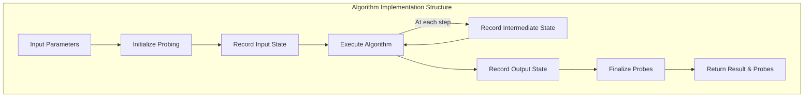
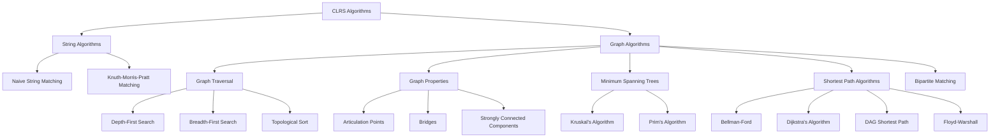
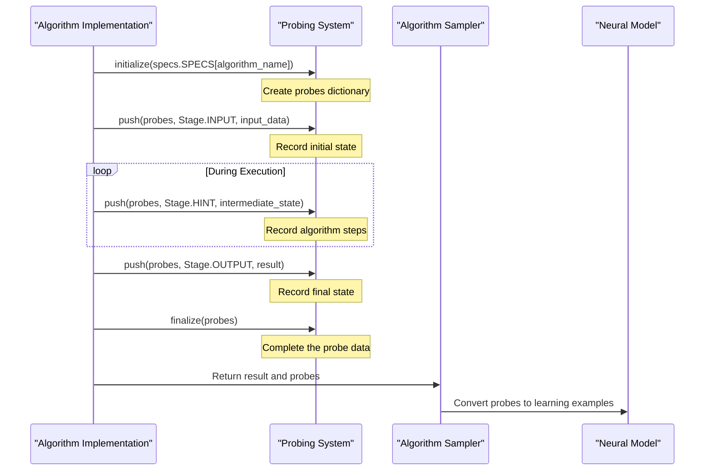
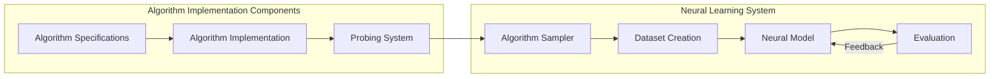

<!-- source: DeepWiki mcp.deepwiki.com · repo google-deepmind/clrs · page 9 Algorithm Implementations · fetched 2026-10-26 -->

# Algorithm Implementations

Relevant source files

The following files were used as context for generating this wiki page:

- [clrs/_src/algorithms/graphs.py](clrs/_src/algorithms/graphs.py)
- [clrs/_src/algorithms/strings.py](clrs/_src/algorithms/strings.py)
- [clrs/_src/algorithms/strings_test.py](clrs/_src/algorithms/strings_test.py)
- [clrs/_src/model.py](clrs/_src/model.py)

## Purpose and Scope

This document details the algorithm implementations provided in the CLRS benchmark repository. These implementations serve as the foundation for generating algorithmic reasoning datasets and provide the ground truth behaviors that neural models aim to learn. These are reference implementations of classic algorithms from the "Introduction to Algorithms" textbook (CLRS), instrumented with a probing system that captures execution traces.

For information about how these algorithms are sampled to generate datasets, see [Algorithm Samplers](#4).

Sources: [clrs/_src/algorithms/strings.py:16-23](), [clrs/_src/algorithms/graphs.py:16-35]()

## Implementation Structure

All algorithm implementations in the CLRS benchmark follow a consistent pattern that enables integration with the probing system. This structure allows the benchmark to generate detailed execution traces for training neural models.

Sources: [clrs/_src/algorithms/strings.py:42-111](), [clrs/_src/algorithms/graphs.py:52-174]()

### Common Components

Each algorithm implementation consists of:

1. **Function signature** - Defines the input parameters for the algorithm
2. **Type checking** - Validates input shapes and types
3. **Probes initialization** - Sets up the data structure to record execution traces
4. **Algorithm logic** - The actual implementation of the algorithm
5. **Probe recording** - Captures the state at various execution points
6. **Result and probes return** - Returns both the algorithm output and execution traces

The implemented algorithms are intended to serve as reference implementations that neural models can learn from, rather than being optimized for computational efficiency.

Sources: [clrs/_src/algorithms/strings.py:42-111](), [clrs/_src/algorithms/graphs.py:52-174]()

## Algorithm Categories

The CLRS benchmark implements multiple categories of classic algorithms:

Sources: [clrs/_src/algorithms/strings.py:16-23](), [clrs/_src/algorithms/graphs.py:16-35]()

## String Algorithms

The repository includes two string matching algorithms that aim to find occurrences of a pattern string within a text string.

### Naive String Matching

This algorithm compares the pattern with each possible substring of the text in a straightforward manner.

- **Function**: `naive_string_matcher`
- **Inputs**: Text array `T`, Pattern array `P`
- **Output**: Matching position or length of T if no match found
- **Time Complexity**: O((n-m+1)m), where n is the length of the text and m is the length of the pattern

Sources: [clrs/_src/algorithms/strings.py:42-111](), [clrs/_src/algorithms/strings_test.py:31-46]()

### Knuth-Morris-Pratt Algorithm

This algorithm improves upon naive string matching by avoiding redundant comparisons through a preprocessing step that computes a partial match table.

- **Function**: `kmp_matcher`
- **Inputs**: Text array `T`, Pattern array `P`
- **Output**: Matching position or length of T if no match found
- **Time Complexity**: O(n+m)

Sources: [clrs/_src/algorithms/strings.py:114-281](), [clrs/_src/algorithms/strings_test.py:31-46]()

## Graph Algorithms

The repository includes a comprehensive set of graph algorithms organized into several categories.

### Graph Representation

In all graph algorithm implementations, graphs are represented as adjacency matrices, where:
- `A[i, j]` represents the edge from vertex i to vertex j
- Non-zero values indicate edge presence (and possibly weight)
- Zero values indicate absence of an edge

### Graph Traversal Algorithms

#### Depth-First Search (DFS)

- **Function**: `dfs`
- **Inputs**: Adjacency matrix `A`
- **Output**: Parent array `pi`
- **Key Features**: Records discovery and finish times for each vertex

Sources: [clrs/_src/algorithms/graphs.py:52-174]()

#### Breadth-First Search (BFS)

- **Function**: `bfs`
- **Inputs**: Adjacency matrix `A`, Starting vertex `s`
- **Output**: Parent array `pi`
- **Key Features**: Visits vertices in increasing order of distance from the source

Sources: [clrs/_src/algorithms/graphs.py:177-219]()

#### Topological Sort

- **Function**: `topological_sort`
- **Inputs**: Adjacency matrix `A` (for directed acyclic graph)
- **Output**: Topological order array `topo`
- **Key Features**: Orders vertices such that for every edge (u,v), u comes before v in the ordering

Sources: [clrs/_src/algorithms/graphs.py:222-339]()

### Graph Properties Algorithms

#### Articulation Points

- **Function**: `articulation_points`
- **Inputs**: Adjacency matrix `A`
- **Output**: Boolean array indicating which vertices are articulation points
- **Key Features**: Identifies vertices whose removal increases the number of connected components

Sources: [clrs/_src/algorithms/graphs.py:342-515]()

#### Bridges

- **Function**: `bridges`
- **Inputs**: Adjacency matrix `A`
- **Output**: Boolean matrix indicating which edges are bridges
- **Key Features**: Identifies edges whose removal increases the number of connected components

Sources: [clrs/_src/algorithms/graphs.py:518-685]()

#### Strongly Connected Components (Kosaraju's Algorithm)

- **Function**: `strongly_connected_components`
- **Inputs**: Adjacency matrix `A`
- **Output**: Component ID array `scc_id`
- **Key Features**: Groups vertices such that there is a path between every pair of vertices in the same component

Sources: [clrs/_src/algorithms/graphs.py:688-927]()

### Minimum Spanning Tree Algorithms

#### Kruskal's Algorithm

- **Function**: `mst_kruskal`
- **Inputs**: Weighted adjacency matrix `A`
- **Output**: Boolean matrix indicating edges in the MST
- **Key Features**: Greedy algorithm that builds MST by adding edges in order of increasing weight

Sources: [clrs/_src/algorithms/graphs.py:930-1078]()

#### Prim's Algorithm

- **Function**: `mst_prim`
- **Inputs**: Weighted adjacency matrix `A`, Starting vertex `s`
- **Output**: Parent array `pi`
- **Key Features**: Grows MST from a starting vertex by adding closest vertex at each step

Sources: [clrs/_src/algorithms/graphs.py:1081-1144]()

### Shortest Path Algorithms

#### Bellman-Ford Algorithm

- **Function**: `bellman_ford`
- **Inputs**: Weighted adjacency matrix `A`, Source vertex `s`
- **Output**: Parent array `pi`
- **Key Features**: Can handle negative edge weights, detects negative cycles

Sources: [clrs/_src/algorithms/graphs.py:1147-1194]()

#### Dijkstra's Algorithm

- **Function**: `dijkstra`
- **Inputs**: Weighted adjacency matrix `A`, Source vertex `s`
- **Output**: Parent array `pi`
- **Key Features**: More efficient than Bellman-Ford but requires non-negative edge weights

Sources: [clrs/_src/algorithms/graphs.py:1197-1260]()

#### DAG Shortest Path

- **Function**: `dag_shortest_paths`
- **Inputs**: Weighted adjacency matrix `A` (for directed acyclic graph), Source vertex `s`
- **Output**: Parent array `pi`
- **Key Features**: Uses topological sorting to compute shortest paths in linear time

Sources: [clrs/_src/algorithms/graphs.py:1263-1445]()

#### Floyd-Warshall Algorithm

- **Function**: `floyd_warshall`
- **Inputs**: Weighted adjacency matrix `A`
- **Output**: Predecessor matrix `Pi`
- **Key Features**: Computes shortest paths between all pairs of vertices

Sources: [clrs/_src/algorithms/graphs.py:1448-1500]()

### Specialized Graph Algorithms

#### Bipartite Matching (Edmonds-Karp)

- **Function**: `bipartite_matching`
- **Inputs**: Flow network adjacency matrix `A`, Sizes `n` and `m` of the two partitions, Source `s` and sink `t` vertices
- **Output**: Boolean matrix indicating edges in the matching
- **Key Features**: Uses flow network techniques to find maximum bipartite matching

Sources: [clrs/_src/algorithms/graphs.py:1503-1604]()

## Integration with Probing System

Each algorithm implementation is integrated with a probing system that records the algorithm's state at various execution points. This system captures three types of data:

Sources: [clrs/_src/algorithms/strings.py:46-111](), [clrs/_src/algorithms/graphs.py:56-175](), [clrs/_src/model.py:16-46]()

### Probe Types

The probing system records three types of data:

1. **Input** - The initial state of the algorithm, including all input parameters
2. **Hints** - Intermediate states during algorithm execution
3. **Output** - The final result of the algorithm

These probes are used to generate training data for neural models, enabling them to learn the algorithm's behavior by observing examples of its execution.

Sources: [clrs/_src/algorithms/strings.py:51-62](), [clrs/_src/algorithms/strings.py:83-88](), [clrs/_src/algorithms/strings.py:105-111]()

## Relationship to Neural Models

Algorithm implementations form the foundation of the CLRS benchmark's neural algorithmic reasoning approach:

The algorithm implementations provide:

1. Reference behavior for each algorithm
2. Detailed execution traces for supervised learning
3. Evaluation metrics for assessing model performance

Neural models aim to learn these algorithms' behavior by observing execution traces and predicting intermediate states and outputs.

Sources: [clrs/_src/model.py:16-46]()

## Testing

Algorithm implementations include unit tests to verify correctness. For example, string matching algorithms are tested with various pattern and text combinations to ensure they correctly identify matching positions.

Sources: [clrs/_src/algorithms/strings_test.py:16-49]()

---

