# Page: Overview

# Overview

<details>
<summary>Relevant source files</summary>

The following files were used as context for generating this wiki page:

- [README.md](README.md)
- [clrs/__init__.py](clrs/__init__.py)
- [clrs/_src/clrs_text/README.md](clrs/_src/clrs_text/README.md)
- [clrs/_src/probing.py](clrs/_src/probing.py)
- [clrs/_src/probing_test.py](clrs/_src/probing_test.py)

</details>


The CLRS Algorithmic Reasoning Benchmark is a suite designed to evaluate and advance machine learning models' ability to learn and execute classical algorithms. Named after the authors of the textbook "Introduction to Algorithms" (Cormen, Leiserson, Rivest, and Stein), this benchmark consolidates algorithmic reasoning tasks in a unified framework, focusing on representing algorithms as graph operations that neural networks can learn.

Sources: [README.md:1-9](), [clrs/__init__.py:16]()

## Key Concepts

The CLRS benchmark provides:

1. **Algorithm Implementations**: 30 classic algorithms from the CLRS textbook, implemented to generate learning examples
2. **Graph Representation**: Algorithms represented through graph operations for neural processing
3. **Trajectory Hints**: Intermediate algorithm states that help models learn execution traces
4. **Generalization Testing**: Train/eval/test splits designed to evaluate out-of-distribution performance
5. **Neural Baselines**: Baseline implementations using graph neural networks and other processor architectures

The benchmark supports both the core CLRS dataset for graph-based learning and CLRS-Text, a more recent extension for evaluating algorithmic reasoning capabilities in language models.

Sources: [README.md:43-61](), [README.md:118-162]()

## System Architecture

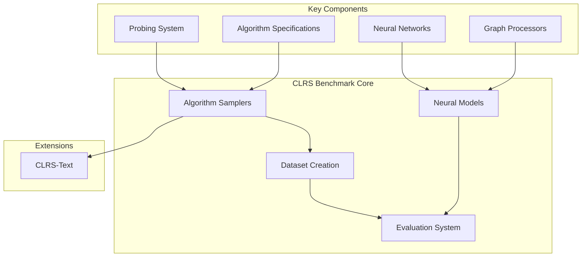

Sources: [clrs/__init__.py:18-57](), [README.md:45-61]()

## Algorithms as Graphs

CLRS implements algorithms in an idiomatic way aligned with the original CLRS pseudocode. The core insight is representing algorithms as operations on graphs, where:

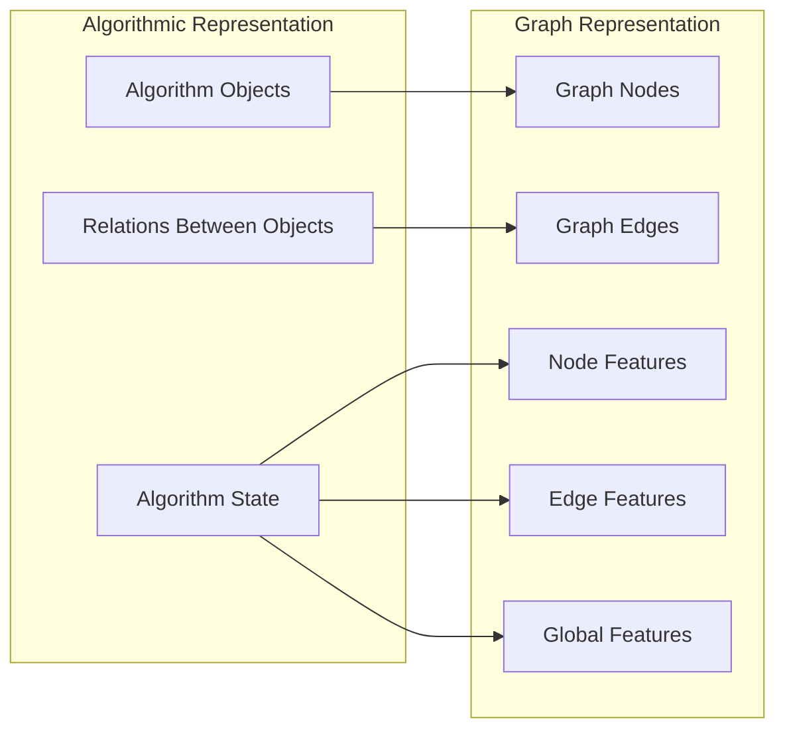

Even ordered structures like arrays or trees are represented through graph relations with additional constraints like predecessor links. The probing system captures the execution state of algorithms over time, exposing these as trajectories of "hints" that show the internal algorithm state.

Sources: [README.md:45-61](), [clrs/_src/probing.py:16-26]()

# Core Components

## 1. Algorithm Samplers

Samplers generate examples for each algorithm with appropriate inputs that conform to the algorithm's preconditions. Each algorithm has dedicated samplers creating:

- Random instances of appropriate problem structures (arrays, graphs, etc.)
- Valid inputs that meet algorithm requirements
- Complete execution traces with intermediate states

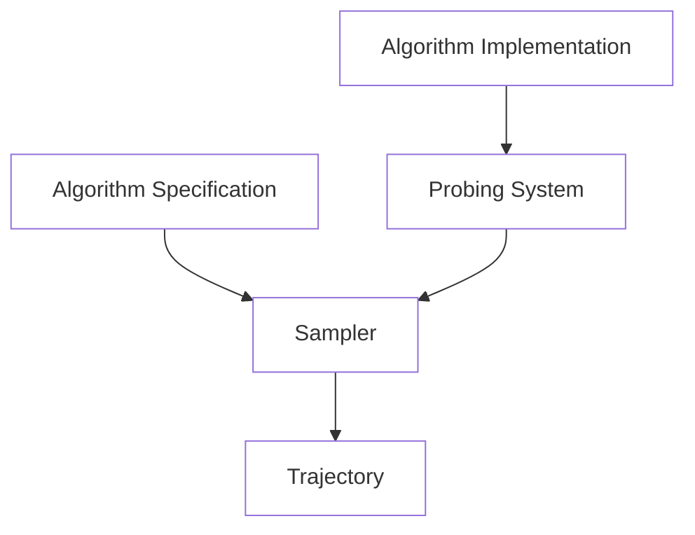

The sampler workflow:
1. Define algorithm specifications (`SPECS` in [clrs/_src/specs.py]())
2. Implement abstract algorithm with probing points ([clrs/_src/algorithms/]())
3. Create input samplers for the algorithm ([clrs/_src/samplers.py]())
4. Generate trajectories containing inputs, outputs, and hints

Sources: [README.md:208-226](), [clrs/__init__.py:43-51]()

## 2. Probing System

The probing system captures algorithm execution traces by recording data at specific points during execution:

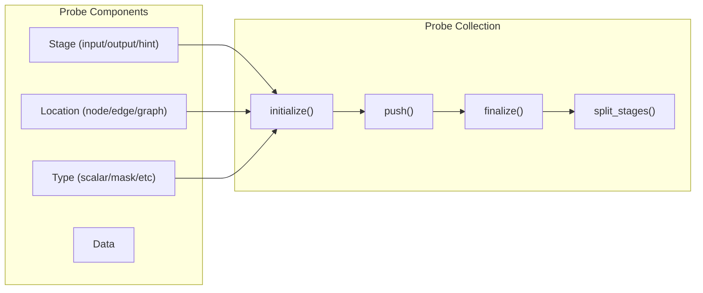

Each probe contains:
- **Stage**: Input, output, or hint
- **Location**: Node, edge, or graph level
- **Type**: Data type (scalar, vector, mask, etc.)
- **Data**: The actual values

The probing system collects these data points during algorithm execution and organizes them for the learning task.

Sources: [clrs/_src/probing.py:16-203]()

## 3. Dataset Creation

The dataset system creates standardized train/eval/test splits for benchmarking:

| Split | Trajectories | Problem Size |
|-------|--------------|--------------|
| Train | 1000         | 16           |
| Eval  | 32×          | 16           |
| Test  | 32×          | 64           |

The dataset creation process handles:
- Creating algorithm samples
- Processing them into appropriate formats
- Optional chunking for long trajectories
- Packaging as TensorFlow datasets

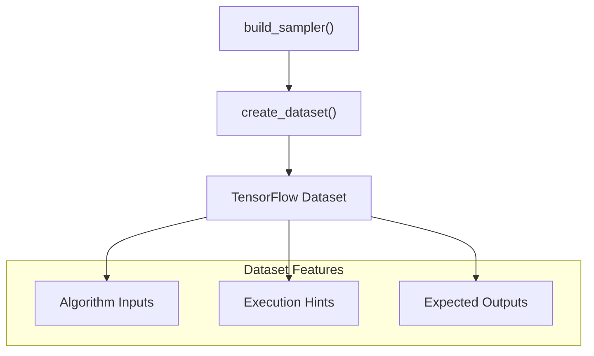

Sources: [README.md:64-83](), [clrs/__init__.py:26-31]()

## 4. Models and Processors

The CLRS benchmark includes several baseline neural network models:

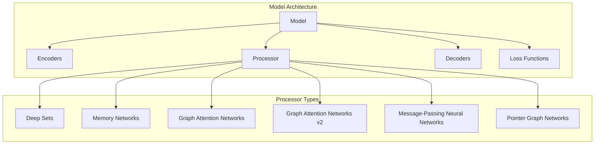

The model architecture consists of:
1. **Encoders**: Convert algorithm inputs and intermediate states to vector representations
2. **Processors**: Process graph-structured data (various GNN architectures)
3. **Decoders**: Convert processed data back to algorithm outputs
4. **Loss Functions**: Compare predicted outputs with expected outputs

Sources: [README.md:164-199](), [clrs/__init__.py:18-24]()

## 5. CLRS-Text Extension

CLRS-Text extends the benchmark for evaluating language models on algorithmic reasoning tasks:

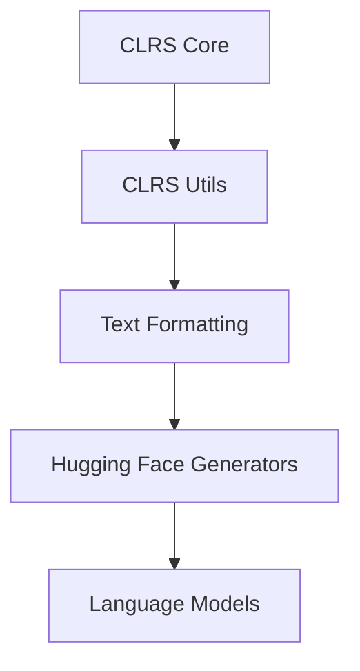

CLRS-Text provides:
- Text conversion utilities for CLRS traces
- Scripts for generating datasets in text format
- Integration with Hugging Face for language model evaluation

Sources: [README.md:227-234](), [clrs/_src/clrs_text/README.md:1-57]()

# Usage Flow

The typical workflow for using the CLRS benchmark:

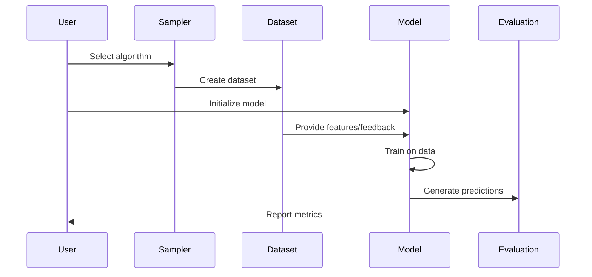

Basic usage pattern:
1. Create a dataset for a specific algorithm
2. Initialize a model
3. Train the model on the dataset
4. Evaluate the model's performance

Example code pattern:
```python
train_ds, num_samples, spec = clrs.create_dataset(
    folder='/tmp/CLRS30', algorithm='bfs',
    split='train', batch_size=32)

for i, feedback in enumerate(train_ds.as_numpy_iterator()):
  if i == 0:
    model.init(feedback.features, initial_seed)
  loss = model.feedback(rng_key, feedback)
```

Sources: [README.md:84-116]()

# Conclusion

The CLRS Algorithmic Reasoning Benchmark provides a comprehensive framework for evaluating and advancing algorithmic reasoning capabilities in machine learning models. By representing classic algorithms as graph operations and providing rich execution traces, it enables models to learn algorithmic behavior and generalize to new problem instances.

For installation and setup information, please see [Installation and Setup](#1.1).
For more detailed information about the system architecture, see [System Architecture](#1.2).

Sources: [README.md:11-42]()

---

# Page: Installation and Setup

# Installation and Setup

<details>
<summary>Relevant source files</summary>

The following files were used as context for generating this wiki page:

- [.github/workflows/pypi-publish.yml](.github/workflows/pypi-publish.yml)
- [.gitignore](.gitignore)
- [.pylintrc](.pylintrc)
- [README.md](README.md)
- [clrs/_src/clrs_text/README.md](clrs/_src/clrs_text/README.md)
- [clrs/_src/probing.py](clrs/_src/probing.py)
- [clrs/_src/probing_test.py](clrs/_src/probing_test.py)
- [requirements/requirements.txt](requirements/requirements.txt)
- [setup.py](setup.py)

</details>


This page provides detailed instructions for installing the CLRS Algorithmic Reasoning Benchmark and setting up your environment to run experiments. For information about the system architecture and core components, see [System Architecture](#1.2).

## Overview

The CLRS Algorithmic Reasoning Benchmark is a machine learning framework for algorithmic reasoning, based on algorithms from the third edition of "Introduction to Algorithms" by Cormen, Leiserson, Rivest, and Stein. This document covers:

1. Installation methods
2. Environment setup
3. Dataset configuration
4. Verification of installation
5. Troubleshooting common issues

## Installation Methods

You can install the CLRS benchmark through PyPI or directly from GitHub. The package name is `dm-clrs`.

### PyPI Installation

```bash
pip install dm-clrs
```

### GitHub Installation (for the latest version)

```bash
pip install git+https://github.com/google-deepmind/clrs.git
```

### Installing in a Virtual Environment

If you encounter dependency conflicts, installing in a virtual environment is recommended:

```bash
python3 -m venv clrs_env
source clrs_env/bin/activate
pip install git+https://github.com/google-deepmind/clrs.git
```

Sources: [README.md:13-33]()

## Installation Workflow

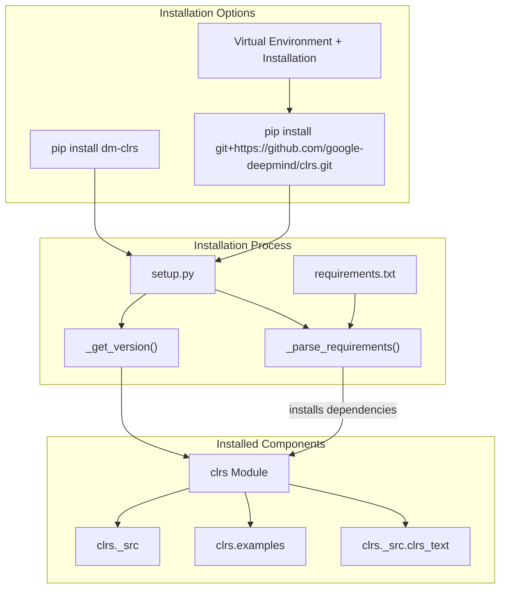

Sources: [README.md:13-33](), [setup.py:15-76]()

## System Requirements

### Dependencies

The CLRS benchmark has the following key dependencies:

| Dependency | Version | Purpose |
|------------|---------|---------|
| absl-py    | ≥2.1.0  | Google's Abseil Python Common Libraries |
| attrs      | ≥24.2.0 | Classes without boilerplate |
| chex       | ≥0.1.86 | Testing utilities for JAX |
| dm-haiku   | ≥0.0.12 | Neural network library for JAX |
| jax        | ≥0.4.31 | Numerical computing library |
| jaxlib     | ≥0.4.31 | JAX CPU/GPU/TPU implementation |
| tensorflow | ≥2.17.0 | Machine learning framework |
| numpy      | ≥1.26.4 | Numerical computing |
| optax      | ≥0.2.3  | Gradient processing and optimization |

For a full list of dependencies, refer to the requirements file.

Sources: [requirements/requirements.txt:1-14]()

## Dataset Setup

### Automatic Dataset Download

When running the example for the first time, the dataset will be automatically downloaded and stored in the specified dataset path (default: `/tmp/CLRS30`):

```bash
python3 -m clrs.examples.run
```

You can specify a custom dataset path with the `--dataset_path` flag:

```bash
python3 -m clrs.examples.run --dataset_path=/path/to/dataset
```

### Manual Dataset Download

Alternatively, you can manually download and extract the dataset:

```bash
wget https://storage.googleapis.com/dm-clrs/CLRS30_v1.0.0.tar.gz
tar -xzvf CLRS30_v1.0.0.tar.gz -C /desired/path
```

Then specify this path when running experiments.

Sources: [README.md:35-43]()

## Dataset Configuration Workflow

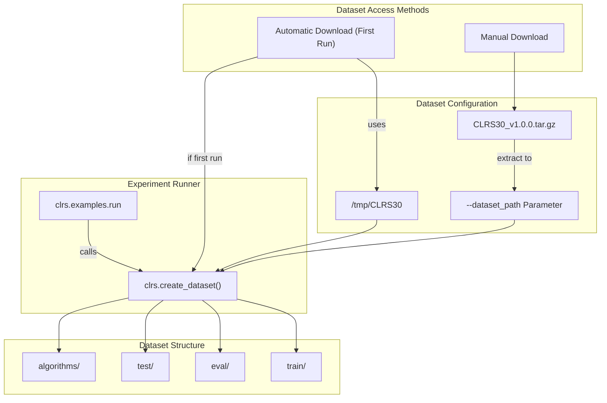

Sources: [README.md:35-43](), [README.md:83-95]()

## Verifying Installation

To verify a successful installation, run the example baseline model:

```bash
python3 -m clrs.examples.run
```

This will:
1. Download the dataset if it's not already present
2. Initialize and train a baseline model
3. Output training progress

### Example Output

```
Algorithm: bfs
Processor: mpnn
Iterations: 100
Step 1/100: Loss: 0.823, Accuracy: 0.512
...
```

Sources: [README.md:35-39]()

## Creating Custom Datasets

Instead of using the pre-generated dataset, you can create your own samples using the `build_sampler` method:

```python
import clrs

sampler, spec = clrs.build_sampler(
    name='bfs',  # algorithm name
    seed=42,     # random seed
    num_samples=1000,  # number of samples
    length=16)   # problem size

# Example of using the sampler
def iterate_sampler(batch_size):
    while True:
        yield sampler.next(batch_size)

# Generate batches of samples
for feedback in iterate_sampler(batch_size=32):
    # Process the feedback
    pass
```

Sources: [README.md:208-225]()

## Component Relationship Diagram

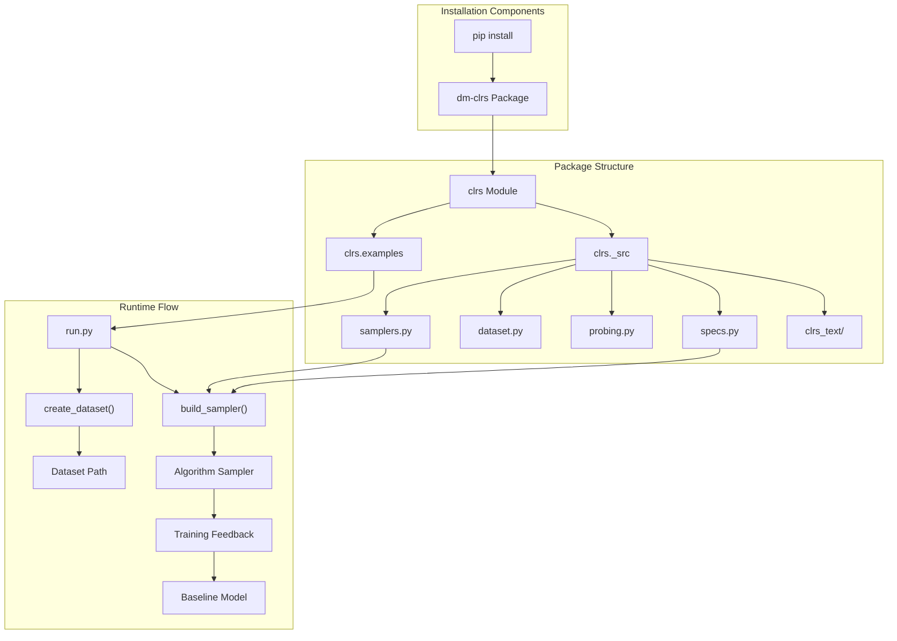

Sources: [README.md:13-39](), [README.md:83-95](), [README.md:208-225]()

## CLRS-Text Setup

If you're interested in the text-based variant of CLRS (CLRS-Text), the installation process is the same. CLRS-Text is included in the main package but has additional utilities:

- `clrs_utils.py`: Functions for converting CLRS traces to text
- `generate_clrs_text.py`: Scripts for generating CLRS-Text datasets
- `huggingface_generators.py`: Utilities for Hugging Face integration

For CLRS-Text specific examples and usage, refer to the [CLRS-Text](#7) documentation page.

Sources: [clrs/_src/clrs_text/README.md:1-57]()

## Troubleshooting

### Common Installation Issues

1. **Dependency Conflicts**:
   - Solution: Use a virtual environment as described earlier.

2. **JAX Installation Issues**:
   - JAX installation can be complex, especially with GPU support.
   - Follow the [official JAX installation guide](https://github.com/google/jax#installation) for your specific platform.

3. **Dataset Download Failures**:
   - If automatic dataset download fails, try the manual download method.
   - Ensure you have sufficient disk space (the dataset is approximately 5GB).

4. **Permission Issues**:
   - If you encounter permission errors with the default dataset path, specify a path in your user directory:
     ```bash
     python3 -m clrs.examples.run --dataset_path=~/clrs_data
     ```

Sources: [README.md:13-43]()

## Environment Compatibility

The CLRS package is compatible with:

- Python 3.6 or later
- Linux, Windows, and macOS operating systems

For optimal performance, especially when training models on larger algorithm instances, GPU acceleration is recommended.

Sources: [setup.py:62-74]()

---

# Page: System Architecture

# System Architecture

<details>
<summary>Relevant source files</summary>

The following files were used as context for generating this wiki page:

- [README.md](README.md)
- [clrs/__init__.py](clrs/__init__.py)
- [clrs/_src/clrs_text/README.md](clrs/_src/clrs_text/README.md)
- [clrs/_src/probing.py](clrs/_src/probing.py)
- [clrs/_src/probing_test.py](clrs/_src/probing_test.py)

</details>


This document provides a detailed overview of the system architecture of the CLRS Algorithmic Reasoning Benchmark. It explains how the different components of the system interact to enable the training and evaluation of neural network models on algorithmic reasoning tasks. For information about specific model implementations, see [Baseline Models](#2), and for details on running experiments, see [Running Experiments](#3).

## Overview

The CLRS benchmark is designed around the concept of representing algorithms as operations on graph structures, where models learn to predict algorithm execution through message-passing on these graphs. The system implements 30 classical algorithms from the "Introduction to Algorithms" textbook by Cormen, Leiserson, Rivest, and Stein, providing a standardized environment for evaluating algorithmic reasoning capabilities of neural networks.

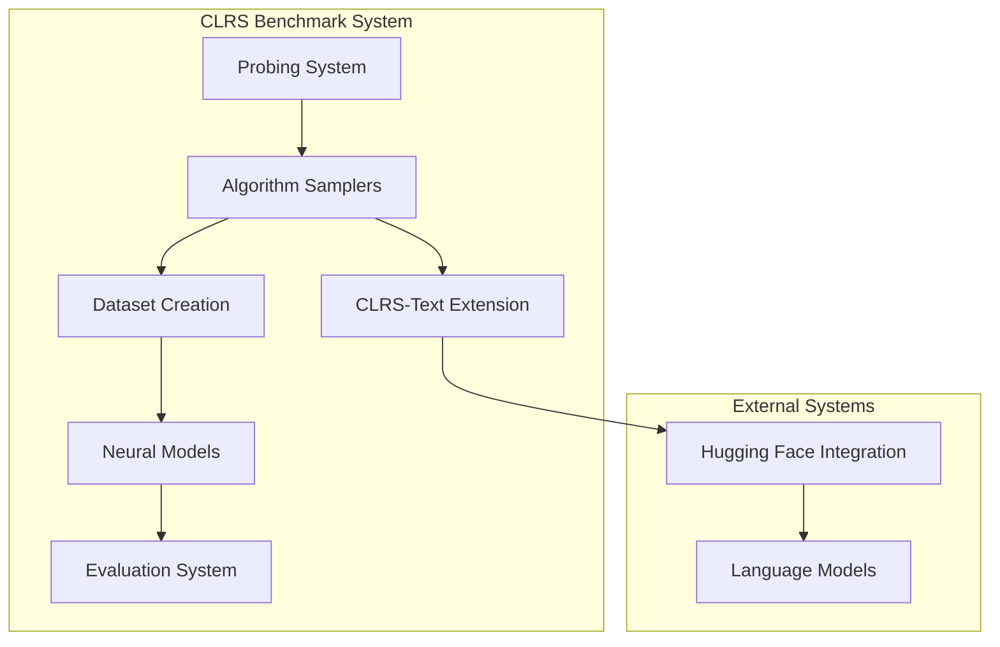

Sources: [clrs/__init__.py:16-94](), [README.md:1-162]()

## Core Components

The CLRS architecture comprises several core components that work together to create a comprehensive benchmark for algorithmic reasoning:

### 1. Algorithm Samplers

The samplers generate input/output pairs and execution traces for each algorithm. They are responsible for:
- Creating appropriate input data distributions
- Executing algorithms on these inputs
- Capturing execution traces through the probing system
- Formatting data in a graph-based representation

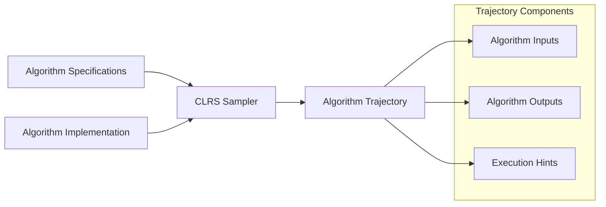

Sources: [clrs/__init__.py:42-51](), [README.md:45-61](), [README.md:85-102]()

### 2. Probing System

The probing system captures the internal state of algorithms during execution, providing "hints" that expose the algorithm's reasoning process:

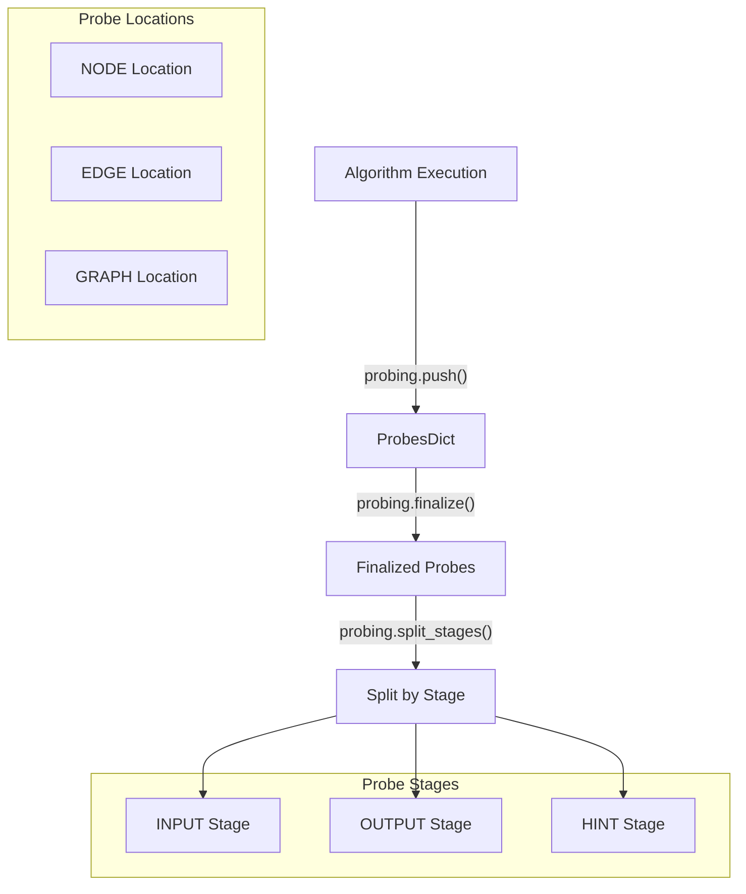

Sources: [clrs/_src/probing.py:16-440](), [clrs/__init__.py:38-39]()

### 3. Dataset System

The dataset system handles the creation, management, and chunking of data for model training and evaluation:

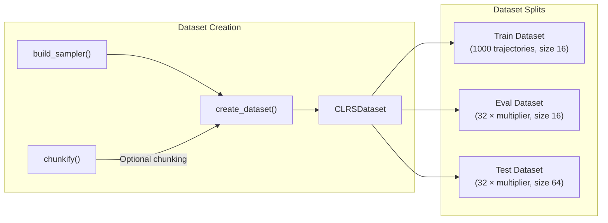

Sources: [clrs/__init__.py:26-31](), [README.md:66-83]()

### 4. Model Architecture

The model architecture is centered around graph-based neural networks that learn algorithm execution through message passing:

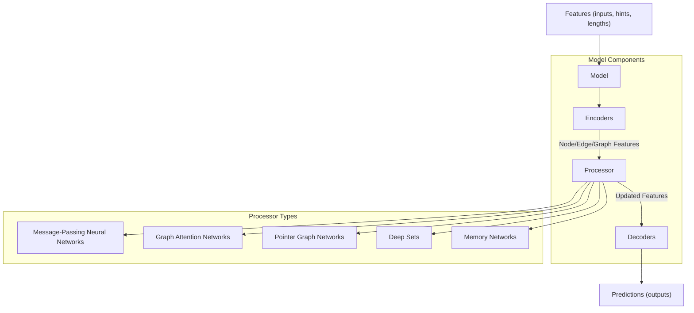

Sources: [clrs/__init__.py:36](), [clrs/__init__.py:21-24](), [README.md:164-185]()

### 5. Evaluation System

The evaluation system measures the performance of models on algorithm execution:

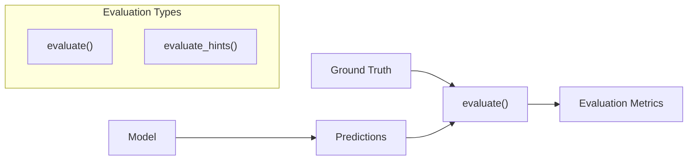

Sources: [clrs/__init__.py:33-34]()

### 6. CLRS-Text Extension

The CLRS-Text extension provides a text-based interface to the benchmark, suitable for language models:

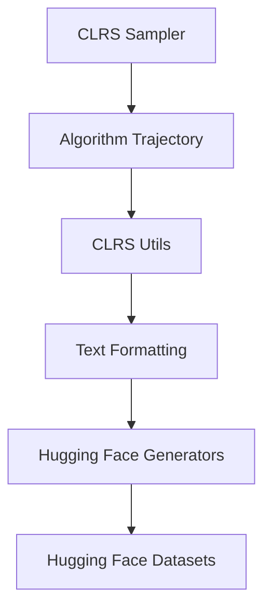

Sources: [clrs/_src/clrs_text/README.md:1-57](), [clrs/__init__.py:21]()

## Data Flow Architecture

The following diagram illustrates how data flows through the CLRS system during model training and evaluation:

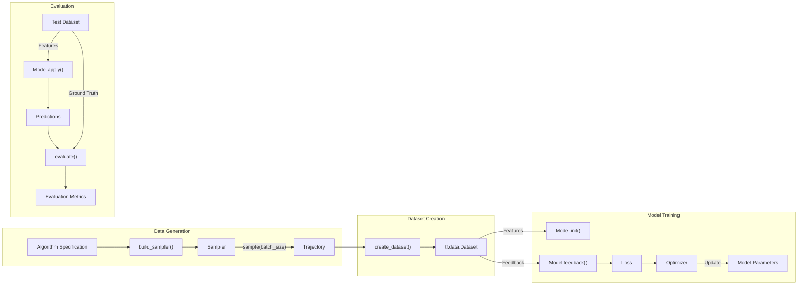

Sources: [README.md:85-95](), [clrs/__init__.py:16-94]()

## Code Structure

The CLRS codebase is organized into the following key modules:

| Module | Path | Description |
|--------|------|-------------|
| Algorithms | `clrs/_src/algorithms/` | Implementations of the 30 CLRS algorithms |
| Samplers | `clrs/_src/samplers.py` | Algorithm execution sampling |
| Specs | `clrs/_src/specs.py` | Algorithm specifications |
| Probing | `clrs/_src/probing.py` | Execution state capture system |
| Dataset | `clrs/_src/dataset.py` | Dataset creation and management |
| Model | `clrs/_src/model.py` | Base model implementation |
| Processors | `clrs/_src/processors.py` | Graph neural network components |
| Decoders | `clrs/_src/decoders.py` | Output decoders |
| Evaluation | `clrs/_src/evaluation.py` | Evaluation metrics |
| CLRS-Text | `clrs/_src/clrs_text/` | Text-based benchmark extension |

Sources: [clrs/__init__.py:16-94]()

## Graph-Based Representation

All algorithms in CLRS are represented using a graph-based formalism, which enables consistent learning and evaluation across different types of algorithms:

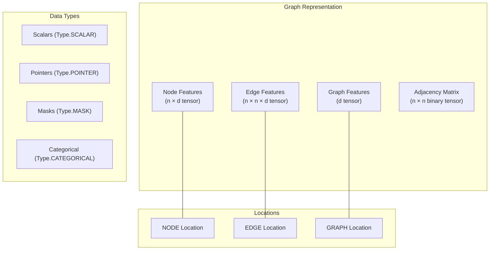

Sources: [README.md:45-61](), [clrs/_src/probing.py:16-26]()

## Integration With External Systems

CLRS integrates with external systems, primarily through the CLRS-Text extension which enables language model evaluation:

```mermaid
flowchart LR
    subgraph "CLRS Core"
        CLRSSamplers["CLRS Samplers"]
        Algorithms["Algorithm Implementations"]
        Processors["Graph Processors"]
    end
    
    subgraph "CLRS-Text"
        CLRSUtils["CLRS Utils"]
        TextFormatting["Text Formatting"]
        HuggingFaceGen["Hugging Face Generators"]
    end
    
    subgraph "External Systems"
        HuggingFace["Hugging Face Datasets"]
        LLMs["Language Models"]
        TensorBoard["TensorBoard Logging"]
    end
    
    CLRSSamplers --> CLRSUtils
    CLRSUtils --> TextFormatting
    TextFormatting --> HuggingFaceGen
    HuggingFaceGen --> HuggingFace
    HuggingFace --> LLMs
    
    CLRSSamplers --> |"Training Data"| Processors
    Processors --> |"Metrics"| TensorBoard
```

Sources: [clrs/_src/clrs_text/README.md:17-42]()

## Software Dependencies

The CLRS benchmark relies on several key software dependencies:

| Dependency | Purpose |
|------------|---------|
| JAX | Core numerical computation |
| NumPy | Array manipulation |
| TensorFlow | Dataset handling |
| DeepMind JAX Ecosystem | Additional tools for neural networks |
| Hugging Face | Integration with language models (CLRS-Text) |

Sources: [README.md:112-115](), [clrs/_src/probing.py:30-34]()

## Extending the System

The CLRS benchmark is designed to be extensible. New algorithms can be added by:

1. Defining their specifications in `specs.py`
2. Implementing the algorithm with appropriate probing
3. Creating a suitable input data sampler

Similarly, new neural network models can be implemented either by:
- Adding new processors to the existing model architecture
- Creating entirely new model classes that extend the Model API

Sources: [README.md:238-255](), [README.md:175-199]()

---

# Page: Baseline Models

# Baseline Models

<details>
<summary>Relevant source files</summary>

The following files were used as context for generating this wiki page:

- [clrs/_src/baselines.py](clrs/_src/baselines.py)
- [clrs/_src/baselines_test.py](clrs/_src/baselines_test.py)
- [clrs/models.py](clrs/models.py)

</details>


This document describes the implementation and functionality of the baseline neural network models in the CLRS (Cormen, Leiserson, Rivest, and Stein) algorithmic reasoning benchmark. These models serve as reference implementations for learning to execute algorithms through neural networks. For information about specific neural architectures used within these models, see [Neural Network Architecture](#2.1).

## Overview

The CLRS baseline models implement message-passing neural networks designed to learn algorithm execution through graph-based representations. There are two primary model variants:

1. **BaselineModel**: The standard implementation for both training and evaluation
2. **BaselineModelChunked**: A variant that processes data in fixed-time chunks, optimized for training longer sequences

Both models follow a similar architecture with encoders, a processor, and decoders, but differ in how they handle sequential data and state management.

Sources: [clrs/_src/baselines.py:136-455](), [clrs/_src/baselines.py:507-687](), [clrs/models.py:1-32]()

## Model Architecture

### BaselineModel

The BaselineModel consists of three main components:

```mermaid
flowchart TD
    subgraph "BaselineModel"
        Encoders["Encoders"] --> |"Hidden states"| Processor["Message-Passing Processor"]
        Processor --> |"Updated hidden states"| OptionalLSTM["Optional LSTM"]
        OptionalLSTM --> Decoders["Decoders"]
        Processor --> |"If LSTM disabled"| Decoders
        
        Decoders --> Outputs["Algorithm Outputs"]
        Decoders --> Hints["Hint Predictions"]
        
        Hints --> |"Teacher forcing"| Encoders
    end
    
    AlgorithmInputs["Algorithm Inputs"] --> Encoders
    GroundTruths["Ground Truth"] --> |"Loss computation"| LossFunction["Loss Function"]
    Outputs --> LossFunction
    Hints --> LossFunction
```

This architecture enables the model to:
1. Encode node, edge, and graph features
2. Process these features using message passing
3. Decode the processed features into algorithm outputs and intermediate state predictions (hints)
4. Optionally feed predicted hints back as inputs (with teacher forcing)

Sources: [clrs/_src/baselines.py:139-206](), [clrs/_src/baselines.py:251-269]()

### Component Relationships

```mermaid
classDiagram
    class BaselineModel {
        +_spec: Spec or List[Spec]
        +decode_hints: bool
        +nb_msg_passing_steps: int
        +init(features, seed)
        +feedback(rng_key, feedback, algorithm_index): loss
        +predict(rng_key, features, algorithm_index)
        +compute_grad(rng_key, feedback)
        -_loss(params, rng_key, feedback, algorithm_index)
        -_update_params(params, grads, opt_state)
    }
    
    class BaselineModelChunked {
        +mp_states: List[List[MessagePassingStateChunked]]
        +init_mp_states: List[List[MessagePassingStateChunked]]
        +init(features, seed)
        +feedback(rng_key, feedback, algorithm_index): loss
        -_loss(params, rng_key, feedback, mp_state, algorithm_index)
    }
    
    class Net {
        +__call__(features, repred, algorithm_index)
    }
    
    class NetChunked {
        +__call__(features, mp_states, repred, algorithm_index)
    }
    
    class Processor {
        <<interface>>
        +__call__(hidden, adj_mat)
    }
    
    class PGN {
        +__call__(hidden, adj_mat)
    }
    
    class MPNN {
        +__call__(hidden, adj_mat)
    }
    
    class GAT {
        +__call__(hidden, adj_mat)
    }
    
    BaselineModel *-- Net : uses
    BaselineModelChunked *-- NetChunked : uses
    BaselineModelChunked --|> BaselineModel : extends
    Net ..> Processor : requires
    NetChunked ..> Processor : requires
    PGN ..|> Processor : implements
    MPNN ..|> Processor : implements
    GAT ..|> Processor : implements
```

Sources: [clrs/_src/baselines.py:136-455](), [clrs/_src/baselines.py:507-687](), [clrs/models.py:16-32]()

## Key Features

### Initialization and Configuration

The BaselineModel constructor takes several parameters that determine the model's behavior:

| Parameter | Description | Default |
|-----------|-------------|---------|
| `spec` | Algorithm specification(s) | (required) |
| `dummy_trajectory` | Sample feedback for initialization | (required) |
| `processor_factory` | Factory for creating the message-passing processor | (required) |
| `hidden_dim` | Size of hidden message-passing vectors | 32 |
| `encode_hints` | Whether to use hints as inputs | False |
| `decode_hints` | Whether to predict hints as outputs | True |
| `use_lstm` | Whether to add an LSTM after message passing | False |
| `hint_teacher_forcing` | Probability of using ground truth hints as inputs | 0.0 |
| `hint_repred_mode` | How to process predicted hints (`soft`, `hard`, `hard_on_eval`) | `soft` |
| `nb_msg_passing_steps` | Number of message passing steps per hint | 1 |

Sources: [clrs/_src/baselines.py:139-206]()

### Training and Inference

The BaselineModel implements several core methods:

1. **`init(features, seed)`**: Initializes model parameters
2. **`feedback(rng_key, feedback, algorithm_index)`**: Performs a training step
3. **`predict(rng_key, features, algorithm_index)`**: Runs inference
4. **`compute_grad(rng_key, feedback, algorithm_index)`**: Computes gradients without updating parameters

The training flow involves:
1. Encoding the input features
2. Processing via the message-passing neural network
3. Decoding to produce outputs and hints
4. Computing losses against ground truth
5. Updating parameters via gradient descent

Sources: [clrs/_src/baselines.py:281-391](), [clrs/_src/baselines.py:406-442]()

## Multi-Algorithm Support

One significant capability of the BaselineModel is supporting multiple algorithms with a shared processor:

```mermaid
flowchart TD
    subgraph "Multi-Algorithm BaselineModel"
        Processor["Shared Message-Passing Processor"]
        
        subgraph "Algorithm 1"
            Encoders1["Encoders_1"] --> Processor
            Processor --> Decoders1["Decoders_1"]
            Decoders1 --> Outputs1["Outputs_1"]
        end
        
        subgraph "Algorithm 2"
            Encoders2["Encoders_2"] --> Processor
            Processor --> Decoders2["Decoders_2"]
            Decoders2 --> Outputs2["Outputs_2"]
        end
        
        subgraph "Algorithm N"
            EncodersN["Encoders_N"] --> Processor
            Processor --> DecodersN["Decoders_N"]
            DecodersN --> OutputsN["Outputs_N"]
        end
    end
```

Key points:
- The processor parameters are shared across all algorithms
- Each algorithm has its own dedicated encoders and decoders
- During training, only the relevant algorithm's encoders and decoders are updated
- The processor is updated regardless of which algorithm is being trained
- An optional `freeze_processor` parameter allows keeping the processor fixed while training algorithm-specific encoders/decoders

Sources: [clrs/_src/baselines.py:161-166](), [clrs/_src/baselines.py:443-456](), [clrs/_src/baselines_test.py:158-227]()

## Chunked Model for Processing Long Sequences

The BaselineModelChunked extends BaselineModel to process data in fixed-time chunks:

```mermaid
flowchart TD
    subgraph "BaselineModelChunked"
        direction LR
        ChunkedData["Chunked Input\n(time × batch × ...)"] --> MPState["Message Passing State"]
        MPState --> NetChunked["NetChunked"]
        NetChunked --> UpdatedMPState["Updated MP State"]
        NetChunked --> Outputs["Outputs"]
        UpdatedMPState --> |"Next chunk"| NetChunked
    end
```

Key differences from BaselineModel:
- Processes fixed-time chunks rather than full sequences
- Maintains message passing state between chunks
- Uses tensors with dimensions: `chunk_length × batch_size × ...`
- Signal for new samples via an `is_first` tensor (`chunk_length × batch_size`)
- Optimized for training but not for validation/testing

The chunked model enables training on longer sequences that might not fit in memory when processed in full.

Sources: [clrs/_src/baselines.py:507-517](), [clrs/_src/baselines.py:523-548](), [clrs/_src/baselines_test.py:89-156]()

## Loss Computation and Optimization

Both models calculate loss based on:
1. Output loss: Comparing model predictions to ground truth algorithm outputs
2. Hint loss: Comparing intermediate step predictions to the ground truth algorithm state (if `decode_hints=True`)

```mermaid
flowchart TD
    subgraph "Loss Computation"
        Outputs["Model Outputs"] --> OutputLoss["Output Loss"]
        Hints["Hint Predictions"] --> HintLoss["Hint Loss"]
        OutputLoss --> TotalLoss["Total Loss"]
        HintLoss --> TotalLoss
        
        GroundTruthOutputs["Ground Truth Outputs"] --> OutputLoss
        GroundTruthHints["Ground Truth Hints"] --> HintLoss
    end
    
    TotalLoss --> GradientComputation["Gradient Computation"]
    GradientComputation --> ParameterUpdate["Parameter Update"]
```

The optimization process includes:
- Support for gradient clipping via `grad_clip_max_norm`
- Selective parameter updates based on algorithm index
- Option to freeze processor weights while updating encoders/decoders

Sources: [clrs/_src/baselines.py:406-442](), [clrs/_src/baselines.py:582-619](), [clrs/_src/baselines.py:443-456]()

## Distributed Processing Support

Both models include support for multi-device computation using JAX:

- Functions for reshaping data across devices
- pmapping computations across multiple devices
- Handling device-specific parameters and optimization state
- Utility functions for restacking results from parallel computations

This enables efficient scaling of training and inference across multiple accelerators.

Sources: [clrs/_src/baselines.py:57-133](), [clrs/_src/baselines.py:364-369]()

## Checkpoint Management

The models provide methods for saving and loading parameters:

- `save_model(file_name)`: Saves model parameters and optimizer state
- `restore_model(file_name, only_load_processor)`: Restores model parameters with option to only load processor weights

This enables model persistence and transfer learning between different algorithm sets.

Sources: [clrs/_src/baselines.py:486-504]()

---

# Page: Neural Network Architecture

# Neural Network Architecture

<details>
<summary>Relevant source files</summary>

The following files were used as context for generating this wiki page:

- [clrs/_src/baselines.py](clrs/_src/baselines.py)
- [clrs/_src/nets.py](clrs/_src/nets.py)

</details>


This document describes the neural network architecture used in the CLRS algorithmic reasoning benchmark. It covers the design and implementation of the neural models that learn to execute algorithms, focusing on how data flows through the system and the key components involved in processing algorithmic inputs and generating predictions.

For information about the specific loss functions used in training, see [Loss Functions](#2.2).

## Overview

The CLRS benchmark uses message-passing neural networks to learn algorithmic reasoning. The architecture processes algorithm data represented as graphs, with nodes, edges, and global features. The core design follows an encode-process-decode pattern, where inputs are encoded into latent representations, processed through message passing, and then decoded to produce outputs and algorithm state predictions.

```mermaid
flowchart LR
    subgraph "Neural Network Architecture"
        direction TB
        input["Algorithm Input"] --> encoder["Encoders"]
        encoder --> features["Node/Edge/Graph Features"]
        features --> processor["Message Passing Processor"]
        processor --> updatedFeatures["Updated Features"]
        updatedFeatures --> lstm["Optional LSTM"]
        updatedFeatures --> decoder["Decoders"]
        lstm --> decoder
        decoder --> outputs["Output Predictions"]
        decoder --> hints["Hint Predictions"]
        hints --> |"Teacher Forcing"| encoder
    end
```

Sources: [clrs/_src/nets.py:71-449](), [clrs/_src/baselines.py:136-187]()

## Core Components

### Net Class

The `Net` class serves as the central building block for the neural architecture. It implements the encode-process-decode pattern and handles the message passing logic.

Key responsibilities include:
- Initializing encoders, decoders, and processors
- Managing data flow through the network
- Implementing message passing steps
- Handling hint predictions and teacher forcing
- Optional LSTM integration

```mermaid
classDiagram
    class Net {
        +hidden_dim: int
        +encode_hints: bool
        +decode_hints: bool
        +processor_factory: ProcessorFactory
        +use_lstm: bool
        +__call__(features_list, repred, algorithm_index, return_hints, return_all_outputs)
        -_construct_encoders_decoders()
        -_msg_passing_step()
        -_one_step_pred()
    }
    
    class NetChunked {
        +__call__(features_list, mp_state_list, repred, init_mp_state, algorithm_index)
        -_msg_passing_step()
    }
    
    Net <|-- NetChunked
```

Sources: [clrs/_src/nets.py:71-449](), [clrs/_src/nets.py:451-696]()

### BaselineModel

The `BaselineModel` class wraps the neural network and provides a high-level interface for training and evaluation. It handles gradient computation, parameter updates, and inference.

Key properties:
- Manages model parameters and optimizer state
- Implements training and evaluation methods
- Handles batch processing and device placement
- Supports model checkpointing

```mermaid
classDiagram
    class BaselineModel {
        +spec: List[Spec]
        +decode_hints: bool
        +opt: Optimizer
        +params: Parameters
        +opt_state: OptimizerState
        +feedback(rng_key, feedback, algorithm_index)
        +predict(rng_key, features, algorithm_index, return_hints, return_all_outputs)
        +compute_grad(rng_key, feedback, algorithm_index)
        -_loss(params, rng_key, feedback, algorithm_index)
        -_update_params(params, grads, opt_state, algorithm_index)
    }
    
    class BaselineModelChunked {
        +mp_states: List[List[MessagePassingStateChunked]]
        +init_mp_states: List[List[MessagePassingStateChunked]]
        +feedback(rng_key, feedback, algorithm_index)
        +compute_grad(rng_key, feedback, algorithm_index)
    }
    
    BaselineModel <|-- BaselineModelChunked
```

Sources: [clrs/_src/baselines.py:136-456](), [clrs/_src/baselines.py:507-687]()

## Processing Pipeline

The neural network processes data through several distinct stages:

### 1. Encoding Stage

The encoding stage transforms algorithm inputs and hints into latent representations.

```mermaid
flowchart TD
    subgraph "Encoding Stage"
        direction LR
        algoInputs["Algorithm Inputs"] --> nodeEnc["Node Encoders"]
        algoInputs --> edgeEnc["Edge Encoders"]
        algoInputs --> graphEnc["Graph Encoders"]
        
        hints["Hint Inputs"] --> hintEnc["Hint Encoders"]
        
        nodeEnc --> nodeFt["Node Features"]
        edgeEnc --> edgeFt["Edge Features"]
        graphEnc --> graphFt["Graph Features"]
        hintEnc --> nodeFt
        hintEnc --> edgeFt
        hintEnc --> graphFt
    end
```

Sources: [clrs/_src/nets.py:364-404](), [clrs/_src/nets.py:329-362]()

### 2. Message Passing Stage

The processor updates node, edge, and graph features through message passing. Multiple message passing steps can be performed per time step.

```mermaid
flowchart TD
    subgraph "Message Passing"
        direction LR
        nodeFt["Node Features"] --> proc["Processor"]
        edgeFt["Edge Features"] --> proc
        graphFt["Graph Features"] --> proc
        adjMat["Adjacency Matrix"] --> proc
        hiddenState["Previous Hidden State"] --> proc
        
        proc --> newHidden["New Hidden State"]
        proc --> newEdge["New Edge Features"]
    end
```

Sources: [clrs/_src/nets.py:405-432](), [clrs/_src/baselines.py:174-177]()

### 3. Optional LSTM Stage

If activated, an LSTM processes the hidden states to incorporate temporal information.

```mermaid
flowchart LR
    hiddenState["Hidden State"] --> lstm["LSTM"]
    prevLSTMState["Previous LSTM State"] --> lstm
    lstm --> newHidden["New Hidden State"]
    lstm --> newLSTMState["New LSTM State"]
```

Sources: [clrs/_src/nets.py:422-426](), [clrs/_src/baselines.py:181]()

### 4. Decoding Stage

The decoding stage transforms processed features into algorithm outputs and hint predictions.

```mermaid
flowchart TD
    subgraph "Decoding Stage"
        direction LR
        hiddenState["Hidden State"] --> dec["Decoders"]
        edgeFeatures["Edge Features"] --> dec
        graphFeatures["Graph Features"] --> dec
        
        dec --> outputPreds["Output Predictions"]
        dec --> hintPreds["Hint Predictions"]
    end
```

Sources: [clrs/_src/nets.py:434-447](), [clrs/_src/decoders.py]()

## Processor Types

The processor is responsible for the message passing computation. Different processor types are available:

```mermaid
flowchart TD
    subgraph "Processor Types"
        direction TB
        processor["ProcessorFactory"] --> mpnn["Message Passing Neural Network"]
        processor --> gat["Graph Attention Network"]
        processor --> pgn["Pointer Graph Network"]
        processor --> deepsets["Deep Sets"]
    end
```

Sources: [clrs/_src/processors.py](), [clrs/_src/baselines.py:144]()

## Data Flow Through Time

Algorithm execution is modeled as a sequence of message passing steps through time:

```mermaid
sequenceDiagram
    participant Inputs as "Algorithm Inputs"
    participant Processor as "Message Passing Processor"
    participant LSTM as "LSTM (Optional)"
    participant Decoder as "Decoders"
    participant Outputs as "Outputs & Hints"
    
    Note over Inputs,Outputs: Time Step 1
    Inputs->>Processor: Initial Features
    Processor->>LSTM: Processed Features
    LSTM->>Decoder: Temporal Features
    Decoder->>Outputs: Initial Predictions
    
    Note over Inputs,Outputs: Time Step 2
    Inputs->>Processor: New Features + Previous Hints
    Processor->>LSTM: Processed Features
    LSTM->>Decoder: Temporal Features
    Decoder->>Outputs: Updated Predictions
    
    Note over Inputs,Outputs: Time Step t
    Inputs->>Processor: New Features + Previous Hints
    Processor->>LSTM: Processed Features
    LSTM->>Decoder: Temporal Features
    Decoder->>Outputs: Final Predictions
```

Sources: [clrs/_src/nets.py:108-195](), [clrs/_src/nets.py:197-327]()

## Hint Teacher Forcing

The architecture supports teacher forcing for algorithm hints, which can enhance learning:

```mermaid
flowchart TD
    subgraph "Hint Teacher Forcing"
        direction LR
        randGen["Random Generator"] --> forceMask["Teacher Forcing Mask"]
        trueHint["Ground Truth Hint"] --> selection["Selection"]
        predHint["Predicted Hint"] --> selection
        forceMask --> selection
        selection --> nextInput["Next Step Input"]
    end
```

Sources: [clrs/_src/nets.py:138-165](), [clrs/_src/baselines.py:154-156]()

## Training vs. Inference Mode

The network behavior differs between training and inference:

| Mode | Hint Input | Postprocessing | Dropout | Description |
|------|------------|----------------|---------|-------------|
| Training | Mix of ground truth and predicted hints based on teacher forcing | Soft (differentiable) | Active | Uses teacher forcing for improved learning |
| Inference | Only predicted hints | Hard (discrete) | Inactive | Fully autoregressive prediction |

Sources: [clrs/_src/nets.py:124-132](), [clrs/_src/nets.py:418-419]()

## Chunked vs. Full Processing

The CLRS benchmark supports two processing modes:

1. **Full Processing** (`Net` class): Processes entire algorithm trajectories at once
2. **Chunked Processing** (`NetChunked` class): Processes fixed-length chunks of algorithm trajectories, useful for long-running algorithms

```mermaid
flowchart TD
    subgraph "Processing Modes"
        direction TB
        full["Full Trajectory Processing"]
        chunked["Chunked Trajectory Processing"]
        
        full --> fullAdvantage["Complete Algorithm View"]
        full --> fullDisadvantage["Memory Intensive"]
        
        chunked --> chunkedAdvantage["Memory Efficient"]
        chunked --> chunkedDisadvantage["State Management Required"]
    end
```

Sources: [clrs/_src/nets.py:71-449](), [clrs/_src/nets.py:451-696](), [clrs/_src/baselines.py:507-520]()

## Implementation Details

### Construction Parameters

The neural architecture accepts several configuration parameters:

| Parameter | Description |
|-----------|-------------|
| `hidden_dim` | Size of hidden state vectors |
| `encode_hints` | Whether to use algorithm hints as inputs |
| `decode_hints` | Whether to predict algorithm hints as outputs |
| `processor_factory` | Function to create the message passing processor |
| `use_lstm` | Whether to use an LSTM after message passing |
| `encoder_init` | Initialization strategy for encoders |
| `dropout_prob` | Dropout probability during message passing |
| `hint_teacher_forcing` | Probability of using ground truth hints instead of predictions |
| `hint_repred_mode` | How to process predicted hints ('soft', 'hard', 'hard_on_eval') |
| `nb_msg_passing_steps` | Number of message passing steps per time step |

Sources: [clrs/_src/baselines.py:139-186](), [clrs/_src/nets.py:74-106]()

### MessagePassingScanState

The internal state maintained during message passing:

```mermaid
classDiagram
    class MessagePassingScanState {
        +hint_preds: Array
        +output_preds: Array
        +hiddens: Array
        +lstm_state: Optional[LSTMState]
    }
    
    class MessagePassingStateChunked {
        +inputs: Array
        +hints: Array
        +is_first: Array
        +hint_preds: Array
        +hiddens: Array
        +lstm_state: Optional[LSTMState]
    }
```

Sources: [clrs/_src/nets.py:47-53](), [clrs/_src/nets.py:62-68]()

## Practical Example

Here's a concrete example of data flow through the architecture for a single time step:

1. **Input**: Algorithm state represented as node, edge, and graph features
2. **Encoding**: Features transformed into latent space
3. **Message Passing**: Multiple passes update node and edge representations
4. **LSTM (Optional)**: Temporal information incorporated
5. **Decoding**: Latent representations converted to algorithm outputs and next-step hints
6. **Feedback**: Hints fed back into the system for the next step (with teacher forcing during training)

Sources: [clrs/_src/nets.py:364-447]()

---

# Page: Loss Functions

# Loss Functions

<details>
<summary>Relevant source files</summary>

The following files were used as context for generating this wiki page:

- [clrs/_src/decoders_test.py](clrs/_src/decoders_test.py)
- [clrs/_src/evaluation.py](clrs/_src/evaluation.py)
- [clrs/_src/evaluation_test.py](clrs/_src/evaluation_test.py)
- [clrs/_src/losses.py](clrs/_src/losses.py)
- [clrs/_src/losses_test.py](clrs/_src/losses_test.py)

</details>


This document provides a technical reference for the loss function system used in the CLRS algorithmic reasoning benchmark. The loss functions are critical components that quantify the difference between model predictions and ground truth values during training, enabling the neural networks to learn algorithmic behaviors. For information about the neural network architecture, see [Neural Network Architecture](#2.1).

## Overview

The CLRS benchmark uses specialized loss functions to handle different types of algorithmic data structures, including scalars, masks, categorical values, and pointers. The loss system supports two training modes: full-sample training and chunked training, with distinct implementations for each.

```mermaid
flowchart TD
    subgraph "Loss Function System"
        LossComputation["Loss Computation"]
        
        subgraph "Input Data Types"
            DataType["Data Type Detection"]
            DataType --> Scalar["SCALAR"]
            DataType --> Mask["MASK"]
            DataType --> MaskOne["MASK_ONE"]
            DataType --> Categorical["CATEGORICAL"]
            DataType --> Pointer["POINTER"]
            DataType --> Permutation["PERMUTATION_POINTER"]
        end
        
        subgraph "Training Modes"
            TrainingMode["Training Mode"]
            TrainingMode --> FullSample["Full Sample"]
            TrainingMode --> Chunked["Chunked"]
        end
        
        subgraph "Loss Functions"
            OutputLoss["Output Loss"]
            HintLoss["Hint Loss"]
        end
        
        DataType --> LossComputation
        TrainingMode --> LossComputation
        LossComputation --> OutputLoss
        LossComputation --> HintLoss
    end
```

Sources: [clrs/_src/losses.py:37-210]()

## Loss Function Types

The CLRS benchmark utilizes two primary categories of loss functions:

1. **Output Loss**: Calculates loss between model predictions and the final algorithm outputs
2. **Hint Loss**: Calculates loss between model predictions and intermediate algorithm states (hints)

Each category has both full-sample and chunked implementations to accommodate different training approaches.

```mermaid
flowchart LR
    subgraph "Loss Function Types"
        OutputLoss["Output Loss Functions"]
        HintLoss["Hint Loss Functions"]
        
        OutputLoss --> OutputLossFull["output_loss()"]
        OutputLoss --> OutputLossChunked["output_loss_chunked()"]
        
        HintLoss --> HintLossFull["hint_loss()"]
        HintLoss --> HintLossChunked["hint_loss_chunked()"]
    end
    
    OutputLossFull --> CoreLoss["_hint_loss()"]
    OutputLossChunked --> CoreLoss
    HintLossFull --> CoreLoss
    HintLossChunked --> CoreLoss
```

Sources: [clrs/_src/losses.py:47-162]()

### Output Loss Functions

Output loss functions measure the difference between model predictions and the ground truth outputs of algorithms.

1. **Full-Sample Output Loss** (`output_loss`):
   - Processes complete algorithm outputs
   - Handles different data types with specialized loss calculations
   - Returns a scalar loss value

2. **Chunked Output Loss** (`output_loss_chunked`):
   - Used for time-chunked training
   - Applies loss only on chunks marked as "last" in the sequence
   - Handles masking and appropriate normalization

Sources: [clrs/_src/losses.py:47-115](), [clrs/_src/losses_test.py:120-138]()

### Hint Loss Functions

Hint loss functions measure the difference between model predictions and the ground truth intermediate states (hints) during algorithm execution.

1. **Full-Sample Hint Loss** (`hint_loss`):
   - Processes entire hint trajectories
   - Accounts for variable-length sequences
   - Can return verbose loss breakdowns by hint

2. **Chunked Hint Loss** (`hint_loss_chunked`):
   - Used for time-chunked training
   - Applies loss only on non-first chunks to avoid penalizing initial states
   - Handles appropriate masking and normalization

Sources: [clrs/_src/losses.py:118-162](), [clrs/_src/losses_test.py:140-162]()

## Data Types and Loss Calculations

The loss functions handle different data types with specialized calculations. Below is a detailed mapping of data types to their respective loss calculations:

| Data Type | Description | Loss Calculation | Used For |
|-----------|-------------|------------------|----------|
| `SCALAR` | Numeric scalar values | Mean squared error | Distances, costs, weights |
| `MASK` | Binary masks | Binary cross-entropy with masking | Visited nodes, valid edges |
| `MASK_ONE` | One-hot encoded masks | Cross-entropy with masking | Selected single items |
| `CATEGORICAL` | Multi-class categorical data | Cross-entropy with masking | Node colors, state classifications |
| `POINTER` | Node pointers | Cross-entropy with one-hot encoding | Parent pointers, next pointers |
| `PERMUTATION_POINTER` | Node permutations | Cross-entropy between matrices | Sorting orders, matchings |

Sources: [clrs/_src/losses.py:165-202]()

```mermaid
graph TD
    subgraph "Data Type to Loss Calculation Mapping"
        Input["Input Data"] --> TypeDetection["Type Detection"]
        
        TypeDetection --> ScalarType["SCALAR"]
        TypeDetection --> MaskType["MASK"]
        TypeDetection --> MaskOneType["MASK_ONE"]
        TypeDetection --> CategoricalType["CATEGORICAL"]
        TypeDetection --> PointerType["POINTER"]
        TypeDetection --> PermutationType["PERMUTATION_POINTER"]
        
        ScalarType --> MSE["Squared Error: (pred - truth)²"]
        MaskType --> BCE["Binary Cross-Entropy with Masking"]
        MaskOneType --> CE1["Cross-Entropy with One-Hot"]
        CategoricalType --> CE2["Cross-Entropy with Masking"]
        PointerType --> CE3["Cross-Entropy with One-Hot"]
        PermutationType --> PCE["Matrix Cross-Entropy"]
    end
```

Sources: [clrs/_src/losses.py:165-202]()

## Core Loss Function Implementation

Both output and hint loss functions rely on a common core implementation (`_hint_loss`) that handles the actual loss calculation based on data type. This function:

1. Determines the appropriate loss calculation based on the data type
2. Applies masking for masked data types
3. Returns both the loss and a mask indicating valid data points

```mermaid
flowchart TD
    subgraph "_hint_loss Function"
        Input["Input: truth_data, truth_type, pred, nb_nodes"]
        TypeCheck["Check Data Type"]
        
        TypeCheck --> |"SCALAR"| ScalarLoss["(pred - truth_data)²"]
        TypeCheck --> |"MASK"| MaskLoss["log(1 + exp(-|pred|)) + max(pred, 0) - pred*truth_data"]
        TypeCheck --> |"MASK_ONE"| MaskOneLoss["-sum(truth_data * log_softmax(pred))"]
        TypeCheck --> |"CATEGORICAL"| CategoricalLoss["-sum(truth_data * log_softmax(pred))"]
        TypeCheck --> |"POINTER"| PointerLoss["-sum(one_hot(truth_data) * log_softmax(pred))"]
        TypeCheck --> |"PERMUTATION_POINTER"| PermLoss["-sum(truth_data * pred)"]
        
        ScalarLoss --> CreateMask["Create or Use Mask"]
        MaskLoss --> CreateMask
        MaskOneLoss --> CreateMask
        CategoricalLoss --> CreateMask
        PointerLoss --> CreateMask
        PermLoss --> CreateMask
        
        CreateMask --> Output["Output: loss, mask"]
    end
```

Sources: [clrs/_src/losses.py:165-202]()

## Training Modes

The CLRS benchmark supports two training modes, each with specialized loss function implementations:

### Full-Sample Training

In full-sample training, the model processes the entire algorithm execution trajectory at once.

- Uses `output_loss` and `hint_loss`
- Processes complete sequences of data
- Normalizes losses over the entire sequence
- Suitable for shorter algorithms or when memory is not a constraint

### Chunked Training

In chunked training, long sequences are broken into chunks to manage memory efficiently.

- Uses `output_loss_chunked` and `hint_loss_chunked`
- Processes data in chunks with appropriate masking
- Uses `is_first` and `is_last` flags to apply losses correctly at chunk boundaries
- Suitable for longer algorithms or memory-constrained environments

```mermaid
flowchart LR
    subgraph "Training Mode Selection"
        Algorithm["Algorithm Length/Complexity"]
        Memory["Memory Constraints"]
        
        Algorithm --> |"Short/Simple"| FullSample["Full-Sample Training"]
        Algorithm --> |"Long/Complex"| Chunked["Chunked Training"]
        Memory --> |"No Constraints"| FullSample
        Memory --> |"Constraints"| Chunked
        
        FullSample --> FullLoss["output_loss()/hint_loss()"]
        Chunked --> ChunkedLoss["output_loss_chunked()/hint_loss_chunked()"]
    end
```

Sources: [clrs/_src/losses.py:47-162](), [clrs/_src/losses_test.py:107-113]()

## Helper Functions

The loss calculation system uses several helper functions to handle tensor shape manipulation and masking:

1. `_expand_to`: Expands tensor dimensions to match another tensor's shape
2. `_expand_and_broadcast_to`: Expands and broadcasts a tensor to match another tensor's shape
3. `_is_not_done_broadcast`: Creates a mask based on sequence completion status

These helper functions ensure proper tensor shape handling and masking across different loss calculations.

Sources: [clrs/_src/losses.py:37-45](), [clrs/_src/losses.py:205-209]()

## Integration with Evaluation

While loss functions are used during training, a separate evaluation system handles model performance assessment. The evaluation system uses similar metrics to the loss functions but focuses on performance measurement rather than gradient-based learning.

The primary difference between loss functions and evaluation metrics:
- Loss functions produce differentiable values suitable for gradient-based optimization
- Evaluation metrics focus on interpretable performance measures (e.g., F1 score)

For more details on the evaluation system, refer to the Evaluation section of the documentation.

Sources: [clrs/_src/evaluation.py:143-202]()

## Implementation Notes

- Loss functions use a small epsilon value (`EPS = 1e-12`) to prevent division by zero
- Special handling is provided for masked values, where certain data points are excluded from loss calculation
- Chunk boundaries require special handling to ensure consistent loss calculations

Sources: [clrs/_src/losses.py:34-36](), [clrs/_src/losses.py:77-82]()

---

# Page: Running Experiments

# Running Experiments

<details>
<summary>Relevant source files</summary>

The following files were used as context for generating this wiki page:

- [clrs/examples/run.py](clrs/examples/run.py)

</details>


This document explains how to set up and run experiments using the CLRS benchmark. It covers configuring experiments, executing training runs, and evaluating model performance on algorithmic reasoning tasks. For details on available baseline models, see [Baseline Models](#2), and for specific configuration options, see [Configuration Options](#3.1).

## Experiment Workflow Overview

Running an experiment with CLRS involves several key steps, from configuration to final evaluation.

```mermaid
flowchart TD
    config["Configure Experiment"] --> samplers["Create Data Samplers"]
    samplers --> model["Initialize Model"]
    model --> training["Training Loop"]
    training --> eval["Periodic Evaluation"]
    eval -- "Continue Training" --> training
    eval -- "If Best Model" --> checkpoint["Save Checkpoint"]
    training -- "Training Complete" --> testEval["Test Evaluation"]
    checkpoint --> testEval
```

**Experiment Workflow Diagram**

Sources: [clrs/examples/run.py:400-581]()

## Running a Basic Experiment

The primary entry point for running experiments is the `run.py` script. This script handles the full experimental pipeline including dataset creation, model initialization, training, validation, and testing.

To run a basic experiment:

```bash
python clrs/examples/run.py --algorithms=bfs --train_lengths=8,16 --train_steps=1000
```

This will train a model on the breadth-first search algorithm using two different input sizes (8 and 16 nodes) for 1000 training steps.

Sources: [clrs/examples/run.py:16-17](), [clrs/examples/run.py:33-44]()

## Key Configuration Parameters

The experiment can be customized through numerous command-line parameters:

| Parameter Group | Key Parameters | Description |
|-----------------|----------------|-------------|
| Algorithm Selection | `--algorithms` | List of algorithms to train on (default: ['bfs']) |
|  | `--train_lengths` | List of training sizes to use (default: ['4', '7', '11', '13', '16']) |
| Model Architecture | `--hidden_size` | Number of hidden units in the model (default: 128) |
|  | `--processor_type` | Type of message-passing processor (default: 'triplet_gmpnn') |
|  | `--nb_msg_passing_steps` | Message passing steps per hint (default: 1) |
| Training Parameters | `--batch_size` | Batch size for training (default: 32) |
|  | `--train_steps` | Number of training steps (default: 10000) |
|  | `--learning_rate` | Learning rate (default: 0.001) |
| Evaluation | `--eval_every` | How frequently to evaluate on validation data (default: 50) |
|  | `--test_every` | How frequently to evaluate on test data (default: 500) |
| Hint Usage | `--hint_mode` | How hints should be used ('encoded_decoded', 'decoded_only', 'none') |
|  | `--hint_teacher_forcing` | Probability of using ground-truth hints during training |
| Data Processing | `--chunked_training` | Whether to use chunking for training (default: False) |
|  | `--chunk_length` | Time chunk length for training (default: 16) |

```mermaid
flowchart TD
    subgraph "Configuration Parameters Map"
        config["Experiment Configuration"]
        
        config --> algoConfig["Algorithm Config"]
        config --> modelConfig["Model Architecture"]
        config --> trainConfig["Training Parameters"]
        config --> dataConfig["Data Configuration"]
        
        algoConfig --> |"--algorithms"| algorithms["Selected Algorithms"]
        algoConfig --> |"--train_lengths"| inputSizes["Input Graph Sizes"]
        
        modelConfig --> |"--processor_type"| processor["Message Passing Type"]
        modelConfig --> |"--hidden_size"| hiddenSize["Network Dimensions"]
        modelConfig --> |"--use_lstm"| lstm["LSTM Usage"]
        
        trainConfig --> |"--train_steps"| steps["Number of Steps"]
        trainConfig --> |"--learning_rate"| lr["Learning Rate"]
        trainConfig --> |"--batch_size"| batchSize["Batch Size"]
        
        dataConfig --> |"--chunked_training"| chunking["Data Chunking"]
        dataConfig --> |"--hint_mode"| hintMode["Hint Usage Mode"]
    end
```

**Configuration Parameters and their Relationships**

Sources: [clrs/examples/run.py:33-120]()

## Data Samplers

The experiment process begins with creating samplers for generating algorithm data:

```mermaid
flowchart LR
    subgraph "make_sampler() Function"
        algSpec["Algorithm Specification"] --> sampler["Sampler Creation"]
        sampler --> |"randomize_pos"| randPos["Randomize Position"]
        randPos --> |"process_pred_as_input"| predInput["Process Pred as Input"]
        predInput --> |"process_permutations"| permProc["Process Permutations"]
        permProc --> |"chunkify"| chunk["Optional Chunking"]
    end
    
    chunk --> trainSamplers["train_samplers"]
    chunk --> valSamplers["val_samplers"]
    chunk --> testSamplers["test_samplers"]
    
    trainSamplers --> |"next()"| trainData["Training Data"]
    valSamplers --> |"next()"| valData["Validation Data"]
    testSamplers --> |"next()"| testData["Test Data"]
```

**Data Sampler Creation and Flow**

The system creates three types of samplers:
1. **Training samplers**: Used for model training, can use multiple input sizes
2. **Validation samplers**: Used for periodic evaluation and checkpointing
3. **Test samplers**: Used for final evaluation on the benchmark dataset

The `create_samplers()` function orchestrates the creation of these samplers with appropriate configurations for each type.

Sources: [clrs/examples/run.py:170-397]()

## Model Initialization

The model is configured and initialized based on the processor type and other parameters:

```mermaid
flowchart TD
    subgraph "BaselineModel Initialization"
        procFactory["processor_factory"] --> modelParams["model_params"]
        hiddenDim["hidden_dim"] --> modelParams
        encodeHints["encode_hints"] --> modelParams
        decodeHints["decode_hints"] --> modelParams
        
        modelParams --> evalModel["eval_model = BaselineModel()"]
        
        chunkedTraining{"chunked_training?"}
        evalModel --> chunkedTraining
        chunkedTraining -- "Yes" --> trainModel["train_model = BaselineModelChunked()"]
        chunkedTraining -- "No" --> sameModel["train_model = eval_model"]
    end
```

**Model Initialization Process**

The initialization process creates either one or two model instances:
- `eval_model`: Always created, used for evaluation
- `train_model`: Either the same as `eval_model` or a `BaselineModelChunked` instance if chunked training is enabled

Sources: [clrs/examples/run.py:435-470]()

## Training Loop

The training loop iterates through steps, periodically evaluating on validation data:

```mermaid
flowchart TD
    subgraph "Training Loop"
        initStep["Initialize Model"] --> trainStep["Training Step"]
        trainStep --> nextAlgo["Process Next Algorithm"]
        nextAlgo --> evalCheck{"Time to evaluate?"}
        
        evalCheck -- "No" --> trainStep
        evalCheck -- "Yes" --> validation["Run Validation"]
        validation --> scoreCheck{"Best Score?"}
        
        scoreCheck -- "Yes" --> saveModel["Save Best Model"]
        scoreCheck -- "No" --> continue["Continue Training"]
        
        saveModel --> continue
        continue --> trainStep
        
        trainStep -- "Training Complete" --> restore["Restore Best Model"]
        restore --> testEval["Test Evaluation"]
    end
```

**Training and Evaluation Cycle**

Key aspects of the training loop:

1. **Initialization**: The model is initialized with the first batch of samples 
2. **Training Steps**: Each step processes a batch from each algorithm
3. **Periodic Evaluation**: The model is evaluated on validation data every `eval_every` steps
4. **Checkpointing**: The best model (highest validation score) is saved
5. **Final Evaluation**: After training, the best model is restored and evaluated on test data

Sources: [clrs/examples/run.py:472-580]()

## Example Training Output

During training, the script logs progress information like:

```
INFO:absl:Algo bfs step 100 current loss 0.023456, current_train_items 3200.
INFO:absl:(val) algo bfs step 100: {'score': 0.921, 'examples_seen': 3200, 'step': 100, 'algorithm': 'bfs'}
INFO:absl:Checkpointing best model, best avg val score was 0.000, current avg val score is 0.921, val scores are: bfs: 0.921
```

This shows:
- Current training loss and number of processed examples
- Validation score after evaluation
- Checkpointing information based on score comparison

Sources: [clrs/examples/run.py:519-558]()

## Advanced Usage Examples

### Chunked Training

For algorithms with long trajectories, chunked training can be more efficient:

```bash
python clrs/examples/run.py --algorithms=floyd_warshall --chunked_training=True --chunk_length=16
```

### Multi-Algorithm Training

Train on multiple algorithms simultaneously:

```bash
python clrs/examples/run.py --algorithms=bfs,dfs,topological_sort --train_steps=5000
```

### Custom Model Architecture

Customize the neural network architecture:

```bash
python clrs/examples/run.py --algorithms=dijkstra --processor_type=gat --hidden_size=256 --nb_heads=4
```

Sources: [clrs/examples/run.py:33-120]()

## Experiment Components and Data Flow

The following diagram shows how the different components of the experiment system interact:

```mermaid
flowchart TD
    subgraph "run.py Execution Flow"
        config["FLAGS from absl"] --> main["main() function"]
        main --> createSamplers["create_samplers()"]
        main --> modelParams["Configure model_params"]
        
        createSamplers --> |"train_samplers"| trainModel["train_model"]
        createSamplers --> |"val_samplers"| evalModel["eval_model"]
        createSamplers --> |"test_samplers"| testEval["Final Evaluation"]
        
        modelParams --> trainModel
        modelParams --> evalModel
        
        trainModel --> |"feedback()"| trainStep["Training Steps"]
        trainStep --> |"params"| evalModel
        evalModel --> |"predict()"| validation["Validation Evaluation"]
        validation --> |"best model"| checkpoint["checkpoint_path"]
        
        trainStep --> |"end of training"| restore["restore_model()"]
        checkpoint --> restore
        restore --> testEval
    end
```

**CLRS Experiment System Data Flow**

Sources: [clrs/examples/run.py:400-581]()

## Conclusion

The CLRS benchmark provides a flexible framework for experimenting with neural algorithmic reasoning. By configuring the appropriate parameters, you can train models on various algorithms, with different model architectures, and evaluate their performance against benchmark datasets.

When running experiments, it's important to consider:
- The appropriate input sizes for the algorithms you're studying
- The model architecture suitable for the algorithmic task
- Whether chunked training is needed for longer trajectories
- The hint mode that best suits your research question

For more specific configuration details, see [Configuration Options](#3.1).

Sources: [clrs/examples/run.py]()

---

# Page: Configuration Options

# Configuration Options

<details>
<summary>Relevant source files</summary>

The following files were used as context for generating this wiki page:

- [clrs/_src/algorithms/graphs.py](clrs/_src/algorithms/graphs.py)
- [clrs/_src/model.py](clrs/_src/model.py)
- [clrs/examples/run.py](clrs/examples/run.py)

</details>


This page documents the various configuration options available when running experiments with the CLRS algorithmic reasoning benchmark. Configuration options control aspects such as algorithm selection, model architecture, training parameters, and evaluation settings. These options are primarily defined as command-line flags in the main runner script.

For information about running complete experiments, see [Running Experiments](#3). For details about the baseline models that can be configured, see [Baseline Models](#2).

## Overview of Configuration System

The CLRS benchmark uses the Abseil flags library for configuration. Options can be specified via command-line arguments when running the training script. All configuration options have sensible defaults but can be customized for specific experimental needs.

```mermaid
flowchart TB
    config["Configuration System"]
    algoConfig["Algorithm Selection"]
    dataConfig["Dataset Configuration"]
    modelConfig["Model Architecture"]
    trainConfig["Training Parameters"]
    hintConfig["Hint System Configuration"]
    evalConfig["Evaluation Settings"]
    
    config --> algoConfig
    config --> dataConfig
    config --> modelConfig
    config --> trainConfig
    config --> hintConfig
    config --> evalConfig
```

Sources: [clrs/examples/run.py:33-122]()

## Algorithm Selection Options

The CLRS benchmark includes implementations of numerous algorithms from the "Introduction to Algorithms" textbook. You can select one or more algorithms to train on.

### Key Configuration Options:

| Flag | Description | Default |
|------|-------------|---------|
| `algorithms` | List of algorithms to run | `['bfs']` |

Some algorithms may require special handling for hints. For algorithms that use `pred` as input, set `enforce_pred_as_input` to `True`.

```mermaid
flowchart LR
    subgraph "Algorithm Categories"
        graph["Graph Algorithms"]
        string["String Algorithms"]
        dp["Dynamic Programming"]
        greedy["Greedy Algorithms"]
    end
    
    graph --> bfs["breadth-first search"]
    graph --> dfs["depth-first search"]
    graph --> topo["topological_sort"]
    graph --> apsp["floyd_warshall"]
    graph --> sssp["dijkstra/bellman_ford"]
    
    string --> kmp["kmp_matcher"]
    string --> naive["naive_string_matcher"]
    
    dp --> lcs["lcs_length"]
    dp --> mco["matrix_chain_order"]
    
    greedy --> acts["activity_selector"]
    greedy --> task["task_scheduling"]
```

Sources: [clrs/examples/run.py:33-34](), [clrs/examples/run.py:125-137]()

## Dataset Configuration Options

Dataset options control the data generation and processing for training, validation, and testing.

### Key Configuration Options:

| Flag | Description | Default |
|------|-------------|---------|
| `train_lengths` | Sizes to use for training samples | `['4', '7', '11', '13', '16']` |
| `length_needle` | Length of needle for string matching algorithms | `-8` |
| `batch_size` | Batch size for training | `32` |
| `chunked_training` | Whether to use chunking for training | `False` |
| `chunk_length` | Time chunk length if chunking is enabled | `16` |
| `random_pos` | Randomize the position input | `True` |
| `enforce_permutations` | Enforce permutation-type node pointers | `True` |
| `dataset_path` | Path for storing the dataset | `/tmp/CLRS30` |

Training lengths are specified as a list of integers representing graph sizes. A value of `-1` means using the benchmark dataset rather than generating samples.

```mermaid
flowchart TD
    datasetConfig["Dataset Configuration"]
    
    datasetConfig --> genParams["Generation Parameters"]
    datasetConfig --> procParams["Processing Parameters"]
    datasetConfig --> storageParams["Storage Parameters"]
    
    genParams --> trainLengths["train_lengths"]
    genParams --> needleLength["length_needle"]
    genParams --> randomPos["random_pos"]
    
    procParams --> batchSize["batch_size"]
    procParams --> chunking["chunked_training"]
    procParams --> chunkLength["chunk_length"]
    procParams --> enforcePermutations["enforce_permutations"]
    
    storageParams --> datasetPath["dataset_path"]
```

Sources: [clrs/examples/run.py:34-51](), [clrs/examples/run.py:52-60](), [clrs/examples/run.py:115-118]()

## Model Configuration Options

Model architecture options control the neural network structure, including processor type, hidden dimensions, and other neural network parameters.

### Key Configuration Options:

| Flag | Description | Default |
|------|-------------|---------|
| `processor_type` | Type of processor to use | `triplet_gmpnn` |
| `hidden_size` | Number of hidden units | `128` |
| `nb_heads` | Number of heads for GAT processors | `1` |
| `nb_msg_passing_steps` | Number of message passing steps per hint | `1` |
| `nb_triplet_fts` | Number of triplet features to compute | `8` |
| `use_ln` | Whether to use layer normalization | `True` |
| `use_lstm` | Whether to insert an LSTM after message passing | `False` |
| `encoder_init` | Initializer to use for the encoders | `xavier_on_scalars` |
| `freeze_processor` | Whether to freeze the processor | `False` |

The processor type is particularly important as it determines how graph message passing is performed. Available processors include:

```mermaid
flowchart LR
    processorTypes["Processor Types"]
    
    processorTypes --> basic["Basic Processors"]
    processorTypes --> triplet["Triplet Processors"]
    processorTypes --> gat["Graph Attention"]
    
    basic --> mpnn["mpnn"]
    basic --> pgn["pgn"]
    basic --> deepsets["deepsets"]
    
    triplet --> tripletMpnn["triplet_mpnn"]
    triplet --> tripletPgn["triplet_pgn"]
    triplet --> tripletGmpnn["triplet_gmpnn (default)"]
    
    gat --> gatBasic["gat"]
    gat --> gatv2["gatv2"]
    gat --> gatFull["gat_full"]
```

Sources: [clrs/examples/run.py:62-70](), [clrs/examples/run.py:97-120](), [clrs/examples/run.py:104-113]()

## Training Configuration Options

Training options control the learning process, including optimization parameters and training schedule.

### Key Configuration Options:

| Flag | Description | Default |
|------|-------------|---------|
| `learning_rate` | Learning rate | `0.001` |
| `grad_clip_max_norm` | Gradient clipping norm (0 disables) | `1.0` |
| `dropout_prob` | Dropout rate | `0.0` |
| `train_steps` | Number of training iterations | `10000` |
| `seed` | Random seed | `42` |
| `eval_every` | Evaluation frequency (steps) | `50` |
| `test_every` | Test evaluation frequency (steps) | `500` |
| `checkpoint_path` | Path for saving checkpoints | `/tmp/CLRS30` |

The training loop will periodically evaluate on validation data and save checkpoints for the best-performing model.

```mermaid
flowchart TD
    trainConfig["Training Configuration"]
    
    trainConfig --> optParams["Optimization Parameters"]
    trainConfig --> schedParams["Scheduling Parameters"]
    trainConfig --> miscParams["Miscellaneous Parameters"]
    
    optParams --> lr["learning_rate"]
    optParams --> clipNorm["grad_clip_max_norm"]
    optParams --> dropout["dropout_prob"]
    
    schedParams --> steps["train_steps"]
    schedParams --> evalFreq["eval_every"]
    schedParams --> testFreq["test_every"]
    
    miscParams --> seed["seed"]
    miscParams --> checkpointPath["checkpoint_path"]
```

Sources: [clrs/examples/run.py:58-61](), [clrs/examples/run.py:67-70](), [clrs/examples/run.py:115-120]()

## Hint Configuration Options

Hints are a critical part of the CLRS benchmark, representing intermediate states of algorithm execution. Hint configuration controls how hints are used during training.

### Key Configuration Options:

| Flag | Description | Default |
|------|-------------|---------|
| `hint_mode` | How hints should be used | `encoded_decoded` |
| `hint_teacher_forcing` | Probability of using ground-truth hints | `0.0` |
| `hint_repred_mode` | How to process predicted hints | `soft` |
| `enforce_pred_as_input` | Change pred_h hints into pred inputs | `True` |

The `hint_mode` has three options:
- `encoded_decoded`: Hints are both encoded and decoded (hardest, but most aligned with algorithms)
- `decoded_only`: Hints are only used for reconstruction losses
- `none`: No hint usage

```mermaid
flowchart LR
    hintConfig["Hint Configuration"]
    
    hintConfig --> mode["hint_mode"]
    hintConfig --> teacherForcing["hint_teacher_forcing"]
    hintConfig --> repredMode["hint_repred_mode"]
    hintConfig --> enforcePred["enforce_pred_as_input"]
    
    mode --> encodedDecoded["encoded_decoded"]
    mode --> decodedOnly["decoded_only"]
    mode --> none["none"]
    
    repredMode --> soft["soft"]
    repredMode --> hard["hard"]
    repredMode --> hardOnEval["hard_on_eval"]
```

Sources: [clrs/examples/run.py:50-51](), [clrs/examples/run.py:71-96]()

## Configuration Flow in the Runner Script

The following diagram illustrates how configuration options are processed in the main runner script:

```mermaid
flowchart TD
    cmdFlags["Command-line Flags"] --> mainFunc["main() function"]
    mainFunc --> rngSetup["Set up RNG with seed"]
    mainFunc --> createSamplers["Create samplers with configuration"]
    mainFunc --> createProcessor["Create processor with configuration"]
    mainFunc --> setupModel["Set up model with configuration"]
    mainFunc --> trainingLoop["Training loop with configured parameters"]
    
    createSamplers --> trainSamplers["Train Samplers"]
    createSamplers --> valSamplers["Validation Samplers"]
    createSamplers --> testSamplers["Test Samplers"]
    
    setupModel --> evalModel["Evaluation Model"]
    setupModel --> trainModel["Training Model (may be chunked)"]
    
    trainingLoop --> evaluation["Periodic Evaluation"]
    trainingLoop --> checkpointing["Model Checkpointing"]
    trainingLoop --> finalTest["Final Testing"]
```

Sources: [clrs/examples/run.py:400-464](), [clrs/examples/run.py:472-580]()

## Example Configuration Usage

Here's an example of how to run an experiment with custom configuration:

```bash
python3 -m clrs.examples.run \
  --algorithms=bfs,dijkstra \
  --train_lengths=8,16,32 \
  --batch_size=64 \
  --hidden_size=256 \
  --processor_type=gat \
  --nb_heads=4 \
  --hint_mode=encoded_decoded \
  --learning_rate=0.0005 \
  --train_steps=20000 \
  --checkpoint_path=/path/to/checkpoints
```

This would train models for breadth-first search and Dijkstra's algorithm with graph sizes of 8, 16, and 32 nodes, using a Graph Attention Network processor with 4 attention heads.

Sources: [clrs/examples/run.py:582-584]()

---

# Page: Algorithm Samplers

# Algorithm Samplers

<details>
<summary>Relevant source files</summary>

The following files were used as context for generating this wiki page:

- [clrs/_src/samplers.py](clrs/_src/samplers.py)
- [clrs/_src/samplers_test.py](clrs/_src/samplers_test.py)

</details>


Algorithm Samplers are a critical component of the CLRS benchmark that generate data for training and evaluating neural networks on algorithmic reasoning tasks. They create input instances for algorithms, execute the algorithms, and collect execution traces for supervised learning.

For information about the algorithm specifications that samplers use, see [Algorithm Specifications](#4.1). For details on how samplers track algorithm execution, see [Data Probing](#4.2).

## Purpose and Role

Algorithm Samplers serve three primary purposes in the CLRS benchmark:

1. **Input Generation**: Creating diverse, controlled inputs for algorithms (e.g., random arrays, graphs)
2. **Algorithm Execution**: Running algorithms on generated inputs and capturing execution traces
3. **Dataset Creation**: Organizing the inputs, outputs, and execution traces into structured datasets

In the overall architecture, samplers serve as the data generation layer that powers model training and evaluation.

```mermaid
flowchart TB
    subgraph "CLRS Benchmark"
        specs["Algorithm Specifications"] --> sampler
        algorithms["Algorithm Implementations"] --> sampler
        
        subgraph "Data Generation Layer"
            sampler["Algorithm Samplers"] --> dataset["Dataset Creation"]
        end
        
        dataset --> model["Neural Models"]
        dataset --> evaluation["Evaluation"]
    end
    
    subgraph "External Consumers"
        model --> training["Model Training"]
        evaluation --> metrics["Performance Metrics"]
    end
```

Sources: [clrs/_src/samplers.py:16-43]()

## Sampler Architecture

The `Sampler` class is an abstract base class that defines the interface for all algorithm-specific samplers. Each algorithm has its own sampler implementation that inherits from this base class.

```mermaid
classDiagram
    class Sampler {
        <<abstract>>
        _rng: RandomState
        _spec: Spec
        _algorithm: Algorithm
        _num_samples: int
        _args, _kwargs
        CAN_TRUNCATE_INPUT_DATA: bool
        __init__(algorithm, spec, num_samples, seed, ...)
        next(batch_size) Feedback
        _sample_data(length, *args, **kwargs) List~Array~
        _random_sequence(), _random_string(), _random_er_graph(), ...
    }
    
    Sampler <|-- SortingSampler
    Sampler <|-- SearchSampler
    Sampler <|-- DfsSampler
    Sampler <|-- BfsSampler
    Sampler <|-- MSTSampler
    Sampler <|-- FloydWarshallSampler
    Sampler <|-- BipartiteSampler
    
    class SortingSampler {
        CAN_TRUNCATE_INPUT_DATA = True
        _sample_data(length, low, high)
    }
    
    class SearchSampler {
        CAN_TRUNCATE_INPUT_DATA = True
        _sample_data(length, low, high)
    }
    
    class DfsSampler {
        CAN_TRUNCATE_INPUT_DATA = False
        _sample_data(length, p)
    }
```

Sources: [clrs/_src/samplers.py:65-312](), [clrs/_src/samplers.py:356-822]()

## Creating Samplers

Samplers are created using the `build_sampler` function, which maps algorithm names to their respective sampler classes through the `SAMPLERS` dictionary:

```mermaid
flowchart LR
    build_sampler["build_sampler()"] --> SAMPLERS["SAMPLERS dictionary"]
    SAMPLERS --> algorithm_sampler["Specific Sampler Class"]
    
    build_sampler --> spec["Algorithm Spec"]
    build_sampler --> algorithm["Algorithm Implementation"]
    
    algorithm_sampler --> sampler_instance["Sampler Instance"]
    algorithm --> sampler_instance
    spec --> sampler_instance
```

The `build_sampler` function takes the following key parameters:
- `name`: The algorithm name (e.g., 'insertion_sort', 'bfs')
- `num_samples`: Number of samples to generate (-1 for on-the-fly generation)
- `seed`: Random seed for reproducibility
- Other algorithm-specific parameters

Sources: [clrs/_src/samplers.py:321-353](), [clrs/_src/samplers.py:824-857]()

## Sampler Categories

The CLRS benchmark includes samplers for a wide range of algorithms grouped into several categories:

| Category | Samplers | Purpose |
|----------|----------|---------|
| **Sorting** | `SortingSampler` | Generates random sequences for sorting algorithms |
| **Search** | `SearchSampler` | Generates sorted arrays and target values for search algorithms |
| **Dynamic Programming** | `LCSSampler`, `OptimalBSTSampler` | Generates inputs for DP algorithms |
| **Graph Algorithms** | `DfsSampler`, `BfsSampler`, `TopoSampler`, etc. | Generates random graphs with various properties |
| **Flow Networks** | `BipartiteSampler` | Generates bipartite graphs for flow algorithms |
| **String Matching** | `MatcherSampler` | Generates strings for pattern matching |
| **Computational Geometry** | `SegmentsSampler`, `ConvexHullSampler` | Generates geometric data |

Sources: [clrs/_src/samplers.py:356-822]()

## Data Generation Process

The data generation process in samplers involves several key steps:

```mermaid
sequenceDiagram
    participant User
    participant Sampler as "Sampler Instance"
    participant Algorithm as "Algorithm Implementation"
    participant Probing as "Probing System"
    
    User->>Sampler: next(batch_size)
    activate Sampler
    
    alt num_samples > 0
        Sampler->>Sampler: Select random batch from precomputed samples
    else num_samples == -1
        loop batch_size times
            Sampler->>Sampler: _sample_data(*args, **kwargs)
            Sampler->>Sampler: _trunc_array(data)
            Sampler->>Algorithm: algorithm(*data)
            Algorithm->>Probing: Record execution trace
            Probing-->>Sampler: Return probes
            Sampler->>Sampler: Split into inputs, outputs, hints
        end
    end
    
    Sampler->>Sampler: _batch_io(inputs)
    Sampler->>Sampler: _batch_io(outputs)
    Sampler->>Sampler: _batch_hints(hints, min_length)
    
    Sampler-->>User: Feedback(Features(inputs, hints, lengths), outputs)
    deactivate Sampler
```

Sources: [clrs/_src/samplers.py:168-213](), [clrs/_src/samplers.py:860-936]()

## Sampling Methods

Each sampler implements a `_sample_data` method that generates appropriate input data for its algorithm. Here are some examples of sampling techniques:

### Random Sequence Generation
For sorting and array algorithms, samplers generate random sequences of values:

```python
# SortingSampler
arr = self._random_sequence(length=length, low=low, high=high)
```

### Random Graph Generation
For graph algorithms, samplers generate random graph adjacency matrices:

```python
# DfsSampler
graph = self._random_er_graph(
    nb_nodes=length, p=self._rng.choice(p),
    directed=True, acyclic=False, weighted=False)
```

### Community Structure Generation
For algorithms like strongly connected components:

```python
# SccSampler
graph = self._random_community_graph(
    nb_nodes=length, k=k, p=self._rng.choice(p), eps=eps,
    directed=True, acyclic=False, weighted=False)
```

Sources: [clrs/_src/samplers.py:356-822]()

## Data Batching and Processing

Samplers include utilities for batching and processing the generated data:

1. **Batching I/O Data**: `_batch_io` combines input/output samples across multiple trajectories
2. **Batching Hints**: `_batch_hints` handles variable-length hint trajectories with padding
3. **Subsampling**: `_subsample_data` creates randomized batches from precomputed samples

```mermaid
flowchart TD
    subgraph "Data Generation"
        sample["_sample_data()"] --> algorithm["Algorithm Execution"]
        algorithm --> probes["Execution Probes"]
    end
    
    subgraph "Data Processing"
        probes --> split["Split into inputs/outputs/hints"]
        split --> batch["Batch Data"]
        
        batch --> batch_io["_batch_io()"]
        batch --> batch_hints["_batch_hints()"]
        
        batch_io --> feedback["Feedback Object"]
        batch_hints --> feedback
    end
    
    subgraph "Post-Processing"
        feedback --> perm["process_permutations()"]
        feedback --> pred["process_pred_as_input()"]
        feedback --> pos["process_random_pos()"]
    end
```

Sources: [clrs/_src/samplers.py:860-936](), [clrs/_src/samplers.py:966-1072]()

## Advanced Features

### On-the-fly Sampling

Samplers support two sampling modes:
- **Precomputed samples** (`num_samples > 0`): Generate all samples at initialization
- **On-the-fly sampling** (`num_samples = -1`): Generate samples as needed

On-the-fly sampling is useful for large datasets or when memory is limited, but it introduces computational overhead during training.

### Data Truncation

Samplers can truncate floating-point data to a specified number of decimal places with the `truncate_decimals` parameter:

```python
data[index] = np.trunc(input_data * 10**self._truncate_decimals) / (10**self._truncate_decimals)
```

This is useful for controlling the precision of algorithm inputs and can help reduce computational complexity and improve numerical stability.

Sources: [clrs/_src/samplers.py:292-311]()

### Permutation Processing

For algorithms that produce permutations, special processing is required to convert them into a format suitable for neural networks:

```python
new_spec, _ = process_permutations(spec, sample_iterator, enforce_permutations)
```

This converts `SHOULD_BE_PERMUTATION` types into `PERMUTATION_POINTER` and `MASK_ONE` types, making them easier to learn by pointer networks.

Sources: [clrs/_src/samplers.py:966-994]()

## Standard CLRS-30 Configuration

The CLRS benchmark provides a standard configuration for training, validation, and testing:

| Split | Samples | Length | Seed |
|-------|---------|--------|------|
| Train | 1000    | 16     | 1    |
| Val   | 32      | 16     | 2    |
| Test  | 32      | 64     | 3    |

This configuration ensures consistent evaluation across different models and experiments.

Sources: [clrs/_src/samplers.py:46-62]()

## Using Samplers

Here's a typical usage pattern for algorithm samplers:

1. Create a sampler for a specific algorithm:
```python
sampler, spec = build_sampler('insertion_sort', num_samples=1000, length=16, seed=1)
```

2. Get a batch of samples:
```python
feedback = sampler.next(batch_size=32)
```

3. Access the input data, hints (execution traces), and outputs:
```python
inputs = feedback.features.inputs   # Algorithm inputs
hints = feedback.features.hints     # Execution traces
lengths = feedback.features.lengths # Trajectory lengths
outputs = feedback.outputs          # Algorithm outputs
```

Sources: [clrs/_src/samplers.py:168-213]()

## Available Samplers

The CLRS benchmark includes samplers for 30 classic algorithms:

| Algorithm Type | Available Samplers |
|----------------|-------------------|
| **Sorting** | insertion_sort, bubble_sort, heapsort, quicksort, quickselect |
| **Search** | binary_search, minimum |
| **Array Algorithms** | find_maximum_subarray, find_maximum_subarray_kadane |
| **Dynamic Programming** | matrix_chain_order, lcs_length, optimal_bst |
| **Greedy Algorithms** | activity_selector, task_scheduling |
| **Graph Traversal** | dfs, bfs |
| **Graph Algorithms** | topological_sort, strongly_connected_components, articulation_points, bridges |
| **Minimum Spanning Trees** | mst_kruskal, mst_prim |
| **Shortest Paths** | bellman_ford, dag_shortest_paths, dijkstra, floyd_warshall |
| **Flow Networks** | bipartite_matching |
| **String Matching** | naive_string_matcher, kmp_matcher |
| **Computational Geometry** | segments_intersect, graham_scan, jarvis_march |

Sources: [clrs/_src/samplers.py:824-857]()

---

# Page: Algorithm Specifications

# Algorithm Specifications

<details>
<summary>Relevant source files</summary>

The following files were used as context for generating this wiki page:

- [clrs/_src/algorithms/searching.py](clrs/_src/algorithms/searching.py)
- [clrs/_src/samplers.py](clrs/_src/samplers.py)
- [clrs/_src/specs.py](clrs/_src/specs.py)

</details>


## Introduction

Algorithm Specifications define the interface and data flow for each algorithm in the CLRS benchmark. These specifications formalize how algorithms are represented as operations on graphs with inputs, outputs, and intermediate state (hints). Algorithm specifications are a foundational component that connects [Algorithm Samplers](#4) with the [Probing System](#4.2) to generate training and evaluation data.

The specification system enables a consistent representation of diverse algorithms within a unified framework, making it possible to train neural models to learn algorithmic reasoning.

Sources: [clrs/_src/specs.py:16-31]()

## Specification Structure

Each algorithm specification is defined as a dictionary mapping probe names to tuples of `(stage, location, type)`:

```mermaid
flowchart LR
    subgraph "Algorithm Specification"
        Spec["Spec Dictionary"]
        ProbeNames["Probe Names"]
        ProbeAttributes["Probe Attributes"]
        
        Spec --> ProbeNames
        ProbeNames --> ProbeAttributes
    end
    
    subgraph "Probe Attributes"
        Stage["Stage
        (input, output, hint)"]
        Location["Location
        (node, edge, graph)"]
        Type["Type
        (scalar, pointer, mask, etc.)"]
    end
    
    ProbeAttributes --> Stage
    ProbeAttributes --> Location
    ProbeAttributes --> Type
```

### Stage

The `Stage` class defines where a probe appears in the algorithm execution flow:

- `INPUT`: Initial algorithm inputs
- `OUTPUT`: Final algorithm outputs
- `HINT`: Intermediate algorithm states (execution trace)

### Location

The `Location` class specifies the structural element associated with the probe:

- `NODE`: Node-level data (e.g., array elements, vertices)
- `EDGE`: Edge-level data (e.g., graph connections)
- `GRAPH`: Global algorithm state

### Type

The `Type` class defines the data type and semantic interpretation:

- `SCALAR`: Numeric values
- `CATEGORICAL`: Discrete categorical values
- `MASK`: Binary mask (over all nodes/edges)
- `MASK_ONE`: One-hot mask (single position)
- `POINTER`: Reference to another node
- `SHOULD_BE_PERMUTATION`: Special type for permutation outputs
- `PERMUTATION_POINTER`: Cyclic permutation representation
- `SOFT_POINTER`: Probabilistic pointer

Sources: [clrs/_src/specs.py:36-65]()

## Specification Registry

The CLRS benchmark includes specifications for 30 algorithms from the Introduction to Algorithms textbook. These are stored in a global `SPECS` dictionary that maps algorithm names to their specifications:

```mermaid
flowchart TD
    SPECS["SPECS Dictionary"]
    AlgorithmName["Algorithm Name
    (e.g., 'binary_search')"]
    Specification["Algorithm Specification"]
    
    SPECS --> AlgorithmName
    AlgorithmName --> Specification
    
    subgraph "Example: Binary Search Spec"
        BinarySearchSpec["binary_search: {...}"]
        
        InputProbes["Input Probes:
        - pos: (INPUT, NODE, SCALAR)
        - key: (INPUT, NODE, SCALAR)
        - target: (INPUT, GRAPH, SCALAR)"]
        
        OutputProbes["Output Probes:
        - return: (OUTPUT, NODE, MASK_ONE)"]
        
        HintProbes["Hint Probes:
        - pred_h: (HINT, NODE, POINTER)
        - low: (HINT, NODE, MASK_ONE)
        - high: (HINT, NODE, MASK_ONE)
        - mid: (HINT, NODE, MASK_ONE)"]
        
        BinarySearchSpec --> InputProbes
        BinarySearchSpec --> OutputProbes
        BinarySearchSpec --> HintProbes
    end
```

All algorithms include at least a `pos` input probe that serves as a unique index, for example, to represent sequential data where appropriate.

Sources: [clrs/_src/specs.py:115-526]()

## Algorithm Categories

The CLRS benchmark covers algorithms from various categories:

| Category | Algorithms |
| --- | --- |
| Sorting | insertion_sort, bubble_sort, heapsort, quicksort |
| Searching | minimum, binary_search, quickselect |
| Dynamic Programming | find_maximum_subarray, lcs_length, matrix_chain_order, optimal_bst |
| Greedy Algorithms | activity_selector, task_scheduling |
| Graph Algorithms | dfs, bfs, topological_sort, strongly_connected_components, articulation_points, bridges |
| Minimum Spanning Trees | mst_kruskal, mst_prim |
| Shortest Paths | bellman_ford, dag_shortest_paths, dijkstra, floyd_warshall |
| Flow Networks | bipartite_matching |
| String Matching | naive_string_matcher, kmp_matcher |
| Computational Geometry | segments_intersect, graham_scan, jarvis_march |

Sources: [clrs/_src/specs.py:67-98]()

## Specification Usage

Algorithm specifications are used in three main ways:

1. **Algorithm Implementation**: Define the interface for algorithm implementation and execution tracing
2. **Data Generation**: Define what data samplers need to generate
3. **Model Training**: Define the inputs, outputs, and hints for model prediction

```mermaid
flowchart LR
    Spec["Algorithm Specification"]
    
    subgraph "Algorithm Implementation"
        Probes["Probing System"]
        Algorithm["Algorithm Code"]
    end
    
    subgraph "Data Generation"
        Sampler["Algorithm Sampler"]
        Features["Features (inputs, hints, lengths)"]
        Feedback["Feedback (features, outputs)"]
    end
    
    subgraph "Model Training"
        Encoder["Encoder"]
        Processor["Graph Processor"]
        Decoder["Decoder"]
    end
    
    Spec --> Probes
    Spec --> Sampler
    Algorithm --> Probes
    
    Sampler --> Features
    Features --> Feedback
    
    Feedback --> Encoder
    Encoder --> Processor
    Processor --> Decoder
```

Sources: [clrs/_src/samplers.py:72-84](), [clrs/_src/samplers.py:144-166]()

## Example: Binary Search Specification

Let's examine the specification for the binary search algorithm:

```python
'binary_search': {
    'pos': (Stage.INPUT, Location.NODE, Type.SCALAR),
    'key': (Stage.INPUT, Location.NODE, Type.SCALAR),
    'target': (Stage.INPUT, Location.GRAPH, Type.SCALAR),
    'return': (Stage.OUTPUT, Location.NODE, Type.MASK_ONE),
    'pred_h': (Stage.HINT, Location.NODE, Type.POINTER),
    'low': (Stage.HINT, Location.NODE, Type.MASK_ONE),
    'high': (Stage.HINT, Location.NODE, Type.MASK_ONE),
    'mid': (Stage.HINT, Location.NODE, Type.MASK_ONE),
},
```

This specification defines:

- **Inputs**: 
  - `pos`: Position index for each array element
  - `key`: Array values (sorted)
  - `target`: Value to search for

- **Output**:
  - `return`: Position of the found element (one-hot encoding)

- **Hints**:
  - `pred_h`: Current array permutation
  - `low`, `high`, `mid`: Current search boundaries and midpoint

The corresponding algorithm implementation initializes probes based on this specification and updates them during execution:

```mermaid
sequenceDiagram
    participant Algorithm as "binary_search()"
    participant Probes as "Probing System"
    participant Spec as "Spec Dictionary"
    
    Algorithm->>Spec: Lookup binary_search spec
    Algorithm->>Probes: initialize(spec)
    
    Algorithm->>Probes: push(INPUT, {pos, key, target})
    
    loop Execution Steps
        Algorithm->>Algorithm: Compute mid, update low/high
        Algorithm->>Probes: push(HINT, {pred_h, low, high, mid})
    end
    
    Algorithm->>Probes: push(OUTPUT, {return})
    Algorithm->>Probes: finalize()
```

Sources: [clrs/_src/specs.py:175-184](), [clrs/_src/algorithms/searching.py:91-144]()

## Integration with Samplers

Algorithm specifications are used by samplers to generate data for training and evaluation:

```mermaid
flowchart TD
    AlgoName["Algorithm Name"] --> |"lookup"| Spec["Algorithm Specification"]
    AlgoImpl["Algorithm Implementation"] --> |"reference"| Spec
    
    Spec --> Sampler["Algorithm Sampler"]
    
    Sampler --> |"generate"| Data["Input Data"]
    AlgoImpl --> |"process"| Data
    AlgoImpl --> |"record"| Probes["Execution Probes"]
    
    Probes --> |"filter by spec"| Split["Split Probes"]
    Split --> Inputs["Input Probes"]
    Split --> Hints["Hint Probes"]
    Split --> Outputs["Output Probes"]
    
    Inputs --> Features["Feature Object"]
    Hints --> Features
    Outputs --> Feedback["Feedback Object"]
    Features --> Feedback
```

The `build_sampler()` function connects algorithm specifications with their corresponding samplers:

1. Looks up the algorithm specification from `SPECS`
2. Gets the algorithm implementation
3. Creates the appropriate sampler class
4. Returns the sampler and specification

Different algorithms have specialized samplers (e.g., `SortingSampler`, `SearchSampler`) that generate appropriate input data.

Sources: [clrs/_src/samplers.py:321-353](), [clrs/_src/samplers.py:824-856]()

## Sampling Process

When a sampler is used, it follows this process:

1. Create random algorithm inputs using the appropriate sampling method
2. Execute the algorithm with these inputs while recording probes
3. Split the probes into inputs, outputs, and hints based on the specification
4. Process and batch the data for model training

The sampling system ensures that generated data follows the structure defined in the algorithm specification.

Sources: [clrs/_src/samplers.py:144-166](), [clrs/_src/samplers.py:168-213]()

## Advanced Specification Features

### Permutation Handling

Some algorithms (like sorting) produce permutations as outputs. The specification system handles these specially:

- `SHOULD_BE_PERMUTATION`: Indicates output should be a permutation
- `process_permutations()`: Converts permutations to proper pointer representations
- Special handling for cyclic permutations

### Special Input Processing

Specifications guide how inputs are processed before model training:

- `process_pred_as_input()`: Moves predecessor hint to input
- `process_random_pos()`: Randomizes position inputs
- Specialized handling for strings and graph structures

Sources: [clrs/_src/samplers.py:967-1072]()

## Conclusion

Algorithm specifications provide a standardized interface for representing diverse algorithms within the CLRS benchmark. They define the inputs, outputs, and execution traces that models learn to predict, bridging the gap between algorithm implementations and neural network training. By formalizing these specifications, the CLRS benchmark enables systematic evaluation of neural algorithmic reasoning capabilities across a wide range of classic algorithms.

For more information about the probing system that captures algorithm execution traces based on these specifications, see [Data Probing](#4.2).

---

# Page: Data Probing

# Data Probing

<details>
<summary>Relevant source files</summary>

The following files were used as context for generating this wiki page:

- [README.md](README.md)
- [clrs/_src/clrs_text/README.md](clrs/_src/clrs_text/README.md)
- [clrs/_src/probing.py](clrs/_src/probing.py)
- [clrs/_src/probing_test.py](clrs/_src/probing_test.py)
- [clrs/_src/samplers.py](clrs/_src/samplers.py)

</details>


## Purpose and Scope

This document explains the Data Probing system in the CLRS benchmark, a mechanism for capturing algorithm execution traces. Data Probing generates rich supervisory signals by exposing the internal state of algorithms at different execution stages, providing neural networks with "hints" about algorithm behavior. This page covers the probing architecture, data structures, and how the system captures algorithm execution states.

For information about Algorithm Specifications that define what data gets probed, see [Algorithm Specifications](#4.1).

Sources: [clrs/_src/probing.py:16-24](), [README.md:50-53]()

## Overview

Data Probing forms a critical part of the CLRS benchmark, enabling the collection of detailed execution traces from classical algorithms. These traces are essential for training neural networks to learn algorithmic reasoning, as they provide visibility into intermediate computation steps rather than just input-output pairs.

```mermaid
flowchart TD
    subgraph "Algorithm Execution"
        AlgorithmCode["Algorithm Implementation"]
        ProbingCalls["Probing.push() Calls"]
        ProbesDict["Probes Dictionary"]
    end
    
    subgraph "Data Processing"
        Finalize["probing.finalize()"]
        SplitStages["probing.split_stages()"]
        DataPoints["DataPoint Structures"]
    end
    
    subgraph "Learning System"
        Inputs["Input Features"]
        Hints["Hint Features"]
        Outputs["Output Labels"]
        Model["Neural Model"]
    end
    
    AlgorithmCode -->|"Captures state"| ProbingCalls
    ProbingCalls -->|"Stores in"| ProbesDict
    ProbesDict -->|"Processes"| Finalize
    Finalize -->|"Divides by stage"| SplitStages
    SplitStages -->|"Creates"| DataPoints
    DataPoints -->|"Provides"| Inputs
    DataPoints -->|"Provides"| Hints
    DataPoints -->|"Provides"| Outputs
    Inputs --> Model
    Hints --> Model
    Model -->|"Predicts"| Outputs
```

Sources: [clrs/_src/probing.py:16-24](), [clrs/_src/samplers.py:152-166]()

## Core Data Structures

### DataPoint

The fundamental unit of the probing system is the `DataPoint`, which encapsulates a single piece of data captured during algorithm execution:

```mermaid
classDiagram
    class DataPoint {
        _name: str
        _location: str
        _type_: str
        data: ndarray
        name()
        location()
        type_()
        tree_flatten()
        tree_unflatten()
    }
```

Each `DataPoint` captures:
- `name`: Identifier for the probe (e.g., "A" for an array)
- `location`: Where the data lives - NODE, EDGE, or GRAPH
- `type_`: The data type (e.g., SCALAR, POINTER, MASK)
- `data`: The actual captured data as a numpy array

Sources: [clrs/_src/probing.py:61-96]()

### ProbesDict

Probes are organized in a nested dictionary structure called `ProbesDict` that groups them by stage, location, and name:

```mermaid
flowchart TD
    ProbesDict["ProbesDict"] --> InputStage["Stage: INPUT"]
    ProbesDict --> OutputStage["Stage: OUTPUT"]
    ProbesDict --> HintStage["Stage: HINT"]
    
    InputStage --> InputNode["Location: NODE"]
    InputStage --> InputEdge["Location: EDGE"]
    InputStage --> InputGraph["Location: GRAPH"]
    
    OutputStage --> OutputNode["Location: NODE"]
    OutputStage --> OutputEdge["Location: EDGE"]
    OutputStage --> OutputGraph["Location: GRAPH"]
    
    HintStage --> HintNode["Location: NODE"]
    HintStage --> HintEdge["Location: EDGE"]
    HintStage --> HintGraph["Location: GRAPH"]
    
    InputNode --> InputNodeName["Name: {probe_name}"]
    InputNodeName --> InputNodeNameType["type_: {type}"]
    InputNodeName --> InputNodeNameData["data: [...]"]
```

This structure organizes data based on:
- **Stage**: Whether the data is an input, output, or intermediate state (hint)
- **Location**: Whether the data relates to nodes, edges, or the entire graph
- **Name**: Specific identifier for the probe
- **Properties**: Type information and the actual data

Sources: [clrs/_src/probing.py:46-47](), [clrs/_src/probing.py:103-118]()

## Probing Workflow

Data probing follows a three-phase process during algorithm execution:

### 1. Initialization

Probes are initialized with the algorithm specification to create an empty `ProbesDict`:

```python
probes = probing.initialize(spec)
```

Sources: [clrs/_src/probing.py:103-118]()

### 2. Data Collection

As the algorithm executes, internal states are captured by pushing data into the `ProbesDict`:

```python
probing.push(probes, specs.Stage.HINT, { 'probe_name': value })
```

Sources: [clrs/_src/probing.py:121-131]()

### 3. Finalization

After execution, the collected probes are finalized to prepare them for use:

```python
probing.finalize(probes)
inputs, outputs, hints = probing.split_stages(probes, spec)
```

This converts the raw probes into structured `DataPoint` objects, organized by their stage (input, output, or hint).

Sources: [clrs/_src/probing.py:134-149](), [clrs/_src/probing.py:151-202]()

## Integration with Algorithm Samplers

The probing system is tightly integrated with algorithm samplers, which are responsible for generating examples for learning:

```mermaid
sequenceDiagram
    participant Sampler as "Sampler"
    participant Algorithm as "Algorithm"
    participant Probing as "Probing System"
    participant DataProcessor as "Data Processor"
    
    Sampler->>Sampler: _sample_data() generates input
    Sampler->>Algorithm: Call algorithm with input data
    Algorithm->>Probing: Initialize probes
    loop Algorithm Execution
        Algorithm->>Algorithm: Execute step
        Algorithm->>Probing: push() internal state
    end
    Algorithm->>Probing: finalize()
    Probing->>Probing: split_stages()
    Probing->>Sampler: Return inputs, outputs, hints
    Sampler->>DataProcessor: _batch_io() and _batch_hints()
    DataProcessor->>Sampler: Batched features
    Sampler->>Sampler: Create Feedback object
```

The key integration points are:
1. Samplers call algorithms with generated inputs
2. Algorithms use probing to record execution states
3. Probes are converted to DataPoint structures
4. Samplers batch the DataPoints for model training

Sources: [clrs/_src/samplers.py:142-166](), [clrs/_src/samplers.py:168-213]()

## Specialized Probe Utilities

The probing system provides specialized utilities for different data structures commonly used in algorithms:

| Probe Function | Purpose | Data Structure |
|----------------|---------|----------------|
| `array` | Captures array structure | Arrays |
| `array_cat` | Categorical representation of arrays | Arrays with categorical values |
| `heap` | Captures heap structure | Heaps |
| `graph` | Captures graph connectivity | Graphs |
| `mask_one` | One-hot encoding of selected position | Selections |
| `strings_id`, `strings_pos`, etc. | String-specific utilities | String algorithms |
| `predecessor_pointers_to_permutation_matrix` | Converts pointers to permutation | Permutations |

These utilities transform algorithm-specific data structures into a standardized format for the probing system.

Sources: [clrs/_src/probing.py:206-439]()

## Data Flow in the CLRS System

Data probing plays a central role in the overall data flow of the CLRS benchmark:

```mermaid
flowchart LR
    subgraph "Data Generation"
        Algorithm["Algorithm Implementation"]
        Probing["Probing System"]
        Sampler["Algorithm Sampler"]
    end
    
    subgraph "Dataset Creation"
        Batching["Batching Logic"]
        Dataset["CLRS Dataset"]
    end
    
    subgraph "Model Training"
        Features["Features Object"]
        Model["Neural Network Model"]
        Loss["Loss Functions"]
    end
    
    Algorithm -->|"Generates probes"| Probing
    Probing -->|"Provides traces"| Sampler
    Sampler -->|"Creates samples"| Batching
    Batching -->|"Builds"| Dataset
    Dataset -->|"Provides"| Features
    Features -->|"Trains"| Model
    Model -->|"Computes"| Loss
```

Sources: [clrs/_src/samplers.py:32-43](), [README.md:96-110]()

## Example: Probe Transformation

The data probing system transforms raw algorithm states into structured representations. For example, a permutation might be transformed into a cyclic predecessor representation:

```mermaid
flowchart TD
    subgraph "Original Permutation"
        P0[("0")]
        P1[("1")]
        P2[("2")]
        
        P0 -->|"points to"| P2
        P1 -->|"points to"| P1
        P2 -->|"points to"| P1
    end
    
    subgraph "Probed Representation"
        PermMatrix["Permutation Matrix"]
        FirstMask["First Node Mask"]
        
        PermMatrix -->|"specifies order"| FirstMask
    end
    
    Original["pointers = [2, 1, 1]"] --> Transform["predecessor_to_cyclic_predecessor_and_first()"]
    Transform --> Result["P = [[0, 0, 1], [1, 0, 0], [0, 1, 0]]\nM = [0, 1, 0]"]
```

This example shows how the probing system transforms a linked-list style representation of a permutation into a matrix form more suitable for neural network processing.

Sources: [clrs/_src/probing.py:403-439](), [clrs/_src/probing_test.py:176-188]()

## Relationship with Other Components

Data probing interconnects with several key components of the CLRS benchmark:

```mermaid
flowchart TD
    ProbeSystem["Probing System"]
    AlgoSpecs["Algorithm Specifications"]
    AlgoImpl["Algorithm Implementations"]
    Samplers["Algorithm Samplers"]
    Models["Neural Models"]
    
    AlgoSpecs -->|"defines probes"| ProbeSystem
    AlgoImpl -->|"generates probes"| ProbeSystem
    ProbeSystem -->|"provides traces"| Samplers
    Samplers -->|"creates features"| Models
```

- **Algorithm Specifications**: Define what data needs to be probed
- **Algorithm Implementations**: Generate probes during execution
- **Algorithm Samplers**: Use probes to create learning examples
- **Neural Models**: Learn from the probed data

Sources: [clrs/_src/samplers.py:26-31](), [README.md:238-251]()

## Conclusion

The Data Probing system is a crucial component of the CLRS benchmark, providing the mechanism to capture and format algorithmic execution traces. By exposing the internal states of algorithms, it enables neural networks to learn not just input-output mappings but the actual step-by-step process of algorithmic reasoning.

---

# Page: Dataset System

# Dataset System

<details>
<summary>Relevant source files</summary>

The following files were used as context for generating this wiki page:

- [clrs/__init__.py](clrs/__init__.py)
- [clrs/_src/dataset.py](clrs/_src/dataset.py)
- [clrs/_src/dataset_test.py](clrs/_src/dataset_test.py)

</details>


The Dataset System in the CLRS benchmark is responsible for creating, managing, and processing algorithmic data for training and evaluation. It provides utilities for handling both full-trajectory algorithm execution traces and fixed-length chunks for more efficient training with neural networks.

For information about data chunking specifically, see [Data Chunking](#5.1).

## Architecture Overview

**Dataset System Architecture**
```mermaid
graph TD
    subgraph "Dataset System Components"
        CLRSDs["CLRSDataset Class"] -->|implements| TFDsBuilder["TensorFlow GeneratorBasedBuilder"]
        CLRSDs -->|generates| AlgExamples["Algorithm Examples"]
        CLRSDs -->|uses| BuilderCfg["BuilderConfig<br/>(algorithm_split)"]
        
        CreateDs["create_dataset()"] -->|creates| FullTrajectory["Full-trajectory<br/>Datasets"]
        CreateChunkDs["create_chunked_dataset()"] -->|creates| ChunkedDs["Chunked<br/>Datasets"]
        
        CreateChunkDs -->|uses| Chunkify["chunkify()"]
        Chunkify -->|transforms| FullTrajectory
        Chunkify -->|produces| ChunkedDs
        
        Preprocess["_preprocess()"] -->|converts| RawData["Raw Data"]
        Preprocess -->|produces| DataPoints["DataPoint Objects"]
        
        CreateDs -->|uses| Preprocess
        CreateChunkDs -->|uses| Preprocess
    end
    
    subgraph "External Interfaces"
        TFDs["TensorFlow Datasets"] <-->|data access| CLRSDs
        AlgoSpecs["Algorithm Specifications"] -->|defines data structure| Preprocess
        Samplers["Algorithm Samplers"] -->|generates| RawData
    end
```

Sources: [clrs/_src/dataset.py:58-138](), [clrs/_src/dataset.py:153-178](), [clrs/_src/dataset.py:181-189](), [clrs/_src/dataset.py:211-330]()

## Core Components

### CLRSDataset Class

The core of the dataset system is the `CLRSDataset` class, which implements TensorFlow's `GeneratorBasedBuilder` interface. This class enables seamless integration with TensorFlow's dataset ecosystem while providing specialized functionality for algorithmic reasoning tasks.

**CLRSDataset Inheritance and Structure**
```mermaid
classDiagram
    class CLRSDataset {
        VERSION = "1.0.0"
        BUILDER_CONFIGS = DEFAULT_BUILDER_CONFIGS
        _instantiated_dataset
        _instantiated_dataset_name
        _instantiated_dataset_split
        _create_data(single_sample)
        _info() -> DatasetInfo
        _split_generators(dl_manager) -> dict
        _generate_examples() -> (id, data)
    }
    
    class CLRSConfig {
        name: str
        split: str
    }
    
    class GeneratorBasedBuilder {
        info: DatasetInfo
        download_and_prepare()
        as_dataset()
    }
    
    GeneratorBasedBuilder <|-- CLRSDataset : extends
    CLRSConfig --|> CLRSDataset : configures
```

Sources: [clrs/_src/dataset.py:39-52](), [clrs/_src/dataset.py:58-138]()

The `CLRSDataset` class handles:
- Generating algorithm-specific data points
- Supporting different split configurations (train/val/test)
- Providing consistent dataset interfaces through TensorFlow Datasets
- Managing the creation and access to algorithm execution trajectories

### Dataset Creation Functions

The system provides two main functions for creating datasets:

#### 1. create_dataset

The `create_dataset` function creates datasets with full-trajectory samples:

```python
def create_dataset(folder, algorithm, split, batch_size):
    """Create dataset with full-trajectory samples."""
    # Returns (processed_dataset, num_samples, specs)
```

#### 2. create_chunked_dataset

The `create_chunked_dataset` function creates datasets with fixed-length chunks:

```python
def create_chunked_dataset(folder, algorithm, split, batch_size, chunk_length):
    """Create dataset with fixed-length chunks."""
    # Returns (chunked_dataset, specs)
```

**Dataset Creation Flow**
```mermaid
flowchart LR
    subgraph "Input Parameters"
        folder["folder"]
        algorithm["algorithm"]
        split["split"]
        batchSize["batch_size"]
        chunkLength["chunk_length"]
    end
    
    subgraph "Dataset Creation Pipeline"
        loadDS["tfds.load()"]
        repeat["dataset.repeat()"]
        batch["dataset.batch()"]
        preprocess["_preprocess()"]
        chunkify["chunkify()"]
    end
    
    subgraph "Output"
        processedDS["Processed Dataset"]
        numSamples["Number of Samples"]
        specs["Algorithm Specifications"]
    end
    
    folder & algorithm & split --> loadDS
    loadDS --> repeat
    repeat --> batch
    batchSize --> batch
    batch --> preprocess
    algorithm --> preprocess
    
    %% For create_dataset
    preprocess --> processedDS
    
    %% For create_chunked_dataset
    preprocess --> chunkify
    chunkLength --> chunkify
    chunkify --> processedDS
    
    processedDS & numSamples & specs --> result["Return Value"]
```

Sources: [clrs/_src/dataset.py:181-189](), [clrs/_src/dataset.py:323-330]()

## Data Processing

### Preprocessing

The `_preprocess` function converts raw data into structured `DataPoint` objects:

```python
def _preprocess(data_point, algorithm=None):
    """Convert sampled inputs into DataPoints."""
    # Sorts data into inputs, outputs, and hints
    # Creates DataPoint objects
    # Returns Feedback object
```

**Data Preprocessing Flow**
```mermaid
flowchart LR
    subgraph "Input"
        rawData["data_point"]
        algorithm["algorithm"]
    end
    
    subgraph "Preprocessing Steps"
        extractFields["Extract Fields from Names"]
        sortData["Sort Data by Type<br/>(input/hint/output)"]
        createDataPoints["Create DataPoint Objects"]
        createFeedback["Create Feedback Object"]
    end
    
    subgraph "Reference Data"
        specs["SPECS[algorithm]"]
    end
    
    subgraph "Output"
        processedData["samplers.Feedback Object"]
    end
    
    rawData --> extractFields
    algorithm --> specs
    specs --> sortData
    extractFields --> sortData
    sortData --> createDataPoints
    createDataPoints --> createFeedback
    createFeedback --> processedData
```

Sources: [clrs/_src/dataset.py:153-178]()

During preprocessing:
1. Data is sorted into inputs, outputs, and hints based on naming conventions
2. The algorithm's specifications determine the stage, location, and type of each data point
3. `DataPoint` objects are created for each component
4. A `Feedback` object is returned containing the processed data

## Data Chunking

The chunking mechanism is a critical component of the Dataset System that handles variable-length algorithm execution traces.

### Chunking Mechanism

The `chunkify` function converts full-trajectory samples into fixed-length chunks:

```python
def chunkify(dataset: Iterator[samplers.Feedback], chunk_length: int):
    """Generator of fixed-length chunks from full-trajectory samples."""
    # Yields fixed-length chunks of data
```

**Chunking Process**
```mermaid
flowchart TD
    subgraph "Input"
        fullDataset["Full-trajectory Dataset"]
        chunkLength["chunk_length parameter"]
    end
    
    subgraph "Chunking Process"
        createEmptyChunk["Create Empty Chunk"]
        getBatches["Get Data Batches to Fill Chunk"]
        fillChunk["Fill Chunk (one batch element at a time)"]
        markBoundaries["Mark Sample Boundaries (is_first/is_last)"]
        cleanUp["Clean Up Processed Batches"]
        yieldChunk["Yield Chunked Feedback"]
    end
    
    fullDataset & chunkLength --> chunkify["chunkify() function"]
    chunkify --> createEmptyChunk
    createEmptyChunk --> getBatches
    getBatches --> fillChunk
    fillChunk --> markBoundaries
    markBoundaries --> cleanUp
    cleanUp --> yieldChunk
    yieldChunk --> createEmptyChunk
    
    subgraph "Output"
        chunkedDataset["Fixed-length Chunked Dataset"]
    end
    
    yieldChunk --> chunkedDataset
    
    subgraph "Helper Functions"
        copyIO["_copy_io() function"]
        copyHint["_copy_hint() function"]
    end
    
    fillChunk -->|uses| copyIO
    fillChunk -->|uses| copyHint
```

Sources: [clrs/_src/dataset.py:211-320](), [clrs/_src/dataset.py:192-208]()

The chunking mechanism:
- Takes full-sample dataset and chunk_length as input
- Yields fixed-time-length chunks of data
- Uses marking tensors (`is_first` and `is_last`) to track sample boundaries
- Efficiently handles batches with samples of different lengths
- Uses helper functions `_copy_hint` and `_copy_io` to copy data to chunks

### Sample Boundaries in Chunked Data

The chunking system tracks sample boundaries using two binary indicator matrices:
- `is_first`: Marks the beginning of each sample
- `is_last`: Marks the end of each sample

For example, with `chunk_length=6` and `batch_size=2`, if one sample has length 3 and another has length 5:

| is_first | is_last |
|----------|---------|
| [1, 1]   | [0, 0]  |
| [0, 0]   | [0, 0]  |
| [0, 0]   | [1, 0]  |
| [1, 0]   | [0, 0]  |
| [0, 0]   | [0, 1]  |
| [0, 1]   | [0, 0]  |

This allows the model to recognize where samples begin and end within the batch.

Sources: [clrs/_src/dataset.py:230-235]()

## API and Integration

The Dataset System integrates with the rest of the CLRS benchmark through several exported functions:

**API and Integration Points**
```mermaid
flowchart TD
    subgraph "Dataset System API"
        CLRSDs["CLRSDataset Class"]
        createDs["create_dataset()"]
        createChunkDs["create_chunked_dataset()"]
        chunkify["chunkify()"]
        getFolder["get_clrs_folder()"]
        getURL["get_dataset_gcp_url()"]
    end
    
    subgraph "Integration Points"
        runFile["run.py"]
        samplers["samplers.py"]
        clrsText["clrs_text.py"]
    end
    
    %% Dataset System to Integration Points
    createDs -->|used by| runFile
    createChunkDs -->|used by| runFile
    CLRSDs -->|provides data for| samplers
    getURL -->|used by| runFile
    getFolder -->|used by| runFile
    
    %% Integration with CLRS-Text
    CLRSDs -->|provides data for| clrsText
    
    subgraph "External Systems"
        tfds["TensorFlow Datasets"]
        huggingFace["Hugging Face"]
    end
    
    CLRSDs -->|extends| tfds
    clrsText -->|interfaces with| huggingFace
```

Sources: [clrs/__init__.py:26-31](), [clrs/_src/dataset.py:145-150]()

## Function Reference

Here's a reference of key functions in the Dataset System:

| Function | Purpose | Parameters |
|----------|---------|------------|
| `CLRSDataset` | TensorFlow dataset implementation | - |
| `create_dataset` | Creates full-trajectory datasets | folder, algorithm, split, batch_size |
| `create_chunked_dataset` | Creates chunked datasets | folder, algorithm, split, batch_size, chunk_length |
| `chunkify` | Converts to fixed-length chunks | dataset, chunk_length |
| `get_clrs_folder` | Returns dataset folder name | - |
| `get_dataset_gcp_url` | Returns dataset download URL | - |

Sources: [clrs/__init__.py:64-94](), [clrs/_src/dataset.py:58-330]()

## Summary

The Dataset System is a flexible component of the CLRS benchmark that enables:

1. Creation of algorithm-specific datasets through the `CLRSDataset` class
2. Processing of raw algorithm data into structured `DataPoint` objects
3. Generation of both full-trajectory and chunked datasets for training
4. Efficient handling of variable-length algorithm executions through the chunking mechanism

This system forms a critical bridge between the algorithm implementation and the neural network models, providing the data structures and interfaces needed for effective algorithmic reasoning.

Sources: [clrs/_src/dataset.py:16-330]()

---

# Page: Data Chunking

# Data Chunking

<details>
<summary>Relevant source files</summary>

The following files were used as context for generating this wiki page:

- [clrs/_src/baselines.py](clrs/_src/baselines.py)
- [clrs/_src/dataset.py](clrs/_src/dataset.py)
- [clrs/_src/dataset_test.py](clrs/_src/dataset_test.py)

</details>


## Introduction and Purpose

Data chunking is a key mechanism in the CLRS benchmark that enables processing of long algorithm execution traces in memory-efficient fixed-size segments. This page explains how algorithm trajectories are broken into chunks, how these chunks are structured, and how models can process them for neural algorithmic reasoning.

The chunking system addresses the challenge of training on algorithms with variable-length executions by breaking them into fixed-length segments while preserving temporal dependencies through message passing states.

For information about running experiments with chunked datasets, see [Running Experiments](#3). For details about the baseline models that can process chunks, see [Baseline Models](#2).

Sources: [clrs/_src/dataset.py:211-231]()

## Core Concepts

The CLRS benchmark generates algorithm execution traces of varying lengths. While full trajectories can be processed directly by standard models, this becomes memory-inefficient for algorithms that run for many time steps.

Data chunking transforms full trajectories into fixed-length segments with the following characteristics:

- Each chunk has a fixed length specified by the `chunk_length` parameter
- Different samples are concatenated together to fill chunks efficiently
- Special markers track where original samples begin and end within each chunk
- Chunks maintain batch processing capabilities

The chunking system allows the CLRS benchmark to efficiently train on longer algorithm executions by only requiring the model to process a fixed number of steps at a time while maintaining the ability to learn long-term dependencies.

```mermaid
flowchart TD
    subgraph "Full Trajectory Processing"
        F1["Full Sample 1<br/>(Length=15)"]
        F2["Full Sample 2<br/>(Length=10)"]
        F3["Full Sample 3<br/>(Length=20)"]
        FM["BaselineModel"]
        F1 --> FM
        F2 --> FM
        F3 --> FM
    end

    subgraph "Chunked Processing"
        C1["Chunk 1<br/>(chunk_length=8)"]
        C2["Chunk 2<br/>(chunk_length=8)"]
        C3["Chunk 3<br/>(chunk_length=8)"]
        C4["Chunk 4<br/>(chunk_length=8)"]
        C5["Chunk 5<br/>(chunk_length=8)"]
        CM["BaselineModelChunked<br/>(with message passing state)"]
        C1 --> CM
        C2 --> CM
        C3 --> CM
        C4 --> CM
        C5 --> CM
    end

    FC["chunkify()"]
    F1 --> FC
    F2 --> FC
    F3 --> FC
    FC --> C1
    FC --> C2
    FC --> C3
    FC --> C4
    FC --> C5
```

Sources: [clrs/_src/dataset.py:211-242](), [clrs/_src/baselines.py:507-519]()

## Chunking Data Structure

The chunked data has a specific structure to enable efficient processing while preserving the integrity of the original samples:

1. **Dimensions**: Each tensor of inputs, hints, and outputs has dimensions `[chunk_length × batch_size × ...]`

2. **Sample Boundaries**: Since different samples can have different time lengths, the beginnings and ends of samples within a batch do not necessarily coincide.

3. **Boundary Markers**: Two special tensors indicate sample boundaries:
   - `is_first`: Marks the beginning of a sample (has value 1 at those positions)
   - `is_last`: Marks the end of a sample (has value 1 at those positions)

4. **Data Continuity**: When a sample ends in one chunk and the next sample begins, there is no padding - samples are concatenated sequentially.

```mermaid
graph TD
    subgraph "Sample Structure Example"
        direction LR
        subgraph "Chunk with chunk_length=6, batch_size=2"
            direction TB
            A["is_first = <br/>[[1, 1]<br/>[0, 0]<br/>[0, 0]<br/>[1, 0]<br/>[0, 0]<br/>[0, 1]]"]
            B["is_last = <br/>[[0, 0]<br/>[0, 0]<br/>[1, 0]<br/>[0, 0]<br/>[0, 1]<br/>[0, 0]]"]
            C["Sample map (for reference)<br/>[[0, 1]<br/>[0, 1]<br/>[0, 1]<br/>[2, 1]<br/>[2, 1]<br/>[2, 3]]"]
        end
    end

    subgraph "Interpretation"
        direction TB
        D["Column 0 (first batch item):<br/>Sample 0 starts at position 0<br/>Sample 0 ends at position 2<br/>Sample 2 starts at position 3"]
        E["Column 1 (second batch item):<br/>Sample 1 starts at position 0<br/>Sample 1 ends at position 4<br/>Sample 3 starts at position 5"]
    end

    A --> D
    B --> D
    A --> E
    B --> E
```

The diagram above shows how `is_first` and `is_last` markers track sample boundaries in a chunk. When processing, models can use these markers to identify where samples begin and end.

Sources: [clrs/_src/dataset.py:228-241]()

## The Chunking Algorithm

The `chunkify` function in the dataset module transforms full-trajectory samples into fixed-length chunks:

```mermaid
flowchart TD
    Start["Start chunking process"] --> Init["Initialize empty chunk"]
    Init --> Fill["Fill chunk with data from samples<br/>(Mark is_first and is_last)"]
    Fill --> Yield["Yield completed chunk"]
    Yield --> Cleanup["Clean up finished samples"]
    Cleanup --> Init
```

The chunking process works by:

1. Creating an empty chunk of fixed length
2. Taking samples from the input dataset and filling the chunk
3. Marking the start and end of samples with `is_first` and `is_last` tensors
4. When a chunk is full, yielding it and starting a new chunk
5. If a sample isn't fully consumed in one chunk, continuing it in the next chunk

The algorithm ensures that inputs, hints, and outputs are correctly aligned in each chunk.

Key implementation details:
- Inputs and outputs are repeated for each timestep to match chunk dimensions
- Hints, which already have a time dimension, are copied into the appropriate positions
- `_copy_hint` and `_copy_io` helper functions handle the data transfer

Sources: [clrs/_src/dataset.py:211-321](), [clrs/_src/dataset.py:192-208]()

## Chunked Model Architecture

The `BaselineModelChunked` class extends the standard `BaselineModel` to process chunked data efficiently. The key differences are:

1. **State Maintenance**: Chunked models maintain message passing states between chunks
2. **Specialized Processing**: They process fixed-length chunks rather than full trajectories
3. **Training Focus**: Chunked models are designed specifically for training (not evaluation)

```mermaid
classDiagram
    class BaselineModel {
        +init(spec, dummy_trajectory, ...)
        +predict(rng_key, features, algorithm_index)
        +feedback(rng_key, feedback, algorithm_index)
        -_loss(params, rng_key, feedback, algorithm_index)
    }
    
    class BaselineModelChunked {
        +mp_states: MessagePassingStateChunked[][]
        +init_mp_states: MessagePassingStateChunked[][]
        +init(features, seed)
        +predict() NotImplemented
        +feedback(rng_key, feedback, algorithm_index)
        -_loss(params, rng_key, feedback, mp_state, algorithm_index)
    }
    
    class MessagePassingStateChunked {
        +inputs
        +hints
        +is_first
        +hint_preds
        +hiddens
        +lstm_state
    }
    
    BaselineModel <|-- BaselineModelChunked
    BaselineModelChunked o-- MessagePassingStateChunked
```

The `MessagePassingStateChunked` structure maintains the state needed to correctly process chunks, allowing information to flow between consecutive chunks of the same sample. This enables the model to learn long-term dependencies across chunk boundaries.

Sources: [clrs/_src/baselines.py:507-519](), [clrs/_src/baselines.py:551-573]()

## Loss Calculation for Chunked Data

Loss calculation for chunked data requires special handling to ensure that only valid positions contribute to the loss:

1. **Output Loss**: Only calculated at positions marked by `is_last` (end of samples)
2. **Hint Loss**: Calculated throughout the chunk, but takes `is_first` into account

The implementation uses specialized loss functions:
- `losses.output_loss_chunked` - For calculating loss on final outputs
- `losses.hint_loss_chunked` - For calculating loss on hints throughout execution

```mermaid
flowchart LR
    subgraph "Loss Calculation Process"
        direction TB
        A["Input: Chunked Feedback"] --> B["Forward Pass"]
        B --> C["Get output_preds & hint_preds"]
        C --> D["Calculate output loss<br/>(using is_last markers)"]
        C --> E["Calculate hint loss<br/>(using is_first markers)"]
        D --> F["Total Loss"]
        E --> F
    end
```

Sources: [clrs/_src/baselines.py:585-619]()

## Using Chunked Datasets

The CLRS benchmark provides a convenient function to create chunked datasets:

```python
chunked_dataset, spec = create_chunked_dataset(
    folder, algorithm, split, batch_size, chunk_length)
```

When choosing a `chunk_length`, consider:
- **Memory constraints**: Longer chunks use more memory
- **Long-range dependencies**: Shorter chunks might make it harder to learn long-range patterns
- **Training efficiency**: Very short chunks can lead to more overhead
- **Algorithm complexity**: More complex algorithms might benefit from longer chunks

When using a chunked dataset with a model:

1. Initialize a `BaselineModelChunked` model
2. Process chunks sequentially, maintaining message passing state
3. For evaluation, use a standard `BaselineModel` with full trajectories

Sources: [clrs/_src/dataset.py:323-330]()

## Practical Considerations

Important points to remember when working with chunked data:

1. **Evaluation**: Chunked models are intended for training only; evaluation should use the standard `BaselineModel`

2. **Message Passing State**: While the chunked model maintains message passing state, the implementation currently reinitializes states for performance reasons:
   ```python
   # Reusing init_mp_state improves performance.
   # The next, commented out line, should be used for proper state keeping.
   # mp_state = self.mp_states[length_index][algorithm_index]
   mp_state = self.init_mp_states[length_index][algorithm_index]
   ```

3. **Reproducibility**: The chunking process is deterministic when using the same seed

4. **Testing**: Comprehensive tests in `dataset_test.py` verify the correctness of the chunking implementation

Sources: [clrs/_src/baselines.py:670-673](), [clrs/_src/dataset_test.py:54-112]()

## Summary

Data chunking is a crucial technique in the CLRS benchmark that enables efficient processing of long algorithm execution traces. By breaking trajectories into fixed-length chunks and maintaining message passing state between them, the system can handle algorithms with varying execution lengths while keeping memory requirements manageable.

The chunking system consists of:
1. The `chunkify` function that transforms full trajectories into chunks
2. Special markers (`is_first` and `is_last`) to track sample boundaries
3. The `BaselineModelChunked` class that processes chunks sequentially
4. Specialized loss functions that handle chunked data correctly

This approach allows the CLRS benchmark to train neural networks on complex algorithms with long execution traces, which would otherwise be impractical due to memory constraints.

---

# Page: Processors

# Processors

<details>
<summary>Relevant source files</summary>

The following files were used as context for generating this wiki page:

- [clrs/_src/processors.py](clrs/_src/processors.py)
- [clrs/_src/processors_test.py](clrs/_src/processors_test.py)

</details>


## Purpose and Scope

This document details the processor components within the CLRS benchmark. Processors are specialized neural network modules that operate on graph-structured data to implement various forms of message passing and information aggregation. They serve as the core computation engines for the baseline models, enabling the neural networks to reason about algorithms represented as operations on graphs. For information about how processors are used in the overall model architecture, see [Baseline Models](#2).

Sources: [clrs/_src/processors.py:16-16]()

## Processor Base Class

The CLRS benchmark defines an abstract `Processor` base class that establishes the interface for all processor implementations.

```mermaid
classDiagram
    class "Processor" {
        +__init__(name: str)
        +__call__(node_fts, edge_fts, graph_fts, adj_mat, hidden, **kwargs) Tuple[Array, Optional[Array]]
        +inf_bias: bool
        +inf_bias_edge: bool
    }
    
    "Processor" <|-- "GAT"
    "Processor" <|-- "GATv2"
    "Processor" <|-- "PGN"
    "Processor" <|-- "MemNetMasked"
    "PGN" <|-- "DeepSets"
    "PGN" <|-- "MPNN"
    "PGN" <|-- "PGNMask"
    "MemNetMasked" <|-- "MemNetFull"
    "GAT" <|-- "GATFull"
    "GATv2" <|-- "GATv2Full"
    "GATv2" <|-- "GATv2FullD2"
```

All processor implementations must implement the `__call__` method, which takes:
- `node_fts`: Features for each node in the graph
- `edge_fts`: Features for each edge in the graph
- `graph_fts`: Global graph features
- `adj_mat`: Adjacency matrix defining graph connectivity
- `hidden`: Hidden state from previous steps

The method returns updated node embeddings and optional edge embeddings.

Sources: [clrs/_src/processors.py:34-66]()

## Types of Processors

### Graph Attention Networks (GAT)

The `GAT` processor implements the Graph Attention Network architecture from Velickovic et al. (ICLR 2018). It uses attention mechanisms to weigh the importance of neighbor node features when aggregating information.

```mermaid
flowchart TD
    subgraph "GAT Processing"
        Input["Input Features"] --> Concat["Concatenate Node Features with Hidden State"]
        Concat --> AttentionCoefs["Compute Attention Coefficients"]
        AttentionCoefs --> Aggregate["Weighted Aggregation"]
        Aggregate --> Output["Output Node Embeddings"]
    end
```

Key features:
- Multi-head attention mechanism
- Masked attention through adjacency matrix
- Optional residual connections and layer normalization

Sources: [clrs/_src/processors.py:77-161]()

A variant called `GATFull` uses a fully connected adjacency matrix, ignoring the graph structure provided.

Sources: [clrs/_src/processors.py:164-170]()

### Graph Attention Networks v2 (GATv2)

`GATv2` is an improved version of GAT from Brody et al. (ICLR 2022), offering more expressive attention mechanisms.

Sources: [clrs/_src/processors.py:173-289]()

Variants include:
- `GATv2Full`: Uses a fully connected adjacency matrix
- `GATv2FullD2`: A specialized variant with D2 symmetry support

Sources: [clrs/_src/processors.py:292-356]()

### Pointer Graph Networks (PGN)

`PGN` implements Pointer Graph Networks from Veličković et al. (NeurIPS 2020), allowing the model to learn to generate pointers to graph elements.

```mermaid
flowchart TD
    subgraph "PGN Processing"
        Input["Input Features"] --> ConcatFeatures["Concatenate Node Features with Hidden State"]
        ConcatFeatures --> ComputeMessages["Compute Messages"]
        ComputeMessages --> TripletMsgs["Optional Triplet Messages"]
        ComputeMessages --> AggregateMessages["Aggregate Messages by Reduction Function"]
        AggregateMessages --> CombineWithHidden["Combine with Input Features"]
        CombineWithHidden --> Output["Output Node Embeddings"]
    end
```

Key features:
- Flexible message aggregation using configurable reduction functions (max, mean)
- Optional triplet messages for higher-order interactions
- Gated update mechanism for better information flow
- Support for layer normalization

Sources: [clrs/_src/processors.py:388-502]()

Variants include:
- `PGNMask`: A masked version that enables bias for infinity values
- `MPNN`: Message Passing Neural Network that uses a fully connected adjacency matrix
- `DeepSets`: A processor that operates on sets (uses identity adjacency matrix)

Sources: [clrs/_src/processors.py:505-533]()

### Memory Networks (MemNet)

The `MemNetMasked` processor implements End-to-End Memory Networks inspired by Sukhbaatar et al. Memory networks maintain an external memory that can be read and written to.

```mermaid
flowchart TD
    subgraph "Memory Network Processing"
        Input["Input Features"] --> CombineFeatures["Combine Node and Graph Features"]
        CombineFeatures --> PadEdgeFeatures["Pad Edge Features"]
        PadEdgeFeatures --> ApplyMemNet["Apply Memory Network"]
        ApplyMemNet --> BroadcastGraph["Broadcast Graph Features"]
        BroadcastGraph --> Output["Output Node Embeddings"]
    end
```

Key components:
- Position encodings for sequence data
- Multi-hop attention mechanism
- Embedding layers for input/output encoding
- Optional layer normalization

Sources: [clrs/_src/processors.py:536-720]()

`MemNetFull` is a variant that uses a fully connected adjacency matrix.

Sources: [clrs/_src/processors.py:723-729]()

## Processor Factory

The CLRS benchmark provides a factory function `get_processor_factory` to create processor instances based on configuration parameters. This factory simplifies the process of selecting and instantiating the appropriate processor for a given task.

```mermaid
flowchart LR
    subgraph "Processor Factory System"
        Config["Configuration Parameters"] --> Factory["get_processor_factory()"]
        Factory --> ProcessorType["Select Processor Type"]
        ProcessorType --> Instantiate["Instantiate Processor with Parameters"]
        Instantiate --> ReturnProcessor["Return Processor Instance"]
    end
```

The factory function takes these key parameters:
- `kind`: The type of processor to create (e.g., 'gat', 'pgn', 'mpnn')
- `use_ln`: Whether to use layer normalization
- `nb_triplet_fts`: Number of triplet features for processors that support them
- `nb_heads`: Number of attention heads for GAT-based processors

The function returns a factory that can create processor instances with a specified output size.

Sources: [clrs/_src/processors.py:732-902]()

## Processor Integration with Neural Networks

Processors are integrated into the baseline model architecture to enable learning on algorithm execution traces.

```mermaid
flowchart TD
    subgraph "Model Architecture Integration"
        Input["Algorithm Input"] --> Encoder["Encoder"]
        Encoder --> NodeFeatures["Node Features"]
        Encoder --> EdgeFeatures["Edge Features"]
        Encoder --> GraphFeatures["Graph Features"]
        
        NodeFeatures --> Processor["Processor"]
        EdgeFeatures --> Processor
        GraphFeatures --> Processor
        AdjacencyMatrix["Adjacency Matrix"] --> Processor
        HiddenState["Hidden State"] --> Processor
        
        Processor --> UpdatedFeatures["Updated Node Features"]
        UpdatedFeatures --> Decoder["Decoder"]
        Decoder --> AlgorithmOutput["Algorithm Output"]
    end
```

During training, processors transform the graph representation at each step of algorithm execution, learning to mimic the algorithm's behavior.

Sources: [clrs/_src/processors.py:34-66]()

## Detailed Processor Feature Comparison

The following table summarizes the key features of different processor types:

| Processor Type | Graph Connectivity | Attention Mechanism | Triplet Messages | Gated Updates | Layer Norm Support |
|----------------|-------------------|---------------------|-----------------|--------------|-------------------|
| GAT            | Adjacency Matrix  | Multi-head          | No              | No           | Yes               |
| GATFull        | Fully Connected   | Multi-head          | No              | No           | Yes               |
| GATv2          | Adjacency Matrix  | Improved Multi-head | No              | No           | Yes               |
| GATv2Full      | Fully Connected   | Improved Multi-head | No              | No           | Yes               |
| PGN            | Adjacency Matrix  | No                  | Optional        | Optional     | Yes               |
| PGNMask        | Adjacency Matrix  | No                  | Optional        | Optional     | Yes               |
| MPNN           | Fully Connected   | No                  | Optional        | Optional     | Yes               |
| DeepSets       | Identity Matrix   | No                  | No              | Optional     | Yes               |
| MemNetMasked   | Adjacency Matrix  | Memory-based        | No              | No           | Yes               |
| MemNetFull     | Fully Connected   | Memory-based        | No              | No           | Yes               |

Sources: [clrs/_src/processors.py:734-902]()

## Implementation Details

### Triplet Messages

For processors that support triplet interactions (like `PGN` with `use_triplets=True`), the system computes higher-order messages between triplets of nodes. This enables capturing more complex graph relationships and is implemented via the `get_triplet_msgs` function.

Sources: [clrs/_src/processors.py:359-385]()

### Position Encoding

Memory Networks use position encodings to incorporate sequence information. The position encoding is computed by the `_position_encoding` function.

Sources: [clrs/_src/processors.py:905-914]()

---

# Page: Encoders and Decoders

# Encoders and Decoders

<details>
<summary>Relevant source files</summary>

The following files were used as context for generating this wiki page:

- [clrs/_src/decoders.py](clrs/_src/decoders.py)
- [clrs/_src/encoders.py](clrs/_src/encoders.py)

</details>


This document provides technical documentation on the encoder and decoder systems in the CLRS benchmark. These components are responsible for transforming algorithm data structures into neural network representations and vice versa. For information about the graph processors that operate on these encoded representations, see [Processors](#6).

## Purpose and Components

Encoders and decoders serve as the interface between algorithmic data structures and neural network representations:

- **Encoders**: Transform algorithm data (nodes, edges, graph attributes) into feature vectors for neural network processing
- **Decoders**: Transform neural network outputs back into algorithm-specific data structures

```mermaid
flowchart LR
    subgraph "Algorithm Data"
        algData["Raw Algorithm Data"]
    end
    
    subgraph "Neural Network Processing"
        enc["Encoders"]
        proc["Processors"]
        dec["Decoders"]
        
        enc --> proc
        proc --> dec
    end
    
    subgraph "Algorithm Output"
        algOut["Algorithm Output/Hints"]
    end
    
    algData --> enc
    dec --> algOut
    algOut -.-> |"Optional feedback\n(for hints)"| enc
```

Sources: [clrs/_src/encoders.py:15-16](), [clrs/_src/decoders.py:15-16]()

## Data Types and Locations

Both encoders and decoders handle various data types and locations that represent algorithm elements.

### Types

| Type | Description | Encoding/Decoding Approach |
|------|-------------|----------------------------|
| `SCALAR` | Numerical values | Direct encoding/decoding |
| `MASK` | Binary masks | Sigmoid for soft values, thresholding for hard |
| `MASK_ONE` | Single-selection masks | One-hot encoding/softmax |
| `CATEGORICAL` | Categorical data | One-hot encoding/softmax |
| `POINTER` | Pointers to other elements | One-hot encoding/softmax |
| `PERMUTATION_POINTER` | Pointers representing permutations | One-hot with Sinkhorn normalization |
| `SOFT_POINTER` | Soft pointers | Already in distribution form |

### Locations

| Location | Description |
|----------|-------------|
| `NODE` | Features associated with nodes in a graph |
| `EDGE` | Features associated with edges in a graph |
| `GRAPH` | Features associated with the entire graph |

Sources: [clrs/_src/encoders.py:24-29](), [clrs/_src/decoders.py:27-32]()

## Encoder System

The encoder system transforms algorithm data into neural network feature representations.

```mermaid
flowchart TD
    subgraph "Encoder System"
        preproc["preprocess()"]
        construct["construct_encoders()"]
        encode["_encode_inputs()"]
        
        subgraph "Feature Accumulation"
            adj["accum_adj_mat()"]
            edge["accum_edge_fts()"]
            node["accum_node_fts()"]
            graph["accum_graph_fts()"]
        end
        
        dataPoint["DataPoint"] --> preproc
        preproc --> encode
        construct --> encode
        encode --> adj
        encode --> edge
        encode --> node
        encode --> graph
    end
    
    adj --> |"adj_mat"| outputFeatures["Neural Network Features"]
    edge --> |"edge_fts"| outputFeatures
    node --> |"node_fts"| outputFeatures
    graph --> |"graph_fts"| outputFeatures
```

Sources: [clrs/_src/encoders.py:32-51](), [clrs/_src/encoders.py:54-80](), [clrs/_src/encoders.py:83-139]()

### Encoder Construction

Encoders are built as linear layers with specific configurations based on the data type and location:

```python
# Example of encoder construction (simplified)
encoders = [hk.Linear(hidden_dim)]
if loc == _Location.EDGE and t == _Type.POINTER:
    # Edge pointers need two-way encoders
    encoders.append(hk.Linear(hidden_dim))
```

The encoder weights can be initialized using different strategies, with special treatment for scalar hint encoders.

Sources: [clrs/_src/encoders.py:32-51]()

### Data Preprocessing

Before encoding, data points undergo preprocessing to ensure they're in the appropriate format:

- `POINTER` types are expanded to one-hot representations
- `SOFT_POINTER` types are treated as regular `POINTER` types for encoding
- All data is converted to float32

Sources: [clrs/_src/encoders.py:54-80]()

### Feature Accumulation Functions

The encoded features are accumulated into three main feature matrices:

- **Adjacency Matrix**: Built from node pointers and edge masks
- **Edge Features**: Built from node pointers and edge data
- **Node Features**: Built from node data and graph pointers
- **Graph Features**: Built from graph data

Sources: [clrs/_src/encoders.py:83-139]()

## Decoder System

The decoder system transforms neural network outputs back into algorithm-specific data structures.

```mermaid
flowchart TD
    subgraph "Decoder System"
        construct["construct_decoders()"]
        decode["decode_fts()"]
        
        subgraph "Feature Decoding"
            nodeDecoder["_decode_node_fts()"]
            edgeDecoder["_decode_edge_fts()"]
            graphDecoder["_decode_graph_fts()"]
        end
        
        postproc["postprocess()"]
        diffDecoder["maybe_decode_diffs()"]
        
        nodeFeatures["Node Features (h_t)"] --> decode
        edgeFeatures["Edge Features"] --> decode
        graphFeatures["Graph Features"] --> decode
        
        decode --> nodeDecoder
        decode --> edgeDecoder
        decode --> graphDecoder
        
        nodeDecoder --> |"Output/Hint Predictions"| postproc
        edgeDecoder --> |"Output/Hint Predictions"| postproc
        graphDecoder --> |"Output/Hint Predictions"| postproc
        
        diffDecoder -.-> |"Optional Difference Predictions"| postproc
    end
    
    postproc --> algorithmOutputs["Algorithm Outputs/Hints"]
```

Sources: [clrs/_src/decoders.py:67-111](), [clrs/_src/decoders.py:198-382]()

### Decoder Construction

Decoders are constructed as a series of linear layers, with the number and configuration depending on the data location and type:

- **Node decoders**: 1-4 linear layers depending on type
- **Edge decoders**: 3-5 linear layers depending on type
- **Graph decoders**: 2-3 linear layers depending on type

Specialized "diff decoders" can also be constructed to predict differences between states.

Sources: [clrs/_src/decoders.py:67-121]()

### Feature Decoding

The `decode_fts` function orchestrates the decoding process by:
1. Selecting the appropriate decoder based on data name and spec
2. Routing to the appropriate decoding function based on location
3. Separating outputs and hints based on their stage in the spec
4. Returning dictionaries of predictions

Sources: [clrs/_src/decoders.py:198-235]()

### Type-Specific Decoding

Each location type (node, edge, graph) has its own decoding function:

- **Node decoding**: Handles scalar values, categorical data, and pointers
- **Edge decoding**: Processes edge relationships and properties
- **Graph decoding**: Handles global properties and graph-level outputs

Each type of data (SCALAR, MASK, CATEGORICAL, POINTER, etc.) is decoded differently.

Sources: [clrs/_src/decoders.py:238-327]()

### Sinkhorn Operation for Permutation Pointers

For permutation pointers, a special Sinkhorn operation is applied to ensure the output is a doubly stochastic matrix (a relaxation of a permutation matrix):

```mermaid
flowchart LR
    subgraph "log_sinkhorn()"
        input["Input Matrix"]
        tempScale["Scale by Temperature"]
        zeroDiag["Zero Out Diagonal"]
        rowNorm["Row-wise Log-Softmax"]
        colNorm["Column-wise Log-Softmax"]
        gumbel["Optional Gumbel Noise"]
        
        input --> gumbel
        gumbel --> tempScale
        tempScale --> zeroDiag
        zeroDiag --> loop["Iterative\nNormalization"]
        loop --> rowNorm
        rowNorm --> colNorm
        colNorm --> |"Repeat"| rowNorm
    end
    
    loop --> output["Normalized Log Matrix"]
```

Sources: [clrs/_src/decoders.py:36-64](), [clrs/_src/decoders.py:262-270]()

### Postprocessing

The `postprocess` function handles the final transformation of decoder outputs:

- In "hard" mode (for evaluation):
  - SCALAR: Stop gradient
  - MASK: Threshold at 0
  - MASK_ONE/CATEGORICAL: Argmax and one-hot
  - POINTER: Argmax
  - PERMUTATION_POINTER: Convert to permutation matrix

- In "soft" mode (for hint feedback):
  - SCALAR: Pass through
  - MASK: Sigmoid
  - MASK_ONE/CATEGORICAL: Softmax
  - POINTER: Softmax (becomes SOFT_POINTER)
  - PERMUTATION_POINTER: Sinkhorn normalization

Sources: [clrs/_src/decoders.py:127-195]()

## Integration with CLRS Pipeline

The encoder and decoder systems integrate with the larger CLRS benchmark pipeline as follows:

```mermaid
flowchart TB
    subgraph "Algorithm"
        algSpec["Algorithm Specification"]
        samples["Algorithm Samples"]
        probing["Probing System"]
    end
    
    subgraph "Neural Model"
        encoder["Encoder System"]
        processor["Graph Processor"]
        decoder["Decoder System"]
    end
    
    subgraph "Training Loop"
        loss["Loss Functions"]
        eval["Evaluation"]
    end
    
    algSpec --> samples
    samples --> probing
    probing --> |"Input/Hint DataPoints"| encoder
    
    encoder --> |"Node/Edge/Graph Features"| processor
    processor --> |"Processed Features"| decoder
    decoder --> |"Output/Hint Predictions"| loss
    decoder --> |"Hint Predictions\n(Teacher Forcing)"| encoder
    
    loss --> eval
```

### Data Flow Through Encoders and Decoders

1. Algorithm samples generate `DataPoint` objects containing algorithm data
2. Encoders preprocess these data points and convert them to feature vectors
3. Graph processors update these feature vectors
4. Decoders convert processed features back to algorithm outputs
5. Postprocessing transforms raw decoder outputs to final predictions
6. For teacher forcing, hint predictions are fed back to encoders

Sources: [clrs/_src/encoders.py:15-140](), [clrs/_src/decoders.py:15-382]()

## Usage in Model Training

During model training, encoders and decoders interact with other components as follows:

1. The model constructs encoders and decoders for each data type in the algorithm specification
2. Input data is encoded to produce initial feature representations
3. The processor updates these representations over multiple steps
4. At each step, decoders produce output and hint predictions
5. Hint predictions may be fed back to the model via encoders (teacher forcing)
6. Loss is computed between predictions and ground truth
7. During evaluation, "hard" postprocessing is used to generate final predictions

This architecture allows the model to learn algorithmic reasoning by processing graph-structured data and gradually refining its predictions based on feedback.

Sources: [clrs/_src/encoders.py:15-140](), [clrs/_src/decoders.py:15-382]()

---

# Page: CLRS-Text

# CLRS-Text

<details>
<summary>Relevant source files</summary>

The following files were used as context for generating this wiki page:

- [clrs/_src/clrs_text/__init__.py](clrs/_src/clrs_text/__init__.py)
- [clrs/_src/clrs_text/huggingface_generators.py](clrs/_src/clrs_text/huggingface_generators.py)

</details>


## Purpose and Scope

CLRS-Text is a specialized variant of the CLRS algorithmic reasoning benchmark that transforms algorithm samples into textual representations for use with language models. While the core CLRS benchmark primarily targets graph neural networks, CLRS-Text creates natural language descriptions of algorithmic tasks to enable the evaluation of large language models (LLMs) on algorithmic reasoning. This module provides seamless integration with the Hugging Face ecosystem for dataset creation and model evaluation.

For information about the core algorithm samplers that generate the data underlying CLRS-Text, see [Algorithm Samplers](#4). For details on Hugging Face integration specifics, see [Hugging Face Integration](#7.1).

Sources: [clrs/_src/clrs_text/__init__.py:15-19]()

## System Architecture

CLRS-Text builds upon the core CLRS benchmark system, acting as a bridge between algorithmic reasoning tasks and language models. It leverages the existing algorithm samplers to generate examples, then transforms them into text format suitable for language models.

```mermaid
flowchart LR
    subgraph "CLRS Core"
        Samplers["samplers.build_sampler()"]
        AlgoExamples["Algorithm Examples"]
    end
    
    subgraph "CLRS-Text"
        ClrsUtils["clrs_utils.format_clrs_example()"]
        HuggingFaceGen["huggingface_generators.clrs_generator()"]
    end
    
    subgraph "External Integration"
        HFDataset["Hugging Face Datasets"]
        LanguageModels["Language Models"]
    end
    
    Samplers --> AlgoExamples
    AlgoExamples --> ClrsUtils
    ClrsUtils --> HuggingFaceGen
    HuggingFaceGen --> HFDataset
    HFDataset --> LanguageModels
```

*CLRS-Text System Architecture*

Sources: [clrs/_src/clrs_text/huggingface_generators.py:15-22](), [clrs/_src/clrs_text/__init__.py:15-19]()

## Core Components

CLRS-Text consists of two primary components:

1. **CLRS Utils**: Provides utilities for formatting algorithm examples into text, responsible for transforming structured algorithm data into natural language descriptions.

2. **Hugging Face Generators**: Offers integration with the Hugging Face ecosystem, providing generator functions that can create both finite and infinite datasets.

```mermaid
classDiagram
    class clrs_utils {
        +format_clrs_example(algo_name, sample, use_hints)
    }
    
    class huggingface_generators {
        +clrs_generator(algos_and_lengths, num_samples, use_hints, seed, num_decimals_in_float)
    }
    
    clrs_utils <-- huggingface_generators : uses
```

*CLRS-Text Component Structure*

Sources: [clrs/_src/clrs_text/__init__.py:17-18]()

## Data Flow Process

CLRS-Text transforms algorithm samples into textual representations through a well-defined data flow process:

```mermaid
flowchart TD
    A["Configuration Input"] --> B["Initialize Samplers"]
    B --> C["Generate Algorithm Sample"]
    C --> D["Format as Text"]
    D --> E["Output Dataset Item"]
    
    subgraph "Configuration"
        A
    end
    
    subgraph "Sample Generation"
        B
        C
    end
    
    subgraph "Text Formatting"
        D
    end
    
    subgraph "Dataset Creation"
        E
    end
```

*CLRS-Text Data Flow Process*

The process begins by configuring which algorithms and input lengths to include. For each algorithm-length pair, a sampler is initialized. When generating dataset items, the system:

1. Randomly selects a sampler
2. Generates a single algorithm sample
3. Formats the sample into question and answer text
4. Yields a complete dataset item

Sources: [clrs/_src/clrs_text/huggingface_generators.py:87-129]()

## Hugging Face Integration

CLRS-Text provides a generator function compatible with Hugging Face's dataset creation tools. The `clrs_generator` function can be used to create both finite datasets using `Dataset.from_generator()` and infinite datasets using `IterableDataset.from_generator()`.

```mermaid
flowchart LR
    A["clrs_generator()"] --> B["Dataset.from_generator()"]
    A --> C["IterableDataset.from_generator()"]
    
    B --> D["Finite Dataset"]
    C --> E["Infinite Dataset"]
    
    D --> F["Language Model Training/Evaluation"]
    E --> F
```

*Hugging Face Integration Options*

Each generated dataset item contains the following fields:
- `text`: Complete text (question + answer)
- `question`: Problem statement text
- `answer`: Solution text
- `algo_name`: Name of the algorithm
- `length`: Input length
- `use_hints`: Whether hints were included

Sources: [clrs/_src/clrs_text/huggingface_generators.py:24-86](), [clrs/_src/clrs_text/huggingface_generators.py:122-129]()

## Usage Examples

CLRS-Text can be used to create datasets for training and evaluating language models on algorithmic reasoning tasks. Here are the two primary usage patterns:

### Finite Dataset Creation

For creating a dataset with a fixed number of examples:

```python
algos_and_lengths = {"insertion_sort": [16]}
ds = datasets.Dataset.from_generator(
    clrs_generator, 
    gen_kwargs={
        "algos_and_lengths": algos_and_lengths,
        "num_samples": 100
    }
)
```

### Infinite Dataset Creation

For creating an infinite stream of examples (useful for ongoing training):

```python
algos_and_lengths = {"insertion_sort": [16]}
ds = IterableDataset.from_generator(
    clrs_generator,
    features=Features({
        "text": Value(dtype="string", id=None),
        "question": Value(dtype="string", id=None),
        "answer": Value(dtype="string", id=None),
        "algo_name": Value(dtype="string", id=None),
        "length": Value(dtype="int32", id=None),
        "use_hints": Value(dtype="bool_", id=None),
    }),
    gen_kwargs={"algos_and_lengths": algos_and_lengths},
)
```

Sources: [clrs/_src/clrs_text/huggingface_generators.py:31-65]()

## Configuration Options

When using the CLRS-Text generator, several configuration options are available:

| Parameter | Type | Default | Description |
|-----------|------|---------|-------------|
| `algos_and_lengths` | Dict[str, List[int]] | Required | Maps algorithm names to lists of input lengths |
| `num_samples` | Optional[int] | None | Number of samples (None = infinite dataset) |
| `use_hints` | bool | False | Whether to include algorithm hints in the text |
| `seed` | int | 0 | Random seed for reproducibility |
| `num_decimals_in_float` | int | 3 | Number of decimal places for float values |

Sources: [clrs/_src/clrs_text/huggingface_generators.py:24-76]()

## Internal Implementation Details

The CLRS-Text generator works by:

1. Creating samplers for each algorithm-length combination
2. Randomly selecting a sampler to generate an example
3. Formatting the example into question and answer text
4. Yielding the formatted example as a dataset item

```mermaid
sequenceDiagram
    participant Client
    participant Generator as "clrs_generator()"
    participant Samplers as "Algorithm Samplers"
    participant Formatter as "format_clrs_example()"
    
    Client->>Generator: Initialize with algos_and_lengths
    Generator->>Samplers: Build samplers for each algo-length pair
    loop For each sample
        Generator->>Samplers: Select random sampler
        Samplers->>Generator: Return algorithm sample
        Generator->>Formatter: Format sample as text
        Formatter->>Generator: Return question/answer text
        Generator->>Client: Yield dataset item
    end
```

*CLRS-Text Generator Sequence*

Sources: [clrs/_src/clrs_text/huggingface_generators.py:87-129]()

## Integration with Core CLRS

CLRS-Text builds upon the core CLRS benchmark infrastructure, particularly its algorithm samplers. The text generators use these samplers to create examples, which are then transformed into textual format.

```mermaid
flowchart LR
    subgraph "Core CLRS Components"
        A["samplers.build_sampler()"]
        B["Algorithm Implementations"]
    end
    
    subgraph "CLRS-Text Components"
        C["clrs_utils.format_clrs_example()"]
        D["huggingface_generators.clrs_generator()"]
    end
    
    A --> |"Provides sample data"| C
    B --> |"Defines algorithm behavior"| A
    C --> |"Formats as text"| D
```

*CLRS-Text Integration with Core CLRS*

Sources: [clrs/_src/clrs_text/huggingface_generators.py:92-99]()

---

# Page: Hugging Face Integration

# Hugging Face Integration

<details>
<summary>Relevant source files</summary>

The following files were used as context for generating this wiki page:

- [clrs/_src/clrs_text/huggingface_generators.py](clrs/_src/clrs_text/huggingface_generators.py)
- [clrs/_src/clrs_text/huggingface_generators_test.py](clrs/_src/clrs_text/huggingface_generators_test.py)

</details>


## Purpose and Scope

This document details the integration between the CLRS benchmark and the Hugging Face ecosystem. It explains how to generate CLRS-Text datasets in formats compatible with Hugging Face's dataset libraries, allowing users to leverage algorithmic reasoning tasks with language models. For general information about CLRS-Text, see [CLRS-Text](#7), and for details on text formatting, see [Text Formatting](#7.2).

## Architecture Overview

The Hugging Face integration provides a bridge between the CLRS algorithm samplers and Hugging Face's dataset infrastructure. This enables the creation of both finite and streaming datasets containing algorithm examples formatted as text.

```mermaid
flowchart TD
    subgraph "CLRS Core"
        algorithmSamplers["Algorithm Samplers"]
        specs["Algorithm Specifications"]
    end
    
    subgraph "CLRS-Text"
        clrsUtils["clrs_utils"]
        formatClrsExample["format_clrs_example()"]
    end
    
    subgraph "Hugging Face Integration"
        clrsGenerator["clrs_generator()"]
    end
    
    subgraph "Hugging Face Ecosystem"
        dataset["datasets.Dataset"]
        iterableDataset["datasets.IterableDataset"]
        hfModels["HF Models (LLMs, etc.)"]
    end
    
    specs --> algorithmSamplers
    algorithmSamplers --> clrsGenerator
    clrsGenerator --> clrsUtils
    clrsUtils --> formatClrsExample
    clrsGenerator --> dataset
    clrsGenerator --> iterableDataset
    dataset --> hfModels
    iterableDataset --> hfModels
```

Sources: [clrs/_src/clrs_text/huggingface_generators.py:15-130](), [clrs/_src/clrs_text/huggingface_generators_test.py:15-22]()

## Generator Function

The `clrs_generator` function is the core component that enables Hugging Face integration. It creates a generator function that produces algorithm examples in a standardized format compatible with Hugging Face's dataset creation functions.

```mermaid
sequenceDiagram
    participant User
    participant HF as "Hugging Face Dataset.from_generator()"
    participant Generator as "clrs_generator()"
    participant Samplers as "CLRS Samplers"
    participant Utils as "clrs_utils.format_clrs_example()"
    
    User->>HF: Create dataset with generator
    HF->>Generator: Call with configuration
    Generator->>Samplers: Create samplers for each algorithm/length
    
    loop For each sample needed
        Generator->>Samplers: next(batch_size=1)
        Samplers-->>Generator: Return sample
        Generator->>Utils: Format sample as text
        Utils-->>Generator: Return question/answer
        Generator-->>HF: Yield formatted sample
    end
    
    HF-->>User: Return dataset
```

Sources: [clrs/_src/clrs_text/huggingface_generators.py:24-129]()

## Usage Options

The Hugging Face integration supports two primary ways of creating datasets:

### 1. Finite Dataset Creation

Use `Dataset.from_generator()` to create a finite dataset with a specified number of samples:

```python
from datasets import Dataset
from clrs._src.clrs_text.huggingface_generators import clrs_generator

# Create a finite dataset with 100 samples
algos_and_lengths = {"insertion_sort": [16]}
dataset = Dataset.from_generator(
    clrs_generator,
    gen_kwargs={
        "algos_and_lengths": algos_and_lengths,
        "num_samples": 100
    }
)
```

### 2. Streaming Dataset Creation

Use `IterableDataset.from_generator()` to create an infinite streaming dataset:

```python
from datasets import IterableDataset, Features, Value
from clrs._src.clrs_text.huggingface_generators import clrs_generator

# Create an infinite streaming dataset
algos_and_lengths = {"insertion_sort": [16]}
dataset = IterableDataset.from_generator(
    clrs_generator,
    features=Features({
        "text": Value(dtype="string", id=None),
        "question": Value(dtype="string", id=None),
        "answer": Value(dtype="string", id=None),
        "algo_name": Value(dtype="string", id=None),
        "length": Value(dtype="int32", id=None),
        "use_hints": Value(dtype="bool_", id=None),
    }),
    gen_kwargs={"algos_and_lengths": algos_and_lengths}
)
```

Sources: [clrs/_src/clrs_text/huggingface_generators.py:31-59]()

## Configuration Parameters

The `clrs_generator` function accepts several parameters to customize the generated dataset:

| Parameter | Type | Description |
|-----------|------|-------------|
| `algos_and_lengths` | Dict[str, List[int]] | Dictionary mapping algorithm names to lists of input lengths |
| `num_samples` | Optional[int] | Number of samples to generate (None for infinite streaming) |
| `use_hints` | bool | Whether to include algorithm execution traces as hints |
| `seed` | int | Random seed for reproducibility |
| `num_decimals_in_float` | int | Number of decimal places to include in floating-point values |

Sources: [clrs/_src/clrs_text/huggingface_generators.py:24-76]()

## Data Flow Process

The following diagram illustrates the data flow process within the `clrs_generator` function:

```mermaid
flowchart TD
    subgraph "Input Configuration"
        algosAndLengths["algos_and_lengths"]
        numSamples["num_samples"]
        useHints["use_hints"]
        seed["seed"]
    end
    
    subgraph "Initialization"
        createSamplers["Create samplers for each algorithm/length pair"]
        randomSeed["Set random seed"]
    end
    
    subgraph "Generation Loop"
        chooseSampler["Randomly select sampler/algorithm/length"]
        getSample["Get next sample from sampler"]
        formatExample["Format as question/answer text"]
        yieldSample["Yield dictionary with all fields"]
    end
    
    algosAndLengths --> createSamplers
    seed --> randomSeed
    seed --> createSamplers
    
    createSamplers --> chooseSampler
    randomSeed --> chooseSampler
    
    chooseSampler --> getSample
    getSample --> formatExample
    useHints --> formatExample
    
    formatExample --> yieldSample
    numSamples --"Controls loop termination"--> yieldSample
```

Sources: [clrs/_src/clrs_text/huggingface_generators.py:87-129]()

## Output Structure

Each generated sample is a dictionary with the following fields:

```mermaid
classDiagram
    class SampleDictionary {
        text: string
        question: string
        answer: string
        algo_name: string
        length: int
        use_hints: bool
    }
    
    note for SampleDictionary "text = question + answer\nContains formatted algorithm example"
```

Fields in detail:

| Field | Description |
|-------|-------------|
| `text` | The complete text (question and answer concatenated) |
| `question` | The formatted algorithm problem statement |
| `answer` | The expected answer/output for the algorithm |
| `algo_name` | The name of the algorithm (e.g., "insertion_sort") |
| `length` | The input length used for this example |
| `use_hints` | Boolean indicating whether hints were included |

Sample output formats differ based on whether hints are included:

With hints (for supported algorithms):
- Question includes "initial_trace" and "trace" schema
- Answer includes trace identifier ("|" symbol)

Without hints:
- Question contains only the algorithm input
- Answer contains only the algorithm output

Sources: [clrs/_src/clrs_text/huggingface_generators.py:78-129](), [clrs/_src/clrs_text/huggingface_generators_test.py:70-89]()

## Testing and Validation

The integration includes comprehensive tests that verify:

1. Output format correctness for all algorithm types
2. Proper handling of hints and trace information
3. Correct field values in the generated samples
4. Dataset size limitations for finite datasets

These tests ensure the generator produces consistent, correctly formatted data for use with Hugging Face models.

Sources: [clrs/_src/clrs_text/huggingface_generators_test.py:33-146]()

---

# Page: Text Formatting

# Text Formatting

<details>
<summary>Relevant source files</summary>

The following files were used as context for generating this wiki page:

- [clrs/_src/clrs_text/clrs_utils.py](clrs/_src/clrs_text/clrs_utils.py)
- [clrs/_src/clrs_text/clrs_utils_test.py](clrs/_src/clrs_text/clrs_utils_test.py)

</details>


## Purpose and Scope

This document details the text formatting system within the CLRS-Text module. This system is responsible for converting algorithm samples from their internal numerical representation to human-readable text formats suitable for use with language models. The primary purpose is to transform algorithm inputs, outputs, and execution traces into well-formatted text strings that can serve as prompts and answers for language model training and evaluation.

For information about using the generated text data with Hugging Face models, see [Hugging Face Integration](#7.1). For the complete dataset generation process using this formatting system, see [Dataset Generation](#7.3).

Sources: [clrs/_src/clrs_text/clrs_utils.py:14-16]()

## System Overview

The text formatting system provides utilities to convert numerical CLRS data samples into standardized text representations. These representations maintain the semantic meaning of the original data while making it accessible to language models.

```mermaid
flowchart TD
    subgraph "Algorithm Sample"
        AlgSample["Algorithm Sample"]
        Inputs["Input Features"]
        Outputs["Output Features"]
        Hints["Hint Features"]
    end

    subgraph "Text Formatting System"
        FormatExamples["format_clrs_example()"]
        SampleToStr["sample_to_str()"]
        
        subgraph "Feature Converters"
            NodeFeatures["_convert_node_features_to_str()"]
            EdgeFeatures["_convert_edge_features_to_str()"]
            GraphFeatures["_convert_graph_features_to_str()"]
        end
    end

    subgraph "Text Output"
        Question["Question Text"]
        Answer["Answer Text"]
    end
    
    AlgSample --> Inputs
    AlgSample --> Outputs
    AlgSample --> Hints
    
    Inputs --> FormatExamples
    Outputs --> FormatExamples
    Hints --> FormatExamples
    
    FormatExamples --> SampleToStr
    SampleToStr --> NodeFeatures
    SampleToStr --> EdgeFeatures
    SampleToStr --> GraphFeatures
    
    NodeFeatures --> Question
    EdgeFeatures --> Question
    GraphFeatures --> Question
    
    NodeFeatures --> Answer
    EdgeFeatures --> Answer
    GraphFeatures --> Answer
```

The system transforms algorithm examples into structured text prompts that consist of a question component (containing algorithm inputs) and an answer component (containing expected outputs), with optional intermediate steps when hint tracing is enabled.

Sources: [clrs/_src/clrs_text/clrs_utils.py:79-110](), [clrs/_src/clrs_text/clrs_utils.py:158-251]()

## Formatting Examples

### Input and Output Structure

Each formatted example follows a consistent structure:

```
algorithm_name:
input1: [value1], input2: [value2], ...
output_name:
output_value
```

With hints enabled, the structure expands to include execution traces:

```
algorithm_name:
input1: [value1], input2: [value2], ..., initial_trace: [initial_state]
trace | output_name:
[intermediate_state1] | [intermediate_state2] | ... | [final_state]
```

Sources: [clrs/_src/clrs_text/clrs_utils.py:107-108](), [clrs/_src/clrs_text/clrs_utils.py:231-251]()

### Feature Representation Types

The formatting system handles different types of data representations depending on the algorithm features:

```mermaid
flowchart TD
    subgraph "Feature Types"
        Scalar["Scalar Values"]
        Mask["Binary Masks"]
        MaskOne["Single-Element Masks"]
        Pointer["Pointers"]
        Categorical["Categorical Values"]
        Permutation["Permutations"]
    end

    subgraph "Location Types"
        Node["Node Features"]
        Edge["Edge Features"]
        Graph["Graph Features"]
    end

    subgraph "Text Representations"
        ScalarText["Numeric Values"]
        SequenceText["Space-Separated Sequences"]
        BracketText["Bracketed Lists '[...]'"]
        IndexText["Single Indexes"]
        EdgeListText["Edge Lists '(x,y)'"]
        MatrixText["Nested Bracketed Lists"]
    end

    Scalar --> |"Node"| BracketText
    Scalar --> |"Graph"| ScalarText
    Scalar --> |"Edge"| MatrixText
    
    Mask --> |"Node/Edge"| BracketText
    Mask --> |"As Edge List"| EdgeListText
    
    MaskOne --> IndexText
    
    Pointer --> |"Node/Edge"| BracketText
    
    Categorical --> |"Node/Edge/Graph"| BracketText
    
    Permutation --> |"Special Handling"| BracketText
```

Sources: [clrs/_src/clrs_text/clrs_utils.py:406-573]()

## Text Formatting Details

### Node Feature Formatting

Node features are formatted based on their type specification:

- **Permutations**: Represented as the original "key" input values rearranged according to the permutation
- **Masks with Single Element**: Represented as the index of the non-zero element
- **Scalars**: Represented as bracketed space-separated values
- **Masks/Pointers/Categorical**: Represented as bracketed space-separated integers

Example:
```
Scalar array [0.549, 0.715, 0.603] → "[0.549 0.715 0.603]"
Permutation → Input values rearranged in permutation order
```

Sources: [clrs/_src/clrs_text/clrs_utils.py:469-507]()

### Edge Feature Formatting

Edge features are formatted in different ways depending on the feature type:

- **Masks/Pointers/Categorical**: Represented as nested bracketed lists
- **Scalars**: Represented as nested bracketed lists of values
- **Binary Masks as Edge List**: Represented as a list of tuples for non-zero entries

Example:
```
Adjacency matrix → "[[0 1 0], [1 0 1], [0 1 0]]"
Edge list representation → "(0,1), (1,0), (1,2), (2,1)"
```

Sources: [clrs/_src/clrs_text/clrs_utils.py:536-573]()

### Graph Feature Formatting

Graph-level features are formatted based on their type:

- **Scalars**: Represented as the raw value
- **Categorical**: Represented as the index of the maximum value
- **Other Types**: Represented as their integer value

Example:
```
Graph scalar value 0.5 → "0.5"
Categorical [0.1, 0.8, 0.1] → "1"
```

Sources: [clrs/_src/clrs_text/clrs_utils.py:510-533]()

## Algorithm Trace Formatting

The system can include intermediate algorithm execution traces through the hint system. These traces provide step-by-step outputs of the algorithm's execution.

### Hint Structure

```mermaid
flowchart LR
    subgraph "Hint Processing Flow"
        direction LR
        Sample["Algorithm Sample"] --> ExtractHints["Extract Hint Features"]
        ExtractHints --> InitialHint["Initial Hint State"]
        ExtractHints --> IntermediateHints["Intermediate Hint States"]
        ExtractHints --> FinalHint["Final Hint State"]
        
        InitialHint --> InputPrompt["Include in Input Prompt"]
        IntermediateHints --> OutputTrace["Include in Output Trace"]
        FinalHint --> |"Matches Output"| Discard["Discarded"]
    end
```

Hints are formatted differently based on the algorithm type:

1. **String Matching Algorithms**: Use special formatting for string matching tasks like 'naive_string_matcher'
2. **Search Algorithms**: Use special formatting for search algorithms like 'binary_search'
3. **Algorithms with Parentheses Traces**: Use parentheses format for certain algorithms

Sources: [clrs/_src/clrs_text/clrs_utils.py:307-403]()

## Special Cases and Algorithm-Specific Formatting

The system handles several special cases for different algorithm types:

### Algorithm Categories with Special Handling

| Algorithm Category | Example Algorithms | Special Handling |
|-------------------|-------------------|------------------|
| String Matching | naive_string_matcher, kmp_matcher | Replace output with 's' |
| Search Algorithms | binary_search, find_maximum_subarray_kadane, quickselect | Custom output field names |
| Parentheses Traces | binary_search, find_maximum_subarray_kadane | Format with parentheses instead of brackets |
| Sorting Algorithms | bubble_sort, heapsort, insertion_sort, quicksort | Special permutation handling |

Sources: [clrs/_src/clrs_text/clrs_utils.py:22-73](), [clrs/_src/clrs_text/clrs_utils.py:113-128]()

### Example Outputs

Here are example formatted outputs for different algorithm types:

1. **Insertion Sort**:
   - Without hints: `insertion_sort: key: [0.549 0.715 0.603 0.545 0.424] pred: [0.424 0.545 0.549 0.603 0.715]`
   - With hints: `insertion_sort: key: [0.549 0.715 0.603], initial_trace: [0.549 0.715 0.603] trace | pred: [0.549 0.715 0.603] | [0.549 0.603 0.715]`

2. **Binary Search**:
   - Without hints: `binary_search: key: [0.424 0.545 0.549 0.603 0.715], target: 0.646 return: 4`
   - With hints: `binary_search: key: [0.549 0.603 0.715], target: 0.545, initial_trace: (0, 2) trace | (low, high): (0, 1) | (0, 0)`

Sources: [clrs/_src/clrs_text/clrs_utils.py:163-195]()

## Implementation Details

### Constants and Separators

The system uses consistent separators and markers throughout the formatting process:

| Constant | Value | Purpose |
|----------|-------|---------|
| DEFAULT_SEPARATOR | `, ` | Separates most elements |
| INPUT_TRACE_MARKER | `initial_trace:` | Marks the beginning of a trace in input |
| TRACE_ANSWER_SEPARATOR | ` \| ` | Separates trace steps in output |
| OUTPUT_TRACE_MARKER | `trace` | Marks trace output |
| PERMUTATION_SEPARATOR | `->` | Used in permutation formatting |
| SEQUENCE_SEPARATOR | ` ` | Separates elements in sequences |

Sources: [clrs/_src/clrs_text/clrs_utils.py:69-74]()

### Helper Functions

Several helper functions facilitate the text formatting process:

- `predecessors_to_order`: Converts a list of predecessors to an ordered list of node indices
- `_bracket`: Adds brackets around a string
- `_is_binary`: Checks if a numpy array contains only binary values
- `_get_feature_by_name`: Retrieves a feature by name from a collection
- `_do_not_include_input_in_text`: Determines if an input should be omitted from text

Sources: [clrs/_src/clrs_text/clrs_utils.py:456-603]()

## Integration with CLRS-Text

The text formatting system serves as a critical component in the broader CLRS-Text module, enabling the transformation of algorithm data into a format suitable for language models.

```mermaid
flowchart TD
    subgraph "CLRS Core System"
        Samplers["Algorithm Samplers"]
        AlgoData["Algorithm Data"]
    end
    
    subgraph "CLRS-Text System"
        TextFormatting["Text Formatting\n(clrs_utils.py)"]
        HuggingFaceGenerator["Hugging Face Dataset Generator"]
    end
    
    subgraph "External Systems"
        HFDatasets["Hugging Face Datasets"]
        LLMs["Language Models"]
    end
    
    Samplers --> AlgoData
    AlgoData --> TextFormatting
    TextFormatting --> |"Formatted Examples\n(Question/Answer Pairs)"| HuggingFaceGenerator
    HuggingFaceGenerator --> HFDatasets
    HFDatasets --> LLMs
```

The formatted text serves as the foundation for creating datasets that can be used to train and evaluate language models on algorithmic reasoning tasks.

Sources: [clrs/_src/clrs_text/clrs_utils.py:15-16](), [clrs/_src/clrs_text/clrs_utils.py:79-110]()

---

# Page: Dataset Generation

# Dataset Generation

<details>
<summary>Relevant source files</summary>

The following files were used as context for generating this wiki page:

- [clrs/_src/clrs_text/generate_clrs_text.py](clrs/_src/clrs_text/generate_clrs_text.py)
- [clrs/_src/clrs_text/huggingface_generators.py](clrs/_src/clrs_text/huggingface_generators.py)

</details>


This document outlines the dataset generation process for CLRS-Text, which is a textual version of the CLRS algorithmic reasoning benchmark designed for language models. For information about the core CLRS dataset system, see [Dataset System](#5).

The CLRS-Text dataset generation system provides tools for creating text-based algorithmic reasoning datasets that can be used to train and evaluate language models. It offers both programmatic generation through Hugging Face integration and command-line generation for creating standalone datasets.

## Dataset Generation Architecture

The CLRS-Text dataset generation system builds upon the core CLRS algorithm samplers to produce text-based versions of algorithmic reasoning problems. The system converts the graph-based algorithm representations into natural language descriptions with corresponding answers.

```mermaid
flowchart TD
    subgraph "CLRS Core"
        Samplers["Algorithm Samplers"]
        AlgorithmImplementations["Algorithm Implementations"]
    end
    
    subgraph "CLRS-Text Dataset Generation"
        FormatUtils["clrs_utils.format_clrs_example()"]
        HFGenerator["clrs_generator()"]
        JSONGenerator["generate_clrs_algo_dataset()"]
    end
    
    subgraph "Output Formats"
        HFDataset["Hugging Face Dataset"]
        JsonFiles["JSON Files"]
    end
    
    Samplers --> FormatUtils
    AlgorithmImplementations --> Samplers
    FormatUtils --> HFGenerator
    FormatUtils --> JSONGenerator
    HFGenerator --> HFDataset
    JSONGenerator --> JsonFiles
```

Sources: [clrs/_src/clrs_text/huggingface_generators.py:24-129](), [clrs/_src/clrs_text/generate_clrs_text.py:235-311]()

The architecture follows a modular design where:
1. Core CLRS algorithm samplers generate algorithm input/output examples
2. Formatting utilities convert these examples to text format
3. Generator functions create datasets in different formats (Hugging Face datasets or JSON files)

## Hugging Face Integration

The CLRS-Text system provides seamless integration with the Hugging Face ecosystem through the `clrs_generator` function, which can be used to create both finite and infinite datasets.

```mermaid
sequenceDiagram
    participant HF as "Hugging Face Dataset"
    participant Generator as "clrs_generator()"
    participant Samplers as "CLRS Samplers"
    participant Formatter as "format_clrs_example()"
    
    HF->>Generator: "from_generator()"
    loop For each requested sample
        Generator->>Samplers: "next(batch_size=1)"
        Samplers-->>Generator: "Return algorithm sample"
        Generator->>Formatter: "Format example"
        Formatter-->>Generator: "Return question/answer pair"
        Generator-->>HF: "Yield formatted sample"
    end
```

Sources: [clrs/_src/clrs_text/huggingface_generators.py:24-129]()

### Usage Examples

For a finite dataset with Hugging Face's `Dataset` class:

```python
algos_and_lengths = {"insertion_sort": [16]}
ds = datasets.Dataset.from_generator(
    clrs_generator, 
    gen_kwargs={
        "algos_and_lengths": algos_and_lengths,
        "num_samples": 100
    }
)
```

For an infinite dataset with Hugging Face's `IterableDataset` class:

```python
algos_and_lengths = {"insertion_sort": [16]}
ds = IterableDataset.from_generator(
    clrs_generator,
    features=Features({
        "text": Value(dtype="string", id=None),
        "question": Value(dtype="string", id=None),
        "answer": Value(dtype="string", id=None),
        "algo_name": Value(dtype="string", id=None),
        "length": Value(dtype="int32", id=None),
        "use_hints": Value(dtype="bool_", id=None),
    }),
    gen_kwargs={"algos_and_lengths": algos_and_lengths},
)
```

Sources: [clrs/_src/clrs_text/huggingface_generators.py:30-60]()

## Manual Dataset Generation

For creating standalone datasets, the system provides a command-line script `generate_clrs_text.py` that generates JSON files containing CLRS-Text examples.

```mermaid
flowchart TD
    subgraph "Command Line Input"
        SplitName["--split_name"]
        AlgosAndLengths["--algos_and_lengths"]
        NumberOfSamples["--number_of_samples"]
        UseHints["--use_hints"]
        PathToSave["--path_to_save"]
        Seeds["--seeds"]
        NumDecimals["--num_decimals_in_float"]
    end
    
    subgraph "Generation Process"
        UpdateParams["_update_generation_params()"]
        ConfigGeneration["get_dataset_config()"]
        DatasetGeneration["generate_clrs_algo_dataset()"]
        FormatSamples["_convert_to_basic_types()"]
    end
    
    subgraph "Output"
        JsonOutput["JSON Files"]
    end
    
    SplitName --> UpdateParams
    AlgosAndLengths --> UpdateParams
    NumberOfSamples --> UpdateParams
    Seeds --> UpdateParams
    
    UpdateParams --> ConfigGeneration
    UseHints --> ConfigGeneration
    NumDecimals --> ConfigGeneration
    
    ConfigGeneration --> DatasetGeneration
    DatasetGeneration --> FormatSamples
    FormatSamples --> JsonOutput
    PathToSave --> JsonOutput
```

Sources: [clrs/_src/clrs_text/generate_clrs_text.py:394-452]()

### Usage Examples

To generate a training dataset:
```
python generate_clrs_text.py --split_name train
```

To generate an evaluation dataset:
```
python generate_clrs_text.py --split_name val
```

Sources: [clrs/_src/clrs_text/generate_clrs_text.py:15-32]()

## Default Dataset Configurations

The script provides default configurations for both training and validation datasets:

### Default Training Dataset

```mermaid
graph TD
    subgraph "Training Dataset Configuration"
        TrainAlgos["30 Algorithms"]
        TrainLengths["Variable lengths (4-31)"]
        TrainSamples["10,000 samples per config"]
        TrainSeeds["1 seed (0)"]
    end
```

Sources: [clrs/_src/clrs_text/generate_clrs_text.py:53-86](), [clrs/_src/clrs_text/generate_clrs_text.py:337-346]()

### Default Validation Dataset

```mermaid
graph TD
    subgraph "Validation Dataset Configuration"
        ValAlgos["30 Algorithms"]
        ValLengths["Wide range (4 to 65)"]
        ValSamples["125 samples per config"]
        ValSeeds["5 seeds (3,14,35,81,94)"]
    end
```

Sources: [clrs/_src/clrs_text/generate_clrs_text.py:88-121](), [clrs/_src/clrs_text/generate_clrs_text.py:356-359]()

## Configuration Options

The dataset generation system offers several configuration options:

| Parameter | Description | Default |
|-----------|-------------|---------|
| `algos_and_lengths` | Dictionary of algorithms and their input lengths | Predefined sets for train/val |
| `use_hints` | Whether to include algorithm execution hints | False |
| `number_of_samples` | Number of samples to generate per configuration | 10,000 (train), 125 (val) |
| `seeds` | Random seeds to use for generation | [0] (train), [3,14,35,81,94] (val) |
| `num_decimals_in_float` | Number of decimal places to display in float values | 3 |
| `path_to_save` | Directory to save the generated dataset | './tmp/clrs_text' |
| `split_name` | Dataset split (train/val) | 'train' |

Sources: [clrs/_src/clrs_text/huggingface_generators.py:67-76](), [clrs/_src/clrs_text/generate_clrs_text.py:123-154]()

## Dataset Format

The generated datasets follow a standardized format:

```mermaid
classDiagram
    class CLRSTextSample {
        +String prompt
        +String[] references
        +Auxiliary auxiliary
    }
    
    class Auxiliary {
        +Integer length
        +Integer seed
        +Boolean use_hints
    }
    
    CLRSTextSample --> Auxiliary
```

For Hugging Face datasets, the output format is slightly different:

```mermaid
classDiagram
    class HuggingFaceSample {
        +String text
        +String question
        +String answer
        +String algo_name
        +Integer length
        +Boolean use_hints
    }
```

Sources: [clrs/_src/clrs_text/huggingface_generators.py:78-85](), [clrs/_src/clrs_text/generate_clrs_text.py:157-165]()

### Example Dataset Structure

When generated as JSON files, the datasets follow this structure:

```
{
  "name": "clrs_text_insertion_sort",
  "examples": [
    {
      "prompt": "...",
      "references": ["..."],
      "auxiliary": {
        "length": 16,
        "seed": 0,
        "use_hints": false
      }
    },
    ...
  ]
}
```

The output directory structure when using the command-line script looks like:

```
./tmp/clrs_text/
  ├── train/
  │   ├── insertion_sort.json
  │   ├── binary_search.json
  │   └── ...
  └── val/
      ├── insertion_sort.json
      ├── binary_search.json
      └── ...
```

Sources: [clrs/_src/clrs_text/generate_clrs_text.py:439-447]()

## Implementation Details

### Sampler Integration

The dataset generation system integrates with the core CLRS samplers to generate algorithm examples:

```mermaid
sequenceDiagram
    participant ConfigGen as "get_dataset_config()"
    participant SamplerBuilder as "samplers.build_sampler()"
    participant SampleGen as "sample_generator()"
    participant Format as "clrs_utils.format_clrs_example()"
    
    ConfigGen->>SamplerBuilder: "Create sampler"
    SamplerBuilder-->>ConfigGen: "Return sampler"
    ConfigGen->>SampleGen: "Generate samples"
    loop For each sample
        SampleGen->>SamplerBuilder: "next(batch_size=1)"
        SamplerBuilder-->>SampleGen: "Return algorithm sample"
        SampleGen->>Format: "Format example"
        Format-->>SampleGen: "Return question/answer"
        SampleGen-->>ConfigGen: "Yield formatted sample"
    end
```

Sources: [clrs/_src/clrs_text/generate_clrs_text.py:236-272](), [clrs/_src/clrs_text/generate_clrs_text.py:286-294]()

### Format Conversion

The system converts TensorFlow tensors to basic Python types for JSON serialization:

```python
def _convert_to_basic_types(
    sample: dict[str, Any],
    converters: dict[str, Callable[[Any], Any]],
) -> dict[str, Any]:
    # ...
```

Sources: [clrs/_src/clrs_text/generate_clrs_text.py:178-199]()

## Related Systems

- The dataset generation system relies on the core CLRS [Algorithm Samplers](#4) for generating algorithm examples
- The generated datasets can be used with language models through the [Hugging Face Integration](#7.1) system
- The text formatting is handled by utilities described in [Text Formatting](#7.2)

---

# Page: Evaluation

# Evaluation

<details>
<summary>Relevant source files</summary>

The following files were used as context for generating this wiki page:

- [clrs/_src/clrs_text/colabs/accuracy_data.csv](clrs/_src/clrs_text/colabs/accuracy_data.csv)
- [clrs/_src/clrs_text/colabs/accuracy_graphs.ipynb](clrs/_src/clrs_text/colabs/accuracy_graphs.ipynb)
- [clrs/_src/decoders_test.py](clrs/_src/decoders_test.py)
- [clrs/_src/evaluation.py](clrs/_src/evaluation.py)
- [clrs/_src/evaluation_test.py](clrs/_src/evaluation_test.py)
- [clrs/_src/losses_test.py](clrs/_src/losses_test.py)

</details>


The Evaluation system in the CLRS benchmark measures the accuracy of model predictions against ground truth values. It provides metrics that quantify how well neural models learn algorithmic reasoning tasks across different data types and structures. This page documents the evaluation components, metrics, and workflow.

For information about loss calculation used during training, see [Loss Functions](#2.2).

## Overview of the Evaluation System

The evaluation system assesses model predictions for both outputs (final results of algorithms) and hints (intermediate states during algorithm execution). It supports multiple data types and provides specialized handling for data structures like permutations and masks.

```mermaid
graph TB
    Predictions["Model Predictions"] --> Evaluation["Evaluation Functions"]
    GroundTruth["Ground Truth"] --> Evaluation
    Evaluation --> Metrics["Evaluation Metrics"]
    
    subgraph "Evaluation Processing"
        OutputEval["evaluate()"] 
        HintEval["evaluate_hints()"]
        PermProc["fuse_perm_and_mask()"]
    end
    
    Evaluation --> OutputEval
    Evaluation --> HintEval
    Evaluation --> PermProc
    
    OutputEval --> Metrics
    HintEval --> Metrics
```

Sources: 
- [clrs/_src/evaluation.py:125-139]()
- [clrs/_src/evaluation.py:100-122]()
- [clrs/_src/evaluation.py:29-56]()

## Evaluation Components

### Data Type Handling

The evaluation system handles various data types defined in the CLRS specs, each with its own evaluation metric:

| Data Type | Description | Evaluation Metric | Implementation |
| --- | --- | --- | --- |
| SCALAR | Continuous numerical values | Mean Squared Error | `lambda pred, truth: np.mean((pred - truth)**2)` |
| MASK | Binary masks | F1 Score | `_mask_fn` function |
| MASK_ONE | One-hot masks | Accuracy | `_eval_one` function |
| CATEGORICAL | Categorical data | Accuracy | `_eval_one` function |
| POINTER | Index pointers | Accuracy | `lambda pred, truth: np.mean((pred == truth) * 1.0)` |

Sources:
- [clrs/_src/evaluation.py:192-202]()
- [clrs/_src/evaluation.py:160-190]()

### Output Evaluation

Output evaluation assesses the final predictions of a model against the expected outputs of an algorithm. The `evaluate` function processes all outputs and computes a single scalar score representing the overall performance:

```mermaid
graph TB
    Outputs["Algorithm Outputs"] --> ReducePerm["_reduce_permutations_tuple()"]
    Predictions["Model Predictions"] --> ReducePredPerm["_reduce_permutations_dict()"]
    
    ReducePerm --> Evaluate["_evaluate()"]
    ReducePredPerm --> Evaluate
    
    Evaluate --> IndividualScores["Individual Output Scores"]
    IndividualScores --> AggregateScore["Aggregate Score (mean)"]
```

The output evaluation returns a dictionary with individual scores for each output and an aggregate 'score' key that represents the mean of all output scores.

Sources:
- [clrs/_src/evaluation.py:125-139]()
- [clrs/_src/evaluation.py:142-157]()

### Hint Evaluation

Hint evaluation assesses predictions for intermediate states during algorithm execution. The `evaluate_hints` function evaluates predictions at each timestep and computes metrics that account for the variable length of algorithm executions:

```mermaid
graph TB
    Hints["Algorithm Hints"] --> ReducePerm["_reduce_permutations_tuple()"]
    HintPreds["Hint Predictions"] --> ReducePredPerm["_reduce_permutations_dict()"]
    Lengths["Sequence Lengths"] --> EvalAlongTime["Evaluate Along Time"]
    
    ReducePerm --> EvalAlongTime
    ReducePredPerm --> EvalAlongTime
    
    EvalAlongTime --> WeightByLengths["Weight by Sequence Lengths"]
    WeightByLengths --> HintScores["Hint Scores"]
```

The hint evaluation returns a dictionary with scores for each hint and additional '_along_time' metrics showing performance across timesteps.

Sources:
- [clrs/_src/evaluation.py:100-122]()
- [clrs/_src/evaluation.py:142-157]()

## Permutation Handling

The evaluation system provides specialized handling for permutations, which are represented as a combination of permutation pointers and masks. The `fuse_perm_and_mask` function combines these elements to create evaluable pointer structures:

```mermaid
graph LR
    PermPointer["Permutation Pointer (NxN)"] --> FuseFunc["fuse_perm_and_mask()"]
    Mask["Mask_One (N)"] --> FuseFunc
    FuseFunc --> Pointer["Regular Pointer (N)"]
    Pointer --> Evaluation["Standard Evaluation"]
```

This process allows for proper evaluation of algorithms that produce permutations as outputs. The permutation pointer identifies potential mappings, while the mask indicates which positions should use self-pointers.

Sources:
- [clrs/_src/evaluation.py:29-56]()
- [clrs/_src/evaluation.py:59-97]()
- [clrs/_src/evaluation_test.py:30-51]()

## Integration with Training and Evaluation Workflow

The evaluation metrics are central to the CLRS benchmark training and testing workflow:

```mermaid
graph TB
    subgraph "Model Training" 
        ModelOutput["Model Output"] --> LossCalc["Loss Calculation"]
        LossCalc --> ModelUpdate["Model Update"]
    end
    
    subgraph "Evaluation Process"
        ModelPreds["Model Predictions"] --> EvalSystem["evaluation.py Functions"]
        GroundTruth["Ground Truth"] --> EvalSystem
        
        EvalSystem --> OutputEval["evaluate()"]
        EvalSystem --> HintEval["evaluate_hints()"]
        
        OutputEval --> ValidationMetrics["Validation Metrics"]
        HintEval --> ValidationMetrics
    end
    
    ValidationMetrics --> BestModelSelection["Best Model Selection"]
    BestModelSelection --> TestEvaluation["Test Evaluation"]
    TestEvaluation --> FinalResults["Final Results"]
```

During training, the evaluation system provides validation metrics that guide model selection. The best performing model (based on these metrics) is then used for final test evaluation to produce the benchmark results.

Sources:
- [The diagram showing Training Pipeline from the provided context]

## Handling Edge Cases

The evaluation system includes special handling for edge cases:

1. **Masked values**: The evaluation functions account for masked values in the data, ensuring evaluation only occurs on relevant output parts.

2. **Variable-length sequences**: For hint evaluation, the system handles variable-length sequences by appropriately weighting scores based on sequence lengths.

3. **Class imbalance**: For MASK type outputs, the system uses F1 score to address potential class imbalance, providing a balanced assessment of binary classification performance.

Sources:
- [clrs/_src/evaluation.py:160-190]()
- [clrs/_src/evaluation.py:100-122]()

## Evaluating CLRS-Text

The CLRS-Text variant also utilizes evaluation metrics to assess language model performance on algorithmic reasoning tasks. The evaluation.py functions are used to calculate accuracy scores for different algorithms, as seen in the accuracy_data.csv file. These metrics allow for comparing traditional neural network approaches with language model approaches to algorithmic reasoning.

Sources:
- [clrs/_src/clrs_text/colabs/accuracy_data.csv]()
- [clrs/_src/clrs_text/colabs/accuracy_graphs.ipynb]()

## Relationship with Other System Components

```mermaid
graph TD
    subgraph "CLRS Benchmark Core Components"
        AlgoSamplers["Algorithm Samplers"]
        Models["Neural Models"]
        Eval["Evaluation System"]
        Runner["Run Script"]
        CLRSText["CLRS-Text"]
    end
    
    AlgoSamplers --> Runner
    Models --> Runner
    Eval --> Runner
    Runner --> |"Uses"| Eval
    
    AlgoSamplers --> |"Provides Truth Data"| Eval
    Models --> |"Provides Predictions"| Eval
    CLRSText --> |"Uses for LLM Evaluation"| Eval
    
    subgraph "Evaluation Module Components"
        evaluate["evaluate()"]
        evaluateHints["evaluate_hints()"]
        fusePermAndMask["fuse_perm_and_mask()"]
        _evaluate["_evaluate()"]
        _evalFn["_EVAL_FN Dict"]
    end
    
    Eval --> evaluate
    Eval --> evaluateHints
    evaluate --> _evaluate
    evaluateHints --> _evaluate
    _evaluate --> _evalFn
    fusePermAndMask --> evaluate
    fusePermAndMask --> evaluateHints
```

The evaluation system interfaces with algorithm samplers (which provide ground truth data), neural models (which provide predictions), and the Run script (which orchestrates training and evaluation). The evaluation results help determine model performance and guide model selection.

Sources:
- [The diagram showing Core System Architecture from the provided context]
- [clrs/_src/evaluation.py]()

## Using the Evaluation System

The evaluation system is typically used in conjunction with the Runner script, which orchestrates the training and evaluation process. The Runner uses the evaluation functions to:

1. Compute validation metrics during training
2. Select the best model based on these metrics
3. Produce final test evaluation metrics for the selected model

For a complete understanding of how to run experiments with evaluation, see [Running Experiments](#3).

Sources:
- [The diagram showing Training Pipeline from the provided context]

---

# Page: Algorithm Implementations

# Algorithm Implementations

<details>
<summary>Relevant source files</summary>

The following files were used as context for generating this wiki page:

- [clrs/_src/algorithms/graphs.py](clrs/_src/algorithms/graphs.py)
- [clrs/_src/algorithms/strings.py](clrs/_src/algorithms/strings.py)
- [clrs/_src/algorithms/strings_test.py](clrs/_src/algorithms/strings_test.py)
- [clrs/_src/model.py](clrs/_src/model.py)

</details>


## Purpose and Scope

This document details the algorithm implementations provided in the CLRS benchmark repository. These implementations serve as the foundation for generating algorithmic reasoning datasets and provide the ground truth behaviors that neural models aim to learn. These are reference implementations of classic algorithms from the "Introduction to Algorithms" textbook (CLRS), instrumented with a probing system that captures execution traces.

For information about how these algorithms are sampled to generate datasets, see [Algorithm Samplers](#4).

Sources: [clrs/_src/algorithms/strings.py:16-23](), [clrs/_src/algorithms/graphs.py:16-35]()

## Implementation Structure

All algorithm implementations in the CLRS benchmark follow a consistent pattern that enables integration with the probing system. This structure allows the benchmark to generate detailed execution traces for training neural models.

```mermaid
flowchart TD
    subgraph "Algorithm Implementation Structure"
        Input["Input Parameters"] --> Initialize["Initialize Probing"]
        Initialize --> RecordInput["Record Input State"]
        RecordInput --> Execute["Execute Algorithm"]
        Execute -- "At each step" --> RecordHint["Record Intermediate State"]
        RecordHint --> Execute
        Execute --> RecordOutput["Record Output State"]
        RecordOutput --> FinalizeProbes["Finalize Probes"]
        FinalizeProbes --> Return["Return Result & Probes"]
    end
```

Sources: [clrs/_src/algorithms/strings.py:42-111](), [clrs/_src/algorithms/graphs.py:52-174]()

### Common Components

Each algorithm implementation consists of:

1. **Function signature** - Defines the input parameters for the algorithm
2. **Type checking** - Validates input shapes and types
3. **Probes initialization** - Sets up the data structure to record execution traces
4. **Algorithm logic** - The actual implementation of the algorithm
5. **Probe recording** - Captures the state at various execution points
6. **Result and probes return** - Returns both the algorithm output and execution traces

The implemented algorithms are intended to serve as reference implementations that neural models can learn from, rather than being optimized for computational efficiency.

Sources: [clrs/_src/algorithms/strings.py:42-111](), [clrs/_src/algorithms/graphs.py:52-174]()

## Algorithm Categories

The CLRS benchmark implements multiple categories of classic algorithms:

```mermaid
flowchart TD
    Root["CLRS Algorithms"] --> Strings["String Algorithms"]
    Root --> Graphs["Graph Algorithms"]
    
    Strings --> NaiveMatch["Naive String Matching"]
    Strings --> KMP["Knuth-Morris-Pratt Matching"]
    
    Graphs --> Traversal["Graph Traversal"]
    Graphs --> Properties["Graph Properties"]
    Graphs --> MST["Minimum Spanning Trees"]
    Graphs --> ShortestPath["Shortest Path Algorithms"]
    Graphs --> Matching["Bipartite Matching"]
    
    Traversal --> DFS["Depth-First Search"]
    Traversal --> BFS["Breadth-First Search"]
    Traversal --> Topo["Topological Sort"]
    
    Properties --> ArticulationPoints["Articulation Points"]
    Properties --> Bridges["Bridges"]
    Properties --> SCC["Strongly Connected Components"]
    
    MST --> Kruskal["Kruskal's Algorithm"]
    MST --> Prim["Prim's Algorithm"]
    
    ShortestPath --> BellmanFord["Bellman-Ford"]
    ShortestPath --> Dijkstra["Dijkstra's Algorithm"]
    ShortestPath --> DAGShortest["DAG Shortest Path"]
    ShortestPath --> FloydWarshall["Floyd-Warshall"]
```

Sources: [clrs/_src/algorithms/strings.py:16-23](), [clrs/_src/algorithms/graphs.py:16-35]()

## String Algorithms

The repository includes two string matching algorithms that aim to find occurrences of a pattern string within a text string.

### Naive String Matching

This algorithm compares the pattern with each possible substring of the text in a straightforward manner.

- **Function**: `naive_string_matcher`
- **Inputs**: Text array `T`, Pattern array `P`
- **Output**: Matching position or length of T if no match found
- **Time Complexity**: O((n-m+1)m), where n is the length of the text and m is the length of the pattern

Sources: [clrs/_src/algorithms/strings.py:42-111](), [clrs/_src/algorithms/strings_test.py:31-46]()

### Knuth-Morris-Pratt Algorithm

This algorithm improves upon naive string matching by avoiding redundant comparisons through a preprocessing step that computes a partial match table.

- **Function**: `kmp_matcher`
- **Inputs**: Text array `T`, Pattern array `P`
- **Output**: Matching position or length of T if no match found
- **Time Complexity**: O(n+m)

Sources: [clrs/_src/algorithms/strings.py:114-281](), [clrs/_src/algorithms/strings_test.py:31-46]()

## Graph Algorithms

The repository includes a comprehensive set of graph algorithms organized into several categories.

### Graph Representation

In all graph algorithm implementations, graphs are represented as adjacency matrices, where:
- `A[i, j]` represents the edge from vertex i to vertex j
- Non-zero values indicate edge presence (and possibly weight)
- Zero values indicate absence of an edge

### Graph Traversal Algorithms

#### Depth-First Search (DFS)

- **Function**: `dfs`
- **Inputs**: Adjacency matrix `A`
- **Output**: Parent array `pi`
- **Key Features**: Records discovery and finish times for each vertex

Sources: [clrs/_src/algorithms/graphs.py:52-174]()

#### Breadth-First Search (BFS)

- **Function**: `bfs`
- **Inputs**: Adjacency matrix `A`, Starting vertex `s`
- **Output**: Parent array `pi`
- **Key Features**: Visits vertices in increasing order of distance from the source

Sources: [clrs/_src/algorithms/graphs.py:177-219]()

#### Topological Sort

- **Function**: `topological_sort`
- **Inputs**: Adjacency matrix `A` (for directed acyclic graph)
- **Output**: Topological order array `topo`
- **Key Features**: Orders vertices such that for every edge (u,v), u comes before v in the ordering

Sources: [clrs/_src/algorithms/graphs.py:222-339]()

### Graph Properties Algorithms

#### Articulation Points

- **Function**: `articulation_points`
- **Inputs**: Adjacency matrix `A`
- **Output**: Boolean array indicating which vertices are articulation points
- **Key Features**: Identifies vertices whose removal increases the number of connected components

Sources: [clrs/_src/algorithms/graphs.py:342-515]()

#### Bridges

- **Function**: `bridges`
- **Inputs**: Adjacency matrix `A`
- **Output**: Boolean matrix indicating which edges are bridges
- **Key Features**: Identifies edges whose removal increases the number of connected components

Sources: [clrs/_src/algorithms/graphs.py:518-685]()

#### Strongly Connected Components (Kosaraju's Algorithm)

- **Function**: `strongly_connected_components`
- **Inputs**: Adjacency matrix `A`
- **Output**: Component ID array `scc_id`
- **Key Features**: Groups vertices such that there is a path between every pair of vertices in the same component

Sources: [clrs/_src/algorithms/graphs.py:688-927]()

### Minimum Spanning Tree Algorithms

#### Kruskal's Algorithm

- **Function**: `mst_kruskal`
- **Inputs**: Weighted adjacency matrix `A`
- **Output**: Boolean matrix indicating edges in the MST
- **Key Features**: Greedy algorithm that builds MST by adding edges in order of increasing weight

Sources: [clrs/_src/algorithms/graphs.py:930-1078]()

#### Prim's Algorithm

- **Function**: `mst_prim`
- **Inputs**: Weighted adjacency matrix `A`, Starting vertex `s`
- **Output**: Parent array `pi`
- **Key Features**: Grows MST from a starting vertex by adding closest vertex at each step

Sources: [clrs/_src/algorithms/graphs.py:1081-1144]()

### Shortest Path Algorithms

#### Bellman-Ford Algorithm

- **Function**: `bellman_ford`
- **Inputs**: Weighted adjacency matrix `A`, Source vertex `s`
- **Output**: Parent array `pi`
- **Key Features**: Can handle negative edge weights, detects negative cycles

Sources: [clrs/_src/algorithms/graphs.py:1147-1194]()

#### Dijkstra's Algorithm

- **Function**: `dijkstra`
- **Inputs**: Weighted adjacency matrix `A`, Source vertex `s`
- **Output**: Parent array `pi`
- **Key Features**: More efficient than Bellman-Ford but requires non-negative edge weights

Sources: [clrs/_src/algorithms/graphs.py:1197-1260]()

#### DAG Shortest Path

- **Function**: `dag_shortest_paths`
- **Inputs**: Weighted adjacency matrix `A` (for directed acyclic graph), Source vertex `s`
- **Output**: Parent array `pi`
- **Key Features**: Uses topological sorting to compute shortest paths in linear time

Sources: [clrs/_src/algorithms/graphs.py:1263-1445]()

#### Floyd-Warshall Algorithm

- **Function**: `floyd_warshall`
- **Inputs**: Weighted adjacency matrix `A`
- **Output**: Predecessor matrix `Pi`
- **Key Features**: Computes shortest paths between all pairs of vertices

Sources: [clrs/_src/algorithms/graphs.py:1448-1500]()

### Specialized Graph Algorithms

#### Bipartite Matching (Edmonds-Karp)

- **Function**: `bipartite_matching`
- **Inputs**: Flow network adjacency matrix `A`, Sizes `n` and `m` of the two partitions, Source `s` and sink `t` vertices
- **Output**: Boolean matrix indicating edges in the matching
- **Key Features**: Uses flow network techniques to find maximum bipartite matching

Sources: [clrs/_src/algorithms/graphs.py:1503-1604]()

## Integration with Probing System

Each algorithm implementation is integrated with a probing system that records the algorithm's state at various execution points. This system captures three types of data:

```mermaid
sequenceDiagram
    participant Algo as "Algorithm Implementation"
    participant Probes as "Probing System"
    participant Sampler as "Algorithm Sampler"
    participant Model as "Neural Model"
    
    Algo->>Probes: initialize(specs.SPECS[algorithm_name])
    Note over Probes: Create probes dictionary
    
    Algo->>Probes: push(probes, Stage.INPUT, input_data)
    Note over Probes: Record initial state
    
    loop During Execution
        Algo->>Probes: push(probes, Stage.HINT, intermediate_state)
        Note over Probes: Record algorithm steps
    end
    
    Algo->>Probes: push(probes, Stage.OUTPUT, result)
    Note over Probes: Record final state
    
    Algo->>Probes: finalize(probes)
    Note over Probes: Complete the probe data
    
    Algo->>Sampler: Return result and probes
    Sampler->>Model: Convert probes to learning examples
```

Sources: [clrs/_src/algorithms/strings.py:46-111](), [clrs/_src/algorithms/graphs.py:56-175](), [clrs/_src/model.py:16-46]()

### Probe Types

The probing system records three types of data:

1. **Input** - The initial state of the algorithm, including all input parameters
2. **Hints** - Intermediate states during algorithm execution
3. **Output** - The final result of the algorithm

These probes are used to generate training data for neural models, enabling them to learn the algorithm's behavior by observing examples of its execution.

Sources: [clrs/_src/algorithms/strings.py:51-62](), [clrs/_src/algorithms/strings.py:83-88](), [clrs/_src/algorithms/strings.py:105-111]()

## Relationship to Neural Models

Algorithm implementations form the foundation of the CLRS benchmark's neural algorithmic reasoning approach:

```mermaid
flowchart LR
    subgraph "Algorithm Implementation Components"
        AlgoImpl["Algorithm Implementation"]
        Specs["Algorithm Specifications"] 
        Probing["Probing System"]
    end
    
    subgraph "Neural Learning System"
        Sampler["Algorithm Sampler"]
        Dataset["Dataset Creation"]
        Model["Neural Model"]
        Evaluation["Evaluation"]
    end
    
    AlgoImpl --> Probing
    Specs --> AlgoImpl
    Probing --> Sampler
    Sampler --> Dataset
    Dataset --> Model
    Model --> Evaluation
    Evaluation -- "Feedback" --> Model
```

The algorithm implementations provide:

1. Reference behavior for each algorithm
2. Detailed execution traces for supervised learning
3. Evaluation metrics for assessing model performance

Neural models aim to learn these algorithms' behavior by observing execution traces and predicting intermediate states and outputs.

Sources: [clrs/_src/model.py:16-46]()

## Testing

Algorithm implementations include unit tests to verify correctness. For example, string matching algorithms are tested with various pattern and text combinations to ensure they correctly identify matching positions.

Sources: [clrs/_src/algorithms/strings_test.py:16-49]()

---

# Page: Contributing

# Contributing

<details>
<summary>Relevant source files</summary>

The following files were used as context for generating this wiki page:

- [CONTRIBUTING.md](CONTRIBUTING.md)
- [README.md](README.md)
- [clrs/_src/clrs_text/README.md](clrs/_src/clrs_text/README.md)
- [clrs/_src/probing.py](clrs/_src/probing.py)
- [clrs/_src/probing_test.py](clrs/_src/probing_test.py)

</details>


This document provides guidance for developers who want to contribute to the CLRS Algorithmic Reasoning Benchmark. It covers the process of setting up a development environment, understanding the code structure, adding new algorithms or models, and submitting contributions to the project.

## Prerequisites

Before contributing to the CLRS repository, you should:

1. Be familiar with Python and JAX
2. Understand the basic concepts of algorithm implementation and graph representations
3. Have a working knowledge of Git and GitHub

Sources: [README.md:11-33]()

## Setting Up a Development Environment

To set up a development environment for contributing to CLRS:

```bash
# Clone the repository
git clone https://github.com/google-deepmind/clrs.git
cd clrs

# Create and activate a virtual environment
python3 -m venv clrs_env
source clrs_env/bin/activate

# Install the package in development mode
pip install -e .
```

This will install the package in development mode, allowing you to make changes to the code and immediately see their effects without reinstalling.

Sources: [README.md:11-33]()

## Code Structure Overview

The CLRS repository is organized as follows:

```mermaid
flowchart TD
    subgraph "Core Components"
        specs["Algorithm Specifications\n(specs.py)"]
        samplers["Samplers\n(samplers.py)"]
        probing["Probing System\n(probing.py)"]
        algorithms["Algorithm Implementations\n(algorithms/)"]
        model["Neural Network Models\n(model.py, baselines.py)"]
        processors["Graph Processors\n(processors.py)"]
    end
    
    subgraph "Extensions"
        clrs_text["CLRS-Text\n(clrs_text/)"]
    end
    
    subgraph "Tools"
        dataset["Dataset Generation\n(dataset.py)"]
        run["Example Runner\n(examples/run.py)"]
    end
    
    specs --> samplers
    algorithms --> probing
    probing --> samplers
    samplers --> dataset
    samplers --> run
    model --> run
    processors --> model
    samplers --> clrs_text
```

Sources: [README.md:45-61](), [README.md:119-161]()

## Data Flow Architecture

The following diagram illustrates how data flows through the system:

```mermaid
flowchart LR
    subgraph "Algorithm Definition"
        spec["Algorithm Specification"]
        implementation["Algorithm Implementation"]
    end
    
    subgraph "Data Generation"
        probing["Probing System"]
        sampler["Algorithm Sampler"]
    end
    
    subgraph "Model Training"
        encoders["Encoders"]
        processor["Graph Processor"]
        decoders["Decoders"]
        model["Neural Network Model"]
    end
    
    implementation --> probing
    spec --> sampler
    probing --> sampler
    sampler --> |"Inputs\nHints\nOutputs"| model
    model --> encoders
    encoders --> processor
    processor --> decoders
```

Sources: [README.md:45-95](), [clrs/_src/probing.py:16-24]()

## Contributor License Agreement

Before contributing to the CLRS repository, you must sign a Contributor License Agreement (CLA). This gives the project permission to use and redistribute your contributions.

1. Visit https://cla.developers.google.com/
2. If you've already submitted a CLA (even for a different project), you likely don't need to do it again
3. Otherwise, sign a new agreement

Sources: [CONTRIBUTING.md:1-16]()

## Contributing New Algorithms

Adding a new algorithm to the CLRS benchmark involves three main steps:

```mermaid
flowchart TD
    A["1. Define Algorithm Specification\nin specs.py"] --> B
    B["2. Implement Algorithm with Probing\nin algorithms/"] --> C
    C["3. Create Input Data Sampler\nin samplers.py"]
```

### 1. Define Algorithm Specification

Define the input/hint/output specification in `clrs/_src/specs.py` by adding to the `SPECS` dictionary:

```python
# Example specification format:
'my_new_algorithm': {
  'input_name': (specs.Stage.INPUT, specs.Location.NODE, specs.Type.SCALAR),
  'hint_name': (specs.Stage.HINT, specs.Location.EDGE, specs.Type.MASK),
  'output_name': (specs.Stage.OUTPUT, specs.Location.GRAPH, specs.Type.SCALAR)
}
```

### 2. Implement the Algorithm

Implement your algorithm in the `clrs/_src/algorithms/` folder. Use the `probing.push` function to capture algorithm state, and `probing.finalize` to format probes:

```python
# Simplified example:
def my_new_algorithm(A):
  # Initialize probes
  probes = probing.initialize(specs.SPECS['my_new_algorithm'])
  
  # Push initial state
  probing.push(probes, specs.Stage.INPUT, {'input_name': A})
  
  # Algorithm steps with intermediate state capture
  for step in range(steps):
    # Algorithm logic here
    # ...
    
    # Capture intermediate state
    probing.push(probes, specs.Stage.HINT, {'hint_name': intermediate_state})
  
  # Push final outputs
  probing.push(probes, specs.Stage.OUTPUT, {'output_name': result})
  
  # Finalize probes
  probing.finalize(probes)
  
  return result, probes
```

### 3. Create an Input Data Sampler

Implement a sampler for your algorithm in `clrs/_src/samplers.py` and add it to the `SAMPLERS` dictionary:

```python
def sample_my_new_algorithm(unused_rng, n):
  # Create input data of size n
  # ...
  return inputs
```

Sources: [README.md:236-255](), [clrs/_src/probing.py:103-151]()

## Contributing New Models or Processors

To implement a new processor for algorithm learning:

1. Add your processor to `clrs/_src/processors.py`
2. Make it available through the `get_processor_factory` method

Your processor should implement a `__call__` method with the following signature:

```python
def __call__(self,
             node_fts, edge_fts, graph_fts,
             adj_mat, hidden,
             nb_nodes, batch_size):
  # Process inputs and return updated node features
  # ...
  return updated_node_features
```

For more significant changes to the model architecture, create a new class that extends the Model API in `clrs/_src/model.py`. See `clrs/_src/baselines.py` for an example.

Sources: [README.md:164-198]()

## CLRS-Text Contributions

To contribute to the CLRS-Text variant:

1. Understand the core CLRS trace generation
2. Work with the text formatting utilities in `clrs/_src/clrs_text/clrs_utils.py`
3. Review the Hugging Face integration in `clrs/_src/clrs_text/huggingface_generators.py`

Note that current text converters cannot manage padding, so it's recommended to process traces sampled with a batch size of 1 and without max-hint tracking.

Sources: [clrs/_src/clrs_text/README.md:1-39]()

## Testing Guidelines

When contributing new code, ensure that:

1. You write appropriate unit tests for your contributions
2. All existing tests pass using the test runner
3. Your code follows the style guidelines of the project

Example test file structure (based on existing tests):

```python
# Example test file structure:
def test_my_new_functionality():
  # Setup inputs
  # Call your function
  # Assert expected outputs
```

Sources: [clrs/_src/probing_test.py:16-192]()

## Pull Request Process

All submissions to the CLRS repository require review via GitHub pull requests:

1. Fork the repository
2. Create a branch for your changes
3. Make your changes following the guidelines above
4. Create tests for new functionality
5. Submit a pull request
6. Address feedback from reviewers

Sources: [CONTRIBUTING.md:19-23]()

## Community Guidelines

This project follows [Google's Open Source Community Guidelines](https://opensource.google.com/conduct/). Please be respectful and constructive when participating in the project.

Sources: [CONTRIBUTING.md:25-28]()

## Probing System Deep Dive

The probing system is a core component for capturing algorithm execution traces:

```mermaid
flowchart TD
    subgraph "Probing Process"
        A["Initialize Probes\nprobing.initialize()"] --> B
        B["Push Input State\nprobing.push(probes, Stage.INPUT, data)"] --> C
        C["Push Hint States\nprobing.push(probes, Stage.HINT, data)"] --> D
        D["Push Output State\nprobing.push(probes, Stage.OUTPUT, data)"] --> E
        E["Finalize Probes\nprobing.finalize(probes)"] --> F
        F["Split by Stage\nprobing.split_stages(probes, spec)"]
    end
    
    F --> |"inputs"| G["DataPoints\nfor Model Input"]
    F --> |"hints"| H["DataPoints\nfor Supervision"]
    F --> |"outputs"| I["DataPoints\nfor Evaluation"]
```

The probing system organizes data into a nested dictionary structure (`ProbesDict`) with the following hierarchy:
- Stage (INPUT, HINT, OUTPUT)
- Location (NODE, EDGE, GRAPH)
- Name (algorithm-specific identifiers)
- Attributes (data, type)

When finalizing probes, INPUT and OUTPUT data are squeezed to remove the leading dimension, while HINT data is stacked to preserve the timestep dimension.

Sources: [clrs/_src/probing.py:16-202]()