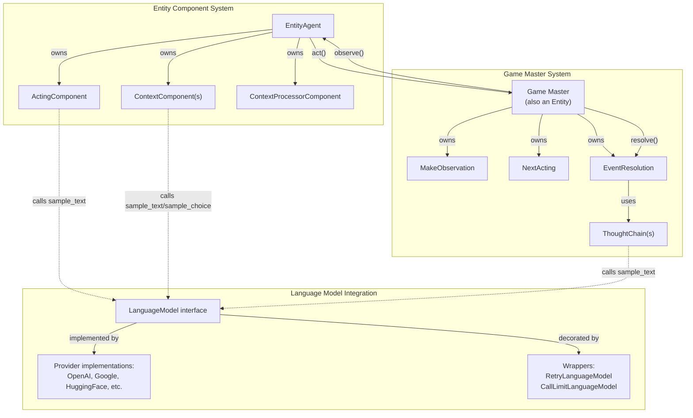
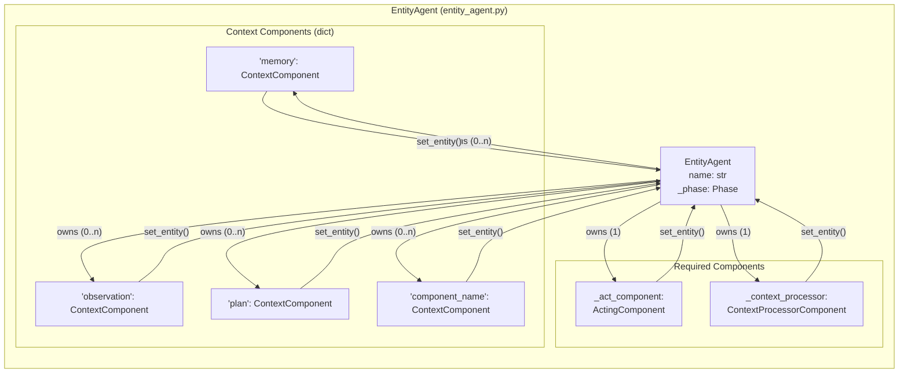
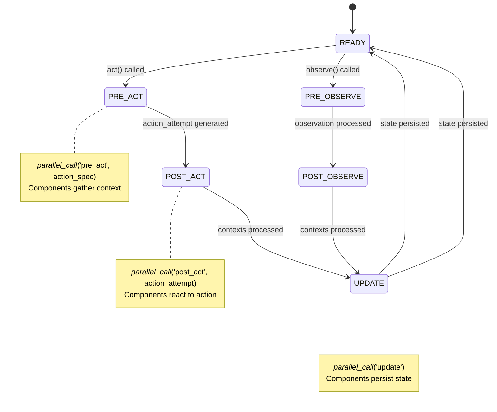
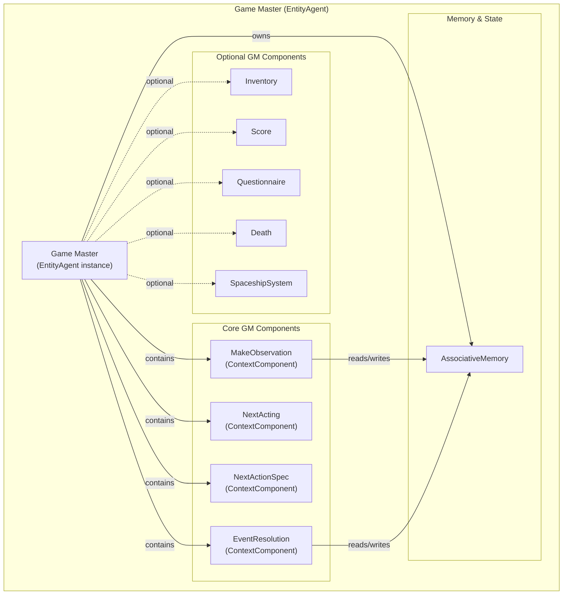
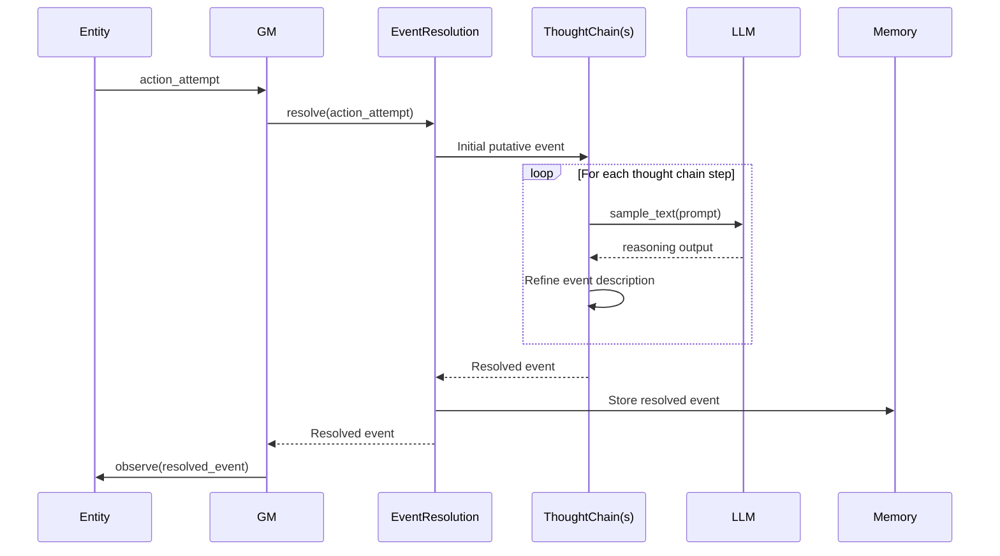
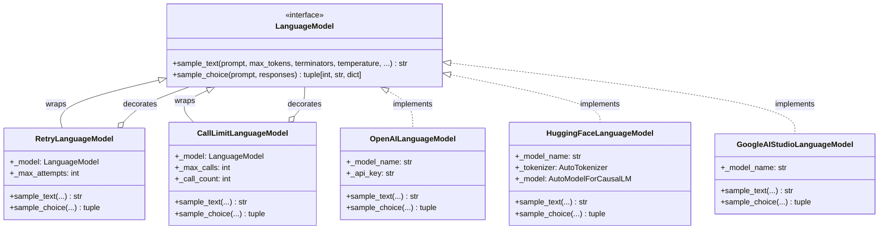
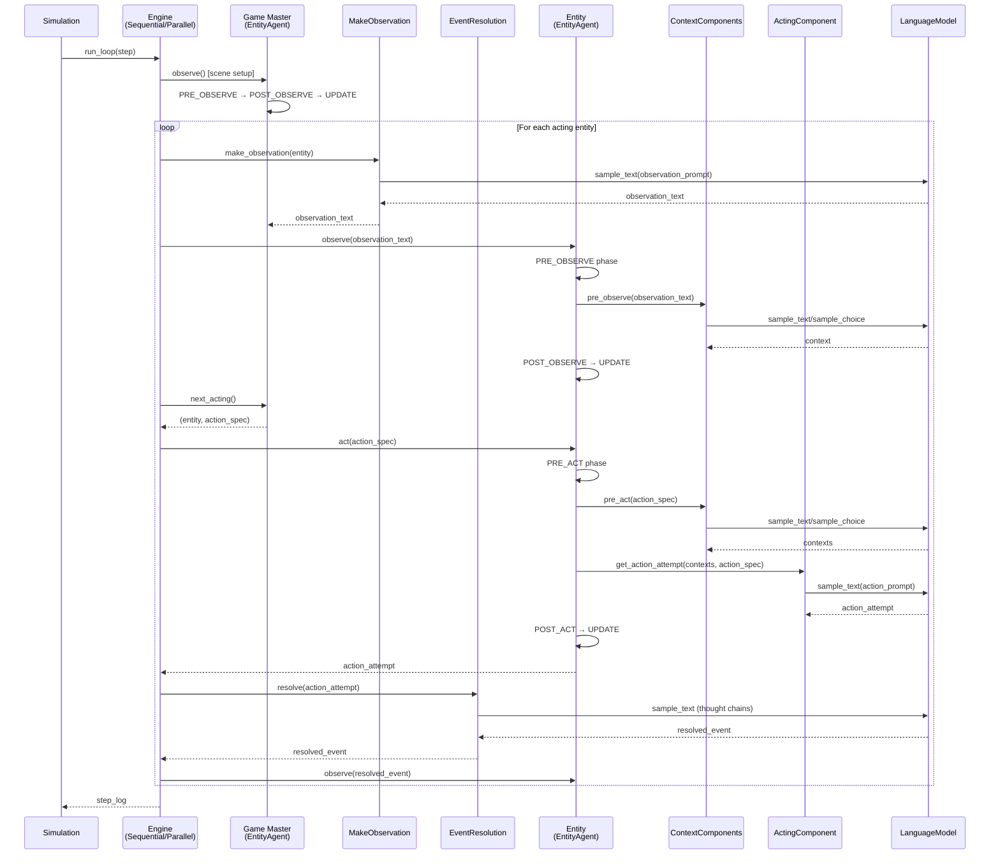

<!-- source: DeepWiki mcp.deepwiki.com · repo google-deepmind/concordia · page 2 Core Architecture · fetched 2026-10-26 -->

# Core Architecture

<details>
<summary>Relevant source files</summary>

The following files were used as context for generating this wiki page:

- [CHANGELOG.md](CHANGELOG.md)
- [CITATION.bib](CITATION.bib)
- [README.md](README.md)
- [setup.py](setup.py)

</details>


## Purpose and Scope

This document provides an overview of Concordia's three main architectural pillars: the **Entity Component System (ECS)**, the **Game Master System**, and the **Language Model Integration Layer**. These systems form the foundation for building multi-agent generative simulations.

For detailed documentation on specific aspects of each system, see:
- Entity Component System details: [Entity Component System](#2.1)
- Game Master implementation details: [Game Master System](#2.2)
- Language Model provider implementations: [Language Model Integration](#2.3)
- Simulation configuration and execution: [Simulation Framework](#3)

## Architectural Overview

Concordia's architecture separates concerns into three primary layers that interact through well-defined interfaces.

**High-Level Architecture Diagram**



**Sources:** [concordia/agents/entity_agent.py](), [concordia/language_model/language_model.py](), [CHANGELOG.md:68-82]()

## Entity Component System (ECS)

### Core Concept

Concordia uses an Entity Component System pattern where agents (`EntityAgent`) are composed of modular, reusable components. This design enables flexible agent behavior through composition rather than inheritance.

**EntityAgent Structure Diagram**



**Sources:** [concordia/agents/entity_agent.py:35-86]()

### Component Types

| Component Type | Base Class | Purpose | Key Methods |
|----------------|------------|---------|-------------|
| **Acting** | `ActingComponent` | Generates agent actions | `get_action_attempt()` |
| **Context** | `ContextComponent` | Provides contextual information | `pre_act()`, `post_act()`, `pre_observe()`, `post_observe()`, `update()` |
| **Context Processor** | `ContextProcessorComponent` | Orchestrates context flow | `pre_act()`, `post_act()`, `pre_observe()`, `post_observe()` |

**Sources:** [concordia/typing/entity_component.py]()

### Lifecycle Phases

The `EntityAgent` operates through a state machine with distinct phases defined in the `Phase` enum:

**Phase Transition Diagram**



**Key Implementation Details:**

- **Phase transitions** are enforced by `_set_phase()` which calls `phase.check_successor()` [concordia/agents/entity_agent.py:97-100]()
- **Parallel execution**: `_parallel_call_()` invokes component methods concurrently using `ThreadPoolExecutor` [concordia/agents/entity_agent.py:120-161]()
- **Thread safety**: Operations are protected by `_control_lock` to prevent concurrent lifecycle execution [concordia/agents/entity_agent.py:70,167]()

**Sources:** [concordia/agents/entity_agent.py:163-200](), [concordia/typing/entity_component.py]()

## Game Master System

### Game Master as Entity

Since version 2.0.0, Game Masters are implemented as entities (`EntityAgent` instances), allowing them to use the same component system as player agents. This unification simplifies the architecture and enables Game Masters to have memory, observation processing, and other agent-like capabilities.

**Game Master Component Architecture**



**Sources:** [CHANGELOG.md:71](), [concordia/typing/entity.py]()

### Core Responsibilities

The Game Master orchestrates the simulation through four primary responsibilities:

| Responsibility | Component | Method | Purpose |
|----------------|-----------|--------|---------|
| **Observation Generation** | `MakeObservation` | `make_observation()` | Creates entity-specific observations based on simulation state |
| **Turn Selection** | `NextActing` | `next_acting()` | Determines which entity acts next (may use LLM for dynamic selection) |
| **Action Format** | `NextActionSpec` | `next_action_spec()` | Specifies the format/constraints for the next action |
| **Event Resolution** | `EventResolution` | `resolve()` | Validates and processes action attempts into canonical events |

**Sources:** [concordia/components/game_master/]()

### Event Resolution and Thought Chains

Event resolution transforms putative events (action attempts from entities) into resolved events through a chain of reasoning steps:

**Thought Chain Processing Flow**



**Common Thought Chain Examples:**

- **`AccountForAgencyOfOthers`**: Validates that actions respect the agency and consent of other entities
- **`determine_success_and_why`**: Assesses whether an action succeeds and explains the outcome
- **`result_to_causal_statement`**: Converts outcomes into causal narrative statements
- **`Conversation`**: Resolves multi-turn dialogue interactions

**Sources:** [concordia/components/game_master/thought_chains.py](), [concordia/thought_chains/]()

## Language Model Integration

### Abstraction Layer

Concordia abstracts LLM access through the `LanguageModel` interface, which defines two primary methods:

**LanguageModel Interface Mapping**



**Method Signatures:**

- **`sample_text(prompt, *, max_tokens, terminators, temperature, ...)`**: Returns a text completion as a string
- **`sample_choice(prompt, responses, *)`**: Returns `(index, response_text, debug_info)` selecting from provided options

**Sources:** [concordia/language_model/language_model.py](), [concordia/language_model/huggingface_model.py:38-198]()

### Provider Implementations

Concordia supports 11+ LLM providers through uniform implementations of the `LanguageModel` interface:

| Provider Type | Implementations | Module Path |
|---------------|----------------|-------------|
| **OpenAI** | GPT-3.5, GPT-4, GPT-4o | `openai_model.py` |
| **Google** | Gemini (AI Studio, Vertex AI) | `google_aistudio_model.py`, `vertex_ai.py` |
| **Mistral** | Mistral models | `mistral_model.py` |
| **HuggingFace** | Transformers models | `huggingface_model.py` |
| **Ollama** | Local models | `ollama_model.py` |
| **vLLM** | Optimized local inference | `vllm_model.py` |
| **Together AI** | Open weights models | `together_ai.py` |
| **Amazon Bedrock** | AWS hosted models | `amazon_bedrock_model.py` |

**Sources:** [concordia/language_model/](), [setup.py:69-90]()

### Factory Function

The `language_model_setup()` factory dynamically instantiates LM implementations based on the `api_type` parameter:

```mermaid
graph TB
    Factory["language_model_setup()<br/>(utils/language_model_setup.py)"]
    
    Factory -->|"api_type='openai'"| OpenAI["OpenAILanguageModel"]
    Factory -->|"api_type='google_aistudio_model'"| Google["GoogleAIStudioLanguageModel"]
    Factory -->|"api_type='mistral'"| Mistral["MistralLanguageModel"]
    Factory -->|"api_type='huggingface'"| HF["HuggingFaceLanguageModel"]
    Factory -->|"api_type='ollama'"| Ollama["OllamaLanguageModel"]
    Factory -->|"api_type='vllm'"| VLLM["VLLMLanguageModel"]
    Factory -->|"api_type='together'"| Together["TogetherLanguageModel"]
    Factory -->|"api_type='amazon_bedrock'"| Bedrock["AmazonBedrockLanguageModel"]
    
    Factory -.->|"wraps with"| Retry["RetryLanguageModel"]
    Factory -.->|"wraps with"| Limit["CallLimitLanguageModel"]
```



**Sources:** [concordia/utils/language_model_setup.py]()

## Integration and Data Flow

### Simulation Execution Flow

The three architectural pillars interact through a structured execution flow orchestrated by the `Simulation` class and `Engine` implementations:

**Complete System Data Flow**



**Sources:** [concordia/simulation.py](), [concordia/engines/](), [concordia/agents/entity_agent.py:163-200]()

### Key Integration Points

**1. Component-to-LLM Binding**

Components invoke LLM methods directly through dependency injection:

```
ContextComponent.pre_act()
  └─> self._model.sample_text(prompt)  # _model is LanguageModel instance
```

**2. GM-to-Entity Communication**

Game Master and entities interact through the `Entity` interface:

```
GameMaster (EntityAgent)
  └─> entity.observe(observation)      # Entity.observe() method
  └─> entity.act(action_spec)          # Entity.act() method
```

**3. State Serialization**

All components implement `get_state()` / `set_state()` for checkpointing:

```
EntityAgent.get_state() returns EntityState = {
  'act_component': dict,
  'context_processor': dict,
  'context_components': {name: dict, ...}
}
```

**Sources:** [concordia/agents/entity_agent.py:202-251](), [concordia/typing/entity_component.py]()

---

## Summary

Concordia's core architecture achieves modularity and extensibility through three loosely coupled systems:

1. **Entity Component System**: Provides compositional agent behavior through `EntityAgent` and modular components with phase-based lifecycle management
2. **Game Master System**: Orchestrates simulations through observation generation, turn selection, and event resolution with thought chains
3. **Language Model Integration**: Abstracts LLM access through a unified interface supporting 11+ providers with decorator-based enhancements

These systems integrate through well-defined interfaces (`Entity`, `LanguageModel`, `Component`) enabling flexible simulation design while maintaining clear separation of concerns.

**Sources:** [CHANGELOG.md:68-82](), [setup.py:34-114](), [concordia/agents/entity_agent.py](), [concordia/language_model/language_model.py]()

---

