<!-- source: DeepWiki mcp.deepwiki.com · repo google-deepmind/concordia · page 2.1 Entity Component System · fetched 2026-10-26 -->

# Entity Component System

<details>
<summary>Relevant source files</summary>

The following files were used as context for generating this wiki page:

- [concordia/agents/entity_agent.py](concordia/agents/entity_agent.py)
- [concordia/components/agent/__init__.py](concordia/components/agent/__init__.py)
- [concordia/components/agent/instructions.py](concordia/components/agent/instructions.py)
- [concordia/components/agent/no_op_context_processor.py](concordia/components/agent/no_op_context_processor.py)
- [concordia/typing/entity_component.py](concordia/typing/entity_component.py)
- [concordia/typing/logging.py](concordia/typing/logging.py)

</details>


The Entity Component System (ECS) is Concordia's foundational architecture for building modular, composable agents. This system enables agents to be assembled from reusable functional components that operate within a strictly-defined phase-based lifecycle. The ECS separates agent functionality into orthogonal concerns (observation processing, memory retrieval, planning, action generation) and coordinates their execution through a centralized orchestrator.

This page covers the core ECS architecture, phase lifecycle, component base classes, and the `EntityAgent` orchestrator. For concrete component implementations, see [Agent Component Library](#2.1.3). For game master components, see [Game Master System](#2.2).

## Architecture Overview

The ECS consists of three primary abstractions working together:

| Abstraction | Purpose | Key Classes |
|------------|---------|-------------|
| **Phase Lifecycle** | Defines the ordered sequence of states an entity transitions through during act/observe cycles | `Phase` enum [concordia/typing/entity_component.py:39-88]() |
| **Component Base Classes** | Abstract interfaces for modular functionality blocks | `BaseComponent`, `ContextComponent`, `ActingComponent`, `ContextProcessorComponent` [concordia/typing/entity_component.py:90-366]() |
| **Entity Orchestrator** | Coordinates component execution and manages lifecycle transitions | `EntityAgent` [concordia/agents/entity_agent.py:35-277]() |

### Component Architecture

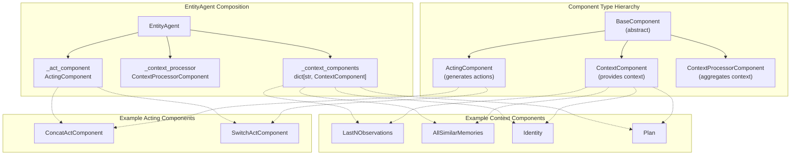

**Sources:** [concordia/typing/entity_component.py:90-366](), [concordia/agents/entity_agent.py:45-86](), [concordia/components/agent/__init__.py:17-29]()

## Phase-Based Lifecycle

The ECS lifecycle is governed by the `Phase` enum, which defines six states that entities transition through during `act()` and `observe()` operations. This phase system ensures deterministic component execution order and prevents race conditions.

### Phase State Machine

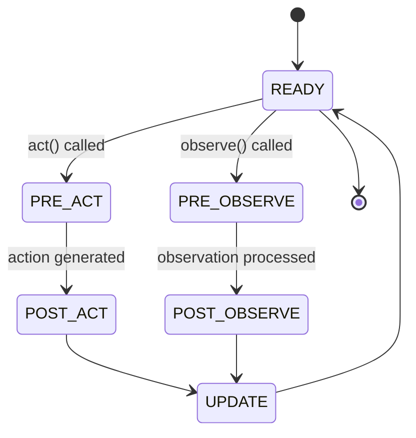

**Sources:** [concordia/typing/entity_component.py:39-88]()

### Phase Descriptions

| Phase | Entry Condition | Component Hook | Purpose | Exit Condition |
|-------|----------------|----------------|---------|----------------|
| `READY` | Initial state or after `UPDATE` | None | Entity is idle, awaiting `act()` or `observe()` call | `act()` or `observe()` invoked |
| `PRE_ACT` | `act()` called | `ContextComponent.pre_act()` | Components provide context strings for action generation | All components return context |
| `POST_ACT` | Action attempt generated | `ContextComponent.post_act()` | Components receive notification of action attempt | All components process action |
| `PRE_OBSERVE` | `observe()` called | `ContextComponent.pre_observe()` | Components receive observation string | All components process observation |
| `POST_OBSERVE` | Observation distributed | `ContextComponent.post_observe()` | Components provide post-observation context | All components return context |
| `UPDATE` | After `POST_ACT` or `POST_OBSERVE` | `ContextComponent.update()` | Components update internal state and caches | All components complete update |

Phase transitions are validated by [concordia/typing/entity_component.py:84-87](), which raises `ValueError` for invalid transitions. The current phase is tracked in [concordia/agents/entity_agent.py:72]() and protected by a thread lock [concordia/agents/entity_agent.py:71]().

**Sources:** [concordia/typing/entity_component.py:39-88](), [concordia/agents/entity_agent.py:93-100]()

## Component Base Classes

### BaseComponent

The root abstraction for all components, providing entity binding and state management.

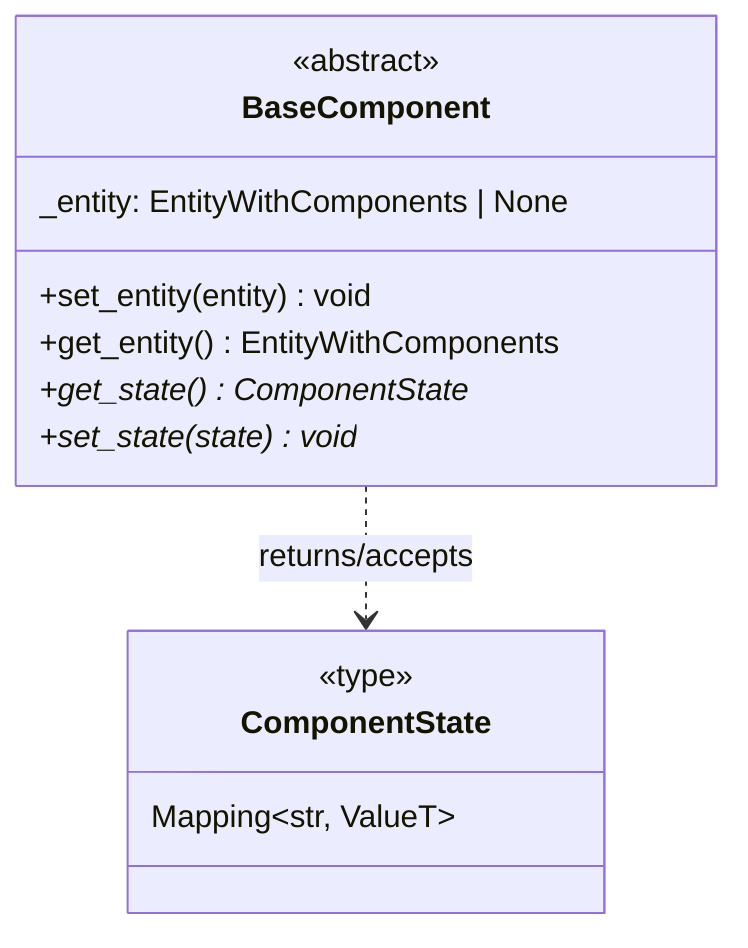

**Key Methods:**
- `set_entity()` [concordia/typing/entity_component.py:95-106](): Binds component to entity. Raises `RuntimeError` if already bound.
- `get_entity()` [concordia/typing/entity_component.py:108-116](): Returns owning entity. Raises `RuntimeError` if not bound.
- `get_state()` [concordia/typing/entity_component.py:118-125](): Returns serializable state dict for checkpointing.
- `set_state()` [concordia/typing/entity_component.py:128-162](): Restores component state from dict. Must be called after `__init__()` with identical parameters.

**Sources:** [concordia/typing/entity_component.py:90-163]()

### ContextComponent

Components that provide information during phase transitions. These form the bulk of agent functionality.

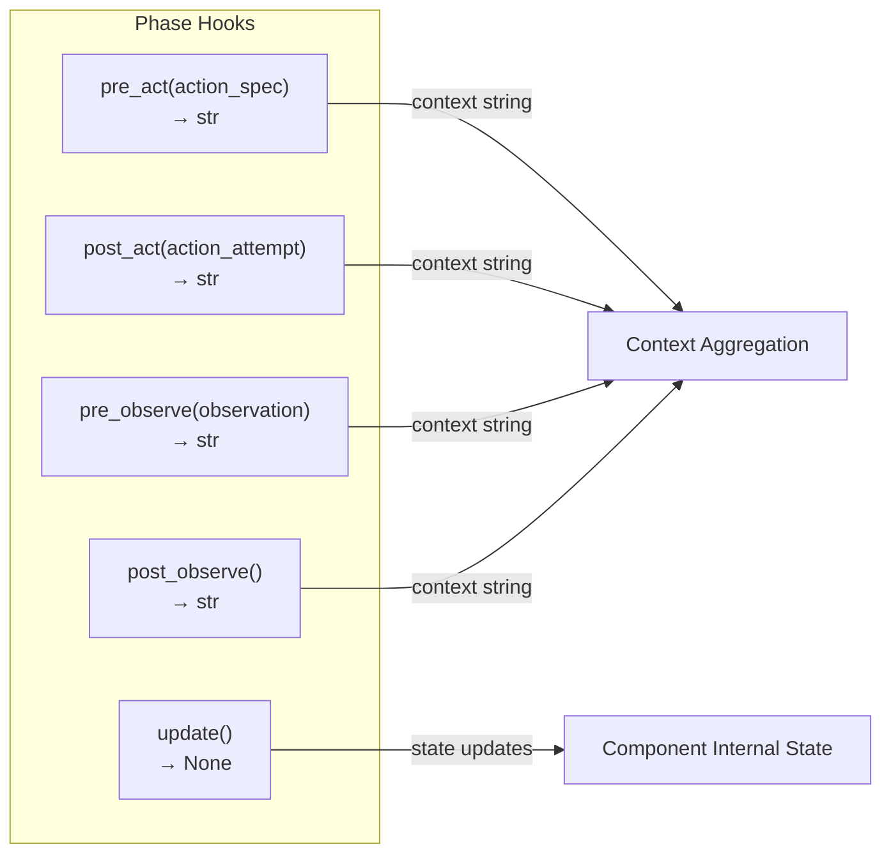

**Method Signatures:**
- `pre_act(action_spec: ActionSpec) -> str` [concordia/typing/entity_component.py:218-234](): Returns context relevant for action generation.
- `post_act(action_attempt: str) -> str` [concordia/typing/entity_component.py:236-252](): Receives the action attempt, returns additional context.
- `pre_observe(observation: str) -> str` [concordia/typing/entity_component.py:254-271](): Receives observation, returns relevant context.
- `post_observe() -> str` [concordia/typing/entity_component.py:273-285](): Returns context after observation processing.
- `update() -> None` [concordia/typing/entity_component.py:287-295](): Updates internal state, replaces caches.

All methods have default no-op implementations returning empty strings. Components override only methods relevant to their functionality.

**Sources:** [concordia/typing/entity_component.py:211-296]()

### ActingComponent

A privileged component responsible for generating action attempts. Each `EntityAgent` has exactly one `ActingComponent`.

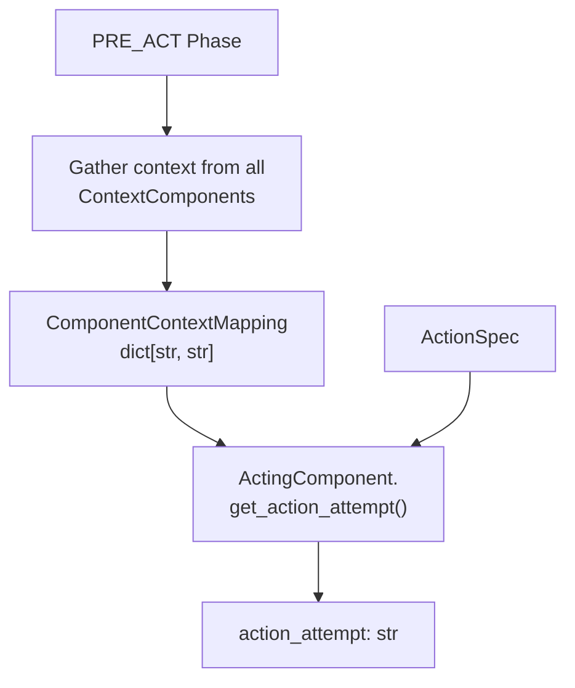

**Key Method:**
- `get_action_attempt(context: ComponentContextMapping, action_spec: ActionSpec) -> str` [concordia/typing/entity_component.py:302-321]()

The `context` parameter is a mapping of component names to their `pre_act()` return values. This allows the acting component to synthesize information from all other components when generating the action.

**Sources:** [concordia/typing/entity_component.py:298-322]()

### ContextProcessorComponent

An optional component that processes aggregated context from all `ContextComponent` instances. Unlike `ContextComponent`, it receives the complete context mapping rather than contributing to it.

**Method Signatures:**
- `pre_act(contexts: ComponentContextMapping) -> None` [concordia/typing/entity_component.py:327-333]()
- `post_act(contexts: ComponentContextMapping) -> None` [concordia/typing/entity_component.py:335-341]()
- `pre_observe(contexts: ComponentContextMapping) -> None` [concordia/typing/entity_component.py:343-349]()
- `post_observe(contexts: ComponentContextMapping) -> None` [concordia/typing/entity_component.py:351-357]()

If no `ContextProcessorComponent` is provided to `EntityAgent`, a `NoOpContextProcessor` [concordia/components/agent/no_op_context_processor.py:20-22]() is used by default [concordia/agents/entity_agent.py:77-81]().

**Sources:** [concordia/typing/entity_component.py:324-366](), [concordia/agents/entity_agent.py:77-81](), [concordia/components/agent/no_op_context_processor.py:20-22]()

## EntityAgent: The Component Orchestrator

`EntityAgent` [concordia/agents/entity_agent.py:35-277]() is the concrete implementation of `EntityWithComponents` that manages component lifecycle and coordinates their execution.

### Initialization and Component Binding

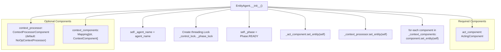

**Sources:** [concordia/agents/entity_agent.py:45-86]()

### act() Execution Flow

The `act()` method [concordia/agents/entity_agent.py:165-185]() orchestrates the complete action generation cycle with strict phase transitions:

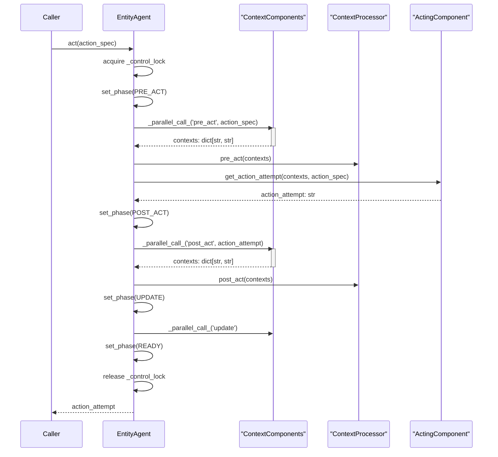

**Key Implementation Details:**
- The entire sequence is protected by `_control_lock` [concordia/agents/entity_agent.py:168]() to ensure atomicity.
- Phase transitions are validated by `_set_phase()` [concordia/agents/entity_agent.py:97-100]().
- Component methods are called in parallel via `_parallel_call_()` [concordia/agents/entity_agent.py:120-162]().
- Duplicate component instances are called only once, with results mapped to all registration names [concordia/agents/entity_agent.py:143-161]().

**Sources:** [concordia/agents/entity_agent.py:165-185]()

### observe() Execution Flow

The `observe()` method [concordia/agents/entity_agent.py:188-201]() follows a similar pattern:

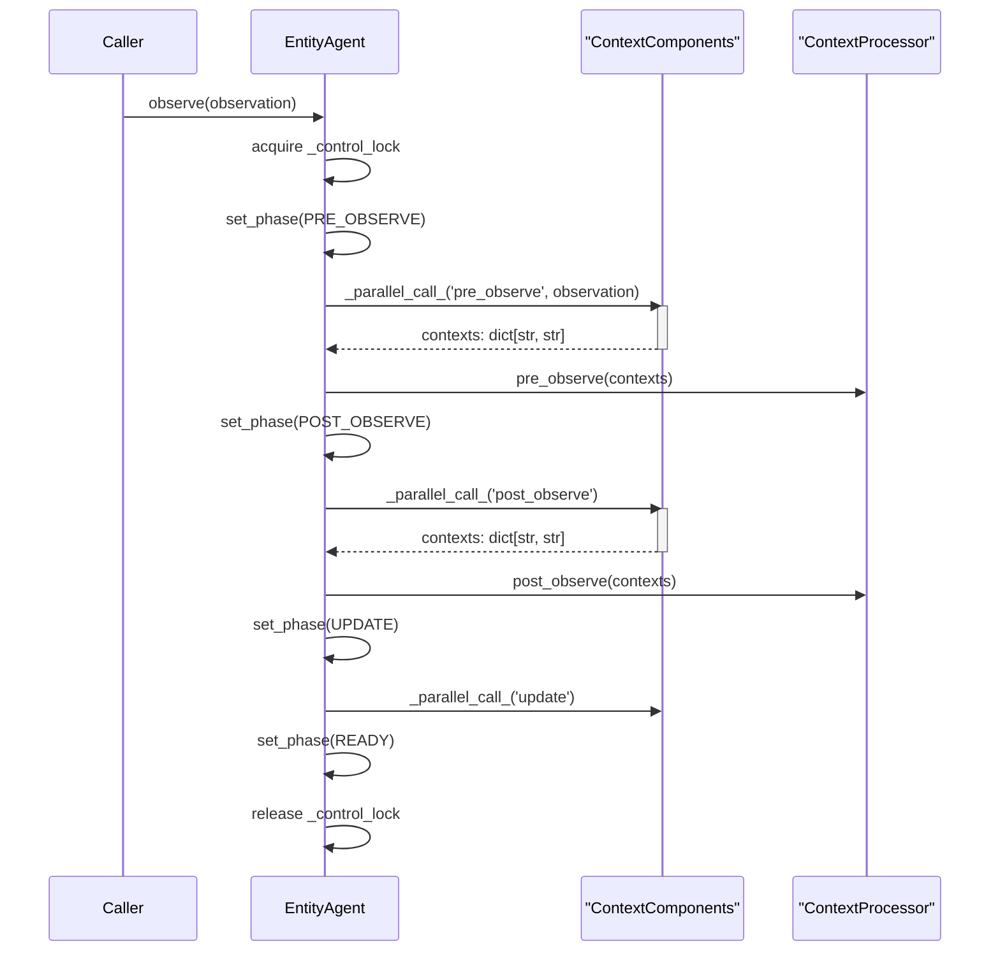

**Sources:** [concordia/agents/entity_agent.py:188-201]()

## Parallel Component Execution

Components are called in parallel to reduce latency, especially when components make independent LLM calls. The `_parallel_call_()` method [concordia/agents/entity_agent.py:120-162]() implements this with deduplication:

### Deduplication Logic

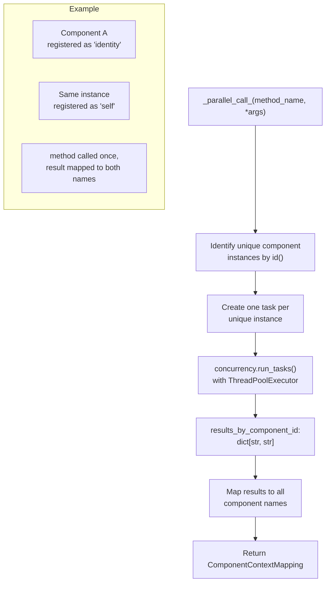

**Implementation Details:**
1. Unique instances identified: `list(set(self._context_components.values()))` [concordia/agents/entity_agent.py:144]()
2. Tasks created by id: `tasks_for_unique[str(id(component))] = functools.partial(...)` [concordia/agents/entity_agent.py:147-151]()
3. Parallel execution: `concurrency.run_tasks(tasks_for_unique, executor=executor)` [concordia/agents/entity_component.py:153-155]()
4. Result mapping: `final_results[name] = results_by_component_id[str(id(component))]` [concordia/agents/entity_agent.py:159-160]()

**Sources:** [concordia/agents/entity_agent.py:120-162]()

## State Management

The ECS supports serialization and restoration for checkpointing. State is hierarchical:

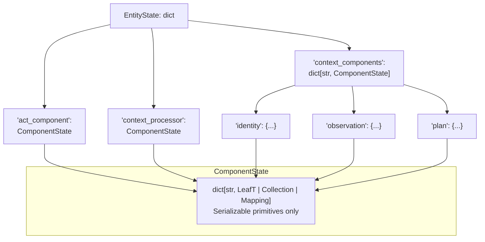

### get_state() / set_state() Protocol

**Serialization** [concordia/agents/entity_agent.py:243-252]():
```python
# Returns nested dict structure
entity_state = {
    'act_component': self._act_component.get_state(),
    'context_processor': self._context_processor.get_state(),
    'context_components': {
        name: component.get_state()
        for name, component in self._context_components.items()
    }
}
```

**Restoration** [concordia/agents/entity_agent.py:203-241]():
1. Context components restored first [concordia/agents/entity_agent.py:209-220]()
2. Acting component restored [concordia/agents/entity_agent.py:223-230]()
3. Context processor restored [concordia/agents/entity_agent.py:233-241]()
4. Errors logged but don't halt restoration [concordia/agents/entity_agent.py:216-220]()

**Important Constraints:**
- State dicts contain only serializable primitives (str, int, float, None, collections, mappings) [concordia/typing/entity_component.py:32-36]()
- `set_state()` assumes component was initialized with identical `__init__()` parameters [concordia/typing/entity_component.py:136-137]()
- Non-serializable resources (LLMs, memory banks) passed at initialization, not in state [concordia/typing/entity_component.py:133-135]()

**Sources:** [concordia/agents/entity_agent.py:203-252](), [concordia/typing/entity_component.py:32-36](), [concordia/typing/entity_component.py:128-162]()

## Thread Safety

The `EntityAgent` uses two locks to ensure thread safety:

| Lock | Protects | Scope | Location |
|------|----------|-------|----------|
| `_control_lock` | Complete `act()` and `observe()` sequences | Method-level | [concordia/agents/entity_agent.py:70]() |
| `_phase_lock` | `_phase` field reads/writes | Field-level | [concordia/agents/entity_agent.py:71]() |

**Locking Strategy:**
- `_control_lock` acquired at method entry [concordia/agents/entity_agent.py:168](), [concordia/agents/entity_agent.py:189]()
- Prevents interleaved `act()` and `observe()` calls
- `_phase_lock` protects `get_phase()` [concordia/agents/entity_agent.py:94-95]() and `_set_phase()` [concordia/agents/entity_agent.py:98-100]()
- Allows phase queries without blocking entire operation

**Sources:** [concordia/agents/entity_agent.py:70-71](), [concordia/agents/entity_agent.py:93-100](), [concordia/agents/entity_agent.py:165-201]()

## Component Composition Pattern

Entities are typically composed following this pattern:

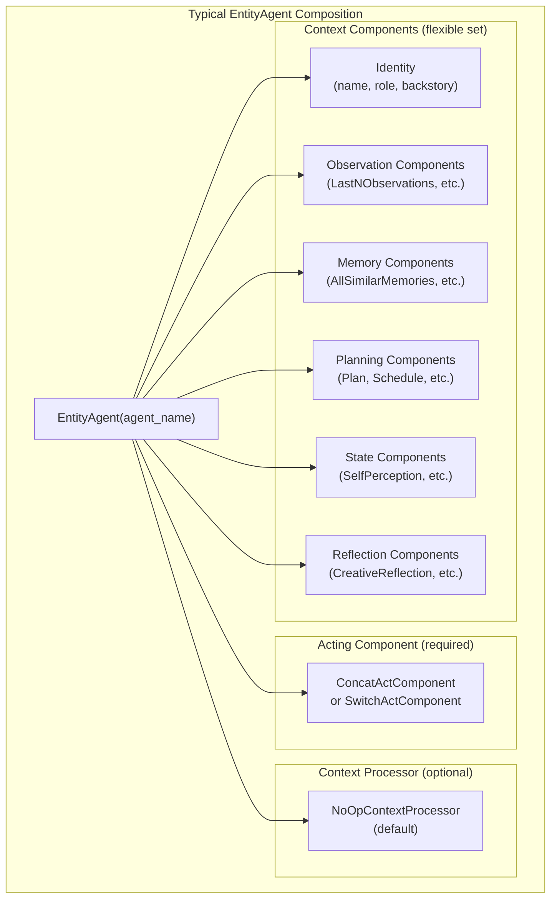

Components are instantiated separately and passed to `EntityAgent.__init__()` [concordia/agents/entity_agent.py:45-86](). The entity takes ownership by calling `set_entity()` on each component [concordia/agents/entity_agent.py:74-85]().

For concrete component implementations, see [Agent Component Library](#2.1.3). For prefab recipes that instantiate complete agents, see [Prefab and Configuration System](#3.1).

**Sources:** [concordia/agents/entity_agent.py:45-86](), [concordia/components/agent/__init__.py:15-29]()

---

