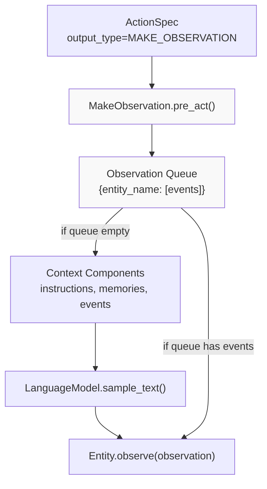
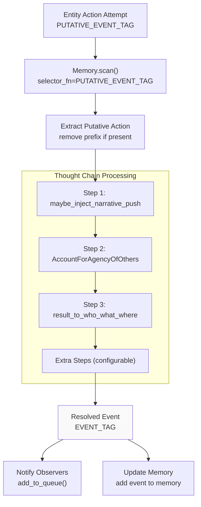
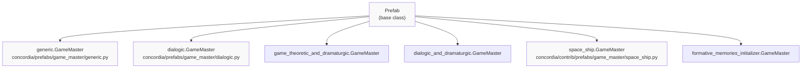
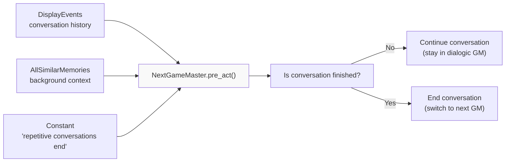
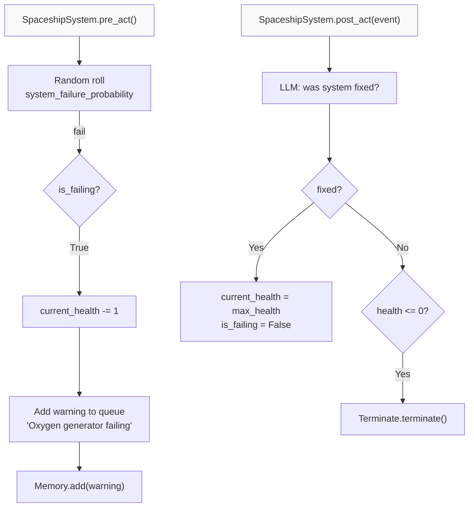
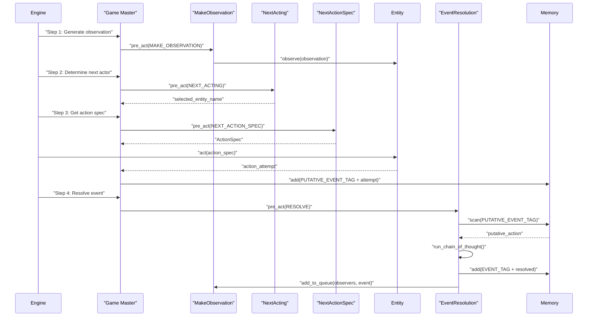
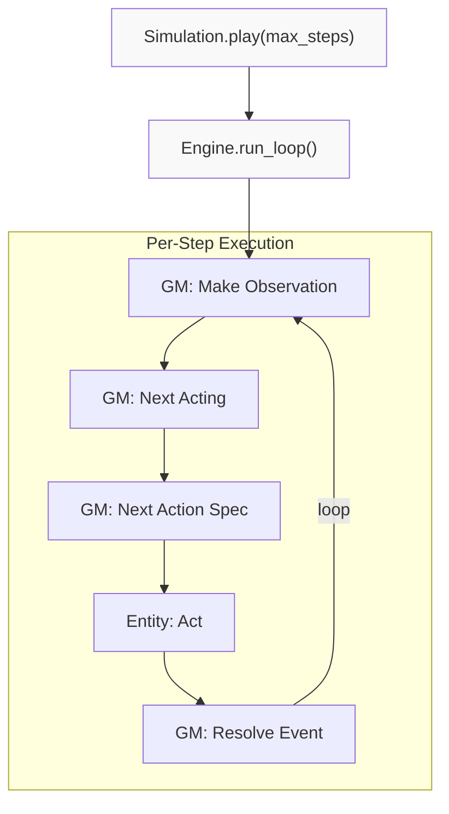

<!-- source: DeepWiki mcp.deepwiki.com · repo google-deepmind/concordia · page 2.2 Game Master System · fetched 2026-10-26 -->

# Game Master System

<details>
<summary>Relevant source files</summary>

The following files were used as context for generating this wiki page:

- [CITATION.bib](CITATION.bib)
- [README.md](README.md)
- [concordia/prefabs/entity/conversational.py](concordia/prefabs/entity/conversational.py)
- [concordia/prefabs/game_master/__init__.py](concordia/prefabs/game_master/__init__.py)
- [concordia/prefabs/game_master/dialogic.py](concordia/prefabs/game_master/dialogic.py)
- [concordia/prefabs/game_master/formative_memories_initializer.py](concordia/prefabs/game_master/formative_memories_initializer.py)
- [concordia/prefabs/game_master/formative_memories_initializer_dramaturgic.py](concordia/prefabs/game_master/formative_memories_initializer_dramaturgic.py)
- [concordia/prefabs/game_master/game_master_prefabs_test.py](concordia/prefabs/game_master/game_master_prefabs_test.py)
- [concordia/prefabs/game_master/situated_in_time_and_place.py](concordia/prefabs/game_master/situated_in_time_and_place.py)

</details>


## Purpose and Scope

The Game Master System is responsible for orchestrating multi-agent simulations in Concordia. It manages the simulation state, generates observations for entities, determines turn order, and resolves actions into canonical events. The Game Master acts as a referee and narrator, ensuring coherent simulation dynamics while maintaining narrative consistency.

For information about the Entity Component System that Game Masters orchestrate, see [Entity Component System](#2.1). For details on Language Model integration used by Game Master components, see [Language Model Integration](#2.3). For simulation execution flow, see [Simulation Orchestration](#3.2).

---

## Core Responsibilities

The Game Master fulfills four primary responsibilities during each simulation step:

| Responsibility | Component | Purpose |
|----------------|-----------|---------|
| **Observation Generation** | `MakeObservation` | Generate entity-specific views of the simulation state |
| **Turn Selection** | `NextActing` | Determine which entity acts next |
| **Action Specification** | `NextActionSpec` | Define the format and constraints for entity actions |
| **Event Resolution** | `EventResolution` | Transform putative actions into resolved events |

### Observation Generation via MakeObservation

**Observation Generation Flow**



The `MakeObservation` component generates customized observations for each entity. It maintains a queue of events per entity and can either pull from the queue or generate new observations using the LLM based on the current simulation state.

**Sources:** [concordia/components/game_master/make_observation.py:40-231]()

### Turn Selection via NextActing

The Game Master determines which entity should act next through one of several strategies:

| Strategy | Implementation | Behavior |
|----------|---------------|----------|
| `game_master_choice` | `NextActing` | LLM decides based on context |
| `fixed` | `NextActingInFixedOrder` | Round-robin by predefined sequence |
| `random` | `NextActingInRandomOrder` | Random selection from available entities |

**Sources:** [concordia/prefabs/game_master/generic.py:161-188](), [concordia/prefabs/game_master/dialogic.py:146-170]()

### Action Specification via NextActionSpec

The `NextActionSpec` component defines what type of action an entity can take. Common action specifications include:

- `DEFAULT_SPEECH_ACTION_SPEC` - Free-form speech/dialogue
- `choice_action_spec()` - Multiple choice selection
- `free_action_spec()` - Open-ended action description

**Sources:** [concordia/prefabs/game_master/dialogic.py:172-176]()

---

## Architecture and Component Integration

**Game Master Component Structure**

```mermaid
graph TB
    EntityAgent["EntityAgentWithLogging<br/>(Game Master)"]
    
    subgraph "Core Components"
        Instructions["Instructions"]
        PlayerChars["PlayerCharacters"]
        Memory["AssociativeMemory"]
        Observation["LastNObservations"]
    end
    
    subgraph "Orchestration Components"
        MakeObs["MakeObservation<br/>DEFAULT_MAKE_OBSERVATION_COMPONENT_KEY"]
        NextAct["NextActing<br/>DEFAULT_NEXT_ACTING_COMPONENT_KEY"]
        NextSpec["NextActionSpec<br/>DEFAULT_NEXT_ACTION_SPEC_COMPONENT_KEY"]
        Resolution["EventResolution<br/>DEFAULT_RESOLUTION_COMPONENT_KEY"]
    end
    
    subgraph "Special Components"
        Display["DisplayEvents"]
        RelevantMem["AllSimilarMemories"]
        SendEvents["SendEventToRelevantPlayers"]
    end
    
    SwitchAct["SwitchAct<br/>(ActingComponent)"]
    
    EntityAgent --> SwitchAct
    SwitchAct --> Instructions
    SwitchAct --> PlayerChars
    SwitchAct --> Memory
    SwitchAct --> Observation
    SwitchAct --> MakeObs
    SwitchAct --> NextAct
    SwitchAct --> NextSpec
    SwitchAct --> Resolution
    SwitchAct --> Display
    SwitchAct --> RelevantMem
    SwitchAct --> SendEvents
    
    style EntityAgent fill:#f9f9f9
    style SwitchAct fill:#f9f9f9
```



The Game Master is implemented as an `EntityAgentWithLogging` with specialized components. The `SwitchAct` acting component coordinates the execution flow, routing action specifications to the appropriate components based on their `output_type`.

**Sources:** [concordia/prefabs/game_master/generic.py:56-273](), [concordia/prefabs/game_master/dialogic.py:55-255]()

---

## Event Resolution and Thought Chains

Event resolution transforms putative events (action attempts from entities) into canonical events that update the simulation state. This process uses a chain-of-thought approach to ensure consistency, validate agency, and maintain narrative coherence.

**Event Resolution Pipeline**



### Thought Chain Steps

The `event_resolution_steps` parameter accepts a sequence of functions that progressively refine the event. Each step receives an `InteractiveDocument` and returns a refined version.

**Default Resolution Steps:**
1. `maybe_inject_narrative_push` - Adds narrative drive if story is stagnating
2. `AccountForAgencyOfOthers` - Validates that actions respect other entities' agency
3. `result_to_who_what_where` - Extracts structured event information

**Additional Available Steps:**
- `attempt_to_result` - Determines success/failure of attempts
- `result_to_effect_caused_by_active_player` - Clarifies causal relationships
- `result_to_causal_statement` - Generates causal explanations
- `RemoveSpecificText` - Removes formatting prefixes

**Sources:** [concordia/components/game_master/event_resolution.py:38-243](), [concordia/prefabs/game_master/generic.py:199-231]()

### Event Tags and Memory Integration

Events are tagged in memory to distinguish between putative and resolved events:

- `PUTATIVE_EVENT_TAG = '[putative_event]'` - Action attempts from entities
- `EVENT_TAG = '[event]'` - Canonical resolved events

The `DisplayEvents` component retrieves and displays recent events from memory:

**Sources:** [concordia/components/game_master/event_resolution.py:34-36](), [concordia/components/game_master/event_resolution.py:246-310]()

---

## Specialized Game Master Implementations

Concordia provides several specialized Game Master prefabs that extend the base functionality with domain-specific components.

**Game Master Prefab Hierarchy**



### Generic Game Master

The `generic.GameMaster` provides basic orchestration suitable for most simulations. It includes:

- Standard event resolution with `AccountForAgencyOfOthers`
- Configurable acting order (game_master_choice, fixed, random)
- Observation generation with time-based formatting
- Memory-based context retrieval

**Key Parameters:**
- `name` - Game Master identifier
- `acting_order` - Turn selection strategy
- `extra_event_resolution_steps` - Comma-separated thought chain steps
- `extra_components` - Additional custom components
- `extra_components_index` - Insertion positions for extra components

**Sources:** [concordia/prefabs/game_master/generic.py:31-273]()

### Dialogic Game Master

The `dialogic.GameMaster` specializes in conversation-based interactions. It differs from the generic GM by:

- Using identity-preserving event resolution (no agency validation)
- Detecting conversation completion via `NextGameMaster` component
- Managing turn transitions to other game masters
- Enforcing speech-only action specifications

**Conversation Termination Logic:**



**Sources:** [concordia/prefabs/game_master/dialogic.py:30-255]()

### Spaceship Game Master

The `space_ship.GameMaster` adds survival mechanics for space-themed simulations:

**Specialized Components:**
- `SpaceshipSystem` - Tracks system health (oxygen, power)
- `Death` - Handles entity mortality
- `Locations` - Manages entity positions in the ship

**SpaceshipSystem Mechanics:**



**Sources:** [concordia/contrib/prefabs/game_master/space_ship.py:33-358](), [concordia/contrib/components/game_master/spaceship_system.py:30-236]()

### Death Component

The `Death` component monitors events for entity mortality and removes dead entities from the simulation:

**Death Detection Flow:**
1. After each event resolution, check if any entity died
2. If death occurred, identify which entities died
3. Remove dead entities from `NextActingInFixedOrder` sequence
4. Notify remaining entities via observation queue
5. Add death event to memory
6. Terminate simulation if all entities are dead

**Sources:** [concordia/contrib/components/game_master/death.py:32-228]()

---

## Component Interaction Patterns

**Game Master Lifecycle During Simulation Step**



**Sources:** [concordia/components/game_master/make_observation.py:128-207](), [concordia/components/game_master/event_resolution.py:130-212]()

---

## Configuration and Instantiation

Game Masters are instantiated through the Prefab system using `InstanceConfig` objects:

```python
# Example from tutorial notebooks
prefab_lib.InstanceConfig(
    prefab='generic__GameMaster',
    role=prefab_lib.Role.GAME_MASTER,
    params={
        'name': 'default rules',
        'acting_order': 'game_master_choice',
        'extra_event_resolution_steps': '',
    },
)
```

**Common Configuration Patterns:**

| Parameter | Values | Effect |
|-----------|--------|--------|
| `acting_order` | `'game_master_choice'` | LLM selects next actor based on context |
| | `'fixed'` | Round-robin turn order |
| | `'random'` | Random selection |
| `extra_event_resolution_steps` | Comma-separated list | Additional thought chain steps |
| `next_game_master_name` | String | Game Master to switch to after completion |
| `can_terminate_simulation` | Boolean | Whether GM can end the simulation |

**Sources:** [examples/tutorial.ipynb:177-219](), [examples/actor_development.ipynb:406-448](), [examples/selling_cookies.ipynb:410-463]()

---

## Memory and State Management

Game Masters maintain state through their component system:

**Stateful Components:**
- `MakeObservation` - Observation queue per entity
- `EventResolution` - Current active entity and putative action
- `SendEventToRelevantPlayers` - Previous observations per entity
- `AssociativeMemory` - All simulation events and context

**State Serialization:**

All Game Master components implement `get_state()` and `set_state()` methods for checkpointing:

```python
# MakeObservation state structure
{
    'queue': {
        'entity_name': ['observation1', 'observation2', ...]
    }
}

# EventResolution state structure
{
    '_active_entity_name': 'Alice',
    '_putative_action': 'walks to the door'
}
```

**Sources:** [concordia/components/game_master/make_observation.py:222-230](), [concordia/components/game_master/event_resolution.py:222-232]()

---

## Integration with Simulation Framework

The Game Master integrates with the broader simulation framework through the `SwitchAct` acting component and the simulation's `Engine`:

**Simulation.play() Integration:**



The `SwitchAct` component routes to different output types:
- `OutputType.MAKE_OBSERVATION` → `MakeObservation.pre_act()`
- `OutputType.NEXT_ACTING` → `NextActing.pre_act()`
- `OutputType.NEXT_ACTION_SPEC` → `NextActionSpec.pre_act()`
- `OutputType.RESOLVE` → `EventResolution.pre_act()`

**Sources:** [concordia/prefabs/game_master/generic.py:261-265]()

---

## Summary

The Game Master System provides the orchestration layer for Concordia simulations. It:

1. **Generates contextualized observations** for each entity based on simulation state
2. **Manages turn order** through flexible selection strategies
3. **Defines action specifications** that constrain entity behavior
4. **Resolves events** through thought chains that validate and refine actions
5. **Maintains simulation memory** of all events and context
6. **Supports specialization** through prefab subclasses for specific domains

Game Masters are implemented as `EntityAgentWithLogging` instances with specialized components orchestrated by `SwitchAct`. They integrate with the simulation engine to manage the complete entity action cycle from observation to event resolution.

---

