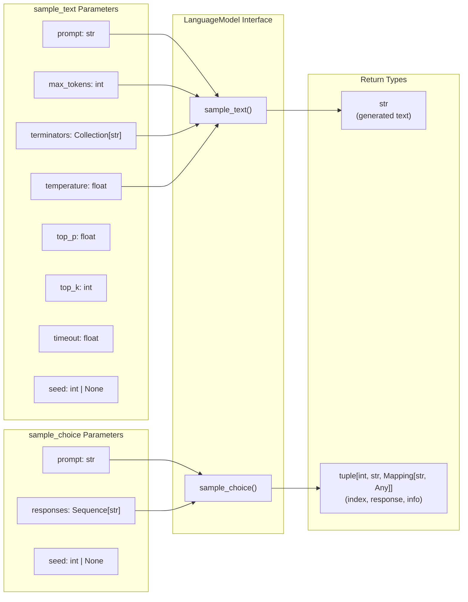
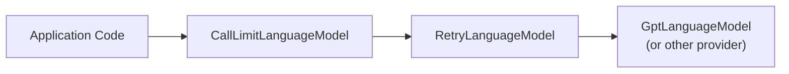

<!-- source: DeepWiki mcp.deepwiki.com · repo google-deepmind/concordia · page 2.3 Language Model Integration · fetched 2026-10-26 -->

# Language Model Integration

<details>
<summary>Relevant source files</summary>

The following files were used as context for generating this wiki page:

- [CHANGELOG.md](CHANGELOG.md)
- [concordia/document/interactive_document.py](concordia/document/interactive_document.py)
- [concordia/document/interactive_document_test.py](concordia/document/interactive_document_test.py)
- [concordia/language_model/call_limit_wrapper.py](concordia/language_model/call_limit_wrapper.py)
- [concordia/language_model/language_model.py](concordia/language_model/language_model.py)
- [concordia/language_model/no_language_model.py](concordia/language_model/no_language_model.py)
- [concordia/language_model/retry_wrapper.py](concordia/language_model/retry_wrapper.py)
- [concordia/testing/mock_model.py](concordia/testing/mock_model.py)
- [setup.py](setup.py)

</details>


This page provides an overview of Concordia's language model integration architecture. The framework provides a unified abstraction layer that allows agents and game masters to interact with various language model providers (OpenAI, Google, Mistral, local models, etc.) through a consistent interface.

The language model integration consists of three main components:
- **Language Model Abstraction** (page 2.3.1): The `LanguageModel` interface, wrapper utilities, and `InteractiveDocument` for structured conversations
- **Language Model Factory** (page 2.3.2): The `language_model_setup()` factory function for dynamic provider instantiation
- **Provider Implementations** (pages 2.3.3 and 2.3.4): Concrete implementations for cloud providers and local inference

## Three-Layer Architecture

Concordia's language model integration follows a three-layer architecture that separates application logic from provider-specific implementations:

**Three-Layer Language Model Architecture**

```mermaid
graph TB
    subgraph Application["Application Layer"]
        EntityAgent["EntityAgent"]
        GMComponents["Game Master Components"]
        AgentComponents["Agent Components<br/>(Memory, Plan, etc)"]
        ThoughtChains["Thought Chains"]
        InteractiveDocument["InteractiveDocument"]
    end
    
    subgraph Abstraction["Abstraction Layer"]
        LanguageModel["LanguageModel<br/>(base interface)"]
        RetryLanguageModel["RetryLanguageModel"]
        CallLimitLanguageModel["CallLimitLanguageModel"]
        NoLanguageModel["NoLanguageModel"]
        Factory["language_model_setup()"]
    end
    
    subgraph Implementation["Implementation Layer"]
        subgraph Cloud["Cloud Providers"]
            GptLanguageModel["GptLanguageModel"]
            GoogleAIStudioLanguageModel["GoogleAIStudioLanguageModel"]
            VertexAI["VertexAI"]
            MistralLanguageModel["MistralLanguageModel"]
            AmazonBedrockLanguageModel["AmazonBedrockLanguageModel"]
            TogetherAI["together_ai.Base"]
        end
        subgraph Local["Local Inference"]
            HuggingFaceLanguageModel["HuggingFaceLanguageModel"]
            OllamaLanguageModel["OllamaLanguageModel"]
            LangchainOllamaLanguageModel["LangchainOllamaLanguageModel"]
            PyTorchGemmaLanguageModel["PyTorchGemmaLanguageModel"]
            VLLMLanguageModel["VLLMLanguageModel"]
        end
    end
    
    EntityAgent --> LanguageModel
    GMComponents --> LanguageModel
    AgentComponents --> LanguageModel
    ThoughtChains --> LanguageModel
    InteractiveDocument --> LanguageModel
    
    Factory --> LanguageModel
    RetryLanguageModel --> LanguageModel
    CallLimitLanguageModel --> LanguageModel
    
    LanguageModel <--> GptLanguageModel
    LanguageModel <--> GoogleAIStudioLanguageModel
    LanguageModel <--> VertexAI
    LanguageModel <--> MistralLanguageModel
    LanguageModel <--> AmazonBedrockLanguageModel
    LanguageModel <--> TogetherAI
    LanguageModel <--> HuggingFaceLanguageModel
    LanguageModel <--> OllamaLanguageModel
    LanguageModel <--> LangchainOllamaLanguageModel
    LanguageModel <--> PyTorchGemmaLanguageModel
    LanguageModel <--> VLLMLanguageModel
    
    NoLanguageModel -.debug/testing.-> LanguageModel
```


Sources: [concordia/language_model/language_model.py:37-104](), [concordia/language_model/utils.py:32-88](), [concordia/language_model/retry_wrapper.py:25-59](), [concordia/language_model/call_limit_wrapper.py:24-46]()

The **Application Layer** contains all components that need language model capabilities. These include agent components, game master components, thought chains for event resolution, and the `InteractiveDocument` class for structured conversations.

The **Abstraction Layer** defines the `LanguageModel` interface with two key methods (`sample_text` and `sample_choice`), provides wrapper classes for cross-cutting concerns (retry logic, call limits, debugging), and offers the factory function for dynamic instantiation.

The **Implementation Layer** contains concrete provider implementations, divided into cloud-based services (OpenAI, Google AI Studio, Vertex AI, Mistral, Amazon Bedrock, Together AI) and local/self-hosted options (HuggingFace, Ollama, PyTorch Gemma, vLLM).

## Core Abstractions

### LanguageModel Interface

The `LanguageModel` abstract base class [concordia/language_model/language_model.py:37-104]() defines two primary methods that all provider implementations must support:

**LanguageModel Interface Methods**


| Method | Purpose | Returns |
|--------|---------|---------|
| `sample_text(prompt, max_tokens, ...)` | Generate free-form text responses | `str` (the generated text) |
| `sample_choice(prompt, responses, seed)` | Select from predefined response options | `tuple[int, str, Mapping[str, Any]]` (index, response, debug info) |

Sources: [concordia/language_model/language_model.py:40-104]()

### Wrapper Utilities

The abstraction layer provides several wrapper classes that add functionality to any `LanguageModel` implementation:

| Wrapper Class | Purpose | Key Features |
|--------------|---------|--------------|
| `RetryLanguageModel` | Automatic retry with exponential backoff | Configurable retry attempts, delays, jitter, max delay |
| `CallLimitLanguageModel` | Limit total API calls | Returns empty strings/first choice after limit reached |
| `NoLanguageModel` | Debug/testing without API calls | Always returns empty strings and first choice |

Sources: [concordia/language_model/retry_wrapper.py:25-59](), [concordia/language_model/call_limit_wrapper.py:24-46](), [concordia/language_model/no_language_model.py:26-33]()

### InteractiveDocument

The `InteractiveDocument` class [concordia/document/interactive_document.py:48-351]() provides structured conversation management with language models. It builds on the base `Document` class to enable chain-of-thought prompting with automatic prompt construction, response parsing, and conversation history management.

Key methods include:
- `open_question()`: Ask free-form questions with customizable prefixes/suffixes
- `multiple_choice_question()`: Present multiple choice options
- `yes_no_question()`: Ask binary questions
- `statement()`: Add declarative statements to the conversation

`InteractiveDocument` is used extensively in thought chains, game master observation generation, and agent reflection processes. See page 2.3.1 for detailed documentation.

Sources: [concordia/document/interactive_document.py:48-351]()

## Factory Pattern and Provider Instantiation

The `language_model_setup()` factory function [concordia/language_model/utils.py:32-88]() provides dynamic provider instantiation based on the `api_type` parameter. This enables configuration-driven provider selection without hardcoding provider-specific logic in application code.

**Factory Function and Provider Mapping**

```mermaid
graph TB
    subgraph Input["Input Parameters"]
        api_type["api_type: str"]
        model_name["model_name: str"]
        api_key["api_key: str | None"]
        device["device: str | None"]
        disable["disable_language_model: bool"]
    end
    
    subgraph Factory["language_model_setup()"]
        factory_func["language_model_setup()<br/>[utils.py:32-88]"]
    end
    
    subgraph CloudProviders["Cloud Provider Mappings"]
        openai["'openai' →<br/>GptLanguageModel"]
        google["'google_aistudio_model' →<br/>GoogleAIStudioLanguageModel"]
        vertex["'google_cloud_custom_model' →<br/>VertexAI"]
        mistral["'mistral' →<br/>MistralLanguageModel"]
        bedrock["'amazon_bedrock' →<br/>AmazonBedrockLanguageModel"]
        together["'together_ai' →<br/>together_ai.Base"]
    end
    
    subgraph LocalProviders["Local Provider Mappings"]
        hf["'huggingface' →<br/>HuggingFaceLanguageModel"]
        ollama["'ollama' →<br/>OllamaLanguageModel"]
        langchain_ollama["'langchain_ollama' →<br/>LangchainOllamaLanguageModel"]
        pytorch["'pytorch_gemma' →<br/>PyTorchGemmaLanguageModel"]
        vllm["'vllm' →<br/>VLLMLanguageModel"]
    end
    
    subgraph Debug["Debug Mode"]
        no_lm["disable_language_model=True →<br/>NoLanguageModel"]
    end
    
    api_type --> factory_func
    model_name --> factory_func
    api_key --> factory_func
    device --> factory_func
    disable --> factory_func
    
    factory_func --> openai
    factory_func --> google
    factory_func --> vertex
    factory_func --> mistral
    factory_func --> bedrock
    factory_func --> together
    factory_func --> hf
    factory_func --> ollama
    factory_func --> langchain_ollama
    factory_func --> pytorch
    factory_func --> vllm
    factory_func --> no_lm
```


The factory function supports the following provider types:

| `api_type` Value | Provider Class | Implementation |
|------------------|---------------|----------------|
| `'openai'` | `GptLanguageModel` | OpenAI API (GPT-4, GPT-3.5, etc.) |
| `'google_aistudio_model'` | `GoogleAIStudioLanguageModel` | Google AI Studio (Gemini) |
| `'google_cloud_custom_model'` | `VertexAI` | Google Cloud Vertex AI |
| `'mistral'` | `MistralLanguageModel` | Mistral API |
| `'amazon_bedrock'` | `AmazonBedrockLanguageModel` | Amazon Bedrock |
| `'together_ai'` | `together_ai.Base` | Together AI |
| `'huggingface'` | `HuggingFaceLanguageModel` | HuggingFace transformers |
| `'ollama'` | `OllamaLanguageModel` | Ollama local server |
| `'langchain_ollama'` | `LangchainOllamaLanguageModel` | Ollama via LangChain |
| `'pytorch_gemma'` | `PyTorchGemmaLanguageModel` | PyTorch Gemma models |
| `'vllm'` | `VLLMLanguageModel` | vLLM inference engine |

See page 2.3.2 for detailed documentation of the factory function, page 2.3.3 for provider implementations, and page 2.3.4 for vLLM-specific features.

Sources: [concordia/language_model/utils.py:32-88](), [concordia/language_model/utils.py:63-86]()

## Common Usage Patterns

### Basic Provider Setup

The typical pattern for setting up a language model in Concordia simulations:

```python
# From examples/marketplace.ipynb
from concordia.language_model import utils as language_model_utils

# Create a language model instance
model = language_model_utils.language_model_setup(
    api_type='openai',
    model_name='gpt-4',
    api_key=API_KEY,
    disable_language_model=False,
)
```

Sources: [examples/marketplace.ipynb:108-113]()

### Adding Wrappers

Wrappers can be applied to add retry logic or call limiting:

**Language Model with Retry and Call Limiting**


```python
# Example wrapper composition
from concordia.language_model import retry_wrapper
from concordia.language_model import call_limit_wrapper

# Base model from factory
base_model = language_model_setup(api_type='openai', model_name='gpt-4', api_key=key)

# Add retry logic
retry_model = retry_wrapper.RetryLanguageModel(
    base_model,
    retry_tries=3,
    retry_delay=2.0,
    exponential_backoff=True,
)

# Add call limiting
limited_model = call_limit_wrapper.CallLimitLanguageModel(
    retry_model,
    max_calls=1200,
)
```

Sources: [concordia/language_model/retry_wrapper.py:28-58](), [concordia/language_model/call_limit_wrapper.py:33-46]()

### Debug and Testing Mode

For development without API costs:

```python
# From examples/marketplace.ipynb
model = language_model_setup(
    api_type='openai',
    model_name='gpt-4',
    api_key='',
    disable_language_model=True,  # Returns NoLanguageModel
)
```

The `NoLanguageModel` class returns empty strings for `sample_text()` and the first choice for `sample_choice()`, enabling rapid prototyping and testing without API calls.

Sources: [examples/marketplace.ipynb:88](), [concordia/language_model/no_language_model.py:26-48](), [concordia/language_model/utils.py:54-55]()

### Using InteractiveDocument

For structured conversations with automatic prompt management:

```python
from concordia.document import interactive_document

# Create an interactive document
doc = interactive_document.InteractiveDocument(model)

# Ask questions
answer = doc.open_question(
    question='What should the character do next?',
    max_tokens=100,
)

# Multiple choice
choice_idx = doc.multiple_choice_question(
    question='Which action is most appropriate?',
    answers=['Fight', 'Flee', 'Negotiate'],
)

# Yes/no questions
agrees = doc.yes_no_question('Does the character agree with this plan?')
```

Sources: [concordia/document/interactive_document.py:143-196](), [concordia/document/interactive_document.py:304-350]()

## Configuration and Setup

Language models are typically configured through the factory function with provider-specific parameters:

```python
# Example configuration patterns from the codebase
model = language_model_setup(
    api_type='openai',
    model_name='gpt-4',
    api_key='your-api-key'
)

# With call limiting
limited_model = CallLimitLanguageModel(model, max_calls=1200)

# Debug mode
debug_model = language_model_setup(
    api_type='openai',
    model_name='gpt-4', 
    disable_language_model=True
)
```

The factory pattern enables consistent initialization across different provider types while accommodating provider-specific configuration requirements such as API keys, endpoints, and authentication methods.

Sources: [concordia/language_model/utils.py:52-82](), [concordia/language_model/call_limit_wrapper.py:33-46]()

---

