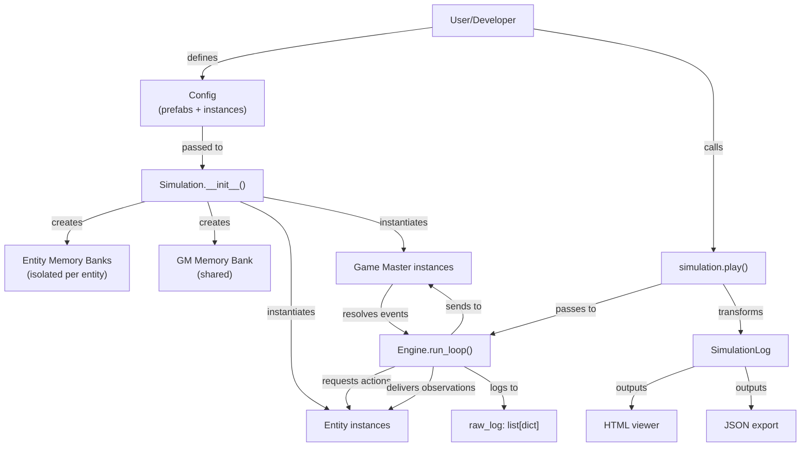
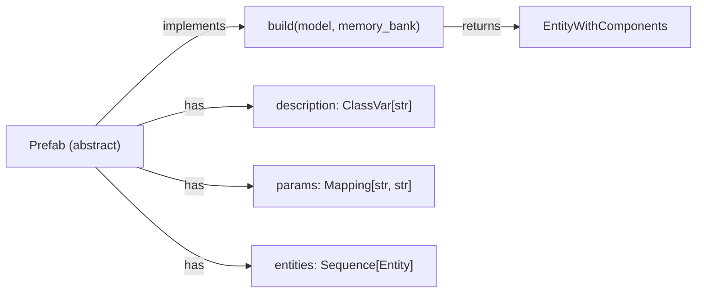
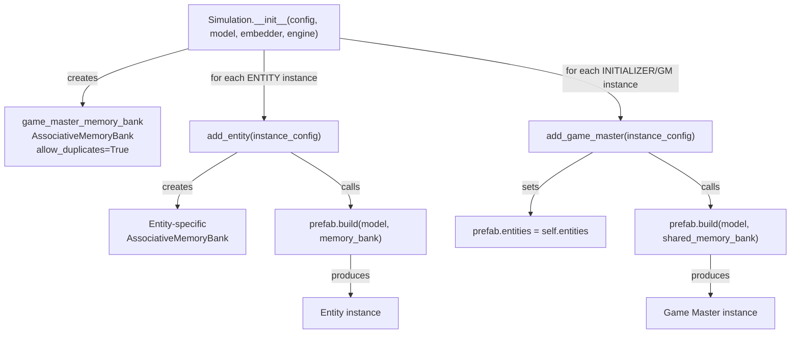
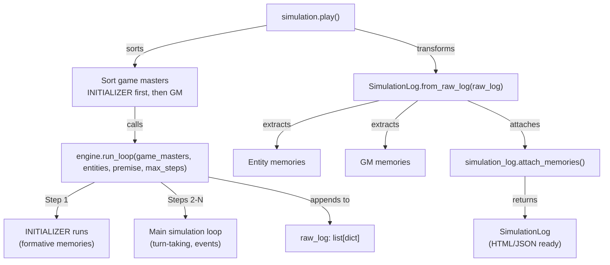
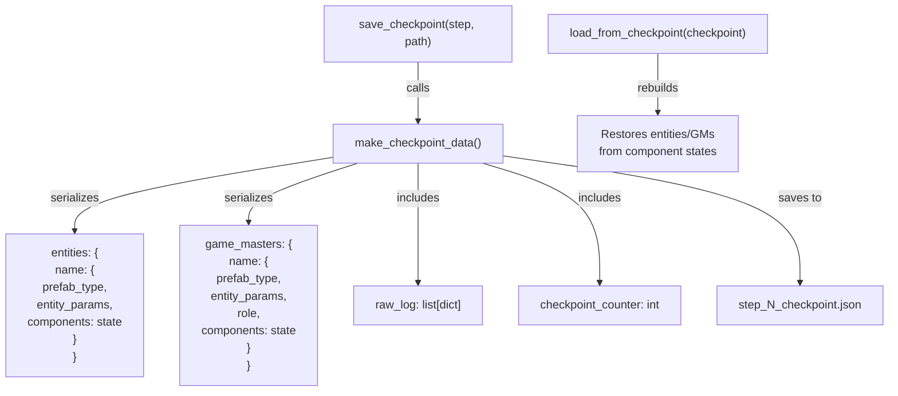
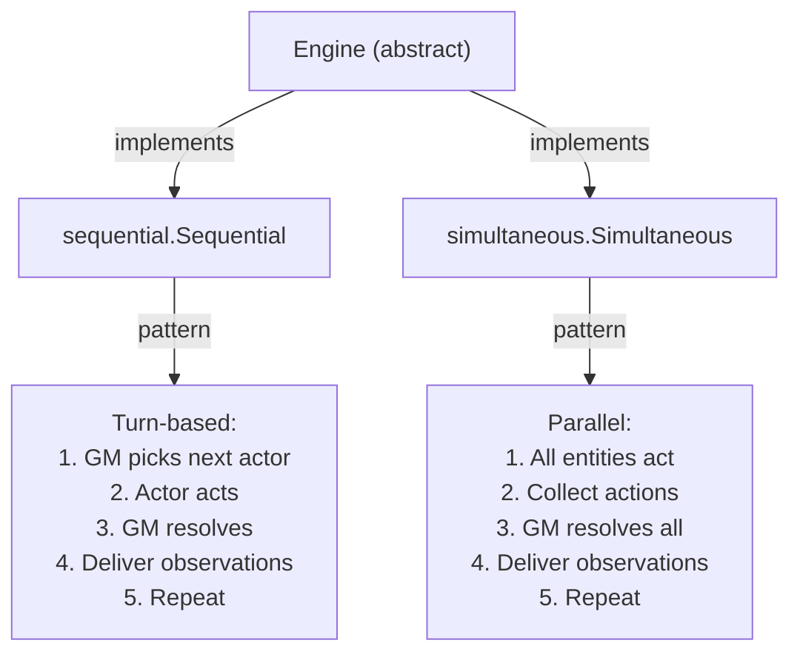
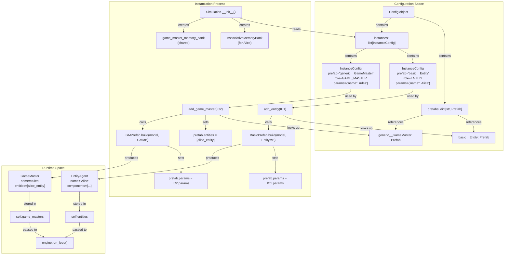

<!-- source: DeepWiki mcp.deepwiki.com · repo google-deepmind/concordia · page 3 Simulation Framework · fetched 2026-10-26 -->

# Simulation Framework

<details>
<summary>Relevant source files</summary>

The following files were used as context for generating this wiki page:

- [CHANGELOG.md](CHANGELOG.md)
- [concordia/associative_memory/basic_associative_memory.py](concordia/associative_memory/basic_associative_memory.py)
- [concordia/prefabs/game_master/generic.py](concordia/prefabs/game_master/generic.py)
- [concordia/prefabs/simulation/generic.py](concordia/prefabs/simulation/generic.py)
- [concordia/typing/prefab.py](concordia/typing/prefab.py)
- [concordia/typing/simulation.py](concordia/typing/simulation.py)
- [concordia/utils/log_viewer.html](concordia/utils/log_viewer.html)
- [concordia/utils/structured_logging.py](concordia/utils/structured_logging.py)
- [concordia/utils/structured_logging_test.py](concordia/utils/structured_logging_test.py)
- [examples/actor_development.ipynb](examples/actor_development.ipynb)
- [examples/alice.ipynb](examples/alice.ipynb)
- [examples/dialog.ipynb](examples/dialog.ipynb)
- [examples/marketplace.ipynb](examples/marketplace.ipynb)
- [examples/selling_cookies.ipynb](examples/selling_cookies.ipynb)
- [examples/tutorial.ipynb](examples/tutorial.ipynb)
- [setup.py](setup.py)

</details>


## Purpose and Scope

This document explains Concordia's top-level simulation orchestration layer: how simulations are configured using the Prefab pattern, instantiated via the `Simulation` class, and executed using `Engine` implementations. This page covers the configuration-to-execution pipeline but not the internal details of individual components.

For information about:
- Component composition within entities, see [Entity Component System](#2.1)
- Game master responsibilities and components, see [Game Master System](#2.2)
- Memory and logging infrastructure, see [Memory and Logging](#4)
- Creating custom prefabs, see [Prefab and Configuration System](#3.1)

---

## Architectural Overview

The Simulation Framework implements a declarative configuration pattern where users specify *what* entities to create (via `Config` objects) rather than imperatively constructing them. The system then instantiates, connects, and executes these entities through a coordinated lifecycle.

**Simulation Lifecycle Flow**



Sources: [concordia/prefabs/simulation/generic.py:41-323](), [concordia/typing/simulation.py:31-89](), Diagram 2 from high-level architecture

---

## Configuration System

Simulations are configured using three core dataclasses from [concordia/typing/prefab.py]():

### Config Dataclass

The `Config` object is the root configuration that specifies everything needed to run a simulation:

| Field | Type | Description |
|-------|------|-------------|
| `prefabs` | `Mapping[str, Prefab]` | Dictionary mapping prefab names to prefab instances |
| `instances` | `Sequence[InstanceConfig]` | List of entities/game masters to instantiate |
| `default_premise` | `str` | Initial narrative context for the simulation |
| `default_max_steps` | `int` | Maximum number of simulation steps (default: 100) |

### InstanceConfig Dataclass

Each `InstanceConfig` specifies one entity or game master to create:

| Field | Type | Description |
|-------|------|-------------|
| `prefab` | `str` | Name of the prefab to use (key in `Config.prefabs` dict) |
| `role` | `Role` | Role enum: `ENTITY`, `GAME_MASTER`, or `INITIALIZER` |
| `params` | `Mapping[str, str]` | Parameters passed to the prefab's `build()` method |

### Role Enum

The `Role` enum distinguishes three types of simulation participants:

```python
class Role(enum.StrEnum):
  ENTITY = 'entity'           # Regular agents (isolated from each other)
  GAME_MASTER = 'game_master' # Environment controllers (see all entities)
  INITIALIZER = 'initializer' # Special GM for setup phase
```

**Critical architectural distinction**: `ENTITY` instances are isolated (no references to other entities), while `GAME_MASTER` instances receive references to all entities via the `entities` attribute. This prevents agents from bypassing the game master by directly querying each other.

Sources: [concordia/typing/prefab.py:28-76](), [concordia/prefabs/simulation/generic.py:44-73]()

---

## Prefab Pattern

Prefabs are reusable templates for constructing entities with specific component configurations. They implement the factory pattern to separate configuration from instantiation.

**Prefab Interface**



Every prefab must:
1. Define a `description` class variable explaining its purpose
2. Implement `build(model, memory_bank)` returning an `EntityWithComponents` instance
3. Accept runtime parameters via the `params` mapping

### Example Prefab Structure

From [examples/actor_development.ipynb:214-312]():

```python
@dataclasses.dataclass
class MyAgent(prefab_lib.Prefab):
  description: str = "An entity with minimal components..."
  params: Mapping[str, str] = dataclasses.field(
      default_factory=lambda: {'name': 'Alice'}
  )
  
  def build(
      self,
      model: language_model.LanguageModel,
      memory_bank: basic_associative_memory.AssociativeMemoryBank,
  ) -> entity_agent_with_logging.EntityAgentWithLogging:
      agent_name = self.params.get('name', 'Bob')
      
      # Create components
      instructions = agent_components.instructions.Instructions(...)
      observation = agent_components.observation.LastNObservations(...)
      
      # Compose into entity
      components_of_agent = {
          'Instructions': instructions,
          'observation': observation,
          '__memory__': agent_components.memory.AssociativeMemory(memory_bank),
      }
      
      act_component = agent_components.concat_act_component.ConcatActComponent(...)
      
      return entity_agent_with_logging.EntityAgentWithLogging(
          agent_name=agent_name,
          act_component=act_component,
          context_components=components_of_agent,
      )
```

The prefab packages component assembly logic, making entities reusable across simulations. Users only need to specify which prefab to use and what parameters to provide.

Sources: [concordia/typing/prefab.py:34-61](), [examples/actor_development.ipynb:214-312]()

---

## Simulation Class

The `Simulation` class ([concordia/prefabs/simulation/generic.py:41-485]()) orchestrates the complete simulation lifecycle from instantiation through execution.

**Simulation Initialization Process**



### Memory Architecture

The initialization phase establishes a critical memory isolation pattern:

1. **Entity Memory Banks** ([concordia/prefabs/simulation/generic.py:194-196]()): Each entity gets its own `AssociativeMemoryBank` to prevent cross-contamination of memories
2. **Shared GM Memory Bank** ([concordia/prefabs/simulation/generic.py:92-95]()): All game masters share a single memory bank with `allow_duplicates=True` to handle recurring events across rounds

This asymmetry is intentional: entities must remain isolated to prevent "telepathy," while game masters need a shared world state for consistency.

### Play Method

The `play()` method ([concordia/prefabs/simulation/generic.py:234-322]()) executes the simulation:

```python
def play(
    self,
    premise: str | None = None,
    max_steps: int | None = None,
    raw_log: list[Mapping[str, Any]] | None = None,
    get_state_callback: Callable[[dict[str, Any]], None] | None = None,
    checkpoint_path: str | None = None,
) -> structured_logging.SimulationLog:
```

**Play Method Execution Flow**



The method:
1. Sorts game masters to ensure `INITIALIZER` role runs first
2. Delegates to the engine's `run_loop()`
3. Collects raw log data during execution
4. Transforms raw log into structured `SimulationLog` object
5. Attaches entity and game master memories for rendering

Sources: [concordia/prefabs/simulation/generic.py:234-322](), [concordia/typing/simulation.py:74-89]()

### Checkpointing System

The simulation supports state persistence via checkpointing:

**Checkpoint Data Structure**



Checkpoints enable:
- Resuming interrupted simulations
- Saving simulation states at specific steps
- Analyzing intermediate states
- Custom callbacks via `get_state_callback` parameter

Sources: [concordia/prefabs/simulation/generic.py:324-485]()

---

## Engine Implementations

Engines control the execution pattern: who acts when, and how observations are delivered. They implement the abstract `Engine` interface.

**Engine Types and Execution Patterns**



### Sequential Engine

Default execution pattern for turn-based simulations. The game master determines which entity acts next.

Example from [examples/tutorial.ipynb:256-262]():
```python
runnable_simulation = simulation.Simulation(
    config=config,
    model=model,
    embedder=embedder,
    # Uses default sequential.Sequential() engine
)
```

### Simultaneous Engine

Used for simultaneous-move games (e.g., markets, auctions). All entities act concurrently each round.

Example from [examples/marketplace.ipynb:356-361]():
```python
engine = simultaneous.Simultaneous()
simul_sim = simulation.Simulation(
    config=config,
    model=model,
    embedder=embedder,
    engine=engine,
)
```

The choice of engine fundamentally changes simulation dynamics but requires no changes to entity or game master implementations.

Sources: [concordia/prefabs/simulation/generic.py:44-50](), [examples/marketplace.ipynb:356-361](), [concordia/environment/engines/sequential.py](), [concordia/environment/engines/simultaneous.py]()

---

## Complete Configuration Example

The following example from [examples/tutorial.ipynb:183-237]() demonstrates the full configuration-to-execution workflow:

**Step 1: Load available prefabs**

```python
prefabs = {
    **helper_functions.get_package_classes(entity_prefabs),
    **helper_functions.get_package_classes(game_master_prefabs),
}
```

**Step 2: Define instances**

```python
instances = [
    prefab_lib.InstanceConfig(
        prefab='basic__Entity',
        role=prefab_lib.Role.ENTITY,
        params={'name': 'Oliver Cromwell', 'goal': 'become lord protector'},
    ),
    prefab_lib.InstanceConfig(
        prefab='basic__Entity',
        role=prefab_lib.Role.ENTITY,
        params={'name': 'King Charles I', 'goal': 'avoid execution'},
    ),
    prefab_lib.InstanceConfig(
        prefab='generic__GameMaster',
        role=prefab_lib.Role.GAME_MASTER,
        params={'name': 'default rules'},
    ),
    prefab_lib.InstanceConfig(
        prefab='formative_memories_initializer__GameMaster',
        role=prefab_lib.Role.INITIALIZER,
        params={
            'name': 'initial setup rules',
            'next_game_master_name': 'default rules',
            'shared_memories': [
                'The king was captured by Parliamentary forces in 1646.',
                'Charles I was tried for treason and found guilty.',
            ],
        },
    ),
]
```

**Step 3: Create config**

```python
config = prefab_lib.Config(
    default_premise='Today is January 29, 1649.',
    default_max_steps=5,
    prefabs=prefabs,
    instances=instances,
)
```

**Step 4: Initialize and run**

```python
runnable_simulation = simulation.Simulation(
    config=config,
    model=model,
    embedder=embedder,
)

results_log = runnable_simulation.play(max_steps=5)
display.HTML(results_log.to_html())
```

This pattern separates concerns:
- **Configuration** (Steps 1-3): Declaratively specify what to build
- **Instantiation** (Step 4): Let the `Simulation` class handle construction
- **Execution** (Step 4): Run the simulation and render results

Sources: [examples/tutorial.ipynb:183-287](), [examples/selling_cookies.ipynb:416-525]()

---

## Configuration-to-Execution Mapping

The following diagram shows how configuration elements map to runtime objects:

**Config Elements to Runtime Entities**



This mapping shows how:
1. `InstanceConfig` objects reference prefabs by string name
2. The `Simulation` class resolves these references during initialization
3. Each prefab's `build()` method receives injected dependencies (model, memory bank)
4. Game master prefabs receive additional context (all entities via `prefab.entities`)
5. Resulting entity instances are orchestrated by the engine

Sources: [concordia/prefabs/simulation/generic.py:96-233](), [concordia/typing/prefab.py:34-76]()

---

## Summary

The Simulation Framework provides a declarative, composable approach to configuring and running multi-agent simulations:

| Component | Purpose | Key Files |
|-----------|---------|-----------|
| **Config** | Root configuration object | [concordia/typing/prefab.py:70-76]() |
| **Prefab** | Reusable entity templates | [concordia/typing/prefab.py:34-61]() |
| **InstanceConfig** | Specifies what to build | [concordia/typing/prefab.py:63-68]() |
| **Simulation** | Orchestrates lifecycle | [concordia/prefabs/simulation/generic.py:41-485]() |
| **Engine** | Controls execution pattern | [concordia/environment/engines/]() |

This architecture enables:
- **Reusability**: Define prefabs once, use in many simulations
- **Composability**: Mix and match entities and game masters
- **Reproducibility**: Simulations are fully specified by configuration
- **Extensibility**: Add new prefabs without changing framework code

For details on:
- How to create custom prefabs, see [Prefab and Configuration System](#3.1)
- The internal simulation orchestration logic, see [Simulation Orchestration](#3.2)
- Specialized questionnaire-based simulations, see [Questionnaire Simulations](#3.3)
- Engine implementation details, see [Engines and Execution](#3.4)

Sources: [concordia/prefabs/simulation/generic.py](), [concordia/typing/prefab.py](), [concordia/typing/simulation.py](), [examples/tutorial.ipynb](), [examples/selling_cookies.ipynb](), [examples/marketplace.ipynb]()

---

