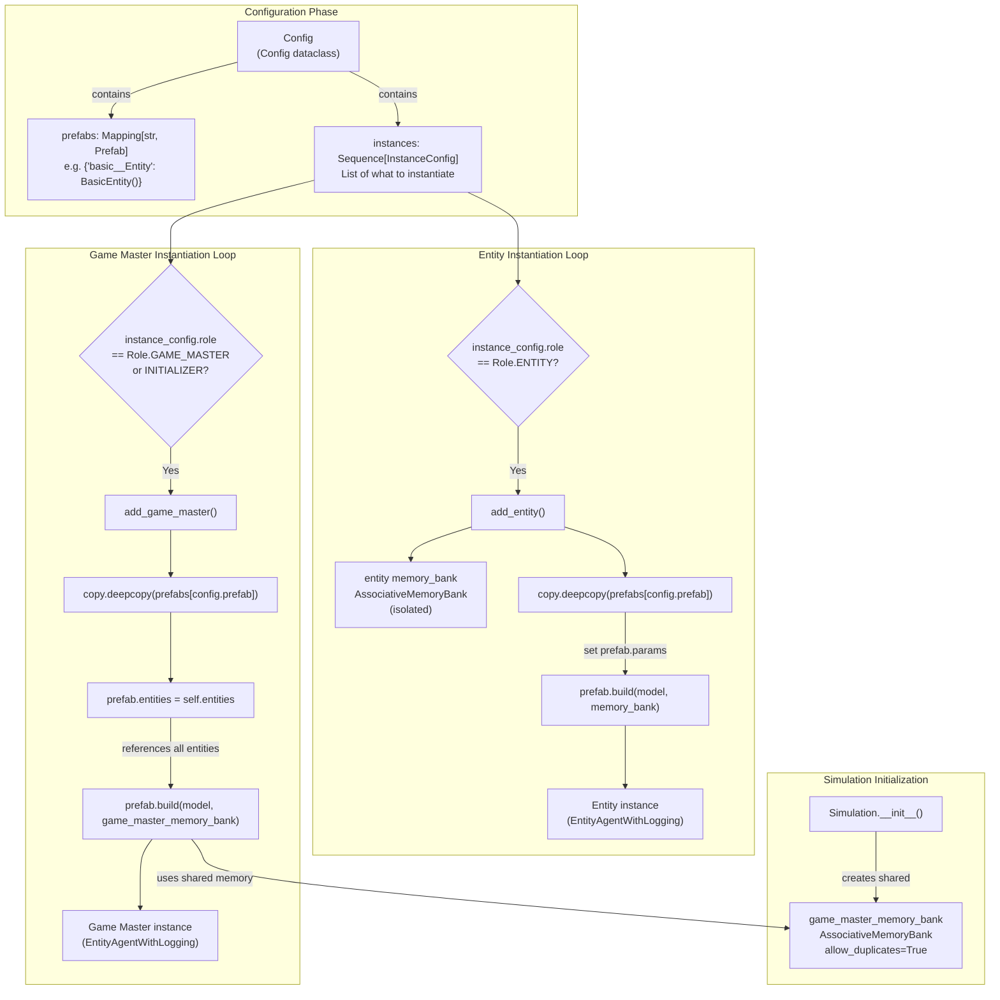
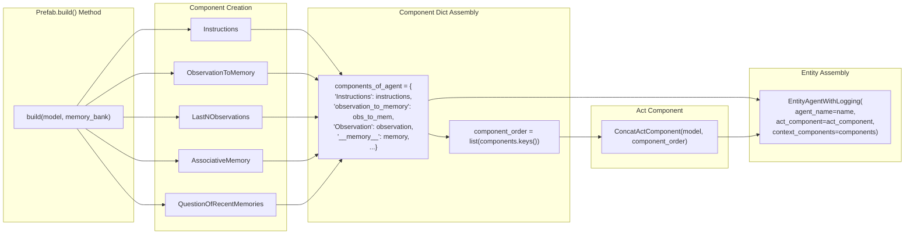

<!-- source: DeepWiki mcp.deepwiki.com · repo google-deepmind/concordia · page 3.1 Prefab and Configuration System · fetched 2026-10-26 -->

# Prefab and Configuration System

<details>
<summary>Relevant source files</summary>

The following files were used as context for generating this wiki page:

- [CHANGELOG.md](CHANGELOG.md)
- [concordia/associative_memory/basic_associative_memory.py](concordia/associative_memory/basic_associative_memory.py)
- [concordia/prefabs/game_master/generic.py](concordia/prefabs/game_master/generic.py)
- [concordia/prefabs/simulation/generic.py](concordia/prefabs/simulation/generic.py)
- [concordia/typing/prefab.py](concordia/typing/prefab.py)
- [concordia/typing/simulation.py](concordia/typing/simulation.py)
- [concordia/utils/log_viewer.html](concordia/utils/log_viewer.html)
- [concordia/utils/structured_logging.py](concordia/utils/structured_logging.py)
- [concordia/utils/structured_logging_test.py](concordia/utils/structured_logging_test.py)
- [examples/actor_development.ipynb](examples/actor_development.ipynb)
- [examples/alice.ipynb](examples/alice.ipynb)
- [examples/dialog.ipynb](examples/dialog.ipynb)
- [examples/marketplace.ipynb](examples/marketplace.ipynb)
- [examples/selling_cookies.ipynb](examples/selling_cookies.ipynb)
- [examples/tutorial.ipynb](examples/tutorial.ipynb)
- [setup.py](setup.py)

</details>


## Purpose and Scope

The Prefab and Configuration System provides a declarative, composable mechanism for defining and instantiating simulation participants (entities and game masters) in Concordia. This system separates the *recipe* for creating an agent (the Prefab) from the *specific instance parameters* (the InstanceConfig), enabling reusable agent templates that can be configured differently for each simulation run.

For information about how simulations are executed after configuration, see [Simulation Orchestration](#3.2). For details on the underlying component architecture that prefabs compose, see [Entity Component System](#2.1) and [Game Master System](#2.2).

## Core Abstractions

The prefab system is built on three primary abstractions defined in [concordia/typing/prefab.py:1-76]():

### Prefab Abstract Base Class

The `Prefab` class is an abstract dataclass that defines the interface for entity templates:

```python
@dataclasses.dataclass
class Prefab(abc.ABC):
  description: ClassVar[str]
  params: Mapping[str, str] = dataclasses.field(default_factory=dict)
  entities: Sequence[entity_component.EntityWithComponents] | None = None
  
  @abc.abstractmethod
  def build(
      self,
      model: language_model.LanguageModel,
      memory_bank: basic_associative_memory.AssociativeMemoryBank,
  ) -> entity_component.EntityWithComponents:
    raise NotImplementedError
```

Key characteristics:
- **`description`**: A class variable documenting the prefab's purpose
- **`params`**: A mapping of string keys to values that configure the instance
- **`entities`**: Reference to all entities in the simulation (populated for game masters only)
- **`build()`**: Abstract method that constructs an `EntityAgentWithLogging` from the provided model and memory bank

The prefab pattern enables separation of concerns: the prefab defines *how* to build an entity, while `params` defines *what* specific values to use.

**Sources:** [concordia/typing/prefab.py:34-51]()

### Role Enumeration

The `Role` enum distinguishes between three types of simulation participants:

```python
class Role(enum.StrEnum):
  ENTITY = 'entity'
  GAME_MASTER = 'game_master'
  INITIALIZER = 'initializer'
```

| Role | Purpose | Memory Architecture | Entity References |
|------|---------|-------------------|-------------------|
| `ENTITY` | Autonomous agents that perceive and act | Individual isolated memory bank | None (entities are isolated) |
| `GAME_MASTER` | Controls simulation rules, event resolution, turn-taking | Shared memory bank across all GMs | References to all entities |
| `INITIALIZER` | Sets up initial conditions, then hands off to another GM | Shared GM memory bank | References to all entities |

The critical architectural decision enforced by roles: game masters receive references to entities (via `prefab.entities`), but entities never receive references to other entities or game masters, maintaining agent isolation.

**Sources:** [concordia/typing/prefab.py:28-31](), [concordia/prefabs/simulation/generic.py:55-62]()

### InstanceConfig and Config

`InstanceConfig` specifies *which* prefab to instantiate and *how* to configure it:

```python
@dataclasses.dataclass
class InstanceConfig:
  prefab: str              # Name key into Config.prefabs dict
  role: Role               # ENTITY, GAME_MASTER, or INITIALIZER
  params: Mapping[str, str]  # Parameters to pass to the prefab
```

`Config` contains the complete simulation definition:

```python
@dataclasses.dataclass
class Config:
  prefabs: Mapping[str, Prefab]      # Available prefab templates
  instances: Sequence[InstanceConfig]  # Instances to create
  default_premise: str = ''           # Initial simulation state
  default_max_steps: int = 100        # Default step limit
```

**Sources:** [concordia/typing/prefab.py:63-76]()

## Prefab Instantiation Flow

The following diagram shows how `Config` objects are processed by the `Simulation` class to create running entities:



**Instantiation Sequence:**

1. **Config Loading** [concordia/prefabs/simulation/generic.py:74-86](): User creates a `Config` with prefabs dictionary and instances list
2. **Shared GM Memory Creation** [concordia/prefabs/simulation/generic.py:89-95](): Simulation creates a single `AssociativeMemoryBank` with `allow_duplicates=True` for all game masters to share
3. **Entity Instantiation** [concordia/prefabs/simulation/generic.py:111-112](): For each `InstanceConfig` with `role=ENTITY`:
   - Create isolated memory bank [concordia/prefabs/simulation/generic.py:194-196]()
   - Deep copy the prefab from the prefabs dict [concordia/prefabs/simulation/generic.py:191]()
   - Set `prefab.params` from `instance_config.params` [concordia/prefabs/simulation/generic.py:192]()
   - Call `prefab.build(model, memory_bank)` [concordia/prefabs/simulation/generic.py:197-199]()
4. **Game Master Instantiation** [concordia/prefabs/simulation/generic.py:114-115](): For each `InstanceConfig` with `role=GAME_MASTER` or `INITIALIZER`:
   - Deep copy the prefab [concordia/prefabs/simulation/generic.py:162-163]()
   - Set `prefab.params` [concordia/prefabs/simulation/generic.py:165]()
   - **Set `prefab.entities = self.entities`** [concordia/prefabs/simulation/generic.py:166]() (game masters get entity references)
   - Call `prefab.build(model, game_master_memory_bank)` [concordia/prefabs/simulation/generic.py:167-169]() (using shared memory)

This flow ensures entities remain isolated (no entity references, individual memory) while game masters can observe and control all entities (entity references, shared memory).

**Sources:** [concordia/prefabs/simulation/generic.py:44-116](), [concordia/prefabs/simulation/generic.py:151-233]()

## Built-in Prefab Catalog

Concordia provides pre-built prefabs in two categories:

### Entity Prefabs

Located in `concordia/prefabs/entity/`, these define agent templates:

| Prefab Name | Module | Purpose |
|-------------|--------|---------|
| `basic__Entity` | `basic.py` | Minimal agent with observation, memory, and LLM-based action |
| `conversational__Entity` | `conversational.py` | Optimized for dialog with conversation style parameters |
| `rational__Entity` | `rational.py` | Goal-oriented agent with planning components |
| `puppet__Entity` | `puppet.py` | Non-autonomous agent with scripted responses |

Example from tutorial notebooks showing how to reference built-in prefabs:

```python
prefabs = {
    **helper_functions.get_package_classes(entity_prefabs),
    **helper_functions.get_package_classes(game_master_prefabs),
}
```

**Sources:** [examples/tutorial.ipynb:148-156](), [examples/actor_development.ipynb:176-185]()

### Game Master Prefabs

Located in `concordia/prefabs/game_master/`, these define simulation control templates:

| Prefab Name | Module | Purpose |
|-------------|--------|---------|
| `generic__GameMaster` | `generic.py` | Default GM with event resolution and turn management |
| `dialogic__GameMaster` | `dialogic.py` | Manages conversational scenes |
| `game_theoretic_and_dramaturgic__GameMaster` | `game_theoretic_and_dramaturgic.py` | Scene-based GM with payoff matrices |
| `formative_memories_initializer__GameMaster` | `formative_memories_initializer.py` | Sets up initial memories, then transfers control |
| `marketplace__GameMaster` | `marketplace.py` | Handles economic transactions |

The generic game master is the most commonly used and demonstrates typical GM structure:

**Sources:** [concordia/prefabs/game_master/generic.py:1-274]()

## Parameter System and Customization

### Parameter Passing Pattern

Prefabs receive parameters through the `params` mapping. The prefab's `build()` method extracts values using `.get()` with defaults:

```python
# From generic game master prefab
name = self.params.get('name')
extra_event_resolution_steps = self.params.get(
    'extra_event_resolution_steps', ''
)
acting_order = self.params.get('acting_order', 'game_master_choice')
```

### Configuration Example

Complete example from tutorial notebook showing instance configuration:

```python
instances = [
    prefab_lib.InstanceConfig(
        prefab='basic__Entity',
        role=prefab_lib.Role.ENTITY,
        params={
            'name': 'Oliver Cromwell',
            'goal': 'become lord protector',
        },
    ),
    prefab_lib.InstanceConfig(
        prefab='generic__GameMaster',
        role=prefab_lib.Role.GAME_MASTER,
        params={
            'name': 'default rules',
            'extra_event_resolution_steps': '',
        },
    ),
    prefab_lib.InstanceConfig(
        prefab='formative_memories_initializer__GameMaster',
        role=prefab_lib.Role.INITIALIZER,
        params={
            'name': 'initial setup rules',
            'next_game_master_name': 'default rules',
            'shared_memories': [
                'The king was captured by Parliamentary forces in 1646.',
                'Charles I was tried for treason and found guilty.',
            ],
        },
    ),
]

config = prefab_lib.Config(
    default_premise='Today is January 29, 1649.',
    default_max_steps=5,
    prefabs=prefabs,
    instances=instances,
)
```

**Sources:** [examples/tutorial.ipynb:174-238]()

## Creating Custom Prefabs

Custom prefabs must inherit from `prefab_lib.Prefab` and implement the `build()` method. Example from actor development tutorial:

```python
@dataclasses.dataclass
class MyAgent(prefab_lib.Prefab):
  description: str = (
      'An entity that has a minimal set of components and is configurable by'
      ' the user. The initial set of components manage memory, observations,'
      ' and instructions. If goal is specified, the entity will have a goal '
      'constant component.'
  )
  params: Mapping[str, str] = dataclasses.field(
      default_factory=lambda: {
          'name': 'Alice',
      }
  )

  def build(
      self,
      model: language_model.LanguageModel,
      memory_bank: basic_associative_memory.AssociativeMemoryBank,
  ) -> entity_agent_with_logging.EntityAgentWithLogging:
    agent_name = self.params.get('name', 'Bob')
    
    # Create components
    instructions = agent_components.instructions.Instructions(
        agent_name=agent_name,
        pre_act_label=DEFAULT_INSTRUCTIONS_PRE_ACT_LABEL,
    )
    
    observation_to_memory = agent_components.observation.ObservationToMemory()
    
    observation = agent_components.observation.LastNObservations(
        history_length=100, pre_act_label=observation_label
    )
    
    # ... additional components ...
    
    components_of_agent = {
        'Instructions': instructions,
        'observation_to_memory': observation_to_memory,
        'Observation': observation,
        '__memory__': agent_components.memory.AssociativeMemory(
            memory_bank=memory_bank
        ),
        # ... additional components ...
    }
    
    component_order = list(components_of_agent.keys())
    
    act_component = agent_components.concat_act_component.ConcatActComponent(
        model=model,
        component_order=component_order,
    )
    
    agent = entity_agent_with_logging.EntityAgentWithLogging(
        agent_name=agent_name,
        act_component=act_component,
        context_components=components_of_agent,
    )
    
    return agent
```

### Custom Prefab Registration

After defining a custom prefab, add it to the prefabs dictionary:

```python
prefabs['myagent__Entity'] = MyAgent()
```

Now it can be referenced by name in `InstanceConfig`:

```python
prefab_lib.InstanceConfig(
    prefab='myagent__Entity',
    role=prefab_lib.Role.ENTITY,
    params={'name': 'Alice'},
)
```

**Sources:** [examples/actor_development.ipynb:202-313](), [examples/actor_development.ipynb:323]()

## Component Composition in Prefabs

Prefabs compose components to define entity behavior. The following diagram shows how the `build()` method assembles components:



**Component Organization Pattern:**

1. **Create individual components** using component classes from `concordia.components.agent` or `concordia.components.game_master`
2. **Assemble into dictionary** with string keys (these keys are used for component lookup)
3. **Define component order** as a list (determines order in prompt context)
4. **Create act component** (`ConcatActComponent` or `SwitchActComponent`) that orchestrates components
5. **Instantiate EntityAgentWithLogging** with components and act component

**Sources:** [examples/actor_development.ipynb:244-311](), [concordia/prefabs/game_master/generic.py:96-273]()

## Advanced: Extra Components and Dynamic Configuration

The generic game master prefab demonstrates advanced dynamic component composition:

```python
extra_components = self.params.get('extra_components', {})
extra_components_index = self.params.get('extra_components_index', {})

# ... standard components defined ...

components_of_game_master = {
    instructions_key: instructions,
    relevant_memories_key: relevant_memories,
    # ... other components ...
}

component_order = list(components_of_game_master.keys())

if extra_components:
    components_of_game_master.update(extra_components)
    if extra_components_index:
        for component_name in extra_components.keys():
            component_order.insert(
                extra_components_index[component_name],
                component_name,
            )
    else:
        component_order = list(components_of_game_master.keys())
```

This pattern allows users to inject custom components at specific positions without modifying the prefab source code. The `extra_components` parameter receives a dictionary of component instances, and `extra_components_index` specifies where in the component order to insert them.

**Sources:** [concordia/prefabs/game_master/generic.py:71-259]()

## Memory State Preloading

The entity instantiation process supports loading pre-saved memory states:

```python
# Check if a pre-loaded memory state was passed in the entity's params.
memory_state = instance_config.params.get("memory_state")
if memory_state:
    logging.info(
        "Found pre-loaded memory state for %s. Setting it.", entity.name
    )
    try:
        memory_component = entity.get_component("__memory__")
        memory_component.set_state(memory_state)
        logging.info(
            "Successfully set pre-loaded memories for %s.", entity.name
        )
    except (KeyError, TypeError, ValueError) as e:
        logging.error(
            "Error setting pre-loaded memory for %s: %s", entity.name, e
        )
        raise
```

This enables scenarios where agents start with pre-existing memories rather than blank memory banks, useful for transfer learning or continuing previous simulations.

**Sources:** [concordia/prefabs/simulation/generic.py:205-221]()

## Prefab Pattern Benefits

The prefab system provides several architectural advantages:

1. **Separation of Structure and Content**: Prefab defines *how* to build an entity; params define *what* values to use
2. **Reusability**: Same prefab can be instantiated multiple times with different parameters
3. **Composability**: Prefabs compose components in the `build()` method
4. **Extensibility**: Users create custom prefabs without modifying core library
5. **Testability**: Prefabs can be tested independently of full simulation
6. **Serialization**: Config objects are pure data (dataclasses) that can be saved/loaded as JSON

The pattern draws inspiration from game engine prefab systems (Unity, Unreal) where templates define object blueprints that are instantiated with specific parameters at runtime.

**Sources:** [concordia/typing/prefab.py:1-76](), [concordia/prefabs/simulation/generic.py:1-485]()

---

