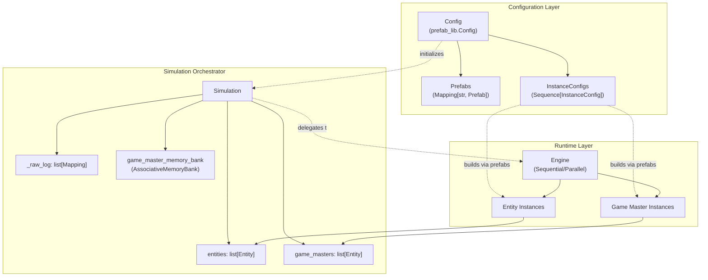
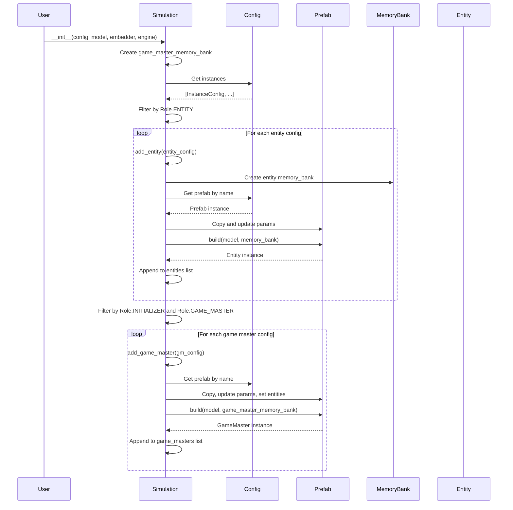
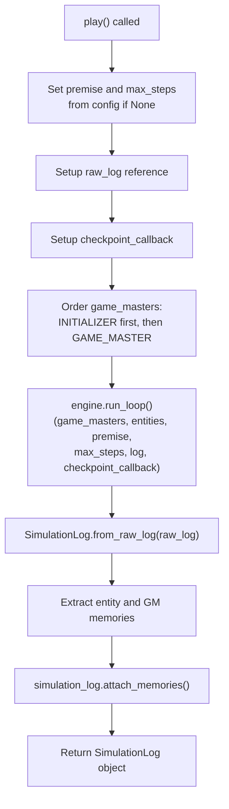
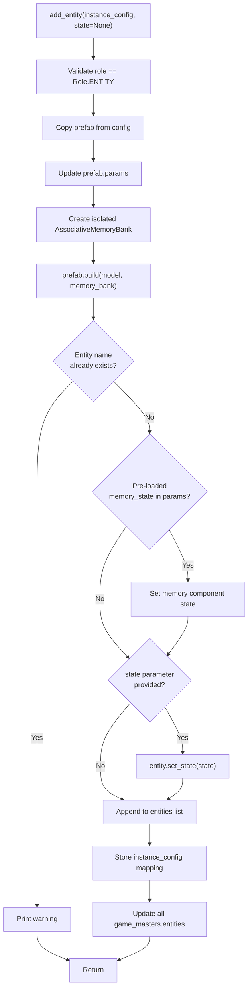
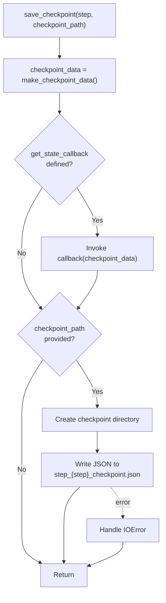
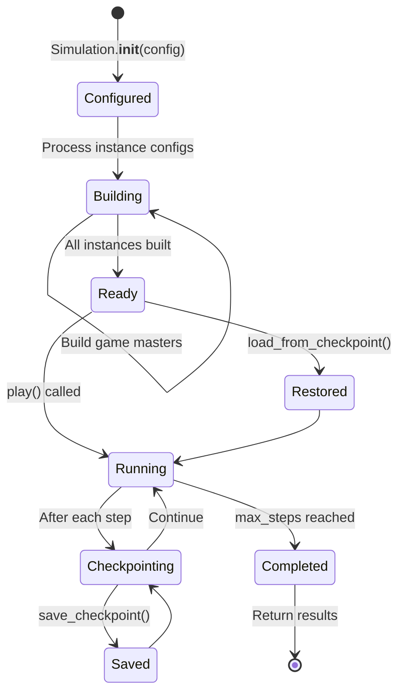

<!-- source: DeepWiki mcp.deepwiki.com · repo google-deepmind/concordia · page 3.2 Simulation Orchestration · fetched 2026-10-26 -->

# Simulation Orchestration

<details>
<summary>Relevant source files</summary>

The following files were used as context for generating this wiki page:

- [concordia/associative_memory/basic_associative_memory.py](concordia/associative_memory/basic_associative_memory.py)
- [concordia/prefabs/game_master/generic.py](concordia/prefabs/game_master/generic.py)
- [concordia/prefabs/simulation/generic.py](concordia/prefabs/simulation/generic.py)
- [concordia/typing/prefab.py](concordia/typing/prefab.py)
- [concordia/typing/simulation.py](concordia/typing/simulation.py)
- [concordia/utils/log_viewer.html](concordia/utils/log_viewer.html)
- [concordia/utils/structured_logging.py](concordia/utils/structured_logging.py)
- [concordia/utils/structured_logging_test.py](concordia/utils/structured_logging_test.py)
- [examples/actor_development.ipynb](examples/actor_development.ipynb)
- [examples/alice.ipynb](examples/alice.ipynb)
- [examples/dialog.ipynb](examples/dialog.ipynb)
- [examples/marketplace.ipynb](examples/marketplace.ipynb)
- [examples/selling_cookies.ipynb](examples/selling_cookies.ipynb)
- [examples/tutorial.ipynb](examples/tutorial.ipynb)

</details>


## Purpose and Scope

This page documents the `Simulation` class, which serves as the central orchestrator for running multi-agent simulations in Concordia. The Simulation class manages the complete lifecycle of a simulation: initialization from configuration, runtime execution, state management, and checkpointing.

For information about configuring simulations through prefabs and instance definitions, see [Prefab System](#3.1). For details on scene-based execution patterns, see [Scene-Based Execution](#3.3). For the underlying execution engines, see [Engine Implementations](#3.4).

## Simulation Class Architecture

The `Simulation` class ([concordia/prefabs/simulation/generic.py:42-485]()) implements the `simulation_lib.Simulation` interface ([concordia/typing/simulation.py:31-89]()). It acts as the primary entry point for creating and running simulations, bridging the configuration system (prefabs and instance configs) with runtime execution.



**Sources:** [concordia/prefabs/simulation/generic.py:42-104](), [concordia/typing/simulation.py:31-56]()

## Core Components and State

The Simulation class maintains several key pieces of state:

| Attribute | Type | Purpose |
|-----------|------|---------|
| `_config` | `prefab_lib.Config` | Configuration defining the simulation structure |
| `_model` | `language_model.LanguageModel` | Language model for all LLM calls |
| `_embedder` | `Callable[[str], np.ndarray]` | Sentence embedding function |
| `_engine` | `engine_lib.Engine` | Execution engine (default: Sequential) |
| `entities` | `list[entity_lib.Entity]` | Player entities participating in the simulation |
| `game_masters` | `list[entity_lib.Entity]` | Game master entities managing simulation rules |
| `game_master_memory_bank` | `AssociativeMemoryBank` | Shared memory bank for all game masters |
| `_raw_log` | `list[Mapping[str, Any]]` | Complete log of simulation events |
| `_entity_to_prefab_config` | `dict[str, InstanceConfig]` | Maps entity names to their prefab configs |

**Sources:** [concordia/prefabs/simulation/generic.py:45-78]()

## Initialization Process

The initialization process transforms declarative configuration into runtime objects through the prefab system:



**Sources:** [concordia/prefabs/simulation/generic.py:45-104]()

### Entity and Game Master Distinction

The Simulation class enforces a critical architectural distinction ([concordia/prefabs/simulation/generic.py:54-61]()):

- **Game Masters** receive references to all entities and can observe/control them
- **Entities** do not receive references to other entities or game masters
- **Game Masters** share a single memory bank ([concordia/prefabs/simulation/generic.py:81-83]())
- **Entities** each have isolated memory banks ([concordia/prefabs/simulation/generic.py:182-184]())

This asymmetry enables game masters to orchestrate the simulation while maintaining entity isolation.

**Sources:** [concordia/prefabs/simulation/generic.py:54-61](), [concordia/prefabs/simulation/generic.py:81-83](), [concordia/prefabs/simulation/generic.py:139-213]()

## The Play Method

The `play()` method ([concordia/prefabs/simulation/generic.py:234-323]()) is the main entry point for executing a simulation:

```python
def play(
    premise: str | None = None,
    max_steps: int | None = None,
    raw_log: list[Mapping[str, Any]] | None = None,
    get_state_callback: Callable[[dict[str, Any]], None] | None = None,
    checkpoint_path: str | None = None,
) -> structured_logging.SimulationLog
```

### Method Parameters

| Parameter | Type | Purpose |
|-----------|------|---------|
| `premise` | `str \| None` | Initial premise string; defaults to `config.default_premise` |
| `max_steps` | `int \| None` | Maximum simulation steps; defaults to `config.default_max_steps` |
| `raw_log` | `list[Mapping] \| None` | Log list to append to; creates new if None |
| `get_state_callback` | `Callable \| None` | Callback invoked on each checkpoint with state dict |
| `checkpoint_path` | `str \| None` | Directory path for saving checkpoint JSON files |

The method returns a `SimulationLog` object ([concordia/utils/structured_logging.py:193-542]()) which provides:
- Structured access to log entries via `get_entries_by_entity()`, `get_entries_by_step()`, etc.
- HTML rendering via `to_html()` method
- JSON export via `to_json()` method
- Entity and game master memory access

**Sources:** [concordia/prefabs/simulation/generic.py:234-259](), [concordia/utils/structured_logging.py:193-542]()

### Play Method Execution Flow



**Sources:** [concordia/prefabs/simulation/generic.py:234-323]()

### Engine Delegation

The `play()` method delegates actual simulation execution to the `Engine` ([concordia/prefabs/simulation/generic.py:289-297]()):

```python
self._engine.run_loop(
    game_masters=sorted_game_masters,
    entities=self.entities,
    premise=premise,
    max_steps=max_steps,
    verbose=True,
    log=raw_log,
    checkpoint_callback=checkpoint_callback,
)
```

The engine manages the interaction loop between game masters and entities, invoking the checkpoint callback after each step. For details on engine implementations, see [Engine Implementations](#3.4).

**Sources:** [concordia/prefabs/simulation/generic.py:289-297]()

### SimulationLog Construction

After the engine completes, the simulation builds a structured log object ([concordia/prefabs/simulation/generic.py:299-323]()):

1. **Create SimulationLog**: `SimulationLog.from_raw_log(raw_log)` converts the raw event list
2. **Extract Entity Memories**: Retrieves memory contents from each entity's `__memory__` component
3. **Extract GM Memories**: Retrieves contents from `game_master_memory_bank`
4. **Attach Memories**: `simulation_log.attach_memories()` associates memories with the log

The returned `SimulationLog` object provides:
- **HTML Output**: `simulation_log.to_html()` generates a multi-tab interface with game log, entity memories, and GM memories
- **JSON Export**: `simulation_log.to_json()` for serialization
- **Structured Queries**: `get_entries_by_entity()`, `get_entries_by_step()`, `get_entries_by_component()`

**Sources:** [concordia/prefabs/simulation/generic.py:299-323](), [concordia/utils/structured_logging.py:193-542]()

## Entity and Game Master Management

### Adding Entities

The `add_entity()` method ([concordia/prefabs/simulation/generic.py:170-213]()) creates and registers entities:



**Sources:** [concordia/prefabs/simulation/generic.py:170-213]()

### Adding Game Masters

The `add_game_master()` method ([concordia/prefabs/simulation/generic.py:139-168]()) creates and registers game masters:

Key differences from `add_entity()`:
- Uses the shared `game_master_memory_bank` instead of creating a new one
- Sets `prefab.entities = self.entities` before building, giving GMs entity references
- Accepts `Role.GAME_MASTER` or `Role.INITIALIZER` roles

**Sources:** [concordia/prefabs/simulation/generic.py:139-168]()

## Checkpointing System

The checkpointing system enables saving and restoring complete simulation state. This supports reproducibility, debugging, and resuming simulations.

### Checkpoint Data Structure

A checkpoint contains complete simulation state ([concordia/prefabs/simulation/generic.py:329-374]()):

```python
{
    "entities": {
        "entity_name": {
            "prefab_type": str,
            "entity_params": dict,
            "components": EntityState
        }
    },
    "game_masters": {
        "gm_name": {
            "prefab_type": str,
            "entity_params": dict,
            "role": str,
            "components": EntityState
        }
    },
    "raw_log": list[Mapping[str, Any]],
    "checkpoint_counter": int
}
```

**Sources:** [concordia/prefabs/simulation/generic.py:329-374]()

### Saving Checkpoints

The `save_checkpoint()` method ([concordia/prefabs/simulation/generic.py:376-395]()) is invoked by the engine after each step:



**Sources:** [concordia/prefabs/simulation/generic.py:376-395]()

### Loading from Checkpoint

The `load_from_checkpoint()` method ([concordia/prefabs/simulation/generic.py:397-434]()) restores simulation state from a checkpoint dictionary:

1. Loads entity states, creating new entities or updating existing ones
2. Loads game master states, creating new GMs or updating existing ones
3. Updates all game masters' entity references
4. Restores the raw log
5. Restores the checkpoint counter

The method uses `_load_entity_from_state()` ([concordia/prefabs/simulation/generic.py:436-484]()) as a helper to handle both entities and game masters uniformly.

**Sources:** [concordia/prefabs/simulation/generic.py:397-484]()

## Usage Examples

### Basic Simulation Execution

From the tutorial notebooks:

```python
# Initialize simulation from config
runnable_simulation = simulation.Simulation(
    config=config,
    model=model,
    embedder=embedder,
)

# Run for 5 steps and get SimulationLog
raw_log = []
results_log = runnable_simulation.play(
    max_steps=5,
    raw_log=raw_log
)

# Display HTML in notebook
display.HTML(results_log.to_html())

# Or export as JSON
json_data = results_log.to_json()

# Query specific entries
alice_entries = results_log.get_entries_by_entity('Alice')
step_1_entries = results_log.get_entries_by_step(1)
```

**Sources:** [examples/tutorial.ipynb:255-287](), [examples/actor_development.ipynb:502-532]()

### With Checkpointing

```python
# Define callback to receive checkpoint data
def my_callback_function(checkpoint_data):
    print(f"Checkpoint at step {checkpoint_data['checkpoint_counter']}")
    # Process checkpoint data as needed

# Run with checkpoint saving
results_log = runnable_simulation.play(
    premise="Custom premise text",
    max_steps=10,
    checkpoint_path="/path/to/checkpoints",
    get_state_callback=my_callback_function,
)

# Display results
display.HTML(results_log.to_html())
```

This will save checkpoint files at `/path/to/checkpoints/step_0_checkpoint.json`, `step_1_checkpoint.json`, etc., and invoke `my_callback_function()` with the checkpoint data after each step.

**Sources:** [concordia/prefabs/simulation/generic.py:234-259](), [concordia/prefabs/simulation/generic.py:371-391]()

### Loading a Checkpoint

```python
import json

# Load checkpoint from file
with open('checkpoint.json', 'r') as f:
    checkpoint_data = json.load(f)

# Restore state
runnable_simulation.load_from_checkpoint(checkpoint_data)

# Continue simulation from checkpoint
results_log = runnable_simulation.play(max_steps=5)

# Access restored memories
for entity_name in results_log.get_entity_names():
    memories = results_log.get_entity_memories(entity_name)
    print(f"{entity_name}: {len(memories)} memories")
```

**Sources:** [concordia/prefabs/simulation/generic.py:392-429]()

## Simulation Lifecycle Summary



**Sources:** [concordia/prefabs/simulation/generic.py:42-485]()

---

