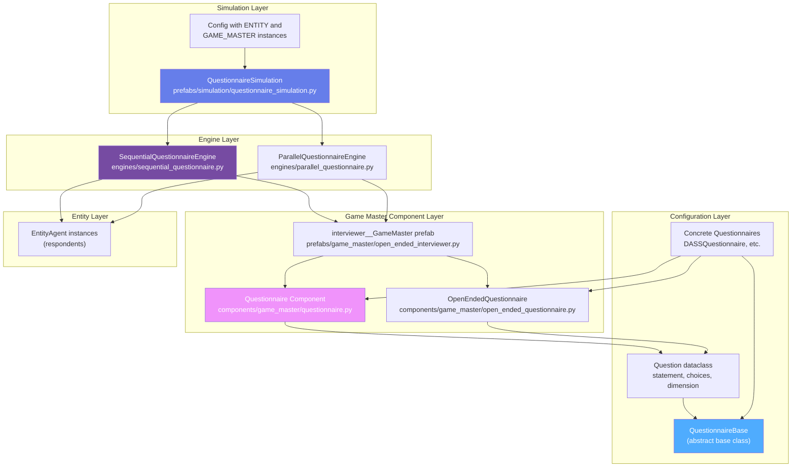
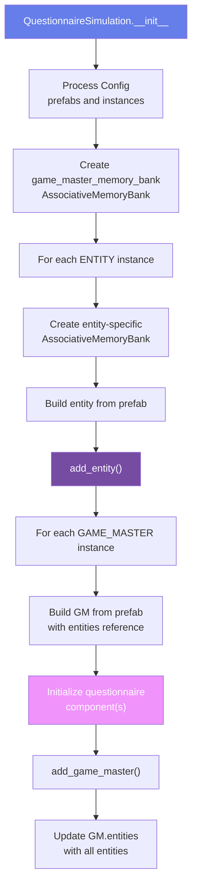
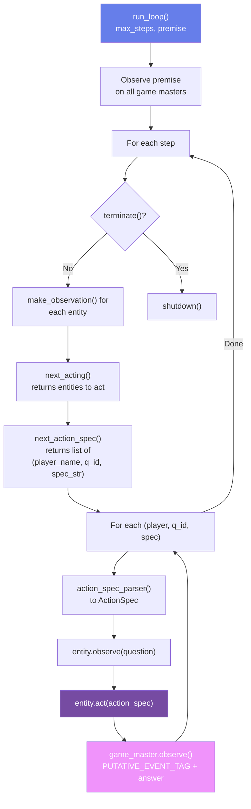
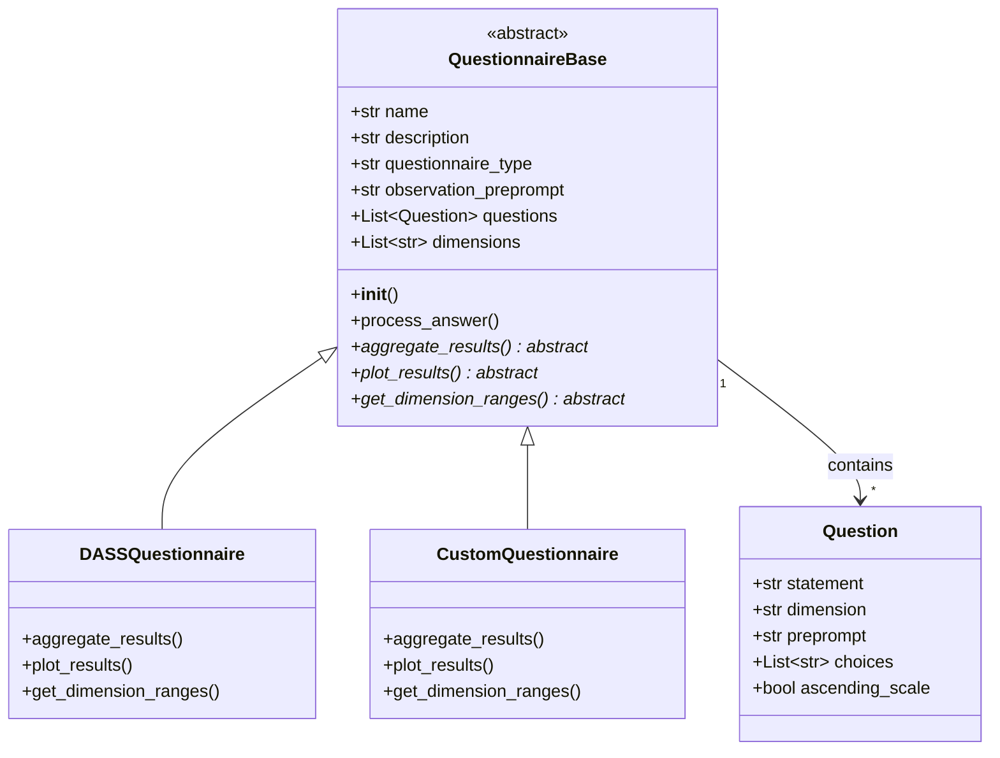
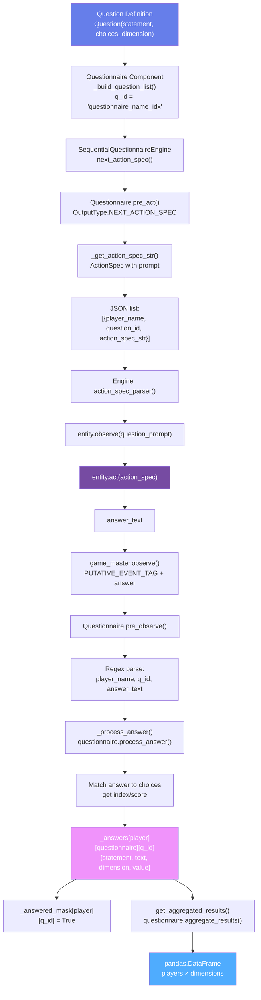

<!-- source: DeepWiki mcp.deepwiki.com · repo google-deepmind/concordia · page 3.3 Questionnaire Simulations · fetched 2026-10-26 -->

# Questionnaire Simulations

<details>
<summary>Relevant source files</summary>

The following files were used as context for generating this wiki page:

- [concordia/components/game_master/formative_memories_initializer.py](concordia/components/game_master/formative_memories_initializer.py)
- [concordia/components/game_master/gm_components_test.py](concordia/components/game_master/gm_components_test.py)
- [concordia/components/game_master/next_acting.py](concordia/components/game_master/next_acting.py)
- [concordia/components/game_master/next_game_master.py](concordia/components/game_master/next_game_master.py)
- [concordia/components/game_master/open_ended_questionnaire.py](concordia/components/game_master/open_ended_questionnaire.py)
- [concordia/components/game_master/questionnaire.py](concordia/components/game_master/questionnaire.py)
- [concordia/contrib/data/questionnaires/base_questionnaire.py](concordia/contrib/data/questionnaires/base_questionnaire.py)
- [concordia/contrib/data/questionnaires/depression_anxiety_stress_scale.py](concordia/contrib/data/questionnaires/depression_anxiety_stress_scale.py)
- [concordia/environment/engine.py](concordia/environment/engine.py)
- [concordia/environment/engine_test.py](concordia/environment/engine_test.py)
- [concordia/environment/engines/sequential_questionnaire.py](concordia/environment/engines/sequential_questionnaire.py)
- [concordia/prefabs/game_master/open_ended_interviewer.py](concordia/prefabs/game_master/open_ended_interviewer.py)
- [concordia/prefabs/simulation/questionnaire_simulation.py](concordia/prefabs/simulation/questionnaire_simulation.py)
- [examples/questionnaire_example.ipynb](examples/questionnaire_example.ipynb)

</details>


## Purpose and Scope

This document describes Concordia's questionnaire simulation system, which enables systematic administration of surveys and psychological instruments to LLM-based agents. Questionnaire simulations differ from regular simulations in that they use specialized engines and game master components optimized for asking sequences of questions and aggregating responses. 

For general simulation orchestration concepts, see [Simulation Orchestration](#3.2). For basic engine implementations, see [Engines and Execution](#3.4). This page focuses specifically on the questionnaire-specific components and workflows.

**Sources:** [concordia/prefabs/simulation/questionnaire_simulation.py:15-453]()

---

## Architecture Overview

The questionnaire simulation system consists of four main layers:



**Diagram:** Questionnaire Simulation Architecture showing the four layers from questionnaire definition to agent responses

**Sources:** 
- [concordia/prefabs/simulation/questionnaire_simulation.py:40-453]()
- [concordia/environment/engines/sequential_questionnaire.py:51-338]()
- [concordia/components/game_master/questionnaire.py:41-297]()
- [concordia/contrib/data/questionnaires/base_questionnaire.py:25-157]()

---

## QuestionnaireSimulation Class

The `QuestionnaireSimulation` class extends the standard `Simulation` interface with questionnaire-specific initialization and execution.

### Key Differences from Generic Simulation

| Aspect | Generic Simulation | QuestionnaireSimulation |
|--------|-------------------|------------------------|
| **Default Engine** | None (must specify) | `ParallelQuestionnaireEngine` |
| **Game Master Role** | Event resolution, world state | Question delivery, answer collection |
| **Entity Interaction** | Free-form actions | Structured question-answer pairs |
| **Termination** | Event-based or step-based | Answer-completeness based |
| **Result Extraction** | Manual from logs | `get_questionnaires_results()` method |

### Initialization Flow



**Diagram:** QuestionnaireSimulation initialization sequence showing entity isolation and game master references

**Sources:** [concordia/prefabs/simulation/questionnaire_simulation.py:43-116]()

### Core Methods

| Method | Purpose | Return Type |
|--------|---------|-------------|
| `play()` | Execute questionnaire administration | `str` (JSON log) |
| `add_entity()` | Add respondent entity | `None` |
| `add_game_master()` | Add interviewer game master | `None` |
| `get_entities()` | Retrieve entity list | `list[Entity]` |
| `get_game_masters()` | Retrieve game master list | `list[Entity]` |
| `save_checkpoint()` | Persist state | `None` |
| `load_from_checkpoint()` | Restore state | `None` |

**Sources:** [concordia/prefabs/simulation/questionnaire_simulation.py:237-453]()

---

## Questionnaire Engines

Questionnaire engines orchestrate the question-answer loop between game masters and entities. They differ from standard engines in how they handle action specs and termination.

### SequentialQuestionnaireEngine

Asks all questions to all entities sequentially, one question-answer pair at a time.



**Diagram:** SequentialQuestionnaireEngine execution flow showing the question-answer loop

The engine performs these steps:

1. **Initialization** [sequential_questionnaire.py:192-197](): Observe premise on all game masters in parallel
2. **Termination Check** [sequential_questionnaire.py:204-208](): Ask game master via `OutputType.TERMINATE`
3. **Make Observations** [sequential_questionnaire.py:210-216](): Generate observations for entities in parallel
4. **Select Acting Entities** [sequential_questionnaire.py:218-228](): Call `next_acting()` with `OutputType.NEXT_ACTING`
5. **Get Question Specs** [sequential_questionnaire.py:230-235](): Call `next_action_spec()` to retrieve JSON list of question specifications
6. **Ask Questions** [sequential_questionnaire.py:240-280](): For each (player_name, question_id, spec_string):
   - Parse action spec from JSON string
   - Observe question on entity
   - Call `entity.act()` to get answer
7. **Feed Answers Back** [sequential_questionnaire.py:283-286](): Observe answers on game master with `PUTATIVE_EVENT_TAG`

**Sources:** [concordia/environment/engines/sequential_questionnaire.py:51-338]()

### ParallelQuestionnaireEngine

Referenced in code but implementation follows similar pattern with concurrent question asking. Uses `ThreadPoolExecutor` to parallelize entity responses.

**Sources:** [concordia/prefabs/simulation/questionnaire_simulation.py:49-50](), [concordia/environment/engines/parallel_questionnaire.py]()

---

## Game Master Components

### Questionnaire Component

The `Questionnaire` component manages question administration, answer tracking, and result aggregation for standard questionnaires.

```mermaid
graph TB
    subgraph "Initialization"
        QInit["Questionnaire.__init__"]
        BuildQList["_build_question_list()<br/>q_id = questionnaire_name_idx"]
        InitAnswers["_answers: dict[player][questionnaire][q_id]"]
        InitMask["_answered_mask: dict[player][q_id]"]
    end
    
    subgraph "Runtime - pre_act Phase"
        PreAct["pre_act(action_spec)"]
        CheckType{"action_spec<br/>.output_type?"}
        
        RetTerminate["TERMINATE:<br/>return 'Yes' if is_done()"]
        RetNextActing["NEXT_ACTING:<br/>return comma-separated<br/>player_names"]
        RetNextActionSpec["NEXT_ACTION_SPEC:<br/>build JSON list of specs"]
        
        GetActionSpec["_get_action_spec_str()<br/>for each unanswered q_id"]
        BuildJSON["json.dumps(list of:<br/>player_name, question_id,<br/>action_spec_str)"]
    end
    
    subgraph "Runtime - pre_observe Phase"
        PreObserve["pre_observe(observation)"]
        ParseRegex["Parse PUTATIVE_EVENT_TAG<br/>player: q_id: answer"]
        ProcessAnswer["_process_answer()<br/>dimension, value"]
        UpdateMask["Mark q_id as answered"]
    end
    
    subgraph "Result Extraction"
        GetAnswers["get_answers()<br/>raw dict structure"]
        GetAggregated["get_aggregated_results()<br/>calls questionnaire.aggregate_results()"]
        GetDF["get_questionnaires_results()<br/>returns pandas.DataFrame"]
    end
    
    QInit --> BuildQList
    BuildQList --> InitAnswers
    InitAnswers --> InitMask
    
    PreAct --> CheckType
    CheckType --> RetTerminate
    CheckType --> RetNextActing
    CheckType --> RetNextActionSpec
    
    RetNextActionSpec --> GetActionSpec
    GetActionSpec --> BuildJSON
    
    PreObserve --> ParseRegex
    ParseRegex --> ProcessAnswer
    ProcessAnswer --> UpdateMask
    
    style QInit fill:#667eea,color:#fff
    style ProcessAnswer fill:#764ba2,color:#fff
    style GetDF fill:#f093fb,color:#fff
```



**Diagram:** Questionnaire component lifecycle from initialization through answer processing to result aggregation

**Key Data Structures:**

- `_questions_by_id: Dict[str, Tuple[str, Question]]` - Maps `q_id` to (questionnaire_name, Question object)
- `_answers: Dict[str, Dict[str, Any]]` - Nested dict: player → questionnaire → question_id → answer data
- `_answered_mask: Dict[str, Dict[str, bool]]` - Tracks which questions each player has answered

**Answer Processing** [questionnaire.py:203-223]():
1. Extract questionnaire_name and Question from `_questions_by_id`
2. Call `questionnaire.process_answer(player_name, answer_text, question)` to get (dimension, value)
3. Store in `_answers[player][questionnaire_name][q_id]` with statement, text, dimension, value

**Sources:** [concordia/components/game_master/questionnaire.py:41-297]()

### OpenEndedQuestionnaire Component

Extends `Questionnaire` for open-ended questions with semantic similarity scoring.

**Key Differences:**

| Aspect | Questionnaire | OpenEndedQuestionnaire |
|--------|--------------|----------------------|
| **Answer Storage** | Single dict | List of dicts (per event) |
| **Event Handling** | Single pass | Sequence of events support |
| **Embedding** | Not used | Required for open-ended similarity |
| **Answer Processing** | Choice matching only | Cosine similarity to choices |

**Sequence of Events Support** [open_ended_questionnaire.py:78-112]():
- `sequence_of_events: Sequence[str]` - Events to show before each question round
- `_event_counter` tracks current event index
- `_answers` is a list of dicts, one per event
- Questions asked after each event in sequence

**Similarity Calculation** [open_ended_questionnaire.py:236-256]():
```python
answer_embedding = embedder(answer_text)
for choice in choices:
    choice_embedding = embedder(choice)
    similarity = np.dot(answer_embedding, choice_embedding)
```

**Sources:** [concordia/components/game_master/open_ended_questionnaire.py:42-361]()

---

## QuestionnaireBase and Question Dataclass

### Question Dataclass

Defines the structure of a single question:

```python
@dataclasses.dataclass
class Question:
    statement: str                    # The question text
    dimension: str                    # Scoring dimension (e.g., "anxiety")
    preprompt: str = ""              # Context before statement
    choices: Optional[List[str]] = None  # Multiple choice options
    ascending_scale: bool = True     # True if higher choice index = higher score
```

**Sources:** [concordia/contrib/data/questionnaires/base_questionnaire.py:25-34]()

### QuestionnaireBase Abstract Class

All questionnaires must extend this base class:



**Diagram:** QuestionnaireBase class hierarchy and composition with Question dataclass

**Key Methods:**

| Method | Purpose | Default Implementation |
|--------|---------|----------------------|
| `process_answer()` | Convert answer text to score | Choice index matching [base_questionnaire.py:69-95]() |
| `aggregate_results()` | Aggregate per-player scores | Must implement |
| `plot_results()` | Visualize results | Must implement |
| `get_dimension_ranges()` | Return score ranges | Must implement |

**Sources:** [concordia/contrib/data/questionnaires/base_questionnaire.py:36-157]()

---

## Creating Custom Questionnaires

### Step 1: Define Questions

```python
from concordia.contrib.data.questionnaires import base_questionnaire

Question = base_questionnaire.Question

LIKERT_SCALE = [
    "Strongly Disagree",
    "Disagree", 
    "Neutral",
    "Agree",
    "Strongly Agree"
]

questions = [
    Question(
        statement="I enjoy social gatherings.",
        dimension="extraversion",
        preprompt="Rate your agreement:",
        choices=LIKERT_SCALE,
        ascending_scale=True
    ),
    Question(
        statement="I prefer working alone.",
        dimension="extraversion", 
        preprompt="Rate your agreement:",
        choices=LIKERT_SCALE,
        ascending_scale=False  # Reverse scored
    ),
]
```

### Step 2: Implement QuestionnaireBase

```python
class PersonalityQuestionnaire(base_questionnaire.QuestionnaireBase):
    def __init__(self):
        super().__init__(
            name="Big_Five_Extraversion",
            description="Measures extraversion dimension",
            questionnaire_type="multiple_choice",
            observation_preprompt="{player_name} is taking a personality test.",
            questions=questions,
            dimensions=["extraversion"],
        )
    
    def aggregate_results(self, player_answers):
        # Average scores for extraversion dimension
        values = [
            qa['value'] 
            for qa in player_answers.values()
            if qa['dimension'] == 'extraversion'
        ]
        return {'extraversion': np.mean(values) if values else np.nan}
    
    def get_dimension_ranges(self):
        return {'extraversion': (0, 4)}  # 5-point scale, 0-indexed
    
    def plot_results(self, results_df, label_column=None, kwargs=None):
        # Visualization implementation
        pass
```

**Sources:** [concordia/contrib/data/questionnaires/depression_anxiety_stress_scale.py:379-430]()

### Step 3: Configure Simulation

```python
from concordia.typing import prefab as prefab_lib

# Define questionnaire instances
personality_questionnaire = PersonalityQuestionnaire()

# Create entity instances
entity_instances = [
    prefab_lib.InstanceConfig(
        prefab='basic__Entity',
        role=prefab_lib.Role.ENTITY,
        params={'name': name}
    )
    for name in ["Alice", "Bob", "Carol"]
]

# Create game master instance with questionnaire
gm_instance = prefab_lib.InstanceConfig(
    prefab='interviewer__GameMaster',
    role=prefab_lib.Role.GAME_MASTER,
    params={
        'name': 'interviewer',
        'player_names': ["Alice", "Bob", "Carol"],
        'questionnaires': [personality_questionnaire],
        'embedder': embedder,  # Required for open-ended questions
        'sequence_of_events': None,  # Optional
    }
)

config = prefab_lib.Config(
    default_premise="Participants are taking a personality assessment.",
    default_max_steps=1,
    prefabs=prefabs,
    instances=entity_instances + [gm_instance]
)
```

**Sources:** [examples/questionnaire_example.ipynb:190-290]()

### Step 4: Run and Extract Results

```python
from concordia.prefabs.simulation import questionnaire_simulation

sim = questionnaire_simulation.QuestionnaireSimulation(
    config=config,
    model=model,
    embedder=embedder,
)

# Execute questionnaire
results_log = sim.play(max_steps=1)

# Extract structured results
questionnaire_comp = sim.game_masters[0].get_component('questionnaire')
results_df = questionnaire_comp.get_questionnaires_results()
print(results_df)

# Access raw answers
raw_answers = questionnaire_comp.get_answers()

# Plot results
questionnaire_comp.plot_all_results(results_df, label_column='character')
```

**Sources:** [examples/questionnaire_example.ipynb:296-333]()

---

## Answer Flow Diagram

The following diagram traces a single answer through the system:



**Diagram:** Complete answer flow from question definition to aggregated results DataFrame

**Sources:** 
- [concordia/components/game_master/questionnaire.py:82-223]()
- [concordia/environment/engines/sequential_questionnaire.py:103-286]()

---

## interviewer__GameMaster Prefab

The `interviewer__GameMaster` prefab provides a ready-to-use game master for questionnaire administration.

**Component Configuration:**

```python
components_of_game_master = {
    next_acting_component_key: questionnaire_component_instance,
    next_action_spec_key: questionnaire_component_instance,
    terminator_key: questionnaire_component_instance,
    make_observation_key: questionnaire_component_instance,
    resolution_key: questionnaire_component_instance,
    "questionnaire": questionnaire_component_instance,
}
```

All engine interaction points use the same `Questionnaire` or `OpenEndedQuestionnaire` component instance, which implements multiple component interfaces:
- `ContextComponent` for `pre_act()`
- Handles `NEXT_ACTING`, `NEXT_ACTION_SPEC`, `TERMINATE`, and `MAKE_OBSERVATION` output types

**Sources:** [concordia/prefabs/game_master/open_ended_interviewer.py:28-115]()

---

## OutputType Handling

Questionnaire components respond to specific `OutputType` enum values:

| OutputType | Component Response | Line Reference |
|-----------|-------------------|----------------|
| `TERMINATE` | Return `"Yes"` if `is_done()`, else `""` | [questionnaire.py:149-150]() |
| `NEXT_ACTING` | Return comma-separated player names | [questionnaire.py:152-153]() |
| `NEXT_ACTION_SPEC` | Return JSON list of question specs | [questionnaire.py:155-168]() |
| `MAKE_OBSERVATION` | Return current event from sequence | [open_ended_questionnaire.py:182-186]() |

**Sources:** 
- [concordia/components/game_master/questionnaire.py:145-170]()
- [concordia/components/game_master/open_ended_questionnaire.py:152-187]()

---

## State Persistence

Questionnaire components support checkpointing via `get_state()` and `set_state()`:

**Questionnaire Component State:**
```python
{
    'answers': Dict[str, Dict[str, Any]],
    'answered_mask': Dict[str, Dict[str, bool]]
}
```

**OpenEndedQuestionnaire Component State:**
```python
{
    'answers': List[Dict[str, Dict[str, Any]]],  # Per-event
    'answered_mask': List[Dict[str, Dict[str, bool]]]  # Per-event
}
```

**QuestionnaireSimulation Checkpoint Format:**
```python
{
    'entities': {
        entity_name: {
            'prefab_type': str,
            'entity_params': dict,
            'components': dict  # Component states
        }
    },
    'game_masters': {
        gm_name: {
            'prefab_type': str,
            'entity_params': dict,
            'role': str,
            'components': dict  # Includes questionnaire state
        }
    }
}
```

**Sources:** 
- [concordia/components/game_master/questionnaire.py:286-296]()
- [concordia/components/game_master/open_ended_questionnaire.py:350-360]()
- [concordia/prefabs/simulation/questionnaire_simulation.py:306-360]()

---

## Example: DASS Questionnaire

The Depression Anxiety Stress Scale (DASS) implementation demonstrates a complete questionnaire:

**Dimension Structure:**
- `anxiety`: 14 questions
- `depression`: 14 questions  
- `stress`: 14 questions

**Answer Processing:**
```python
def process_answer(self, player_name, answer_text, question):
    # Inherited from base class - matches answer to choice index
    idx = question.choices.index(answer_text)
    if question.ascending_scale:
        value = idx
    else:
        value = len(choices) - 1 - idx
    return question.dimension, value
```

**Aggregation:**
```python
def aggregate_results(self, player_answers):
    dimension_values = {}
    for question_data in player_answers.values():
        dimension = question_data['dimension']
        value = question_data['value']
        dimension_values.setdefault(dimension, []).append(value)
    
    return {
        dim: np.mean(values) if values else np.nan
        for dim, values in dimension_values.items()
    }
```

**Sources:** [concordia/contrib/data/questionnaires/depression_anxiety_stress_scale.py:30-430]()

---

