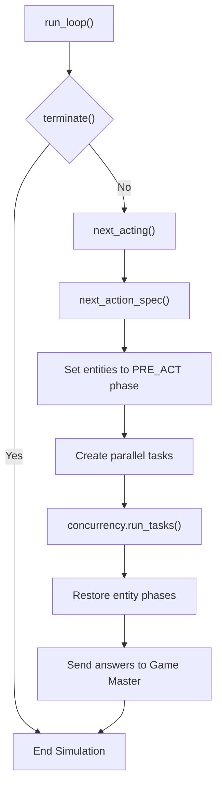
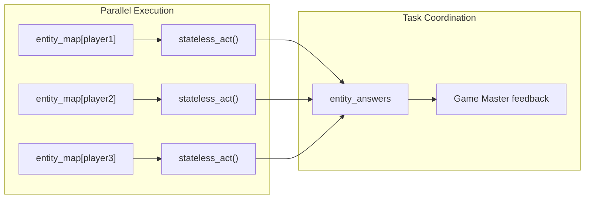
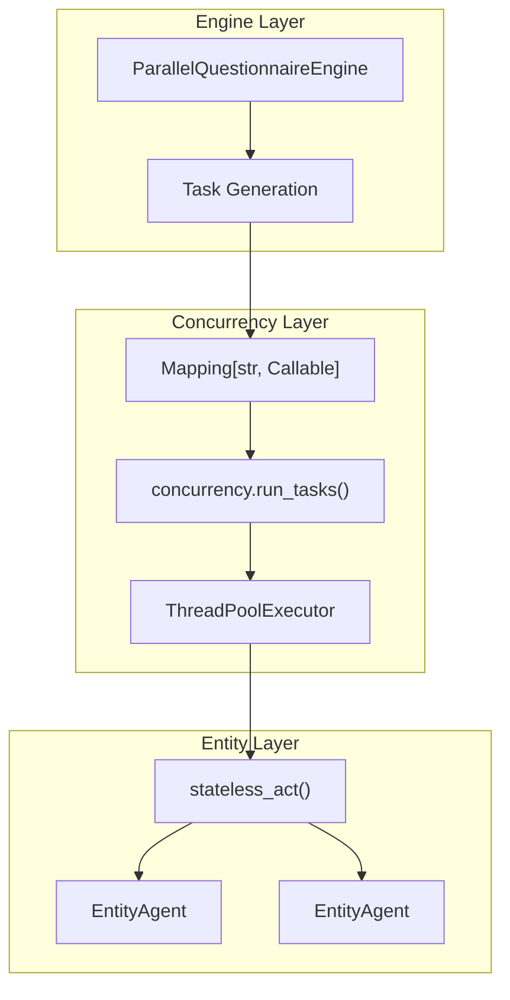
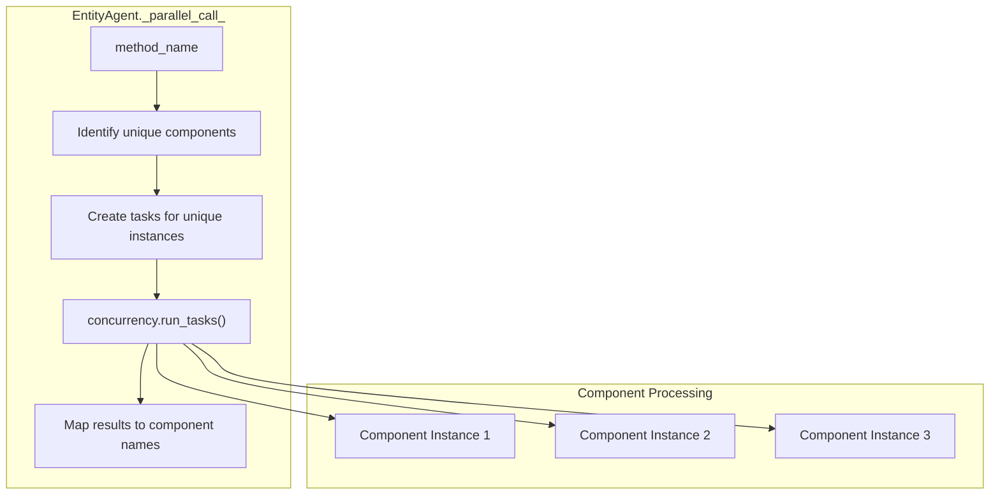
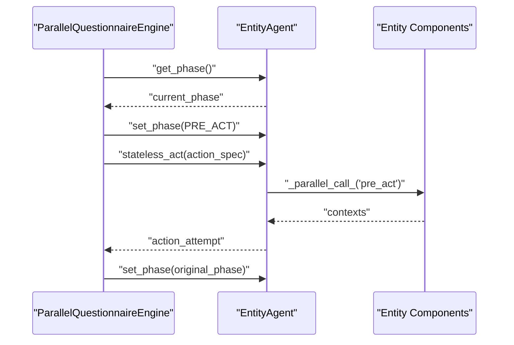
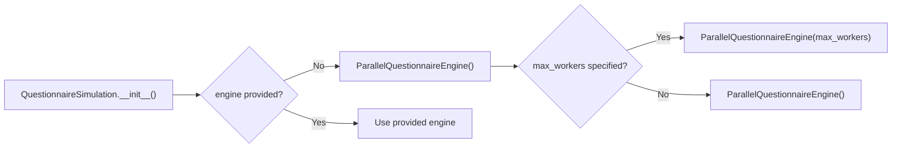
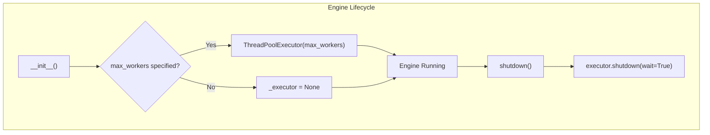
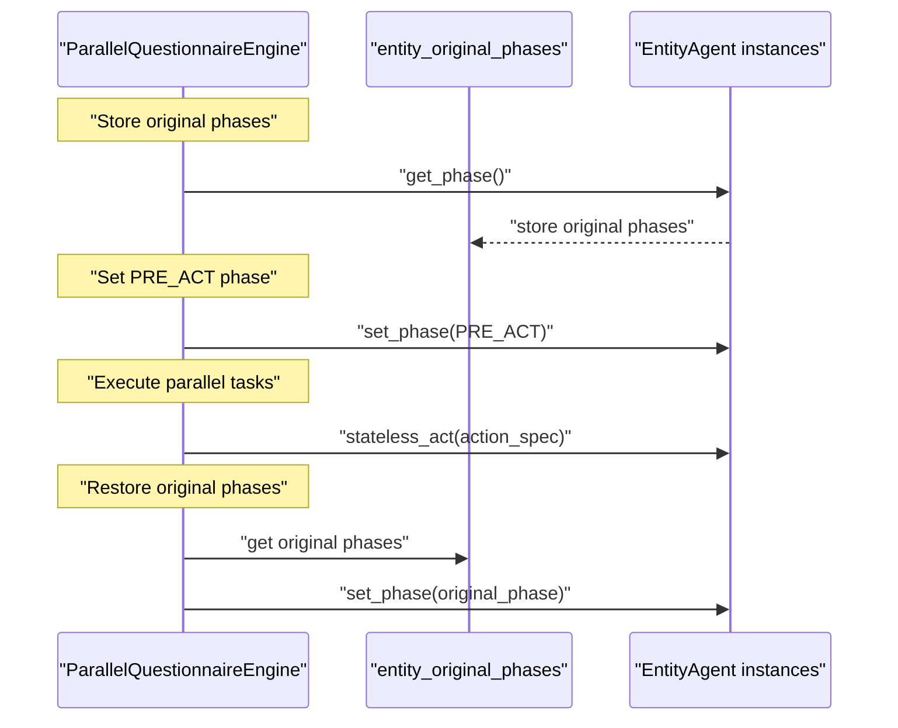

<!-- source: DeepWiki mcp.deepwiki.com · repo google-deepmind/concordia · page 3.4 Engines and Execution · fetched 2026-10-26 -->

# Engine Implementations

<details>
<summary>Relevant source files</summary>

The following files were used as context for generating this wiki page:

- [concordia/associative_memory/basic_associative_memory.py](concordia/associative_memory/basic_associative_memory.py)
- [concordia/components/game_master/next_acting.py](concordia/components/game_master/next_acting.py)
- [concordia/components/game_master/open_ended_questionnaire.py](concordia/components/game_master/open_ended_questionnaire.py)
- [concordia/components/game_master/questionnaire.py](concordia/components/game_master/questionnaire.py)
- [concordia/environment/engine.py](concordia/environment/engine.py)
- [concordia/environment/engine_test.py](concordia/environment/engine_test.py)
- [concordia/environment/engines/sequential_questionnaire.py](concordia/environment/engines/sequential_questionnaire.py)
- [concordia/prefabs/game_master/generic.py](concordia/prefabs/game_master/generic.py)
- [concordia/prefabs/game_master/open_ended_interviewer.py](concordia/prefabs/game_master/open_ended_interviewer.py)
- [concordia/prefabs/simulation/generic.py](concordia/prefabs/simulation/generic.py)
- [concordia/prefabs/simulation/questionnaire_simulation.py](concordia/prefabs/simulation/questionnaire_simulation.py)
- [concordia/typing/prefab.py](concordia/typing/prefab.py)
- [concordia/typing/simulation.py](concordia/typing/simulation.py)
- [concordia/utils/log_viewer.html](concordia/utils/log_viewer.html)
- [concordia/utils/structured_logging.py](concordia/utils/structured_logging.py)
- [concordia/utils/structured_logging_test.py](concordia/utils/structured_logging_test.py)
- [examples/actor_development.ipynb](examples/actor_development.ipynb)
- [examples/alice.ipynb](examples/alice.ipynb)
- [examples/dialog.ipynb](examples/dialog.ipynb)
- [examples/marketplace.ipynb](examples/marketplace.ipynb)
- [examples/selling_cookies.ipynb](examples/selling_cookies.ipynb)
- [examples/tutorial.ipynb](examples/tutorial.ipynb)

</details>


## Purpose and Overview

This page documents the engine implementations in Concordia. Engines are responsible for orchestrating the execution flow of simulations, managing interactions between Game Masters and entities, and coordinating parallel processing of agent actions. They serve as the "runtime" that coordinates the simulation loop and determines execution patterns.

Concordia provides specialized engine implementations for different simulation scenarios:
- **ParallelQuestionnaireEngine**: Executes questionnaires across multiple entities in parallel, optimized for data collection scenarios

Engines are integrated into simulations through simulation prefabs, which configure the engine and use it to coordinate the simulation loop. The `ParallelQuestionnaireEngine` is used by default in questionnaire-based simulations.

For information about the Scene System, see [Scene System](#3.2). For information about configuring and launching simulations using these engines, see [Configuration and Launching](#4).

Sources:
- [concordia/environment/engines/parallel.py:49-282]()
- [concordia/prefabs/simulation/questionnaire_simulation.py:75-83]()
- [concordia/utils/concurrency.py:112-143]()

## Engine Interface

All engines in Concordia implement the abstract `Engine` class defined in `concordia.environment.engine`. The interface defines core methods that engines must implement:

**Engine Interface**
```mermaid
classDiagram
    class "engine_lib.Engine" {
        <<abstract>>
        +make_observation(game_master, entity) str
        +next_acting(game_master, entities) Sequence
        +resolve(game_master, event) None
        +terminate(game_master, verbose) bool
        +next_game_master(game_master, game_masters, verbose) Entity
        +run_loop(game_masters, entities, premise, max_steps, verbose, log, checkpoint_callback) None
    }
    
    class "ParallelQuestionnaireEngine" {
        +next_acting(game_master, entities) Sequence[Entity]
        +next_action_spec(game_master, acting_entities) List[Tuple]
        +terminate(game_master, verbose) bool
        +run_loop(game_masters, entities, premise, max_steps, verbose, log, checkpoint_callback) None
        +next_game_master(game_master, game_masters, verbose) Entity
        +shutdown(wait) None
    }
    
    "engine_lib.Engine" <|-- "ParallelQuestionnaireEngine"
```

- **next_acting**: Determines which entities should act next in the simulation
- **next_action_spec**: Returns action specifications for questionnaire scenarios  
- **terminate**: Checks if the simulation should end
- **run_loop**: Executes the main simulation loop with parallel processing
- **next_game_master**: Selects which Game Master should be used for the next step
- **shutdown**: Cleans up engine resources like thread pools

The engine implementations leverage the concurrency utilities for parallel execution of agent actions and observations.

Sources:
- [concordia/environment/engines/parallel.py:49-282]()
- [concordia/environment/engines/parallel.py:74-98]()
- [concordia/environment/engines/parallel.py:127-144]()

## Parallel Questionnaire Engine

The `ParallelQuestionnaireEngine` implements a specialized execution model designed for questionnaire scenarios where multiple entities answer questions simultaneously. This engine optimizes for data collection use cases by processing all entity responses in parallel.

### Execution Flow

**Parallel Questionnaire Engine Flow**


### Key Components

The Parallel Questionnaire engine uses specialized prompts for questionnaire scenarios:

| Method | Default Prompt | Purpose |
|--------|---------------|---------|
| `next_acting` | "Who is next to act?" | Determine which entities participate |
| `next_action_spec` | Player names passed directly | Get questionnaire specifications |
| `terminate` | "Is the game/simulation finished?" | Check if questionnaire complete |
| `next_game_master` | "Which rule set should we use for the next step?" | Select Game Master for next phase |

The engine processes questionnaire responses through parallel task execution:



Sources:
- [concordia/environment/engines/parallel.py:146-230]()
- [concordia/environment/engines/parallel.py:54-64]()
- [concordia/environment/engines/parallel.py:99-126]()

## Concurrency and Parallel Processing

The engine implementations leverage Concordia's concurrency utilities for efficient parallel processing. The `ParallelQuestionnaireEngine` demonstrates how engines coordinate simultaneous entity actions.

### Concurrency Architecture

**Concurrency Integration in Engines**


### Task-Based Parallel Execution

The engine creates parallel tasks for each entity-question combination:

| Component | Role | Implementation |
|-----------|------|----------------|
| `tasks` | Maps task keys to callable functions | `{player_name}_{question_id}: partial(process_question_task)` |
| `concurrency.run_tasks` | Executes tasks in parallel | Thread pool coordination with error handling |
| `entity.stateless_act` | Processes individual questions | Uses `_parallel_call_` for component coordination |
| `entity_answers` | Collects results | Thread-safe dictionary with mutex protection |

### Entity Agent Parallel Processing

The `EntityAgent` class supports parallel processing through its `_parallel_call_` method:



This enables parallel execution of component methods like `pre_act`, `post_act`, and `update` across all entity components.

Sources:
- [concordia/environment/engines/parallel.py:176-214]()
- [concordia/utils/concurrency.py:112-143]()
- [concordia/agents/entity_agent.py:120-161]()

## Integration with Game Master Components

Engines communicate with Game Masters through structured `ActionSpec` objects and coordinate with entity components for parallel processing:

**Engine-Game Master-Entity Integration**
```mermaid
classDiagram
    direction TB
    
    class "engine_lib.Engine" {
        <<interface>>
    }
    
    class "ParallelQuestionnaireEngine" {
        -_call_to_check_termination
        -_call_to_next_acting
        -_call_to_next_action_spec
        -_call_to_next_game_master
        -_executor: ThreadPoolExecutor
    }
    
    class "entity_lib.Entity" {
        +act(action_spec)
        +observe(observation)
    }
    
    class "entity_agent.EntityAgent" {
        +stateless_act(action_spec)
        +_parallel_call_(method_name)
        +set_phase(phase)
        +get_phase()
    }
    
    "engine_lib.Engine" <|-- "ParallelQuestionnaireEngine"
    
    "ParallelQuestionnaireEngine" --> "entity_lib.Entity" : "Game Master coordination"
    "ParallelQuestionnaireEngine" --> "entity_agent.EntityAgent" : "Parallel questionnaire processing"
```

### Engine-Game Master Communication

The `ParallelQuestionnaireEngine` communicates with Game Masters through specific `ActionSpec` types:

| ActionSpec OutputType | Purpose | Engine Method | Default Prompt |
|---------------------|---------|---------------|----------------|
| `NEXT_ACTING` | Determine participating entities | `next_acting()` | "Who is next to act?" |
| `NEXT_ACTION_SPEC` | Get questionnaire specifications | `next_action_spec()` | Player names directly |
| `TERMINATE` | Check if questionnaire complete | `terminate()` | "Is the game/simulation finished?" |
| `NEXT_GAME_MASTER` | Select next Game Master | `next_game_master()` | "Which rule set should we use for the next step?" |

### Entity Phase Management

The engine coordinates entity phases during parallel processing:



The engine ensures thread-safe phase transitions and proper component lifecycle management during parallel execution.

Sources:
- [concordia/environment/engines/parallel.py:54-64]()
- [concordia/environment/engines/parallel.py:181-220]()
- [concordia/environment/engines/parallel.py:251-281]()
- [concordia/agents/entity_agent.py:253-276]()

## Engine Usage in Simulations

Engines are integrated into simulations through specialized simulation classes. The `QuestionnaireSimulation` demonstrates how engines coordinate questionnaire-based data collection:

**Questionnaire Simulation Architecture**
```mermaid
classDiagram
    direction TB
    
    class "QuestionnaireSimulation" {
        -_engine: ParallelQuestionnaireEngine
        -_model: LanguageModel
        -_embedder: Callable
        -game_masters: list[Entity]
        -entities: list[Entity]
        +play(premise, max_steps, raw_log, checkpoint_path)
        +add_entity(instance_config, state)
        +add_game_master(instance_config, state)
    }
    
    class "ParallelQuestionnaireEngine" {
        +run_loop()
        +shutdown()
    }
    
    "QuestionnaireSimulation" --> "ParallelQuestionnaireEngine" : "coordinates questionnaire execution"
```

### Engine Configuration and Initialization

The questionnaire simulation initializes the `ParallelQuestionnaireEngine` with optional thread pool configuration:

| Parameter | Purpose | Default |
|-----------|---------|---------|
| `engine` | Engine instance | `ParallelQuestionnaireEngine()` |
| `max_workers` | Thread pool size | System default |



### Simulation Execution Flow

The `play()` method coordinates the complete simulation lifecycle:

| Step | Action | Implementation |
|------|--------|----------------|
| 1 | Initialize premise and parameters | Use config defaults or provided values |
| 2 | Sort Game Masters (Initializers first) | Separate initializers from regular Game Masters |
| 3 | Execute questionnaire loop | `engine.run_loop()` |
| 4 | Shutdown engine resources | `engine.shutdown()` |
| 5 | Process memories and generate HTML | Extract entity memories and Game Master logs |

The engine processes questionnaires for all entities and feeds results back to Game Masters for analysis and scoring.

Sources:
- [concordia/prefabs/simulation/questionnaire_simulation.py:75-83]()
- [concordia/prefabs/simulation/questionnaire_simulation.py:267-278]()
- [concordia/prefabs/simulation/questionnaire_simulation.py:254-266]()

## Special Engine Behaviors

### Resource Management

The `ParallelQuestionnaireEngine` includes proper resource management for thread pools and concurrent execution:



### Thread Pool Management

The engine manages concurrent execution through configurable thread pools:

| Configuration | Behavior | Use Case |
|--------------|----------|----------|
| `max_workers=None` | No dedicated executor | Use system default threading |
| `max_workers=N` | Fixed thread pool size | Control resource usage |
| `executor` parameter | External executor | Share thread pools across engines |

### Entity State Coordination

The engine coordinates entity states during parallel questionnaire processing:

**Entity Phase Management**


### Error Handling and Recovery

The engine implements robust error handling for parallel execution scenarios, ensuring proper cleanup even when individual tasks fail.

Sources:
- [concordia/environment/engines/parallel.py:66-72]()
- [concordia/environment/engines/parallel.py:244-248]()
- [concordia/environment/engines/parallel.py:181-220]()

## Testing and Debugging

The engine implementations include test files that demonstrate basic usage:

- `synchronous_test.py`: Tests the Synchronous engine with mock entities
- `asynchronous_test.py`: Tests the Asynchronous engine with mock entities

Both engines support verbose output and logging options to facilitate debugging:

- `verbose`: When enabled, prints detailed information about each step
- `log`: When provided, appends detailed logs about entity actions and Game Master decisions

Sources:
- [concordia/environment/unstable/engines/synchronous_test.py:15-77]()
- [concordia/environment/unstable/engines/asynchronous_test.py:15-77]()

---

