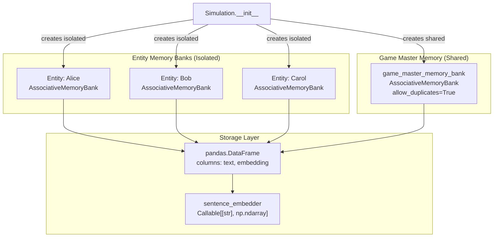
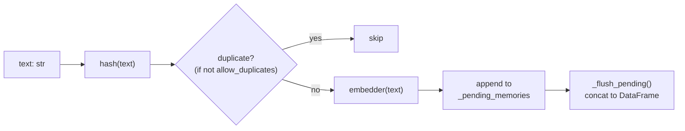
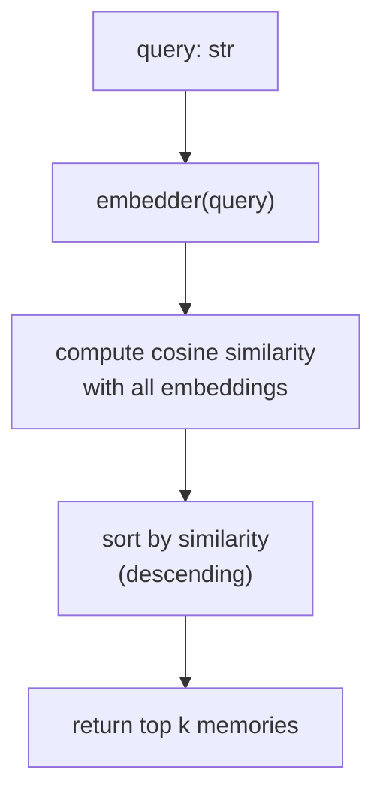
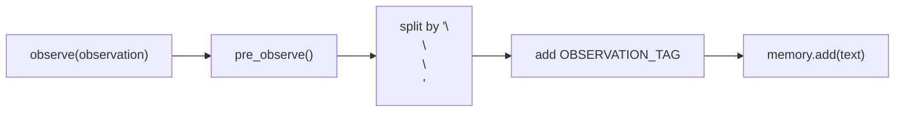
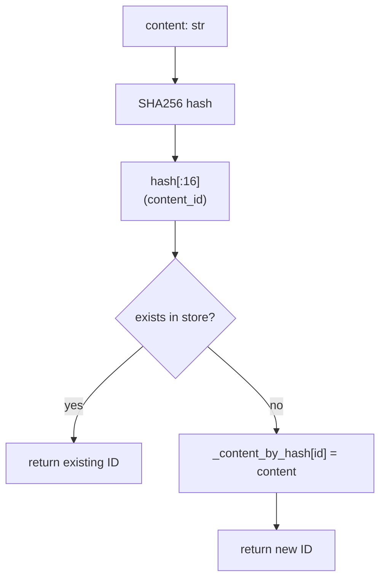
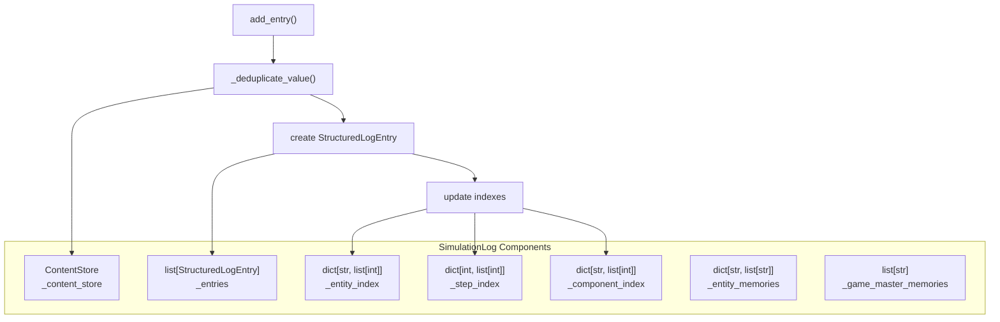
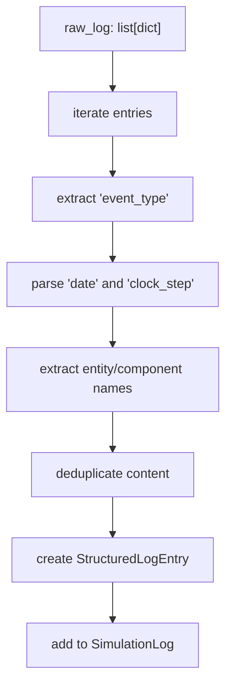
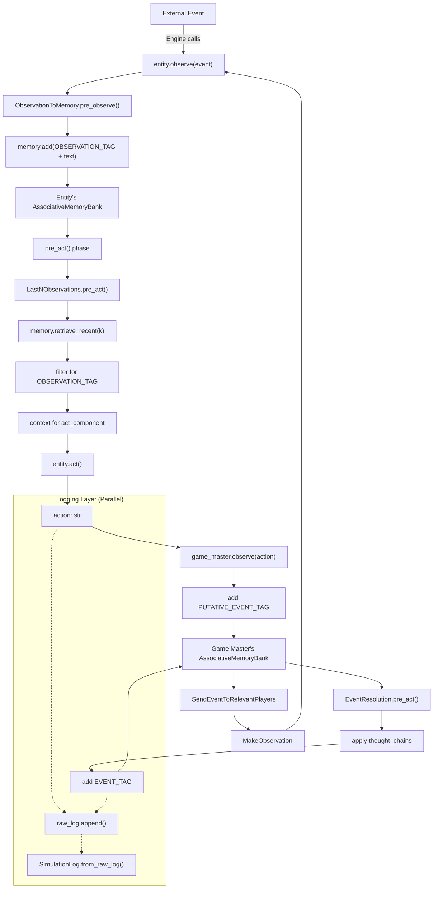
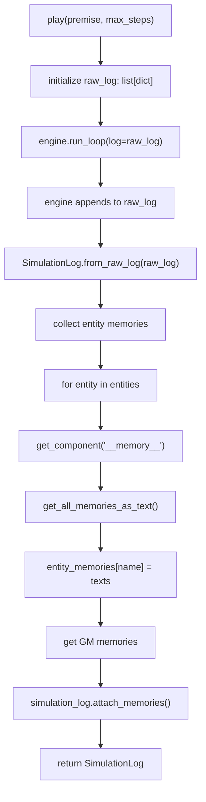
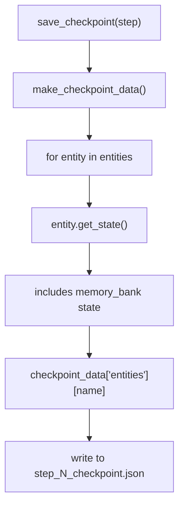

<!-- source: DeepWiki mcp.deepwiki.com · repo google-deepmind/concordia · page 4 Memory and Logging · fetched 2026-10-26 -->

# Memory and Logging

<details>
<summary>Relevant source files</summary>

The following files were used as context for generating this wiki page:

- [concordia/associative_memory/basic_associative_memory.py](concordia/associative_memory/basic_associative_memory.py)
- [concordia/components/agent/observation.py](concordia/components/agent/observation.py)
- [concordia/components/agent/plan.py](concordia/components/agent/plan.py)
- [concordia/prefabs/game_master/generic.py](concordia/prefabs/game_master/generic.py)
- [concordia/prefabs/simulation/generic.py](concordia/prefabs/simulation/generic.py)
- [concordia/typing/prefab.py](concordia/typing/prefab.py)
- [concordia/typing/simulation.py](concordia/typing/simulation.py)
- [concordia/utils/log_viewer.html](concordia/utils/log_viewer.html)
- [concordia/utils/structured_logging.py](concordia/utils/structured_logging.py)
- [concordia/utils/structured_logging_test.py](concordia/utils/structured_logging_test.py)
- [examples/actor_development.ipynb](examples/actor_development.ipynb)
- [examples/alice.ipynb](examples/alice.ipynb)
- [examples/dialog.ipynb](examples/dialog.ipynb)
- [examples/marketplace.ipynb](examples/marketplace.ipynb)
- [examples/selling_cookies.ipynb](examples/selling_cookies.ipynb)
- [examples/tutorial.ipynb](examples/tutorial.ipynb)

</details>


## Purpose and Scope

This document describes Concordia's memory and logging infrastructure, which provides two critical capabilities:

1. **Associative Memory System**: Enables agents and game masters to store, retrieve, and query episodic memories using semantic similarity search
2. **Structured Logging System**: Records simulation events with efficient deduplication for analysis and visualization

For information about how components use memory during the action-selection lifecycle, see [Entity Component System](#2.1). For simulation configuration and execution, see [Simulation Orchestration](#3.2).

---

## Associative Memory System

### Memory Architecture

Concordia implements a **dual-memory architecture** where entities maintain isolated memory banks while game masters share a collective memory bank.



**Sources**: [concordia/prefabs/simulation/generic.py:89-95](), [concordia/prefabs/simulation/generic.py:182-199]()

### AssociativeMemoryBank Class

The `AssociativeMemoryBank` class ([concordia/associative_memory/basic_associative_memory.py:30-260]()) provides the core memory storage and retrieval functionality.

| Property | Type | Description |
|----------|------|-------------|
| `_memory_bank` | `pd.DataFrame` | Stores memories with columns: `text`, `embedding` |
| `_embedder` | `Callable[[str], np.ndarray]` | Sentence encoder for semantic embeddings |
| `_allow_duplicates` | `bool` | If `True`, allows duplicate memories (used for Game Master) |
| `_stored_hashes` | `set[int]` | Tracks content hashes to prevent duplicates |
| `_pending_memories` | `list[dict]` | Batch accumulator for performance optimization |

**Key Design Decisions**:
- **Entity Isolation**: Each entity has its own `AssociativeMemoryBank` to prevent cross-contamination of memories ([concordia/prefabs/simulation/generic.py:194-196]())
- **Game Master Sharing**: All game masters share one memory bank with `allow_duplicates=True` to track recurring actions across rounds ([concordia/prefabs/simulation/generic.py:92-95]())
- **Batch Processing**: Pending memories are accumulated and flushed together to the DataFrame for efficiency ([concordia/associative_memory/basic_associative_memory.py:75-85]())

**Sources**: [concordia/associative_memory/basic_associative_memory.py:30-260](), [concordia/prefabs/simulation/generic.py:89-95]()

### Memory Operations

#### Adding Memories



The `add()` method ([concordia/associative_memory/basic_associative_memory.py:87-114]()) adds memories with automatic deduplication and newline removal.

**Sources**: [concordia/associative_memory/basic_associative_memory.py:87-114]()

#### Retrieval Patterns

The `AssociativeMemoryBank` supports three retrieval patterns:

| Method | Purpose | Key Parameters |
|--------|---------|----------------|
| `retrieve_recent(k)` | Get the most recent `k` memories | `k`: number of memories ([concordia/associative_memory/basic_associative_memory.py:218-237]()) |
| `retrieve_associative(query, k)` | Get `k` memories most similar to query | `query`: search text, `k`: number of results ([concordia/associative_memory/basic_associative_memory.py:173-198]()) |
| `scan(selector_fn)` | Filter memories by predicate function | `selector_fn`: function returning bool ([concordia/associative_memory/basic_associative_memory.py:200-216]()) |

**Semantic Search Implementation**:

The `retrieve_associative()` method uses cosine similarity on embeddings:



**Sources**: [concordia/associative_memory/basic_associative_memory.py:133-153](), [concordia/associative_memory/basic_associative_memory.py:173-198]()

---

## Observation Components

Observation components bridge external events to agent memory by tagging, storing, and retrieving observations.

### Memory Tagging System

| Tag | Purpose | Used By |
|-----|---------|---------|
| `OBSERVATION_TAG = '[observation]'` | Marks external observations | ObservationToMemory, LastNObservations ([concordia/components/agent/observation.py:26]()) |
| `PUTATIVE_EVENT_TAG` | Marks proposed actions before resolution | EventResolution |
| `EVENT_TAG` | Marks resolved events | EventResolution |

**Sources**: [concordia/components/agent/observation.py:26]()

### ObservationToMemory

The `ObservationToMemory` component ([concordia/components/agent/observation.py:29-62]()) adds observations to memory during the `pre_observe` phase:



**Implementation**:
- Retrieves the memory component by key: `memory_component.DEFAULT_MEMORY_COMPONENT_KEY` ([concordia/components/agent/observation.py:34-36]())
- Splits multi-part observations by triple newlines ([concordia/components/agent/observation.py:54]())
- Tags each observation with `OBSERVATION_TAG` prefix ([concordia/components/agent/observation.py:57]())

**Sources**: [concordia/components/agent/observation.py:29-62]()

### LastNObservations

The `LastNObservations` component ([concordia/components/agent/observation.py:64-114]()) retrieves recent observations during `pre_act`:

| Parameter | Type | Default | Description |
|-----------|------|---------|-------------|
| `history_length` | `int` | - | Maximum number of observations to retrieve |
| `memory_component_key` | `str` | `'__memory__'` | Key for memory component |
| `pre_act_label` | `str` | `'Observations (ordered from oldest to latest)'` | Label for output |

**Filtering Logic**: Only memories containing `OBSERVATION_TAG` are returned ([concordia/components/agent/observation.py:99]()).

**Sources**: [concordia/components/agent/observation.py:64-114]()

### ObservationsSinceLastPreAct

The `ObservationsSinceLastPreAct` component ([concordia/components/agent/observation.py:116-177]()) tracks observations since the last action by incrementing a counter on each `pre_observe` call and retrieving that many recent observations during `pre_act`.

**State Management**: The counter is stored in component state for checkpointing ([concordia/components/agent/observation.py:168-176]()).

**Sources**: [concordia/components/agent/observation.py:116-177]()

---

## Structured Logging System

The structured logging system provides efficient, deduplicated storage of simulation events with multiple output formats.

### ContentStore: Deduplication Layer



The `ContentStore` class ([concordia/utils/structured_logging.py:37-136]()) implements content-addressable storage:

| Method | Purpose |
|--------|---------|
| `add(content: str) -> str` | Store content, return hash ID ([concordia/utils/structured_logging.py:65-84]()) |
| `get(content_id: str) -> str` | Retrieve content by ID ([concordia/utils/structured_logging.py:86-99]()) |
| `get_or_none(content_id: str \| None) -> str \| None` | Safe retrieval ([concordia/utils/structured_logging.py:101-113]()) |

**Hash Collision Probability**: Uses 16-character hex prefix (64 bits), providing negligible collision probability for typical log sizes ([concordia/utils/structured_logging.py:53]()).

**Sources**: [concordia/utils/structured_logging.py:37-136]()

### StructuredLogEntry

The `StructuredLogEntry` dataclass ([concordia/utils/structured_logging.py:138-191]()) represents individual log entries:

```python
@dataclasses.dataclass
class StructuredLogEntry:
    step: int
    timestamp: str
    entity_name: str
    component_name: str
    entry_type: str
    summary: str = ''
    deduplicated_data: Mapping[str, Any] = dataclasses.field(default_factory=dict)
```

**Deduplication Strategy**: Long strings (≥50 characters by default) in `deduplicated_data` are replaced with `{'_ref': content_id}` references ([concordia/utils/structured_logging.py:265-296]()).

**Sources**: [concordia/utils/structured_logging.py:138-191]()

### SimulationLog

The `SimulationLog` class ([concordia/utils/structured_logging.py:193-804]()) is the main container for simulation logs:



**Key Methods**:

| Method | Purpose | Returns |
|--------|---------|---------|
| `add_entry(...)` | Add log entry with auto-deduplication | `StructuredLogEntry` ([concordia/utils/structured_logging.py:318-373]()) |
| `get_entries_by_entity(name)` | Query entries for specific entity | `list[StructuredLogEntry]` ([concordia/utils/structured_logging.py:375-379]()) |
| `get_entries_by_step(step)` | Query entries for specific step | `list[StructuredLogEntry]` ([concordia/utils/structured_logging.py:381-385]()) |
| `reconstruct_value(value)` | Resolve content references | Original value ([concordia/utils/structured_logging.py:298-316]()) |
| `to_dict()` | Export for serialization | `dict[str, Any]` ([concordia/utils/structured_logging.py:429-446]()) |
| `to_json()` | Export as JSON string | `str` ([concordia/utils/structured_logging.py:480-489]()) |
| `to_html()` | Generate HTML viewer | `str` ([concordia/utils/structured_logging.py:491-580]()) |

**Thread Safety**: All methods are protected by `_lock` for concurrent access ([concordia/utils/structured_logging.py:225]()).

**Sources**: [concordia/utils/structured_logging.py:193-580]()

### Raw Log to Structured Log Transformation

The `SimulationLog.from_raw_log()` class method ([concordia/utils/structured_logging.py:582-694]()) transforms the engine's raw log format into structured entries:



**Supported Event Types**:
- `'step'`: Step initialization ([concordia/utils/structured_logging.py:608-619]())
- `'entity'`: Entity component output during `pre_act` ([concordia/utils/structured_logging.py:621-646]())
- `'event'`: Game master event resolution ([concordia/utils/structured_logging.py:648-671]())
- `'observation'`: Entity observations ([concordia/utils/structured_logging.py:673-685]())

**Sources**: [concordia/utils/structured_logging.py:582-694]()

---

## Memory and Event Flow

The following diagram shows how observations and events flow through the memory and logging systems:



**Sources**: [concordia/components/agent/observation.py:29-62](), [concordia/prefabs/simulation/generic.py:289-322]()

---

## Simulation Log Generation

The `Simulation.play()` method ([concordia/prefabs/simulation/generic.py:234-322]()) generates logs:



**Memory Attachment**: Entity and game master memories are attached to the log for HTML rendering ([concordia/prefabs/simulation/generic.py:301-322]()).

**Sources**: [concordia/prefabs/simulation/generic.py:234-322]()

---

## Log Visualization

### HTML Viewer

The structured log includes an embedded HTML viewer ([concordia/utils/log_viewer.html:1-435]()) with features:

- **Lazy Rendering**: Content is rendered on-demand when tabs/sections are expanded
- **Nested Structure**: Collapsible hierarchy: Steps → Entities → Components → Content
- **Drag-and-Drop**: Load JSON files by dragging into browser
- **Content Deduplication**: References are resolved from `ContentStore` on display
- **Memory Tabs**: Separate tabs for each entity's memories and GM memories

**File Structure**:
```
*_structured.json     # SimulationLog.to_json() output
*_structured.html     # SimulationLog.to_html() output (viewer + data)
```

**Sources**: [concordia/utils/structured_logging.py:491-580](), [concordia/utils/log_viewer.html:1-435]()

### JSON Export

The `to_json()` method ([concordia/utils/structured_logging.py:480-489]()) exports the log as a JSON string containing:

| Key | Content |
|-----|---------|
| `content_store` | Dictionary mapping content IDs to strings |
| `entries` | List of `StructuredLogEntry` dictionaries |
| `entity_memories` | Optional: entity memory lists |
| `game_master_memories` | Optional: GM memory list |

**Example Usage**:
```python
results_log = simulation.play(max_steps=5)
json_data = results_log.to_json()
html_output = results_log.to_html()
```

**Sources**: [examples/tutorial.ipynb:274-287](), [concordia/utils/structured_logging.py:480-489]()

---

## Checkpoint Integration

Memory state is preserved in checkpoints for simulation resumption.

### Saving Memory State

The `Simulation.make_checkpoint_data()` method ([concordia/prefabs/simulation/generic.py:324-369]()) calls `get_state()` on each entity's memory component:



**Memory State Format** (from `AssociativeMemoryBank.get_state()` [concordia/associative_memory/basic_associative_memory.py:56-65]()):
```json
{
  "stored_hashes": ["hash1", "hash2", ...],
  "memory_bank": "<pandas DataFrame as JSON>"
}
```

**Sources**: [concordia/prefabs/simulation/generic.py:324-369](), [concordia/associative_memory/basic_associative_memory.py:56-65]()

### Loading Memory State

The `Simulation.load_from_checkpoint()` method ([concordia/prefabs/simulation/generic.py:392-429]()) restores memory state:

1. Reads checkpoint JSON
2. Creates entities with `add_entity()` passing `state` parameter
3. Calls `entity.set_state(components_state)` which propagates to memory component
4. Memory component calls `AssociativeMemoryBank.set_state()` ([concordia/associative_memory/basic_associative_memory.py:67-73]())

**Sources**: [concordia/prefabs/simulation/generic.py:392-429](), [concordia/associative_memory/basic_associative_memory.py:67-73]()

---

