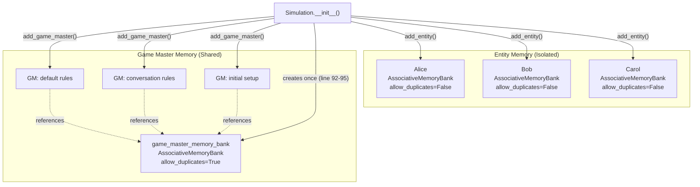
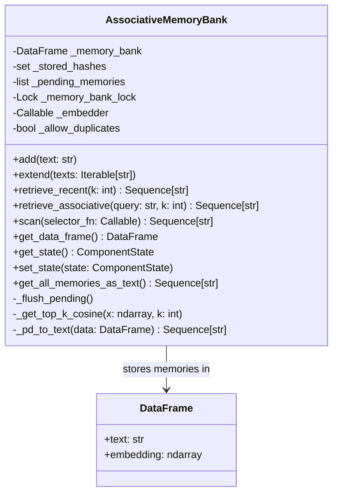
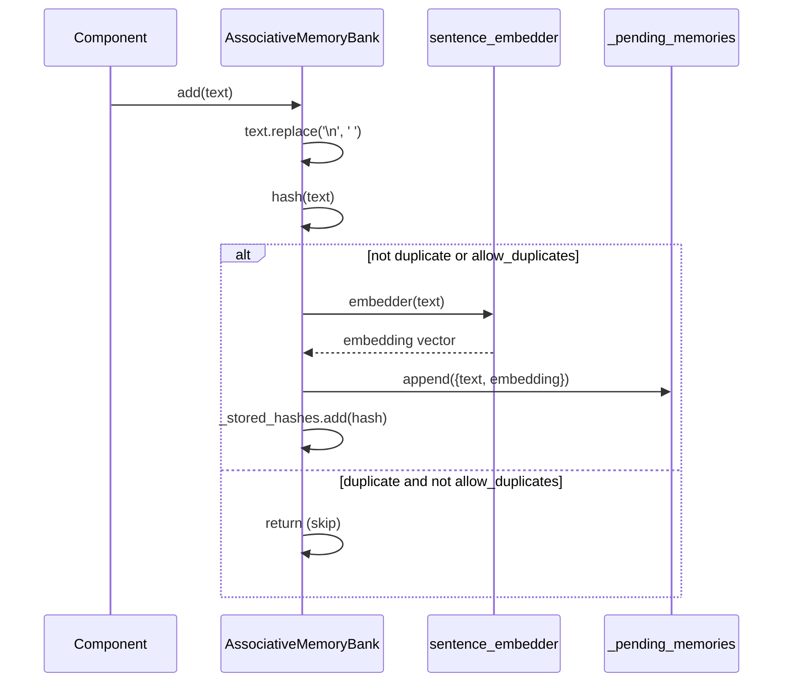
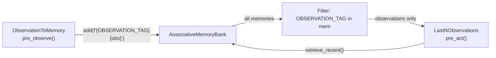
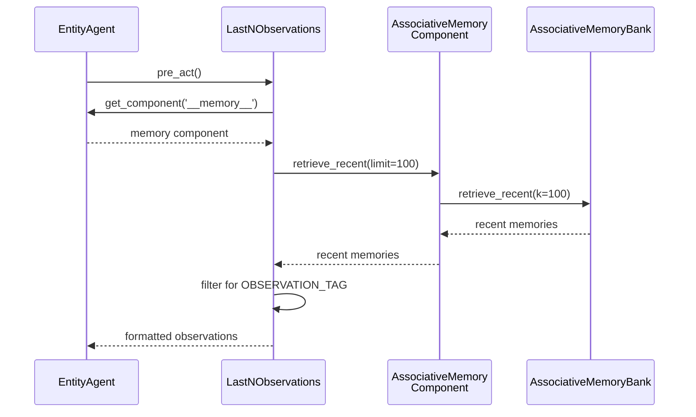
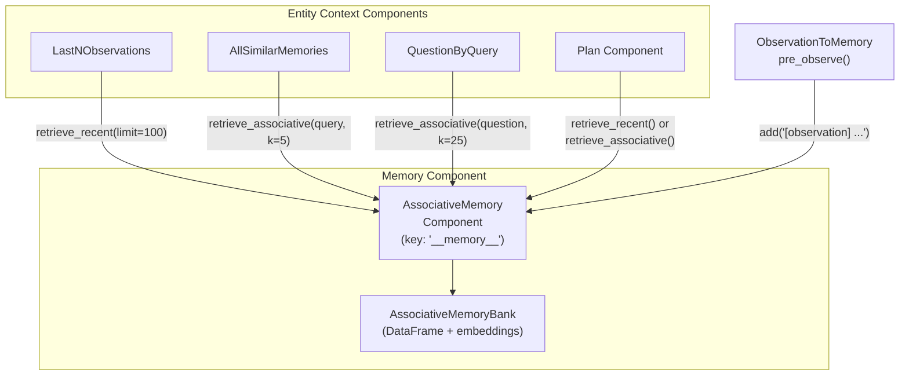

<!-- source: DeepWiki mcp.deepwiki.com · repo google-deepmind/concordia · page 4.1 Associative Memory System · fetched 2026-10-26 -->

# Associative Memory System

<details>
<summary>Relevant source files</summary>

The following files were used as context for generating this wiki page:

- [concordia/associative_memory/basic_associative_memory.py](concordia/associative_memory/basic_associative_memory.py)
- [concordia/components/agent/observation.py](concordia/components/agent/observation.py)
- [concordia/components/agent/plan.py](concordia/components/agent/plan.py)
- [concordia/prefabs/game_master/generic.py](concordia/prefabs/game_master/generic.py)
- [concordia/prefabs/simulation/generic.py](concordia/prefabs/simulation/generic.py)
- [concordia/typing/prefab.py](concordia/typing/prefab.py)
- [concordia/typing/simulation.py](concordia/typing/simulation.py)
- [concordia/utils/log_viewer.html](concordia/utils/log_viewer.html)
- [concordia/utils/structured_logging.py](concordia/utils/structured_logging.py)
- [concordia/utils/structured_logging_test.py](concordia/utils/structured_logging_test.py)
- [examples/actor_development.ipynb](examples/actor_development.ipynb)
- [examples/alice.ipynb](examples/alice.ipynb)
- [examples/dialog.ipynb](examples/dialog.ipynb)
- [examples/marketplace.ipynb](examples/marketplace.ipynb)
- [examples/selling_cookies.ipynb](examples/selling_cookies.ipynb)
- [examples/tutorial.ipynb](examples/tutorial.ipynb)

</details>


## Purpose and Scope

This document describes Concordia's associative memory system, which provides semantic storage and retrieval for agent and game master memories. The system uses pandas DataFrames with sentence embeddings to enable both recency-based and semantic similarity-based memory retrieval.

This page covers the `AssociativeMemoryBank` implementation, memory allocation patterns (isolated per entity, shared for game masters), and integration with components. For information about how components use memory during the agent lifecycle, see [2.1](#2.1). For structured logging and simulation output, see [4.2](#4.2).

**Sources:** [concordia/associative_memory/basic_associative_memory.py:1-260](), [concordia/prefabs/simulation/generic.py:41-485]()

---

## Memory Architecture Overview

Concordia maintains a fundamental asymmetry in how memory is allocated: each entity receives an isolated `AssociativeMemoryBank`, while all game masters share a single collective memory bank.

### Entity vs Game Master Memory Allocation



**Memory Isolation Principles:**
- **Entity memory banks** prevent cross-contamination between agents. Each entity can only access its own memories.
- **Game master memory bank** enables consistent world state. All GMs see the same event history.
- The `allow_duplicates=True` flag on the GM memory bank permits repeated actions (e.g., "Bob: defect") across different rounds.

**Sources:** [concordia/prefabs/simulation/generic.py:89-95](), [concordia/prefabs/simulation/generic.py:194-199](), [concordia/prefabs/simulation/generic.py:166-169]()

---

## AssociativeMemoryBank Implementation

The `AssociativeMemoryBank` class provides the core memory storage and retrieval functionality.

### Class Structure



**Thread Safety:** All public methods acquire `_memory_bank_lock` to ensure thread-safe concurrent access from multiple components.

**Batch Accumulation:** The `_pending_memories` list accumulates new memories for performance. Memories are flushed to the DataFrame when retrieval operations occur or state is saved.

**Sources:** [concordia/associative_memory/basic_associative_memory.py:30-260]()

---

## Storage Format

Memories are stored in a pandas DataFrame with two columns:

| Column | Type | Description |
|--------|------|-------------|
| `text` | `str` | The memory text with newlines replaced by spaces |
| `embedding` | `np.ndarray` | Sentence embedding vector from the embedder |

### DataFrame Schema

```python
# Initialization at line 52
self._memory_bank = pd.DataFrame(columns=['text', 'embedding'])
```

### Example Memory Entry

```python
{
    'text': '[observation] Alice said hello to Bob.',
    'embedding': array([0.123, -0.456, 0.789, ...])  # Vector from sentence-transformers
}
```

**Deduplication:** The `_stored_hashes` set tracks content hashes to prevent duplicate entries (unless `allow_duplicates=True`). Hash computation includes only the text content, computed at [concordia/associative_memory/basic_associative_memory.py:105]().

**Sources:** [concordia/associative_memory/basic_associative_memory.py:52](), [concordia/associative_memory/basic_associative_memory.py:99-114]()

---

## Memory Operations

### Adding Memories



**Key Method:** `add(text: str) -> None`
- Removes all newline characters from text [concordia/associative_memory/basic_associative_memory.py:100]()
- Computes content hash for deduplication
- Generates embedding via `sentence_embedder` (typically sentence-transformers)
- Appends to `_pending_memories` for batch processing

**Sources:** [concordia/associative_memory/basic_associative_memory.py:87-115]()

### Retrieving Memories

The system provides three retrieval patterns:

#### 1. Recent Retrieval

```python
# Retrieve last k memories by insertion order
memories = memory_bank.retrieve_recent(k=10)
```

Returns the most recently added memories. Implementation flushes pending memories and slices the DataFrame [concordia/associative_memory/basic_associative_memory.py:218-237]().

#### 2. Associative Retrieval

```python
# Retrieve k most semantically similar memories
memories = memory_bank.retrieve_associative(
    query="What did Alice say?",
    k=5
)
```

Uses cosine similarity between query embedding and stored embeddings. The `_get_top_k_cosine` method computes similarities and sorts in descending order [concordia/associative_memory/basic_associative_memory.py:133-153]().

#### 3. Scan with Selector Function

```python
# Retrieve memories matching custom criteria
def selector(text: str) -> bool:
    return OBSERVATION_TAG in text

observations = memory_bank.scan(selector)
```

Applies a boolean selector function to filter memories [concordia/associative_memory/basic_associative_memory.py:200-216]().

**Sources:** [concordia/associative_memory/basic_associative_memory.py:173-199](), [concordia/associative_memory/basic_associative_memory.py:218-237](), [concordia/associative_memory/basic_associative_memory.py:200-216]()

---

## Memory Tagging

Components tag memories with prefixes to enable selective retrieval:

### Standard Tags

| Tag | Constant | Usage |
|-----|----------|-------|
| `[observation]` | `OBSERVATION_TAG` | External observations received by entities |

**Example Tagged Memory:**
```
[observation] Alice observed: Bob picked up the red ball.
```

### Tag-Based Retrieval Pattern



The `LastNObservations` component retrieves recent memories and filters for the observation tag at [concordia/components/agent/observation.py:99]().

**Sources:** [concordia/components/agent/observation.py:26](), [concordia/components/agent/observation.py:54-58](), [concordia/components/agent/observation.py:91-105]()

---

## Integration with Agent Components

### Memory Component Wrapper

Components access memory through the `AssociativeMemory` wrapper component:

```python
# From concordia/components/agent/memory.py
DEFAULT_MEMORY_COMPONENT_KEY = '__memory__'

class AssociativeMemory(action_spec_ignored.ActionSpecIgnored):
    def __init__(self, memory_bank: AssociativeMemoryBank):
        self._memory_bank = memory_bank
    
    def add(self, text: str) -> None:
        self._memory_bank.add(text)
    
    def retrieve_recent(self, k: int = 1) -> Sequence[str]:
        return self._memory_bank.retrieve_recent(k=k)
```

### Component Access Pattern



Components retrieve the memory component by key and call retrieval methods. Example from `LastNObservations` at [concordia/components/agent/observation.py:91-105]().

**Sources:** [concordia/components/agent/observation.py:91-105](), [examples/actor_development.ipynb:293-294]()

---

## Memory State Management

### Serialization

The `get_state()` method converts memory to a serializable dictionary:

```python
def get_state(self) -> entity_component.ComponentState:
    with self._memory_bank_lock:
        self._flush_pending()  # Ensure all memories in DataFrame
        output = {
            'stored_hashes': list(self._stored_hashes),
            'memory_bank': self._memory_bank.to_json(),  # DataFrame as JSON
        }
    return output
```

**Key Features:**
- Flushes pending memories before serialization [concordia/associative_memory/basic_associative_memory.py:60]()
- Converts DataFrame to JSON string [concordia/associative_memory/basic_associative_memory.py:63]()
- Preserves deduplication state via stored hashes

### Deserialization

```python
def set_state(self, state: entity_component.ComponentState) -> None:
    with self._memory_bank_lock:
        self._stored_hashes = set(state['stored_hashes'])
        self._memory_bank = pd.read_json(StringIO(state['memory_bank']))
        self._pending_memories.clear()  # Clear pending on restore
```

Restores memory bank from checkpoint data at [concordia/associative_memory/basic_associative_memory.py:67-73]().

### Checkpoint Integration

Memory state is included in simulation checkpoints:

```python
# From generic.py simulation checkpointing
entity_state = entity.get_state()  # Includes memory component state
checkpoint_data["entities"][entity.name] = {
    "prefab_type": prefab_config.prefab,
    "entity_params": prefab_config.params,
    "components": entity_state,  # Contains '__memory__' state
}
```

Memory component state is accessed via the `__memory__` key and saved in checkpoint files at [concordia/prefabs/simulation/generic.py:334-348]().

**Sources:** [concordia/associative_memory/basic_associative_memory.py:56-73](), [concordia/prefabs/simulation/generic.py:334-348]()

---

## Usage Examples

### Entity Memory Initialization

```python
# From Simulation.add_entity() at line 194-199
memory_bank = associative_memory.AssociativeMemoryBank(
    sentence_embedder=self._embedder,
)
entity = entity_prefab.build(
    model=self._agent_model,
    memory_bank=memory_bank
)
```

Each entity receives its own isolated memory bank when added to the simulation.

### Game Master Memory Initialization

```python
# From Simulation.__init__() at line 92-95
self.game_master_memory_bank = associative_memory.AssociativeMemoryBank(
    sentence_embedder=embedder,
    allow_duplicates=True,  # Allow repeated actions across rounds
)

# All GMs use the same bank at line 168
game_master = game_master_prefab.build(
    model=self._game_master_model,
    memory_bank=self.game_master_memory_bank  # Shared bank
)
```

### Pre-loaded Memory State

Entities can be initialized with pre-existing memories:

```python
# From Simulation.add_entity() at line 206-221
memory_state = instance_config.params.get("memory_state")
if memory_state:
    memory_component = entity.get_component("__memory__")
    memory_component.set_state(memory_state)
```

This allows warm-starting entities with background knowledge.

**Sources:** [concordia/prefabs/simulation/generic.py:92-95](), [concordia/prefabs/simulation/generic.py:194-199](), [concordia/prefabs/simulation/generic.py:166-169](), [concordia/prefabs/simulation/generic.py:206-221]()

---

## Memory Retrieval in Practice

### Component Memory Access Pattern



Different components use different retrieval strategies:
- **Observation components** use `retrieve_recent()` to get latest events
- **Memory reflection components** use `retrieve_associative()` for semantic queries
- **Planning components** may combine both approaches

**Sources:** [concordia/components/agent/observation.py:64-105](), [examples/actor_development.ipynb:246-297]()

---

## Performance Considerations

### Batch Processing

The `_pending_memories` list accumulates additions before flushing to the DataFrame:

```python
# Adding is O(1) with pending list
self._pending_memories.append(memory_row)  # Line 113

# Flush converts to DataFrame when needed
def _flush_pending(self) -> None:
    if self._pending_memories:
        new_df = pd.DataFrame(self._pending_memories)
        self._memory_bank = pd.concat([self._memory_bank, new_df], ignore_index=True)
        self._pending_memories.clear()
```

This defers expensive DataFrame operations until retrieval time [concordia/associative_memory/basic_associative_memory.py:75-85]().

### Cosine Similarity Computation

Associative retrieval applies the embedder to the query once, then computes cosine similarity with all stored embeddings:

```python
def retrieve_associative(self, query: str, k: int = 1) -> Sequence[str]:
    query_embedding = self._embedder(query)  # Once per query
    data = self._get_top_k_cosine(query_embedding, k)  # Vectorized comparison
    return self._pd_to_text(data)
```

The similarity computation is vectorized via pandas `apply()` at [concordia/associative_memory/basic_associative_memory.py:145-146]().

**Sources:** [concordia/associative_memory/basic_associative_memory.py:75-85](), [concordia/associative_memory/basic_associative_memory.py:173-198]()

---

