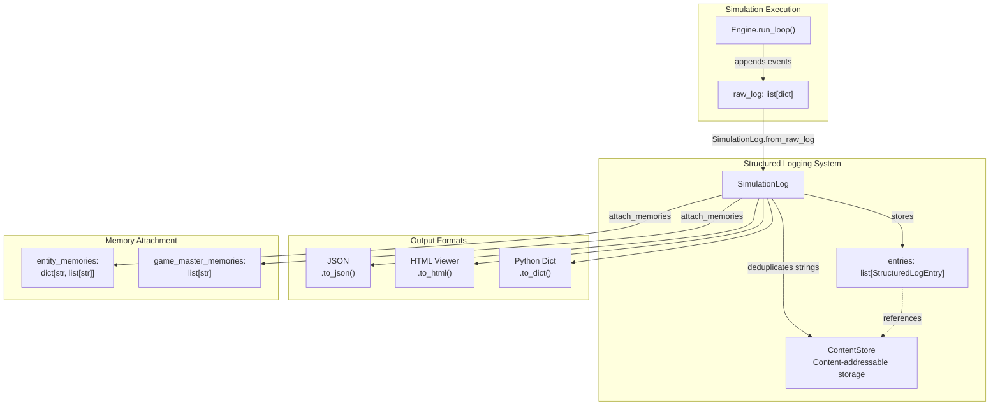
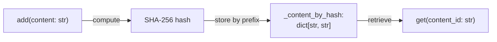
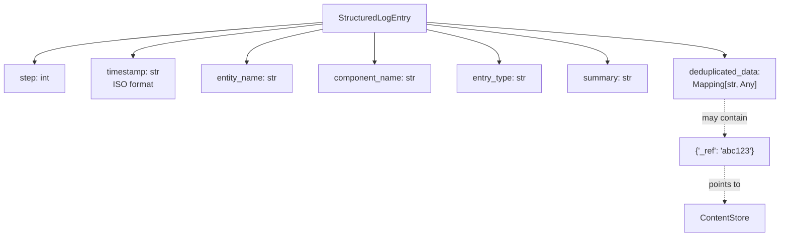
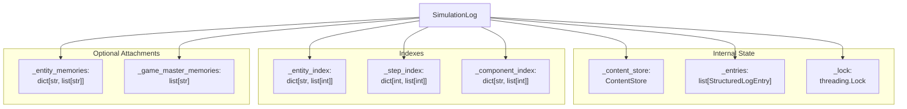
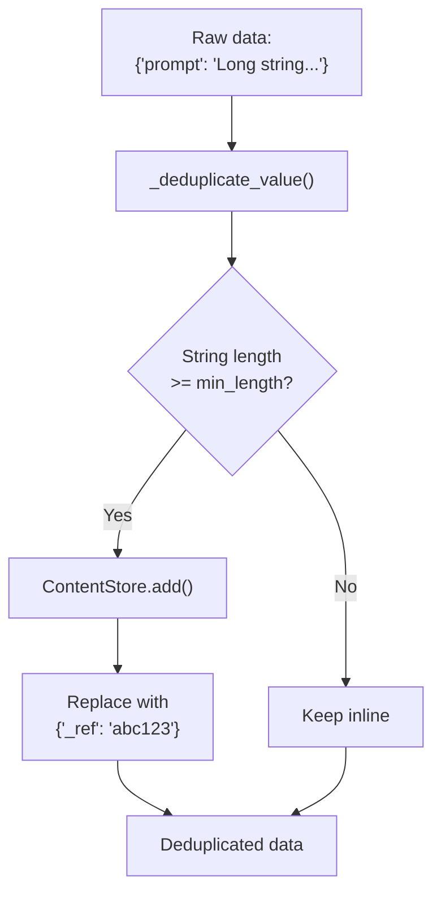
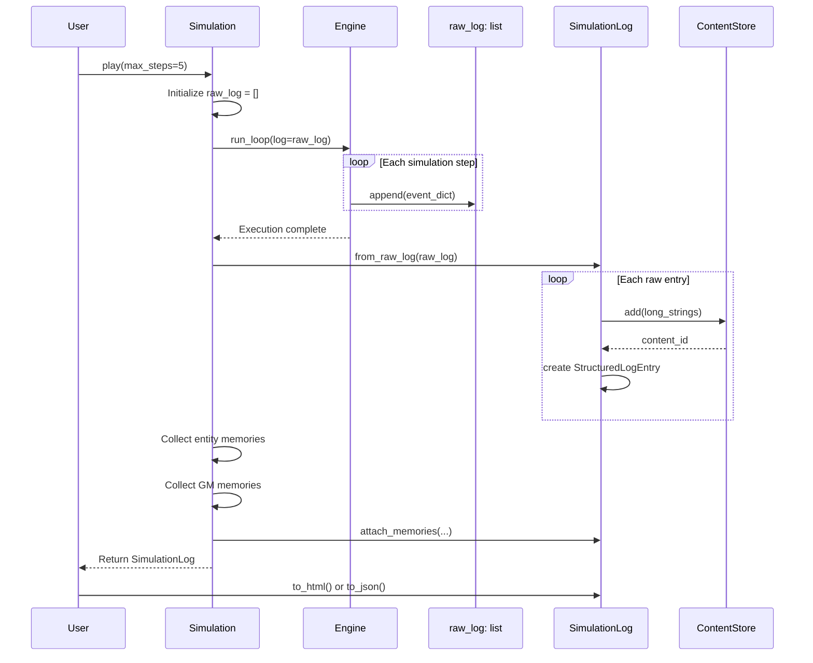
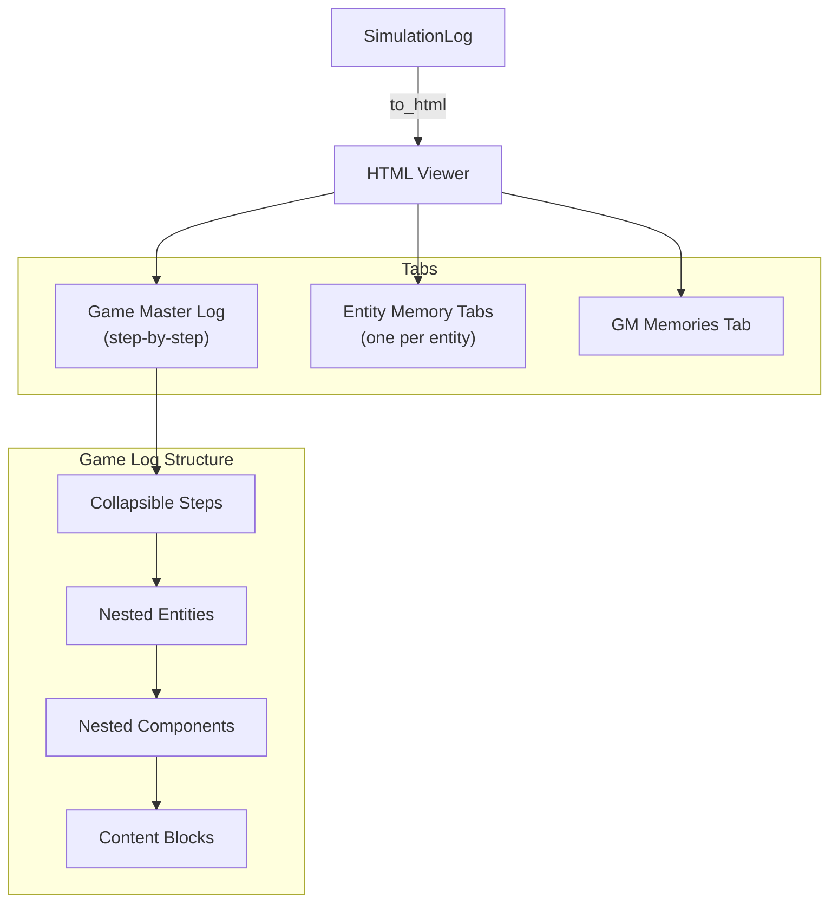
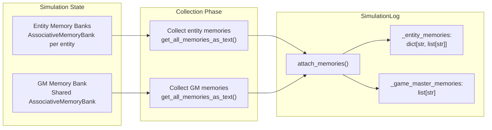
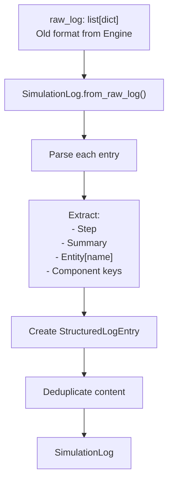
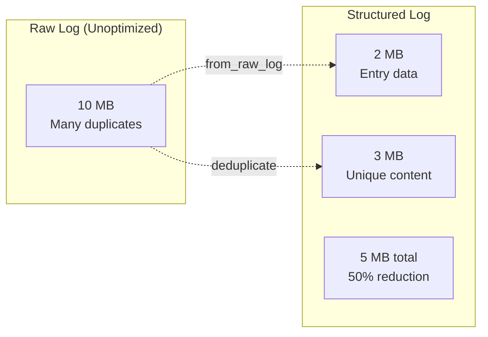

<!-- source: DeepWiki mcp.deepwiki.com · repo google-deepmind/concordia · page 4.2 Structured Logging · fetched 2026-10-26 -->

# Structured Logging

<details>
<summary>Relevant source files</summary>

The following files were used as context for generating this wiki page:

- [concordia/associative_memory/basic_associative_memory.py](concordia/associative_memory/basic_associative_memory.py)
- [concordia/prefabs/game_master/generic.py](concordia/prefabs/game_master/generic.py)
- [concordia/prefabs/simulation/generic.py](concordia/prefabs/simulation/generic.py)
- [concordia/typing/prefab.py](concordia/typing/prefab.py)
- [concordia/typing/simulation.py](concordia/typing/simulation.py)
- [concordia/utils/log_viewer.html](concordia/utils/log_viewer.html)
- [concordia/utils/structured_logging.py](concordia/utils/structured_logging.py)
- [concordia/utils/structured_logging_test.py](concordia/utils/structured_logging_test.py)
- [examples/actor_development.ipynb](examples/actor_development.ipynb)
- [examples/alice.ipynb](examples/alice.ipynb)
- [examples/dialog.ipynb](examples/dialog.ipynb)
- [examples/marketplace.ipynb](examples/marketplace.ipynb)
- [examples/selling_cookies.ipynb](examples/selling_cookies.ipynb)
- [examples/tutorial.ipynb](examples/tutorial.ipynb)

</details>


## Purpose and Scope

This page documents Concordia's **Structured Logging** system, which provides efficient, deduplicated storage and multi-format output for simulation logs. The system is implemented in [concordia/utils/structured_logging.py]() and is used by the `Simulation.play()` method to capture and export simulation events.

For information about how simulations are orchestrated and executed, see [Simulation Orchestration](#3.2). For details on the memory system that stores agent state, see [Associative Memory System](#4.1).

---

## Architecture Overview

The structured logging system consists of three primary components that work together to capture, deduplicate, and export simulation data:



**Sources:** [concordia/utils/structured_logging.py:1-542](), [concordia/prefabs/simulation/generic.py:241-322]()

---

## Core Components

### ContentStore

`ContentStore` provides content-addressable storage for string deduplication. It computes SHA-256 hashes of content and uses hash prefixes as IDs.



| Method | Purpose |
|--------|---------|
| `add(content: str) -> str` | Store content, return hash ID |
| `get(content_id: str) -> str` | Retrieve content by ID |
| `get_or_none(content_id) -> str \| None` | Safe retrieval |
| `to_dict() -> dict[str, str]` | Export for serialization |
| `from_dict(data) -> ContentStore` | Restore from dict |

**Thread Safety:** Uses `threading.Lock` for concurrent access [concordia/utils/structured_logging.py:37-136]().

**Key Features:**
- Default hash prefix length: 16 hex characters (64 bits)
- Automatic deduplication: same content → same ID
- Negligible collision probability for typical log sizes

**Sources:** [concordia/utils/structured_logging.py:37-136]()

---

### StructuredLogEntry

`StructuredLogEntry` is a dataclass that represents a single log event with content references instead of inline strings.



**Attributes:**

| Attribute | Type | Description |
|-----------|------|-------------|
| `step` | `int` | Simulation step number |
| `timestamp` | `str` | ISO format timestamp |
| `entity_name` | `str` | Entity that generated entry |
| `component_name` | `str` | Component that logged entry |
| `entry_type` | `str` | Category (e.g., 'action', 'observation') |
| `summary` | `str` | Human-readable summary |
| `deduplicated_data` | `Mapping[str, Any]` | Original data with string references |

**Serialization:**
- `to_dict() -> dict[str, Any]` - Convert to serializable dict
- `from_dict(data) -> StructuredLogEntry` - Restore from dict

**Sources:** [concordia/utils/structured_logging.py:138-191]()

---

### SimulationLog

`SimulationLog` is the main container that collects log entries, manages deduplication, and provides multiple output formats.



**Key Methods:**

| Method | Purpose |
|--------|---------|
| `add_entry(step, timestamp, entity_name, ...)` | Add log entry with auto-deduplication |
| `get_entries_by_entity(entity_name)` | Query entries for specific entity |
| `get_entries_by_step(step)` | Query entries for specific step |
| `get_entries_by_component(component_name)` | Query entries by component |
| `attach_memories(entity_memories, gm_memories)` | Attach memory snapshots |
| `to_json(indent=2) -> str` | Export as JSON |
| `to_html() -> str` | Generate HTML viewer |
| `to_dict() -> dict` | Export as dict |
| `from_raw_log(raw_log) -> SimulationLog` | Convert old format |

**Sources:** [concordia/utils/structured_logging.py:193-542]()

---

## Deduplication Strategy

The system automatically deduplicates strings longer than a configurable threshold (default: 50 characters) by replacing them with content references.



**Process:**

1. **Recursive Traversal:** `_deduplicate_value()` recursively scans dicts, lists, and strings [concordia/utils/structured_logging.py:265-297]()
2. **Threshold Check:** Strings ≥ 50 chars are deduplicated
3. **Hash Storage:** Long strings are stored in `ContentStore`, replaced with `{'_ref': content_id}`
4. **Reconstruction:** `reconstruct_value()` reverses the process [concordia/utils/structured_logging.py:298-316]()

**Example:**

```python
# Before deduplication
raw_data = {
    'prompt': 'A very long observation that appears multiple times...',
    'short': 'ok'  # < 50 chars, kept inline
}

# After deduplication
deduplicated_data = {
    'prompt': {'_ref': 'abc123...'},
    'short': 'ok'
}
```

**Benefits:**
- Significant storage savings when content repeats
- Efficient memory usage during simulation
- Fast serialization/deserialization

**Sources:** [concordia/utils/structured_logging.py:265-316]()

---

## Integration with Simulation.play()

The `Simulation.play()` method uses structured logging to capture and return simulation results.



**Implementation Details:**

1. **Raw Log Collection:** [concordia/prefabs/simulation/generic.py:234-297]()
   ```python
   raw_log = self._raw_log
   self._engine.run_loop(
       game_masters=sorted_game_masters,
       entities=self.entities,
       premise=premise,
       max_steps=max_steps,
       verbose=True,
       log=raw_log,  # Engine appends events here
       checkpoint_callback=checkpoint_callback,
   )
   ```

2. **Structured Log Creation:** [concordia/prefabs/simulation/generic.py:299-300]()
   ```python
   simulation_log = structured_logging.SimulationLog.from_raw_log(raw_log)
   ```

3. **Memory Attachment:** [concordia/prefabs/simulation/generic.py:301-320]()
   ```python
   entity_memories: dict[str, list[str]] = {}
   for player in self.entities:
       if isinstance(player, entity_component.EntityWithComponents):
           memory_component = player.get_component("__memory__")
           entity_memories[player.name] = (
               memory_component.get_all_memories_as_text()
           )
   
   game_master_memories = (
       self.game_master_memory_bank.get_all_memories_as_text()
   )
   
   simulation_log.attach_memories(
       entity_memories=entity_memories,
       game_master_memories=game_master_memories,
   )
   ```

4. **Return:** [concordia/prefabs/simulation/generic.py:322]()
   ```python
   return simulation_log
   ```

**Sources:** [concordia/prefabs/simulation/generic.py:234-322](), [concordia/typing/simulation.py:74-89]()

---

## Output Formats

### JSON Export

The `to_json()` method exports the entire log as a JSON string for programmatic access or AI agent inspection.

**Structure:**
```json
{
  "content_store": {
    "abc123": "Long repeated content...",
    "def456": "Another piece of content..."
  },
  "entries": [
    {
      "step": 1,
      "timestamp": "2025-01-01T12:00:00",
      "entity_name": "Alice",
      "component_name": "ActComponent",
      "entry_type": "action",
      "summary": "Alice said hello",
      "deduplicated_data": {
        "Key": "action",
        "Value": {"_ref": "abc123"}
      }
    }
  ],
  "entity_memories": {
    "Alice": ["memory1", "memory2"],
    "Bob": ["memory3"]
  },
  "game_master_memories": ["gm_memory1", "gm_memory2"]
}
```

**Usage:**
```python
results_log = simulation.play(max_steps=5)
json_str = results_log.to_json(indent=2)
with open('simulation_log.json', 'w') as f:
    f.write(json_str)

# Restore later
restored = SimulationLog.from_json(json_str)
```

**Sources:** [concordia/utils/structured_logging.py:480-494]()

---

### HTML Viewer

The `to_html()` method generates an interactive HTML viewer with collapsible sections and tabbed navigation.



**Features:**
- **Lazy Rendering:** Tabs load content only when clicked
- **Nested Collapsibles:** Step → Entity → Component hierarchy
- **Drag-and-Drop:** Can load JSON files directly in browser
- **Reference Resolution:** Automatically resolves `_ref` pointers

**HTML Template Location:** [concordia/utils/log_viewer.html:1-559]()

**Example Usage in Notebooks:**
```python
from IPython import display

results_log = runnable_simulation.play(max_steps=5, raw_log=raw_log)
display.HTML(results_log.to_html())
```

**Sources:** [concordia/utils/structured_logging.py:542-690](), [concordia/utils/log_viewer.html:1-559](), [examples/tutorial.ipynb:286-287]()

---

### Raw Data Access

For programmatic analysis, `SimulationLog` provides query methods that return Python objects.

| Method | Return Type | Description |
|--------|-------------|-------------|
| `get_entries_by_entity(name)` | `list[StructuredLogEntry]` | All entries for entity |
| `get_entries_by_step(step)` | `list[StructuredLogEntry]` | All entries in step |
| `get_entries_by_component(name)` | `list[StructuredLogEntry]` | All entries from component |
| `get_entity_names()` | `list[str]` | All entity names |
| `get_steps()` | `list[int]` | All step numbers (sorted) |
| `get_entity_memories(name)` | `list[str]` | Memories for entity |
| `get_game_master_memories()` | `list[str]` | GM memories |
| `get_summary()` | `dict[str, Any]` | High-level statistics |

**Example:**
```python
# Query specific entity's actions
alice_entries = log.get_entries_by_entity('Alice')
for entry in alice_entries:
    if entry.entry_type == 'action':
        # Reconstruct full data
        full_data = log.reconstruct_value(entry.deduplicated_data)
        print(full_data)

# Get summary statistics
summary = log.get_summary()
print(f"Total entries: {summary['total_entries']}")
print(f"Entities: {summary['entities']}")
print(f"Unique content items: {summary['unique_content_items']}")
```

**Sources:** [concordia/utils/structured_logging.py:375-514]()

---

## Memory Attachment

The `attach_memories()` method allows memory snapshots to be stored with the log for HTML rendering and analysis.



**Implementation in Simulation.play():**

```python
# Step 1: Collect entity memories
entity_memories: dict[str, list[str]] = {}
for player in self.entities:
    if isinstance(player, entity_component.EntityWithComponents):
        memory_component = player.get_component("__memory__")
        if memory_component:
            entity_memories[player.name] = (
                memory_component.get_all_memories_as_text()
            )

# Step 2: Collect game master memories
game_master_memories = (
    self.game_master_memory_bank.get_all_memories_as_text()
)

# Step 3: Attach to log
simulation_log.attach_memories(
    entity_memories=entity_memories,
    game_master_memories=game_master_memories,
)
```

**Usage in Output:**
- **HTML Viewer:** Creates separate tabs for each entity's memories [concordia/utils/log_viewer.html:282-314]()
- **JSON Export:** Includes `entity_memories` and `game_master_memories` fields
- **Programmatic Access:** `get_entity_memories(name)` and `get_game_master_memories()`

**Sources:** [concordia/prefabs/simulation/generic.py:301-320](), [concordia/utils/structured_logging.py:246-263]()

---

## Conversion from Raw Log Format

The `from_raw_log()` class method converts the legacy raw log format (list of dicts) to the new structured format.



**Raw Log Format:**
```python
[
    {
        'Step': 1,
        'Summary': 'Alice acted',
        'Entity [Alice]': {'Key': 'action', 'Value': 'Alice said hello'},
        'date': '2025-01-01T12:00:00'
    },
    # ...
]
```

**Conversion Logic:** [concordia/utils/structured_logging.py:516-595]()

1. **Step Extraction:** `step = entry.get('Step', 0)`
2. **Summary Extraction:** `summary = entry.get('Summary', '')`
3. **Entity Detection:** Parse keys like `'Entity [Alice]'` to extract entity name
4. **Component Detection:** Parse keys like `'Entity [Alice] [ActComponent]'`
5. **Entry Creation:** Create `StructuredLogEntry` with parsed data
6. **Deduplication:** Automatically deduplicate content via `add_entry()`

**Sources:** [concordia/utils/structured_logging.py:516-595]()

---

## Thread Safety

All core components are thread-safe for concurrent logging from multiple components:

| Component | Mechanism |
|-----------|-----------|
| `ContentStore` | `threading.Lock` on `_content_by_hash` [concordia/utils/structured_logging.py:62-63]() |
| `SimulationLog` | `threading.Lock` on all mutations [concordia/utils/structured_logging.py:225]() |
| `AssociativeMemoryBank` | `threading.Lock` on memory operations [concordia/associative_memory/basic_associative_memory.py:48]() |

**Concurrent Add Example:**
```python
import threading

log = SimulationLog()

def add_entries(entity_name):
    for i in range(100):
        log.add_entry(
            step=i,
            timestamp=f"2025-01-01T{i:02d}:00:00",
            entity_name=entity_name,
            component_name="Component",
            entry_type="action",
        )

threads = [
    threading.Thread(target=add_entries, args=("Alice",)),
    threading.Thread(target=add_entries, args=("Bob",)),
]
for t in threads:
    t.start()
for t in threads:
    t.join()

# Safe: log now contains 200 entries
```

**Sources:** [concordia/utils/structured_logging.py:37-136, 193-428](), [concordia/utils/structured_logging_test.py:121-139]()

---

## Example Usage

### Basic Simulation with Structured Logging

```python
from concordia.prefabs.simulation import generic as simulation
from IPython import display

# Initialize simulation
runnable_simulation = simulation.Simulation(
    config=config,
    model=model,
    embedder=embedder,
)

# Run and capture log
raw_log = []
results_log = runnable_simulation.play(max_steps=5, raw_log=raw_log)

# View in notebook
display.HTML(results_log.to_html())

# Export to JSON
with open('simulation_log.json', 'w') as f:
    f.write(results_log.to_json())

# Query programmatically
alice_entries = results_log.get_entries_by_entity('Alice')
print(f"Alice performed {len(alice_entries)} actions")
```

**Sources:** [examples/tutorial.ipynb:273-287](), [examples/actor_development.ipynb:518-532]()

---

## Performance Characteristics

| Aspect | Performance |
|--------|-------------|
| Deduplication Overhead | Minimal for strings < 50 chars (inline) |
| Hash Computation | O(n) per unique string |
| Memory Savings | 50-90% reduction for repeated content |
| Query Speed | O(1) for indexed lookups (entity, step, component) |
| JSON Serialization | O(n) entries + O(m) content items |
| HTML Generation | Lazy rendering reduces initial load time |

**Storage Comparison:**



**Sources:** [concordia/utils/structured_logging.py:34-297]()

---

