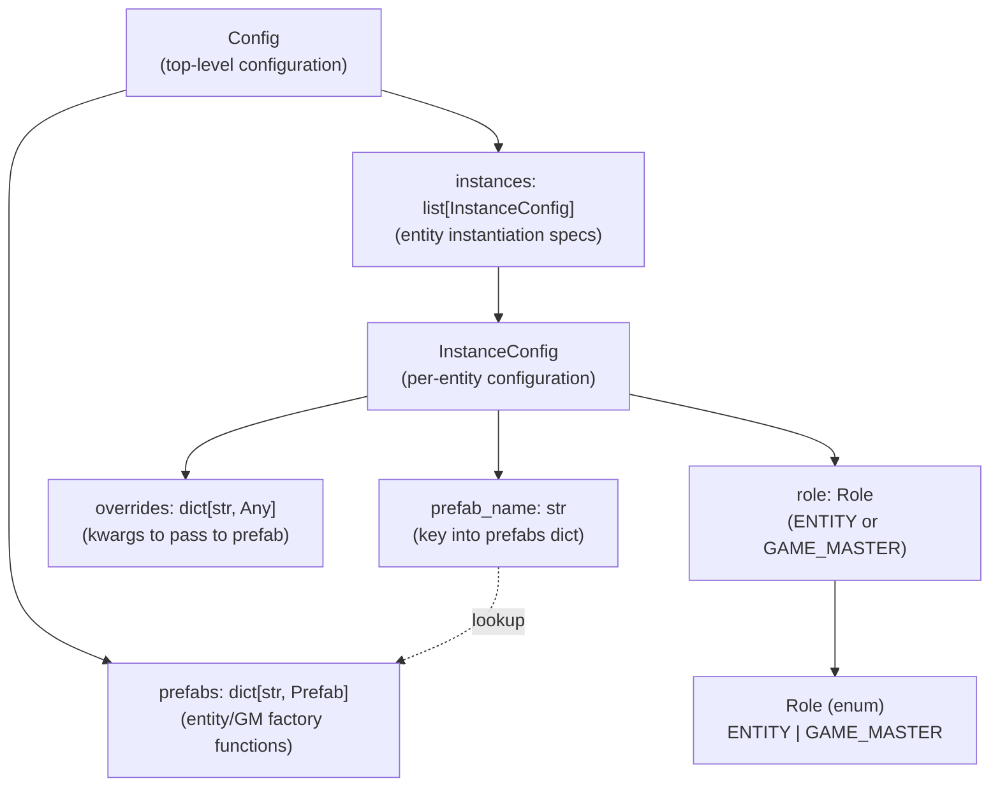
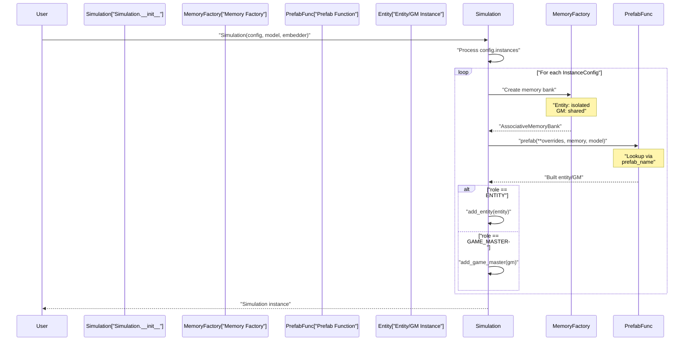
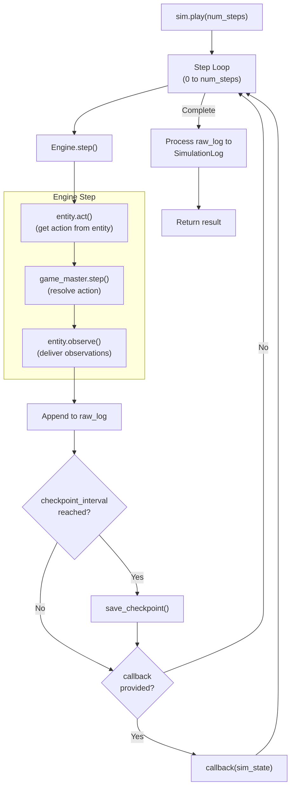
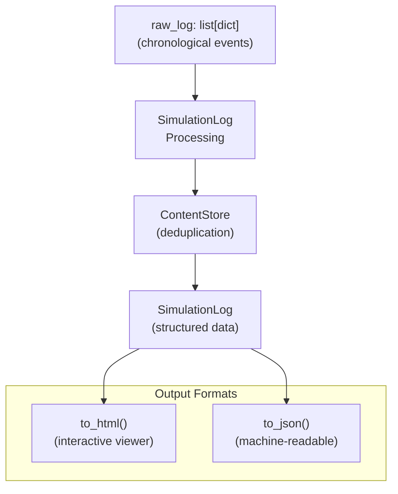

<!-- source: DeepWiki mcp.deepwiki.com · repo google-deepmind/concordia · page 5 Configuration and Usage · fetched 2026-10-26 -->

# Configuration and Usage

<details>
<summary>Relevant source files</summary>

The following files were used as context for generating this wiki page:

- [CHANGELOG.md](CHANGELOG.md)
- [CITATION.bib](CITATION.bib)
- [README.md](README.md)
- [setup.py](setup.py)

</details>


This page provides practical guidance on installing Concordia, configuring simulations, and running them. It covers the end-to-end workflow from installation through execution and result analysis.

For details on the underlying prefab and configuration system architecture, see [Prefab and Configuration System](#3.1). For information on developing new components or contributing to Concordia, see [Development Environment Setup](#7.1).

---

## Installation and Dependencies

### Basic Installation

Concordia is distributed via PyPI as `gdm-concordia`. The package can be installed using pip:

```shell
pip install gdm-concordia
```

After installation, you can import the library:

```python
import concordia
```

**Sources:** [setup.py:1-137](), [README.md:78-88]()

### Python Version Requirements

Concordia requires **Python 3.12 or higher**. This requirement is enforced in the package metadata:

```python
python_requires='>=3.12'
```

The package is tested on Python 3.12, 3.13, and 3.14 on Linux and macOS X.

**Sources:** [setup.py:68](), [setup.py:52-64]()

### Core Dependencies

The base installation includes the following required dependencies:

| Dependency | Purpose |
|------------|---------|
| `absl-py` | Logging and command-line flags |
| `ipython` | Interactive shell support |
| `matplotlib` | Visualization utilities |
| `numpy>=1.26` | Numerical operations |
| `pandas` | Memory storage backend (DataFrame) |
| `python-dateutil` | Date/time handling |
| `reactivex` | Reactive programming utilities |
| `tenacity` | Retry logic with exponential backoff |
| `termcolor` | Terminal output formatting |

**Sources:** [setup.py:69-79]()

### Optional LLM Provider Extras

Concordia supports 10+ language model providers through optional dependency groups. Install the extras you need:

```mermaid
graph TB
    Base["gdm-concordia<br/>(core package)"]
    
    subgraph "Commercial APIs"
        OpenAI["openai<br/>pip install gdm-concordia[openai]"]
        Google["google<br/>pip install gdm-concordia[google]"]
        Amazon["amazon<br/>pip install gdm-concordia[amazon]"]
        Mistral["mistralai<br/>pip install gdm-concordia[mistralai]"]
        Groq["groq<br/>pip install gdm-concordia[groq]"]
    end
    
    subgraph "Open Source / Local"
        HF["huggingface<br/>pip install gdm-concordia[huggingface]"]
        Ollama["ollama<br/>pip install gdm-concordia[ollama]"]
        VLLM["vllm<br/>pip install gdm-concordia[vllm]"]
    end
    
    subgraph "Aggregators"
        Together["together<br/>pip install gdm-concordia[together]"]
        Langchain["langchain<br/>pip install gdm-concordia[langchain]"]
    end
    
    Base --> OpenAI
    Base --> Google
    Base --> Amazon
    Base --> Mistral
    Base --> Groq
    Base --> HF
    Base --> Ollama
    Base --> VLLM
    Base --> Together
    Base --> Langchain
```



**Diagram: Optional Dependency Groups for LLM Providers**

#### Provider-Specific Installation

**OpenAI (GPT-4, GPT-3.5-turbo):**
```shell
pip install gdm-concordia[openai]
```
Installs: `openai>=1.3.0`

**Google (Gemini, Vertex AI):**
```shell
pip install gdm-concordia[google]
```
Installs: `google-cloud-aiplatform`, `google-generativeai`

**HuggingFace (Transformers):**
```shell
pip install gdm-concordia[huggingface]
```
Installs: `accelerate`, `torch`, `transformers`

**Ollama (Local models):**
```shell
pip install gdm-concordia[ollama]
```
Installs: `ollama`

**AWS Bedrock:**
```shell
pip install gdm-concordia[amazon]
```
Installs: `boto3`

**Other Providers:**
- `mistralai`: Mistral AI API
- `together`: Together AI (Gemma, Deepseek)
- `vllm`: vLLM optimized serving
- `groq`: Groq fast inference
- `langchain`: Langchain integration

**Sources:** [setup.py:80-136]()

### Development Dependencies

For contributing to Concordia, install the `dev` extra:

```shell
pip install gdm-concordia[dev]
```

This includes: `build`, `isort`, `jupyter`, `pip-tools`, `pyink`, `pylint`, `pytest-xdist`, `pytype`, `twine`

**Sources:** [setup.py:85-96]()

---

## Creating Simulations

### Configuration Object Structure

Concordia simulations are configured using a hierarchical system of dataclasses defined in `concordia.typing.prefab`:



**Diagram: Configuration Object Structure**

**Sources:** [setup.py:28-31]() (references Config in simulation prefabs)

#### Core Configuration Types

**`Config` dataclass:**
- `prefabs: dict[str, Prefab]` - Maps prefab names to factory functions
- `instances: list[InstanceConfig]` - List of entities to instantiate

**`InstanceConfig` dataclass:**
- `prefab_name: str` - Key to lookup in `Config.prefabs`
- `overrides: dict[str, Any]` - Keyword arguments passed to the prefab function
- `role: Role` - Either `Role.ENTITY` or `Role.GAME_MASTER`

**`Role` enum:**
- `Role.ENTITY` - For player agents
- `Role.GAME_MASTER` - For game master controllers

**`Prefab` type:**
A callable that takes `**kwargs` and returns an entity or game master instance.

### Selecting Prefabs

Concordia includes pre-built prefabs in `concordia.prefabs`:

**Agent Prefabs** (in `concordia/prefabs/agent/`):
- Basic reasoning agents
- Conversational agents
- Rational agents
- Supporting character agents
- Puppet agents (scripted behavior)

**Game Master Prefabs** (in `concordia/prefabs/game_master/`):
- `dialogic` - For conversation-based simulations
- `situated_in_time_and_place` - Adds temporal and spatial context
- `dramaturgic` - Adds scene management
- `formative_memories_initializer` - For memory initialization

### Basic Configuration Example

Here's how to configure a simple simulation:

```python
from concordia.typing import prefab
from concordia.prefabs import simulation as simulation_prefabs
from concordia.prefabs import agent as agent_prefabs
from concordia.prefabs import game_master as gm_prefabs

# Define available prefabs
prefabs = {
    'basic_agent': agent_prefabs.basic_agent,
    'dialogic_gm': gm_prefabs.dialogic,
}

# Configure entities to instantiate
instances = [
    prefab.InstanceConfig(
        prefab_name='basic_agent',
        overrides={'name': 'Alice'},
        role=prefab.Role.ENTITY
    ),
    prefab.InstanceConfig(
        prefab_name='basic_agent',
        overrides={'name': 'Bob'},
        role=prefab.Role.ENTITY
    ),
    prefab.InstanceConfig(
        prefab_name='dialogic_gm',
        overrides={},
        role=prefab.Role.GAME_MASTER
    ),
]

# Create configuration
config = prefab.Config(
    prefabs=prefabs,
    instances=instances
)
```

### Simulation Initialization Flow



**Diagram: Simulation Initialization Sequence**

**Key Initialization Steps:**

1. **Memory Bank Allocation:**
   - Each entity receives an isolated `AssociativeMemoryBank`
   - Game masters share a single `AssociativeMemoryBank` with `allow_duplicates=True`

2. **Prefab Instantiation:**
   - Lookup prefab function using `InstanceConfig.prefab_name`
   - Call prefab with `overrides` kwargs plus injected dependencies (memory, model, embedder)

3. **Entity Registration:**
   - Entities added via `add_entity()` method
   - Game masters added via `add_game_master()` method

**Sources:** [CHANGELOG.md:29-31]() (memory bank configuration), README.md example usage

### Memory Configuration

Memory banks can be pre-configured with initial memories:

```python
# Example: Loading presaved memories
instance_config = prefab.InstanceConfig(
    prefab_name='basic_agent',
    overrides={
        'name': 'Alice',
        'memory_state': [
            {'text': 'Alice is a baker.', 'timestamp': '2024-01-01 09:00'},
            {'text': 'Alice loves chocolate.', 'timestamp': '2024-01-01 09:01'},
        ]
    },
    role=prefab.Role.ENTITY
)
```

The simulation handles preloading these memories during initialization.

**Sources:** [CHANGELOG.md:150]() (loading presaved memory states)

---

## Running and Monitoring Simulations

### Executing Simulations with `play()`

Once a `Simulation` instance is created, execute it using the `play()` method:

```python
from concordia.prefabs.simulation import generic

# Create simulation
sim = generic.Simulation(
    config=config,
    model=language_model,
    embedder=sentence_embedder
)

# Run for 10 steps
result = sim.play(num_steps=10)
```

**`play()` Method Parameters:**

| Parameter | Type | Purpose |
|-----------|------|---------|
| `num_steps` | `int` | Number of simulation steps to execute |
| `checkpoint_interval` | `int` | Save checkpoint every N steps (optional) |
| `callback` | `Callable` | Called after each step for custom monitoring (optional) |
| `return_raw_log` | `bool` | Return raw log instead of processed SimulationLog (optional) |

**Sources:** [CHANGELOG.md:157]() (raw log return option), [CHANGELOG.md:149]() (callback for checkpointing)

### Simulation Execution Flow



**Diagram: Simulation Execution Flow**

**Sources:** Inferred from architecture diagrams and CHANGELOG

### Interpreting SimulationLog Output

The `play()` method returns a `SimulationLog` object containing structured event data:



**Diagram: SimulationLog Processing Pipeline**

**`SimulationLog` Features:**

1. **Content Deduplication:** Uses `ContentStore` to avoid storing duplicate text
2. **Chronological Ordering:** Events sorted by timestamp
3. **HTML Export:** Interactive viewer with expandable sections
4. **JSON Export:** Machine-readable format for analysis

**Accessing Log Data:**

```python
# Run simulation
result = sim.play(num_steps=10)

# Access structured log
log = result.log

# Export to HTML
html_viewer = log.to_html()
with open('simulation.html', 'w') as f:
    f.write(html_viewer)

# Export to JSON
json_data = log.to_json()
```

**Sources:** [CHANGELOG.md:22-24]() (structured logging), [CHANGELOG.md:53]() (HTML/JSON export)

### Using Checkpoints

Concordia supports saving and loading simulation checkpoints for long-running simulations or resumption:

**Saving Checkpoints:**

```python
# Save checkpoint every 5 steps
result = sim.play(
    num_steps=50,
    checkpoint_interval=5
)
```

Checkpoints are saved to files named `step_N_checkpoint.json` where `N` is the step number.

**Loading from Checkpoint:**

```python
# Resume from checkpoint
sim = generic.Simulation.load_from_checkpoint(
    checkpoint_file='step_25_checkpoint.json',
    model=language_model,
    embedder=sentence_embedder
)

# Continue simulation
result = sim.play(num_steps=25)  # Runs steps 26-50
```

**Checkpoint Contents:**

Checkpoints serialize:
- Entity states (memory, component states)
- Game master states
- Simulation metadata (current step, config)

**Sources:** Inferred from architecture Diagram 2 (Checkpoint System)

### Monitoring Simulation Progress

**Using Callbacks:**

```python
def monitor_callback(sim_state):
    """Called after each step."""
    print(f"Step {sim_state['step']} complete")
    print(f"Active entities: {len(sim_state['entities'])}")
    
    # Custom logging or metrics
    # Can access entity states, memories, etc.

result = sim.play(
    num_steps=100,
    callback=monitor_callback
)
```

**Using Logging:**

Concordia uses `absl.logging` for runtime logging:

```python
from absl import logging

logging.set_verbosity(logging.INFO)

# Simulation will now print INFO-level logs
result = sim.play(num_steps=10)
```

**Accessing Raw Logs:**

```python
# Get raw event log instead of processed SimulationLog
result = sim.play(
    num_steps=10,
    return_raw_log=True
)

# result is now list[dict] of raw events
for event in result:
    print(event['timestamp'], event['type'], event['content'])
```

**Sources:** [CHANGELOG.md:157]() (raw log return), [CHANGELOG.md:149]() (callback system), [CHANGELOG.md:19]() (absl logging usage)

---

## Configuration Best Practices

### Separating Agent and Environment Configuration

For maintainability, separate agent prefabs from game master prefabs:

```python
# agent_prefabs.py
def create_alice(**kwargs):
    return agent_prefabs.basic_agent(name='Alice', **kwargs)

def create_bob(**kwargs):
    return agent_prefabs.basic_agent(name='Bob', **kwargs)

# environment_prefabs.py
def create_game_master(**kwargs):
    return gm_prefabs.dialogic(**kwargs)

# main.py
config = prefab.Config(
    prefabs={
        'alice': create_alice,
        'bob': create_bob,
        'gm': create_game_master,
    },
    instances=[
        prefab.InstanceConfig('alice', {}, prefab.Role.ENTITY),
        prefab.InstanceConfig('bob', {}, prefab.Role.ENTITY),
        prefab.InstanceConfig('gm', {}, prefab.Role.GAME_MASTER),
    ]
)
```

### Parameterizing Simulations

Use `overrides` to parameterize agent behavior:

```python
# Vary personality traits
instances = [
    prefab.InstanceConfig(
        'agent',
        overrides={'name': 'Alice', 'personality': 'cautious'},
        role=prefab.Role.ENTITY
    ),
    prefab.InstanceConfig(
        'agent',
        overrides={'name': 'Bob', 'personality': 'aggressive'},
        role=prefab.Role.ENTITY
    ),
]
```

### Managing LLM Costs

Use `CallLimitLanguageModel` wrapper to cap API calls:

```python
from concordia.language_model import call_limit_wrapper

# Limit to 1000 calls total
limited_model = call_limit_wrapper.CallLimitLanguageModel(
    model=base_model,
    max_calls=1000
)

sim = generic.Simulation(
    config=config,
    model=limited_model,
    embedder=embedder
)
```

**Sources:** [CHANGELOG.md:310]() (call limit wrapper)

---

## Troubleshooting

### Common Issues

**Import Error: `ModuleNotFoundError: No module named 'concordia'`**
- Solution: Ensure `gdm-concordia` is installed: `pip install gdm-concordia`

**Import Error: Missing LLM Provider**
- Solution: Install the appropriate extra: `pip install gdm-concordia[openai]`

**Runtime Error: `Python version too old`**
- Solution: Upgrade to Python 3.12+: `python --version`

**Memory Error: `OutOfMemoryError during embedding`**
- Solution: Use a smaller batch size or reduce memory bank size limits

**API Error: Rate Limiting**
- Solution: Use `RetryLanguageModel` wrapper (automatically includes exponential backoff)

**Checkpoint Error: `Failed to deserialize checkpoint`**
- Solution: Ensure checkpoint was created with same Concordia version

**Sources:** [setup.py:68]() (Python requirements), [CHANGELOG.md:69]() (retry with exponential backoff)

---

