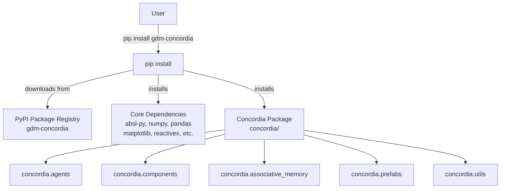
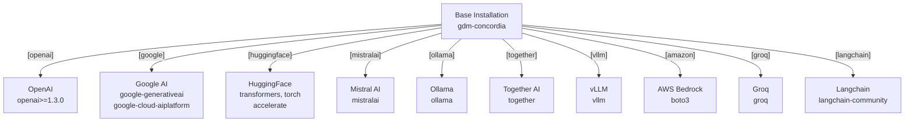
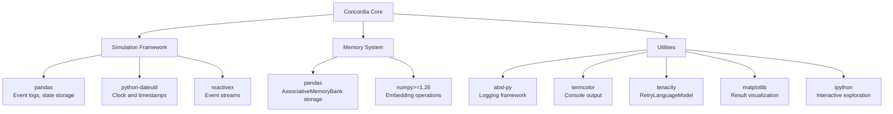
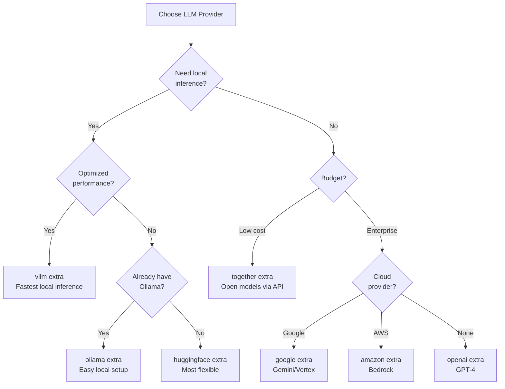
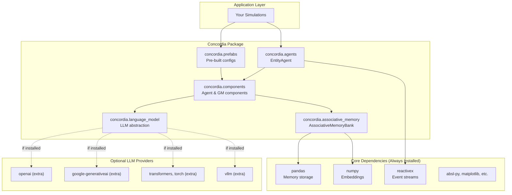
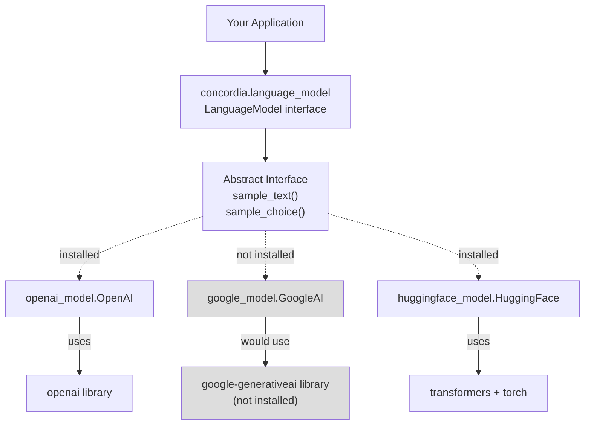
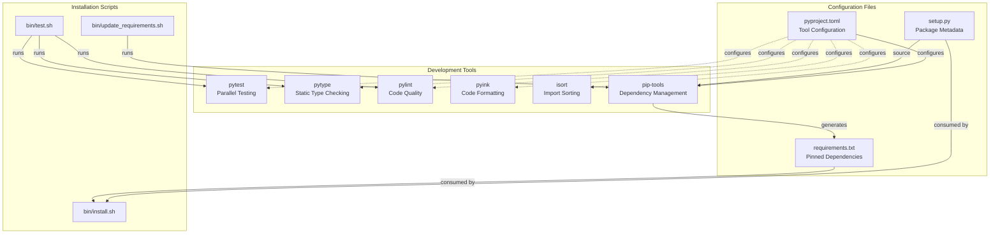
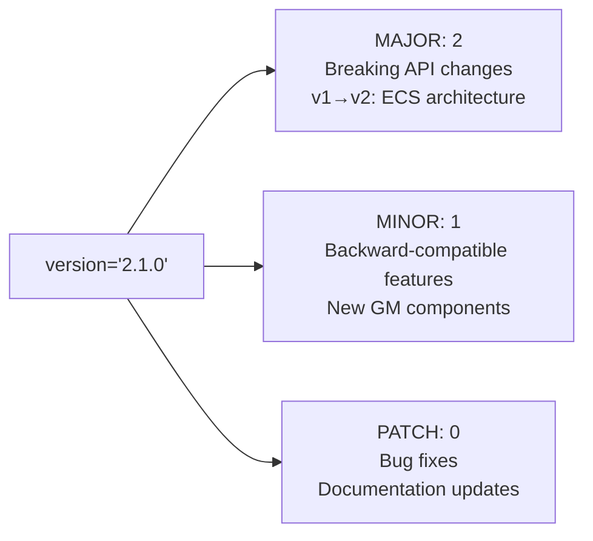
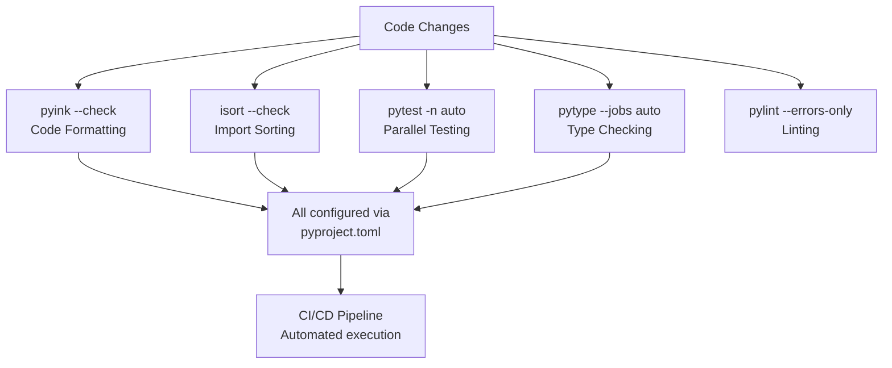

<!-- source: DeepWiki mcp.deepwiki.com · repo google-deepmind/concordia · page 5.1 Installation and Dependencies · fetched 2026-10-26 -->

# Installation and Dependencies

<details>
<summary>Relevant source files</summary>

The following files were used as context for generating this wiki page:

- [CHANGELOG.md](CHANGELOG.md)
- [bin/install.sh](bin/install.sh)
- [bin/test.sh](bin/test.sh)
- [bin/test_examples.sh](bin/test_examples.sh)
- [bin/update_requirements.sh](bin/update_requirements.sh)
- [pyproject.toml](pyproject.toml)
- [requirements.txt](requirements.txt)
- [setup.py](setup.py)

</details>


This page documents how to install Concordia and its dependencies. It covers pip installation, Python version requirements, core dependencies, and optional extras for different LLM providers.

For setting up a development environment, see page 7.1. For information on creating and running simulations, see pages 5.2 and 5.3.

---

## Installation Methods

Concordia is distributed as the `gdm-concordia` package on PyPI and can be installed using pip.

### Basic Installation

The simplest installation includes core dependencies only:

```bash
pip install gdm-concordia
```

This installs the simulation framework with minimal dependencies. You'll need to install additional LLM provider extras to use language models.

**Installation Workflow:**



**Sources:** [setup.py:34-36]()

### Installation with LLM Providers

To use language models, install with one or more provider extras:

```bash
# OpenAI GPT models
pip install gdm-concordia[openai]

# Google Gemini models
pip install gdm-concordia[google]

# HuggingFace local models
pip install gdm-concordia[huggingface]

# Multiple providers
pip install gdm-concordia[openai,google,huggingface]
```

**Available Provider Extras:**



**Sources:** [setup.py:80-136]()

---

## Python Version Requirements

Concordia requires Python 3.12 or later:

```python
python_requires='>=3.12'
```

**Supported Python Versions:**

| Version | Status | Notes |
|---------|--------|-------|
| 3.12 | ✓ Supported | Minimum required version |
| 3.13 | ✓ Supported | Fully tested |
| 3.14 | ✓ Supported | Fully tested |
| 3.11 and earlier | ✗ Not supported | Will fail installation |

**Why Python 3.12+?**

Concordia uses modern Python features that require 3.12 or later:
- Enhanced type hinting features
- Performance improvements
- Better error messages

**Checking Your Python Version:**

```bash
python --version
# Should output: Python 3.12.x or higher
```

**Sources:** [setup.py:68](), [setup.py:60-63]()

## Core Dependencies

The base installation includes these core dependencies automatically:

**Core Libraries:**

| Package | Version Constraint | Purpose |
|---------|-------------------|---------|
| `absl-py` | any | Command-line flags and logging |
| `ipython` | any | Interactive Python shell |
| `matplotlib` | any | Plotting and visualization |
| `numpy` | >=1.26 | Numerical operations |
| `pandas` | any | Data structures and memory storage |
| `python-dateutil` | any | Date and time handling |
| `reactivex` | any | Reactive programming patterns |
| `tenacity` | any | Retry logic with exponential backoff |
| `termcolor` | any | Colored terminal output |

**Dependencies by Use Case:**



**Note:** Language model providers are **not** included in core dependencies. Install provider-specific extras as needed (see next section).

**Sources:** [setup.py:69-79]()

## Optional Extras for LLM Providers

Concordia supports 10+ language model providers through optional extras. Each extra installs the necessary client libraries for that provider.

### Provider Extras Reference

**Commercial API Providers:**

| Extra | Install Command | Packages Installed | Use Case |
|-------|----------------|-------------------|----------|
| `openai` | `pip install gdm-concordia[openai]` | `openai>=1.3.0` | OpenAI GPT-4, GPT-3.5, etc. |
| `google` | `pip install gdm-concordia[google]` | `google-generativeai`, `google-cloud-aiplatform` | Google Gemini, Vertex AI |
| `mistralai` | `pip install gdm-concordia[mistralai]` | `mistralai` | Mistral AI models |
| `groq` | `pip install gdm-concordia[groq]` | `groq` | Groq fast inference |
| `amazon` | `pip install gdm-concordia[amazon]` | `boto3` | AWS Bedrock models |
| `together` | `pip install gdm-concordia[together]` | `together` | Together AI (Gemma, Deepseek) |

**Local Inference Providers:**

| Extra | Install Command | Packages Installed | Use Case |
|-------|----------------|-------------------|----------|
| `huggingface` | `pip install gdm-concordia[huggingface]` | `transformers`, `torch`, `accelerate` | Local HuggingFace models |
| `ollama` | `pip install gdm-concordia[ollama]` | `ollama` | Ollama local models |
| `vllm` | `pip install gdm-concordia[vllm]` | `vllm` | Optimized local inference |

**Integration Extras:**

| Extra | Install Command | Packages Installed | Use Case |
|-------|----------------|-------------------|----------|
| `langchain` | `pip install gdm-concordia[langchain]` | `langchain-community` | Langchain integration |

**Development Extras:**

| Extra | Install Command | Packages Installed | Use Case |
|-------|----------------|-------------------|----------|
| `dev` | `pip install gdm-concordia[dev]` | `pytype`, `pylint`, `pytest-xdist`, `pyink`, `pip-tools`, etc. | Development and testing |

**Sources:** [setup.py:80-136]()

### Provider Selection Strategy

**Choosing a Provider:**



**Sources:** [setup.py:80-136]()

### Multiple Provider Installation

Install multiple providers for flexibility:

```bash
# API providers for different models
pip install gdm-concordia[openai,google,mistralai]

# Local + API options
pip install gdm-concordia[vllm,openai]

# Everything for experimentation
pip install gdm-concordia[openai,google,huggingface,vllm,together]
```

**Use Cases for Multiple Providers:**

- **Development:** Test with cheap local models, deploy with production API
- **Redundancy:** Fallback providers if one service is down
- **Experimentation:** Compare model behaviors across providers
- **Cost Optimization:** Route requests based on complexity/budget

**Sources:** [setup.py:80-136]()

---

## Installation Examples

### Common Installation Scenarios

**Scenario 1: API-based Development (Recommended for Getting Started)**

```bash
# Install with OpenAI support (easiest to set up)
pip install gdm-concordia[openai]

# Set API key
export OPENAI_API_KEY='your-api-key'
```

This is the simplest setup. OpenAI's API is reliable and well-documented. Use this if you're new to Concordia.

**Scenario 2: Google Cloud Environment**

```bash
# Install with Google AI support
pip install gdm-concordia[google]

# Authenticate with Google Cloud
gcloud auth application-default login
```

Use this in Google Cloud environments or if you prefer Gemini models.

**Scenario 3: Local Inference for Cost/Privacy**

```bash
# Install with HuggingFace support (most flexible)
pip install gdm-concordia[huggingface]

# Or install with vLLM for better performance
pip install gdm-concordia[vllm]
```

Use local inference when:
- Running many simulations (API costs add up)
- Privacy requirements prohibit cloud APIs
- Need offline capability

**Scenario 4: Multi-Provider Setup**

```bash
# Install multiple providers for flexibility
pip install gdm-concordia[openai,google,ollama]
```

Useful when:
- Comparing different LLMs in experiments
- Need fallback options
- Different use cases (cheap vs. powerful models)

**Scenario 5: Development Contributor**

```bash
# Clone repository
git clone https://github.com/google-deepmind/concordia
cd concordia

# Install in editable mode with all extras
pip install -e .[dev,openai,google,huggingface]
```

Use this if you're contributing to Concordia development.

**Sources:** [setup.py:80-136]()

---

## Verifying Installation

After installation, verify that Concordia is correctly installed:

### Import Test

```python
# Test basic import
import concordia

# Check version
print(concordia.__version__)  # Should print: 2.3.1 or later

# Test key modules
from concordia.agents import entity_agent
from concordia.components import agent as agent_components
from concordia.associative_memory import associative_memory
from concordia.language_model import language_model

print("Concordia installed successfully!")
```

### Provider Verification

Test that your LLM provider is accessible:

```python
# Example: OpenAI
from concordia.language_model import openai_model

model = openai_model.OpenAI(
    api_key='your-api-key',
    model_name='gpt-4',
)
result = model.sample_text('Hello!')
print(f"Model response: {result}")
```

### Check Installed Extras

```bash
# List installed packages
pip list | grep -E "(concordia|openai|google|transformers)"

# Check specific provider availability
python -c "import openai; print('OpenAI available')"
python -c "import google.generativeai; print('Google AI available')"
python -c "import transformers; print('HuggingFace available')"
```

**Sources:** [setup.py:34-36]()

---

## Dependency Architecture

Understanding how Concordia's dependencies are organized:

### Dependency Layers



**Sources:** [setup.py:69-136]()

### Provider Independence

Concordia's language model integration is designed to work with any subset of providers:



You only need to install the providers you plan to use. The others remain optional.

**Sources:** [setup.py:80-136]()

---

## Configuration File Relationships



**Sources:** [setup.py:1-114](), [pyproject.toml:1-46](), [requirements.txt:1-10](), [bin/install.sh:1-32](), [bin/update_requirements.sh:1-22](), [bin/test.sh:1-42]()

---

## Version Management

### Semantic Versioning

Concordia follows semantic versioning (MAJOR.MINOR.PATCH):



**Version History:**
- **v2.1.0** (2025-08-18): Current version with questionnaires, marketplace, death components
- **v2.0.1** (2025-07-07): Dependency pinning improvements
- **v2.0.0** (2025-07-04): Major rewrite with prefab system and engines
- **v1.8.x** (2024): Legacy architecture with factories

**Sources:** [setup.py:36](), [CHANGELOG.md:7-82]()

### Package Classifiers

```python
classifiers=[
    'Development Status :: 4 - Beta',
    'Intended Audience :: Developers',
    'Intended Audience :: Education',
    'Intended Audience :: Science/Research',
    'License :: OSI Approved :: Apache Software License',
    'Operating System :: POSIX :: Linux',
    'Operating System :: MacOS :: MacOS X',
    'Programming Language :: Python :: 3 :: Only',
    'Programming Language :: Python :: 3.12',
    'Programming Language :: Python :: 3.13',
    'Programming Language :: Python :: 3.14',
    'Topic :: Scientific/Engineering :: Artificial Intelligence',
]
```

**Key Classifications:**
- **Development Status**: Beta (4) - production-ready but evolving
- **Python Versions**: 3.12, 3.13, 3.14
- **Operating Systems**: Linux, macOS (Windows not officially supported)
- **License**: Apache 2.0

**Sources:** [setup.py:52-65]()

---

## Configuration Best Practices

### For Contributors

1. **Dependency Changes**:
   ```bash
   # Edit setup.py (install_requires or extras_require)
   ./bin/update_requirements.sh
   # Commit both setup.py and requirements.txt
   ```

2. **Tool Configuration**:
   - Centralize all tool configs in `pyproject.toml`
   - Never use tool-specific config files (e.g., `.pylintrc`, `pytest.ini`)

3. **Version Bumping**:
   - Update version in `setup.py` only
   - Follow semantic versioning rules
   - Document changes in `CHANGELOG.md`

### For Users

1. **Standard Installation**:
   ```bash
   pip install gdm-concordia
   ```

2. **With Optional Features**:
   ```bash
   pip install gdm-concordia[huggingface]  # Local inference
   pip install gdm-concordia[vllm]         # Optimized inference
   ```

3. **Development Setup**:
   ```bash
   git clone https://github.com/google-deepmind/concordia
   cd concordia
   ./bin/install.sh
   ```

**Sources:** [bin/install.sh:1-32](), [bin/update_requirements.sh:1-22]()

---

## Testing and Quality Assurance

### Test Configuration

The `pyproject.toml` pytest configuration enables parallel test execution:

```bash
# Equivalent to running:
pytest -n auto concordia examples
```

This automatically distributes tests across available CPU cores using `pytest-xdist`.

### Quality Tools Workflow



**Test Script Execution:**
```bash
./bin/test.sh           # Test concordia package
./bin/test_examples.sh  # Test examples and notebooks
```

**Sources:** [pyproject.toml:31-45](), [bin/test.sh:1-42](), [bin/test_examples.sh:1-57]()

---

