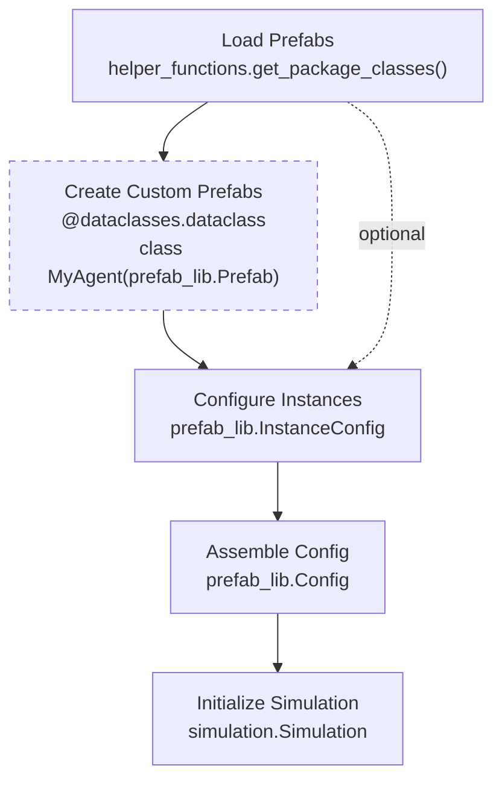
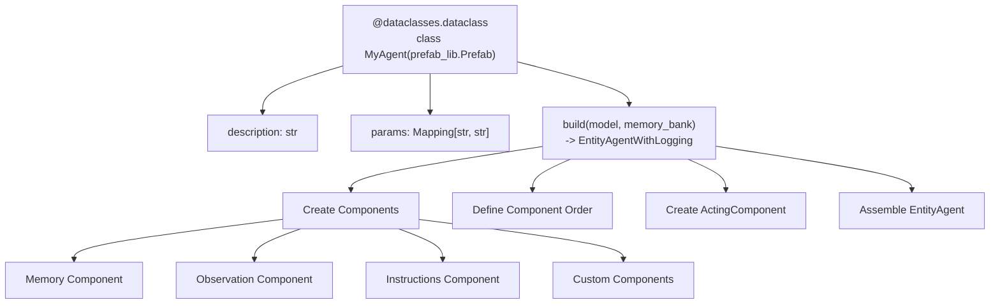
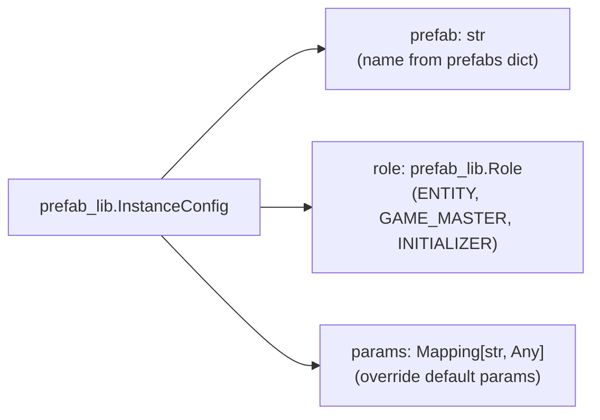
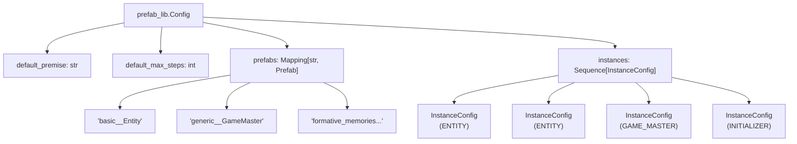
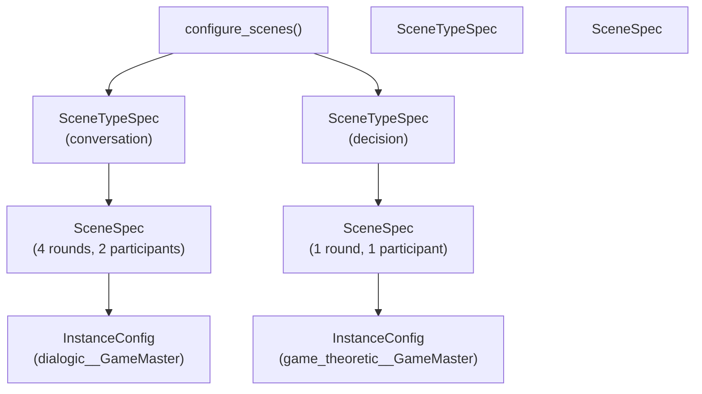
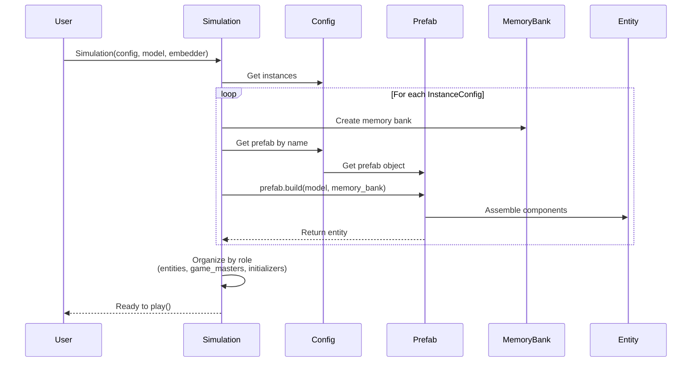

<!-- source: DeepWiki mcp.deepwiki.com · repo google-deepmind/concordia · page 5.2 Creating Simulations · fetched 2026-10-26 -->

# Creating Simulations

<details>
<summary>Relevant source files</summary>

The following files were used as context for generating this wiki page:

- [CHANGELOG.md](CHANGELOG.md)
- [concordia/associative_memory/basic_associative_memory.py](concordia/associative_memory/basic_associative_memory.py)
- [concordia/prefabs/game_master/generic.py](concordia/prefabs/game_master/generic.py)
- [concordia/prefabs/simulation/generic.py](concordia/prefabs/simulation/generic.py)
- [concordia/typing/prefab.py](concordia/typing/prefab.py)
- [concordia/typing/simulation.py](concordia/typing/simulation.py)
- [concordia/utils/log_viewer.html](concordia/utils/log_viewer.html)
- [concordia/utils/structured_logging.py](concordia/utils/structured_logging.py)
- [concordia/utils/structured_logging_test.py](concordia/utils/structured_logging_test.py)
- [examples/actor_development.ipynb](examples/actor_development.ipynb)
- [examples/alice.ipynb](examples/alice.ipynb)
- [examples/dialog.ipynb](examples/dialog.ipynb)
- [examples/marketplace.ipynb](examples/marketplace.ipynb)
- [examples/selling_cookies.ipynb](examples/selling_cookies.ipynb)
- [examples/tutorial.ipynb](examples/tutorial.ipynb)
- [setup.py](setup.py)

</details>


## Purpose and Scope

This page provides a step-by-step guide to creating simulations in Concordia. It covers defining the `Config` object, loading or creating prefabs, configuring instances, and assembling all components into a runnable simulation. For information about running simulations after they are created, see [Running Simulations](#4.3). For information about developing custom agent components, see [Agent Development Tutorial](#5.2).

## Simulation Creation Workflow

Creating a simulation in Concordia involves four main steps:

1. **Load Prefabs**: Import pre-built agent and game master templates
2. **Create Custom Prefabs** (optional): Define custom agent or game master behaviors
3. **Configure Instances**: Specify which prefabs to instantiate and with what parameters
4. **Assemble Config**: Package everything into a `Config` object



**Diagram: Simulation Creation Workflow**

Sources: [examples/actor_development.ipynb:176-490](), [examples/tutorial.ipynb:151-235]()

## Step 1: Loading Prefabs

Concordia provides pre-built prefabs for common agent and game master types. These are loaded from the `concordia.prefabs.entity` and `concordia.prefabs.game_master` packages.

### Loading Built-in Prefabs

```python
from concordia.utils import helper_functions
import concordia.prefabs.entity as entity_prefabs
import concordia.prefabs.game_master as game_master_prefabs

prefabs = {
    **helper_functions.get_package_classes(entity_prefabs),
    **helper_functions.get_package_classes(game_master_prefabs),
}
```

The `helper_functions.get_package_classes()` function scans a package and returns a dictionary mapping prefab names to prefab classes. Prefab names follow the convention `{module_name}__{type}`, for example `basic__Entity` or `generic__GameMaster`.

| Prefab Type | Example Name | Description |
|-------------|--------------|-------------|
| Entity | `basic__Entity` | A simple agent with memory, observation, and planning |
| Game Master | `generic__GameMaster` | A general-purpose game master for orchestrating interactions |
| Game Master | `dialogic__GameMaster` | A game master specialized for conversations |
| Initializer | `formative_memories_initializer__GameMaster` | Sets up initial memories before the main simulation |

### Inspecting Available Prefabs

```python
from IPython import display

display.display(
    display.Markdown(helper_functions.print_pretty_prefabs(prefabs))
)
```

This displays a formatted list of all available prefabs with their descriptions and parameters.

Sources: [examples/actor_development.ipynb:176-193](), [examples/tutorial.ipynb:149-168]()

## Step 2: Creating Custom Prefabs

To define custom agent or game master behaviors, create a new prefab class. A prefab is a dataclass that inherits from `prefab_lib.Prefab` and implements a `build()` method.

### Custom Agent Prefab Structure



**Diagram: Custom Prefab Structure**

### Example Custom Agent Prefab

A custom prefab implements three key elements:

1. **Description**: A string describing the prefab's purpose
2. **Params**: Default parameter values (can be overridden in `InstanceConfig`)
3. **Build Method**: Constructs the agent from components

```python
from collections.abc import Mapping
import dataclasses
from concordia.typing import prefab as prefab_lib
from concordia.agents import entity_agent_with_logging
from concordia.associative_memory import basic_associative_memory
from concordia.components import agent as agent_components
from concordia.language_model import language_model

@dataclasses.dataclass
class MyAgent(prefab_lib.Prefab):
    """A prefab implementing a custom agent."""
    
    description: str = (
        'An agent with specific behavioral components.'
    )
    params: Mapping[str, str] = dataclasses.field(
        default_factory=lambda: {
            'name': 'Alice',
            'goal': '',
        }
    )
    
    def build(
        self,
        model: language_model.LanguageModel,
        memory_bank: basic_associative_memory.AssociativeMemoryBank,
    ) -> entity_agent_with_logging.EntityAgentWithLogging:
        """Build an agent."""
        # Extract parameters
        agent_name = self.params.get('name', 'Alice')
        
        # Create components
        components_of_agent = {
            'Instructions': agent_components.instructions.Instructions(
                agent_name=agent_name,
                pre_act_label='\nInstructions',
            ),
            'observation_to_memory': agent_components.observation.ObservationToMemory(),
            'observation': agent_components.observation.LastNObservations(
                history_length=100, pre_act_label='\nObservation'
            ),
            'memory': agent_components.memory.AssociativeMemory(
                memory_bank=memory_bank
            ),
        }
        
        # Define component order
        component_order = list(components_of_agent.keys())
        
        # Create acting component
        act_component = agent_components.concat_act_component.ConcatActComponent(
            model=model,
            component_order=component_order,
        )
        
        # Assemble agent
        agent = entity_agent_with_logging.EntityAgentWithLogging(
            agent_name=agent_name,
            act_component=act_component,
            context_components=components_of_agent,
        )
        
        return agent
```

### Registering Custom Prefabs

After defining a custom prefab, add it to the prefabs dictionary:

```python
prefabs['myagent__Entity'] = MyAgent()
```

The key should follow the naming convention `{identifier}__{Entity|GameMaster}`.

Sources: [examples/actor_development.ipynb:208-317](), [examples/selling_cookies.ipynb:199-301]()

## Step 3: Configuring Instances

Instances specify which prefabs to instantiate and with what parameters. Each instance is represented by an `InstanceConfig` object.

### InstanceConfig Structure



**Diagram: InstanceConfig Components**

### Creating Entity Instances

```python
from concordia.typing import prefab as prefab_lib

instances = [
    prefab_lib.InstanceConfig(
        prefab='basic__Entity',
        role=prefab_lib.Role.ENTITY,
        params={
            'name': 'Alice',
            'goal': 'Explore the world',
        },
    ),
    prefab_lib.InstanceConfig(
        prefab='basic__Entity',
        role=prefab_lib.Role.ENTITY,
        params={
            'name': 'Bob',
            'goal': 'Find treasure',
        },
    ),
]
```

### Role Types

| Role | Purpose | Lifecycle |
|------|---------|-----------|
| `Role.ENTITY` | Represents a simulated agent | Active throughout simulation |
| `Role.GAME_MASTER` | Orchestrates simulation mechanics | Active during its designated phase |
| `Role.INITIALIZER` | Sets up initial conditions | Runs once at start, then transfers control |

### Creating Game Master Instances

```python
instances.append(
    prefab_lib.InstanceConfig(
        prefab='generic__GameMaster',
        role=prefab_lib.Role.GAME_MASTER,
        params={
            'name': 'default rules',
            'acting_order': 'game_master_choice',
            'extra_event_resolution_steps': '',
        },
    )
)
```

The `generic__GameMaster` accepts several parameters:

- `name`: Identifier for this game master
- `acting_order`: How to select the next acting entity
  - `'game_master_choice'`: LLM decides who acts next
  - `'fixed'`: Round-robin order
  - `'random'`: Random selection
- `extra_event_resolution_steps`: Comma-separated list of thought chain steps

### Creating Initializer Instances

Initializers set up the simulation's starting state:

```python
instances.append(
    prefab_lib.InstanceConfig(
        prefab='formative_memories_initializer__GameMaster',
        role=prefab_lib.Role.INITIALIZER,
        params={
            'name': 'initial setup rules',
            'next_game_master_name': 'default rules',
            'shared_memories': [
                'The year is 1649.',
                'England is in political turmoil.',
            ],
            'player_specific_memories': {
                'Alice': ['Alice is a merchant.'],
                'Bob': ['Bob is a soldier.'],
            },
            'player_specific_context': {
                'Alice': 'Alice wants to protect her business.',
                'Bob': 'Bob follows orders loyally.',
            },
        },
    )
)
```

Key parameters for initializers:

- `next_game_master_name`: Which game master takes control after initialization
- `shared_memories`: Memories added to all entities
- `player_specific_memories`: Memories added to specific entities
- `player_specific_context`: Context used during agent building

Sources: [examples/actor_development.ipynb:408-449](), [examples/tutorial.ipynb:181-219](), [examples/selling_cookies.ipynb:412-464]()

## Step 4: Assembling the Config

The `Config` object packages all simulation components together. It is defined in the `concordia.typing.prefab` module.

### Config Structure



**Diagram: Config Object Structure**

### Creating the Config

```python
from concordia.typing import prefab as prefab_lib

config = prefab_lib.Config(
    default_premise='Today is January 29, 1649.',
    default_max_steps=5,
    prefabs=prefabs,
    instances=instances,
)
```

### Config Parameters

| Parameter | Type | Description |
|-----------|------|-------------|
| `default_premise` | `str` | Initial situation description shared with all entities |
| `default_max_steps` | `int` | Maximum number of simulation steps (can be overridden in `play()`) |
| `prefabs` | `Mapping[str, Prefab]` | Dictionary of available prefab templates |
| `instances` | `Sequence[InstanceConfig]` | List of entities and game masters to create |

Sources: [examples/actor_development.ipynb:460-465](), [examples/tutorial.ipynb:230-235](), [examples/selling_cookies.ipynb:475-485]()

## Scene-Based Configuration

For more structured simulations, Concordia supports scene-based execution where different phases use different game masters and action specifications.

### Scene Configuration Flow



**Diagram: Scene Configuration Flow**

### Defining Scene Types

```python
from concordia.typing import scene as scene_lib
from concordia.typing import entity as entity_lib

def configure_scenes():
    """Configure scenes for this simulation."""
    conversation = scene_lib.SceneTypeSpec(
        name='conversation',
        game_master_name='conversation rules',
        action_spec=entity_lib.free_action_spec(
            call_to_action=entity_lib.DEFAULT_CALL_TO_SPEECH
        ),
    )
    
    decision = scene_lib.SceneTypeSpec(
        name='decision',
        game_master_name='decision rules',
        action_spec={
            'Alice': entity_lib.choice_action_spec(
                call_to_action='Would {name} buy the cookies?',
                options=['Yes', 'No'],
            ),
        },
    )
    
    scenes = [
        scene_lib.SceneSpec(
            scene_type=conversation,
            participants=['Alice', 'Bob'],
            num_rounds=4,
            premise={
                'Alice': ['Alice is approached by Bob'],
                'Bob': ['Bob has approached Alice'],
            },
        ),
        scene_lib.SceneSpec(
            scene_type=decision,
            participants=['Alice'],
            num_rounds=1,
            premise={
                'Alice': ['Alice must decide'],
            },
        ),
    ]
    return scenes
```

### SceneTypeSpec Components

| Component | Description |
|-----------|-------------|
| `name` | Identifier for this scene type |
| `game_master_name` | Which game master handles this scene |
| `action_spec` | Defines how entities can act (free text, multiple choice, or per-entity specs) |

### SceneSpec Components

| Component | Description |
|-----------|-------------|
| `scene_type` | The `SceneTypeSpec` to use |
| `participants` | List of entity names involved |
| `num_rounds` | How many action rounds in this scene |
| `premise` | Per-entity setup descriptions |

### Using Scenes in Game Masters

Game masters that support scenes accept a `scenes` parameter:

```python
prefab_lib.InstanceConfig(
    prefab='game_theoretic_and_dramaturgic__GameMaster',
    role=prefab_lib.Role.GAME_MASTER,
    params={
        'name': 'decision rules',
        'scenes': scenes,
        'action_to_scores': action_to_scores_function,
        'scores_to_observation': scores_to_observation_function,
    },
)
```

Sources: [examples/selling_cookies.ipynb:317-399](), [examples/selling_cookies.ipynb:428-447]()

## Instantiation Process

When a simulation is initialized, the following process occurs:



**Diagram: Simulation Instantiation Sequence**

The `Simulation` class reads the `Config` and:

1. Creates a memory bank for each entity (using the embedder)
2. Looks up each prefab by name from the `prefabs` dictionary
3. Calls the prefab's `build()` method with the language model and memory bank
4. Merges the `params` from `InstanceConfig` into the prefab's default params
5. Organizes the built entities by role (entities vs. game masters vs. initializers)

Sources: [concordia/prefabs/simulation/generic.py]() (implementation details), [examples/actor_development.ipynb:486-490]()

## Common Patterns

### Multiple Entities with Same Prefab

Use different parameters for each instance:

```python
player_names = ['Alice', 'Bob', 'Charlie']
instances = [
    prefab_lib.InstanceConfig(
        prefab='basic__Entity',
        role=prefab_lib.Role.ENTITY,
        params={'name': name},
    )
    for name in player_names
]
```

### Chaining Game Masters

Use an initializer to set up state, then transfer to a main game master:

```python
instances = [
    prefab_lib.InstanceConfig(
        prefab='formative_memories_initializer__GameMaster',
        role=prefab_lib.Role.INITIALIZER,
        params={
            'name': 'setup',
            'next_game_master_name': 'main_rules',
            # initialization params...
        },
    ),
    prefab_lib.InstanceConfig(
        prefab='generic__GameMaster',
        role=prefab_lib.Role.GAME_MASTER,
        params={'name': 'main_rules'},
    ),
]
```

### Conditional Component Addition

Within a custom prefab's `build()` method, add components conditionally:

```python
def build(self, model, memory_bank):
    components_of_agent = {
        'Instructions': instructions_component,
        'observation': observation_component,
    }
    
    component_order = list(components_of_agent.keys())
    
    # Add goal component if specified
    if self.params.get('goal', ''):
        goal = agent_components.constant.Constant(
            state=self.params['goal'],
            pre_act_label='Overarching goal',
        )
        components_of_agent['Goal'] = goal
        component_order.insert(1, 'Goal')  # Place after Instructions
    
    # Continue building agent...
```

Sources: [examples/selling_cookies.ipynb:268-276]()

## Summary

Creating a simulation involves:

1. **Loading prefabs** with `helper_functions.get_package_classes()`
2. **Creating custom prefabs** by subclassing `prefab_lib.Prefab` and implementing `build()`
3. **Configuring instances** with `prefab_lib.InstanceConfig` objects specifying prefab, role, and params
4. **Assembling the Config** with `prefab_lib.Config(default_premise, default_max_steps, prefabs, instances)`

Once the `Config` is created, it can be passed to `simulation.Simulation()` to instantiate the simulation. For details on running the simulation, see [Running Simulations](#4.3).

Sources: [examples/actor_development.ipynb](), [examples/tutorial.ipynb](), [examples/selling_cookies.ipynb](), [concordia/typing/prefab.py]()

---

