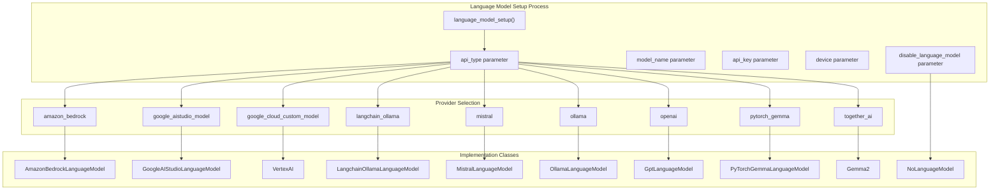
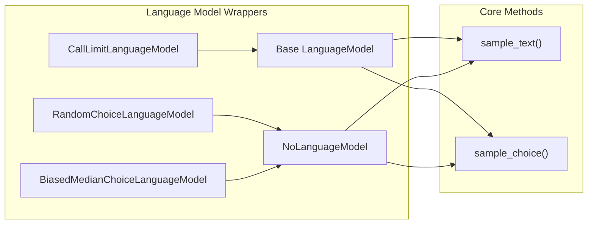
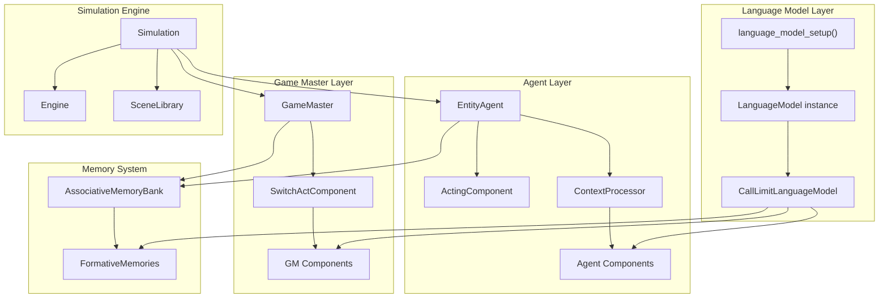

<!-- source: DeepWiki mcp.deepwiki.com · repo google-deepmind/concordia · page 5.3 Running and Monitoring Simulations · fetched 2026-10-26 -->

# Launching Simulations

Relevant source files

The following files were used as context for generating this wiki page:

- [concordia/associative_memory/basic_associative_memory.py](concordia/associative_memory/basic_associative_memory.py)
- [concordia/prefabs/game_master/generic.py](concordia/prefabs/game_master/generic.py)
- [concordia/prefabs/simulation/generic.py](concordia/prefabs/simulation/generic.py)
- [concordia/typing/prefab.py](concordia/typing/prefab.py)
- [concordia/typing/simulation.py](concordia/typing/simulation.py)
- [concordia/utils/log_viewer.html](concordia/utils/log_viewer.html)
- [concordia/utils/structured_logging.py](concordia/utils/structured_logging.py)
- [concordia/utils/structured_logging_test.py](concordia/utils/structured_logging_test.py)
- [examples/actor_development.ipynb](examples/actor_development.ipynb)
- [examples/alice.ipynb](examples/alice.ipynb)
- [examples/dialog.ipynb](examples/dialog.ipynb)
- [examples/marketplace.ipynb](examples/marketplace.ipynb)
- [examples/selling_cookies.ipynb](examples/selling_cookies.ipynb)
- [examples/tutorial.ipynb](examples/tutorial.ipynb)

This document covers the process of instantiating and running Concordia simulations with different language models and configurations. It focuses on the technical steps to launch a configured simulation after scenario setup is complete.

For information about configuring simulation scenarios using prefabs and configuration objects, see [Scenario Configuration](#4.1). For basic examples of complete simulation setups, see [Basic Examples](#5.1).

## Overview

Launching a Concordia simulation involves three main phases:

1. **Language Model Setup** - Configuring and instantiating language model providers
2. **Simulation Instantiation** - Creating simulation objects with configured agents and game masters
3. **Execution** - Running the simulation loop with error handling and monitoring

The process connects configured simulation scenarios with language model backends to enable agent interactions and decision-making.

## Language Model Configuration

### Language Model Factory

The primary entry point for language model setup is the `language_model_setup()` function in [concordia/language_model/utils.py:30-82](). This factory function supports multiple language model providers through a unified interface.

**Sources:** [concordia/language_model/utils.py:30-82](), [concordia/language_model/no_language_model.py:26-34]()

### Provider-Specific Configuration

Different language model providers require specific configuration parameters:

| Provider | Required Parameters | Optional Parameters |
|----------|-------------------|-------------------|
| `openai` | `model_name`, `api_key` | - |
| `google_aistudio_model` | `model_name`, `api_key` | - |
| `google_cloud_custom_model` | `endpoint_id`, `project_id` | `location` |
| `amazon_bedrock` | `model_name` | AWS credentials |
| `mistral` | `model_name`, `api_key` | - |
| `ollama` | `model_name` | - |
| `pytorch_gemma` | `model_name` | `device` |

**Sources:** [concordia/language_model/utils.py:55-82](), [concordia/language_model/google_cloud_custom_model.py:89-115]()

### Call Limiting and Debug Models

The framework provides wrapper classes for production and debugging scenarios:

- **Call Limit Wrapper**: [concordia/language_model/call_limit_wrapper.py:24-46]() limits the number of API calls to prevent excessive usage
- **No Language Model**: [concordia/language_model/no_language_model.py:26-34]() returns empty strings for debugging
- **Random Choice Model**: [concordia/language_model/no_language_model.py:59-76]() makes random choices for testing

**Sources:** [concordia/language_model/call_limit_wrapper.py:24-96](), [concordia/language_model/no_language_model.py:26-117]()

## Simulation Instantiation Process

### Component Integration with Language Models

The simulation instantiation process connects language models to agent components and game master systems:

**Sources:** [concordia/language_model/utils.py:30-82](), [concordia/language_model/call_limit_wrapper.py:24-46]()

### Error Handling and Retry Logic

Language model implementations include robust error handling for production environments. The Google Cloud implementation demonstrates typical retry patterns:

- **Rate Limiting**: [concordia/language_model/google_cloud_custom_model.py:131-141]() implements exponential backoff
- **Maximum Attempts**: [concordia/language_model/google_cloud_custom_model.py:28-34]() defines retry limits
- **Silent Attempts**: [concordia/language_model/google_cloud_custom_model.py:30-34]() reduces logging noise

**Sources:** [concordia/language_model/google_cloud_custom_model.py:28-174]()

## Execution Modes

### Production Execution

For production simulations with real language models:

1. Configure language model with appropriate API credentials
2. Set up call limiting to manage costs
3. Initialize simulation with proper error handling
4. Monitor execution for rate limiting and failures

### Debug Execution

For testing and development:

1. Use `disable_language_model=True` in `language_model_setup()`
2. Configure `NoLanguageModel` or `RandomChoiceLanguageModel`
3. Test simulation logic without API calls
4. Validate agent interactions and memory updates

### Mixed Execution

For selective testing:

1. Use different language models for different agents
2. Apply call limits to specific model instances
3. Combine real and mock models in the same simulation

**Sources:** [concordia/language_model/utils.py:52-53](), [concordia/language_model/no_language_model.py:26-117]()

## Integration Patterns

The launching process integrates multiple system components through well-defined interfaces:

- **Language Models** provide the `sample_text()` and `sample_choice()` methods used by all agent components
- **Call Limiting** enables cost control and testing with production models
- **Error Handling** ensures simulation resilience against API failures
- **Provider Abstraction** allows switching between language model backends without code changes

This architecture enables flexible deployment across different environments while maintaining consistent simulation behavior.

**Sources:** [concordia/language_model/utils.py:30-82](), [concordia/language_model/call_limit_wrapper.py:24-96](), [concordia/language_model/google_cloud_custom_model.py:75-217]()

---

