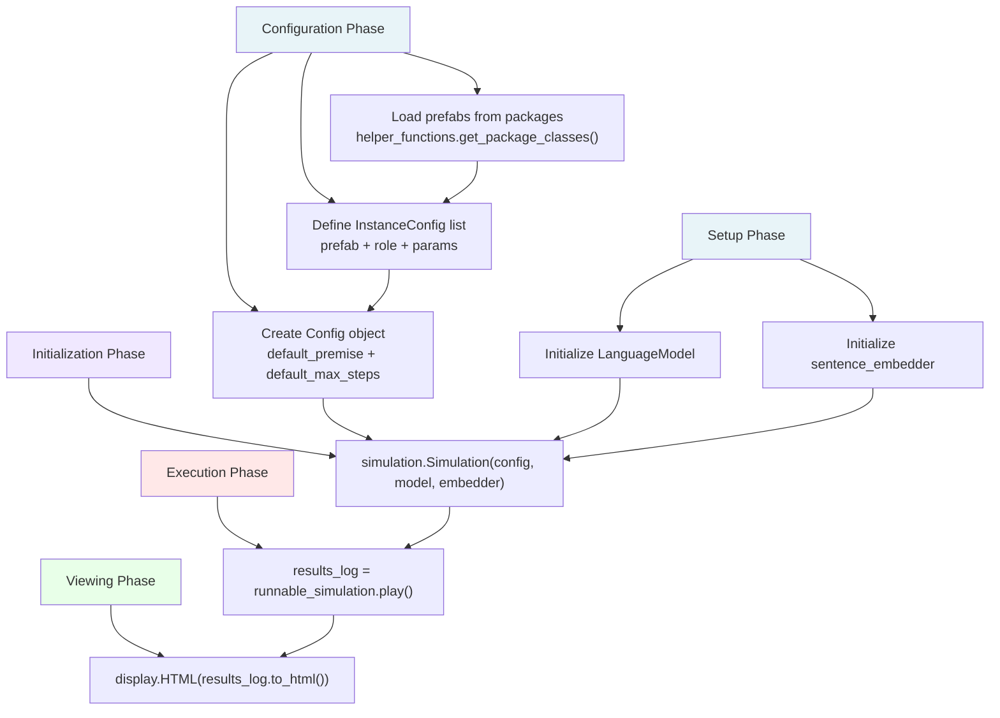
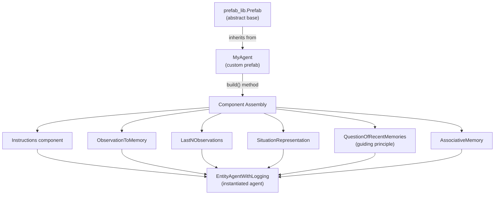
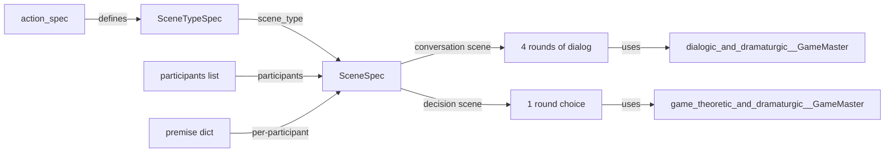
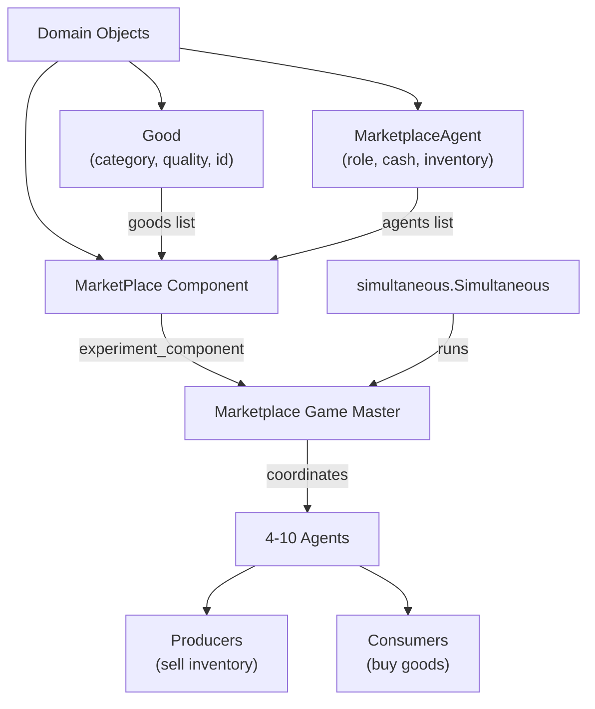
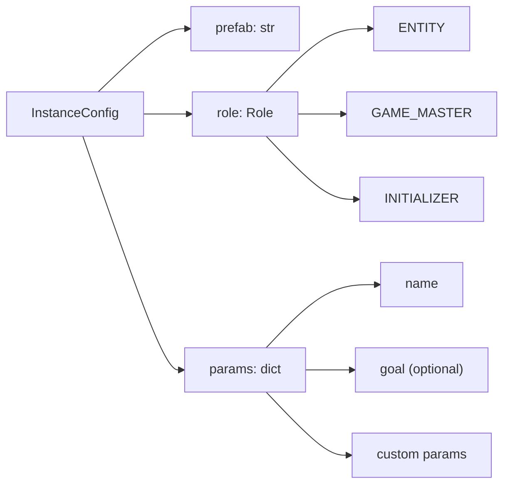

<!-- source: DeepWiki mcp.deepwiki.com · repo google-deepmind/concordia · page 6 Examples and Tutorials · fetched 2026-10-26 -->

# Examples and Tutorials

<details>
<summary>Relevant source files</summary>

The following files were used as context for generating this wiki page:

- [CITATION.bib](CITATION.bib)
- [README.md](README.md)
- [concordia/associative_memory/basic_associative_memory.py](concordia/associative_memory/basic_associative_memory.py)
- [concordia/prefabs/game_master/generic.py](concordia/prefabs/game_master/generic.py)
- [concordia/prefabs/simulation/generic.py](concordia/prefabs/simulation/generic.py)
- [concordia/typing/prefab.py](concordia/typing/prefab.py)
- [concordia/typing/simulation.py](concordia/typing/simulation.py)
- [concordia/utils/log_viewer.html](concordia/utils/log_viewer.html)
- [concordia/utils/structured_logging.py](concordia/utils/structured_logging.py)
- [concordia/utils/structured_logging_test.py](concordia/utils/structured_logging_test.py)
- [examples/actor_development.ipynb](examples/actor_development.ipynb)
- [examples/alice.ipynb](examples/alice.ipynb)
- [examples/dialog.ipynb](examples/dialog.ipynb)
- [examples/marketplace.ipynb](examples/marketplace.ipynb)
- [examples/selling_cookies.ipynb](examples/selling_cookies.ipynb)
- [examples/tutorial.ipynb](examples/tutorial.ipynb)

</details>


This page provides an overview of the example notebooks and tutorials available in the Concordia repository. These notebooks demonstrate common patterns for building and running simulations, from simple two-agent interactions to complex multi-agent scenarios.

For information about creating custom entities and game masters from scratch, see [Component Library](#2.1.3) and [Game Master Prefabs](#2.2.1). For details on the underlying simulation framework, see [Simulation Framework](#3).

---

## Overview of Available Examples

The Concordia repository includes six Jupyter notebooks in the [examples/]() directory that demonstrate progressively more sophisticated simulation configurations:

| Notebook | Focus | Complexity | Key Concepts |
|----------|-------|------------|--------------|
| [tutorial.ipynb]() | Basic simulation setup | Beginner | Prefabs, Config, InstanceConfig |
| [alice.ipynb]() | Simple two-agent story | Beginner | Fixed acting order |
| [dialog.ipynb]() | Conversational agents | Intermediate | Dialog-focused prefabs, conversation styles |
| [actor_development.ipynb]() | Custom agent creation | Intermediate | Building custom Prefab classes |
| [selling_cookies.ipynb]() | Scenes and game theory | Advanced | SceneSpec, action_to_scores, multiple game masters |
| [marketplace.ipynb]() | Economic simulation | Advanced | Simultaneous engine, custom components, large-scale |

Sources: [README.md:70-76](), [examples/tutorial.ipynb:1-327](), [examples/alice.ipynb:1-317](), [examples/dialog.ipynb:1-500](), [examples/actor_development.ipynb:1-572](), [examples/selling_cookies.ipynb:1-590](), [examples/marketplace.ipynb:1-2318]()

---

## Common Workflow Pattern

All example notebooks follow a consistent structure that corresponds to the standard Concordia simulation lifecycle:



**Workflow Steps:**

1. **Setup Phase**: Initialize the language model and sentence embedder
2. **Configuration Phase**: Load prefabs, define instances, create Config object
3. **Initialization Phase**: Instantiate Simulation from configuration
4. **Execution Phase**: Call `play()` to run the simulation
5. **Viewing Phase**: Convert results to HTML for visualization

Sources: [examples/tutorial.ipynb:40-287](), [examples/alice.ipynb:40-278](), [concordia/prefabs/simulation/generic.py:41-322]()

---

## Example Notebook Details

### Tutorial Notebook (tutorial.ipynb)

The canonical starting point for learning Concordia. Demonstrates a historical scenario where Oliver Cromwell and King Charles I interact.

**Location**: [examples/tutorial.ipynb:1-327]()

**Key Code Structures**:

```python
# Language model setup
model = language_model_utils.language_model_setup(
    api_type=API_TYPE,
    model_name=MODEL_NAME,
    api_key=API_KEY,
)

# Load prefabs
prefabs = {
    **helper_functions.get_package_classes(entity_prefabs),
    **helper_functions.get_package_classes(game_master_prefabs),
}

# Configure instances
instances = [
    prefab_lib.InstanceConfig(
        prefab='basic__Entity',
        role=prefab_lib.Role.ENTITY,
        params={'name': 'Oliver Cromwell', 'goal': 'become lord protector'},
    ),
    # ... more instances
]

# Create config and run
config = prefab_lib.Config(
    default_premise='Today is January 29, 1649.',
    default_max_steps=5,
    prefabs=prefabs,
    instances=instances,
)
```

**Demonstrates**:
- Basic entity configuration with `basic__Entity` prefab
- `generic__GameMaster` for event resolution
- `formative_memories_initializer__GameMaster` for setting up initial context
- Simple premise-based initialization

Sources: [examples/tutorial.ipynb:40-287](), [README.md:157-170]()

---

### Alice Notebook (alice.ipynb)

A simple two-character story inspired by Alice in Wonderland. Minimal configuration for quick testing.

**Location**: [examples/alice.ipynb:1-317]()

**Key Configuration**:

```python
instances = [
    prefab_lib.InstanceConfig(
        prefab='basic__Entity',
        role=prefab_lib.Role.ENTITY,
        params={'name': 'Alice'},
    ),
    prefab_lib.InstanceConfig(
        prefab='basic__Entity',
        role=prefab_lib.Role.ENTITY,
        params={'name': 'White Rabbit', 'goal': 'Get to the queen on time'},
    ),
    prefab_lib.InstanceConfig(
        prefab='generic__GameMaster',
        role=prefab_lib.Role.GAME_MASTER,
        params={'name': 'default rules', 'acting_order': 'fixed'},
    ),
]
```

**Demonstrates**:
- Fixed acting order (`acting_order='fixed'`)
- Minimal two-agent setup
- Story-based premise

Sources: [examples/alice.ipynb:174-227]()

---

### Dialog Notebook (dialog.ipynb)

Focused on conversational interactions using `conversational__Entity` and `dialogic__GameMaster` prefabs.

**Location**: [examples/dialog.ipynb:1-500]()

**Key Features**:

```python
prefab_lib.InstanceConfig(
    prefab='conversational__Entity',
    role=prefab_lib.Role.ENTITY,
    params={
        'name': 'Chloe',
        'conversation_style': (
            'Speaks with a lot of energy and excitement. Uses casual, '
            'modern language and slang common for a Southern California '
            'girl in their mid-20s.'
        ),
    },
)

prefab_lib.InstanceConfig(
    prefab='dialogic__GameMaster',
    role=prefab_lib.Role.GAME_MASTER,
    params={
        'name': 'conversation rules',
        'acting_order': 'fixed',
        'can_terminate_simulation': False,
    },
)
```

**Demonstrates**:
- `conversational__Entity` prefab for dialog-focused agents
- `conversation_style` parameter for personality customization
- `dialogic__GameMaster` for managing conversations
- `player_specific_memories` for individual agent context

**Example Scenarios**:
1. Two friends catching up at a coffee shop
2. Love Island first date scenario

Sources: [examples/dialog.ipynb:186-254](), [examples/dialog.ipynb:330-403]()

---

### Actor Development Notebook (actor_development.ipynb)

Teaches how to create custom agent prefabs by implementing the `Prefab` base class.

**Location**: [examples/actor_development.ipynb:1-572]()

**Custom Prefab Implementation**:



**Key Code Pattern**:

```python
@dataclasses.dataclass
class MyAgent(prefab_lib.Prefab):
    description: str = 'An entity that has a minimal set of components...'
    params: Mapping[str, str] = dataclasses.field(default_factory=dict)
    
    def build(
        self,
        model: language_model.LanguageModel,
        memory_bank: basic_associative_memory.AssociativeMemoryBank,
    ) -> entity_agent_with_logging.EntityAgentWithLogging:
        agent_name = self.params.get('name', 'Bob')
        
        # Build components
        instructions = agent_components.instructions.Instructions(...)
        observation = agent_components.observation.LastNObservations(...)
        principle = agent_components.question_of_recent_memories.QuestionOfRecentMemories(
            question=f'How can {agent_name} exploit the situation...',
        )
        
        # Assemble components
        components_of_agent = {
            'Instructions': instructions,
            'observation': observation,
            'principle': principle,
            # ... more components
        }
        
        # Create act component
        act_component = agent_components.concat_act_component.ConcatActComponent(
            model=model,
            component_order=list(components_of_agent.keys()),
        )
        
        # Return assembled agent
        return entity_agent_with_logging.EntityAgentWithLogging(
            agent_name=agent_name,
            act_component=act_component,
            context_components=components_of_agent,
        )
```

**Demonstrates**:
- Implementing the `Prefab` abstract base class
- Component assembly pattern
- Custom agent behavior via `QuestionOfRecentMemories`
- Integration of custom prefab into simulation
- Dynamic premise generation using `InteractiveDocument`

Sources: [examples/actor_development.ipynb:203-313](), [examples/actor_development.ipynb:334-411]()

---

### Selling Cookies Notebook (selling_cookies.ipynb)

Demonstrates scene-based simulations with game-theoretic payoff structures.

**Location**: [examples/selling_cookies.ipynb:1-590]()

**Scene Configuration Pattern**:



**Key Code Structures**:

```python
def configure_scenes() -> Sequence[scene_lib.SceneSpec]:
    decision = scene_lib.SceneTypeSpec(
        name='decision',
        game_master_name='decision rules',
        action_spec={
            PLAYER_ONE: entity_lib.choice_action_spec(
                call_to_action='Would {name} buy the cookies from Bob?',
                options=['Yes', 'No'],
            ),
        },
    )
    
    conversation = scene_lib.SceneTypeSpec(
        name='conversation',
        game_master_name='conversation rules',
        action_spec=entity_lib.free_action_spec(
            call_to_action=entity_lib.DEFAULT_CALL_TO_SPEECH
        ),
    )
    
    return [
        scene_lib.SceneSpec(
            scene_type=conversation,
            participants=[PLAYER_ONE, PLAYER_TWO],
            num_rounds=4,
            premise={...},
        ),
        scene_lib.SceneSpec(
            scene_type=decision,
            participants=[PLAYER_ONE],
            num_rounds=1,
            premise={...},
        ),
    ]

def action_to_scores(joint_action: Mapping[str, str]) -> Mapping[str, float]:
    if joint_action[PLAYER_ONE] == 'Yes':
        return {PLAYER_ONE: -1, PLAYER_TWO: 1}
    return {PLAYER_ONE: 1, PLAYER_TWO: -1}
```

**Demonstrates**:
- `SceneSpec` and `SceneTypeSpec` for structured scenarios
- Multiple game masters (conversation + decision)
- `choice_action_spec` for forced-choice actions
- `action_to_scores` mapping for game-theoretic payoffs
- `scores_to_observation` for feedback generation
- `game_theoretic_and_dramaturgic__GameMaster` prefab

Sources: [examples/selling_cookies.ipynb:313-395](), [examples/selling_cookies.ipynb:418-479]()

---

### Marketplace Notebook (marketplace.ipynb)

A sophisticated economic simulation demonstrating simultaneous action execution and custom game master components.

**Location**: [examples/marketplace.ipynb:1-2318]()

**System Architecture**:



**Key Configuration**:

```python
# Use simultaneous engine instead of sequential
engine = simultaneous.Simultaneous()

# Custom component initialization
component_kwargs = {
    'components': [actor_components.observation.DEFAULT_OBSERVATION_COMPONENT_KEY],
    'agents': agents,
    'goods': goods,
}

instances = [
    # ... entity instances
    prefab_lib.InstanceConfig(
        prefab='marketplace__GameMaster',
        role=prefab_lib.Role.GAME_MASTER,
        params={
            'name': 'MarketplaceGM',
            'experiment_component_class': MarketPlace,
            'experiment_component_init_kwargs': component_kwargs,
        },
    ),
]

simul_sim = simulation.Simulation(
    config=config, 
    model=model, 
    embedder=embedder, 
    engine=engine  # Pass custom engine
)
```

**Demonstrates**:
- `simultaneous.Simultaneous` engine for parallel action execution
- Custom domain objects (`Good`, `MarketplaceAgent`)
- Custom game master component (`MarketPlace`)
- `experiment_component_class` and `experiment_component_init_kwargs` pattern
- Large-scale simulations (10+ agents)
- Economic modeling with supply/demand dynamics

Sources: [examples/marketplace.ipynb:194-227](), [examples/marketplace.ipynb:240-362]()

---

## Common Setup Patterns

### Language Model Initialization

All notebooks use a consistent pattern for language model setup:

```python
# Step 1: Configure API
API_KEY = ''  # User-provided
API_TYPE = 'openai'  # or 'together_ai', etc.
MODEL_NAME = 'gpt-5'

# Step 2: Initialize model
model = language_model_utils.language_model_setup(
    api_type=API_TYPE,
    model_name=MODEL_NAME,
    api_key=API_KEY,
    disable_language_model=False,  # Set True for testing without API calls
)

# Step 3: Initialize embedder
st_model = sentence_transformers.SentenceTransformer(
    'sentence-transformers/all-mpnet-base-v2'
)
embedder = lambda x: st_model.encode(x, show_progress_bar=False)
```

**Testing Without API Calls**:

```python
# For debugging without LLM costs
DISABLE_LANGUAGE_MODEL = True
model = language_model_utils.language_model_setup(..., disable_language_model=True)
embedder = lambda _: np.ones(3)  # Dummy embedder
```

Sources: [examples/tutorial.ipynb:61-124](), [examples/alice.ipynb:61-124]()

---

### Prefab Loading Pattern

```python
import concordia.prefabs.entity as entity_prefabs
import concordia.prefabs.game_master as game_master_prefabs
from concordia.utils import helper_functions

# Load all available prefabs
prefabs = {
    **helper_functions.get_package_classes(entity_prefabs),
    **helper_functions.get_package_classes(game_master_prefabs),
}

# View available prefabs
display.display(
    display.Markdown(helper_functions.print_pretty_prefabs(prefabs))
)
```

This produces a menu of available prefabs like:

- `basic__Entity`
- `conversational__Entity`
- `generic__GameMaster`
- `dialogic__GameMaster`
- `formative_memories_initializer__GameMaster`
- etc.

Sources: [examples/tutorial.ipynb:144-170](), [examples/selling_cookies.ipynb:149-184]()

---

### Instance Configuration Pattern



**Standard Entity Configuration**:

```python
prefab_lib.InstanceConfig(
    prefab='basic__Entity',
    role=prefab_lib.Role.ENTITY,
    params={
        'name': 'Alice',
        'goal': 'Achieve some objective',  # Optional
    },
)
```

**Game Master Configuration**:

```python
prefab_lib.InstanceConfig(
    prefab='generic__GameMaster',
    role=prefab_lib.Role.GAME_MASTER,
    params={
        'name': 'default rules',
        'acting_order': 'game_master_choice',  # or 'fixed', 'random'
    },
)
```

**Initializer Configuration**:

```python
prefab_lib.InstanceConfig(
    prefab='formative_memories_initializer__GameMaster',
    role=prefab_lib.Role.INITIALIZER,
    params={
        'name': 'initial setup rules',
        'next_game_master_name': 'default rules',
        'shared_memories': ['Memory 1', 'Memory 2'],
        'player_specific_memories': {
            'Alice': ['Alice memory 1'],
            'Bob': ['Bob memory 1'],
        },
    },
)
```

Sources: [examples/tutorial.ipynb:180-221](), [examples/selling_cookies.ipynb:416-479](), [concordia/typing/prefab.py:28-75]()

---

### Simulation Execution Pattern

```python
# 1. Create config
config = prefab_lib.Config(
    default_premise='Initial situation description',
    default_max_steps=5,
    prefabs=prefabs,
    instances=instances,
)

# 2. Initialize simulation
runnable_simulation = simulation.Simulation(
    config=config,
    model=model,
    embedder=embedder,
    # engine=custom_engine,  # Optional
)

# 3. Run simulation
raw_log = []
results_log = runnable_simulation.play(
    max_steps=5,  # Override default_max_steps if needed
    raw_log=raw_log,  # Optional raw log capture
)

# 4. View results
display.HTML(results_log.to_html())
```

Sources: [examples/tutorial.ipynb:232-287](), [concordia/prefabs/simulation/generic.py:234-322]()

---

## Result Viewing

All simulations return a `SimulationLog` object that provides multiple output formats:

```python
# HTML viewer (for notebooks)
display.HTML(results_log.to_html())

# JSON export
json_str = results_log.to_json()

# Programmatic access
for entry in results_log.entries:
    print(entry.entity_name, entry.component_name, entry.summary)

# Memory inspection
entity_memories = results_log.get_entity_memories('Alice')
gm_memories = results_log.get_game_master_memories()
```

The HTML viewer provides:
- Game Master Log tab (chronological events)
- Entity-specific tabs (per-agent perspective)
- Memory tabs (entity and GM memories)
- Nested collapsible structure for detailed inspection

Sources: [concordia/utils/structured_logging.py:193-495](), [concordia/utils/log_viewer.html:1-370]()

---

## Running Examples

### In Google Colab

All notebooks include a Colab badge and setup cell:

```python
# @title Colab-specific setup
try:
    %env COLAB_RELEASE_TAG
except:
    pass  # Not running in colab
else:
    %pip install --ignore-requires-python --requirement 'https://raw.githubusercontent.com/google-deepmind/concordia/main/examples/requirements.in' 'git+https://github.com/google-deepmind/concordia.git#egg=gdm-concordia'
```

Click the "Open in Colab" badge at the top of any notebook to run it in Google Colab with automatic dependency installation.

Sources: [examples/tutorial.ipynb:22-37](), [README.md:170]()

### In GitHub Codespaces

The recommended development environment is GitHub Codespaces, which provides a pre-configured container with all dependencies:

1. Open the repository in Codespaces
2. Dependencies are automatically installed
3. Run any notebook in the `examples/` directory

Sources: [README.md:91-99]()

### Local Development

```bash
# Clone repository
git clone https://github.com/google-deepmind/concordia
cd concordia

# Create virtual environment
python -m venv venv
source venv/bin/activate

# Install Concordia
pip install --editable .[dev]

# Install example dependencies
pip install --requirement=examples/requirements.in

# Run Jupyter
jupyter notebook examples/
```

Sources: [README.md:109-140]()

---

## Key Takeaways

1. **Start Simple**: Begin with [tutorial.ipynb]() or [alice.ipynb]() to understand basic concepts
2. **Progress to Complexity**: Move to [selling_cookies.ipynb]() and [marketplace.ipynb]() for advanced features
3. **Follow the Pattern**: All notebooks follow the same Setup → Configure → Initialize → Execute → View workflow
4. **Customize via Params**: The `params` dict in `InstanceConfig` is how you customize prefab behavior
5. **Compose with Prefabs**: Use pre-built prefabs for rapid prototyping, create custom ones when needed
6. **Test Without Cost**: Set `DISABLE_LANGUAGE_MODEL=True` to test without API charges

Sources: [README.md:14-76](), [examples/tutorial.ipynb:1-327](), [examples/marketplace.ipynb:1-2318]()

---

