<!-- source: DeepWiki mcp.deepwiki.com · repo google-deepmind/concordia · page 6.1 Example Notebooks · fetched 2026-10-26 -->

# Example Notebooks

<details>
<summary>Relevant source files</summary>

The following files were used as context for generating this wiki page:

- [concordia/associative_memory/basic_associative_memory.py](concordia/associative_memory/basic_associative_memory.py)
- [concordia/prefabs/game_master/generic.py](concordia/prefabs/game_master/generic.py)
- [concordia/prefabs/simulation/generic.py](concordia/prefabs/simulation/generic.py)
- [concordia/typing/prefab.py](concordia/typing/prefab.py)
- [concordia/typing/simulation.py](concordia/typing/simulation.py)
- [concordia/utils/log_viewer.html](concordia/utils/log_viewer.html)
- [concordia/utils/structured_logging.py](concordia/utils/structured_logging.py)
- [concordia/utils/structured_logging_test.py](concordia/utils/structured_logging_test.py)
- [examples/actor_development.ipynb](examples/actor_development.ipynb)
- [examples/alice.ipynb](examples/alice.ipynb)
- [examples/dialog.ipynb](examples/dialog.ipynb)
- [examples/marketplace.ipynb](examples/marketplace.ipynb)
- [examples/selling_cookies.ipynb](examples/selling_cookies.ipynb)
- [examples/tutorial.ipynb](examples/tutorial.ipynb)

</details>


This page provides an overview of the example Jupyter notebooks included in the Concordia repository. These notebooks demonstrate progressively more complex simulation patterns, from basic two-agent interactions to custom component development and multi-agent economic simulations.

All notebooks are located in the `examples/` directory and can be run in Google Colab or a local Jupyter environment. Each notebook includes complete setup instructions, including language model configuration and dependency installation.

## Notebook Progression

The example notebooks are designed to introduce Concordia concepts in increasing order of complexity:

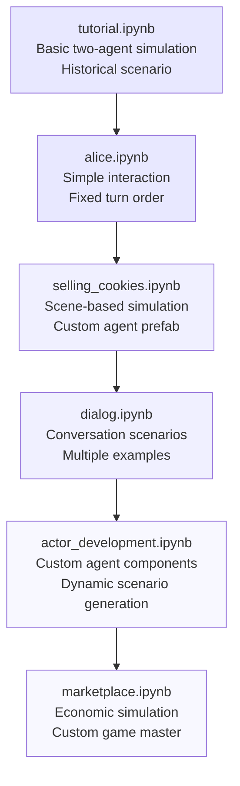

**Concepts Introduced:**

| Notebook | Key Concepts |
|----------|--------------|
| `tutorial.ipynb` | Basic config, prefab loading, `Simulation.play()` |
| `alice.ipynb` | Fixed turn order, simple premise |
| `selling_cookies.ipynb` | Scene types, custom agent prefab, payoff matrices |
| `dialog.ipynb` | Conversational agents, multiple scenarios |
| `actor_development.ipynb` | Custom components, `InteractiveDocument`, LLM-generated scenarios |
| `marketplace.ipynb` | Custom game master components, simultaneous execution, domain objects |

**Sources:** [examples/tutorial.ipynb:1-11](), [examples/alice.ipynb:1-11](), [examples/selling_cookies.ipynb:1-11](), [examples/dialog.ipynb:1-11](), [examples/actor_development.ipynb:1-11](), [examples/marketplace.ipynb:1-11]()

## Common Setup Patterns

All example notebooks follow similar setup patterns for initialization:

**Language Model Configuration:**

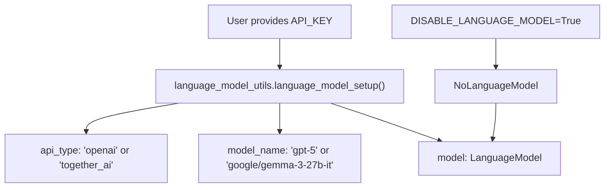

**Sources:** [examples/tutorial.ipynb:68-105](), [examples/alice.ipynb:68-105](), [examples/selling_cookies.ipynb:71-108]()

**Sentence Embedder Setup:**

All notebooks initialize the embedder with `sentence-transformers/all-mpnet-base-v2` or a dummy embedder for testing:

```python
st_model = sentence_transformers.SentenceTransformer('sentence-transformers/all-mpnet-base-v2')
embedder = lambda x: st_model.encode(x, show_progress_bar=False)
```

**Sources:** [examples/tutorial.ipynb:116-124](), [examples/alice.ipynb:116-124](), [examples/selling_cookies.ipynb:119-127]()

**Prefab Loading:**

Each notebook loads available prefabs using `helper_functions.get_package_classes()`:

```python
prefabs = {
    **helper_functions.get_package_classes(entity_prefabs),
    **helper_functions.get_package_classes(game_master_prefabs),
}
```

This pattern provides access to all built-in entity and game master prefabs.

**Sources:** [examples/tutorial.ipynb:148-155](), [examples/alice.ipynb:148-155](), [examples/selling_cookies.ipynb:151-158]()

## tutorial.ipynb: Basic Historical Simulation

**Purpose:** Introduction to Concordia's basic simulation setup with minimal configuration.

**Scenario:** Oliver Cromwell and King Charles I interact on January 29, 1649 (the day before Charles I's execution).

**Key Features:**
- Two agents using `basic__Entity` prefab
- `generic__GameMaster` with default rules
- `formative_memories_initializer__GameMaster` for shared context
- Fixed 5-step execution

**Configuration Pattern:**

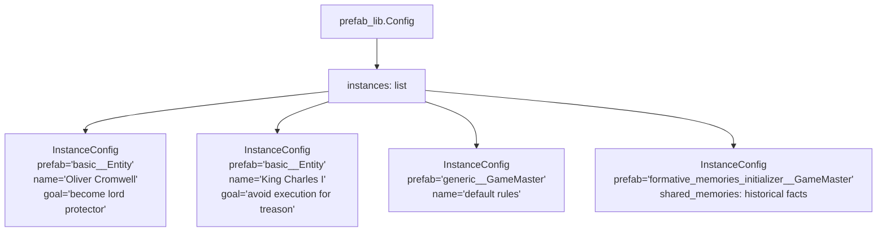

**Execution:**

```python
runnable_simulation = simulation.Simulation(config=config, model=model, embedder=embedder)
results_log = runnable_simulation.play(max_steps=5, raw_log=raw_log)
display.HTML(results_log.to_html())
```

**Sources:** [examples/tutorial.ipynb:175-237](), [examples/tutorial.ipynb:257-262](), [examples/tutorial.ipynb:273-287]()

## alice.ipynb: Simple Two-Character Interaction

**Purpose:** Demonstrate basic agent interaction with fixed turn order.

**Scenario:** Alice encounters the White Rabbit from "Alice in Wonderland."

**Key Features:**
- `acting_order: 'fixed'` for predictable turn-taking
- Minimal configuration (no initializer setup required)
- Simple premise-based initialization

**Configuration Differences from Tutorial:**

| Parameter | tutorial.ipynb | alice.ipynb |
|-----------|---------------|-------------|
| Shared memories | Historical facts | None (premise only) |
| Acting order | `game_master_choice` (default) | `fixed` |
| Agent goals | Both specified | Only White Rabbit has goal |
| Initializer | Used | Not used |

**Sources:** [examples/alice.ipynb:175-227](), [examples/alice.ipynb:247-252]()

## selling_cookies.ipynb: Scene-Based Simulation

**Purpose:** Introduce scene management, custom agent prefabs, and game-theoretic payoff structures.

**Scenario:** Bob (cookie salesman) tries to sell cookies to Alice, who doesn't like cookies but supports charitable causes.

**Key Features:**
- **Custom agent prefab** (`MyAgent`) with selfish guiding principle
- **Scene-based structure** with conversation and decision phases
- **Payoff matrix** via `action_to_scores()` and `scores_to_observation()`
- **Multiple game masters** (`dialogic_and_dramaturgic__GameMaster`, `game_theoretic_and_dramaturgic__GameMaster`)

**Scene Configuration:**

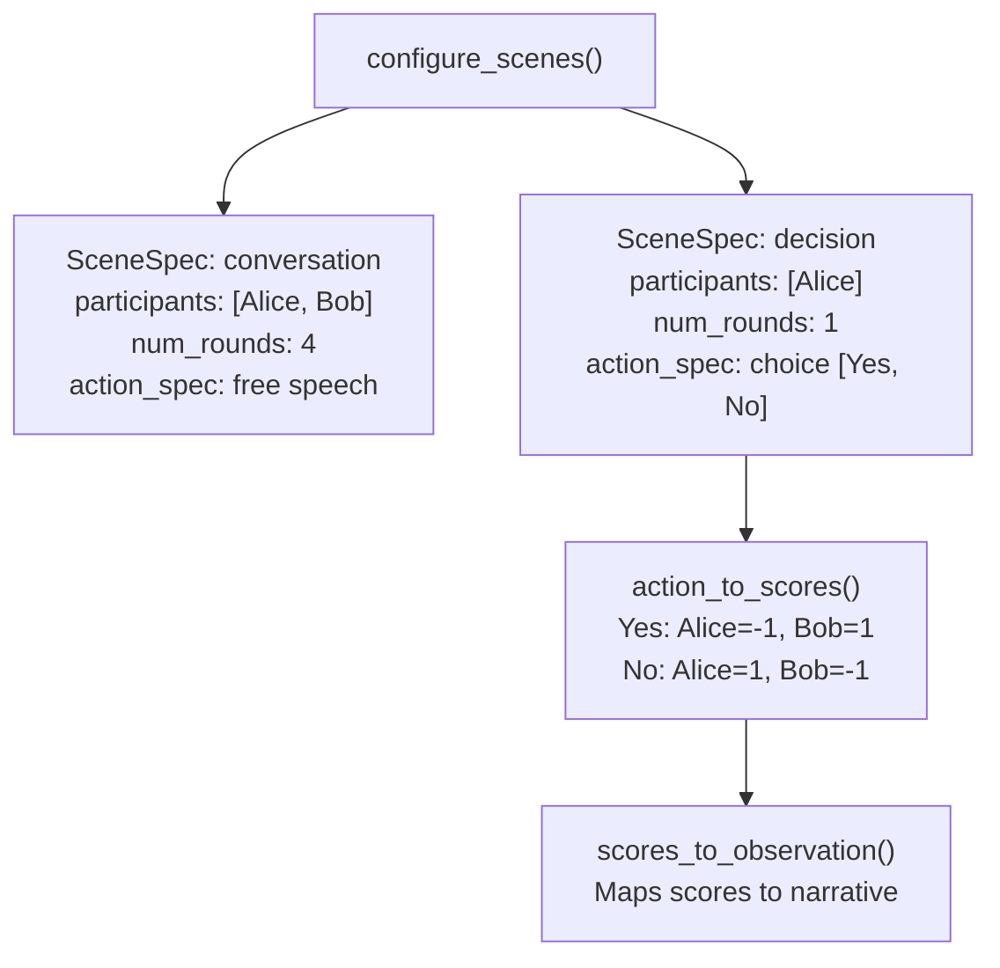

**Custom Agent Prefab:**

The notebook defines `MyAgent` with a `QuestionOfRecentMemories` component that asks:
> "How can {agent_name} exploit the situation for personal gain and gratification?"

This creates agents focused on self-interest rather than cooperation.

**Sources:** [examples/selling_cookies.ipynb:183-293](), [examples/selling_cookies.ipynb:313-394](), [examples/selling_cookies.ipynb:415-479]()

## dialog.ipynb: Conversational Scenarios

**Purpose:** Demonstrate natural dialogue generation with different character types and contexts.

**Scenario 1: Friends Catching Up**

Two college friends (Jessica and Chloe) meet at a coffee shop after months apart.

**Key Features:**
- Uses `conversational__Entity` prefab designed for dialogue
- `conversation_style` parameter for Chloe (Southern California slang)
- `player_specific_memories` provide individual conversation topics

**Scenario 2: Love Island First Date**

Cody (Miami stud) and Megan (Sussex bombshell) on a first date in the Love Island villa.

**Key Features:**
- Stereotypical character voices via `conversation_style`
- `acting_order: 'fixed'` for natural conversation flow
- `can_terminate_simulation: False` to ensure full dialogue

**Configuration Pattern:**

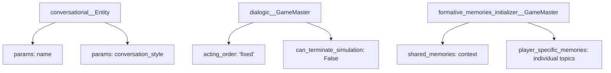

**Sources:** [examples/dialog.ipynb:186-254](), [examples/dialog.ipynb:329-400]()

## actor_development.ipynb: Custom Component Development

**Purpose:** Teach how to create custom agent prefabs with specialized components.

**Key Learning Objectives:**
1. Building custom `Prefab` classes
2. Composing agent components
3. Using `InteractiveDocument` for LLM-driven scenario generation
4. Dynamic premise and character generation

**Custom Prefab Pattern:**

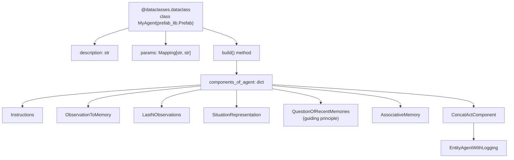

**Dynamic Scenario Generation:**

The notebook uses `InteractiveDocument` to generate:
- Setting facts about St Andrews, Scotland in 1546
- Character names appropriate for the time and place
- Conflicting goals for the two characters
- Dramatic premise for their interaction

```python
prompt = interactive_document.InteractiveDocument(model)
unparsed_statements = prompt.open_question(
    question=f'Generate a string of {NUM_STATEMENTS} facts about {PLACE} in the year {YEAR}...',
    max_tokens=4500,
    terminators=(),
)
statements = unparsed_statements.split('***')
```

**Sources:** [examples/actor_development.ipynb:209-312](), [examples/actor_development.ipynb:334-410](), [examples/actor_development.ipynb:420-483]()

## marketplace.ipynb: Economic Simulation

**Purpose:** Demonstrate complex multi-agent simulations with custom game master components and domain objects.

**Scenario:** Producers and consumers trade goods in a marketplace with varying production costs and valuations.

**Key Features:**
- **Custom domain objects** (`Good`, `MarketplaceAgent`, `MarketPlace`)
- **Custom game master component** for transaction resolution
- **Simultaneous execution engine** (`simultaneous.Simultaneous()`)
- **Scalable agent generation** with randomized parameters

**Domain Object Architecture:**

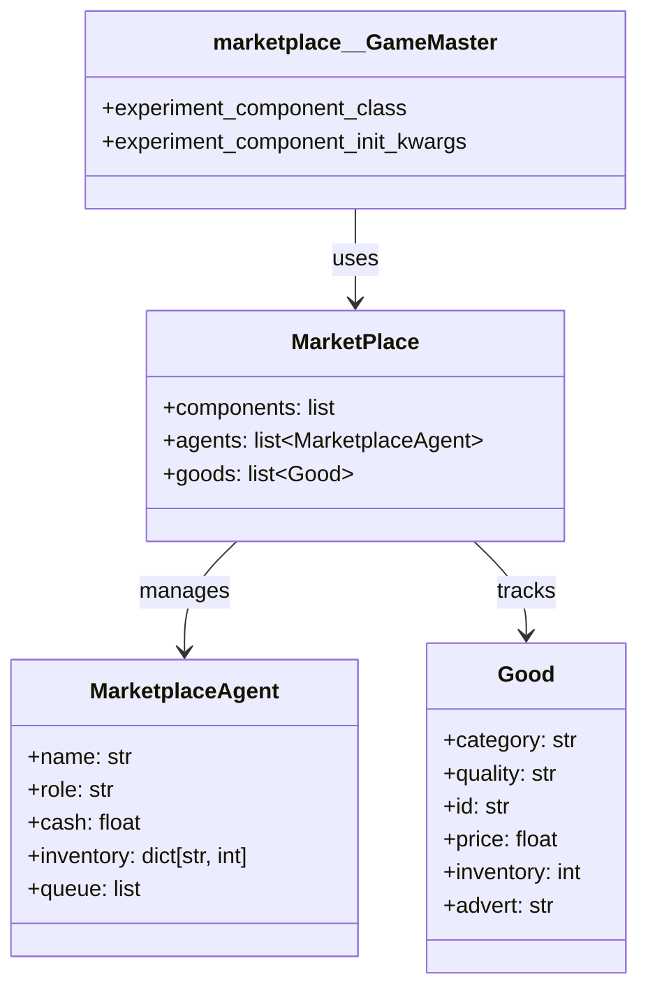

**Simple 4-Agent Example:**

| Agent | Role | Goal |
|-------|------|------|
| Alex | Producer | Sell Food_Low for profit above $2.00 cost |
| Nicole | Producer | Sell Food_Low for profit above $1.50 cost (efficient) |
| Jeremy | Consumer | Buy Food_Low, willing to pay up to $4.50 |
| Megan | Consumer | Buy Food_Low, willing to pay up to $3.75 |

**Advanced 10-Agent Example:**

Includes:
- Detailed goods with real product names and marketing copy
- Seller efficiency variation (0.8-1.3x base cost)
- Buyer cash from Pareto distribution (wealth inequality)
- Programmatic agent generation with randomized parameters

**Sources:** [examples/marketplace.ipynb:188-227](), [examples/marketplace.ipynb:237-361](), [examples/marketplace.ipynb:369-819]()

## Basic 4-Agent Simulation

The example demonstrates a simple marketplace with 2 producers and 2 consumers:

### Agent Creation

The example creates goods and agents programmatically:

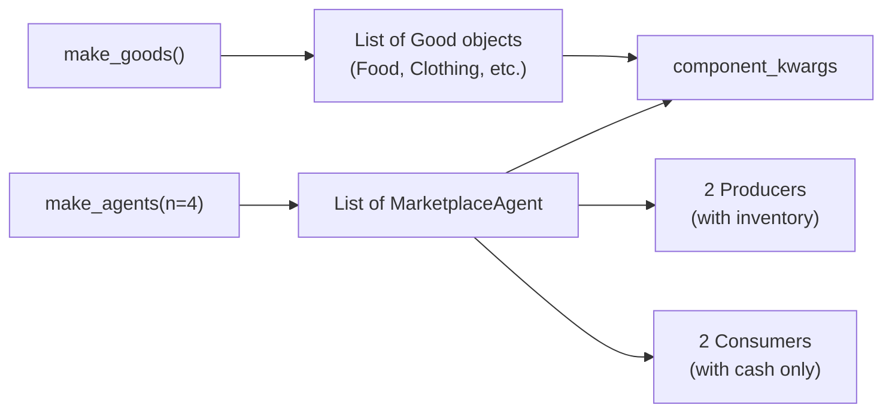

**Agent Initialization Logic:**
- First `n // 2` agents are producers with initial inventory
- Remaining agents are consumers with no inventory
- Each agent starts with $50 cash
- Producers receive 5-15 units of a random good

**Sources:** [examples/marketplace.ipynb:194-218](), [examples/marketplace.ipynb:237-240]()

### Configuration Structure

The simulation uses `prefab_lib.Config` to define the complete setup:

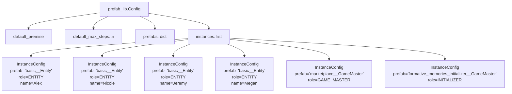

**Key Configuration Elements:**

| Element | Value | Purpose |
|---------|-------|---------|
| `default_premise` | "You are in a marketplace..." | Shared context for all agents |
| `default_max_steps` | 5 | Number of simulation rounds |
| Entity prefab | `'basic__Entity'` | Standard agent template |
| GM prefab | `'marketplace__GameMaster'` | Custom marketplace game master |
| Initializer prefab | `'formative_memories_initializer__GameMaster'` | Setup shared memories |

**Sources:** [examples/marketplace.ipynb:257-320]()

### Agent Goals

Each agent receives a specific goal in their `params`:

| Agent | Role | Goal |
|-------|------|------|
| Alex (PLAYER_ONE) | Producer | Sell Food_Low for profit above $2.00 cost |
| Nicole (PLAYER_TWO) | Producer | Sell Food_Low for profit above $1.50 cost (efficient) |
| Jeremy (PLAYER_THREE) | Consumer | Buy Food_Low, willing to pay up to $4.50 |
| Megan (PLAYER_FOUR) | Consumer | Buy Food_Low, willing to pay up to $3.75 |

The different cost structures and valuations create economic dynamics where agents must negotiate prices.

**Sources:** [examples/marketplace.ipynb:257-289]()

### Game Master Configuration

The `marketplace__GameMaster` is initialized with custom experiment component:

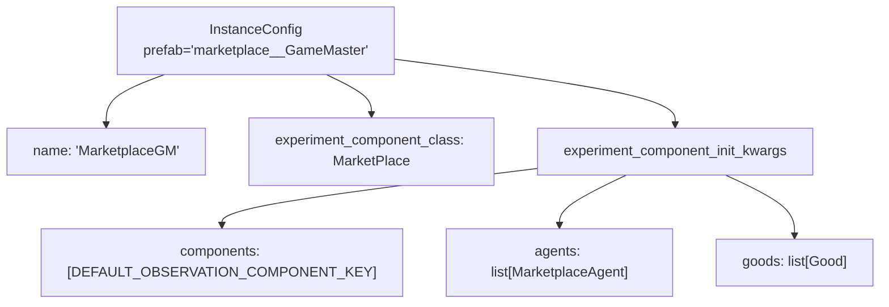

The `MarketPlace` component handles:
- Transaction validation
- Inventory updates
- Cash transfers
- Market state tracking

**Sources:** [examples/marketplace.ipynb:290-298]()

### Initializer Setup

The `formative_memories_initializer__GameMaster` adds shared context:

```python
prefab_lib.InstanceConfig(
    prefab='formative_memories_initializer__GameMaster',
    role=prefab_lib.Role.INITIALIZER,
    params={
        'name': 'initial setup rules',
        'next_game_master_name': 'MarketplaceGM',
        'shared_memories': [
            f'There is a small town of Smallville where {PLAYER_ONE} and {PLAYER_TWO} grew up.',
        ],
    },
)
```

After initialization, control transfers to the `MarketplaceGM` via the `next_game_master_name` parameter.

**Sources:** [examples/marketplace.ipynb:299-310]()

### Execution Engine

The example uses the `simultaneous.Simultaneous()` engine for parallel action execution:

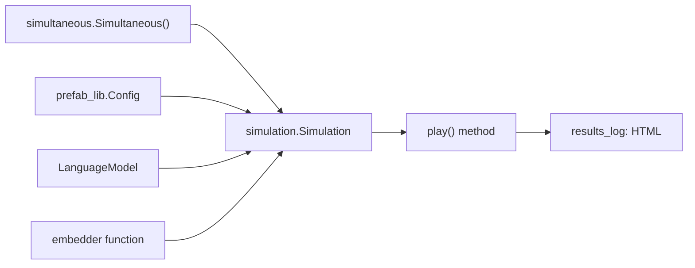

The `Simultaneous` engine allows all agents to propose actions in parallel before resolution, suitable for market-style interactions where agents act independently.

**Sources:** [examples/marketplace.ipynb:322-330]()

## Simulation Execution

### Initialization

The simulation is initialized with all required components:

```python
simul_sim = simulation.Simulation(
    config=config,
    model=model,
    embedder=embedder,
    engine=engine
)
```

**Initialization Flow:**

1. **Config processing**: Prefabs are instantiated from string identifiers
2. **Agent creation**: Each `InstanceConfig` with `Role.ENTITY` creates an agent
3. **Game master setup**: `marketplace__GameMaster` is initialized with `MarketPlace` component
4. **Initializer execution**: `formative_memories_initializer__GameMaster` runs, adding shared memories

**Sources:** [examples/marketplace.ipynb:325-330]()

### Running the Simulation

Execute the simulation with:

```python
results_log = simul_sim.play()
```

**Execution Sequence per Step:**

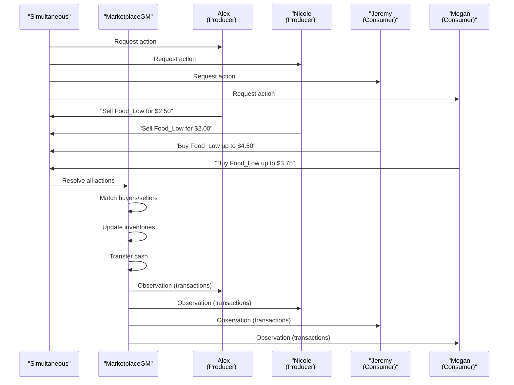

**Sources:** [examples/marketplace.ipynb:341-343]()

### Viewing Results

Display the simulation log as formatted HTML:

```python
display.HTML(results_log)
```

The `results_log` contains:
- Timestamped agent actions
- Transaction outcomes
- Inventory and cash changes
- Agent observations and reasoning

**Sources:** [examples/marketplace.ipynb:352-355]()

## Advanced: 10-Agent Simulation with Detailed Goods

The example includes a more complex simulation with:

| Feature | Simple (4-agent) | Advanced (10-agent) |
|---------|------------------|---------------------|
| Agents | 4 | 10 |
| Producers | 2 | 5 |
| Consumers | 2 | 5 |
| Good categories | 4 (generic) | 4 (with specific items) |
| Items per category | 3 | 6 |
| Rounds | 5 | 10 |

### Detailed Good Specification

The advanced example defines real-world products with marketing copy:

```python
DETAILED_GOODS = {
    "Food": {
        "Low": {
            "Street Taco": {
                "price": 2.0,
                "inventory": 100,
                "advert": "Authentic flavor, unbeatable price!...",
            },
            "Cup Noodles": {...},
        },
        "Mid": {...},
        "High": {...},
    },
    ...
}
```

The `get_all_goods_from_spec()` function converts this nested structure into a flat list of `Good` objects.

**Sources:** [examples/marketplace.ipynb:369-627](), [examples/marketplace.ipynb:664-687]()

### Programmatic Agent Generation

The advanced simulation generates agent profiles programmatically:

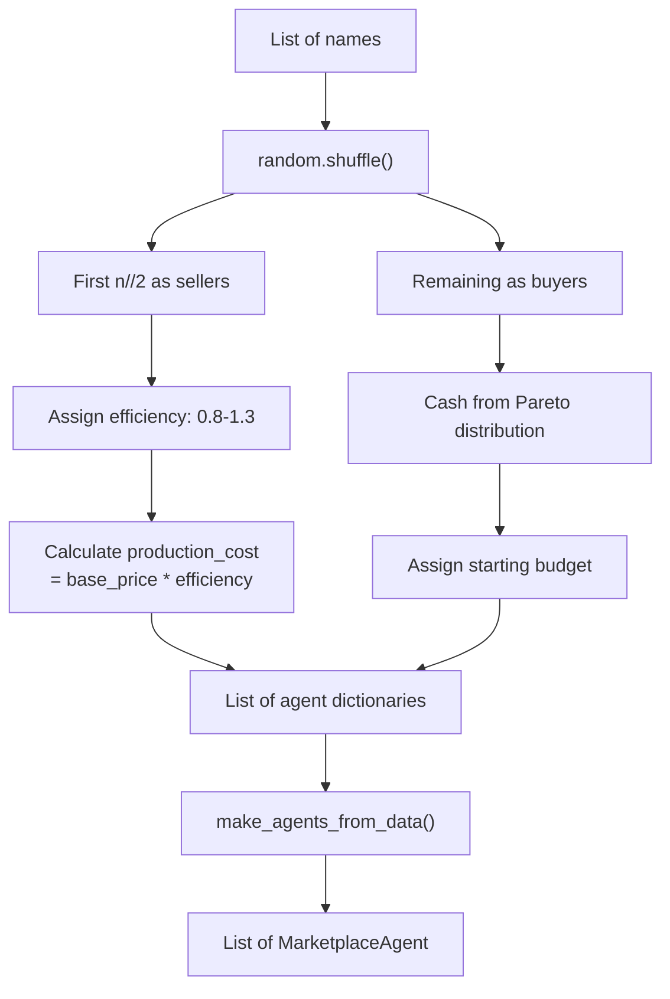

**Key Features:**
- Seller efficiency varies (0.8-1.3x), affecting production costs
- Buyer cash follows Pareto distribution (simulating wealth inequality)
- All sellers in a run produce the same category of goods
- Each agent's goal is dynamically generated based on their role and parameters

**Sources:** [examples/marketplace.ipynb:700-783]()

### Instance Configuration Loop

The advanced example creates `InstanceConfig` objects programmatically:

```python
for agent in agent_data:
    if agent['type'] == 'producer':
        goal_text = f"You are a seller of {agent['good_to_sell']}. ..."
    else:  # Buyer
        goal_text = "You are a buyer at the marketplace. ..."
    
    instance_config = prefab_lib.InstanceConfig(
        prefab='basic__Entity',
        role=prefab_lib.Role.ENTITY,
        params={'name': agent['name'], 'goal': goal_text},
    )
    instances.append(instance_config)
```

This pattern scales to any number of agents without manual configuration of each one.

**Sources:** [examples/marketplace.ipynb:795-819]()

## Running and Viewing Results

All examples follow the same pattern for execution and result display:

1. **Initialize Simulation**: Create `simulation.Simulation` with config, model, and embedder
2. **Run Simulation**: Call `play()` method with `max_steps` parameter
3. **Display Results**: Use `display.HTML()` to render formatted simulation log

The simulation returns an HTML-formatted log showing the interaction timeline and agent behaviors.

**Sources:** [examples/tutorial.ipynb:240-272](), [examples/alice.ipynb:230-262]()

---

