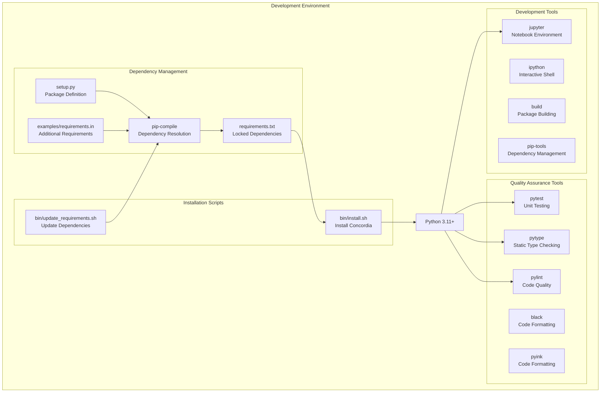
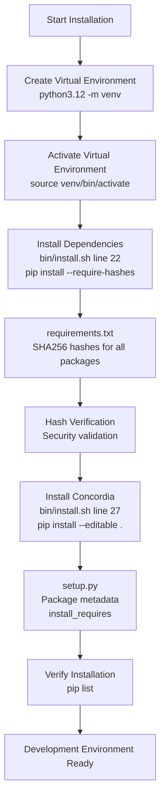
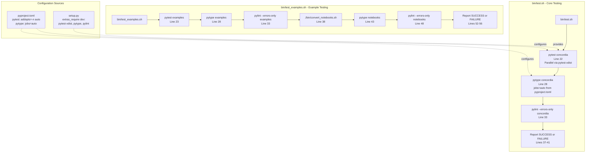
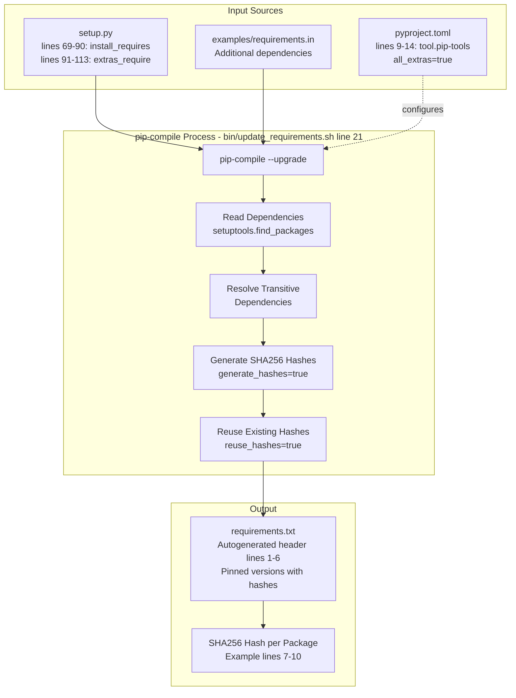

<!-- source: DeepWiki mcp.deepwiki.com · repo google-deepmind/concordia · page 7.1 Development Environment Setup · fetched 2026-10-26 -->

# Development Environment Setup

<details>
<summary>Relevant source files</summary>

The following files were used as context for generating this wiki page:

- [bin/install.sh](bin/install.sh)
- [bin/test.sh](bin/test.sh)
- [bin/test_examples.sh](bin/test_examples.sh)
- [bin/update_requirements.sh](bin/update_requirements.sh)
- [pyproject.toml](pyproject.toml)
- [requirements.txt](requirements.txt)

</details>


This document provides comprehensive guidance for setting up a development environment for the Concordia generative agent simulation system. It covers dependency management, installation procedures, development tools, and quality assurance processes used by contributors to the codebase.

For information about the CI/CD pipeline and automated testing infrastructure, see [CI/CD Pipeline](#6.1). For guidance on launching and configuring simulations, see [Launching Simulations](#4.2).

## Overview

The Concordia development environment is built around Python 3.12+ with a comprehensive set of dependencies managed through `pip-compile` for reproducible builds. The environment includes language model integrations, scientific computing libraries, development tools, and quality assurance utilities. Tool configurations are centralized in `pyproject.toml` following modern Python packaging standards.

**Sources:** [setup.py:68](), [pyproject.toml:1-46]()

## Development Environment Architecture



**Sources:** [requirements.txt:1-8](), [bin/update_requirements.sh:21-22](), [bin/install.sh:21-31]()

## Dependency Categories

The development environment includes several categories of dependencies:

| Category | Key Dependencies | Purpose |
|----------|------------------|---------|
| **Language Models** | `openai`, `google-generativeai`, `anthropic`, `mistral` | LLM integrations for agent behavior |
| **Scientific Computing** | `numpy`, `pandas`, `matplotlib`, `scipy` | Data processing and visualization |
| **Development Tools** | `pytest`, `pytype`, `pylint`, `black` | Code quality and testing |
| **Web/HTTP** | `aiohttp`, `httpx`, `requests` | Network communications |
| **Cloud Services** | `boto3`, `google-cloud-aiplatform` | Cloud platform integrations |
| **Notebook Support** | `jupyter`, `ipykernel`, `nbconvert` | Interactive development |

**Sources:** [requirements.txt:7-600]()

## Installation Process

### Prerequisites

Before setting up the development environment, ensure you have:

- Python 3.12 or later installed (required by [setup.py:68]())
- `pip` and `pip-tools` available
- Git for version control
- Virtual environment tool (recommended: `venv`)

**Sources:** [setup.py:68]()

### Virtual Environment Setup

It is strongly recommended to use a virtual environment for development:

```bash
# Create virtual environment
python3.12 -m venv concordia_env

# Activate virtual environment
# On Linux/macOS:
source concordia_env/bin/activate
# On Windows:
# concordia_env\Scripts\activate

# Upgrade pip
pip install --upgrade pip
```

Once the virtual environment is activated, proceed with installation.

### Core Installation

The primary installation process uses the provided shell script [bin/install.sh:1-32]():

```bash
# Run the installation script
./bin/install.sh
```

This script performs two key steps:

#### 1. Dependency Installation with Hash Verification

```bash
pip install --no-deps --require-hashes --requirement requirements.txt
```

The `--require-hashes` flag enforces cryptographic hash verification for security, as defined in [requirements.txt:1-8](). Each dependency includes SHA256 hashes for integrity verification.

#### 2. Concordia Installation in Editable Mode

```bash
pip install --no-deps --no-index --no-build-isolation --editable .
```

Flags explained:
- `--editable`: Installs in development mode, changes to source files take effect immediately
- `--no-deps`: Dependencies already installed in step 1
- `--no-index`: Use local installation only
- `--no-build-isolation`: Use existing environment dependencies

**Sources:** [bin/install.sh:21-27](), [requirements.txt:1-8]()

### Installing Optional Dependencies

Concordia defines several optional dependency groups in [setup.py:91-113]():

#### Development Tools (`dev` extra)

```bash
pip install gdm-concordia[dev]
```

Includes: `pytest-xdist`, `pytype`, `pylint`, `pyink`, `pip-tools`, `jupyter`, and more.

#### HuggingFace Models (`huggingface` extra)

```bash
pip install gdm-concordia[huggingface]
```

Includes: `torch`, `accelerate`, `sentence-transformers`. Required for `HuggingFaceLanguageModel` ([concordia/language_model/huggingface_model.py:38-199]()).

#### vLLM Inference (`vllm` extra)

```bash
pip install gdm-concordia[vllm]
```

Required for `VLLMLanguageModel` and `VLLMLora` classes ([concordia/language_model/vllm_model.py:73-381]()).

**Sources:** [setup.py:91-113](), [concordia/language_model/huggingface_model.py:17-18](), [concordia/language_model/vllm_model.py:16-46]()

### Development Installation Flow

**Installation Process Executed by bin/install.sh**



**Sources:** [bin/install.sh:18-32](), [setup.py:34-114](), [requirements.txt:1-8]()

## Tool Configuration

Concordia centralizes development tool configuration in `pyproject.toml` following modern Python standards.

### pyproject.toml Configuration

#### Build System Configuration

```toml
[build-system]
requires = ["setuptools>=42"]
build-backend = "setuptools.build_meta"
```

**Sources:** [pyproject.toml:1-3]()

#### Import Sorting (isort)

```toml
[tool.isort]
profile = "google"
known_thirdparty = ["concordia"]
```

Configuration for `isort` to maintain Google-style import ordering.

**Sources:** [pyproject.toml:5-7]()

#### Dependency Management (pip-tools)

```toml
[tool.pip-tools]
allow_unsafe = true
generate_hashes = true
reuse_hashes = true
strip_extras = true
all_extras = true
```

Controls `pip-compile` behavior when updating [requirements.txt:1-8]() via [bin/update_requirements.sh:21]().

**Sources:** [pyproject.toml:9-14]()

#### Code Formatting (pyink)

```toml
[tool.pyink]
line-length = 80
unstable = true
pyink-indentation = 2
pyink-use-majority-quotes = true
```

Configures `pyink` formatter (Google-flavored Black) with 2-space indentation and 80-character line length.

**Sources:** [pyproject.toml:16-29]()

#### Testing (pytest)

```toml
[tool.pytest.ini_options]
required_plugins = ["pytest-xdist"]
addopts = "-n auto"
testpaths = ["concordia", "examples"]
```

Configures `pytest` to use parallel execution via `pytest-xdist` with automatic worker detection.

**Sources:** [pyproject.toml:31-34]()

#### Static Type Checking (pytype)

```toml
[tool.pytype]
inputs = ["concordia", "examples"]
keep_going = true
jobs = "auto"
use_enum_overlay = true
```

Configures `pytype` for parallel type checking with automatic job count.

**Sources:** [pyproject.toml:36-45]()

## Development Tools

### Code Quality Tools

The development environment includes comprehensive code quality tools configured via [pyproject.toml:1-46]():

#### Testing Framework

- **pytest**: Unit and integration testing with parallel execution ([pyproject.toml:31-34]())
- **pytest-xdist**: Distributed test execution across CPUs
- **Coverage**: Test coverage measurement
- **Parameterized testing**: For comprehensive test scenarios

#### Static Analysis

- **pytype**: Static type checking and inference ([pyproject.toml:36-45]())
  - Parallel execution with `jobs = "auto"`
  - Analyzes `concordia` and `examples` directories
  - Uses enhanced enum checking with `use_enum_overlay = true`
- **pylint**: Code quality and style checking
  - Used in [bin/test.sh:33]() and [bin/test_examples.sh:33]()
  - Error-only mode for CI: `pylint --errors-only`

#### Code Formatting

- **pyink**: Google-style code formatter ([pyproject.toml:16-29]())
  - 2-space indentation (`pyink-indentation = 2`)
  - 80-character line length
  - Majority quotes style
- **isort**: Import statement sorting ([pyproject.toml:5-7]())
  - Google profile for import ordering

**Sources:** [pyproject.toml:1-46](), [setup.py:93-103](), [bin/test.sh:22-35]()

### Testing Infrastructure

**Test Script Execution Flow**



**Sources:** [bin/test.sh:18-41](), [bin/test_examples.sh:18-56](), [pyproject.toml:31-45](), [setup.py:93-103]()

## Dependency Management

### Pip-Compile Workflow

The project uses `pip-compile` (from `pip-tools`) for deterministic dependency resolution. Configuration is in [pyproject.toml:9-14]():

```toml
[tool.pip-tools]
allow_unsafe = true
generate_hashes = true
reuse_hashes = true
strip_extras = true
all_extras = true
```

The [bin/update_requirements.sh:21]() script executes:

```bash
pip-compile --upgrade setup.py examples/requirements.in
```

This command:
1. Reads dependencies from [setup.py:69-90]() (core) and [setup.py:91-113]() (extras)
2. Reads additional requirements from `examples/requirements.in`
3. Resolves all dependencies transitively
4. Generates [requirements.txt:1-8]() with SHA256 hashes

Key features from `pyproject.toml`:
- **generate_hashes**: SHA256 hashes for all dependencies ([requirements.txt:7-10]())
- **reuse_hashes**: Maintains existing hashes when versions unchanged
- **strip_extras**: Removes extra requirement markers from output
- **allow_unsafe**: Permits `setuptools` and `pip` in requirements
- **all_extras**: Includes all extras (`dev`, `huggingface`, `vllm`)

**Sources:** [bin/update_requirements.sh:21](), [pyproject.toml:9-14](), [setup.py:69-113](), [requirements.txt:1-8]()

### Dependency Resolution Process

**pip-compile Execution via bin/update_requirements.sh**



**Sources:** [bin/update_requirements.sh:21](), [pyproject.toml:9-14](), [setup.py:69-113](), [requirements.txt:1-10]()

## Quality Assurance Pipeline

### Test Execution

The development environment includes two main test suites:

#### Core Testing (`bin/test.sh`)

1. **pytest concordia**: Executes unit and integration tests
2. **pytype concordia**: Performs static type analysis
3. **pylint concordia**: Checks code quality and style

#### Example Testing (`bin/test_examples.sh`)

1. **pytest examples**: Tests example implementations
2. **pytype examples**: Type checks examples
3. **pylint examples**: Quality checks examples
4. **convert notebooks**: Processes Jupyter notebooks
5. **test notebooks**: Validates notebook code

**Sources:** [bin/test.sh:22-41](), [bin/test_examples.sh:22-56]()

### Error Handling and Reporting

Both test scripts implement comprehensive error handling:

```bash
FAILURES=false
pytest concordia || FAILURES=true
pytype concordia || FAILURES=true
pylint --errors-only concordia || FAILURES=true

if "${FAILURES}"; then
  echo -e '\033[0;31mFAILURE\033[0m' && exit 1
else
  echo -e '\033[0;32mSUCCESS\033[0m'
fi
```

**Sources:** [bin/test.sh:20-41](), [bin/test_examples.sh:20-56]()

## Development Workflow

### Setting Up a New Development Environment

1. **Clone the repository**:
   ```bash
   git clone https://github.com/google-deepmind/concordia
   cd concordia
   ```

2. **Create and activate virtual environment**:
   ```bash
   python3.12 -m venv concordia_env
   source concordia_env/bin/activate  # On Linux/macOS
   # concordia_env\Scripts\activate  # On Windows
   ```

3. **Run installation script**:
   ```bash
   ./bin/install.sh
   ```
   This executes [bin/install.sh:21-27]() which installs dependencies with hash verification and Concordia in editable mode.

4. **Install optional extras** (if needed):
   ```bash
   pip install -e ".[dev]"  # Development tools
   pip install -e ".[huggingface]"  # For HuggingFaceLanguageModel
   pip install -e ".[vllm]"  # For VLLMLanguageModel
   ```

5. **Verify installation**:
   ```bash
   pip list
   python -c "import concordia; print(concordia.__file__)"
   ```

6. **Run tests**:
   ```bash
   ./bin/test.sh  # Core tests
   ./bin/test_examples.sh  # Example tests
   ```

**Sources:** [bin/install.sh:18-32](), [setup.py:91-113](), [bin/test.sh:18-41]()

### Updating Dependencies

1. **Modify requirements**:
   - Edit [setup.py:69-90]() for core dependencies
   - Edit [setup.py:91-113]() for optional extras
   - Edit `examples/requirements.in` for example-specific dependencies

2. **Run update script**:
   ```bash
   ./bin/update_requirements.sh
   ```
   This executes `pip-compile` ([bin/update_requirements.sh:21]()) with configuration from [pyproject.toml:9-14]().

3. **Review changes**:
   ```bash
   git diff requirements.txt
   ```
   Check that new hashes are generated and versions are appropriate.

4. **Test changes**:
   ```bash
   ./bin/install.sh  # Reinstall with new requirements
   ./bin/test.sh  # Run core tests
   ./bin/test_examples.sh  # Run example tests
   ```

5. **Commit changes**:
   ```bash
   git add setup.py requirements.txt examples/requirements.in
   git commit -m "Update dependencies"
   ```

**Sources:** [bin/update_requirements.sh:18-22](), [pyproject.toml:9-14](), [setup.py:69-113]()

### Development Best Practices

- **Use editable installs**: Install Concordia with `--editable` flag
- **Run tests frequently**: Execute tests before committing changes
- **Check type annotations**: Use `pytype` for static type checking
- **Maintain code quality**: Use `pylint` and `black` for consistent style
- **Hash verification**: Always use `--require-hashes` for production installs

**Sources:** [bin/install.sh:26-27](), [bin/update_requirements.sh:21-22]()

---

