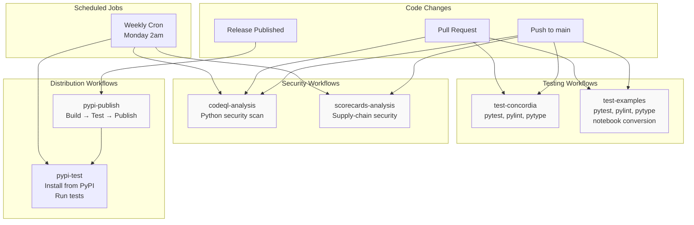
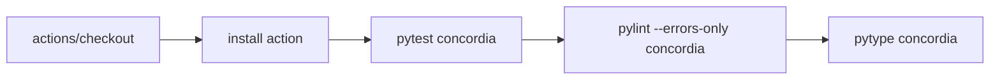
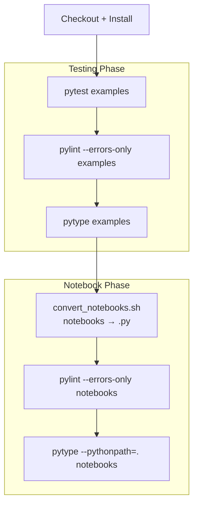
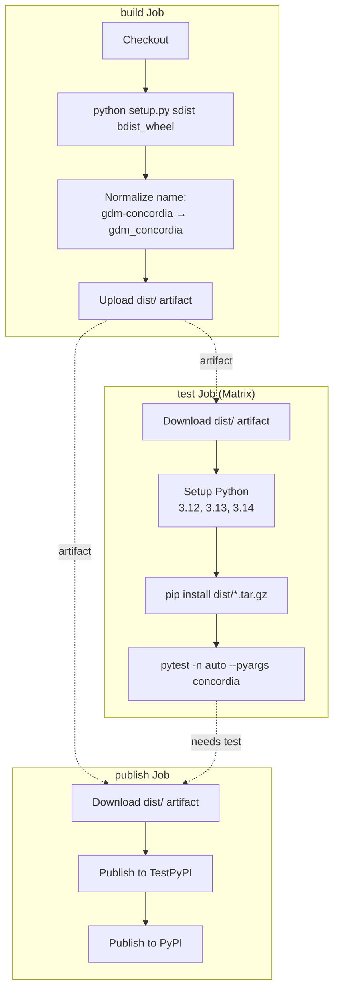
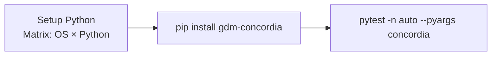
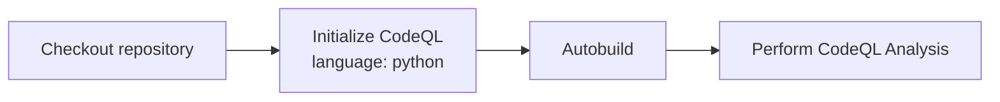
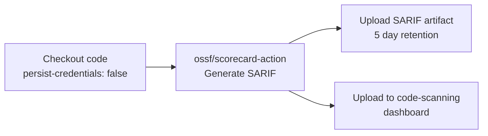
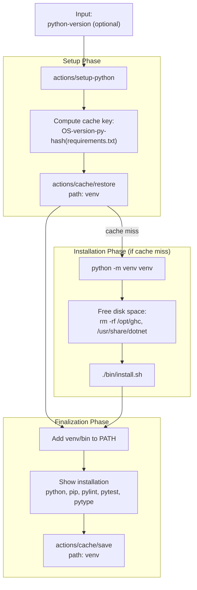
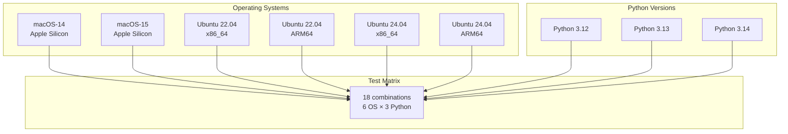
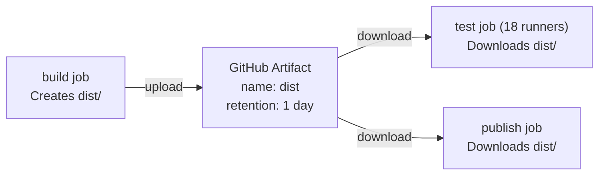

<!-- source: DeepWiki mcp.deepwiki.com · repo google-deepmind/concordia · page 7.2 CI/CD Pipeline · fetched 2026-10-26 -->

# CI/CD Pipeline

<details>
<summary>Relevant source files</summary>

The following files were used as context for generating this wiki page:

- [.github/actions/install/action.yml](.github/actions/install/action.yml)
- [.github/workflows/codeql-analysis.yml](.github/workflows/codeql-analysis.yml)
- [.github/workflows/pypi-publish.yml](.github/workflows/pypi-publish.yml)
- [.github/workflows/pypi-test.yml](.github/workflows/pypi-test.yml)
- [.github/workflows/scorecards-analysis.yml](.github/workflows/scorecards-analysis.yml)
- [.github/workflows/test-concordia.yml](.github/workflows/test-concordia.yml)
- [.github/workflows/test-examples.yml](.github/workflows/test-examples.yml)

</details>


## Purpose and Scope

This document describes the CI/CD (Continuous Integration/Continuous Deployment) infrastructure for the Concordia library. The pipeline consists of GitHub Actions workflows that automate testing, security analysis, and package distribution. Coverage includes workflow configurations, testing strategies, security scanning, and the PyPI publishing process.

For information about local development setup and running tests manually, see [Development Environment Setup](#6.1). For package configuration and dependency management, see [Project Configuration](#4.1).

---

## Workflow Overview

The CI/CD pipeline consists of six primary workflows and one reusable action:

| Workflow | File | Triggers | Purpose |
|----------|------|----------|---------|
| `test-concordia` | `.github/workflows/test-concordia.yml` | Push/PR to main | Core library testing, linting, and type checking |
| `test-examples` | `.github/workflows/test-examples.yml` | Push/PR to main | Examples and notebook validation |
| `pypi-publish` | `.github/workflows/pypi-publish.yml` | Release publication, manual dispatch | Build, test, and publish to PyPI |
| `pypi-test` | `.github/workflows/pypi-test.yml` | Weekly schedule, after pypi-publish | Validate PyPI distributions |
| `codeql-analysis` | `.github/workflows/codeql-analysis.yml` | Push/PR to main, weekly schedule | CodeQL security scanning |
| `scorecards-analysis` | `.github/workflows/scorecards-analysis.yml` | Push to main, weekly schedule | OSSF Scorecard supply-chain analysis |

**Sources:** [.github/workflows/test-concordia.yml:1-56](), [.github/workflows/test-examples.yml:1-70](), [.github/workflows/pypi-publish.yml:1-116](), [.github/workflows/pypi-test.yml:1-77](), [.github/workflows/codeql-analysis.yml:1-63](), [.github/workflows/scorecards-analysis.yml:1-63]()

---

## Workflow Architecture



**Workflow Trigger Relationships**

This diagram shows how different events trigger various workflows. Code changes (pushes and PRs) trigger testing and security workflows. Release publication initiates the distribution pipeline. Weekly scheduled jobs provide continuous validation.

**Sources:** [.github/workflows/test-concordia.yml:3-29](), [.github/workflows/test-examples.yml:3-33](), [.github/workflows/pypi-publish.yml:5-8](), [.github/workflows/pypi-test.yml:5-28](), [.github/workflows/codeql-analysis.yml:3-10](), [.github/workflows/scorecards-analysis.yml:2-8]()

---

## Core Testing Workflow (test-concordia)

The `test-concordia` workflow validates the core library through three quality gates:



**Testing Pipeline for Core Library**

**Workflow Configuration:**

| Property | Value |
|----------|-------|
| Runner | `ubuntu-latest` |
| Concurrency | Cancels previous runs for same branch |
| Path Triggers | `.github/actions/install/action.yml`, `.github/workflows/test-concordia.yml`, `.pylintrc`, `bin/install.sh`, `concordia/**`, `pyproject.toml`, `requirements.txt`, `setup.py` |

**Test Execution Steps:**

1. **Checkout** - Uses `actions/checkout@1af3b93b6815bc44a9784bd300feb67ff0d1eeb3` with pinned SHA
2. **Install** - Delegates to `./.github/actions/install` (see [Reusable Installation Action](#reusable-installation-action))
3. **Test** - Runs `pytest concordia` to execute all tests in the library
4. **Lint** - Runs `pylint --errors-only concordia` to detect code quality issues
5. **Typecheck** - Runs `pytype concordia` for static type analysis

**Sources:** [.github/workflows/test-concordia.yml:1-56]()

---

## Examples and Notebooks Workflow (test-examples)

The `test-examples` workflow validates examples and Jupyter notebooks:



**Examples and Notebook Validation Pipeline**

**Workflow Configuration:**

| Property | Value |
|----------|-------|
| Runner | `ubuntu-latest` |
| Timeout | 90 minutes |
| Path Triggers | Includes `examples/**`, notebook conversion scripts |

**Notebook Conversion:**

The workflow converts Jupyter notebooks to Python scripts using `./bin/convert_notebooks.sh notebooks` [.github/workflows/test-examples.yml:63](), enabling static analysis tools (pylint, pytype) to validate notebook code. The conversion output is stored in the `notebooks` directory.

**Sources:** [.github/workflows/test-examples.yml:1-70]()

---

## PyPI Publishing Workflow (pypi-publish)

The `pypi-publish` workflow orchestrates the complete package distribution lifecycle through three jobs:



**PyPI Publication Pipeline with Three-Job Architecture**

**Job 1: Build** [.github/workflows/pypi-publish.yml:13-39]()

Creates source distribution (sdist) and wheel:
- Runs `python setup.py sdist bdist_wheel` [.github/workflows/pypi-publish.yml:27]()
- Normalizes package name from `gdm-concordia` to `gdm_concordia` [.github/workflows/pypi-publish.yml:29-32]()
- Uploads `dist/` directory as artifact with 1-day retention [.github/workflows/pypi-publish.yml:35-39]()

**Job 2: Test** [.github/workflows/pypi-publish.yml:41-84]()

Tests distribution across multiple platforms:

| Matrix Dimension | Values |
|------------------|--------|
| Operating Systems | `macos-14`, `macos-15`, `ubuntu-22.04`, `ubuntu-22.04-arm`, `ubuntu-24.04`, `ubuntu-24.04-arm` |
| Python Versions | `3.12`, `3.13`, `3.14` |
| Total Combinations | 18 (6 OS × 3 Python versions) |

Test steps:
- Downloads artifact [.github/workflows/pypi-publish.yml:63-67]()
- Installs from source distribution: `pip install dist/*.tar.gz` [.github/workflows/pypi-publish.yml:77-78]()
- Runs parallel tests: `pytest -n auto --pyargs concordia` [.github/workflows/pypi-publish.yml:83-84]()
- Validates dependencies: `pip check` [.github/workflows/pypi-publish.yml:80]()

**Job 3: Publish** [.github/workflows/pypi-publish.yml:86-115]()

Publishes to PyPI using OIDC authentication:
- Requires `build` success and `test` non-failure [.github/workflows/pypi-publish.yml:88-89]()
- Uses `id-token: write` permission for trusted publishing [.github/workflows/pypi-publish.yml:94-95]()
- Publishes to TestPyPI first [.github/workflows/pypi-publish.yml:103-109]()
- Publishes to production PyPI [.github/workflows/pypi-publish.yml:110-115]()
- Uses `pypa/gh-action-pypi-publish@ed0c53931b1dc9bd32cbe73a98c7f6766f8a527e` [.github/workflows/pypi-publish.yml:105,112]()

**Conditional Execution:**

The workflow only runs when:
- A GitHub release is published [.github/workflows/pypi-publish.yml:6-7]()
- Manually triggered via `workflow_dispatch` [.github/workflows/pypi-publish.yml:8]()
- For release events, the ref must start with `refs/tags/v` [.github/workflows/pypi-publish.yml:15]()

**Sources:** [.github/workflows/pypi-publish.yml:1-116]()

---

## PyPI Distribution Testing (pypi-test)

The `pypi-test` workflow validates published packages by installing from PyPI and running the test suite:



**PyPI Installation Validation Pipeline**

**Trigger Conditions:**

- Weekly schedule: Monday at 2am UTC [.github/workflows/pypi-test.yml:6-7]()
- After successful `pypi-publish` workflow completion [.github/workflows/pypi-test.yml:18-22]()
- Manual dispatch with optional version specification [.github/workflows/pypi-test.yml:23-28]()

**Test Matrix:**

| Dimension | Values |
|-----------|--------|
| OS | `macos-14`, `macos-15`, `ubuntu-22.04`, `ubuntu-22.04-arm`, `ubuntu-24.04`, `ubuntu-24.04-arm` |
| Python | `3.12`, `3.13`, `3.14` |
| Fail-fast | Disabled [.github/workflows/pypi-test.yml:41]() |

**Installation Step:**

```bash
VERSION="${{github.event.inputs.version}}"
pip install "gdm-concordia${VERSION:+==$VERSION}"
```

This allows testing specific versions via manual dispatch or installing the latest version by default [.github/workflows/pypi-test.yml:68-69]().

**Sources:** [.github/workflows/pypi-test.yml:1-77]()

---

## Security Analysis Workflows

### CodeQL Analysis (codeql-analysis)

CodeQL performs semantic code analysis to detect security vulnerabilities:



**CodeQL Security Scanning Pipeline**

**Configuration:**

| Property | Value |
|----------|-------|
| Runner | `ubuntu-latest` |
| Language | Python [.github/workflows/codeql-analysis.yml:27]() |
| Triggers | Push/PR to main, Thursday 1:36pm UTC weekly [.github/workflows/codeql-analysis.yml:3-10]() |
| Permissions | `actions: read`, `contents: read`, `security-events: write` [.github/workflows/codeql-analysis.yml:19-22]() |

**Analysis Process:**

1. Uses `github/codeql-action/init@fdbfb4d2750291e159f0156def62b853c2798ca2` [.github/workflows/codeql-analysis.yml:35]()
2. Runs autobuild via `github/codeql-action/autobuild@fdbfb4d2750291e159f0156def62b853c2798ca2` [.github/workflows/codeql-analysis.yml:49]()
3. Performs analysis via `github/codeql-action/analyze@fdbfb4d2750291e159f0156def62b853c2798ca2` [.github/workflows/codeql-analysis.yml:62]()
4. Results uploaded to GitHub Security tab

**Sources:** [.github/workflows/codeql-analysis.yml:1-63]()

### OSSF Scorecard Analysis (scorecards-analysis)

Scorecard evaluates supply-chain security practices:



**OSSF Scorecard Supply-Chain Security Pipeline**

**Configuration:**

| Property | Value |
|----------|-------|
| Runner | `ubuntu-latest` |
| Triggers | Push to main, Sunday 10:17am UTC weekly, branch protection changes [.github/workflows/scorecards-analysis.yml:2-8]() |
| Permissions | `security-events: write`, `id-token: write`, `contents: read`, `actions: read` [.github/workflows/scorecards-analysis.yml:17-24]() |
| Results Format | SARIF (Security Alerts in Report Interchange Format) [.github/workflows/scorecards-analysis.yml:36]() |

**Analysis Execution:**

Uses `ossf/scorecard-action@4eaacf0543bb3f2c246792bd56e8cdeffafb205a` [.github/workflows/scorecards-analysis.yml:33]() to evaluate:
- Branch protection settings
- Dependency update automation
- Code review practices
- Pinned dependencies
- Binary artifact presence
- Security policy availability

**Output Handling:**

- SARIF artifact retained for 5 days [.github/workflows/scorecards-analysis.yml:56]()
- Results uploaded to GitHub Code Scanning dashboard [.github/workflows/scorecards-analysis.yml:59-62]()
- Public repositories receive published scores [.github/workflows/scorecards-analysis.yml:47]()

**Sources:** [.github/workflows/scorecards-analysis.yml:1-63]()

---

## Reusable Installation Action

The `.github/actions/install` composite action provides standardized environment setup with caching:



**Reusable Installation Action Architecture**

**Cache Key Construction:**

The cache key ensures environment reproducibility [.github/actions/install/action.yml:24-37]():

```
{OS name}-{OS version}-py{Python version}-{requirements.txt hash}
```

Example: `Ubuntu-22.04-py3.12-abc123def456`

**Cache Strategy:**

| Scenario | Behavior |
|----------|----------|
| Cache hit | Restore `venv`, activate, show installation |
| Cache miss | Create venv, install dependencies, save cache |
| Cache retention | Indefinite (until evicted by GitHub's cache policies) |

**Disk Space Optimization:**

On cache miss, the action frees disk space on Linux runners [.github/actions/install/action.yml:57-64]():
- Removes `/opt/ghc` (Haskell compiler)
- Removes `/usr/share/dotnet` (dotnet SDK)
- Removes `/usr/local/share/boost` (C++ libraries)

This addresses GitHub Actions runner disk space issues documented in [github.com/actions/runner-images/issues/9344](https://github.com/actions/runner-images/issues/9344).

**Installation Validation:**

After installation, the action displays versions [.github/actions/install/action.yml:72-85]():
- `python --version`
- `pip --version`
- `pylint --version`
- `pytest --version`
- `pytype --version`
- `pip list`

**Outputs:**

The action exposes a `key` output containing the computed cache key [.github/actions/install/action.yml:11-13](), enabling downstream jobs to reference the same cached environment.

**Sources:** [.github/actions/install/action.yml:1-93]()

---

## Workflow Triggers and Path Filters

Workflows use path-based triggers to avoid unnecessary runs:

| Workflow | Triggered Paths |
|----------|----------------|
| `test-concordia` | `.github/actions/install/action.yml`, `.github/workflows/test-concordia.yml`, `.pylintrc`, `bin/install.sh`, `concordia/**`, `pyproject.toml`, `requirements.txt`, `setup.py` [.github/workflows/test-concordia.yml:7-28]() |
| `test-examples` | Above paths + `.github/workflows/test-examples.yml`, `bin/convert_notebooks.sh`, `examples/**` [.github/workflows/test-examples.yml:7-32]() |
| `pypi-publish` | Release publication only (path filters not applicable) [.github/workflows/pypi-publish.yml:5-8]() |
| `pypi-test` | `.github/workflows/pypi-test.yml` [.github/workflows/pypi-test.yml:11-17]() |
| `codeql-analysis` | All pushes/PRs to main (no path filter) [.github/workflows/codeql-analysis.yml:4-8]() |
| `scorecards-analysis` | All pushes to main (no path filter) [.github/workflows/scorecards-analysis.yml:7-8]() |

**Concurrency Control:**

Testing workflows use concurrency groups to cancel previous runs [.github/workflows/test-concordia.yml:31-33]():

```yaml
concurrency:
  group: ${{ github.workflow }}-${{ github.head_ref || github.ref }}
  cancel-in-progress: true
```

This prevents resource waste when multiple commits are pushed rapidly to the same branch.

**Sources:** [.github/workflows/test-concordia.yml:31-33](), [.github/workflows/test-examples.yml:31-37]()

---

## Testing Strategy

### Parallel Test Execution

All workflows use `pytest-xdist` for parallel test execution:

```bash
pytest -n auto --pyargs concordia
```

The `-n auto` flag automatically detects available CPU cores and distributes tests across workers [.github/workflows/test-concordia.yml:49](), [.github/workflows/pypi-publish.yml:84](), [.github/workflows/pypi-test.yml:76]().

### Test Coverage Scope

| Workflow | Test Target | Parallelism |
|----------|-------------|-------------|
| `test-concordia` | `pytest concordia` | CPU auto-detection |
| `test-examples` | `pytest examples` | CPU auto-detection |
| `pypi-publish` (test job) | `pytest -n auto --pyargs concordia` | CPU auto-detection |
| `pypi-test` | `pytest -n auto --pyargs concordia` | CPU auto-detection |

### Linting and Type Checking

All testing workflows apply three quality gates:

1. **pytest** - Unit and integration tests
2. **pylint** - Code quality and style (`--errors-only` flag for workflows)
3. **pytype** - Static type analysis

The `--errors-only` flag for pylint in CI [.github/workflows/test-concordia.yml:52]() prevents warnings from failing builds while catching actual errors.

**Sources:** [.github/workflows/test-concordia.yml:48-55](), [.github/workflows/test-examples.yml:53-69](), [.github/workflows/pypi-publish.yml:82-84](), [.github/workflows/pypi-test.yml:74-76]()

---

## Security Hardening

### Action Version Pinning

All workflows pin GitHub Actions to specific commit SHAs for supply-chain security:

```yaml
- uses: actions/checkout@1af3b93b6815bc44a9784bd300feb67ff0d1eeb3
- uses: actions/setup-python@83679a892e2d95755f2dac6acb0bfd1e9ac5d548
- uses: actions/upload-artifact@330a01c490aca151604b8cf639adc76d48f6c5d4
- uses: actions/download-artifact@018cc2cf5baa6db3ef3c5f8a56943fffe632ef53
```

SHA pinning prevents malicious updates to action dependencies.

### Permission Scoping

Workflows declare minimal required permissions [.github/workflows/pypi-publish.yml:10]():

```yaml
permissions: read-all  # Default
```

Individual jobs escalate permissions only when necessary:

```yaml
permissions:
  id-token: write  # For OIDC authentication (pypi-publish)
  security-events: write  # For uploading SARIF results (codeql, scorecard)
```

### Credential Management

The `pypi-publish` workflow uses OpenID Connect (OIDC) trusted publishing instead of API tokens:
- No secrets required in repository [.github/workflows/pypi-publish.yml:94-95]()
- Short-lived tokens issued by GitHub Actions
- Scoped to specific workflow and environment

The installation action disables credential persistence [.github/actions/install/action.yml:30]():

```yaml
persist-credentials: false
```

**Sources:** [.github/workflows/pypi-publish.yml:10,94-95](), [.github/workflows/codeql-analysis.yml:12-13,19-22](), [.github/workflows/scorecards-analysis.yml:11,17-24](), [.github/actions/install/action.yml:30]()

---

## Environment Matrix Coverage

The distribution workflows test across comprehensive platform combinations:



**Platform Coverage for Distribution Testing**

**Platform Rationale:**

| Platform | Purpose |
|----------|---------|
| macOS-14, macOS-15 | Apple Silicon (M1/M2/M3) validation |
| ubuntu-22.04, ubuntu-24.04 | Latest LTS and current Ubuntu releases |
| ARM variants | ARM64 architecture support (cloud providers, edge devices) |

**Environment Variable:**

Both distribution workflows set `SYSTEM_VERSION_COMPAT: 0` [.github/workflows/pypi-publish.yml:46](), [.github/workflows/pypi-test.yml:38]() to work around macOS Python version detection issues documented in [github.com/actions/setup-python/issues/279](https://github.com/actions/setup-python/issues/279).

**Sources:** [.github/workflows/pypi-publish.yml:44-61](), [.github/workflows/pypi-test.yml:36-53]()

---

## Artifact Management

The `pypi-publish` workflow uses GitHub Actions artifacts for inter-job data transfer:



**Artifact-Based Job Coordination**

**Upload Configuration:**

```yaml
- uses: actions/upload-artifact@330a01c490aca151604b8cf639adc76d48f6c5d4
  with:
    name: dist
    path: ./dist
    retention-days: 1
```

The 1-day retention [.github/workflows/pypi-publish.yml:39]() minimizes storage costs while allowing workflow reruns.

**Download Configuration:**

```yaml
- uses: actions/download-artifact@018cc2cf5baa6db3ef3c5f8a56943fffe632ef53
  with:
    name: dist
    path: ./dist
```

Both `test` and `publish` jobs download the same artifact [.github/workflows/pypi-publish.yml:64-67,99-102](), ensuring all jobs test and publish the exact same distributions built by the `build` job.

**Sources:** [.github/workflows/pypi-publish.yml:34-39,63-67,98-102]()

---

## Workflow Dependencies and Conditional Execution

### Job Dependencies

The `pypi-publish` workflow uses `needs` to enforce job ordering:

```yaml
jobs:
  build:
    # Builds distributions
  
  test:
    needs: build  # Runs after build completes
  
  publish:
    needs: [build, test]  # Runs after both complete
    if: always() && needs.build.result == 'success' && needs.test.result != 'failure'
```

The conditional logic [.github/workflows/pypi-publish.yml:89]() allows publishing even if some test matrix jobs are skipped (e.g., cancelled), but prevents publishing if the build fails or any test explicitly fails.

### Conditional Publishing

Publishing only occurs for actual releases:

```yaml
- name: Publish to TestPyPI
  if: github.event_name == 'release'  # Skip for manual dispatch
  
- name: Publish to PyPI
  if: github.event_name == 'release'  # Skip for manual dispatch
```

This allows manual workflow runs for testing the build/test process without publishing [.github/workflows/pypi-publish.yml:104,111]().

**Sources:** [.github/workflows/pypi-publish.yml:88-89,104,111]()

---

## Timeout Configuration

Workflows specify maximum execution times to prevent hung jobs:

| Workflow | Job | Timeout |
|----------|-----|---------|
| `pypi-publish` | build | 20 minutes [.github/workflows/pypi-publish.yml:17]() |
| `pypi-publish` | test | 120 minutes [.github/workflows/pypi-publish.yml:47]() |
| `pypi-publish` | publish | 10 minutes [.github/workflows/pypi-publish.yml:96]() |
| `pypi-test` | pypi-test | 120 minutes [.github/workflows/pypi-test.yml:39]() |
| `test-examples` | test-examples | 90 minutes [.github/workflows/test-examples.yml:45]() |

The `test-concordia` workflow has no explicit timeout, relying on GitHub's default 6-hour limit.

**Sources:** [.github/workflows/pypi-publish.yml:17,47,96](), [.github/workflows/pypi-test.yml:39](), [.github/workflows/test-examples.yml:45]()