# Page: Overview

# Overview

<details>
<summary>Relevant source files</summary>

The following files were used as context for generating this wiki page:

- [CHANGELOG.md](CHANGELOG.md)
- [CITATION.bib](CITATION.bib)
- [README.md](README.md)
- [setup.py](setup.py)

</details>


## What is Concordia?

**Concordia** is a Python library for building generative agent-based simulations where artificial agents interact in grounded physical, social, or digital environments. The library enables researchers and developers to create sophisticated multi-agent simulations powered by large language models (LLMs).

Published by Google DeepMind and available on PyPI as `gdm-concordia`, Concordia supports applications ranging from social science research and AI ethics to economics, cognitive neuroscience, and service evaluation through simulated usage.

*Sources: [setup.py:34-51](), [README.md:1-38]()*

## Core Concept: The Game Master Pattern

Concordia is structured like a **Game Engine** for generative agents, implementing a design pattern borrowed from tabletop role-playing games:

- **Game Master (GM)**: A special agent responsible for simulating the environment, resolving actions, determining outcomes, and generating observations for player agents. The GM acts as a narrator and arbiter of reality within the simulation.

- **Entities**: The actors in the simulation, which can be:
  - **Player agents** (`EntityAgent`): Autonomous agents with memory, reasoning, and decision-making capabilities
  - **Game Masters** (`GameMaster`): Environment controllers that process actions and maintain world state

- **Components**: Modular building blocks assembled to create entity behaviors. Examples include memory systems, observation processors, planning modules, and action generators.

- **Engine**: The orchestration loop that drives the simulation by requesting actions from entities and having the Game Master resolve them.

This architecture allows agents to take actions by describing what they want to do in natural language, while the GM translates these intentions into appropriate implementations, checks plausibility, and describes effects.

*Sources: [README.md:16-50](), [setup.py:43-45]()*

## Key Features

| Feature | Description |
|---------|-------------|
| **Entity-Component System** | Both agents and game masters are composed from modular, reusable components |
| **LLM Provider Agnostic** | Unified abstraction layer supporting 10+ providers (OpenAI, Google, Anthropic, Mistral, HuggingFace, Ollama, etc.) |
| **Prefab Configuration** | Declarative system for assembling entities from pre-built component recipes |
| **Phase-Based Lifecycle** | Structured execution flow through `PRE_ACT`, `POST_ACT`, `PRE_OBSERVE`, `POST_OBSERVE`, and `UPDATE` phases |
| **Thought Chains** | Chain-of-thought reasoning functions for complex decision-making and event resolution |
| **Memory Systems** | Associative memory with semantic search using sentence embeddings |
| **Scene Management** | Support for multi-scene simulations with participant tracking and scene-aware event delivery |
| **Checkpointing** | State serialization for reproducible experiments and simulation resumption |
| **Structured Logging** | HTML and JSON export of simulation events with content deduplication |

*Sources: [setup.py:69-136](), [CHANGELOG.md:7-60](), [README.md:40-73]()*

## High-Level Architecture

Concordia's architecture is organized into five layers, each with distinct responsibilities. The layers interact through well-defined interfaces, enabling modularity and extensibility.

### Package Organization and Layer Structure

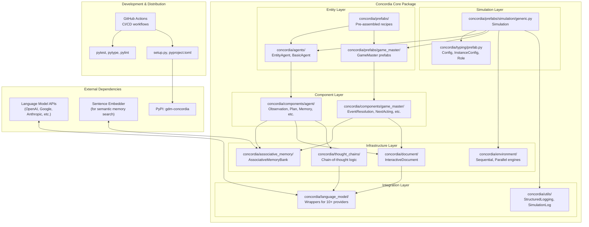

### Layer Responsibilities

| Layer | Purpose | Key Modules |
|-------|---------|-------------|
| **Simulation Layer** | Orchestrates the entire simulation using `Config` objects to instantiate entities | [concordia/prefabs/simulation/generic.py](), [concordia/typing/prefab.py]() |
| **Entity Layer** | Provides agents and game masters built from component compositions | [concordia/agents/](), [concordia/prefabs/game_master/]() |
| **Component Layer** | Modular building blocks for entity behaviors (memory, planning, observation, event resolution) | [concordia/components/agent/](), [concordia/components/game_master/]() |
| **Infrastructure Layer** | Core services: memory systems, execution engines, LLM interaction tools, reasoning chains | [concordia/associative_memory/](), [concordia/environment/](), [concordia/document/](), [concordia/thought_chains/]() |
| **Integration Layer** | Abstracts 10+ LLM providers and handles structured logging | [concordia/language_model/](), [concordia/utils/]() |

**Architectural Principles:**

- **Game masters** have references to all entities and can observe their actions
- **Entities** remain isolated from each other, receiving information only through the GM
- **Components** are composable and reusable across different entity types
- **Memory banks** are separate per entity (isolated) but shared across all game masters
- **LLM providers** are swappable through a unified interface without code changes

*Sources: [setup.py:66-137](), [README.md:55-72]()*

## Entity-Component Architecture

Both agents and game masters are built using an Entity-Component System pattern. Entities are composed from modular components that participate in a phase-based lifecycle.

### Component Composition and Phase Lifecycle

```mermaid
graph TB
    subgraph Configuration["Configuration Phase"]
        User["Developer"] -->|defines| Config["Config<br/>(concordia/typing/prefab.py)"]
        Config -->|contains| Prefabs["prefabs:<br/>dict of Prefab objects"]
        Config -->|contains| Instances["instances:<br/>list of InstanceConfig"]
        Instances -->|specifies| Role["Role:<br/>ENTITY or GAME_MASTER"]
    end
    
    subgraph Build["Build Phase"]
        Prefab["Prefab.build()"] -->|creates| Entity["EntityAgent or GameMaster"]
        Prefab -->|assembles| Components["Components"]
        
        subgraph AgentComps["Agent Components"]
            Obs["ObservationToMemory<br/>LastNObservations"]
            Mem["AllSimilarMemories<br/>QuestionByQuery"]
            State["Identity<br/>SelfPerception<br/>SituationPerception"]
            Plan["Plan<br/>Schedule"]
            Act["ConcatActComponent<br/>SwitchActComponent"]
        end
        
        subgraph GMComps["Game Master Components"]
            Next["NextActing<br/>NextActionSpec"]
            Resolve["EventResolution<br/>SendEventToRelevantPlayers"]
            ObsGen["MakeObservation<br/>ObservationQueue"]
            Scene["SceneTracker<br/>SceneRunner"]
            World["GenerativeClock<br/>WorldState"]
        end
        
        Components --> AgentComps
        Components --> GMComps
    end
    
    subgraph Runtime["Runtime Phase Lifecycle"]
        READY["Phase: READY<br/>(waiting)"]
        PRE_ACT["Phase: PRE_ACT<br/>(gather context)"]
        POST_ACT["Phase: POST_ACT<br/>(react to action)"]
        PRE_OBS["Phase: PRE_OBSERVE<br/>(pre-process observation)"]
        POST_OBS["Phase: POST_OBSERVE<br/>(post-process observation)"]
        UPDATE["Phase: UPDATE<br/>(persist state)"]
        
        READY -->|act() called| PRE_ACT
        PRE_ACT -->|action generated| POST_ACT
        POST_ACT --> UPDATE
        
        READY -->|observe() called| PRE_OBS
        PRE_OBS --> POST_OBS
        POST_OBS --> UPDATE
        
        UPDATE --> READY
    end
    
    Config --> Prefab
    Prefab --> Entity
    Entity --> Runtime
```

### Component Base Classes

| Base Class | Module | Purpose |
|------------|--------|---------|
| `ContextComponent` | [concordia/typing/entity_component.py]() | Provides context strings during action generation (e.g., observations, memories, identity) |
| `ActingComponent` | [concordia/typing/entity_component.py]() | Generates actions from aggregated context provided by other components |
| `ContextProcessorComponent` | [concordia/typing/entity_component.py]() | Processes and transforms context from other components before action generation |

### Phase Execution Model

Components implement methods that are called during specific phases:

1. **`PRE_ACT`**: Components gather relevant information via `pre_act(action_spec)` and return context strings
2. **`POST_ACT`**: Components react to generated actions via `post_act(action_attempt)`
3. **`PRE_OBSERVE`**: Components pre-process observations via `pre_observe(observation)`
4. **`POST_OBSERVE`**: Components post-process observations via `post_observe(observation)`
5. **`UPDATE`**: Components persist state changes via `update()`

The phase-based lifecycle ensures orderly component interactions and prevents race conditions when multiple components access shared resources like memory banks.

*Sources: [concordia/typing/entity_component.py](), [concordia/agents/entity_agent.py](), [concordia/typing/prefab.py](), [concordia/prefabs/simulation/generic.py]()*

## Language Model Integration

Concordia abstracts language model interactions through a provider-agnostic interface, allowing users to swap LLMs without modifying simulation code.

### LLM Abstraction and Provider Support

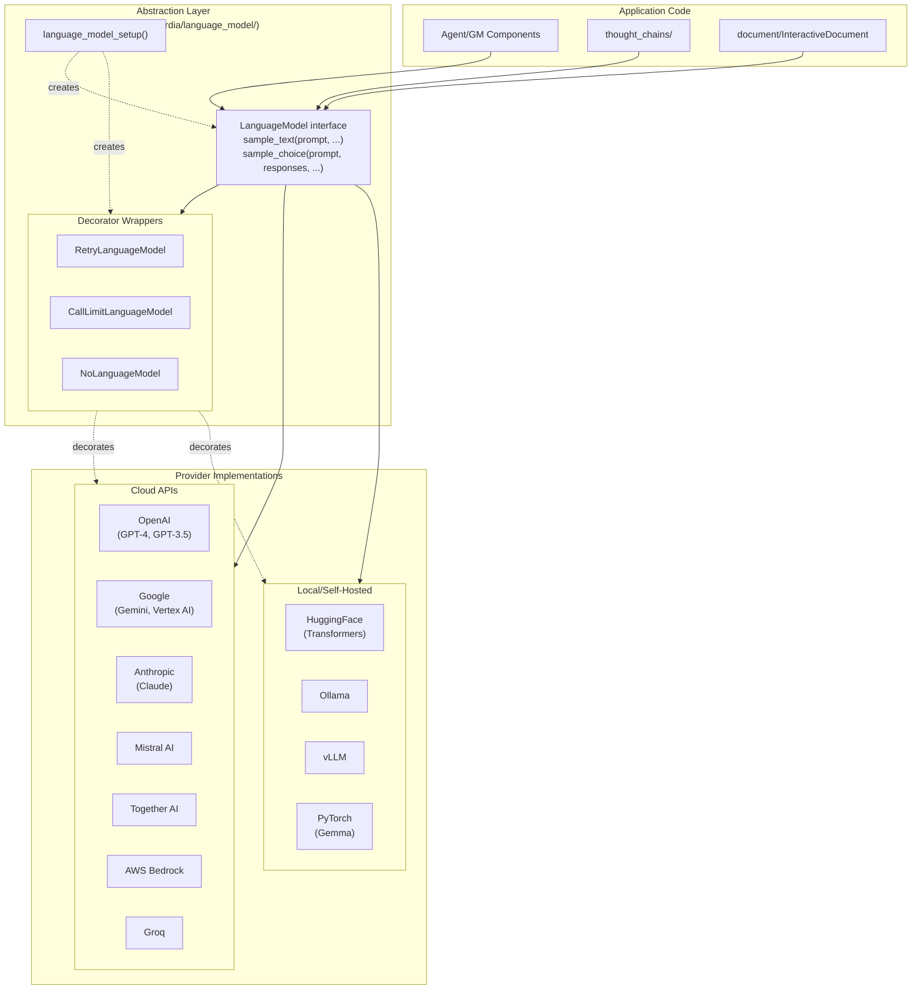

### Core Interface

The `LanguageModel` abstract base class defines two primary methods:

| Method | Signature | Purpose |
|--------|-----------|---------|
| `sample_text` | `(prompt, *, max_tokens, terminators, temperature, ...) -> str` | Generate free-form text completion |
| `sample_choice` | `(prompt, responses, *, seed) -> tuple[int, str, dict]` | Select from predefined multiple-choice options |

### Supported Providers

Concordia includes wrappers for 10+ language model providers:

| Provider | Module | Extra Install |
|----------|--------|---------------|
| OpenAI | [concordia/language_model/]() | `pip install gdm-concordia[openai]` |
| Google (Gemini, Vertex) | [concordia/language_model/]() | `pip install gdm-concordia[google]` |
| Anthropic (Claude) | Available via langchain | `pip install gdm-concordia[langchain]` |
| Mistral AI | [concordia/language_model/]() | `pip install gdm-concordia[mistralai]` |
| Together AI | [concordia/language_model/]() | `pip install gdm-concordia[together]` |
| AWS Bedrock | [concordia/language_model/]() | `pip install gdm-concordia[amazon]` |
| Groq | [concordia/language_model/]() | `pip install gdm-concordia[groq]` |
| HuggingFace | [concordia/language_model/]() | `pip install gdm-concordia[huggingface]` |
| Ollama | [concordia/language_model/]() | `pip install gdm-concordia[ollama]` |
| vLLM | [concordia/language_model/]() | `pip install gdm-concordia[vllm]` |

### Wrapper Utilities

Decorator wrappers add cross-cutting functionality:

- **`RetryLanguageModel`**: Implements exponential backoff for transient API failures
- **`CallLimitLanguageModel`**: Enforces usage caps by tracking API call counts
- **`NoLanguageModel`**: Returns empty strings for testing without API calls

*Sources: [setup.py:80-136](), [concordia/language_model/](), [README.md:146-154]()*

## Simulation Execution Flow

Concordia orchestrates multi-agent interactions through a structured execution loop. The `Simulation` class manages the overall lifecycle, while `Engine` implementations control the specific turn-taking patterns.

### Simulation Lifecycle

```mermaid
sequenceDiagram
    participant User
    participant Sim["Simulation<br/>(generic.py)"]
    participant Engine["Engine<br/>(Sequential/Parallel)"]
    participant GM["GameMaster"]
    participant Agent["EntityAgent"]
    
    User->>Sim: "Initialize with Config"
    Sim->>Sim: "Create memory banks<br/>(isolated per entity,<br/>shared for GMs)"
    Sim->>Sim: "Instantiate entities<br/>from prefabs"
    
    User->>Sim: "play(max_steps)"
    
    loop Each step
        Sim->>Engine: "run_loop()"
        
        Engine->>GM: "make_observation(entity)"
        GM-->>Agent: "observe(observation)"
        Agent->>Agent: "PRE_OBSERVE →<br/>POST_OBSERVE →<br/>UPDATE phases"
        
        Engine->>GM: "next_acting()"
        GM-->>Engine: "Selected entity +<br/>ActionSpec"
        
        Engine->>Agent: "act(action_spec)"
        Agent->>Agent: "PRE_ACT phase<br/>(gather context)"
        Agent->>Agent: "Generate action"
        Agent->>Agent: "POST_ACT →<br/>UPDATE phases"
        Agent-->>Engine: "Action attempt"
        
        Engine->>GM: "resolve(action_attempt)"
        GM->>GM: "Apply thought chains<br/>(EventResolution)"
        GM-->>Agent: "observe(resolved_event)"
        
        opt Checkpoint enabled
            Sim->>Sim: "save_checkpoint()"
        end
        
        Sim->>Sim: "Log events"
    end
    
    Sim-->>User: "SimulationLog<br/>(HTML/JSON)"
```

### Key Execution Components

| Component | Module | Role |
|-----------|--------|------|
| `Simulation` | [concordia/prefabs/simulation/generic.py]() | Top-level orchestrator; processes `Config`, creates entities, manages execution |
| `Config` | [concordia/typing/prefab.py]() | Declarative configuration specifying prefabs and instances |
| `Engine` | [concordia/environment/]() | Defines turn-taking pattern (sequential, parallel, etc.) |
| `Prefab` | [concordia/typing/prefab.py]() | Factory function that builds entities from components |
| `ActionSpec` | [concordia/typing/action_spec.py]() | Specifies the format and constraints for entity actions |

### Memory Architecture

A critical design decision in Concordia:

- **Entity Memory Banks**: Each `EntityAgent` has an isolated `AssociativeMemoryBank` to prevent cross-contamination
- **Game Master Memory Bank**: All `GameMaster` instances share one collective memory bank (with `allow_duplicates=True`) to maintain consistent world state

This asymmetry ensures entities only learn through observation while game masters have full knowledge of events.

*Sources: [concordia/prefabs/simulation/generic.py](), [concordia/environment/](), [concordia/typing/prefab.py](), [CHANGELOG.md:26-32]()*

## Development and Integration

### Package Structure

The `gdm-concordia` package requires Python ≥3.11 and includes comprehensive dependencies for various LLM providers and supporting libraries. Key development tools include:

- **Testing**: `pytest` with parallel execution via `pytest-xdist`
- **Type Checking**: `pytype` for static analysis  
- **Code Formatting**: `pyink` (Google's Python formatter)
- **Linting**: `pylint` for code quality

### Installation and Setup

```bash
# PyPI installation
pip install gdm-concordia

# Development installation
git clone https://github.com/google-deepmind/concordia
cd concordia
pip install --editable .[dev]
```

The library supports multiple deployment patterns:
- **Local Development**: Using local LLMs via Ollama or PyTorch
- **Cloud Services**: Integration with major cloud LLM providers
- **Research Environments**: Jupyter notebooks and Colab integration
- **Production Simulations**: Scalable execution with concurrent processing

*Sources: [setup.py:68-106](), [README.md:41-72](), [pyproject.toml:24-38]()*

---

# Page: Core Architecture

# Core Architecture

<details>
<summary>Relevant source files</summary>

The following files were used as context for generating this wiki page:

- [CHANGELOG.md](CHANGELOG.md)
- [CITATION.bib](CITATION.bib)
- [README.md](README.md)
- [setup.py](setup.py)

</details>


## Purpose and Scope

This document provides an overview of Concordia's three main architectural pillars: the **Entity Component System (ECS)**, the **Game Master System**, and the **Language Model Integration Layer**. These systems form the foundation for building multi-agent generative simulations.

For detailed documentation on specific aspects of each system, see:
- Entity Component System details: [Entity Component System](#2.1)
- Game Master implementation details: [Game Master System](#2.2)
- Language Model provider implementations: [Language Model Integration](#2.3)
- Simulation configuration and execution: [Simulation Framework](#3)

## Architectural Overview

Concordia's architecture separates concerns into three primary layers that interact through well-defined interfaces.

**High-Level Architecture Diagram**

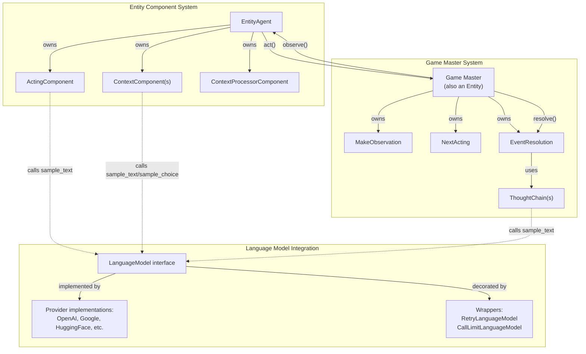

**Sources:** [concordia/agents/entity_agent.py](), [concordia/language_model/language_model.py](), [CHANGELOG.md:68-82]()

## Entity Component System (ECS)

### Core Concept

Concordia uses an Entity Component System pattern where agents (`EntityAgent`) are composed of modular, reusable components. This design enables flexible agent behavior through composition rather than inheritance.

**EntityAgent Structure Diagram**

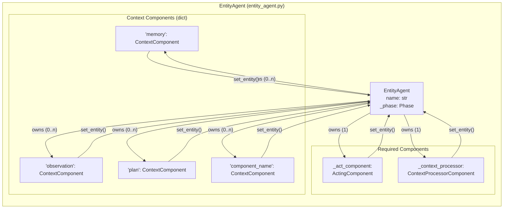

**Sources:** [concordia/agents/entity_agent.py:35-86]()

### Component Types

| Component Type | Base Class | Purpose | Key Methods |
|----------------|------------|---------|-------------|
| **Acting** | `ActingComponent` | Generates agent actions | `get_action_attempt()` |
| **Context** | `ContextComponent` | Provides contextual information | `pre_act()`, `post_act()`, `pre_observe()`, `post_observe()`, `update()` |
| **Context Processor** | `ContextProcessorComponent` | Orchestrates context flow | `pre_act()`, `post_act()`, `pre_observe()`, `post_observe()` |

**Sources:** [concordia/typing/entity_component.py]()

### Lifecycle Phases

The `EntityAgent` operates through a state machine with distinct phases defined in the `Phase` enum:

**Phase Transition Diagram**

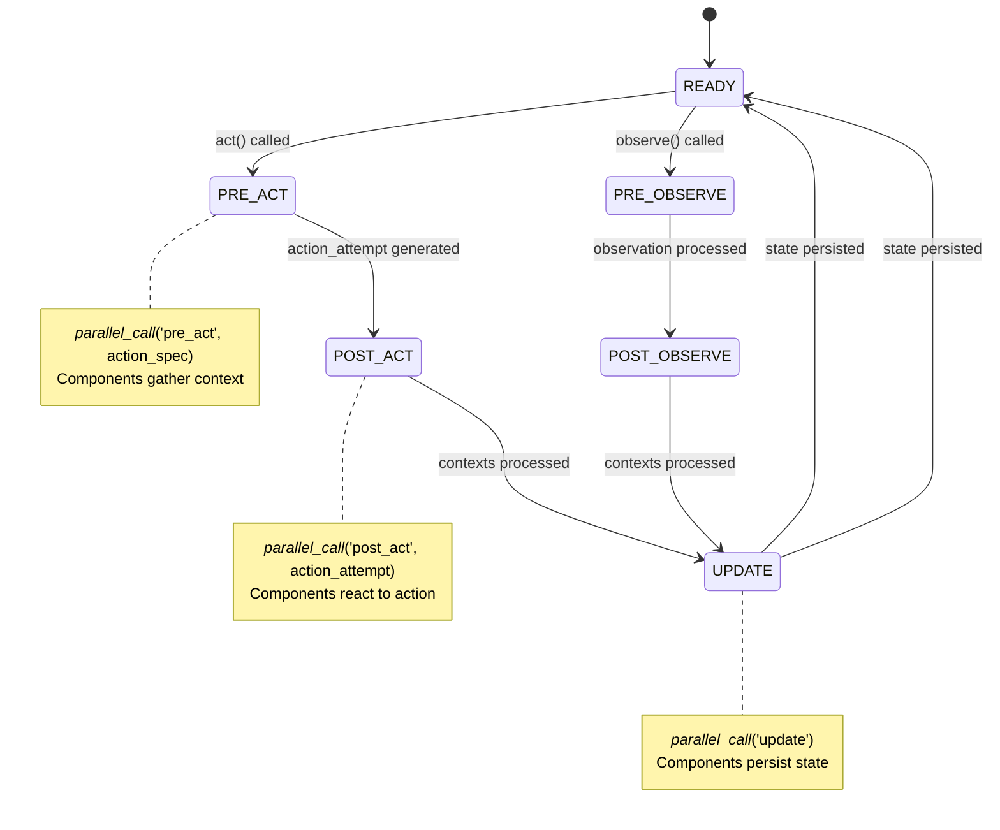

**Key Implementation Details:**

- **Phase transitions** are enforced by `_set_phase()` which calls `phase.check_successor()` [concordia/agents/entity_agent.py:97-100]()
- **Parallel execution**: `_parallel_call_()` invokes component methods concurrently using `ThreadPoolExecutor` [concordia/agents/entity_agent.py:120-161]()
- **Thread safety**: Operations are protected by `_control_lock` to prevent concurrent lifecycle execution [concordia/agents/entity_agent.py:70,167]()

**Sources:** [concordia/agents/entity_agent.py:163-200](), [concordia/typing/entity_component.py]()

## Game Master System

### Game Master as Entity

Since version 2.0.0, Game Masters are implemented as entities (`EntityAgent` instances), allowing them to use the same component system as player agents. This unification simplifies the architecture and enables Game Masters to have memory, observation processing, and other agent-like capabilities.

**Game Master Component Architecture**

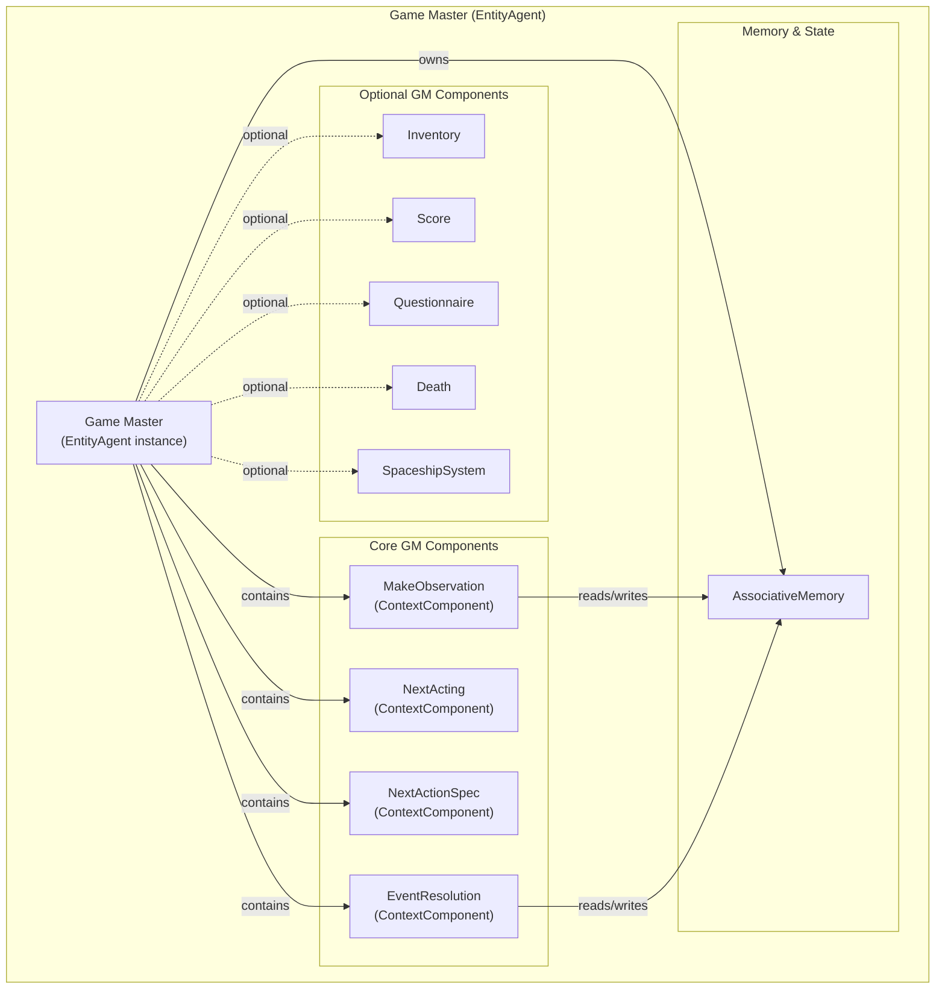

**Sources:** [CHANGELOG.md:71](), [concordia/typing/entity.py]()

### Core Responsibilities

The Game Master orchestrates the simulation through four primary responsibilities:

| Responsibility | Component | Method | Purpose |
|----------------|-----------|--------|---------|
| **Observation Generation** | `MakeObservation` | `make_observation()` | Creates entity-specific observations based on simulation state |
| **Turn Selection** | `NextActing` | `next_acting()` | Determines which entity acts next (may use LLM for dynamic selection) |
| **Action Format** | `NextActionSpec` | `next_action_spec()` | Specifies the format/constraints for the next action |
| **Event Resolution** | `EventResolution` | `resolve()` | Validates and processes action attempts into canonical events |

**Sources:** [concordia/components/game_master/]()

### Event Resolution and Thought Chains

Event resolution transforms putative events (action attempts from entities) into resolved events through a chain of reasoning steps:

**Thought Chain Processing Flow**

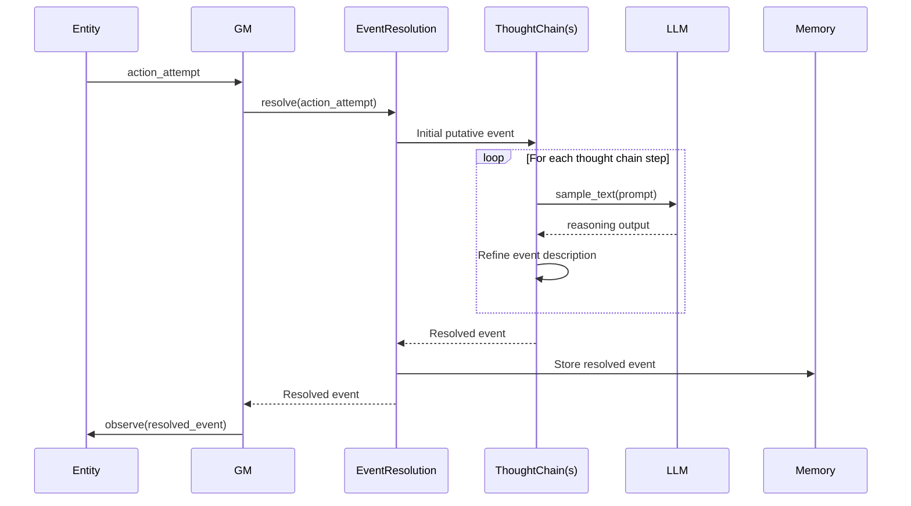

**Common Thought Chain Examples:**

- **`AccountForAgencyOfOthers`**: Validates that actions respect the agency and consent of other entities
- **`determine_success_and_why`**: Assesses whether an action succeeds and explains the outcome
- **`result_to_causal_statement`**: Converts outcomes into causal narrative statements
- **`Conversation`**: Resolves multi-turn dialogue interactions

**Sources:** [concordia/components/game_master/thought_chains.py](), [concordia/thought_chains/]()

## Language Model Integration

### Abstraction Layer

Concordia abstracts LLM access through the `LanguageModel` interface, which defines two primary methods:

**LanguageModel Interface Mapping**

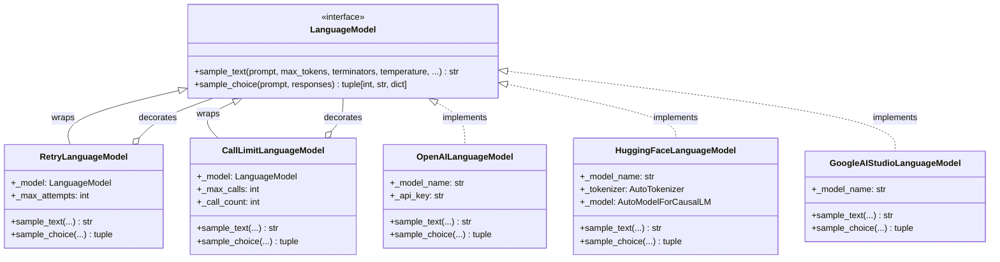

**Method Signatures:**

- **`sample_text(prompt, *, max_tokens, terminators, temperature, ...)`**: Returns a text completion as a string
- **`sample_choice(prompt, responses, *)`**: Returns `(index, response_text, debug_info)` selecting from provided options

**Sources:** [concordia/language_model/language_model.py](), [concordia/language_model/huggingface_model.py:38-198]()

### Provider Implementations

Concordia supports 11+ LLM providers through uniform implementations of the `LanguageModel` interface:

| Provider Type | Implementations | Module Path |
|---------------|----------------|-------------|
| **OpenAI** | GPT-3.5, GPT-4, GPT-4o | `openai_model.py` |
| **Google** | Gemini (AI Studio, Vertex AI) | `google_aistudio_model.py`, `vertex_ai.py` |
| **Mistral** | Mistral models | `mistral_model.py` |
| **HuggingFace** | Transformers models | `huggingface_model.py` |
| **Ollama** | Local models | `ollama_model.py` |
| **vLLM** | Optimized local inference | `vllm_model.py` |
| **Together AI** | Open weights models | `together_ai.py` |
| **Amazon Bedrock** | AWS hosted models | `amazon_bedrock_model.py` |

**Sources:** [concordia/language_model/](), [setup.py:69-90]()

### Factory Function

The `language_model_setup()` factory dynamically instantiates LM implementations based on the `api_type` parameter:

```mermaid
graph TB
    Factory["language_model_setup()<br/>(utils/language_model_setup.py)"]
    
    Factory -->|"api_type='openai'"| OpenAI["OpenAILanguageModel"]
    Factory -->|"api_type='google_aistudio_model'"| Google["GoogleAIStudioLanguageModel"]
    Factory -->|"api_type='mistral'"| Mistral["MistralLanguageModel"]
    Factory -->|"api_type='huggingface'"| HF["HuggingFaceLanguageModel"]
    Factory -->|"api_type='ollama'"| Ollama["OllamaLanguageModel"]
    Factory -->|"api_type='vllm'"| VLLM["VLLMLanguageModel"]
    Factory -->|"api_type='together'"| Together["TogetherLanguageModel"]
    Factory -->|"api_type='amazon_bedrock'"| Bedrock["AmazonBedrockLanguageModel"]
    
    Factory -.->|"wraps with"| Retry["RetryLanguageModel"]
    Factory -.->|"wraps with"| Limit["CallLimitLanguageModel"]
```

**Sources:** [concordia/utils/language_model_setup.py]()

## Integration and Data Flow

### Simulation Execution Flow

The three architectural pillars interact through a structured execution flow orchestrated by the `Simulation` class and `Engine` implementations:

**Complete System Data Flow**

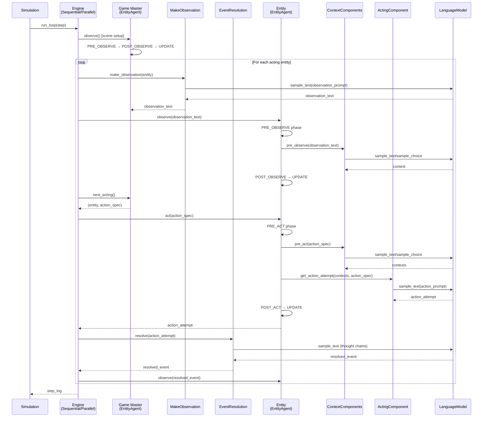

**Sources:** [concordia/simulation.py](), [concordia/engines/](), [concordia/agents/entity_agent.py:163-200]()

### Key Integration Points

**1. Component-to-LLM Binding**

Components invoke LLM methods directly through dependency injection:

```
ContextComponent.pre_act()
  └─> self._model.sample_text(prompt)  # _model is LanguageModel instance
```

**2. GM-to-Entity Communication**

Game Master and entities interact through the `Entity` interface:

```
GameMaster (EntityAgent)
  └─> entity.observe(observation)      # Entity.observe() method
  └─> entity.act(action_spec)          # Entity.act() method
```

**3. State Serialization**

All components implement `get_state()` / `set_state()` for checkpointing:

```
EntityAgent.get_state() returns EntityState = {
  'act_component': dict,
  'context_processor': dict,
  'context_components': {name: dict, ...}
}
```

**Sources:** [concordia/agents/entity_agent.py:202-251](), [concordia/typing/entity_component.py]()

---

## Summary

Concordia's core architecture achieves modularity and extensibility through three loosely coupled systems:

1. **Entity Component System**: Provides compositional agent behavior through `EntityAgent` and modular components with phase-based lifecycle management
2. **Game Master System**: Orchestrates simulations through observation generation, turn selection, and event resolution with thought chains
3. **Language Model Integration**: Abstracts LLM access through a unified interface supporting 11+ providers with decorator-based enhancements

These systems integrate through well-defined interfaces (`Entity`, `LanguageModel`, `Component`) enabling flexible simulation design while maintaining clear separation of concerns.

**Sources:** [CHANGELOG.md:68-82](), [setup.py:34-114](), [concordia/agents/entity_agent.py](), [concordia/language_model/language_model.py]()

---

# Page: Entity Component System

# Entity Component System

<details>
<summary>Relevant source files</summary>

The following files were used as context for generating this wiki page:

- [concordia/agents/entity_agent.py](concordia/agents/entity_agent.py)
- [concordia/components/agent/__init__.py](concordia/components/agent/__init__.py)
- [concordia/components/agent/instructions.py](concordia/components/agent/instructions.py)
- [concordia/components/agent/no_op_context_processor.py](concordia/components/agent/no_op_context_processor.py)
- [concordia/typing/entity_component.py](concordia/typing/entity_component.py)
- [concordia/typing/logging.py](concordia/typing/logging.py)

</details>


The Entity Component System (ECS) is Concordia's foundational architecture for building modular, composable agents. This system enables agents to be assembled from reusable functional components that operate within a strictly-defined phase-based lifecycle. The ECS separates agent functionality into orthogonal concerns (observation processing, memory retrieval, planning, action generation) and coordinates their execution through a centralized orchestrator.

This page covers the core ECS architecture, phase lifecycle, component base classes, and the `EntityAgent` orchestrator. For concrete component implementations, see [Agent Component Library](#2.1.3). For game master components, see [Game Master System](#2.2).

## Architecture Overview

The ECS consists of three primary abstractions working together:

| Abstraction | Purpose | Key Classes |
|------------|---------|-------------|
| **Phase Lifecycle** | Defines the ordered sequence of states an entity transitions through during act/observe cycles | `Phase` enum [concordia/typing/entity_component.py:39-88]() |
| **Component Base Classes** | Abstract interfaces for modular functionality blocks | `BaseComponent`, `ContextComponent`, `ActingComponent`, `ContextProcessorComponent` [concordia/typing/entity_component.py:90-366]() |
| **Entity Orchestrator** | Coordinates component execution and manages lifecycle transitions | `EntityAgent` [concordia/agents/entity_agent.py:35-277]() |

### Component Architecture

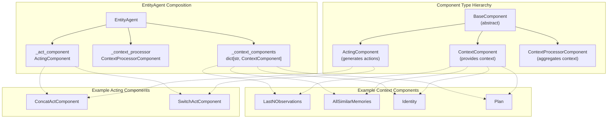

**Sources:** [concordia/typing/entity_component.py:90-366](), [concordia/agents/entity_agent.py:45-86](), [concordia/components/agent/__init__.py:17-29]()

## Phase-Based Lifecycle

The ECS lifecycle is governed by the `Phase` enum, which defines six states that entities transition through during `act()` and `observe()` operations. This phase system ensures deterministic component execution order and prevents race conditions.

### Phase State Machine

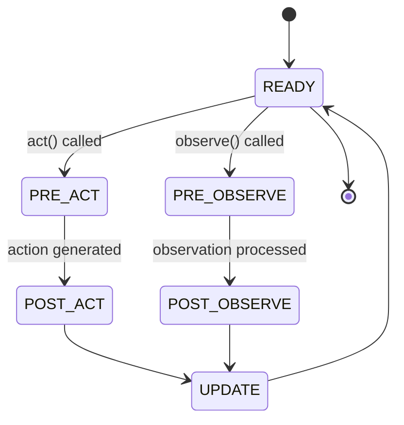

**Sources:** [concordia/typing/entity_component.py:39-88]()

### Phase Descriptions

| Phase | Entry Condition | Component Hook | Purpose | Exit Condition |
|-------|----------------|----------------|---------|----------------|
| `READY` | Initial state or after `UPDATE` | None | Entity is idle, awaiting `act()` or `observe()` call | `act()` or `observe()` invoked |
| `PRE_ACT` | `act()` called | `ContextComponent.pre_act()` | Components provide context strings for action generation | All components return context |
| `POST_ACT` | Action attempt generated | `ContextComponent.post_act()` | Components receive notification of action attempt | All components process action |
| `PRE_OBSERVE` | `observe()` called | `ContextComponent.pre_observe()` | Components receive observation string | All components process observation |
| `POST_OBSERVE` | Observation distributed | `ContextComponent.post_observe()` | Components provide post-observation context | All components return context |
| `UPDATE` | After `POST_ACT` or `POST_OBSERVE` | `ContextComponent.update()` | Components update internal state and caches | All components complete update |

Phase transitions are validated by [concordia/typing/entity_component.py:84-87](), which raises `ValueError` for invalid transitions. The current phase is tracked in [concordia/agents/entity_agent.py:72]() and protected by a thread lock [concordia/agents/entity_agent.py:71]().

**Sources:** [concordia/typing/entity_component.py:39-88](), [concordia/agents/entity_agent.py:93-100]()

## Component Base Classes

### BaseComponent

The root abstraction for all components, providing entity binding and state management.

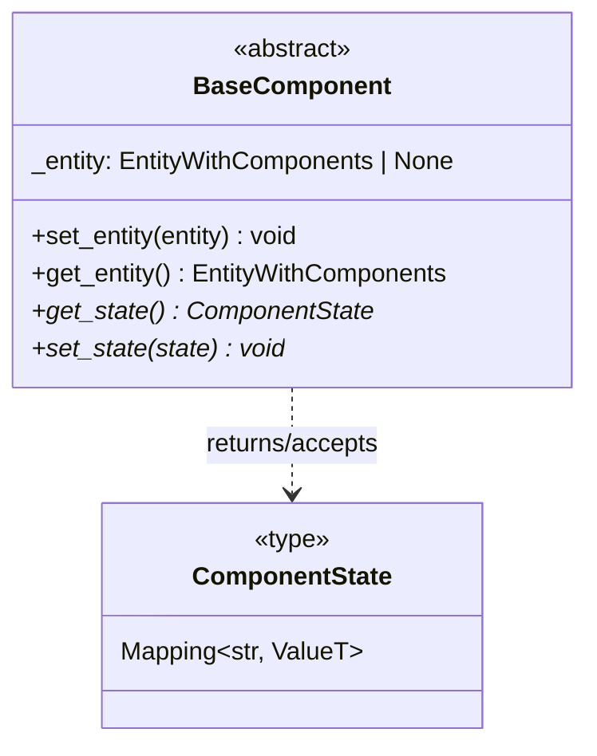

**Key Methods:**
- `set_entity()` [concordia/typing/entity_component.py:95-106](): Binds component to entity. Raises `RuntimeError` if already bound.
- `get_entity()` [concordia/typing/entity_component.py:108-116](): Returns owning entity. Raises `RuntimeError` if not bound.
- `get_state()` [concordia/typing/entity_component.py:118-125](): Returns serializable state dict for checkpointing.
- `set_state()` [concordia/typing/entity_component.py:128-162](): Restores component state from dict. Must be called after `__init__()` with identical parameters.

**Sources:** [concordia/typing/entity_component.py:90-163]()

### ContextComponent

Components that provide information during phase transitions. These form the bulk of agent functionality.

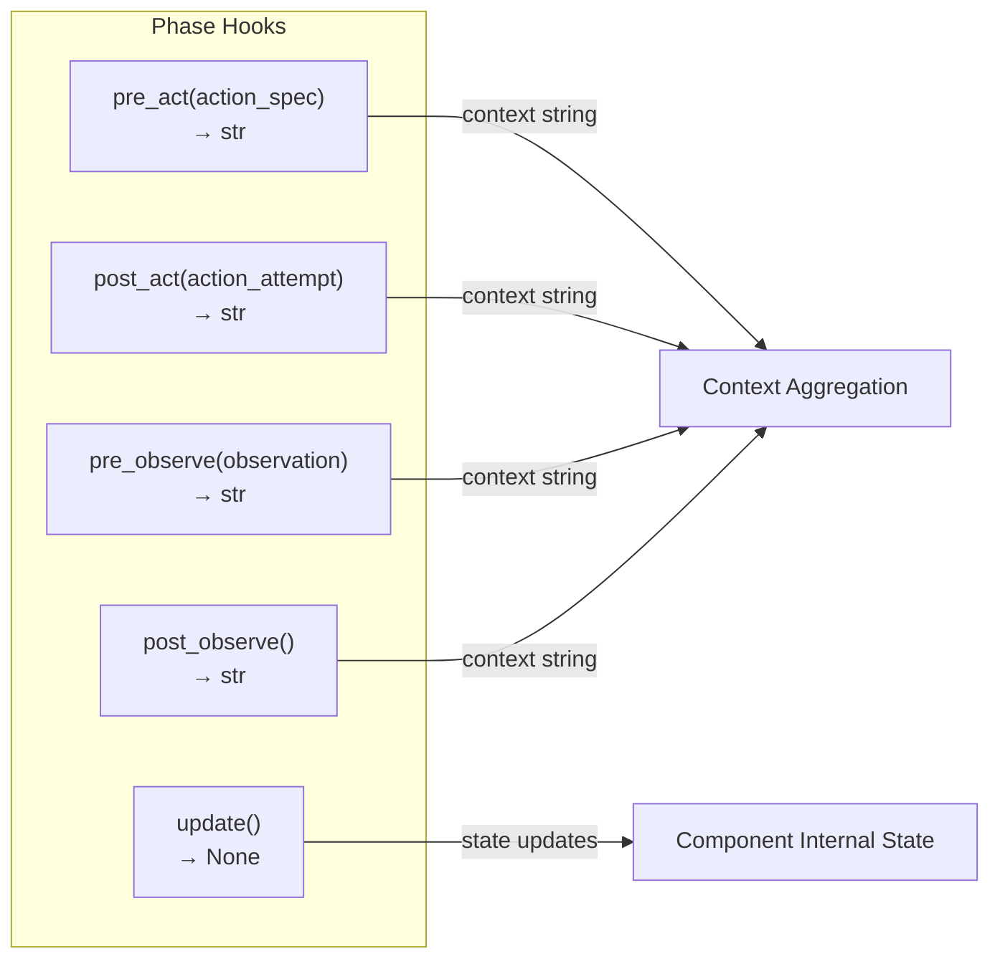

**Method Signatures:**
- `pre_act(action_spec: ActionSpec) -> str` [concordia/typing/entity_component.py:218-234](): Returns context relevant for action generation.
- `post_act(action_attempt: str) -> str` [concordia/typing/entity_component.py:236-252](): Receives the action attempt, returns additional context.
- `pre_observe(observation: str) -> str` [concordia/typing/entity_component.py:254-271](): Receives observation, returns relevant context.
- `post_observe() -> str` [concordia/typing/entity_component.py:273-285](): Returns context after observation processing.
- `update() -> None` [concordia/typing/entity_component.py:287-295](): Updates internal state, replaces caches.

All methods have default no-op implementations returning empty strings. Components override only methods relevant to their functionality.

**Sources:** [concordia/typing/entity_component.py:211-296]()

### ActingComponent

A privileged component responsible for generating action attempts. Each `EntityAgent` has exactly one `ActingComponent`.

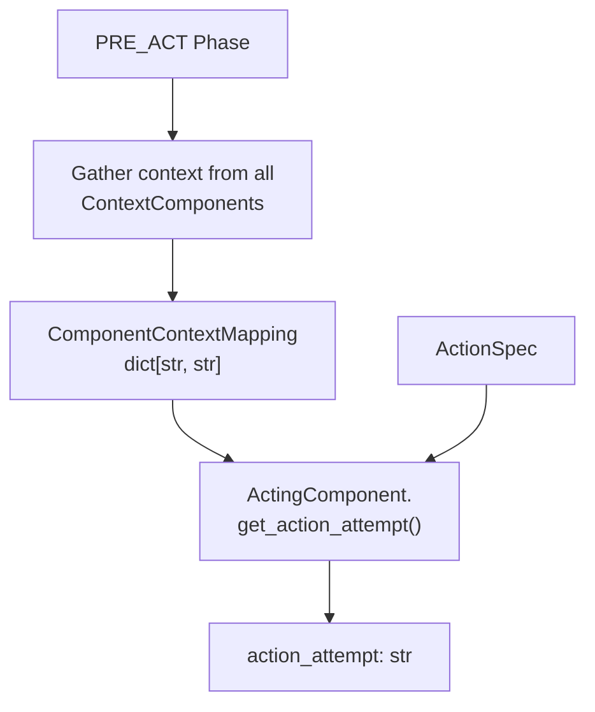

**Key Method:**
- `get_action_attempt(context: ComponentContextMapping, action_spec: ActionSpec) -> str` [concordia/typing/entity_component.py:302-321]()

The `context` parameter is a mapping of component names to their `pre_act()` return values. This allows the acting component to synthesize information from all other components when generating the action.

**Sources:** [concordia/typing/entity_component.py:298-322]()

### ContextProcessorComponent

An optional component that processes aggregated context from all `ContextComponent` instances. Unlike `ContextComponent`, it receives the complete context mapping rather than contributing to it.

**Method Signatures:**
- `pre_act(contexts: ComponentContextMapping) -> None` [concordia/typing/entity_component.py:327-333]()
- `post_act(contexts: ComponentContextMapping) -> None` [concordia/typing/entity_component.py:335-341]()
- `pre_observe(contexts: ComponentContextMapping) -> None` [concordia/typing/entity_component.py:343-349]()
- `post_observe(contexts: ComponentContextMapping) -> None` [concordia/typing/entity_component.py:351-357]()

If no `ContextProcessorComponent` is provided to `EntityAgent`, a `NoOpContextProcessor` [concordia/components/agent/no_op_context_processor.py:20-22]() is used by default [concordia/agents/entity_agent.py:77-81]().

**Sources:** [concordia/typing/entity_component.py:324-366](), [concordia/agents/entity_agent.py:77-81](), [concordia/components/agent/no_op_context_processor.py:20-22]()

## EntityAgent: The Component Orchestrator

`EntityAgent` [concordia/agents/entity_agent.py:35-277]() is the concrete implementation of `EntityWithComponents` that manages component lifecycle and coordinates their execution.

### Initialization and Component Binding

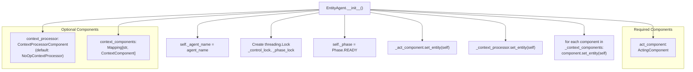

**Sources:** [concordia/agents/entity_agent.py:45-86]()

### act() Execution Flow

The `act()` method [concordia/agents/entity_agent.py:165-185]() orchestrates the complete action generation cycle with strict phase transitions:

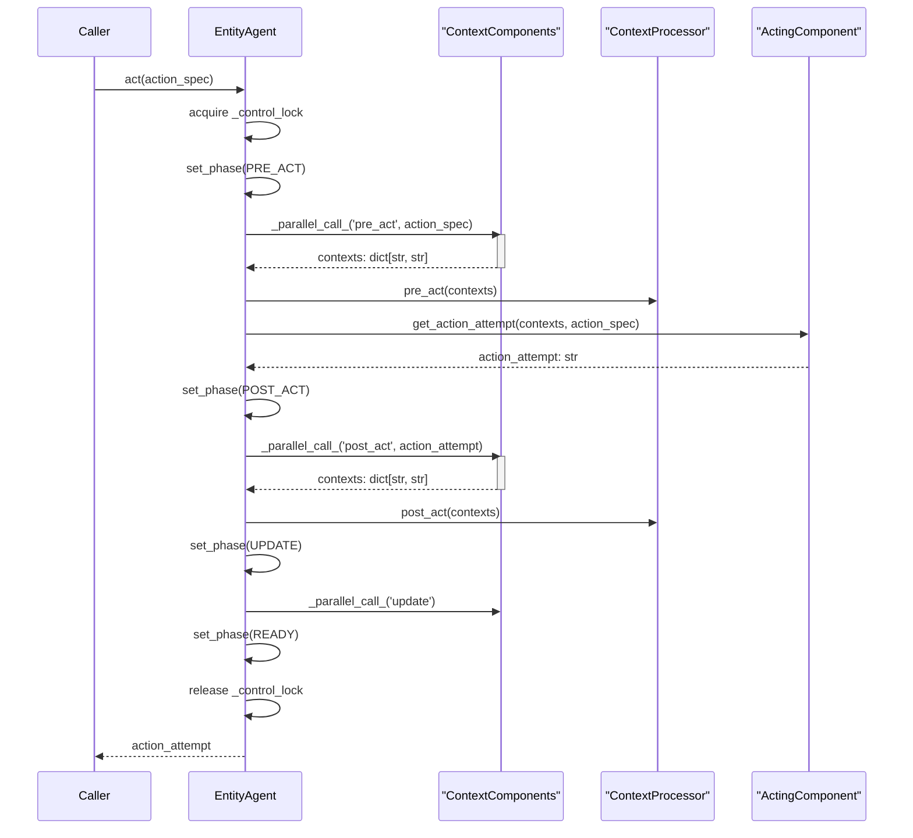

**Key Implementation Details:**
- The entire sequence is protected by `_control_lock` [concordia/agents/entity_agent.py:168]() to ensure atomicity.
- Phase transitions are validated by `_set_phase()` [concordia/agents/entity_agent.py:97-100]().
- Component methods are called in parallel via `_parallel_call_()` [concordia/agents/entity_agent.py:120-162]().
- Duplicate component instances are called only once, with results mapped to all registration names [concordia/agents/entity_agent.py:143-161]().

**Sources:** [concordia/agents/entity_agent.py:165-185]()

### observe() Execution Flow

The `observe()` method [concordia/agents/entity_agent.py:188-201]() follows a similar pattern:

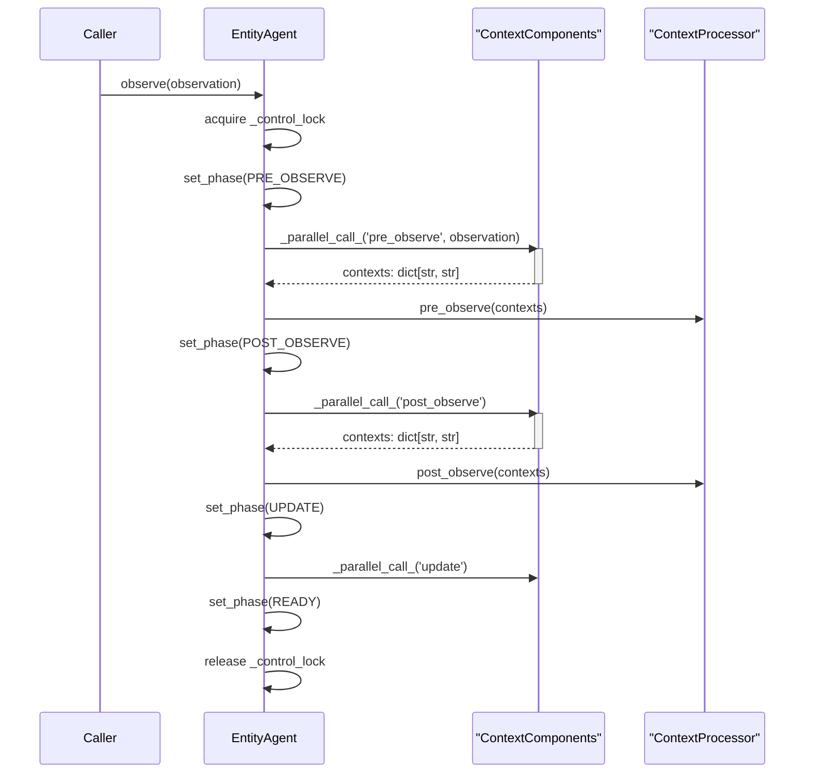

**Sources:** [concordia/agents/entity_agent.py:188-201]()

## Parallel Component Execution

Components are called in parallel to reduce latency, especially when components make independent LLM calls. The `_parallel_call_()` method [concordia/agents/entity_agent.py:120-162]() implements this with deduplication:

### Deduplication Logic

```mermaid
graph TB
    Start["_parallel_call_(method_name, *args)"]
    Start --> Identify["Identify unique component<br/>instances by id()"]
    Identify --> CreateTasks["Create one task per<br/>unique instance"]
    CreateTasks --> Execute["concurrency.run_tasks()<br/>with ThreadPoolExecutor"]
    Execute --> Results["results_by_component_id:<br/>dict[str, str]"]
    Results --> Map["Map results to all<br/>component names"]
    Map --> Return["Return ComponentContextMapping"]
    
    subgraph "Example"
        CompA["Component A<br/>registered as 'identity'"]
        CompA2["Same instance<br/>registered as 'self'"]
        CompA3["method called once,<br/>result mapped to both names"]
    end
```

**Implementation Details:**
1. Unique instances identified: `list(set(self._context_components.values()))` [concordia/agents/entity_agent.py:144]()
2. Tasks created by id: `tasks_for_unique[str(id(component))] = functools.partial(...)` [concordia/agents/entity_agent.py:147-151]()
3. Parallel execution: `concurrency.run_tasks(tasks_for_unique, executor=executor)` [concordia/agents/entity_component.py:153-155]()
4. Result mapping: `final_results[name] = results_by_component_id[str(id(component))]` [concordia/agents/entity_agent.py:159-160]()

**Sources:** [concordia/agents/entity_agent.py:120-162]()

## State Management

The ECS supports serialization and restoration for checkpointing. State is hierarchical:

```mermaid
graph TB
    EntityState["EntityState: dict"]
    EntityState --> ActState["'act_component':<br/>ComponentState"]
    EntityState --> ProcState["'context_processor':<br/>ComponentState"]
    EntityState --> CtxStates["'context_components':<br/>dict[str, ComponentState]"]
    
    CtxStates --> Comp1["'identity': {...}"]
    CtxStates --> Comp2["'observation': {...}"]
    CtxStates --> Comp3["'plan': {...}"]
    
    subgraph "ComponentState"
        StateDict["dict[str, LeafT | Collection | Mapping]<br/>Serializable primitives only"]
    end
    
    ActState --> StateDict
    ProcState --> StateDict
    Comp1 --> StateDict
    Comp2 --> StateDict
    Comp3 --> StateDict
```

### get_state() / set_state() Protocol

**Serialization** [concordia/agents/entity_agent.py:243-252]():
```python
# Returns nested dict structure
entity_state = {
    'act_component': self._act_component.get_state(),
    'context_processor': self._context_processor.get_state(),
    'context_components': {
        name: component.get_state()
        for name, component in self._context_components.items()
    }
}
```

**Restoration** [concordia/agents/entity_agent.py:203-241]():
1. Context components restored first [concordia/agents/entity_agent.py:209-220]()
2. Acting component restored [concordia/agents/entity_agent.py:223-230]()
3. Context processor restored [concordia/agents/entity_agent.py:233-241]()
4. Errors logged but don't halt restoration [concordia/agents/entity_agent.py:216-220]()

**Important Constraints:**
- State dicts contain only serializable primitives (str, int, float, None, collections, mappings) [concordia/typing/entity_component.py:32-36]()
- `set_state()` assumes component was initialized with identical `__init__()` parameters [concordia/typing/entity_component.py:136-137]()
- Non-serializable resources (LLMs, memory banks) passed at initialization, not in state [concordia/typing/entity_component.py:133-135]()

**Sources:** [concordia/agents/entity_agent.py:203-252](), [concordia/typing/entity_component.py:32-36](), [concordia/typing/entity_component.py:128-162]()

## Thread Safety

The `EntityAgent` uses two locks to ensure thread safety:

| Lock | Protects | Scope | Location |
|------|----------|-------|----------|
| `_control_lock` | Complete `act()` and `observe()` sequences | Method-level | [concordia/agents/entity_agent.py:70]() |
| `_phase_lock` | `_phase` field reads/writes | Field-level | [concordia/agents/entity_agent.py:71]() |

**Locking Strategy:**
- `_control_lock` acquired at method entry [concordia/agents/entity_agent.py:168](), [concordia/agents/entity_agent.py:189]()
- Prevents interleaved `act()` and `observe()` calls
- `_phase_lock` protects `get_phase()` [concordia/agents/entity_agent.py:94-95]() and `_set_phase()` [concordia/agents/entity_agent.py:98-100]()
- Allows phase queries without blocking entire operation

**Sources:** [concordia/agents/entity_agent.py:70-71](), [concordia/agents/entity_agent.py:93-100](), [concordia/agents/entity_agent.py:165-201]()

## Component Composition Pattern

Entities are typically composed following this pattern:

```mermaid
graph TB
    subgraph "Typical EntityAgent Composition"
        EA["EntityAgent(agent_name)"]
        
        subgraph "Acting Component (required)"
            ActComponent["ConcatActComponent<br/>or SwitchActComponent"]
        end
        
        subgraph "Context Processor (optional)"
            CtxProc["NoOpContextProcessor<br/>(default)"]
        end
        
        subgraph "Context Components (flexible set)"
            Identity["Identity<br/>(name, role, backstory)"]
            Obs["Observation Components<br/>(LastNObservations, etc.)"]
            Memory["Memory Components<br/>(AllSimilarMemories, etc.)"]
            Planning["Planning Components<br/>(Plan, Schedule, etc.)"]
            State["State Components<br/>(SelfPerception, etc.)"]
            Reflection["Reflection Components<br/>(CreativeReflection, etc.)"]
        end
        
        EA --> ActComponent
        EA --> CtxProc
        EA --> Identity
        EA --> Obs
        EA --> Memory
        EA --> Planning
        EA --> State
        EA --> Reflection
    end
```

Components are instantiated separately and passed to `EntityAgent.__init__()` [concordia/agents/entity_agent.py:45-86](). The entity takes ownership by calling `set_entity()` on each component [concordia/agents/entity_agent.py:74-85]().

For concrete component implementations, see [Agent Component Library](#2.1.3). For prefab recipes that instantiate complete agents, see [Prefab and Configuration System](#3.1).

**Sources:** [concordia/agents/entity_agent.py:45-86](), [concordia/components/agent/__init__.py:15-29]()

---

# Page: Component Base Classes and Lifecycle

# Component Types and Lifecycle

<details>
<summary>Relevant source files</summary>

The following files were used as context for generating this wiki page:

- [concordia/components/agent/__init__.py](concordia/components/agent/__init__.py)
- [concordia/components/agent/instructions.py](concordia/components/agent/instructions.py)
- [concordia/components/agent/no_op_context_processor.py](concordia/components/agent/no_op_context_processor.py)
- [concordia/typing/entity_component.py](concordia/typing/entity_component.py)
- [concordia/typing/logging.py](concordia/typing/logging.py)

</details>


## Purpose and Scope

This document describes the component base classes and lifecycle phases that form the foundation of Concordia's Entity Component System (ECS). It covers the three primary component types (`ContextComponent`, `ActingComponent`, `ContextProcessorComponent`), the phase-based execution model (`Phase` enum), and how components interact with `EntityAgent` throughout the agent lifecycle. 

For details on the `EntityAgent` class that orchestrates these components, see [2.1.1](#2.1.1). For specific component implementations like memory, planning, and reflection components, see [2.1.3](#2.1.3).

---

## Component Base Classes

All components in Concordia inherit from a hierarchy of base classes that define their interface and responsibilities. The component system is defined in [concordia/typing/entity_component.py]().

### Component Class Hierarchy

```mermaid
classDiagram
    class BaseComponent {
        <<abstract>>
        -_entity: EntityWithComponents | None
        +set_entity(entity)
        +get_entity() EntityWithComponents
        +get_state()* ComponentState
        +set_state(state)*
    }
    
    class ComponentWithLogging {
        -_logging_channel: LoggingChannel
        +set_logging_channel(channel)
    }
    
    class ContextComponent {
        +pre_act(action_spec) str
        +post_act(action_attempt) str
        +pre_observe(observation) str
        +post_observe() str
        +update()
    }
    
    class ActingComponent {
        <<abstract>>
        +get_action_attempt(context, action_spec)* str
    }
    
    class ContextProcessorComponent {
        <<abstract>>
        +pre_act(contexts)
        +post_act(contexts)
        +pre_observe(contexts)
        +post_observe(contexts)
    }
    
    BaseComponent <|-- ComponentWithLogging
    BaseComponent <|-- ContextComponent
    BaseComponent <|-- ActingComponent
    BaseComponent <|-- ContextProcessorComponent
```

**Sources:** [concordia/typing/entity_component.py:90-366]()

### BaseComponent

`BaseComponent` is the root of the component hierarchy. All components must implement:

| Method | Purpose |
|--------|---------|
| `set_entity(entity)` | Associates the component with an `EntityWithComponents` instance |
| `get_entity()` | Retrieves the associated entity |
| `get_state()` | Returns serializable state for checkpointing |
| `set_state(state)` | Restores component state from a checkpoint |

The entity reference is stored in `_entity` and managed through `set_entity()`. This creates a bidirectional relationship: the entity owns the component, and the component can access the entity to retrieve other components or entity-level information.

**Sources:** [concordia/typing/entity_component.py:90-163]()

### ContextComponent

`ContextComponent` is the primary building block for agent functionality. These components provide context to the agent during different lifecycle phases and can maintain internal state. The key methods correspond to lifecycle phases:

| Method | Called During Phase | Returns | Purpose |
|--------|---------------------|---------|---------|
| `pre_act(action_spec)` | `PRE_ACT` | `str` | Provides context before action generation |
| `post_act(action_attempt)` | `POST_ACT` | `str` | Reacts to the attempted action |
| `pre_observe(observation)` | `PRE_OBSERVE` | `str` | Processes incoming observations |
| `post_observe()` | `POST_OBSERVE` | `str` | Provides context after observation processing |
| `update()` | `UPDATE` | None | Updates internal state and caches |

All methods return strings that are aggregated by the entity. The default implementations return empty strings, allowing components to opt-in to only the phases they need.

**Sources:** [concordia/typing/entity_component.py:211-296]()

### ActingComponent

`ActingComponent` is a privileged component type responsible for generating the agent's action. An `EntityAgent` must have exactly one `ActingComponent`. The single abstract method is:

```
get_action_attempt(
    context: ComponentContextMapping,
    action_spec: ActionSpec
) -> str
```

This method receives:
- `context`: A mapping of component names to the strings returned by their `pre_act()` methods
- `action_spec`: Specifications for the action format (free text, multiple choice, etc.)

The `ActingComponent` typically aggregates the context strings and uses a language model to generate the action attempt.

**Sources:** [concordia/typing/entity_component.py:298-322]()

### ContextProcessorComponent

`ContextProcessorComponent` provides a hook for processing the aggregated context from all `ContextComponent` instances. Unlike `ContextComponent`, which produces context, this component consumes context mappings:

| Method | Receives | Purpose |
|--------|----------|---------|
| `pre_act(contexts)` | `ComponentContextMapping` | Process contexts before action generation |
| `post_act(contexts)` | `ComponentContextMapping` | Process contexts after action attempt |
| `pre_observe(contexts)` | `ComponentContextMapping` | Process contexts during observation |
| `post_observe(contexts)` | `ComponentContextMapping` | Process contexts after observation |

The default implementation `NoOpContextProcessor` does nothing, making this component optional. Custom implementations might log context, validate consistency, or perform meta-reasoning.

**Sources:** [concordia/typing/entity_component.py:324-366](), [concordia/components/agent/no_op_context_processor.py]()

---

## Lifecycle Phases

The `Phase` enum defines a strict state machine governing component execution order. Each phase has a defined set of valid successor phases.

### Phase Enum Definition

```mermaid
stateDiagram-v2
    [*] --> READY
    READY --> PRE_ACT: act() called
    READY --> PRE_OBSERVE: observe() called
    
    PRE_ACT --> POST_ACT: action attempt generated
    POST_ACT --> UPDATE: components notified
    
    PRE_OBSERVE --> POST_OBSERVE: observation processed
    POST_OBSERVE --> UPDATE: components finalized
    
    UPDATE --> READY: state updated
    READY --> [*]
```

**Sources:** [concordia/typing/entity_component.py:39-88]()

### Phase Descriptions

| Phase | Description | Valid Successors |
|-------|-------------|------------------|
| `READY` | Agent is idle, ready to observe or act | `PRE_ACT`, `PRE_OBSERVE` |
| `PRE_ACT` | Components gather context for action generation | `POST_ACT` |
| `POST_ACT` | Components process the generated action attempt | `UPDATE` |
| `PRE_OBSERVE` | Components process incoming observation | `POST_OBSERVE` |
| `POST_OBSERVE` | Components finalize observation processing | `UPDATE` |
| `UPDATE` | Components update internal state and caches | `READY` |

The phase transitions are validated at runtime using `Phase.check_successor()` [concordia/typing/entity_component.py:84-87](). Attempting an invalid transition raises a `ValueError`.

**Sources:** [concordia/typing/entity_component.py:39-88]()

---

## Component Method Invocation by Phase

The `EntityAgent` orchestrates component method calls based on the current phase. The following table maps phases to the methods invoked:

### Acting Lifecycle

```mermaid
sequenceDiagram
    participant EA as EntityAgent
    participant CC as ContextComponents
    participant CP as ContextProcessor
    participant AC as ActingComponent
    
    Note over EA: Phase: READY → PRE_ACT
    EA->>CC: pre_act(action_spec)
    CC-->>EA: contexts: Mapping[str, str]
    EA->>CP: pre_act(contexts)
    EA->>AC: get_action_attempt(contexts, action_spec)
    AC-->>EA: action_attempt: str
    
    Note over EA: Phase: POST_ACT
    EA->>CC: post_act(action_attempt)
    CC-->>EA: contexts: Mapping[str, str]
    EA->>CP: post_act(contexts)
    
    Note over EA: Phase: UPDATE → READY
    EA->>CC: update()
```

| Phase | Component Type | Method Called | Input | Output |
|-------|---------------|---------------|-------|--------|
| `PRE_ACT` | `ContextComponent` | `pre_act(action_spec)` | `ActionSpec` | `str` |
| `PRE_ACT` | `ContextProcessorComponent` | `pre_act(contexts)` | `ComponentContextMapping` | None |
| `PRE_ACT` | `ActingComponent` | `get_action_attempt(contexts, action_spec)` | `ComponentContextMapping`, `ActionSpec` | `str` |
| `POST_ACT` | `ContextComponent` | `post_act(action_attempt)` | `str` | `str` |
| `POST_ACT` | `ContextProcessorComponent` | `post_act(contexts)` | `ComponentContextMapping` | None |
| `UPDATE` | `ContextComponent` | `update()` | None | None |

**Sources:** [concordia/agents/entity_agent.py:164-184]()

### Observing Lifecycle

```mermaid
sequenceDiagram
    participant EA as EntityAgent
    participant CC as ContextComponents
    participant CP as ContextProcessor
    
    Note over EA: Phase: READY → PRE_OBSERVE
    EA->>CC: pre_observe(observation)
    CC-->>EA: contexts: Mapping[str, str]
    EA->>CP: pre_observe(contexts)
    
    Note over EA: Phase: POST_OBSERVE
    EA->>CC: post_observe()
    CC-->>EA: contexts: Mapping[str, str]
    EA->>CP: post_observe(contexts)
    
    Note over EA: Phase: UPDATE → READY
    EA->>CC: update()
```

| Phase | Component Type | Method Called | Input | Output |
|-------|---------------|---------------|-------|--------|
| `PRE_OBSERVE` | `ContextComponent` | `pre_observe(observation)` | `str` | `str` |
| `PRE_OBSERVE` | `ContextProcessorComponent` | `pre_observe(contexts)` | `ComponentContextMapping` | None |
| `POST_OBSERVE` | `ContextComponent` | `post_observe()` | None | `str` |
| `POST_OBSERVE` | `ContextProcessorComponent` | `post_observe(contexts)` | `ComponentContextMapping` | None |
| `UPDATE` | `ContextComponent` | `update()` | None | None |

**Sources:** [concordia/agents/entity_agent.py:187-200]()

---

## State Management

All components implement `get_state()` and `set_state()` for serialization and restoration. This enables checkpointing entire simulations.

### State Contract

The state contract follows these principles:

1. **Initialization Independence**: State does not include constructor arguments (e.g., memory bank references, component names). Components are restored by calling `__init__` with original parameters, then `set_state()` with saved state.

2. **Identical Behavior**: After state restoration, a component behaves identically to its state at the time of serialization.

3. **Serializable Types**: State is represented as nested mappings, sequences, and primitives (`str`, `int`, `float`, `None`).

```python
# Type definition from entity_component.py
_LeafT = str | int | float | None
_ValueT = _LeafT | Collection["_ValueT"] | Mapping[str, "_ValueT"]
ComponentState = Mapping[str, _ValueT]
```

**Sources:** [concordia/typing/entity_component.py:32-36]()

### Entity-Level State

`EntityAgent.get_state()` returns an `EntityState` containing:

```python
{
    'act_component': ComponentState,
    'context_processor': ComponentState,
    'context_components': {
        'component_name_1': ComponentState,
        'component_name_2': ComponentState,
        # ...
    }
}
```

Restoration via `EntityAgent.set_state()` calls `set_state()` on each component, wrapping exceptions to ensure partial restoration succeeds even if individual components fail.

**Sources:** [concordia/agents/entity_agent.py:202-251]()

---

## Component Orchestration in EntityAgent

The `EntityAgent` class implements the complete orchestration of components through lifecycle phases. Key implementation details:

### Parallel Execution

Components are called in parallel where possible to reduce latency. The `_parallel_call_()` method [concordia/agents/entity_agent.py:120-161]() handles this:

1. **Deduplication**: If a component instance is registered under multiple names, its method is called only once
2. **Thread Pool**: Uses `ThreadPoolExecutor` via `concurrency.run_tasks()`
3. **Result Mapping**: Maps single result back to all names under which the component is registered

```mermaid
graph LR
    subgraph "Component Registration"
        N1["component_name_1"]
        N2["component_name_2"]
        N3["component_name_3"]
        C1["Component Instance A"]
        C2["Component Instance B"]
        
        N1 --> C1
        N2 --> C1
        N3 --> C2
    end
    
    subgraph "Parallel Execution"
        T1["Task: C1.pre_act()"]
        T2["Task: C2.pre_act()"]
    end
    
    subgraph "Result Mapping"
        R1["component_name_1: result_A"]
        R2["component_name_2: result_A"]
        R3["component_name_3: result_B"]
    end
    
    C1 --> T1
    C2 --> T2
    T1 --> R1
    T1 --> R2
    T2 --> R3
```

**Sources:** [concordia/agents/entity_agent.py:120-161]()

### Thread Safety

Phase transitions are protected by locks:

- `_control_lock`: Ensures `act()` and `observe()` methods are not called concurrently
- `_phase_lock`: Protects reads and writes to the `_phase` attribute

This allows safe concurrent access to `get_phase()` while preventing race conditions during lifecycle transitions.

**Sources:** [concordia/agents/entity_agent.py:70-100]()

### Component Registration

Components are registered during `EntityAgent.__init__()`:

```python
def __init__(
    self,
    agent_name: str,
    act_component: ActingComponent,
    context_processor: ContextProcessorComponent | None = None,
    context_components: Mapping[str, ContextComponent] = ...,
):
```

Each component's `set_entity(self)` is called to establish the bidirectional relationship. If no `context_processor` is provided, a `NoOpContextProcessor` is used by default.

**Sources:** [concordia/agents/entity_agent.py:45-86]()

### Accessing Components

Components can be retrieved by name using `get_component()`:

```python
component = entity.get_component(
    'component_name',
    type_=SpecificComponentType
)
```

This enables components to access each other's functionality and state during execution. The optional `type_` parameter provides type safety through casting.

**Sources:** [concordia/agents/entity_agent.py:102-110]()

---

## Type Definitions

The following type aliases are defined in [concordia/typing/entity_component.py:27-36]():

| Type | Definition | Purpose |
|------|------------|---------|
| `ComponentName` | `str` | Key for component in mappings |
| `ComponentContext` | `str` | String returned by component lifecycle methods |
| `ComponentContextMapping` | `Mapping[ComponentName, ComponentContext]` | Aggregated contexts from all components |
| `ComponentState` | `Mapping[str, _ValueT]` | Serializable component state |
| `EntityState` | `Mapping[str, ComponentState \| Mapping[str, ComponentState]]` | Complete entity state with all components |

**Sources:** [concordia/typing/entity_component.py:27-36]()

---

# Page: EntityAgent Implementation

# EntityAgent Implementation

<details>
<summary>Relevant source files</summary>

The following files were used as context for generating this wiki page:

- [concordia/agents/entity_agent.py](concordia/agents/entity_agent.py)

</details>


The `EntityAgent` class is the concrete orchestrator that implements the entity-component architecture in Concordia. It manages component lifecycle, coordinates parallel execution, and provides thread-safe state transitions for autonomous agents in generative simulations.

For information about Game Master entities that orchestrate simulations, see page 2.2. For details about the component base classes and phase system, see page 2.1.1. For the library of built-in components that EntityAgent orchestrates, see page 2.1.3.

## Class Structure and Responsibilities

The `EntityAgent` class in [concordia/agents/entity_agent.py:35-277]() serves as the concrete implementation of `EntityWithComponents` interface. It orchestrates component execution, manages phase transitions, and enforces thread safety through locking mechanisms.

### EntityAgent Internal State

```mermaid
graph TB
    subgraph "EntityAgent Class"
        CLASS["EntityAgent(EntityWithComponents)"]
        NAME["_agent_name: str"]
        CONTROL["_control_lock: threading.Lock"]
        PHASE_LOCK["_phase_lock: threading.Lock"]
        PHASE["_phase: entity_component.Phase"]
        ACT_COMP["_act_component: ActingComponent"]
        CTX_PROC["_context_processor: ContextProcessorComponent"]
        CTX_COMPS["_context_components: dict[str, ContextComponent]"]
    end
    
    subgraph "Public Methods"
        NAME_PROP["name: str (property)"]
        GET_PHASE["get_phase() -> Phase"]
        GET_COMP["get_component(name, type_) -> ComponentT"]
        GET_ACT["get_act_component() -> ActingComponent"]
        GET_ALL["get_all_context_components() -> Mapping"]
        ACT["act(action_spec) -> str"]
        OBSERVE["observe(observation) -> None"]
        GET_STATE["get_state() -> EntityState"]
        SET_STATE["set_state(EntityState) -> None"]
        STATELESS["stateless_act(action_spec) -> str"]
    end
    
    subgraph "Internal Methods"
        SET_PHASE["_set_phase(Phase) -> None"]
        PAR_CALL["_parallel_call_(method_name, *args) -> ComponentContextMapping"]
    end
    
    CLASS --> NAME
    CLASS --> CONTROL
    CLASS --> PHASE_LOCK
    CLASS --> PHASE
    CLASS --> ACT_COMP
    CLASS --> CTX_PROC
    CLASS --> CTX_COMPS
    
    CLASS --> NAME_PROP
    CLASS --> GET_PHASE
    CLASS --> GET_COMP
    CLASS --> GET_ACT
    CLASS --> GET_ALL
    CLASS --> ACT
    CLASS --> OBSERVE
    CLASS --> GET_STATE
    CLASS --> SET_STATE
    CLASS --> STATELESS
    CLASS --> SET_PHASE
    CLASS --> PAR_CALL
```

**Sources**: [concordia/agents/entity_agent.py:35-277]()

## Component Registration and Ownership

The `EntityAgent.__init__()` method establishes component ownership by calling `component.set_entity(self)` on all registered components. This bi-directional relationship allows components to access their parent entity for shared resources.

### Component Types and Requirements

| Component Type | Field Name | Required | Default |
|---|---|---|---|
| `ActingComponent` | `_act_component` | Yes | None |
| `ContextProcessorComponent` | `_context_processor` | No | `NoOpContextProcessor` |
| `ContextComponent` | `_context_components` (dict) | No | Empty dict |

### Component Initialization Flow

```mermaid
graph TB
    INIT["__init__(agent_name, act_component, context_processor, context_components)"]
    
    subgraph "Lock Initialization"
        CREATE_CTRL["self._control_lock = threading.Lock()"]
        CREATE_PHASE["self._phase_lock = threading.Lock()"]
        SET_READY["self._phase = Phase.READY"]
    end
    
    subgraph "ActingComponent Registration"
        ASSIGN_ACT["self._act_component = act_component"]
        SET_ENT_ACT["self._act_component.set_entity(self)"]
    end
    
    subgraph "ContextProcessorComponent Registration"
        CHECK_PROC{"context_processor is None?"}
        USE_NOOP["self._context_processor = NoOpContextProcessor()"]
        USE_PROVIDED["self._context_processor = context_processor"]
        SET_ENT_PROC["self._context_processor.set_entity(self)"]
    end
    
    subgraph "ContextComponents Registration"
        COPY_DICT["self._context_components = dict(context_components)"]
        LOOP_COMPS["for component in _context_components.values()"]
        SET_ENT_CTX["component.set_entity(self)"]
    end
    
    INIT --> CREATE_CTRL
    CREATE_CTRL --> CREATE_PHASE
    CREATE_PHASE --> SET_READY
    SET_READY --> ASSIGN_ACT
    ASSIGN_ACT --> SET_ENT_ACT
    SET_ENT_ACT --> CHECK_PROC
    CHECK_PROC -->|Yes| USE_NOOP
    CHECK_PROC -->|No| USE_PROVIDED
    USE_NOOP --> SET_ENT_PROC
    USE_PROVIDED --> SET_ENT_PROC
    SET_ENT_PROC --> COPY_DICT
    COPY_DICT --> LOOP_COMPS
    LOOP_COMPS --> SET_ENT_CTX
```

**Sources**: [concordia/agents/entity_agent.py:45-86](), [concordia/components/agent/no_op_context_processor.py]()

### Component Lookup Methods

The `EntityAgent` provides three methods for accessing registered components:

| Method | Return Type | Purpose |
|---|---|---|
| `get_component(name, type_)` | `ComponentT` | Retrieves a context component by name with type checking |
| `get_act_component()` | `ActingComponent` | Returns the acting component |
| `get_all_context_components()` | `Mapping[str, ContextComponent]` | Returns immutable mapping of all context components |

```mermaid
graph LR
    GET_COMP["get_component(name, type_)"]
    LOOKUP["self._context_components[name]"]
    CAST["cast(ComponentT, component)"]
    
    GET_ACT["get_act_component()"]
    RET_ACT["return self._act_component"]
    
    GET_ALL["get_all_context_components()"]
    PROXY["MappingProxyType(self._context_components)"]
    
    GET_COMP --> LOOKUP
    LOOKUP --> CAST
    
    GET_ACT --> RET_ACT
    
    GET_ALL --> PROXY
```

**Sources**: [concordia/agents/entity_agent.py:103-118]()

## Phase Transition Management

The `EntityAgent` enforces strict phase transitions using the `_phase` field and `_phase_lock` to maintain consistency. All transitions are validated through the `Phase.check_successor()` method.

### Phase State Machine

```mermaid
stateDiagram-v2
    [*] --> READY
    
    READY --> PRE_ACT : act() called
    PRE_ACT --> POST_ACT : action_attempt generated
    POST_ACT --> UPDATE : contexts processed
    UPDATE --> READY : update complete
    
    READY --> PRE_OBSERVE : observe() called
    PRE_OBSERVE --> POST_OBSERVE : observation processed
    POST_OBSERVE --> UPDATE : contexts processed
    UPDATE --> READY : update complete
    
    note right of READY
        Phase: entity_component.Phase.READY
        Locked by: _phase_lock
    end note
```

**Sources**: [concordia/agents/entity_agent.py:72](), [concordia/typing/entity_component.py]()

### Phase Transition Implementation

The `_set_phase()` method enforces valid transitions:

```mermaid
graph TB
    SET_PHASE["_set_phase(phase: Phase)"]
    ACQUIRE["with self._phase_lock"]
    CHECK["self._phase.check_successor(phase)"]
    UPDATE["self._phase = phase"]
    
    GET_PHASE["get_phase() -> Phase"]
    ACQUIRE2["with self._phase_lock"]
    RETURN["return self._phase"]
    
    SET_PHASE --> ACQUIRE
    ACQUIRE --> CHECK
    CHECK --> UPDATE
    
    GET_PHASE --> ACQUIRE2
    ACQUIRE2 --> RETURN
```

The `Phase.check_successor()` method raises an exception if an invalid transition is attempted (e.g., `READY` → `POST_ACT` without going through `PRE_ACT`).

**Sources**: [concordia/agents/entity_agent.py:93-100](), [concordia/typing/entity_component.py]()

## Parallel Component Execution

The `_parallel_call_()` method coordinates parallel execution of component methods while ensuring that each unique component instance is invoked exactly once, even if registered under multiple names.

### Deduplication and Parallelization Strategy

```mermaid
graph TB
    START["_parallel_call_(method_name, *args, executor=None)"]
    
    subgraph "Step 1: Identify Unique Instances"
        UNIQUE["unique_components = list(set(self._context_components.values()))"]
        NOTE1["Each component object appears once,<br/>regardless of how many names it's registered under"]
    end
    
    subgraph "Step 2: Create Tasks"
        CREATE_TASKS["tasks_for_unique = {}"]
        LOOP["for component in unique_components"]
        KEY["key = str(id(component))"]
        PARTIAL["value = functools.partial(getattr(component, method_name), *args)"]
        ADD["tasks_for_unique[key] = partial"]
    end
    
    subgraph "Step 3: Execute in Parallel"
        RUN["results_by_component_id = concurrency.run_tasks(tasks_for_unique, executor)"]
        EXECUTOR["Uses ThreadPoolExecutor"]
        FAIL["Fails fast on first exception"]
    end
    
    subgraph "Step 4: Map Results to Names"
        BUILD_FINAL["final_results = {}"]
        LOOP2["for name, component in self._context_components.items()"]
        LOOKUP["result = results_by_component_id[str(id(component))]"]
        ASSIGN["final_results[name] = result"]
    end
    
    RETURN["return MappingProxyType(final_results)"]
    
    START --> UNIQUE
    UNIQUE --> NOTE1
    NOTE1 --> CREATE_TASKS
    CREATE_TASKS --> LOOP
    LOOP --> KEY
    KEY --> PARTIAL
    PARTIAL --> ADD
    ADD --> RUN
    RUN --> EXECUTOR
    EXECUTOR --> FAIL
    FAIL --> BUILD_FINAL
    BUILD_FINAL --> LOOP2
    LOOP2 --> LOOKUP
    LOOKUP --> ASSIGN
    ASSIGN --> RETURN
```

This deduplication is critical for performance: if the same component instance is registered as "observations", "memory", and "recent_context", its LLM-based methods are called only once, with the result shared across all three names.

**Sources**: [concordia/agents/entity_agent.py:120-162](), [concordia/utils/concurrency.py:112-143]()

### Thread Pool Execution

The `concurrency.run_tasks()` function manages the actual parallel execution:

| Feature | Implementation |
|---|---|
| Executor | `ThreadPoolExecutor` (created or reused) |
| Task submission | All tasks submitted before waiting |
| Result collection | `futures.as_completed()` |
| Error handling | First exception cancels remaining tasks |
| Return value | `dict[str, str]` mapping task key to result |

**Sources**: [concordia/utils/concurrency.py:112-143]()

## Act and Observe Methods

The `act()` and `observe()` methods implement the core `Entity` interface. Both methods acquire `_control_lock` to serialize execution, then orchestrate component calls through phase transitions.

### act() Method Implementation

The `act()` method at [concordia/agents/entity_agent.py:165-185]() implements the following sequence:

```mermaid
graph TB
    START["act(action_spec: ActionSpec) -> str"]
    LOCK["with self._control_lock"]
    
    subgraph "PRE_ACT Phase"
        PHASE1["self._set_phase(Phase.PRE_ACT)"]
        CALL1["contexts = self._parallel_call_('pre_act', action_spec)"]
        PROC1["self._context_processor.pre_act(MappingProxyType(contexts))"]
    end
    
    subgraph "Action Generation"
        GET_ACT["action_attempt = self._act_component.get_action_attempt(contexts, action_spec)"]
    end
    
    subgraph "POST_ACT Phase"
        PHASE2["self._set_phase(Phase.POST_ACT)"]
        CALL2["contexts = self._parallel_call_('post_act', action_attempt)"]
        PROC2["self._context_processor.post_act(contexts)"]
    end
    
    subgraph "UPDATE Phase"
        PHASE3["self._set_phase(Phase.UPDATE)"]
        CALL3["self._parallel_call_('update')"]
    end
    
    PHASE4["self._set_phase(Phase.READY)"]
    RETURN["return action_attempt"]
    
    START --> LOCK
    LOCK --> PHASE1
    PHASE1 --> CALL1
    CALL1 --> PROC1
    PROC1 --> GET_ACT
    GET_ACT --> PHASE2
    PHASE2 --> CALL2
    CALL2 --> PROC2
    PROC2 --> PHASE3
    PHASE3 --> CALL3
    CALL3 --> PHASE4
    PHASE4 --> RETURN
```

**Key Points**:
- The `_control_lock` ensures only one `act()` or `observe()` call executes at a time
- The `ActionSpec` parameter specifies constraints on the action (e.g., call-to-action, output_format)
- Context components contribute to decision-making in `PRE_ACT` phase
- The `ActingComponent` generates the final action string based on aggregated contexts
- Components can react to the generated action in `POST_ACT` phase

**Sources**: [concordia/agents/entity_agent.py:165-185]()

### observe() Method Implementation

The `observe()` method at [concordia/agents/entity_agent.py:187-201]() processes external observations:

```mermaid
graph TB
    START["observe(observation: str) -> None"]
    LOCK["with self._control_lock"]
    
    subgraph "PRE_OBSERVE Phase"
        PHASE1["self._set_phase(Phase.PRE_OBSERVE)"]
        CALL1["contexts = self._parallel_call_('pre_observe', observation)"]
        PROC1["self._context_processor.pre_observe(contexts)"]
    end
    
    subgraph "POST_OBSERVE Phase"
        PHASE2["self._set_phase(Phase.POST_OBSERVE)"]
        CALL2["contexts = self._parallel_call_('post_observe')"]
        PROC2["self._context_processor.post_observe(contexts)"]
    end
    
    subgraph "UPDATE Phase"
        PHASE3["self._set_phase(Phase.UPDATE)"]
        CALL3["self._parallel_call_('update')"]
    end
    
    PHASE4["self._set_phase(Phase.READY)"]
    
    START --> LOCK
    LOCK --> PHASE1
    PHASE1 --> CALL1
    CALL1 --> PROC1
    PROC1 --> PHASE2
    PHASE2 --> CALL2
    CALL2 --> PROC2
    PROC2 --> PHASE3
    PHASE3 --> CALL3
    CALL3 --> PHASE4
```

**Key Points**:
- Observations are typically strings describing events or state changes
- Components process observations in `PRE_OBSERVE` (e.g., `ObservationToMemory` stores them)
- No action generation occurs during observation processing
- The `UPDATE` phase allows components to synchronize state after observation

**Sources**: [concordia/agents/entity_agent.py:187-201]()

## State Serialization and Checkpointing

The `get_state()` and `set_state()` methods provide serialization support for simulation checkpointing and resumption.

### State Structure

The `EntityState` type (defined in [concordia/typing/entity_component.py]()) is a dictionary with this structure:

```python
{
    'act_component': dict,           # State from _act_component
    'context_processor': dict,       # State from _context_processor
    'context_components': {          # States from all context components
        'component_name_1': dict,
        'component_name_2': dict,
        ...
    }
}
```

### get_state() Implementation

```mermaid
graph TB
    START["get_state() -> EntityState"]
    
    ACT["act_state = self._act_component.get_state()"]
    PROC["proc_state = self._context_processor.get_state()"]
    
    subgraph "Collect Context Component States"
        DICT["comp_states = {}"]
        LOOP["for name, comp in self._context_components.items()"]
        GET["state = comp.get_state()"]
        ADD["comp_states[name] = state"]
    end
    
    BUILD["return {'act_component': act_state, 'context_processor': proc_state, 'context_components': comp_states}"]
    
    START --> ACT
    START --> PROC
    START --> DICT
    DICT --> LOOP
    LOOP --> GET
    GET --> ADD
    ACT --> BUILD
    PROC --> BUILD
    ADD --> BUILD
```

**Sources**: [concordia/agents/entity_agent.py:243-252]()

### set_state() Implementation with Error Handling

The `set_state()` method at [concordia/agents/entity_agent.py:203-241]() restores component states with graceful error handling:

```mermaid
graph TB
    START["set_state(entity_components_state: EntityState)"]
    
    subgraph "Restore Context Components"
        GET_CTX["context_components_state = entity_components_state.get('context_components', {})"]
        LOOP_CTX["for component_name, component in self._context_components.items()"]
        CHECK_CTX{"component_name in context_components_state?"}
        TRY_CTX["try: component.set_state(context_components_state[component_name])"]
        CATCH_CTX["except Exception: logging.error('Error setting state for component %s', component_name)"]
    end
    
    subgraph "Restore Act Component"
        GET_ACT["act_state = entity_components_state.get('act_component')"]
        CHECK_ACT{"act_state exists?"}
        TRY_ACT["try: self._act_component.set_state(act_state)"]
        CATCH_ACT["except Exception: logging.error('Error setting state for act component')"]
    end
    
    subgraph "Restore Context Processor"
        GET_PROC["proc_state = entity_components_state.get('context_processor')"]
        CHECK_PROC{"proc_state exists?"}
        TRY_PROC["try: self._context_processor.set_state(proc_state)"]
        CATCH_PROC["except Exception: logging.error('Error setting state for context processor')"]
    end
    
    START --> GET_CTX
    GET_CTX --> LOOP_CTX
    LOOP_CTX --> CHECK_CTX
    CHECK_CTX -->|Yes| TRY_CTX
    TRY_CTX --> CATCH_CTX
    CHECK_CTX -->|No| LOOP_CTX
    CATCH_CTX --> GET_ACT
    
    GET_ACT --> CHECK_ACT
    CHECK_ACT -->|Yes| TRY_ACT
    TRY_ACT --> CATCH_ACT
    CATCH_ACT --> GET_PROC
    CHECK_ACT -->|No| GET_PROC
    
    GET_PROC --> CHECK_PROC
    CHECK_PROC -->|Yes| TRY_PROC
    TRY_PROC --> CATCH_PROC
```

The error handling ensures that if one component's state restoration fails, the process continues for other components. This is critical for simulation robustness when loading checkpoints across different code versions.

**Sources**: [concordia/agents/entity_agent.py:203-241]()

## Specialized Methods

### stateless_act() for Parallel Questionnaires

The `stateless_act()` method at [concordia/agents/entity_agent.py:258-276]() provides an optimized path for parallel questionnaire execution.

```mermaid
graph TB
    START["stateless_act(action_spec: ActionSpec) -> str"]
    
    CHECK["if self.get_phase() != Phase.PRE_ACT: raise RuntimeError"]
    
    subgraph "Modified PRE_ACT Phase"
        EXEC["executor = ThreadPoolExecutor()"]
        CALL["contexts = self._parallel_call_('pre_act', action_spec, executor=executor)"]
        SHUTDOWN["executor.shutdown(wait=True)"]
        PROC["self._context_processor.pre_act(MappingProxyType(contexts))"]
    end
    
    GET["action_attempt = self._act_component.get_action_attempt(contexts, action_spec)"]
    RETURN["return action_attempt"]
    
    START --> CHECK
    CHECK --> EXEC
    EXEC --> CALL
    CALL --> SHUTDOWN
    SHUTDOWN --> PROC
    PROC --> GET
    GET --> RETURN
```

**Key Differences from `act()`**:
- Requires caller to set phase to `PRE_ACT` beforehand
- Does not transition through `POST_ACT` or `UPDATE` phases
- Creates its own `ThreadPoolExecutor` for the `_parallel_call_`
- Used by `ParallelQuestionnaireEngine` to collect responses in parallel

**Usage Pattern** (from [concordia/environment/engines/parallel.py:181-221]()):

```python
# Save original phases
original_phases = {entity: entity.get_phase() for entity in entities}

# Set all to PRE_ACT
for entity in entities:
    entity.set_phase(entity_component.Phase.PRE_ACT)

# Call stateless_act in parallel
answers = parallel_call(
    {entity.name: functools.partial(entity.stateless_act, action_spec)
     for entity in entities}
)

# Restore original phases
for entity in entities:
    entity.set_phase(original_phases[entity])
```

**Sources**: [concordia/agents/entity_agent.py:258-276](), [concordia/environment/engines/parallel.py:181-221]()

### set_phase() for External Phase Control

The `set_phase()` method at [concordia/agents/entity_agent.py:254-256]() allows external callers to directly set the phase without validation:

```mermaid
graph LR
    PUBLIC["set_phase(phase: Phase)"]
    LOCK["with self._phase_lock"]
    SET["self._phase = phase"]
    
    PUBLIC --> LOCK
    LOCK --> SET
```

**Warning**: This method bypasses `Phase.check_successor()` validation and should only be used by simulation engines that manage phase coordination externally.

**Sources**: [concordia/agents/entity_agent.py:254-256]()

## Thread Safety and Concurrency

EntityAgent is designed for safe concurrent execution with multiple synchronization mechanisms:

| Lock | Purpose | Scope |
|---|---|---|
| `_control_lock` | Serializes `act()` and `observe()` calls | Method-level exclusion |
| `_phase_lock` | Protects phase transitions | Phase state consistency |
| Component isolation | Each component instance called once per phase | Prevents duplicate work |

The parallel execution system ensures that even when components are registered under multiple names, each unique component instance receives exactly one method call per phase, preventing expensive operations like LLM calls from being duplicated.

**Sources**: [concordia/agents/entity_agent.py:70-71](), [concordia/agents/entity_agent.py:144-154](), [concordia/utils/concurrency.py:112-143]()

---

# Page: Agent Component Library

# Agent Components

<details>
<summary>Relevant source files</summary>

The following files were used as context for generating this wiki page:

- [concordia/agents/entity_agent.py](concordia/agents/entity_agent.py)
- [concordia/components/agent/observation.py](concordia/components/agent/observation.py)
- [concordia/components/agent/plan.py](concordia/components/agent/plan.py)

</details>


## Purpose and Scope

This document catalogs the available agent components in Concordia that can be composed to create EntityAgent instances. Agent components are modular, reusable building blocks that provide specific functionality such as memory management, observation processing, planning, reflection, and social reasoning. Each component plugs into the entity lifecycle (documented in [Component Types and Lifecycle](#2.1.2)) and can access the parent EntityAgent and other components.

For information about the EntityAgent class itself and how it manages components, see [EntityAgent](#2.1.1). For information about Game Master components, see [Game Master Components](#2.2.1).

**Sources:** [concordia/components/agent/__init__.py:1-29]()

---

## Component Architecture Overview

Agent components inherit from base classes defined in the entity component system. The three primary component types are:

| Component Type | Base Class | Primary Method | Purpose |
|---|---|---|---|
| **Context Components** | `ContextComponent` | `pre_act()`, `post_act()`, `pre_observe()`, `post_observe()`, `update()` | Provide context and react to entity lifecycle events |
| **Acting Components** | `ActingComponent` | `get_action_attempt()` | Generate the entity's action based on aggregated context |
| **Context Processor Components** | `ContextProcessorComponent` | `pre_act()`, `post_act()`, etc. | Process aggregated contexts from all components |

All components implement `get_state()` and `set_state()` for serialization and checkpointing.

**Sources:** [concordia/typing/entity_component.py:211-366]()

---

## Component Taxonomy

```mermaid
graph TB
    ROOT["Agent Component Library<br/>(concordia.components.agent)"]
    
    ROOT --> MEM["Memory Components"]
    ROOT --> OBS["Observation Components"]
    ROOT --> COG["Cognitive Components"]
    ROOT --> REFL["Reflection Components"]
    ROOT --> SOC["Social Components"]
    ROOT --> ACT["Acting Components"]
    ROOT --> UTIL["Utility Components"]
    
    MEM --> MEM1["memory.Memory"]
    MEM --> MEM2["memory.MemoryWithEmbedding"]
    MEM --> MEM3["all_similar_memories"]
    
    OBS --> OBS1["observation.ObservationToMemory"]
    OBS --> OBS2["observation.LastNObservations"]
    OBS --> OBS3["observation.ObservationsSinceLastPreAct"]
    
    COG --> COG1["plan.Plan"]
    COG --> COG2["instructions.Instructions"]
    COG --> COG3["question_of_recent_memories"]
    
    ACT --> ACT1["concat_act_component.ConcatActComponent"]
    ACT --> ACT2["scripted_act.ScriptedAct"]
    
    UTIL --> UTIL1["constant.Constant"]
    UTIL --> UTIL2["report_function.ReportFunction"]
    UTIL --> UTIL3["action_spec_ignored.ActionSpecIgnored"]
    UTIL --> UTIL4["no_op_context_processor.NoOpContextProcessor"]
```

**Component Taxonomy Diagram** - Shows the categorical organization of agent components

**Sources:** [concordia/components/agent/__init__.py:17-29]()

---

## Memory Components

Memory components manage the storage and retrieval of information for the agent. The primary memory component provides a unified interface for adding and querying memories.

### Memory Base Classes

**`memory.Memory`** - The foundational memory component that stores and retrieves textual memories. Located in `concordia/components/agent/memory.py`.

Key methods:
- `add(memory: str)` - Store a new memory
- `retrieve_recent(limit: int)` - Retrieve the N most recent memories
- `retrieve_by_regex(regex: str)` - Retrieve memories matching a pattern

**`memory.MemoryWithEmbedding`** - Extends `Memory` with semantic search capabilities using embeddings. Enables retrieval based on semantic similarity rather than recency or pattern matching.

**`all_similar_memories`** - A component that retrieves memories similar to a given query using embeddings. Typically used to provide relevant context based on the current situation.

### Memory Component Constants

**`memory.DEFAULT_MEMORY_COMPONENT_KEY`** - Standard key (`'memory'`) used to identify the memory component when retrieving it from an entity.

**Sources:** [concordia/components/agent/__init__.py:22](), [concordia/components/agent/observation.py:18-20]()

---

## Observation Components

Observation components handle the processing of observations that entities receive during the `observe()` lifecycle method. These components bridge the gap between raw observations and the agent's memory system.

### ObservationToMemory

**Class:** `observation.ObservationToMemory`

The simplest observation handler. Immediately adds all observations to the entity's memory component with an `[observation]` tag. Does not provide any context during `pre_act`.

```python
# Usage pattern:
observation_component = observation.ObservationToMemory(
    memory_component_key=memory_component.DEFAULT_MEMORY_COMPONENT_KEY
)
```

**Key behavior:**
- **`pre_observe()`**: Tags the observation with `OBSERVATION_TAG` (`'[observation]'`) and adds it to memory
- **`pre_act()`**: Returns empty string (does not provide context)

**Sources:** [concordia/components/agent/observation.py:29-62]()

---

### LastNObservations

**Class:** `observation.LastNObservations`

Retrieves the last N observations from memory during `pre_act`. Useful for agents that need to consider recent history when acting.

```python
# Usage pattern:
observation_component = observation.LastNObservations(
    history_length=5,
    memory_component_key=memory_component.DEFAULT_MEMORY_COMPONENT_KEY,
    pre_act_label='Observations (ordered from oldest to latest)'
)
```

**Parameters:**
- `history_length`: Maximum number of observations to retrieve
- `memory_component_key`: Name of the memory component to query (default: `DEFAULT_MEMORY_COMPONENT_KEY`)
- `pre_act_label`: Label prefix for the context output (default: `DEFAULT_OBSERVATION_PRE_ACT_LABEL`)

**Key behavior:**
- **`pre_act()`**: Retrieves `history_length` recent memories, filters for those containing `OBSERVATION_TAG`, and returns them as context
- Implements logging via `ComponentWithLogging`

**Sources:** [concordia/components/agent/observation.py:64-114]()

---

### ObservationsSinceLastPreAct

**Class:** `observation.ObservationsSinceLastPreAct`

Retrieves only observations received since the last `pre_act` call. Useful for agents that process observations incrementally.

**Key behavior:**
- **`pre_observe()`**: Increments a counter tracking observations since last `pre_act`
- **`pre_act()`**: Retrieves the counted number of recent observations, filters for observation tags, resets counter to 0
- **State management**: Tracks `_num_since_last_pre_act` in serializable state

**Sources:** [concordia/components/agent/observation.py:116-177]()

---

## Observation Component Lifecycle

```mermaid
sequenceDiagram
    participant GM as "Game Master"
    participant Entity as "EntityAgent"
    participant ObsComp as "Observation Component"
    participant Memory as "Memory Component"
    
    GM->>Entity: "observe(observation)"
    
    rect rgb(240, 240, 240)
        note right of Entity: "PRE_OBSERVE Phase"
        Entity->>ObsComp: "pre_observe(observation)"
        
        alt "ObservationToMemory"
            ObsComp->>Memory: "add('[observation] ' + text)"
            ObsComp-->>Entity: "''"
        else "ObservationsSinceLastPreAct"
            ObsComp->>ObsComp: "increment counter"
            ObsComp-->>Entity: "''"
        end
    end
    
    rect rgb(240, 240, 240)
        note right of Entity: "POST_OBSERVE Phase"
        Entity->>ObsComp: "post_observe()"
        ObsComp-->>Entity: "''"
    end
    
    rect rgb(240, 240, 240)
        note right of Entity: "UPDATE Phase"
        Entity->>ObsComp: "update()"
    end
    
    note over Entity: "Later: act() call"
    
    rect rgb(240, 240, 240)
        note right of Entity: "PRE_ACT Phase"
        Entity->>ObsComp: "pre_act(action_spec)"
        
        alt "ObservationToMemory"
            ObsComp-->>Entity: "''"
        else "LastNObservations"
            ObsComp->>Memory: "retrieve_recent(limit=N)"
            Memory-->>ObsComp: "recent memories"
            ObsComp->>ObsComp: "filter for [observation] tag"
            ObsComp-->>Entity: "filtered observations"
        else "ObservationsSinceLastPreAct"
            ObsComp->>Memory: "retrieve_recent(limit=counter)"
            Memory-->>ObsComp: "recent memories"
            ObsComp->>ObsComp: "filter + reset counter"
            ObsComp-->>Entity: "filtered observations"
        end
    end
```

**Observation Component Lifecycle Diagram** - Shows how different observation components interact with the entity lifecycle phases

**Sources:** [concordia/components/agent/observation.py:29-177]()

---

## Planning Components

### Plan

**Class:** `plan.Plan`

A cognitive component that generates and maintains a multi-step plan for the agent using LLM-driven reasoning. The component determines an appropriate time horizon and creates a step-by-step plan.

```python
# Usage pattern:
plan_component = plan.Plan(
    model=language_model,
    components=['memory', 'goal', 'observations'],
    goal_component_key='goal',
    force_time_horizon=False,
    pre_act_label='Plan'
)
```

**Parameters:**
- `model`: The `LanguageModel` instance to use for planning
- `components`: List of component keys to use as context for planning
- `goal_component_key`: Specific component key representing the agent's goal
- `force_time_horizon`: If set to a string, uses this fixed time horizon instead of asking the LLM to determine it
- `pre_act_label`: Context label (default: `'Plan'`)

**Key behavior:**
- Uses `InteractiveDocument` to construct a multi-step LLM conversation
- First determines the time horizon for planning (unless forced)
- Asks whether the current plan should be changed
- If replanning is needed, generates a new step-by-step plan
- Maintains `_current_plan` state across calls

**Sources:** [concordia/components/agent/plan.py:27-163]()

---

### Plan Component Reasoning Flow

```mermaid
graph TB
    START["pre_act() called"]
    
    START --> GATHER["Gather context from<br/>specified components"]
    GATHER --> GOAL["Present current goal<br/>(if goal_component_key set)"]
    GOAL --> CURRENT["Present current plan"]
    
    CURRENT --> HORIZON_CHECK{force_time_horizon?}
    HORIZON_CHECK -->|Yes| HORIZON_SET["Use forced time horizon"]
    HORIZON_CHECK -->|No| HORIZON_LLM["LLM: Determine time horizon<br/>via open_question()"]
    
    HORIZON_SET --> PLAN_CHECK{Current plan exists?}
    HORIZON_LLM --> PLAN_CHECK
    
    PLAN_CHECK -->|No| REPLAN["should_replan = True"]
    PLAN_CHECK -->|Yes| REPLAN_LLM["LLM: Should replan?<br/>via yes_no_question()"]
    
    REPLAN --> GENERATE
    REPLAN_LLM -->|Yes| GENERATE["LLM: Generate new plan<br/>via open_question()<br/>(max_tokens=1200)"]
    REPLAN_LLM -->|No| KEEP["Keep current plan"]
    
    GENERATE --> STORE["Store in _current_plan"]
    KEEP --> RETURN
    STORE --> RETURN["Return plan as context"]
    
    RETURN --> LOG["Log to logging_channel:<br/>Key, Value, Chain of thought"]
```

**Plan Component Reasoning Flow Diagram** - Shows the decision tree for plan generation and updating

**Sources:** [concordia/components/agent/plan.py:74-152]()

---

## Instructions Component

**Class:** `instructions.Instructions`

A simple component that provides role-playing instructions to the agent, explaining that they are participating in a social science experiment and should act as realistically as possible.

```python
# Usage pattern:
instructions_component = instructions.Instructions(
    agent_name='Alice',
    pre_act_label='Role playing instructions'
)
```

**Inherits from:** `constant.Constant` - Returns the same text on every `pre_act()` call

**Generated instructions:**
- Explains the experiment setup (tabletop roleplaying format)
- Emphasizes realistic behavior
- Instructs use of third-person limited perspective
- Customized with the agent's name

**Sources:** [concordia/components/agent/instructions.py:22-44]()

---

## Acting Components

### ConcatActComponent

**Class:** `concat_act_component.ConcatActComponent`

The standard acting component that aggregates context from all components and uses an LLM to generate an action.

**Key method:**
- `get_action_attempt(context: ComponentContextMapping, action_spec: ActionSpec)` - Concatenates all context values, presents them to the LLM with the `call_to_action`, and returns the generated action

**Sources:** [concordia/components/agent/__init__.py:19]()

---

### ScriptedAct

**Class:** `scripted_act.ScriptedAct`

An acting component that returns pre-defined actions instead of using an LLM. Useful for testing or for agents with deterministic behavior.

**Sources:** [concordia/components/agent/__init__.py:28]()

---

## Utility Components

### ActionSpecIgnored

**Class:** `action_spec_ignored.ActionSpecIgnored`

A base class for context components that don't need to differentiate behavior based on the action spec. Provides convenience methods for standard component behavior.

**Key features:**
- Stores a `pre_act_label` that is returned by `get_pre_act_label()`
- Provides `get_named_component_pre_act_value()` helper to retrieve context from other components
- Abstract method `_make_pre_act_value()` that subclasses implement
- Automatically handles the `pre_act()` call by delegating to `_make_pre_act_value()`

**Common subclasses:** Most context components (observations, plan, etc.)

**Sources:** [concordia/components/agent/observation.py:18](), [concordia/components/agent/plan.py:19]()

---

### Constant

**Class:** `constant.Constant`

A simple component that returns the same constant text value on every `pre_act()` call. Used as a base class for components like `Instructions`.

**Usage:**
```python
constant_component = constant.Constant(
    state='This is constant information',
    pre_act_label='Fixed Context'
)
```

**Sources:** [concordia/components/agent/__init__.py:20](), [concordia/components/agent/instructions.py:17]()

---

### ReportFunction

**Class:** `report_function.ReportFunction`

A component that executes a custom function during `pre_act()` and returns its result as context. Allows injecting arbitrary Python functions into the component system.

**Sources:** [concordia/components/agent/__init__.py:27]()

---

### NoOpContextProcessor

**Class:** `no_op_context_processor.NoOpContextProcessor`

A context processor component that does nothing. Used when an entity requires a context processor but no processing is needed.

**Sources:** [concordia/components/agent/no_op_context_processor.py:20-22]()

---

## Component Composition Pattern

```mermaid
graph TB
    subgraph "Entity Builder Function"
        START["Prefab.build() called"]
        START --> CREATE_ENTITY["entity = entity_agent.EntityAgent(...)"]
        
        CREATE_ENTITY --> ADD_MEM["entity.add_component(<br/>memory.Memory(),<br/>key='memory')"]
        ADD_MEM --> ADD_OBS["entity.add_component(<br/>observation.LastNObservations(...),<br/>key='observations')"]
        ADD_OBS --> ADD_PLAN["entity.add_component(<br/>plan.Plan(...),<br/>key='plan')"]
        ADD_PLAN --> ADD_INST["entity.add_component(<br/>instructions.Instructions(...),<br/>key='instructions')"]
        ADD_INST --> ADD_ACT["entity.add_component(<br/>concat_act_component.ConcatActComponent(...),<br/>key=entity_agent.DEFAULT_ACTION_COMPONENT_KEY)"]
        ADD_ACT --> ADD_PROC["entity.add_component(<br/>no_op_context_processor.NoOpContextProcessor(),<br/>key=entity_agent.DEFAULT_CONTEXT_PROCESSOR_COMPONENT_KEY)"]
        
        ADD_PROC --> RETURN["return entity"]
    end
    
    subgraph "Runtime Access Pattern"
        RUNTIME["During simulation"]
        RUNTIME --> GET_COMP["component = entity.get_component(<br/>'plan',<br/>type_=plan.Plan)"]
        GET_COMP --> USE["Use component methods"]
    end
    
    START -.defines.-> RUNTIME
```

**Component Composition Pattern Diagram** - Shows typical pattern for building an entity with multiple components

**Sources:** [concordia/components/agent/__init__.py:17-29](), [concordia/typing/entity_component.py:186-198]()

---

## Component Registration and Keys

Components are registered with the entity using string keys. Standard key conventions include:

| Component Type | Standard Key | Constant |
|---|---|---|
| Memory | `'memory'` | `memory.DEFAULT_MEMORY_COMPONENT_KEY` |
| Observations | `'__observation__'` | `observation.DEFAULT_OBSERVATION_COMPONENT_KEY` |
| Acting | `'acting_component'` | `entity_agent.DEFAULT_ACTION_COMPONENT_KEY` |
| Context Processor | `'context_processor'` | `entity_agent.DEFAULT_CONTEXT_PROCESSOR_COMPONENT_KEY` |

Custom components can use any unique string key. Components can reference other components by key:

```python
# Pattern used in observation components
memory = self.get_entity().get_component(
    self._memory_component_key, 
    type_=memory_component.Memory
)
```

**Sources:** [concordia/components/agent/observation.py:22-25](), [concordia/components/agent/observation.py:34-36]()

---

## State Management and Serialization

All components implement `get_state()` and `set_state()` for checkpointing:

```mermaid
graph LR
    COMP1["Component Instance<br/>(with runtime state)"]
    
    COMP1 -->|"get_state()"| STATE["ComponentState<br/>(JSON-serializable dict)"]
    STATE -->|"Checkpoint file"| DISK["Persisted to disk"]
    
    DISK -->|"Load checkpoint"| STATE2["ComponentState<br/>(from JSON)"]
    
    COMP2["New Component Instance<br/>(same __init__ params)"]
    STATE2 -->|"set_state()"| COMP2
    
    COMP2 -.identical behavior.-> COMP1
```

**State Management Flow Diagram** - Shows how component state is serialized and restored

**Key principles:**
- **State excludes initialization parameters** - Only runtime state is serialized (e.g., `_current_plan` in `Plan`, `_num_since_last_pre_act` in `ObservationsSinceLastPreAct`)
- **Deterministic restoration** - `set_state()` called on an instance with identical `__init__` parameters reproduces exact behavior
- **Empty state is valid** - Components with no runtime state return `{}` from `get_state()`

**Examples:**

```python
# Plan component state
def get_state(self) -> entity_component.ComponentState:
    with self._lock:
        return {'current_plan': self._current_plan}

# ObservationsSinceLastPreAct state  
def get_state(self) -> entity_component.ComponentState:
    with self._lock:
        return {'num_since_last_pre_act': self._num_since_last_pre_act}

# LastNObservations (stateless)
def get_state(self) -> entity_component.ComponentState:
    return {}
```

**Sources:** [concordia/components/agent/plan.py:154-162](), [concordia/components/agent/observation.py:107-177](), [concordia/typing/entity_component.py:118-162]()

---

## Component Logging

Components that inherit from `ComponentWithLogging` can emit structured log data:

```python
class ComponentWithLogging(BaseComponent):
    def set_logging_channel(self, logging_channel: LoggingChannel):
        """Sets the logging channel for the component."""
        self._logging_channel = logging_channel
```

**Logging pattern:**
```python
self._logging_channel({
    'Key': self.get_pre_act_label(),
    'Value': result,
    'Chain of thought': prompt.view().text().splitlines(),
})
```

Components emit logs during their lifecycle methods (typically in `pre_act()`). The logging system captures:
- Component key/label
- Generated values
- LLM prompts and reasoning chains
- Summary information

**Sources:** [concordia/typing/entity_component.py:165-175](), [concordia/components/agent/plan.py:146-150](), [concordia/components/agent/observation.py:101-103]()

---

## Component Dependencies and References

Components often reference other components to access shared state:

```mermaid
graph TB
    ENTITY["EntityAgent"]
    
    ENTITY --> MEM["Memory Component<br/>(key='memory')"]
    ENTITY --> OBS["Observation Component<br/>(key='observations')"]
    ENTITY --> PLAN["Plan Component<br/>(key='plan')"]
    ENTITY --> GOAL["Goal Component<br/>(key='goal')"]
    
    OBS -.get_component('memory').-> MEM
    PLAN -.get_component('goal').-> GOAL
    PLAN -.get_named_component_pre_act_value('memory').-> MEM
    PLAN -.get_named_component_pre_act_value('observations').-> OBS
    
    MEM --> MEMBANK["MemoryBank<br/>(shared state)"]
    OBS -.add() via.-> MEMBANK
    PLAN -.retrieve_recent() via.-> MEMBANK
```

**Component Dependency Graph** - Shows typical inter-component references in a composed entity

**Access patterns:**

1. **Direct component access:**
```python
memory = self.get_entity().get_component(
    'memory', 
    type_=memory_component.Memory
)
```

2. **Pre-act value access:**
```python
value = self.get_named_component_pre_act_value('other_component')
```

3. **Component label access:**
```python
label = self.get_component_pre_act_label('other_component')
```

**Sources:** [concordia/components/agent/observation.py:51-53](), [concordia/components/agent/plan.py:60-72]()

---

## Common Usage Patterns

### Pattern 1: Basic Agent with Memory and Observations

```python
from concordia.components.agent import memory
from concordia.components.agent import observation
from concordia.components.agent import concat_act_component

# Create memory
mem = memory.Memory()

# Create observation handler
obs = observation.LastNObservations(
    history_length=10,
    memory_component_key=memory.DEFAULT_MEMORY_COMPONENT_KEY
)

# Create acting component
act = concat_act_component.ConcatActComponent(model=language_model)

# Add to entity
entity.add_component(mem, key='memory')
entity.add_component(obs, key='observations')
entity.add_component(act, key=entity_agent.DEFAULT_ACTION_COMPONENT_KEY)
```

### Pattern 2: Agent with Planning

```python
from concordia.components.agent import plan
from concordia.components.agent import instructions

# Add instructions
inst = instructions.Instructions(agent_name=entity.name)
entity.add_component(inst, key='instructions')

# Add planning component that references other components
plan_comp = plan.Plan(
    model=language_model,
    components=['memory', 'observations', 'instructions'],
    goal_component_key='goal'  # if you have a goal component
)
entity.add_component(plan_comp, key='plan')
```

### Pattern 3: Observation Accumulation

```python
# For agents that process observations as they arrive
obs_immediate = observation.ObservationToMemory()
entity.add_component(obs_immediate, key='observation_handler')

# For agents that batch process observations
obs_batch = observation.ObservationsSinceLastPreAct(
    memory_component_key='memory',
    pre_act_label='Recent observations'
)
entity.add_component(obs_batch, key='observation_batch')
```

**Sources:** [concordia/components/agent/observation.py:29-177](), [concordia/components/agent/plan.py:27-163](), [concordia/components/agent/instructions.py:22-44]()

---

# Page: Game Master System

# Game Master System

<details>
<summary>Relevant source files</summary>

The following files were used as context for generating this wiki page:

- [CITATION.bib](CITATION.bib)
- [README.md](README.md)
- [concordia/prefabs/entity/conversational.py](concordia/prefabs/entity/conversational.py)
- [concordia/prefabs/game_master/__init__.py](concordia/prefabs/game_master/__init__.py)
- [concordia/prefabs/game_master/dialogic.py](concordia/prefabs/game_master/dialogic.py)
- [concordia/prefabs/game_master/formative_memories_initializer.py](concordia/prefabs/game_master/formative_memories_initializer.py)
- [concordia/prefabs/game_master/formative_memories_initializer_dramaturgic.py](concordia/prefabs/game_master/formative_memories_initializer_dramaturgic.py)
- [concordia/prefabs/game_master/game_master_prefabs_test.py](concordia/prefabs/game_master/game_master_prefabs_test.py)
- [concordia/prefabs/game_master/situated_in_time_and_place.py](concordia/prefabs/game_master/situated_in_time_and_place.py)

</details>


## Purpose and Scope

The Game Master System is responsible for orchestrating multi-agent simulations in Concordia. It manages the simulation state, generates observations for entities, determines turn order, and resolves actions into canonical events. The Game Master acts as a referee and narrator, ensuring coherent simulation dynamics while maintaining narrative consistency.

For information about the Entity Component System that Game Masters orchestrate, see [Entity Component System](#2.1). For details on Language Model integration used by Game Master components, see [Language Model Integration](#2.3). For simulation execution flow, see [Simulation Orchestration](#3.2).

---

## Core Responsibilities

The Game Master fulfills four primary responsibilities during each simulation step:

| Responsibility | Component | Purpose |
|----------------|-----------|---------|
| **Observation Generation** | `MakeObservation` | Generate entity-specific views of the simulation state |
| **Turn Selection** | `NextActing` | Determine which entity acts next |
| **Action Specification** | `NextActionSpec` | Define the format and constraints for entity actions |
| **Event Resolution** | `EventResolution` | Transform putative actions into resolved events |

### Observation Generation via MakeObservation

**Observation Generation Flow**

```mermaid
graph TB
    ActionSpec["ActionSpec<br/>output_type=MAKE_OBSERVATION"]
    PreAct["MakeObservation.pre_act()"]
    Queue["Observation Queue<br/>{entity_name: [events]}"]
    Components["Context Components<br/>instructions, memories, events"]
    LLM["LanguageModel.sample_text()"]
    EntityObserve["Entity.observe(observation)"]
    
    ActionSpec --> PreAct
    PreAct --> Queue
    Queue -->|"if queue empty"| Components
    Components --> LLM
    LLM --> EntityObserve
    Queue -->|"if queue has events"| EntityObserve
    
    style PreAct fill:#f9f9f9
    style Queue fill:#f9f9f9
```

The `MakeObservation` component generates customized observations for each entity. It maintains a queue of events per entity and can either pull from the queue or generate new observations using the LLM based on the current simulation state.

**Sources:** [concordia/components/game_master/make_observation.py:40-231]()

### Turn Selection via NextActing

The Game Master determines which entity should act next through one of several strategies:

| Strategy | Implementation | Behavior |
|----------|---------------|----------|
| `game_master_choice` | `NextActing` | LLM decides based on context |
| `fixed` | `NextActingInFixedOrder` | Round-robin by predefined sequence |
| `random` | `NextActingInRandomOrder` | Random selection from available entities |

**Sources:** [concordia/prefabs/game_master/generic.py:161-188](), [concordia/prefabs/game_master/dialogic.py:146-170]()

### Action Specification via NextActionSpec

The `NextActionSpec` component defines what type of action an entity can take. Common action specifications include:

- `DEFAULT_SPEECH_ACTION_SPEC` - Free-form speech/dialogue
- `choice_action_spec()` - Multiple choice selection
- `free_action_spec()` - Open-ended action description

**Sources:** [concordia/prefabs/game_master/dialogic.py:172-176]()

---

## Architecture and Component Integration

**Game Master Component Structure**

```mermaid
graph TB
    EntityAgent["EntityAgentWithLogging<br/>(Game Master)"]
    
    subgraph "Core Components"
        Instructions["Instructions"]
        PlayerChars["PlayerCharacters"]
        Memory["AssociativeMemory"]
        Observation["LastNObservations"]
    end
    
    subgraph "Orchestration Components"
        MakeObs["MakeObservation<br/>DEFAULT_MAKE_OBSERVATION_COMPONENT_KEY"]
        NextAct["NextActing<br/>DEFAULT_NEXT_ACTING_COMPONENT_KEY"]
        NextSpec["NextActionSpec<br/>DEFAULT_NEXT_ACTION_SPEC_COMPONENT_KEY"]
        Resolution["EventResolution<br/>DEFAULT_RESOLUTION_COMPONENT_KEY"]
    end
    
    subgraph "Special Components"
        Display["DisplayEvents"]
        RelevantMem["AllSimilarMemories"]
        SendEvents["SendEventToRelevantPlayers"]
    end
    
    SwitchAct["SwitchAct<br/>(ActingComponent)"]
    
    EntityAgent --> SwitchAct
    SwitchAct --> Instructions
    SwitchAct --> PlayerChars
    SwitchAct --> Memory
    SwitchAct --> Observation
    SwitchAct --> MakeObs
    SwitchAct --> NextAct
    SwitchAct --> NextSpec
    SwitchAct --> Resolution
    SwitchAct --> Display
    SwitchAct --> RelevantMem
    SwitchAct --> SendEvents
    
    style EntityAgent fill:#f9f9f9
    style SwitchAct fill:#f9f9f9
```

The Game Master is implemented as an `EntityAgentWithLogging` with specialized components. The `SwitchAct` acting component coordinates the execution flow, routing action specifications to the appropriate components based on their `output_type`.

**Sources:** [concordia/prefabs/game_master/generic.py:56-273](), [concordia/prefabs/game_master/dialogic.py:55-255]()

---

## Event Resolution and Thought Chains

Event resolution transforms putative events (action attempts from entities) into canonical events that update the simulation state. This process uses a chain-of-thought approach to ensure consistency, validate agency, and maintain narrative coherence.

**Event Resolution Pipeline**

```mermaid
graph TB
    Entity["Entity Action Attempt<br/>PUTATIVE_EVENT_TAG"]
    Memory["Memory.scan()<br/>selector_fn=PUTATIVE_EVENT_TAG"]
    Extract["Extract Putative Action<br/>remove prefix if present"]
    
    subgraph "Thought Chain Processing"
        Step1["Step 1: maybe_inject_narrative_push"]
        Step2["Step 2: AccountForAgencyOfOthers"]
        Step3["Step 3: result_to_who_what_where"]
        Extra["Extra Steps (configurable)"]
        
        Step1 --> Step2
        Step2 --> Step3
        Step3 --> Extra
    end
    
    Resolved["Resolved Event<br/>EVENT_TAG"]
    NotifyObs["Notify Observers<br/>add_to_queue()"]
    UpdateMem["Update Memory<br/>add event to memory"]
    
    Entity --> Memory
    Memory --> Extract
    Extract --> Step1
    Extra --> Resolved
    Resolved --> NotifyObs
    Resolved --> UpdateMem
    
    style Resolved fill:#f9f9f9
```

### Thought Chain Steps

The `event_resolution_steps` parameter accepts a sequence of functions that progressively refine the event. Each step receives an `InteractiveDocument` and returns a refined version.

**Default Resolution Steps:**
1. `maybe_inject_narrative_push` - Adds narrative drive if story is stagnating
2. `AccountForAgencyOfOthers` - Validates that actions respect other entities' agency
3. `result_to_who_what_where` - Extracts structured event information

**Additional Available Steps:**
- `attempt_to_result` - Determines success/failure of attempts
- `result_to_effect_caused_by_active_player` - Clarifies causal relationships
- `result_to_causal_statement` - Generates causal explanations
- `RemoveSpecificText` - Removes formatting prefixes

**Sources:** [concordia/components/game_master/event_resolution.py:38-243](), [concordia/prefabs/game_master/generic.py:199-231]()

### Event Tags and Memory Integration

Events are tagged in memory to distinguish between putative and resolved events:

- `PUTATIVE_EVENT_TAG = '[putative_event]'` - Action attempts from entities
- `EVENT_TAG = '[event]'` - Canonical resolved events

The `DisplayEvents` component retrieves and displays recent events from memory:

**Sources:** [concordia/components/game_master/event_resolution.py:34-36](), [concordia/components/game_master/event_resolution.py:246-310]()

---

## Specialized Game Master Implementations

Concordia provides several specialized Game Master prefabs that extend the base functionality with domain-specific components.

**Game Master Prefab Hierarchy**

```mermaid
graph TB
    Base["Prefab<br/>(base class)"]
    
    Generic["generic.GameMaster<br/>concordia/prefabs/game_master/generic.py"]
    Dialogic["dialogic.GameMaster<br/>concordia/prefabs/game_master/dialogic.py"]
    GameTheoretic["game_theoretic_and_dramaturgic.GameMaster"]
    DialogicDramaturgic["dialogic_and_dramaturgic.GameMaster"]
    Spaceship["space_ship.GameMaster<br/>concordia/contrib/prefabs/game_master/space_ship.py"]
    Initializer["formative_memories_initializer.GameMaster"]
    
    Base --> Generic
    Base --> Dialogic
    Base --> GameTheoretic
    Base --> DialogicDramaturgic
    Base --> Spaceship
    Base --> Initializer
    
    style Base fill:#f9f9f9
    style Generic fill:#f9f9f9
    style Dialogic fill:#f9f9f9
    style Spaceship fill:#f9f9f9
```

### Generic Game Master

The `generic.GameMaster` provides basic orchestration suitable for most simulations. It includes:

- Standard event resolution with `AccountForAgencyOfOthers`
- Configurable acting order (game_master_choice, fixed, random)
- Observation generation with time-based formatting
- Memory-based context retrieval

**Key Parameters:**
- `name` - Game Master identifier
- `acting_order` - Turn selection strategy
- `extra_event_resolution_steps` - Comma-separated thought chain steps
- `extra_components` - Additional custom components
- `extra_components_index` - Insertion positions for extra components

**Sources:** [concordia/prefabs/game_master/generic.py:31-273]()

### Dialogic Game Master

The `dialogic.GameMaster` specializes in conversation-based interactions. It differs from the generic GM by:

- Using identity-preserving event resolution (no agency validation)
- Detecting conversation completion via `NextGameMaster` component
- Managing turn transitions to other game masters
- Enforcing speech-only action specifications

**Conversation Termination Logic:**

```mermaid
graph LR
    Display["DisplayEvents<br/>conversation history"]
    RelevantMem["AllSimilarMemories<br/>background context"]
    RepNote["Constant<br/>'repetitive conversations end'"]
    NextGM["NextGameMaster.pre_act()"]
    Question["Is conversation finished?"]
    Continue["Continue conversation<br/>(stay in dialogic GM)"]
    Exit["End conversation<br/>(switch to next GM)"]
    
    Display --> NextGM
    RelevantMem --> NextGM
    RepNote --> NextGM
    NextGM --> Question
    Question -->|"No"| Continue
    Question -->|"Yes"| Exit
    
    style NextGM fill:#f9f9f9
```

**Sources:** [concordia/prefabs/game_master/dialogic.py:30-255]()

### Spaceship Game Master

The `space_ship.GameMaster` adds survival mechanics for space-themed simulations:

**Specialized Components:**
- `SpaceshipSystem` - Tracks system health (oxygen, power)
- `Death` - Handles entity mortality
- `Locations` - Manages entity positions in the ship

**SpaceshipSystem Mechanics:**

```mermaid
graph TB
    PreAct["SpaceshipSystem.pre_act()"]
    RollFail["Random roll<br/>system_failure_probability"]
    Failing{"is_failing?"}
    Health["current_health -= 1"]
    Warning["Add warning to queue<br/>'Oxygen generator failing'"]
    MemAdd["Memory.add(warning)"]
    
    PostAct["SpaceshipSystem.post_act(event)"]
    CheckFix["LLM: was system fixed?"]
    Fixed{"fixed?"}
    Restore["current_health = max_health<br/>is_failing = False"]
    CheckDead{"health <= 0?"}
    Terminate["Terminate.terminate()"]
    
    PreAct --> RollFail
    RollFail -->|"fail"| Failing
    Failing -->|"True"| Health
    Health --> Warning
    Warning --> MemAdd
    
    PostAct --> CheckFix
    CheckFix --> Fixed
    Fixed -->|"Yes"| Restore
    Fixed -->|"No"| CheckDead
    CheckDead -->|"Yes"| Terminate
    
    style PreAct fill:#f9f9f9
    style PostAct fill:#f9f9f9
```

**Sources:** [concordia/contrib/prefabs/game_master/space_ship.py:33-358](), [concordia/contrib/components/game_master/spaceship_system.py:30-236]()

### Death Component

The `Death` component monitors events for entity mortality and removes dead entities from the simulation:

**Death Detection Flow:**
1. After each event resolution, check if any entity died
2. If death occurred, identify which entities died
3. Remove dead entities from `NextActingInFixedOrder` sequence
4. Notify remaining entities via observation queue
5. Add death event to memory
6. Terminate simulation if all entities are dead

**Sources:** [concordia/contrib/components/game_master/death.py:32-228]()

---

## Component Interaction Patterns

**Game Master Lifecycle During Simulation Step**

```mermaid
sequenceDiagram
    participant Engine
    participant GM as "Game Master"
    participant MakeObs as "MakeObservation"
    participant NextAct as "NextActing"
    participant NextSpec as "NextActionSpec"
    participant Entity
    participant Resolution as "EventResolution"
    participant Memory
    
    Engine->>GM: "Step 1: Generate observation"
    GM->>MakeObs: "pre_act(MAKE_OBSERVATION)"
    MakeObs->>Entity: "observe(observation)"
    
    Engine->>GM: "Step 2: Determine next actor"
    GM->>NextAct: "pre_act(NEXT_ACTING)"
    NextAct-->>GM: "selected_entity_name"
    
    Engine->>GM: "Step 3: Get action spec"
    GM->>NextSpec: "pre_act(NEXT_ACTION_SPEC)"
    NextSpec-->>GM: "ActionSpec"
    
    Engine->>Entity: "act(action_spec)"
    Entity-->>GM: "action_attempt"
    GM->>Memory: "add(PUTATIVE_EVENT_TAG + attempt)"
    
    Engine->>GM: "Step 4: Resolve event"
    GM->>Resolution: "pre_act(RESOLVE)"
    Resolution->>Memory: "scan(PUTATIVE_EVENT_TAG)"
    Memory-->>Resolution: "putative_action"
    Resolution->>Resolution: "run_chain_of_thought()"
    Resolution->>Memory: "add(EVENT_TAG + resolved)"
    Resolution->>MakeObs: "add_to_queue(observers, event)"
```

**Sources:** [concordia/components/game_master/make_observation.py:128-207](), [concordia/components/game_master/event_resolution.py:130-212]()

---

## Configuration and Instantiation

Game Masters are instantiated through the Prefab system using `InstanceConfig` objects:

```python
# Example from tutorial notebooks
prefab_lib.InstanceConfig(
    prefab='generic__GameMaster',
    role=prefab_lib.Role.GAME_MASTER,
    params={
        'name': 'default rules',
        'acting_order': 'game_master_choice',
        'extra_event_resolution_steps': '',
    },
)
```

**Common Configuration Patterns:**

| Parameter | Values | Effect |
|-----------|--------|--------|
| `acting_order` | `'game_master_choice'` | LLM selects next actor based on context |
| | `'fixed'` | Round-robin turn order |
| | `'random'` | Random selection |
| `extra_event_resolution_steps` | Comma-separated list | Additional thought chain steps |
| `next_game_master_name` | String | Game Master to switch to after completion |
| `can_terminate_simulation` | Boolean | Whether GM can end the simulation |

**Sources:** [examples/tutorial.ipynb:177-219](), [examples/actor_development.ipynb:406-448](), [examples/selling_cookies.ipynb:410-463]()

---

## Memory and State Management

Game Masters maintain state through their component system:

**Stateful Components:**
- `MakeObservation` - Observation queue per entity
- `EventResolution` - Current active entity and putative action
- `SendEventToRelevantPlayers` - Previous observations per entity
- `AssociativeMemory` - All simulation events and context

**State Serialization:**

All Game Master components implement `get_state()` and `set_state()` methods for checkpointing:

```python
# MakeObservation state structure
{
    'queue': {
        'entity_name': ['observation1', 'observation2', ...]
    }
}

# EventResolution state structure
{
    '_active_entity_name': 'Alice',
    '_putative_action': 'walks to the door'
}
```

**Sources:** [concordia/components/game_master/make_observation.py:222-230](), [concordia/components/game_master/event_resolution.py:222-232]()

---

## Integration with Simulation Framework

The Game Master integrates with the broader simulation framework through the `SwitchAct` acting component and the simulation's `Engine`:

**Simulation.play() Integration:**

```mermaid
graph TB
    Play["Simulation.play(max_steps)"]
    Engine["Engine.run_loop()"]
    
    subgraph "Per-Step Execution"
        GM1["GM: Make Observation"]
        GM2["GM: Next Acting"]
        GM3["GM: Next Action Spec"]
        Entity["Entity: Act"]
        GM4["GM: Resolve Event"]
    end
    
    Play --> Engine
    Engine --> GM1
    GM1 --> GM2
    GM2 --> GM3
    GM3 --> Entity
    Entity --> GM4
    GM4 -->|"loop"| GM1
    
    style Play fill:#f9f9f9
    style Engine fill:#f9f9f9
```

The `SwitchAct` component routes to different output types:
- `OutputType.MAKE_OBSERVATION` → `MakeObservation.pre_act()`
- `OutputType.NEXT_ACTING` → `NextActing.pre_act()`
- `OutputType.NEXT_ACTION_SPEC` → `NextActionSpec.pre_act()`
- `OutputType.RESOLVE` → `EventResolution.pre_act()`

**Sources:** [concordia/prefabs/game_master/generic.py:261-265]()

---

## Summary

The Game Master System provides the orchestration layer for Concordia simulations. It:

1. **Generates contextualized observations** for each entity based on simulation state
2. **Manages turn order** through flexible selection strategies
3. **Defines action specifications** that constrain entity behavior
4. **Resolves events** through thought chains that validate and refine actions
5. **Maintains simulation memory** of all events and context
6. **Supports specialization** through prefab subclasses for specific domains

Game Masters are implemented as `EntityAgentWithLogging` instances with specialized components orchestrated by `SwitchAct`. They integrate with the simulation engine to manage the complete entity action cycle from observation to event resolution.

---

# Page: Game Master Prefabs

# Game Master Prefabs

<details>
<summary>Relevant source files</summary>

The following files were used as context for generating this wiki page:

- [concordia/prefabs/entity/conversational.py](concordia/prefabs/entity/conversational.py)
- [concordia/prefabs/game_master/__init__.py](concordia/prefabs/game_master/__init__.py)
- [concordia/prefabs/game_master/dialogic.py](concordia/prefabs/game_master/dialogic.py)
- [concordia/prefabs/game_master/formative_memories_initializer.py](concordia/prefabs/game_master/formative_memories_initializer.py)
- [concordia/prefabs/game_master/formative_memories_initializer_dramaturgic.py](concordia/prefabs/game_master/formative_memories_initializer_dramaturgic.py)
- [concordia/prefabs/game_master/game_master_prefabs_test.py](concordia/prefabs/game_master/game_master_prefabs_test.py)
- [concordia/prefabs/game_master/situated_in_time_and_place.py](concordia/prefabs/game_master/situated_in_time_and_place.py)

</details>


This document covers pre-configured Game Master types in Concordia. Game Master prefabs are recipes that compose components into complete Game Master entities specialized for different simulation patterns.

For detailed component documentation, see [Specialized Game Master Components](#2.2.4). For broader Game Master architecture, see [Game Master System](#2.2). For simulation framework details, see [Simulation Framework](#3).

## Overview

Game Master prefabs are pre-assembled configurations located in `concordia/prefabs/game_master/`. Each prefab implements the `Prefab` interface and provides a `build()` method that instantiates a complete `EntityAgentWithLogging` configured as a Game Master.

Prefabs compose individual components from `concordia/components/game_master/` into coherent Game Master behaviors:

| Prefab Module | Purpose | Key Features |
|---------------|---------|--------------|
| `dialogic` | Conversation management | Turn-taking, conversation termination |
| `formative_memories_initializer` | Entity initialization | Backstory generation, memory seeding |
| `situated_in_time_and_place` | Physical simulation | Time tracking, location management, world state |
| `scripted` | Fixed conversation scripts | Pre-defined dialogue sequences |
| `generic` | Baseline game master | Minimal configuration for basic simulations |
| `interviewer` | Structured interviews | Question-answer sequences |
| `marketplace` | Economic interactions | Trade and transaction management |
| `dialogic_and_dramaturgic` | Scene-based conversations | Conversation management with scene support |
| `game_theoretic_and_dramaturgic` | Game-theoretic scenarios | Decision-making with scene support |
| `physically_situated_and_dramaturgic` | Physical scenes | Location/time tracking with scene support |

**Sources:** [concordia/prefabs/game_master/__init__.py:1-31]()

## Prefab Architecture

All Game Master prefabs follow a common pattern defined by the `Prefab` interface:

**Prefab Interface and Build Pattern**
```mermaid
graph TB
    subgraph "Prefab Interface"
        PrefabDataclass["@dataclasses.dataclass<br/>GameMaster(Prefab)"]
        PrefabDataclass --> Description["description: str"]
        PrefabDataclass --> Params["params: Mapping[str, Any]"]
        PrefabDataclass --> Entities["entities: Sequence[EntityAgent]"]
        PrefabDataclass --> BuildMethod["build(model, memory_bank)"]
    end
    
    subgraph "Build Method Flow"
        BuildMethod --> ExtractParams["extract params from self.params"]
        ExtractParams --> CreateComponents["instantiate GM components"]
        CreateComponents --> ComponentDict["components_of_game_master: dict"]
        ComponentDict --> ComponentOrder["component_order: list"]
        ComponentOrder --> SwitchAct["SwitchAct(component_order)"]
        SwitchAct --> EntityAgentWithLogging["EntityAgentWithLogging(act_component, context_components)"]
        EntityAgentWithLogging --> GameMaster["Game Master instance"]
    end
    
    subgraph "Component Composition"
        ComponentDict --> Instructions["instructions"]
        ComponentDict --> ObservationToMemory["observation_to_memory"]
        ComponentDict --> Memory["memory"]
        ComponentDict --> DisplayEvents["display_events"]
        ComponentDict --> MakeObservation["make_observation"]
        ComponentDict --> NextActing["next_acting"]
        ComponentDict --> NextActionSpec["next_action_spec"]
        ComponentDict --> EventResolution["event_resolution"]
    end
```

Key elements:
- `description`: Human-readable description of the prefab's purpose
- `params`: Configuration dictionary with default values
- `entities`: Reference to entity instances (used to extract player names)
- `build()`: Factory method that instantiates the configured Game Master

**Sources:** [concordia/prefabs/game_master/dialogic.py:30-51](), [concordia/prefabs/game_master/dialogic.py:55-255]()

## Dialogic Prefab

The `dialogic` prefab specializes in managing conversational interactions between entities. It handles turn-taking, conversation flow, and conversation termination.

**Dialogic Prefab Component Composition**
```mermaid
graph TB
    subgraph "dialogic.GameMaster.build()"
        BuildMethod["build(model, memory_bank)"] --> ExtractPlayerNames["player_names = [entity.name for entity in self.entities]"]
        ExtractPlayerNames --> ComponentCreation["create component instances"]
    end
    
    subgraph "Core Conversation Components"
        ComponentCreation --> Instructions["Instructions()"]
        ComponentCreation --> ExamplesSynchronous["ExamplesSynchronous()"]
        ComponentCreation --> PlayerCharacters["PlayerCharacters(player_names)"]
        ComponentCreation --> DisplayEvents["DisplayEvents(model, pre_act_label='Conversation')"]
        ComponentCreation --> RelevantMemories["AllSimilarMemories(num_memories=10)"]
    end
    
    subgraph "Observation and Resolution"
        ComponentCreation --> MakeObservation["MakeObservation(model, player_names)"]
        ComponentCreation --> SendEventsToPlayers["SendEventToRelevantPlayers(model, player_names)"]
        ComponentCreation --> EventResolution["EventResolution(event_resolution_steps)"]
    end
    
    subgraph "Turn Management"
        ComponentCreation --> NextActorChoice["NextActing or NextActingInFixedOrder"]
        ComponentCreation --> NextActionSpec["FixedActionSpec(DEFAULT_SPEECH_ACTION_SPEC)"]
        ComponentCreation --> NextGameMaster["NextGameMaster(map_game_master_names_to_choices)"]
    end
    
    subgraph "Assembly"
        Instructions --> ComponentsDict["components_of_game_master"]
        DisplayEvents --> ComponentsDict
        NextActorChoice --> ComponentsDict
        ComponentsDict --> SwitchAct["SwitchAct(model, entity_names, component_order)"]
        SwitchAct --> EntityAgent["EntityAgentWithLogging(agent_name, act_component, context_components)"]
    end
```

Configuration parameters (from `params`):
- `name`: Game master identifier (default: `'conversation rules'`)
- `next_game_master_name`: Transition target (default: `'default rules'`)
- `acting_order`: Turn selection method - `'fixed'`, `'random'`, or `'game_master_choice'`
- `can_terminate_simulation`: Whether this GM can end the simulation (default: `True`)

The prefab supports three turn-taking modes:
- **Fixed order**: `NextActingInFixedOrder(sequence=player_names)` - Predetermined rotation
- **Random order**: `NextActingInRandomOrder(player_names)` - Randomized selection
- **GM choice**: `NextActing(player_names)` - LLM-based selection

**Sources:** [concordia/prefabs/game_master/dialogic.py:30-255](), [concordia/prefabs/game_master/dialogic.py:156-170]()

## Formative Memories Initializer Prefab

The `formative_memories_initializer` prefab generates backstories and seeds initial memories for entities at simulation start. It operates as a transitional Game Master that hands control to another GM after initialization.

**Formative Memories Initializer Architecture**
```mermaid
graph TB
    subgraph "formative_memories_initializer.GameMaster.build()"
        BuildMethod["build(model, memory_bank)"] --> BuildComponents["build_components()"]
        BuildComponents --> ComponentDict["components dict"]
        ComponentDict --> BuildGameMaster["build_game_master()"]
    end
    
    subgraph "build_components() creates"
        BuildComponents --> Instructions["Instructions()"]
        BuildComponents --> ExamplesSynchronous["ExamplesSynchronous()"]
        BuildComponents --> PlayerCharacters["PlayerCharacters(player_names)"]
        BuildComponents --> Memory["AssociativeMemory(memory_bank)"]
        BuildComponents --> NextGM["FormativeMemoriesInitializer(next_game_master_name, player_names, shared_memories, player_specific_memories, player_specific_context)"]
        BuildComponents --> MakeObservation["MakeObservation(model, player_names)"]
        BuildComponents --> SkipActionSpec["FixedActionSpec(skip_this_step_action_spec())"]
        BuildComponents --> NeverTerminate["NeverTerminate()"]
    end
    
    subgraph "FormativeMemoriesInitializer component"
        NextGM --> GenerateBackstory["generate_backstory_episodes(model, player_name, player_context)"]
        GenerateBackstory --> EpisodesList["list of formative episodes"]
        EpisodesList --> AddToMemory["add memories to memory_bank"]
        AddToMemory --> QueueObservations["add_to_queue() for each episode"]
        QueueObservations --> SetInitialized["_initialized = True"]
        SetInitialized --> ReturnNextGM["return next_game_master_name"]
    end
```

Configuration parameters:
- `name`: Initializer identifier (default: `'initial setup rules'`)
- `next_game_master_name`: GM to transition to after initialization (default: `'default rules'`)
- `shared_memories`: List of memories given to all entities
- `player_specific_memories`: Mapping from player name to their unique memories
- `player_specific_context`: Mapping from player name to context used for backstory generation

The backstory generation process uses the LLM to create formative childhood episodes based on:
1. Player-specific context (personality traits, background)
2. Shared world context
3. Episodic structure with configurable sentences per episode

**Sources:** [concordia/prefabs/game_master/formative_memories_initializer.py:31-223](), [concordia/prefabs/game_master/formative_memories_initializer.py:163-223]()

## Situated in Time and Place Prefab

The `situated_in_time_and_place` prefab creates Game Masters that simulate physically grounded environments with time progression and location tracking.

**Situated in Time and Place Component Stack**
```mermaid
graph TB
    subgraph "Physical Simulation Components"
        ClockConstant["Constant(clock_description)"] --> ClockDesc["Clock description prompt"]
        LocationsConstant["Constant(location_descriptions)"] --> LocDesc["Locations prompt"]
        
        GenerativeClock["GenerativeClock(model, prompt, start_time)"] --> TimeState["Current time state"]
        Locations["Locations(model, entity_names, prompt)"] --> LocationState["Entity location state"]
        WorldState["WorldState(model)"] --> CombinedState["Combined world state"]
    end
    
    subgraph "Event Resolution Chain"
        AccountForAgency["AccountForAgencyOfOthers(model, players)"] --> EventChain["event_resolution_steps"]
        ResultToWhoWhatWhere["result_to_who_what_where"] --> EventChain
        ExtraSteps["extra_event_resolution_steps"] --> EventChain
        EventChain --> EventResolution["EventResolution(event_resolution_steps)"]
    end
    
    subgraph "Turn Management with Context"
        NextActing["NextActing(model, player_names)"] --> TurnDecision["Turn selection"]
        NextActionSpec["NextActionSpec(model, player_names)"] --> ActionFormat["Action format"]
        
        TurnDecision --> UseComponents["uses: instructions, player_characters, locations_constant, clock_constant, relevant_memories, display_events, generative_clock, locations, world_state"]
    end
    
    subgraph "Observation with Context"
        MakeObservation["MakeObservation(model, player_names)"] --> FormattedObs["Formatted observations"]
        MakeObservation --> ReformatStyle["reformat_observations_in_specified_style:<br/>'// date or time // situation description'"]
    end
```

Configuration parameters:
- `name`: Game master name (default: `'default rules'`)
- `clock_description`: How time is represented and tracked
- `start_time`: Initial clock setting
- `locations`: Description of available locations
- `extra_event_resolution_steps`: Additional thought chain steps (comma-separated string)
- `extra_components`: Additional component dictionary
- `extra_components_index`: Insertion positions for extra components

The prefab's event resolution chain includes:
1. `AccountForAgencyOfOthers`: Confirms entities would perform attributed actions
2. `result_to_who_what_where`: Structures events with actor, action, location
3. Optional extra steps from `thought_chains_lib`

**Sources:** [concordia/prefabs/game_master/situated_in_time_and_place.py:45-362](), [concordia/prefabs/game_master/situated_in_time_and_place.py:281-293]()

## Dramaturgic Prefab Variants

Several prefabs add scene management capabilities to base Game Master configurations. These "dramaturgic" variants integrate `SceneTracker` components for scene-based simulations.

### Dialogic and Dramaturgic

The `dialogic_and_dramaturgic` prefab extends the `dialogic` prefab with scene support:

**Dialogic and Dramaturgic Extension**
```mermaid
graph LR
    subgraph "Base Dialogic Components"
        Instructions["Instructions"]
        PlayerCharacters["PlayerCharacters"]
        DisplayEvents["DisplayEvents"]
        NextActing["NextActing"]
        EventResolution["EventResolution"]
    end
    
    subgraph "Scene Management Addition"
        SceneTracker["SceneTracker(model, scenes)"]
        SceneTracker --> SceneTransition["scene.on_scene_begin()"]
        SceneTracker --> PremiseDistribution["distribute scene premises"]
        SceneTracker --> SceneParticipantFilter["filter observations by participants"]
    end
    
    Instructions --> ComponentsDict["components_of_game_master"]
    DisplayEvents --> ComponentsDict
    SceneTracker --> ComponentsDict
    ComponentsDict --> SwitchAct["SwitchAct"]
```

The `SceneTracker` component:
- Tracks current scene from a sequence of `SceneSpec` objects
- Distributes scene premises to participants at scene start
- Filters observations to scene-active participants
- Advances to next scene after completion

**Sources:** [concordia/prefabs/game_master/dialogic_and_dramaturgic.py:1-255]()

### Game Theoretic and Dramaturgic

The `game_theoretic_and_dramaturgic` prefab manages decision-making scenarios with scene structure:

| Feature | Configuration |
|---------|---------------|
| Action spec | `FixedActionSpec` or `SceneActionSpec` |
| Decision format | Multiple choice via `scene_type.action_spec.options` |
| Result tracking | `PayoffMatrix` component |
| Scene progression | Automatic after `scene.num_rounds` |

The prefab integrates `PayoffMatrix` to track entity choices across scenes, enabling game-theoretic analysis.

**Sources:** [concordia/prefabs/game_master/game_theoretic_and_dramaturgic.py:1-400]()

### Formative Memories Initializer Dramaturgic

The `formative_memories_initializer_dramaturgic` prefab extends the initializer with scene support:

**Initializer with Scene Tracking**
```mermaid
sequenceDiagram
    participant GM as "formative_memories_initializer_dramaturgic"
    participant Initializer as "FormativeMemoriesInitializer"
    participant SceneTracker as "SceneTracker"
    participant NextGM as "Next Game Master"
    
    GM->>Initializer: "pre_act(NEXT_GAME_MASTER)"
    Initializer->>Initializer: "generate formative memories"
    Initializer->>Initializer: "distribute to entities"
    Initializer-->>GM: "next_game_master_name"
    
    Note over SceneTracker: "Responds to TERMINATE action"
    NextGM->>SceneTracker: "observe termination"
    SceneTracker->>SceneTracker: "distribute first scene premises"
    SceneTracker->>NextGM: "scene information"
```

This prefab solves a specific problem: when transitioning from initialization to a scene-based Game Master, the first scene's premises must be distributed. The `SceneTracker` component responds to the initialization termination and properly sets up the first scene.

**Sources:** [concordia/prefabs/game_master/formative_memories_initializer_dramaturgic.py:15-117](), [concordia/prefabs/game_master/formative_memories_initializer_dramaturgic.py:38-46]()

## Scene Integration Components

### Scene Runner Integration

Game Master components integrate with the scene system through the `run_scenes` function, which coordinates scene execution:

**Scene Execution with Game Master Components**
```mermaid
sequenceDiagram
    participant Runner as "run_scenes"
    participant SceneSpec as "scene.scene_type"
    participant GameMaster as "game_master"
    participant Engine as "scene_simulation"
    participant Players as "participants"
    
    Runner->>SceneSpec: "get scene_type.game_master"
    Runner->>GameMaster: "observe(premise_messages)"
    Runner->>Players: "observe(premise_messages)"
    
    loop "for num_rounds"
        Runner->>GameMaster: "observe(SCENE_TYPE_TAG)"
        Runner->>GameMaster: "observe(SCENE_PARTICIPANTS_TAG)"
        Runner->>Engine: "run_loop(game_masters, entities)"
    end
    
    Runner->>GameMaster: "observe(conclusion_messages)"
    Runner->>Players: "observe(conclusion_messages)"
```

Key scene-related constants:
- `_SCENE_TYPE_TAG`: `'[scene type]'` - Identifies scene type observations
- `_SCENE_PARTICIPANTS_TAG`: `'[scene participants]'` - Identifies participant lists
- `_PARTICIPANTS_DELIMITER`: `', '` - Separates participant names

**Sources:** [concordia/environment/scenes/runner.py:66-164](), [concordia/environment/scenes/runner.py:28-31](), [concordia/environment/scenes/runner.py:129-139]()

## Message Flow Integration

Game Master components handle three categories of scene-related messages through the `_get_interscene_messages` function:

### Premise Messages
- Delivered before scene execution begins
- Configure initial scene context for both Game Master and participants
- Support both static strings and dynamic message generation

### Conclusion Messages  
- Delivered after scene execution completes
- Provide closure and transition information
- Enable state persistence between scenes

### Runtime Observation
- Scene type and participant information injected during execution
- Enable Game Master context-awareness during action processing
- Support memory-based scene state queries

**Sources:** [concordia/environment/scenes/runner.py:33-63](), [concordia/environment/scenes/runner.py:114-152]()

---

# Page: Event Resolution and Thought Chains

# Event Resolution and Thought Chains

<details>
<summary>Relevant source files</summary>

The following files were used as context for generating this wiki page:

- [concordia/components/agent/puppet_act_test.py](concordia/components/agent/puppet_act_test.py)
- [concordia/components/game_master/event_resolution.py](concordia/components/game_master/event_resolution.py)
- [concordia/components/game_master/event_resolution_test.py](concordia/components/game_master/event_resolution_test.py)
- [concordia/components/game_master/make_observation.py](concordia/components/game_master/make_observation.py)
- [concordia/components/game_master/payoff_matrix.py](concordia/components/game_master/payoff_matrix.py)
- [concordia/components/game_master/terminate.py](concordia/components/game_master/terminate.py)
- [concordia/prefabs/game_master/dialogic_and_dramaturgic.py](concordia/prefabs/game_master/dialogic_and_dramaturgic.py)
- [concordia/prefabs/game_master/game_theoretic_and_dramaturgic.py](concordia/prefabs/game_master/game_theoretic_and_dramaturgic.py)
- [concordia/prefabs/game_master/physically_situated_and_dramaturgic.py](concordia/prefabs/game_master/physically_situated_and_dramaturgic.py)
- [concordia/thought_chains/thought_chains.py](concordia/thought_chains/thought_chains.py)
- [concordia/typing/entity.py](concordia/typing/entity.py)

</details>


## Purpose and Scope

This page documents the event resolution system in Concordia, which converts putative events (action suggestions from entities) into canonical resolved events through a chain-of-thought reasoning process. Event resolution is a core responsibility of the Game Master and ensures that entity actions are validated, processed, and properly integrated into the simulation state.

For information about other Game Master components like observation generation and turn management, see [Game Master Components](#2.2.1). For specialized GM components that interact with event resolution (e.g., Inventory, Death), see [Specialized Game Master Components](#2.2.3).

## The EventResolution Component

The `EventResolution` component ([concordia/components/game_master/event_resolution.py:38-244]()) is a `ContextComponent` that transforms putative events into resolved events during the Game Master's action phase.

### Core Responsibilities

1. **Retrieve Putative Events**: Scans the Game Master's memory for events tagged with `PUTATIVE_EVENT_TAG`
2. **Execute Thought Chains**: Applies a sequence of reasoning steps to process the event
3. **Notify Observers**: Optionally determines which entities are aware of the resolved event and queues observations
4. **Tag Events**: Marks the resolved event with `EVENT_TAG` for future retrieval

### Event Tags

```python
PUTATIVE_EVENT_TAG = '[putative_event]'  # Marks action attempts
EVENT_TAG = '[event]'                    # Marks resolved canonical events
```

**Sources**: [concordia/components/game_master/event_resolution.py:34-35]()

### Component Architecture

```mermaid
graph TB
    subgraph "EventResolution Component"
        PRE_ACT["pre_act()<br/>when output_type==RESOLVE"]
        RETRIEVE["Retrieve latest<br/>PUTATIVE_EVENT_TAG<br/>from memory"]
        ACTIVE["Get active entity name<br/>from NextActing component"]
        CHAIN["Execute thought chain<br/>via run_chain_of_thought()"]
        NOTIFY["Optional: determine observers<br/>queue to MakeObservation"]
        RESULT["Return resolved event<br/>with EVENT_TAG"]
    end
    
    subgraph "Dependencies"
        MEMORY["Memory component<br/>stores tagged events"]
        NEXT_ACT["NextActing component<br/>tracks active player"]
        MAKE_OBS["MakeObservation component<br/>queues observations"]
    end
    
    PRE_ACT --> RETRIEVE
    RETRIEVE --> MEMORY
    RETRIEVE --> ACTIVE
    ACTIVE --> NEXT_ACT
    ACTIVE --> CHAIN
    CHAIN --> NOTIFY
    NOTIFY --> MAKE_OBS
    NOTIFY --> RESULT
```

**Sources**: [concordia/components/game_master/event_resolution.py:130-212]()

### Key Methods

| Method | Purpose | Returns |
|--------|---------|---------|
| `pre_act(action_spec)` | Main resolution logic, executes when `action_spec.output_type == RESOLVE` | Resolved event string |
| `get_active_entity_name()` | Returns name of entity whose action is being resolved | `str \| None` |
| `get_putative_action()` | Returns the raw putative action attempt | `str \| None` |
| `get_state()` / `set_state()` | Serialization for checkpointing | `ComponentState` |

**Sources**: [concordia/components/game_master/event_resolution.py:130-233]()

## Thought Chain Architecture

Thought chains are composable reasoning steps that transform events through sequential LLM-driven analysis. Each step refines the event description, validates constraints, or extracts information.

### Function Signature

All thought chain functions share a common signature:

```python
Callable[[interactive_document.InteractiveDocument, str, str], str]
#         ^--- working document              ^--- event   ^--- active player name
#                                                    returns: modified event
```

**Sources**: [concordia/thought_chains/thought_chains.py:777-804]()

### The run_chain_of_thought Function

The orchestration function that executes a sequence of thought steps:

```mermaid
graph LR
    INPUT["premise:<br/>initial event string"]
    DOC["document:<br/>InteractiveDocument"]
    
    STEP1["thought_function_1<br/>(doc, premise, player)"]
    STEP2["thought_function_2<br/>(doc, conclusion1, player)"]
    STEP3["thought_function_3<br/>(doc, conclusion2, player)"]
    
    OUTPUT["conclusion:<br/>final event string"]
    
    INPUT --> STEP1
    DOC --> STEP1
    STEP1 --> STEP2
    DOC --> STEP2
    STEP2 --> STEP3
    DOC --> STEP3
    STEP3 --> OUTPUT
    
    style DOC fill:#f9f9f9
```

Each thought function:
1. Receives the `InteractiveDocument` (accumulates reasoning context)
2. Processes the current event premise
3. Returns a modified event string (becomes input to next step)

**Sources**: [concordia/thought_chains/thought_chains.py:777-804]()

### InteractiveDocument Integration

Thought chains use `InteractiveDocument` to maintain reasoning context across steps. Each function can:
- Add statements: `document.statement(text)`
- Ask yes/no questions: `document.yes_no_question(question)`
- Ask open questions: `document.open_question(question, max_tokens=...)`
- Make multiple choice selections: `document.multiple_choice_question(question, answers)`

The document accumulates all prompts and responses, creating a traceable reasoning chain.

**Sources**: [concordia/thought_chains/thought_chains.py:28-804]()

## Basic Thought Chain Functions

These functions implement simple, composable reasoning steps.

### identity

Pass-through function that returns the premise unchanged. Useful for testing or as a placeholder.

```python
def identity(chain_of_thought, premise, active_player_name):
    return premise
```

**Sources**: [concordia/thought_chains/thought_chains.py:28-44]()

### determine_success_and_why

Evaluates whether an action attempt succeeds and provides reasoning.

**Logic**:
1. Ask yes/no: "Does the attempted action succeed?"
2. If no, ask: "Why did the attempt fail?"
3. Format result: "{action}, and was {successful|not successful}. However, {reason}"

**Sources**: [concordia/thought_chains/thought_chains.py:82-121]()

### result_to_causal_statement

Converts an event description into a clear cause-and-effect statement.

**Logic**:
1. Ask: "Because of that, what happens as a result?"
2. Rewrite to highlight cause and effect in one sentence
3. Remove uncertainty ("Francis released the demon" not "Francis could release")

**Sources**: [concordia/thought_chains/thought_chains.py:123-154]()

### attempt_to_result

Determines the direct result of an action attempt without explicit success/failure framing.

**Logic**:
1. Ask: "What happens as a result of the attempted action?"
2. Take into account location and status of each player
3. Format: "{action_attempt} Because of that, {result}"

**Sources**: [concordia/thought_chains/thought_chains.py:157-181]()

### attempt_to_most_likely_outcome

More comprehensive analysis that considers multiple possible outcomes.

**Logic**:
1. Ask: "Where is {active_player}?"
2. Ask: "What is {active_player} trying to do?"
3. Ask: "List at least 3 possible direct consequences"
4. Ask: "Which outcome is the most likely?"

**Sources**: [concordia/thought_chains/thought_chains.py:183-224]()

### extract_direct_quote

Extracts exact dialogue or written text from action attempts.

**Logic**:
1. Ask: "Did {active_player} explicitly say or write anything?"
2. If yes, ask: "Does the text state exactly what they said or wrote?"
3. If yes, extract: "What exactly did {active_player} say or write?"
4. Tag with `[direct quote]` for later restoration

**Sources**: [concordia/thought_chains/thought_chains.py:47-80]()

### restore_direct_quote

Re-incorporates direct quotes that may have been lost in subsequent processing steps.

**Logic**:
1. State the candidate event (potentially missing quotes)
2. Ask: "Incorporate the exact text of anything said or written by {active_player}"
3. Note that quotes are tagged with `[direct quote]`

**Sources**: [concordia/thought_chains/thought_chains.py:288-326]()

### Common Thought Chain Patterns

| Function | Input | Output | Use Case |
|----------|-------|--------|----------|
| `identity` | Any event | Same event | Testing, pass-through |
| `determine_success_and_why` | Action attempt | Success/failure + reason | Binary outcomes |
| `result_to_causal_statement` | Event | Cause-effect statement | Narrative clarity |
| `attempt_to_result` | Action attempt | Consequence | Direct results |
| `attempt_to_most_likely_outcome` | Action attempt | Most likely outcome | Complex scenarios |
| `result_to_who_what_where` | Event | Who/what/where summary | Structured extraction |
| `result_to_effect_caused_by_active_player` | Event | Active player effect | Attribution |

**Sources**: [concordia/thought_chains/thought_chains.py:28-697]()

## Complex Thought Chain Classes

### AccountForAgencyOfOthers

A sophisticated class that prevents entities from taking voluntary actions they wouldn't consent to. This is critical for maintaining agent autonomy and preventing "puppeting" where one player's action forces another player to act.

```mermaid
graph TB
    CANDIDATE["Candidate Event"]
    
    DETECT["Detect voluntary actions<br/>by non-active players"]
    
    CHECK_EACH["For each inactive player<br/>who acted"]
    
    ASK_PLAYER["Ask player's EntityAgent:<br/>'Would you do this action?'<br/>via act() call"]
    
    YES["Player agrees:<br/>accept action"]
    NO["Player refuses:<br/>generate alternative outcome"]
    
    ALT["Ask LLM:<br/>'What would have happened<br/>but for {player}'s refusal?'"]
    
    FINAL["Incorporate reactions<br/>into final event"]
    
    CANDIDATE --> DETECT
    DETECT --> CHECK_EACH
    CHECK_EACH --> ASK_PLAYER
    ASK_PLAYER --> YES
    ASK_PLAYER --> NO
    NO --> ALT
    ALT --> FINAL
    YES --> FINAL
```

**Constructor Parameters**:
- `model`: Language model for reasoning
- `players`: Sequence of `EntityAgent` objects
- `verbose`: Enable debug output

**Key Logic** ([concordia/thought_chains/thought_chains.py:328-441]()):
1. Detect if candidate event implies voluntary actions by non-active players
2. Identify which inactive players took actions
3. For each, extract what they did in one sentence
4. Create an `ActionSpec` with their proposed action
5. Call `player.act(action_spec)` to ask "Would you do this?"
6. If "No", generate alternative outcome without their participation
7. Merge all refusals into final event

**Sources**: [concordia/thought_chains/thought_chains.py:328-441]()

### Conversation

Resolves conversational events by soliciting contributions from all participants and generating a coherent dialogue.

```mermaid
graph TB
    EVENT["Candidate Event"]
    
    DETECT["Ask LLM:<br/>'Does the event suggest<br/>a conversation?'"]
    
    NO["No conversation"]
    YES["Yes, conversation detected"]
    
    PARTICIPANTS["Extract participant names<br/>via LLM"]
    
    LOOP["For each participant"]
    
    CHECK["Is participant<br/>a known EntityAgent?"]
    
    AGENT["Call agent.act():<br/>'What would you say?'"]
    GM["Ask GM's LLM:<br/>'What would {name} say?'"]
    
    COLLECT["Collect all contributions"]
    
    GENERATE["Generate coherent conversation<br/>from contributions"]
    
    OBSERVE["Send conversation text<br/>to all participants via<br/>agent.observe()"]
    
    RETURN["Return conversation text"]
    
    EVENT --> DETECT
    DETECT --> NO
    DETECT --> YES
    NO --> EVENT
    YES --> PARTICIPANTS
    PARTICIPANTS --> LOOP
    LOOP --> CHECK
    CHECK --> AGENT
    CHECK --> GM
    AGENT --> COLLECT
    GM --> COLLECT
    COLLECT --> GENERATE
    GENERATE --> OBSERVE
    OBSERVE --> RETURN
```

**Constructor Parameters**:
- `model`: Language model for NPC dialogue
- `players`: Sequence of `EntityAgent` objects
- `verbose`: Enable debug output

**Key Logic** ([concordia/thought_chains/thought_chains.py:443-526]()):
1. Check if event suggests a conversation
2. Extract participant names
3. For each participant:
   - If player entity: call `player.act()` with conversation context
   - If NPC: ask LLM what they would say
4. Generate coherent conversation from all contributions
5. Send conversation to all player participants via `player.observe()`
6. Return conversation text as resolved event

**Sources**: [concordia/thought_chains/thought_chains.py:443-526]()

### RemoveSpecificText

Simple utility class for text manipulation in thought chains.

**Constructor**:
```python
RemoveSpecificText(substring_to_remove: str)
```

**Behavior**: Returns `candidate_event.replace(substring_to_remove, '')`

**Common Use**: Remove boilerplate prefixes like "Putative event to resolve: " from events.

**Sources**: [concordia/thought_chains/thought_chains.py:528-546]()

## Advanced Thought Chain Functions

### get_action_category_and_player_capability

Inspired by tabletop RPG mechanics (specifically "Girl by moonlight"), categorizes actions into types and assesses player capability.

**Action Categories**:
- Confess: Expose inner thoughts/feelings
- Forgive: Show care despite mistakes
- Perceive: Observe without judgment
- Express: Communicate purposefully
- Defy: Face opposition courageously
- Empathize: Understand others intuitively
- Conceal: Hide true intentions
- Flow: Move with adaptability
- Analyze: Discover hidden information

**Logic**:
1. Present all 9 action categories with descriptions
2. Ask multiple choice: "What category does {player}'s action fall into?"
3. Ask: "Is {player} proficient in {category} and able to perform it? Why or why not?"

**Sources**: [concordia/thought_chains/thought_chains.py:548-637]()

### maybe_inject_narrative_push

Adds narrative complications if the story becomes repetitive.

**Logic**:
1. Ask: "Is the story traced out by events repetitive?"
2. If yes:
   - Ask: "Suggest 5 plausible events to move narrative forward"
   - Randomly select one complication
   - Combine with original event into composite outcome

**Sources**: [concordia/thought_chains/thought_chains.py:639-697]()

### maybe_cut_to_next_scene

Determines if the narrative should transition to a new scene.

**Logic**:
1. Ask: "What is the current scene about? What is its narrative function?"
2. Present criteria for ending a scene:
   - Resolution of immediate conflict
   - Pacing considerations (avoiding repetition)
   - Revelation of key information
   - Catalyst for future action
   - Establishment of setting/character
   - Emphasis of theme
   - Natural break points (e.g., characters go to sleep)
3. Ask: "Does the latest event constitute a good place to end the scene?"
4. If yes:
   - Ask: "What duration should pass? What will next scene be about?"
   - Append `[CUT TO NEXT SCENE]` tag with time duration

**Sources**: [concordia/thought_chains/thought_chains.py:699-775]()

## Configuring Event Resolution in Game Masters

Event resolution is configured when building a Game Master entity by specifying the `event_resolution_steps` parameter.

### Example: Dialogic Game Master

The dialogic game master uses minimal event resolution since conversations are handled differently:

```python
identity_without_prefix = thought_chains_lib.RemoveSpecificText(
    substring_to_remove='Putative event to resolve:  '
)

event_resolution = gm_components.event_resolution.EventResolution(
    model=model,
    event_resolution_steps=(identity_without_prefix,),
    notify_observers=False,
)
```

**Rationale**: Conversations are pass-through events with only prefix removal.

**Sources**: [concordia/prefabs/game_master/dialogic.py:207-217]()

### Example: Spaceship Game Master

The spaceship game master uses more complex resolution to determine physical outcomes:

```python
event_resolution_steps = [
    thought_chains_lib.result_to_effect_caused_by_active_player,
    thought_chains_lib.attempt_to_result,
]

# Optionally add extra steps from config
if extra_event_resolution_steps:
    for step in extra_event_resolution_steps:
        if step:
            event_resolution_steps.append(getattr(thought_chains_lib, step))

event_resolution = gm_components.event_resolution.EventResolution(
    model=model,
    event_resolution_steps=event_resolution_steps,
    components=event_resolution_components,
    notify_observers=True,
)
```

**Chain Composition**:
1. `result_to_effect_caused_by_active_player`: Attribute effects to active player
2. `attempt_to_result`: Determine what actually happens
3. Additional steps from configuration

**Sources**: [concordia/contrib/prefabs/game_master/space_ship.py:286-310]()

### Components Parameter

The `components` parameter specifies which GM components to include in the reasoning context:

```python
event_resolution_components = [
    'instructions',
    'player_characters',
    'relevant_memories',
    'display_events',
]
```

These components' `pre_act` values are concatenated and passed to the `InteractiveDocument`, providing context for LLM reasoning.

**Sources**: [concordia/contrib/prefabs/game_master/space_ship.py:295-310]()

### Notify Observers

When `notify_observers=True`, the EventResolution component:
1. Creates a copy of the reasoning document
2. Asks: "Which entities are aware of the event?"
3. Extracts comma-separated list of entity names
4. Calls `make_observation.add_to_queue(name, event)` for each aware entity

This ensures entities automatically observe events relevant to them without explicit observation calls.

**Sources**: [concordia/components/game_master/event_resolution.py:184-201]()

## Complete Event Resolution Flow

This diagram shows the full lifecycle of an event from action attempt to resolved observation:

```mermaid
sequenceDiagram
    participant Entity as "Entity<br/>(active player)"
    participant ActComp as "Entity's<br/>ActingComponent"
    participant Memory as "GM Memory<br/>Component"
    participant ER as "EventResolution<br/>Component"
    participant TC as "Thought Chain<br/>Functions"
    participant Doc as "Interactive<br/>Document"
    participant MO as "MakeObservation<br/>Component"
    participant Observers as "Observing<br/>Entities"
    
    Entity->>ActComp: act(action_spec)
    ActComp->>ActComp: PRE_ACT phase:<br/>gather context
    ActComp->>ActComp: Generate action via LLM
    ActComp->>Memory: Store with PUTATIVE_EVENT_TAG
    
    Note over ER: GM's pre_act() called<br/>with RESOLVE action_spec
    
    ER->>Memory: Scan for PUTATIVE_EVENT_TAG
    Memory-->>ER: Return latest putative event
    
    ER->>ER: Extract active_player_name
    ER->>Doc: Create InteractiveDocument
    ER->>Doc: Add component context
    
    loop For each thought chain step
        ER->>TC: Call thought_function(doc, event, player)
        TC->>Doc: Add statements
        TC->>Doc: Ask questions via LLM
        Doc-->>TC: Receive answers
        TC-->>ER: Return refined event
    end
    
    alt notify_observers == True
        ER->>Doc: "Which entities are aware?"
        Doc-->>ER: List of observer names
        loop For each observer
            ER->>MO: add_to_queue(observer, event)
        end
    end
    
    ER->>Memory: Store with EVENT_TAG
    ER-->>Entity: Return resolved event string
    
    Note over MO: Later, when observers act
    loop For each observer
        MO->>Observers: Send queued event via observe()
    end
```

**Sources**: [concordia/components/game_master/event_resolution.py:130-212](), [concordia/thought_chains/thought_chains.py:777-804]()

## DisplayEvents and SendEventToRelevantPlayers

Two helper components work with EventResolution to manage event visibility.

### DisplayEvents

Retrieves recent events from memory for display in reasoning context.

**Key Methods**:
- `_make_pre_act_value()`: Scans memory for `EVENT_TAG`, retrieves last N events, formats as numbered list

**Configuration**:
```python
display_events = gm_components.event_resolution.DisplayEvents(
    model=model,
    memory_component_key='__memory__',
    num_events_to_retrieve=100,
    pre_act_label='Recent events',
)
```

**Sources**: [concordia/components/game_master/event_resolution.py:246-310]()

### SendEventToRelevantPlayers

Automatically sends resolved events to relevant players during `post_act` phase.

**Logic**:
1. During `pre_act`: Store the action_spec
2. During `post_act`: If action_spec was RESOLVE:
   - For each player:
     - If `components` specified, ask LLM: "Is {player} aware of event?"
     - If yes (or components not specified), queue event to MakeObservation
   - Remove duplicate observations from previous turn

**Configuration**:
```python
send_events = gm_components.event_resolution.SendEventToRelevantPlayers(
    model=model,
    player_names=player_names,
    make_observation_component_key='__make_observation__',
    components=['display_events'],  # Optional: for awareness check
)
```

**Sources**: [concordia/components/game_master/event_resolution.py:312-469]()

## Integration with Specialized Components

Specialized game master components often interact with event resolution in their `post_act` phase.

### SpaceshipSystem Example

The `SpaceshipSystem` component checks if resolved events fix failing systems:

```python
def post_act(self, event: str) -> str:
    if self._is_failing:
        prompt = interactive_document.InteractiveDocument(self._model)
        # Add component context
        prompt.statement(f'System name: {self._system_name}')
        prompt.statement(f'Event: {event}')
        
        was_system_fixed = prompt.yes_no_question(
            'Given the context above, was the system fixed during the event?'
        )
        
        if was_system_fixed:
            self._current_health = self._system_max_health
            self._is_failing = False
            # Notify all players
            make_observation.add_to_queue('All', f'The {self._system_name} was fixed.')
```

**Sources**: [concordia/contrib/components/game_master/spaceship_system.py:166-213]()

### Death Component Example

The `Death` component checks if resolved events result in character death:

```python
def post_act(self, event: str) -> str:
    if self._last_action_spec.output_type != entity_lib.OutputType.RESOLVE:
        return ''
    
    prompt = interactive_document.InteractiveDocument(self._model)
    prompt.statement(f'Event: {event}')
    
    death_happened = prompt.yes_no_question(
        'Have any of the actors died or been killed as the result of this event?'
    )
    
    if death_happened:
        who_died_str = prompt.open_question('Who died? List their names...')
        # Remove deceased from next_acting sequence
        # Queue death notifications
```

**Sources**: [concordia/contrib/components/game_master/death.py:124-204]()

## Best Practices

### Composing Thought Chains

**Start Simple**: Begin with basic chains like `[attempt_to_result]`, then add complexity.

**Order Matters**: Place extraction steps (like `extract_direct_quote`) early, restoration steps (like `restore_direct_quote`) late.

**Validation Before Outcome**: Use `AccountForAgencyOfOthers` before determining final results to avoid forcing invalid actions.

**Example Progressive Chain**:
```python
event_resolution_steps = [
    extract_direct_quote,                    # Preserve dialogue
    AccountForAgencyOfOthers(model, players), # Validate agency
    determine_success_and_why,               # Assess outcome
    result_to_causal_statement,              # Clarify causation
    restore_direct_quote,                    # Restore dialogue
]
```

### Context Components

**Include Background**: Add `relevant_memories` or `display_events` to provide context for reasoning.

**Domain Knowledge**: Include domain-specific components (e.g., `locations`, `inventory`) when relevant to event validation.

**Performance**: More components = longer prompts. Include only what's necessary for the reasoning task.

### Debugging

**Enable Verbose Mode**: Classes like `AccountForAgencyOfOthers` and `Conversation` support `verbose=True` for terminal output.

**Check Logs**: The EventResolution component logs the full `InteractiveDocument` prompt and result via `_logging_channel`.

**Test Chains Individually**: Use `run_chain_of_thought` directly with test events to validate behavior.

**Sources**: [concordia/thought_chains/thought_chains.py:328-526](), [concordia/components/game_master/event_resolution.py:234-243]()

---

# Page: Scene Management

# Scene Management

<details>
<summary>Relevant source files</summary>

The following files were used as context for generating this wiki page:

- [concordia/components/game_master/next_acting.py](concordia/components/game_master/next_acting.py)
- [concordia/components/game_master/open_ended_questionnaire.py](concordia/components/game_master/open_ended_questionnaire.py)
- [concordia/components/game_master/questionnaire.py](concordia/components/game_master/questionnaire.py)
- [concordia/environment/engine.py](concordia/environment/engine.py)
- [concordia/environment/engine_test.py](concordia/environment/engine_test.py)
- [concordia/environment/engines/sequential_questionnaire.py](concordia/environment/engines/sequential_questionnaire.py)
- [concordia/prefabs/game_master/open_ended_interviewer.py](concordia/prefabs/game_master/open_ended_interviewer.py)
- [concordia/prefabs/simulation/questionnaire_simulation.py](concordia/prefabs/simulation/questionnaire_simulation.py)
- [concordia/typing/scene.py](concordia/typing/scene.py)

</details>


## Purpose and Scope

This document describes Concordia's scene management system, which enables structured organization of simulations into distinct phases with specific participants, action specifications, and rules. The scene system provides a declarative way to define simulation segments where different subsets of entities interact under different conditions.

Scene management is primarily used by the Game Master system (see [2.2](#2.2)) to control simulation flow. For information about how Game Masters use scenes to resolve events and generate observations, see [Event Resolution and Thought Chains](#2.2.2). For details on scene-aware termination conditions, see [Specialized Game Master Components](#2.2.4).

## Core Data Structures

The scene system is built on two primary dataclasses defined in [concordia/typing/scene.py]():

### SceneTypeSpec

`SceneTypeSpec` defines a reusable template for a category of scenes. It specifies the rules and configuration that apply to all scenes of this type.

| Attribute | Type | Purpose |
|-----------|------|---------|
| `name` | `str` | Identifier for this scene type |
| `game_master_name` | `str \| None` | Specific game master to use for this scene type |
| `default_premise` | `Mapping[str, Sequence[str \| Callable]]` | Default messages sent to participants before the scene starts |
| `action_spec` | `ActionSpec \| Mapping[str, ActionSpec]` | Action specification(s) for participant responses. Can be uniform for all participants or per-player |
| `possible_participants` | `Sequence[str] \| None` | Whitelist of entities eligible to participate in scenes of this type |

**Sources:** [concordia/typing/scene.py:25-58]()

### SceneSpec

`SceneSpec` defines a specific instance of a scene with concrete participants and timing.

| Attribute | Type | Purpose |
|-----------|------|---------|
| `scene_type` | `SceneTypeSpec` | Reference to the scene type template |
| `participants` | `Sequence[str]` | Entity names that participate in this scene instance |
| `num_rounds` | `int` | Number of action-resolution rounds for this scene |
| `start_time` | `datetime.datetime \| None` | Simulation time when the scene begins (can advance clock) |
| `premise` | `Mapping[str, Sequence[str \| Callable]]` | Scene-specific premises that override the scene type's defaults |

**Sources:** [concordia/typing/scene.py:60-80]()

## Scene Management Architecture

```mermaid
graph TB
    subgraph "Scene Definition Layer"
        SceneTypeSpec["SceneTypeSpec<br/>(Template)"]
        SceneSpec["SceneSpec<br/>(Instance)"]
        
        SceneSpec -->|references| SceneTypeSpec
    end
    
    subgraph "Scene Tracking Layer"
        SceneTracker["SceneTracker<br/>Component"]
        
        SceneTracker -->|maintains current| SceneSpec
        SceneTracker -->|provides| GetParticipants["get_participants()"]
        SceneTracker -->|provides| GetSceneType["get_current_scene_type()"]
    end
    
    subgraph "Turn Management Integration"
        NextActingFromSceneSpec["NextActingFromSceneSpec"]
        NextActionSpecFromSceneSpec["NextActionSpecFromSceneSpec"]
        
        NextActingFromSceneSpec -->|queries| GetParticipants
        NextActionSpecFromSceneSpec -->|queries| GetSceneType
    end
    
    subgraph "Game Master"
        GM["Game Master Entity"]
        GMComponents["GM Components"]
        
        GM -->|contains| SceneTracker
        GM -->|contains| NextActingFromSceneSpec
        GM -->|contains| NextActionSpecFromSceneSpec
        GMComponents -->|filter by scene| SendEventToRelevantPlayers
    end
    
    subgraph "Simulation Execution"
        Engine["Engine<br/>(Sequential/Parallel)"]
        Entities["Entity Participants"]
        
        Engine -->|requests next actor from| GM
        GM -->|returns| SelectedEntity["Selected Entity<br/>(from scene participants)"]
        Engine -->|requests action spec from| GM
        GM -->|returns scene-specific| ActionSpec["ActionSpec"]
        Engine -->|sends actions to| Entities
    end
```

**Diagram: Scene Management System Architecture**

This diagram shows how scene specifications flow through the tracking layer to influence turn management and execution. The `SceneTracker` component maintains the current scene state and provides query methods used by turn management components to filter participants and select action specifications.

**Sources:** [concordia/typing/scene.py:1-80](), [concordia/components/game_master/next_acting.py:343-615]()

## SceneTracker Component

The `SceneTracker` component (referenced but not included in provided files) maintains the current scene state within a Game Master. It is accessed by other components through the Game Master's component system.

### Key Methods

Based on usage patterns in the codebase:

| Method | Return Type | Purpose |
|--------|-------------|---------|
| `get_participants()` | `Sequence[str]` | Returns names of entities participating in the current scene |
| `get_current_scene_type()` | `SceneTypeSpec` | Returns the type specification for the active scene |
| `get_state()` | `ComponentState` | Serializes scene state for checkpointing |
| `set_state()` | `None` | Restores scene state from checkpoint |

The tracker is typically accessed with the component key `DEFAULT_SCENE_TRACKER_COMPONENT_KEY` defined in the `scene_tracker` module.

**Sources:** [concordia/components/game_master/next_acting.py:352-356](), [concordia/components/game_master/next_acting.py:542-545](), [concordia/components/game_master/next_acting.py:385-389](), [concordia/components/game_master/next_acting.py:579-586]()

## Scene-Based Turn Management

Concordia provides specialized components that use scene information to control turn-taking and action specification selection.

### NextActingFromSceneSpec

This component determines the next acting entity by cycling through the scene's participants.

```mermaid
graph LR
    ActionSpec["ActionSpec<br/>output_type=NEXT_ACTING"]
    Component["NextActingFromSceneSpec"]
    SceneTracker["SceneTracker.get_participants()"]
    Counter["Internal Counter"]
    Result["Selected Participant Name"]
    
    ActionSpec -->|triggers| Component
    Component -->|queries| SceneTracker
    SceneTracker -->|returns| ParticipantList["participants: ['Alice', 'Bob', 'Carol']"]
    Component -->|uses| Counter
    Counter -->|modulo| ParticipantList
    ParticipantList -->|selects| Result
```

**Diagram: NextActingFromSceneSpec Selection Logic**

The component maintains an internal counter that increments with each call, cycling through participants in a round-robin fashion using modulo arithmetic.

**Implementation Details:**

- **Component Key:** `DEFAULT_NEXT_ACTING_COMPONENT_KEY`
- **Phase:** `PRE_ACT` phase with `OutputType.NEXT_ACTING`
- **State:** Maintains `_currently_active_player` and `_counter`
- **Behavior:** Returns `participants[counter % len(participants)]`

**Sources:** [concordia/components/game_master/next_acting.py:343-419]()

### NextActionSpecFromSceneSpec

This component retrieves action specifications from the scene type, supporting both uniform and per-player specs.

```mermaid
graph TB
    Request["ActionSpec<br/>output_type=NEXT_ACTION_SPEC"]
    Component["NextActionSpecFromSceneSpec"]
    
    Request -->|triggers| Component
    Component -->|retrieves| SceneType["scene_tracker.get_current_scene_type()"]
    SceneType -->|returns| SceneTypeSpec["SceneTypeSpec"]
    
    SceneTypeSpec -->|contains| ActionSpecField["action_spec field"]
    
    ActionSpecField -->|case 1| UniformSpec["ActionSpec<br/>(single spec for all)"]
    ActionSpecField -->|case 2| PerPlayerSpec["Mapping[str, ActionSpec]<br/>(spec per player)"]
    
    UniformSpec -->|returns| FinalSpec["action_spec_to_string(spec)"]
    PerPlayerSpec -->|get_current_active_player| PlayerName["Active Player Name"]
    PlayerName -->|lookup| PerPlayerMapping["mapping[player_name]"]
    PerPlayerMapping -->|returns| FinalSpec
    
    FinalSpec -->|JSON string| Output["Engine"]
```

**Diagram: NextActionSpecFromSceneSpec Resolution Flow**

The component handles two patterns:
1. **Uniform Spec:** Single `ActionSpec` applies to all participants
2. **Per-Player Spec:** `Mapping[str, ActionSpec]` provides different specs per participant

**Implementation Details:**

- **Lines:** [concordia/components/game_master/next_acting.py:532-615]()
- **Per-Player Support:** Checks if `action_spec` is a `Mapping` (line 602)
- **Integration:** Uses `NextActingFromSceneSpec` via `_next_acting_component_key` to get current player (lines 588-592)
- **Output Format:** Returns JSON string via `engine_lib.action_spec_to_string()` (line 604)

**Sources:** [concordia/components/game_master/next_acting.py:532-615](), [concordia/environment/engine.py:173-175]()

## Scene-Aware Observation Delivery

While not explicitly shown in the provided files, the scene management system integrates with observation delivery to ensure events are only sent to relevant participants.

### Filtering Pattern

Scene-based filtering typically occurs in components like `SendEventToRelevantPlayers`, which can:

1. Query `SceneTracker` for current participants
2. Filter observation recipients to only those in the active scene
3. Prevent information leakage between simultaneous scenes

This pattern is referenced in the high-level architecture diagram (Diagram 5) where `SendEvent` can filter by `SceneTracker` for active participants.

**Sources:** High-level architecture context, [concordia/components/game_master/next_acting.py:343-419]()

## Integration Example: Questionnaire Simulation

The questionnaire simulation system demonstrates scene management principles without explicit `SceneSpec` usage. The `OpenEndedQuestionnaire` component implements scene-like behavior:

```mermaid
graph TB
    subgraph "Pseudo-Scene: Question Round"
        EventCounter["_event_counter<br/>(acts as scene index)"]
        SequenceOfEvents["sequence_of_events<br/>(scene premises)"]
        PlayerNames["player_names<br/>(fixed participants)"]
    end
    
    subgraph "Turn Management"
        NextActing["pre_act(NEXT_ACTING)"]
        NextActionSpec["pre_act(NEXT_ACTION_SPEC)"]
        
        NextActing -->|returns| AllPlayers["','.join(player_names)"]
        NextActionSpec -->|generates| QuestionSpecs["List of (player, question_id, spec)"]
    end
    
    subgraph "Observation Delivery"
        MakeObservation["pre_act(MAKE_OBSERVATION)"]
        
        MakeObservation -->|returns| Event["sequence_of_events[event_counter]"]
    end
    
    EventCounter -->|indexes| SequenceOfEvents
    PlayerNames -->|used by| NextActing
    PlayerNames -->|filtered by| NextActionSpec
```

**Diagram: Questionnaire Pseudo-Scene Pattern**

The questionnaire component implements scene-like semantics where each element in `sequence_of_events` acts as a mini-scene with its own observation context.

**Key Methods:**

- **Next Acting:** Returns all player names (line 166)
- **Next Action Spec:** Returns JSON list of action specs for all unanswered questions (lines 168-181)
- **Make Observation:** Returns current event from sequence (lines 182-186)
- **Termination:** Triggers when `event_counter >= len(sequence_of_events)` (lines 156-162)

**Sources:** [concordia/components/game_master/open_ended_questionnaire.py:42-361]()

## Scene Lifecycle

```mermaid
graph TD
    Define["Define SceneTypeSpec<br/>in Config"]
    CreateSpec["Create SceneSpec<br/>instances"]
    Load["Load into SceneTracker"]
    
    Define --> CreateSpec
    CreateSpec --> Load
    
    subgraph "Scene Execution"
        Start["Scene Start"]
        SendPremise["Send premise to<br/>participants"]
        RoundLoop["Action Round Loop"]
        NextActor["Select Next Actor<br/>(from participants)"]
        GetSpec["Get Action Spec<br/>(from scene type)"]
        EntityAct["Entity Acts"]
        ResolveEvent["Game Master Resolves"]
        CheckRounds["Rounds Complete?"]
        
        Start --> SendPremise
        SendPremise --> RoundLoop
        RoundLoop --> NextActor
        NextActor --> GetSpec
        GetSpec --> EntityAct
        EntityAct --> ResolveEvent
        ResolveEvent --> CheckRounds
        CheckRounds -->|No| NextActor
        CheckRounds -->|Yes| SceneEnd
    end
    
    Load --> Start
    
    SceneEnd["Scene End"]
    NextScene{"More Scenes?"}
    
    SceneEnd --> NextScene
    NextScene -->|Yes| Load
    NextScene -->|No| SimEnd["Simulation End"]
```

**Diagram: Scene Execution Lifecycle**

A scene progresses through:
1. **Initialization:** SceneTracker loads SceneSpec
2. **Premise Delivery:** Participants receive context-setting messages
3. **Round Loop:** Entities take turns acting within scene constraints
4. **Termination:** Scene ends after completing specified rounds

**Sources:** [concordia/typing/scene.py:60-80](), [concordia/components/game_master/next_acting.py:343-419]()

## Configuration Example

A typical scene-based simulation configuration might look like:

```python
# Define scene types
meeting_scene = SceneTypeSpec(
    name="team_meeting",
    game_master_name="office_gm",
    default_premise={
        "all": ["You are in the conference room for the weekly team meeting."]
    },
    action_spec=ActionSpec(
        call_to_action="What do you say or do?",
        output_type=OutputType.FREE
    ),
    possible_participants=["Alice", "Bob", "Carol", "Dave"]
)

# Define specific scene instance
monday_meeting = SceneSpec(
    scene_type=meeting_scene,
    participants=["Alice", "Bob", "Carol"],  # Dave is absent
    num_rounds=5,
    start_time=datetime(2024, 1, 8, 9, 0),
    premise={
        "Alice": ["You are presenting the weekly status report."],
        "Bob": ["You have concerns about the timeline."],
        "Carol": ["You are taking notes."]
    }
)
```

**Usage Pattern:**

1. Game Master contains `SceneTracker` component
2. `SceneTracker` is initialized with a sequence of `SceneSpec` instances
3. `NextActingFromSceneSpec` uses tracker to select from current participants
4. `NextActionSpecFromSceneSpec` retrieves action specs from scene type
5. Engine executes rounds according to scene configuration

**Sources:** [concordia/typing/scene.py:25-80](), [concordia/components/game_master/next_acting.py:343-615]()

## Key Component Keys

The scene management system uses standardized component keys for integration:

| Constant | Module | Purpose |
|----------|--------|---------|
| `DEFAULT_SCENE_TRACKER_COMPONENT_KEY` | `scene_tracker` | Access the SceneTracker component |
| `DEFAULT_NEXT_ACTING_COMPONENT_KEY` | `next_acting` | Access turn selection component |
| `DEFAULT_NEXT_ACTION_SPEC_COMPONENT_KEY` | `next_acting` | Access action spec component |

These keys enable components to reference each other through the Game Master's component registry without hardcoded dependencies.

**Sources:** [concordia/components/game_master/next_acting.py:34-44](), [concordia/components/game_master/next_acting.py:352-356](), [concordia/components/game_master/next_acting.py:542-548]()

## State Management and Checkpointing

Scene-based components support serialization for simulation checkpointing:

**NextActingFromSceneSpec State:**
```python
{
    'currently_active_player': str,
    'counter': int
}
```

**NextActionSpecFromSceneSpec State:**
```python
{}  # Stateless - derives from SceneTracker
```

The `SceneTracker` component (not shown in provided files) would maintain:
- Current scene index
- Active `SceneSpec` instance
- Participant list
- Round counter

**Sources:** [concordia/components/game_master/next_acting.py:409-419](), [concordia/components/game_master/next_acting.py:609-615]()

---

# Page: Specialized Game Master Components

# Specialized Game Master Components

<details>
<summary>Relevant source files</summary>

The following files were used as context for generating this wiki page:

- [concordia/components/game_master/__init__.py](concordia/components/game_master/__init__.py)
- [concordia/components/game_master/formative_memories_initializer.py](concordia/components/game_master/formative_memories_initializer.py)
- [concordia/components/game_master/gm_components_test.py](concordia/components/game_master/gm_components_test.py)
- [concordia/components/game_master/inventory.py](concordia/components/game_master/inventory.py)
- [concordia/components/game_master/next_game_master.py](concordia/components/game_master/next_game_master.py)
- [concordia/contrib/data/questionnaires/base_questionnaire.py](concordia/contrib/data/questionnaires/base_questionnaire.py)
- [concordia/contrib/data/questionnaires/depression_anxiety_stress_scale.py](concordia/contrib/data/questionnaires/depression_anxiety_stress_scale.py)
- [concordia/utils/helper_functions.py](concordia/utils/helper_functions.py)
- [concordia/utils/helper_functions_test.py](concordia/utils/helper_functions_test.py)
- [examples/questionnaire_example.ipynb](examples/questionnaire_example.ipynb)

</details>


## Purpose and Scope

This page documents specialized Game Master components that provide domain-specific functionality beyond the core orchestration components. While core GM components (see [Game Master Components](#2.2.1)) handle observation generation, turn selection, and event resolution, specialized components manage specific simulation aspects such as inventory tracking, questionnaires, system health, and death mechanics.

These components extend `entity_component.ContextComponent` and integrate with the Game Master's lifecycle to provide grounded state management, automated bookkeeping, and domain-specific rule enforcement.

## Overview of Specialized Components

The Concordia library provides several specialized GM components organized across two packages:

| Component | Location | Purpose |
|-----------|----------|---------|
| `Inventory` | `concordia/components/game_master/inventory.py` | Tracks item quantities per player using LLM-based reasoning |
| `Score` | `concordia/components/game_master/inventory.py` | Calculates scores based on inventory contents |
| `OpenEndedQuestionnaire` | `concordia/components/game_master/open_ended_questionnaire.py` | Administers questionnaires with embedding-based analysis |
| `SpaceshipSystem` | `concordia/contrib/components/game_master/spaceship_system.py` | Manages spaceship system health with failure mechanics |
| `Death` | `concordia/contrib/components/game_master/death.py` | Handles player death and removal from simulation |

Sources: [concordia/components/game_master/__init__.py:15-31](), [concordia/contrib/prefabs/game_master/__init__.py:15-17]()

## Component Architecture

```mermaid
graph TB
    subgraph "Core GM System"
        GM["Game Master Entity"]
        MakeObs["MakeObservation"]
        EventRes["EventResolution"]
        NextAct["NextActing"]
    end
    
    subgraph "Specialized Components"
        Inv["Inventory<br/>ContextComponent"]
        Score["Score<br/>ContextComponent"]
        Quest["OpenEndedQuestionnaire<br/>ContextComponent"]
        Ship["SpaceshipSystem<br/>ContextComponent"]
        Death["Death<br/>ContextComponent"]
    end
    
    subgraph "Integration Points"
        Memory["Memory Component"]
        Terminate["Terminate Component"]
    end
    
    GM --> Inv
    GM --> Score
    GM --> Quest
    GM --> Ship
    GM --> Death
    
    Inv --> Memory
    Inv -.uses.-> MakeObs
    
    Score -.reads.-> Inv
    
    Ship --> Memory
    Ship --> Terminate
    Ship -.uses.-> MakeObs
    
    Death --> Memory
    Death --> Terminate
    Death -.uses.-> MakeObs
    Death -.modifies.-> NextAct
    
    Quest -.implements.-> MakeObs
    Quest -.implements.-> NextAct
    Quest -.implements.-> Terminate
```

Sources: [concordia/components/game_master/inventory.py:79-401](), [concordia/components/game_master/open_ended_questionnaire.py:40-348](), [concordia/contrib/components/game_master/spaceship_system.py:30-236](), [concordia/contrib/components/game_master/death.py:32-228]()

## Inventory System

### Inventory Component

The `Inventory` component provides grounded item tracking by maintaining a Python dictionary of item quantities per player and using LLM-based reasoning to determine inventory changes from narrative events.

**Key Features:**
- **Type-safe tracking**: `ItemTypeConfig` enforces constraints (min/max, integer-only)
- **LLM-driven updates**: Analyzes events using chain-of-thought to extract inventory changes
- **Automatic pluralization**: Handles count nouns vs mass nouns correctly
- **Never-increase mode**: Optional constraint preventing inventory growth

```mermaid
graph LR
    Event["Narrative Event"] --> CoT["Chain of Thought<br/>InteractiveDocument"]
    CoT --> Q1["Did any individual<br/>gain or lose items?"]
    Q1 -->|Yes| Q2["Which item types<br/>were affected?"]
    Q2 --> Q3["Which players<br/>were affected?"]
    Q3 --> Q4["How much did<br/>they gain/lose?"]
    Q4 --> Validate["Validate against<br/>ItemTypeConfig"]
    Validate --> Update["Update inventory<br/>Python dict"]
    Update --> Memory["Add to GM memory"]
    
    Q1 -->|No| Skip["No inventory change"]
```

Sources: [concordia/components/game_master/inventory.py:79-401]()

### ItemTypeConfig

The `ItemTypeConfig` dataclass defines constraints for each tracked item type:

```python
@dataclasses.dataclass(frozen=True)
class ItemTypeConfig:
  name: str
  minimum: float = -np.inf
  maximum: float = np.inf
  force_integer: bool = False
```

**Configuration Example:**

| Parameter | Type | Description | Example |
|-----------|------|-------------|---------|
| `name` | `str` | Item type identifier | `"money"`, `"tokens"`, `"water"` |
| `minimum` | `float` | Lower bound for quantity | `0.0` (no negative amounts) |
| `maximum` | `float` | Upper bound for quantity | `100.0` (capacity limit) |
| `force_integer` | `bool` | Require whole number quantities | `True` for discrete items |

Sources: [concordia/components/game_master/inventory.py:54-69]()

### Inventory Initialization

The `Inventory` component is initialized with:

```python
inventory = Inventory(
    model=language_model,
    item_type_configs=[
        ItemTypeConfig(name='money', minimum=0, force_integer=False),
        ItemTypeConfig(name='tokens', minimum=0, maximum=10, force_integer=True),
    ],
    player_initial_endowments={
        'Alice': {'money': 100.0, 'tokens': 5},
        'Bob': {'money': 50.0, 'tokens': 3},
    },
    clock_now=lambda: datetime.datetime.now(),
    financial=True,  # Special handling for buy/sell transactions
    never_increase=False,  # Allow inventory to grow
    verbose=True,
)
```

Sources: [concordia/components/game_master/inventory.py:84-159]()

### Inventory Update Process

During the `PRE_ACT` phase with `OutputType.RESOLVE`, the component:

1. **Retrieves observations** from the observation component [concordia/components/game_master/inventory.py:186-190]()
2. **Builds chain-of-thought** with context about players, items, and the event [concordia/components/game_master/inventory.py:192-196]()
3. **Asks gating question**: Did any individual gain or lose items? [concordia/components/game_master/inventory.py:200-209]()
4. **For each item type**, if relevant:
   - Identifies affected players [concordia/components/game_master/inventory.py:226-237]()
   - Determines quantity change [concordia/components/game_master/inventory.py:250-259]()
   - Validates against constraints [concordia/components/game_master/inventory.py:278-284]()
   - Updates Python state [concordia/components/game_master/inventory.py:286-312]()
5. **Logs effects** to memory and returns [concordia/components/game_master/inventory.py:355-366]()

Sources: [concordia/components/game_master/inventory.py:175-366]()

### Score Component

The `Score` component calculates player scores by counting target items in their inventory:

```python
score = Score(
    inventory=inventory_component,
    player_names=['Alice', 'Bob'],
    targets={
        'Alice': ['tokens', 'rare_gems'],  # Score = tokens + rare_gems
        'Bob': ['money'],  # Score = money amount
    },
    verbose=True,
)
```

**Score Calculation:**

```mermaid
graph LR
    Score["Score Component"] --> GetInv["get_player_inventory()"]
    GetInv --> Inv["Inventory Component"]
    Inv --> Check["Check each<br/>target item"]
    Check --> Sum["Sum quantities"]
    Sum --> Result["Player Scores<br/>Mapping[str, float]"]
```

The `get_scores()` method returns a dictionary mapping player names to their cumulative scores [concordia/components/game_master/inventory.py:431-448]().

Sources: [concordia/components/game_master/inventory.py:403-468]()

## Questionnaire System

### OpenEndedQuestionnaire Component

The `OpenEndedQuestionnaire` component administers structured questionnaires to players and analyzes responses using embeddings. It is designed for use with the `ParallelQuestionnaireEngine` to conduct psychology experiments and surveys.

**Architecture:**

```mermaid
graph TB
    subgraph "Initialization"
        QConfig["Questionnaire Config<br/>QuestionnaireBase"]
        QConfig --> Parse["Parse questions<br/>by ID"]
        Parse --> QMap["questions_by_id<br/>Dict[str, Question]"]
    end
    
    subgraph "Execution Loop"
        Event["Sequence of Events"]
        Event --> NextAct["NEXT_ACTING<br/>Return all player names"]
        NextAct --> NextSpec["NEXT_ACTION_SPEC<br/>Generate ActionSpecs"]
        NextSpec --> MakeObs["MAKE_OBSERVATION<br/>Return event text"]
        MakeObs --> Agent["Agent responds"]
        Agent --> PreObs["PRE_OBSERVE<br/>Parse and store answer"]
        PreObs --> CheckDone["All questions answered?"]
        CheckDone -->|No| NextAct
        CheckDone -->|Yes| NextEvent["Next Event"]
    end
    
    subgraph "Analysis"
        Answers["Stored Answers"]
        Answers --> Embed["Compute embeddings"]
        Embed --> Similarity["Cosine similarity<br/>with choices"]
        Similarity --> Results["get_questionnaires_results()"]
    end
```

Sources: [concordia/components/game_master/open_ended_questionnaire.py:40-348]()

### Key Methods

| Method | Phase | Purpose |
|--------|-------|---------|
| `pre_act()` | Various | Routes based on `OutputType` to provide appropriate response |
| `pre_observe()` | Observation | Parses agent responses and updates answer tracking |
| `is_done()` | Check | Returns whether all players answered all questions |
| `get_answers()` | Analysis | Returns raw answer data structure |
| `get_questionnaires_results()` | Analysis | Returns pandas DataFrame with aggregated results |

Sources: [concordia/components/game_master/open_ended_questionnaire.py:147-327]()

### Question Processing

When an agent's action arrives as an observation, the component uses regex to extract:

1. **Player name** - Who answered
2. **Question ID** - Which question (format: `{questionnaire_name}_{index}`)
3. **Answer text** - The agent's response

For open-ended questions, it computes embeddings and similarity scores:

```python
answer_embedding = self._embedder(answer_text)
choice_similarities = []
for choice in current_question.choices:
    choice_embedding = self._embedder(choice)
    similarity = np.dot(answer_embedding, choice_embedding)
    choice_similarities.append({'choice': choice, 'similarity': similarity})
```

Sources: [concordia/components/game_master/open_ended_questionnaire.py:184-273]()

### ActionSpec Generation

The component implements multi-interface behavior. When `OutputType.NEXT_ACTION_SPEC` is requested, it generates a JSON list of action specifications:

```json
[
  {
    "player_name": "Alice",
    "question_id": "personality_0",
    "action_spec_str": "prompt: \"Rate your extraversion\";;type: choice;;options: Strongly Disagree,Disagree,Neutral,Agree,Strongly Agree"
  },
  {
    "player_name": "Alice", 
    "question_id": "personality_1",
    "action_spec_str": "prompt: \"Rate your conscientiousness\";;type: choice;;options: ..."
  }
]
```

Sources: [concordia/components/game_master/open_ended_questionnaire.py:163-176]()

## Game-Specific Components

### SpaceshipSystem Component

The `SpaceshipSystem` component simulates a degrading spaceship system that requires player intervention to maintain.

**System Lifecycle:**

```mermaid
stateDiagram-v2
    [*] --> Operational
    Operational --> Failing: Random probability<br/>each step
    Failing --> WarningBroadcast: health > 0
    WarningBroadcast --> HealthDecrement
    HealthDecrement --> CheckFix
    CheckFix --> Operational: Player fixed system
    CheckFix --> HealthDecrement: Not fixed, health > 0
    HealthDecrement --> GameOver: health <= 0
    GameOver --> [*]
```

**Configuration Parameters:**

| Parameter | Type | Purpose |
|-----------|------|---------|
| `system_name` | `str` | Display name (e.g., "Oxygen generator") |
| `system_max_health` | `int` | Maximum health points |
| `system_failure_probability` | `float` | Chance per step to start failing |
| `warning_message` | `str` | Message broadcast when failing |

Sources: [concordia/contrib/components/game_master/spaceship_system.py:30-236]()

### System Behavior

**During PRE_ACT (OutputType.RESOLVE):**
1. Check if system should start failing (random roll) [concordia/contrib/components/game_master/spaceship_system.py:122-126]()
2. If failing, broadcast warning message via `MakeObservation` [concordia/contrib/components/game_master/spaceship_system.py:137-147]()
3. Decrement health [concordia/contrib/components/game_master/spaceship_system.py:152]()
4. Log current state [concordia/contrib/components/game_master/spaceship_system.py:154-163]()

**During POST_ACT:**
1. Check if event fixed the system (LLM reasoning) [concordia/contrib/components/game_master/spaceship_system.py:182-186]()
2. If fixed, restore to full health [concordia/contrib/components/game_master/spaceship_system.py:188-204]()
3. If not fixed and health depleted, trigger termination [concordia/contrib/components/game_master/spaceship_system.py:206-211]()

Sources: [concordia/contrib/components/game_master/spaceship_system.py:115-213]()

### Death Component

The `Death` component tracks player survival and removes dead players from the simulation.

**Death Detection Flow:**

```mermaid
graph TD
    Event["Event occurs"] --> PostAct["POST_ACT phase"]
    PostAct --> Q1["Did any actor die<br/>in this event?<br/>LLM question"]
    Q1 -->|No| Continue["Continue simulation"]
    Q1 -->|Yes| Q2["Who died?<br/>Comma-separated list"]
    Q2 --> Parse["Parse names"]
    Parse --> Validate["Validate against<br/>actor_names"]
    Validate --> Remove["Remove from<br/>NextActingInFixedOrder"]
    Remove --> Notify["Add death message<br/>to observation queue"]
    Notify --> Memory["Add to GM memory"]
    Memory --> CheckAll["All actors dead?"]
    CheckAll -->|Yes| Terminate["Trigger simulation<br/>termination"]
    CheckAll -->|No| Continue
```

Sources: [concordia/contrib/components/game_master/death.py:32-228]()

### Death Configuration

```python
death = Death(
    model=language_model,
    pre_act_label='Death',
    actor_names=['Alice', 'Bob', 'Charlie'],
    death_message='{actor_name} has died.',  # Format string
    components=['instructions', 'player_characters'],  # Context for LLM
    verbose=True,
)
```

The component integrates with:
- **NextActingInFixedOrder**: Removes dead actors from turn sequence [concordia/contrib/components/game_master/death.py:176-179]()
- **MakeObservation**: Queues death notifications [concordia/contrib/components/game_master/death.py:181-188]()
- **Memory**: Records deaths [concordia/contrib/components/game_master/death.py:189-193]()
- **Terminate**: Ends simulation when all actors die [concordia/contrib/components/game_master/death.py:197-202]()

Sources: [concordia/contrib/components/game_master/death.py:37-86]()

## Integration in Game Master Prefabs

### Spaceship Game Master Example

The `space_ship.py` prefab demonstrates comprehensive integration of specialized components:

```mermaid
graph TB
    subgraph "Spaceship GM Prefab"
        GM["Space Ship GameMaster"]
        
        subgraph "Core Components"
            Mem["Memory"]
            Obs["MakeObservation"]
            Next["NextActing"]
            Res["EventResolution"]
        end
        
        subgraph "Specialized Components"
            Oxy["oxygen_generator<br/>SpaceshipSystem"]
            Power["power_generator<br/>SpaceshipSystem"]
            Death["death<br/>Death"]
            Loc["locations<br/>Locations"]
        end
    end
    
    GM --> Mem
    GM --> Obs
    GM --> Next
    GM --> Res
    GM --> Oxy
    GM --> Power
    GM --> Death
    GM --> Loc
    
    Oxy -.uses.-> Obs
    Oxy -.may trigger.-> Term["Terminate"]
    Power -.uses.-> Obs
    Power -.may trigger.-> Term
    Death -.modifies.-> Next
    Death -.uses.-> Obs
    Death -.may trigger.-> Term
```

**Component Configuration:**

The oxygen generator system tracks life support health:
```python
oxygen_generator_system = SpaceshipSystem(
    model=model,
    system_name='Oxygen generator',
    system_max_health=10,
    system_failure_probability=0.7,
    warning_message='WARNING! Oxygen generator is failing! Fix immediately...',
    components=['instructions', 'player_characters'],
)
```

The power generator operates independently:
```python
power_generator_system = SpaceshipSystem(
    model=model,
    system_name='Power generator',
    system_max_health=10,
    system_failure_probability=0.7,
    warning_message='WARNING! Power generator is failing! Fix immediately...',
)
```

The death component handles player mortality:
```python
death = Death(
    model=model,
    actor_names=player_names,
    components=['instructions', 'player_characters'],
    memory_component_key=memory_component_key,
    terminator_component_key=terminator_key,
    observation_component_key=make_observation_key,
    fixed_order_next_acting_component_key=next_actor_key,
)
```

Sources: [concordia/contrib/prefabs/game_master/space_ship.py:224-280]()

### Component Ordering

The prefab defines explicit component ordering in the `component_order` list to control execution:

1. Instructions and examples (context setup)
2. Memory and observation components
3. Display events (history)
4. Locations tracking
5. **SpaceshipSystem components** (oxygen, power)
6. **Death component** (mortality tracking)
7. MakeObservation (generate observations)
8. NextActing and NextActionSpec (turn management)
9. EventResolution (process actions)

Sources: [concordia/contrib/prefabs/game_master/space_ship.py:312-344]()

### Dialogic Game Master Example

The `dialogic.py` prefab shows a simpler configuration for conversation-focused scenarios:

```python
conversation_game_master = EntityAgentWithLogging(
    agent_name='conversation rules',
    act_component=SwitchAct(model=model, entity_names=player_names, component_order=component_order),
    context_components={
        'instructions': instructions,
        'display_events': display_events,
        'make_observation': make_observation,
        'next_actor': next_actor,
        'next_action_spec': next_action_spec,
        'event_resolution': event_resolution,
        # No specialized components needed for basic conversation
    }
)
```

Sources: [concordia/prefabs/game_master/dialogic.py:250-255]()

## State Management

All specialized components implement the `get_state()` and `set_state()` methods for checkpointing:

### Inventory State

```python
def get_state(self) -> ComponentState:
    return {'inventories': self._inventories}

def set_state(self, state: ComponentState) -> None:
    with self._lock:
        self._inventories = state['inventories']
```

Sources: [concordia/components/game_master/inventory.py:393-400]()

### SpaceshipSystem State

```python
def get_state(self) -> ComponentState:
    return {
        'system_name': self._system_name,
        'current_health': self._current_health,
        'is_failing': self._is_failing,
        'step_counter': self._step_counter,
    }
```

Sources: [concordia/contrib/components/game_master/spaceship_system.py:215-225]()

### Death State

```python
def get_state(self) -> ComponentState:
    return {
        'actors_names': self._actors_names,
        'step_counter': self._step_counter,
        'last_action_spec': self._last_action_spec.to_dict() if self._last_action_spec else None,
    }
```

Sources: [concordia/contrib/components/game_master/death.py:206-214]()

## Component Interaction Pattern

```mermaid
sequenceDiagram
    participant Engine
    participant GM as "Game Master"
    participant Inv as "Inventory"
    participant Ship as "SpaceshipSystem"
    participant Death as "Death"
    participant Memory
    participant MakeObs as "MakeObservation"
    
    Engine->>GM: resolve(action_attempt)
    GM->>Ship: pre_act(RESOLVE)
    Ship->>Ship: Check failure probability
    alt System failing
        Ship->>MakeObs: add_to_queue("WARNING!")
        Ship->>Memory: add(warning)
    end
    Ship-->>GM: status string
    
    GM->>Inv: pre_act(RESOLVE)
    Inv->>Inv: Parse event for items
    Inv->>Inv: Update inventory dict
    Inv->>Memory: add(inventory effects)
    Inv-->>GM: empty string
    
    GM->>GM: EventResolution processes
    
    GM->>Ship: post_act(resolved_event)
    Ship->>Ship: Check if system fixed
    alt Fixed
        Ship->>MakeObs: add_to_queue("Fixed!")
        Ship->>Memory: add(fixed message)
    end
    
    GM->>Death: post_act(resolved_event)
    Death->>Death: Check if anyone died
    alt Death occurred
        Death->>MakeObs: add_to_queue(death_message)
        Death->>Memory: add(death_message)
        Death->>GM: Remove from NextActing
    end
```

Sources: [concordia/components/game_master/inventory.py:175-366](), [concordia/contrib/components/game_master/spaceship_system.py:115-213](), [concordia/contrib/components/game_master/death.py:124-204]()

## Best Practices

### Thread Safety

Components using shared state should employ locking:
```python
self._lock = threading.Lock()

def get_player_inventory(self, player_name: str) -> Mapping[str, float | int]:
    with self._lock:
        return copy.deepcopy(self._inventories[player_name])
```

Sources: [concordia/components/game_master/inventory.py:151](), [concordia/components/game_master/inventory.py:368-371]()

### Logging Integration

Specialized components should use `_logging_channel` to report state:
```python
self._logging_channel({
    'Key': self._pre_act_label,
    'Value': str(self._inventories),
    'Chain of thought': display_chain_of_thought,
})
```

Sources: [concordia/components/game_master/inventory.py:361-365]()

### Component Dependencies

When components depend on others, reference them by key:
```python
def __init__(
    self,
    terminator_component_key: str = DEFAULT_TERMINATE_COMPONENT_KEY,
    observation_component_key: str = DEFAULT_MAKE_OBSERVATION_COMPONENT_KEY,
):
    # Later access via:
    terminator = self.get_entity().get_component(
        self._terminator_component_key,
        type_=Terminate,
    )
```

Sources: [concordia/contrib/components/game_master/spaceship_system.py:46-51](), [concordia/contrib/components/game_master/spaceship_system.py:207-211]()

### LLM Context Management

Provide relevant context to LLM reasoning via `components` parameter:
```python
relevant_memories = AllSimilarMemories(
    model=model,
    components=['display_events', 'player_characters'],
    num_memories_to_retrieve=25,
)
```

Then access in the specialized component:
```python
component_states = '\n'.join(
    [self._component_pre_act_display(key) for key in self._components]
)
prompt.statement(f'{component_states}\n')
```

Sources: [concordia/contrib/components/game_master/spaceship_system.py:52](), [concordia/contrib/components/game_master/spaceship_system.py:173-176]()

---

# Page: Language Model Integration

# Language Model Integration

<details>
<summary>Relevant source files</summary>

The following files were used as context for generating this wiki page:

- [CHANGELOG.md](CHANGELOG.md)
- [concordia/document/interactive_document.py](concordia/document/interactive_document.py)
- [concordia/document/interactive_document_test.py](concordia/document/interactive_document_test.py)
- [concordia/language_model/call_limit_wrapper.py](concordia/language_model/call_limit_wrapper.py)
- [concordia/language_model/language_model.py](concordia/language_model/language_model.py)
- [concordia/language_model/no_language_model.py](concordia/language_model/no_language_model.py)
- [concordia/language_model/retry_wrapper.py](concordia/language_model/retry_wrapper.py)
- [concordia/testing/mock_model.py](concordia/testing/mock_model.py)
- [setup.py](setup.py)

</details>


This page provides an overview of Concordia's language model integration architecture. The framework provides a unified abstraction layer that allows agents and game masters to interact with various language model providers (OpenAI, Google, Mistral, local models, etc.) through a consistent interface.

The language model integration consists of three main components:
- **Language Model Abstraction** (page 2.3.1): The `LanguageModel` interface, wrapper utilities, and `InteractiveDocument` for structured conversations
- **Language Model Factory** (page 2.3.2): The `language_model_setup()` factory function for dynamic provider instantiation
- **Provider Implementations** (pages 2.3.3 and 2.3.4): Concrete implementations for cloud providers and local inference

## Three-Layer Architecture

Concordia's language model integration follows a three-layer architecture that separates application logic from provider-specific implementations:

**Three-Layer Language Model Architecture**
```mermaid
graph TB
    subgraph Application["Application Layer"]
        EntityAgent["EntityAgent"]
        GMComponents["Game Master Components"]
        AgentComponents["Agent Components<br/>(Memory, Plan, etc)"]
        ThoughtChains["Thought Chains"]
        InteractiveDocument["InteractiveDocument"]
    end
    
    subgraph Abstraction["Abstraction Layer"]
        LanguageModel["LanguageModel<br/>(base interface)"]
        RetryLanguageModel["RetryLanguageModel"]
        CallLimitLanguageModel["CallLimitLanguageModel"]
        NoLanguageModel["NoLanguageModel"]
        Factory["language_model_setup()"]
    end
    
    subgraph Implementation["Implementation Layer"]
        subgraph Cloud["Cloud Providers"]
            GptLanguageModel["GptLanguageModel"]
            GoogleAIStudioLanguageModel["GoogleAIStudioLanguageModel"]
            VertexAI["VertexAI"]
            MistralLanguageModel["MistralLanguageModel"]
            AmazonBedrockLanguageModel["AmazonBedrockLanguageModel"]
            TogetherAI["together_ai.Base"]
        end
        subgraph Local["Local Inference"]
            HuggingFaceLanguageModel["HuggingFaceLanguageModel"]
            OllamaLanguageModel["OllamaLanguageModel"]
            LangchainOllamaLanguageModel["LangchainOllamaLanguageModel"]
            PyTorchGemmaLanguageModel["PyTorchGemmaLanguageModel"]
            VLLMLanguageModel["VLLMLanguageModel"]
        end
    end
    
    EntityAgent --> LanguageModel
    GMComponents --> LanguageModel
    AgentComponents --> LanguageModel
    ThoughtChains --> LanguageModel
    InteractiveDocument --> LanguageModel
    
    Factory --> LanguageModel
    RetryLanguageModel --> LanguageModel
    CallLimitLanguageModel --> LanguageModel
    
    LanguageModel <--> GptLanguageModel
    LanguageModel <--> GoogleAIStudioLanguageModel
    LanguageModel <--> VertexAI
    LanguageModel <--> MistralLanguageModel
    LanguageModel <--> AmazonBedrockLanguageModel
    LanguageModel <--> TogetherAI
    LanguageModel <--> HuggingFaceLanguageModel
    LanguageModel <--> OllamaLanguageModel
    LanguageModel <--> LangchainOllamaLanguageModel
    LanguageModel <--> PyTorchGemmaLanguageModel
    LanguageModel <--> VLLMLanguageModel
    
    NoLanguageModel -.debug/testing.-> LanguageModel
```

Sources: [concordia/language_model/language_model.py:37-104](), [concordia/language_model/utils.py:32-88](), [concordia/language_model/retry_wrapper.py:25-59](), [concordia/language_model/call_limit_wrapper.py:24-46]()

The **Application Layer** contains all components that need language model capabilities. These include agent components, game master components, thought chains for event resolution, and the `InteractiveDocument` class for structured conversations.

The **Abstraction Layer** defines the `LanguageModel` interface with two key methods (`sample_text` and `sample_choice`), provides wrapper classes for cross-cutting concerns (retry logic, call limits, debugging), and offers the factory function for dynamic instantiation.

The **Implementation Layer** contains concrete provider implementations, divided into cloud-based services (OpenAI, Google AI Studio, Vertex AI, Mistral, Amazon Bedrock, Together AI) and local/self-hosted options (HuggingFace, Ollama, PyTorch Gemma, vLLM).

## Core Abstractions

### LanguageModel Interface

The `LanguageModel` abstract base class [concordia/language_model/language_model.py:37-104]() defines two primary methods that all provider implementations must support:

**LanguageModel Interface Methods**
```mermaid
graph LR
    subgraph Interface["LanguageModel Interface"]
        sample_text["sample_text()"]
        sample_choice["sample_choice()"]
    end
    
    subgraph sample_text_params["sample_text Parameters"]
        prompt1["prompt: str"]
        max_tokens["max_tokens: int"]
        terminators["terminators: Collection[str]"]
        temperature["temperature: float"]
        top_p["top_p: float"]
        top_k["top_k: int"]
        timeout["timeout: float"]
        seed1["seed: int | None"]
    end
    
    subgraph sample_choice_params["sample_choice Parameters"]
        prompt2["prompt: str"]
        responses["responses: Sequence[str]"]
        seed2["seed: int | None"]
    end
    
    subgraph Returns["Return Types"]
        text_result["str<br/>(generated text)"]
        choice_result["tuple[int, str, Mapping[str, Any]]<br/>(index, response, info)"]
    end
    
    prompt1 --> sample_text
    max_tokens --> sample_text
    terminators --> sample_text
    temperature --> sample_text
    sample_text --> text_result
    
    prompt2 --> sample_choice
    responses --> sample_choice
    sample_choice --> choice_result
```

| Method | Purpose | Returns |
|--------|---------|---------|
| `sample_text(prompt, max_tokens, ...)` | Generate free-form text responses | `str` (the generated text) |
| `sample_choice(prompt, responses, seed)` | Select from predefined response options | `tuple[int, str, Mapping[str, Any]]` (index, response, debug info) |

Sources: [concordia/language_model/language_model.py:40-104]()

### Wrapper Utilities

The abstraction layer provides several wrapper classes that add functionality to any `LanguageModel` implementation:

| Wrapper Class | Purpose | Key Features |
|--------------|---------|--------------|
| `RetryLanguageModel` | Automatic retry with exponential backoff | Configurable retry attempts, delays, jitter, max delay |
| `CallLimitLanguageModel` | Limit total API calls | Returns empty strings/first choice after limit reached |
| `NoLanguageModel` | Debug/testing without API calls | Always returns empty strings and first choice |

Sources: [concordia/language_model/retry_wrapper.py:25-59](), [concordia/language_model/call_limit_wrapper.py:24-46](), [concordia/language_model/no_language_model.py:26-33]()

### InteractiveDocument

The `InteractiveDocument` class [concordia/document/interactive_document.py:48-351]() provides structured conversation management with language models. It builds on the base `Document` class to enable chain-of-thought prompting with automatic prompt construction, response parsing, and conversation history management.

Key methods include:
- `open_question()`: Ask free-form questions with customizable prefixes/suffixes
- `multiple_choice_question()`: Present multiple choice options
- `yes_no_question()`: Ask binary questions
- `statement()`: Add declarative statements to the conversation

`InteractiveDocument` is used extensively in thought chains, game master observation generation, and agent reflection processes. See page 2.3.1 for detailed documentation.

Sources: [concordia/document/interactive_document.py:48-351]()

## Factory Pattern and Provider Instantiation

The `language_model_setup()` factory function [concordia/language_model/utils.py:32-88]() provides dynamic provider instantiation based on the `api_type` parameter. This enables configuration-driven provider selection without hardcoding provider-specific logic in application code.

**Factory Function and Provider Mapping**
```mermaid
graph TB
    subgraph Input["Input Parameters"]
        api_type["api_type: str"]
        model_name["model_name: str"]
        api_key["api_key: str | None"]
        device["device: str | None"]
        disable["disable_language_model: bool"]
    end
    
    subgraph Factory["language_model_setup()"]
        factory_func["language_model_setup()<br/>[utils.py:32-88]"]
    end
    
    subgraph CloudProviders["Cloud Provider Mappings"]
        openai["'openai' →<br/>GptLanguageModel"]
        google["'google_aistudio_model' →<br/>GoogleAIStudioLanguageModel"]
        vertex["'google_cloud_custom_model' →<br/>VertexAI"]
        mistral["'mistral' →<br/>MistralLanguageModel"]
        bedrock["'amazon_bedrock' →<br/>AmazonBedrockLanguageModel"]
        together["'together_ai' →<br/>together_ai.Base"]
    end
    
    subgraph LocalProviders["Local Provider Mappings"]
        hf["'huggingface' →<br/>HuggingFaceLanguageModel"]
        ollama["'ollama' →<br/>OllamaLanguageModel"]
        langchain_ollama["'langchain_ollama' →<br/>LangchainOllamaLanguageModel"]
        pytorch["'pytorch_gemma' →<br/>PyTorchGemmaLanguageModel"]
        vllm["'vllm' →<br/>VLLMLanguageModel"]
    end
    
    subgraph Debug["Debug Mode"]
        no_lm["disable_language_model=True →<br/>NoLanguageModel"]
    end
    
    api_type --> factory_func
    model_name --> factory_func
    api_key --> factory_func
    device --> factory_func
    disable --> factory_func
    
    factory_func --> openai
    factory_func --> google
    factory_func --> vertex
    factory_func --> mistral
    factory_func --> bedrock
    factory_func --> together
    factory_func --> hf
    factory_func --> ollama
    factory_func --> langchain_ollama
    factory_func --> pytorch
    factory_func --> vllm
    factory_func --> no_lm
```

The factory function supports the following provider types:

| `api_type` Value | Provider Class | Implementation |
|------------------|---------------|----------------|
| `'openai'` | `GptLanguageModel` | OpenAI API (GPT-4, GPT-3.5, etc.) |
| `'google_aistudio_model'` | `GoogleAIStudioLanguageModel` | Google AI Studio (Gemini) |
| `'google_cloud_custom_model'` | `VertexAI` | Google Cloud Vertex AI |
| `'mistral'` | `MistralLanguageModel` | Mistral API |
| `'amazon_bedrock'` | `AmazonBedrockLanguageModel` | Amazon Bedrock |
| `'together_ai'` | `together_ai.Base` | Together AI |
| `'huggingface'` | `HuggingFaceLanguageModel` | HuggingFace transformers |
| `'ollama'` | `OllamaLanguageModel` | Ollama local server |
| `'langchain_ollama'` | `LangchainOllamaLanguageModel` | Ollama via LangChain |
| `'pytorch_gemma'` | `PyTorchGemmaLanguageModel` | PyTorch Gemma models |
| `'vllm'` | `VLLMLanguageModel` | vLLM inference engine |

See page 2.3.2 for detailed documentation of the factory function, page 2.3.3 for provider implementations, and page 2.3.4 for vLLM-specific features.

Sources: [concordia/language_model/utils.py:32-88](), [concordia/language_model/utils.py:63-86]()

## Common Usage Patterns

### Basic Provider Setup

The typical pattern for setting up a language model in Concordia simulations:

```python
# From examples/marketplace.ipynb
from concordia.language_model import utils as language_model_utils

# Create a language model instance
model = language_model_utils.language_model_setup(
    api_type='openai',
    model_name='gpt-4',
    api_key=API_KEY,
    disable_language_model=False,
)
```

Sources: [examples/marketplace.ipynb:108-113]()

### Adding Wrappers

Wrappers can be applied to add retry logic or call limiting:

**Language Model with Retry and Call Limiting**
```mermaid
graph LR
    App["Application Code"]
    CallLimit["CallLimitLanguageModel"]
    Retry["RetryLanguageModel"]
    Provider["GptLanguageModel<br/>(or other provider)"]
    
    App --> CallLimit
    CallLimit --> Retry
    Retry --> Provider
```

```python
# Example wrapper composition
from concordia.language_model import retry_wrapper
from concordia.language_model import call_limit_wrapper

# Base model from factory
base_model = language_model_setup(api_type='openai', model_name='gpt-4', api_key=key)

# Add retry logic
retry_model = retry_wrapper.RetryLanguageModel(
    base_model,
    retry_tries=3,
    retry_delay=2.0,
    exponential_backoff=True,
)

# Add call limiting
limited_model = call_limit_wrapper.CallLimitLanguageModel(
    retry_model,
    max_calls=1200,
)
```

Sources: [concordia/language_model/retry_wrapper.py:28-58](), [concordia/language_model/call_limit_wrapper.py:33-46]()

### Debug and Testing Mode

For development without API costs:

```python
# From examples/marketplace.ipynb
model = language_model_setup(
    api_type='openai',
    model_name='gpt-4',
    api_key='',
    disable_language_model=True,  # Returns NoLanguageModel
)
```

The `NoLanguageModel` class returns empty strings for `sample_text()` and the first choice for `sample_choice()`, enabling rapid prototyping and testing without API calls.

Sources: [examples/marketplace.ipynb:88](), [concordia/language_model/no_language_model.py:26-48](), [concordia/language_model/utils.py:54-55]()

### Using InteractiveDocument

For structured conversations with automatic prompt management:

```python
from concordia.document import interactive_document

# Create an interactive document
doc = interactive_document.InteractiveDocument(model)

# Ask questions
answer = doc.open_question(
    question='What should the character do next?',
    max_tokens=100,
)

# Multiple choice
choice_idx = doc.multiple_choice_question(
    question='Which action is most appropriate?',
    answers=['Fight', 'Flee', 'Negotiate'],
)

# Yes/no questions
agrees = doc.yes_no_question('Does the character agree with this plan?')
```

Sources: [concordia/document/interactive_document.py:143-196](), [concordia/document/interactive_document.py:304-350]()

## Configuration and Setup

Language models are typically configured through the factory function with provider-specific parameters:

```python
# Example configuration patterns from the codebase
model = language_model_setup(
    api_type='openai',
    model_name='gpt-4',
    api_key='your-api-key'
)

# With call limiting
limited_model = CallLimitLanguageModel(model, max_calls=1200)

# Debug mode
debug_model = language_model_setup(
    api_type='openai',
    model_name='gpt-4', 
    disable_language_model=True
)
```

The factory pattern enables consistent initialization across different provider types while accommodating provider-specific configuration requirements such as API keys, endpoints, and authentication methods.

Sources: [concordia/language_model/utils.py:52-82](), [concordia/language_model/call_limit_wrapper.py:33-46]()

---

# Page: Language Model Interface and Wrappers

# Language Model Abstraction

<details>
<summary>Relevant source files</summary>

The following files were used as context for generating this wiki page:

- [concordia/document/interactive_document.py](concordia/document/interactive_document.py)
- [concordia/document/interactive_document_test.py](concordia/document/interactive_document_test.py)
- [concordia/language_model/call_limit_wrapper.py](concordia/language_model/call_limit_wrapper.py)
- [concordia/language_model/language_model.py](concordia/language_model/language_model.py)
- [concordia/language_model/no_language_model.py](concordia/language_model/no_language_model.py)
- [concordia/language_model/retry_wrapper.py](concordia/language_model/retry_wrapper.py)
- [concordia/testing/mock_model.py](concordia/testing/mock_model.py)

</details>


## Purpose and Scope

This document covers Concordia's language model abstraction layer, which provides a unified interface for integrating various language model providers into the simulation framework. The abstraction enables seamless switching between different language model backends while maintaining consistent behavior across agents and game masters.

For specific provider implementations, see [Provider Implementations](#2.4.2). For overall language model integration architecture, see [Language Model Integration](#2.4).

## Core Interface

The foundation of Concordia's language model abstraction is the `language_model.LanguageModel` interface, which defines two primary methods that all implementations must support:

| Method | Purpose | Returns |
|--------|---------|---------|
| `sample_text()` | Generate free-form text responses | `str` |
| `sample_choice()` | Select from predefined response options | `tuple[int, str, dict]` |

Both methods support configurable parameters for temperature, token limits, and seed values to ensure reproducible behavior when needed.

**Text Generation Flow**
```mermaid
graph TD
    subgraph "LanguageModel Interface"
        ST["sample_text()"]
        SC["sample_choice()"]
    end
    
    subgraph "Common Parameters"
        PROMPT["prompt: str"]
        TEMP["temperature: float"]
        TOKENS["max_tokens: int"]
        TERM["terminators: Collection[str]"]
        SEED["seed: int | None"]
    end
    
    subgraph "sample_text Flow"
        INPUT1["Prompt + Parameters"]
        PROCESS1["Provider-specific Processing"]
        OUTPUT1["Generated Text"]
    end
    
    subgraph "sample_choice Flow"
        INPUT2["Prompt + Response Options"]
        PROCESS2["Provider-specific Processing"]
        OUTPUT2["(index, selected_response, metadata)"]
    end
    
    PROMPT --> ST
    TEMP --> ST
    TOKENS --> ST
    TERM --> ST
    SEED --> ST
    
    PROMPT --> SC
    SEED --> SC
    
    ST --> INPUT1
    INPUT1 --> PROCESS1
    PROCESS1 --> OUTPUT1
    
    SC --> INPUT2
    INPUT2 --> PROCESS2
    PROCESS2 --> OUTPUT2
```

Sources: [concordia/language_model/google_cloud_custom_model.py:116-217](), [concordia/language_model/no_language_model.py:35-56]()

## Factory System

The language model factory system provides a centralized mechanism for instantiating different provider implementations based on configuration parameters. The main entry point is the `language_model_setup()` function in the utils module.

**Factory Architecture**
```mermaid
graph TD
    subgraph "Factory Function"
        SETUP["language_model_setup()"]
        PARAMS["api_type, model_name, api_key, device"]
    end
    
    subgraph "Supported Providers"
        AMAZON["amazon_bedrock"]
        GOOGLE_AI["google_aistudio_model"]
        GOOGLE_VERTEX["google_cloud_custom_model"]
        LANGCHAIN["langchain_ollama"]
        MISTRAL["mistral"]
        OLLAMA["ollama"]
        OPENAI["openai"]
        PYTORCH["pytorch_gemma"]
        TOGETHER["together_ai"]
    end
    
    subgraph "Implementation Classes"
        AMAZON_CLS["AmazonBedrockLanguageModel"]
        GOOGLE_AI_CLS["GoogleAIStudioLanguageModel"]
        VERTEX_CLS["VertexAI"]
        LANGCHAIN_CLS["LangchainOllamaLanguageModel"]
        MISTRAL_CLS["MistralLanguageModel"]
        OLLAMA_CLS["OllamaLanguageModel"]
        OPENAI_CLS["GptLanguageModel"]
        PYTORCH_CLS["PyTorchGemmaLanguageModel"]
        TOGETHER_CLS["Gemma2"]
    end
    
    subgraph "Special Cases"
        DISABLE["disable_language_model=True"]
        NO_LM["NoLanguageModel"]
    end
    
    PARAMS --> SETUP
    
    SETUP --> AMAZON
    SETUP --> GOOGLE_AI
    SETUP --> GOOGLE_VERTEX
    SETUP --> LANGCHAIN
    SETUP --> MISTRAL
    SETUP --> OLLAMA
    SETUP --> OPENAI
    SETUP --> PYTORCH
    SETUP --> TOGETHER
    
    AMAZON --> AMAZON_CLS
    GOOGLE_AI --> GOOGLE_AI_CLS
    GOOGLE_VERTEX --> VERTEX_CLS
    LANGCHAIN --> LANGCHAIN_CLS
    MISTRAL --> MISTRAL_CLS
    OLLAMA --> OLLAMA_CLS
    OPENAI --> OPENAI_CLS
    PYTORCH --> PYTORCH_CLS
    TOGETHER --> TOGETHER_CLS
    
    DISABLE --> NO_LM
```

The factory supports the following provider mappings:

| `api_type` Parameter | Implementation Class | Purpose |
|---------------------|---------------------|---------|
| `amazon_bedrock` | `AmazonBedrockLanguageModel` | AWS Bedrock models |
| `google_aistudio_model` | `GoogleAIStudioLanguageModel` | Google AI Studio API |
| `google_cloud_custom_model` | `VertexAI` | Google Cloud Vertex AI |
| `langchain_ollama` | `LangchainOllamaLanguageModel` | Ollama via LangChain |
| `mistral` | `MistralLanguageModel` | Mistral AI models |
| `ollama` | `OllamaLanguageModel` | Direct Ollama integration |
| `openai` | `GptLanguageModel` | OpenAI GPT models |
| `pytorch_gemma` | `PyTorchGemmaLanguageModel` | Local PyTorch Gemma |
| `together_ai` | `Gemma2` | Together AI platform |

Sources: [concordia/language_model/utils.py:30-82]()

## Debug and Testing Models

The abstraction includes specialized implementations for development and testing scenarios:

### NoLanguageModel
A minimal implementation that returns empty strings for `sample_text()` and the first option for `sample_choice()`. Useful for debugging simulation logic without language model dependencies.

### RandomChoiceLanguageModel
Extends `NoLanguageModel` but returns random choices in `sample_choice()`, enabling basic randomized behavior testing.

### BiasedMedianChoiceLanguageModel
Provides configurable bias toward median choices, with a `median_probability` parameter controlling the likelihood of selecting the middle option versus uniform random selection.

```mermaid
graph TD
    subgraph "Debug Models Hierarchy"
        BASE["NoLanguageModel"]
        RANDOM["RandomChoiceLanguageModel"]
        BIASED["BiasedMedianChoiceLanguageModel"]
    end
    
    subgraph "Behavior Patterns"
        EMPTY["sample_text() → empty string"]
        FIRST["sample_choice() → first option"]
        RAND["sample_choice() → random option"]
        MEDIAN["sample_choice() → median-biased"]
    end
    
    BASE --> RANDOM
    BASE --> BIASED
    
    BASE --> EMPTY
    BASE --> FIRST
    RANDOM --> RAND
    BIASED --> MEDIAN
```

Sources: [concordia/language_model/no_language_model.py:26-117]()

## Wrapper Functionality

### CallLimitLanguageModel

The `CallLimitLanguageModel` wrapper provides call limiting functionality to prevent excessive API usage during development and testing. It wraps any `LanguageModel` implementation and tracks the number of calls made.

**Call Limiting Behavior:**
- Tracks total calls across both `sample_text()` and `sample_choice()` methods
- Once limit is reached, returns empty strings for text generation
- Returns first option for choice selection after limit
- Displays warning messages when limit is exceeded
- Default limit: 1200 calls

```mermaid
graph TD
    subgraph "CallLimitLanguageModel Wrapper"
        WRAPPER["CallLimitLanguageModel"]
        COUNTER["Call Counter"]
        LIMIT["Max Calls Limit"]
    end
    
    subgraph "Wrapped Model"
        UNDERLYING["Underlying LanguageModel"]
    end
    
    subgraph "Call Flow"
        REQUEST["Method Call"]
        CHECK["Check Counter < Limit"]
        FORWARD["Forward to Underlying"]
        FALLBACK["Return Default Response"]
        INCREMENT["Increment Counter"]
    end
    
    REQUEST --> CHECK
    CHECK -->|"Under Limit"| FORWARD
    CHECK -->|"Over Limit"| FALLBACK
    FORWARD --> UNDERLYING
    FORWARD --> INCREMENT
    INCREMENT --> COUNTER
    
    WRAPPER --> UNDERLYING
    COUNTER --> LIMIT
```

Sources: [concordia/language_model/call_limit_wrapper.py:24-96]()

## Implementation Patterns

### Provider-Specific Configuration

Each provider implementation follows consistent patterns for initialization and configuration:

1. **Authentication**: API keys, credentials, or endpoint configuration
2. **Model Selection**: Specific model names or IDs for the provider
3. **Parameter Mapping**: Translation of common parameters to provider-specific formats
4. **Error Handling**: Retry logic, rate limiting, and failure recovery

### Example: VertexAI Implementation

The `VertexAI` class demonstrates typical implementation patterns:

- **Initialization**: Requires `endpoint_id`, `project_id`, and `location` parameters
- **Client Setup**: Initializes provider-specific client with appropriate endpoints
- **Prompt Wrapping**: Uses `_wrap_prompt()` to format prompts for the specific model
- **Retry Logic**: Implements exponential backoff with jitter for rate limiting
- **Parameter Translation**: Maps common parameters to Vertex AI format

Sources: [concordia/language_model/google_cloud_custom_model.py:75-217]()

### Common Interface Compliance

All implementations must override the `@override` decorated methods from the base `LanguageModel` interface, ensuring consistent behavior across different providers while allowing for provider-specific optimizations and features.

---

# Page: Provider Implementations

# Provider Implementations

<details>
<summary>Relevant source files</summary>

The following files were used as context for generating this wiki page:

- [.gitignore](.gitignore)
- [CHANGELOG.md](CHANGELOG.md)
- [setup.py](setup.py)

</details>


This page documents the concrete language model provider implementations available in Concordia. These implementations provide connectivity to various cloud-based and local language model services through a unified interface.

For information about the base language model interface and factory system, see [Language Model Abstraction](#2.4.1).

## Overview

Concordia supports multiple language model providers through dedicated implementation classes that conform to the `LanguageModel` interface. These providers can be categorized into cloud-based services requiring API authentication and local model implementations running on the host machine.

## Cloud Provider Implementations

### OpenAI GPT Models

The `GptLanguageModel` class provides access to OpenAI's GPT models through the OpenAI API.

**Class**: `GptLanguageModel` in [concordia/language_model/gpt_model.py:26-54]()

**Authentication**: Requires `OPENAI_API_KEY` environment variable or explicit API key parameter.

**Key Features**:
- Inherits from `BaseGPTModel` for shared GPT functionality
- Supports all OpenAI chat completion models
- Built-in retry logic and error handling

Sources: [concordia/language_model/gpt_model.py:26-54]()

### Google AI Studio Models

The `GoogleAIStudioLanguageModel` provides access to Google's Gemini models via the AI Studio API.

**Class**: `GoogleAIStudioLanguageModel` in [concordia/language_model/google_aistudio_model.py:95-230]()

**Authentication**: Requires `GOOGLE_API_KEY` environment variable or explicit API key parameter.

**Key Features**:
- Configurable safety settings for content filtering
- Built-in chat history management with examples [concordia/language_model/google_aistudio_model.py:32-72]()
- Optional periodic sleeping to manage rate limits

Sources: [concordia/language_model/google_aistudio_model.py:95-230]()

### Google Cloud Vertex AI Models

The `VertexLanguageModel` connects to Google's Vertex AI platform for enterprise deployments.

**Class**: `VertexLanguageModel` in [concordia/language_model/cloud_vertex_model.py:63-185]()

**Authentication**: Uses Google Cloud service account credentials.

**Key Features**:
- Enterprise-grade safety controls with `HarmBlockThreshold` settings
- Built-in conversation history with examples [concordia/language_model/cloud_vertex_model.py:33-60]()
- Configurable harm category blocking

Sources: [concordia/language_model/cloud_vertex_model.py:63-185]()

### Mistral AI Models

The `MistralLanguageModel` provides access to Mistral's language models with support for both chat and completion modes.

**Class**: `MistralLanguageModel` in [concordia/language_model/mistral_model.py:41-283]()

**Authentication**: Requires `MISTRAL_API_KEY` environment variable or explicit API key parameter.

**Key Features**:
- Dual mode support: chat completion and fill-in-the-middle completion [concordia/language_model/mistral_model.py:33-36]()
- Optional Codestral integration for choice sampling
- Dynamic mode selection based on model capabilities

Sources: [concordia/language_model/mistral_model.py:41-283]()

### Together AI Models

The `Gemma2` class provides access to Gemma models hosted on Together AI's platform.

**Class**: `Gemma2` in [concordia/language_model/together_ai.py:109-336]()

**Authentication**: Requires `TOGETHER_AI_API_KEY` environment variable or explicit API key parameter.

**Key Features**:
- Specialized prompt length management for Gemma-2 models [concordia/language_model/together_ai.py:74-106]()
- Logprobs support for choice sampling with concurrent execution
- Automatic prompt trimming with configurable token limits [concordia/language_model/together_ai.py:42-49]()

Sources: [concordia/language_model/together_ai.py:109-336]()

### Amazon Bedrock Models

The `AmazonBedrockLanguageModel` provides access to various models through AWS Bedrock.

**Class**: `AmazonBedrockLanguageModel` in [concordia/language_model/amazon_bedrock_model.py:56-214]()

**Authentication**: Uses AWS credentials via boto3 (environment variables, IAM roles, or AWS CLI configuration).

**Key Features**:
- Support for multiple model families (Claude, Llama, Titan, etc.)
- Model-specific token limits [concordia/language_model/amazon_bedrock_model.py:28-53]()
- Unified conversation interface across different model types

Sources: [concordia/language_model/amazon_bedrock_model.py:56-214]()

## Local Provider Implementations

### Ollama Models

Two Ollama implementations provide local model execution through different integration approaches.

#### Direct Ollama Integration

**Class**: `OllamaLanguageModel` in [concordia/language_model/ollama_model.py:42-162]()

**Features**:
- Direct integration with Ollama client
- JSON-formatted choice responses [concordia/language_model/ollama_model.py:113-127]()
- Configurable system messages

#### Langchain Ollama Integration

**Class**: `LangchainOllamaLanguageModel` in [concordia/language_model/langchain_ollama_model.py:41-140]()

**Features**:
- Integration through Langchain's Ollama wrapper
- Model-specific terminator handling for Llama3 models [concordia/language_model/langchain_ollama_model.py:65-67]()
- Temperature-based retry logic

Sources: [concordia/language_model/ollama_model.py:42-162](), [concordia/language_model/langchain_ollama_model.py:41-140]()

### PyTorch Gemma Models

The `PyTorchGemmaLanguageModel` enables local execution of Gemma models using PyTorch and Transformers.

**Class**: `PyTorchGemmaLanguageModel` in [concordia/language_model/pytorch_gemma_model.py:28-143]()

**Features**:
- Local model execution with CPU or CUDA support
- Direct Transformers integration for token generation
- Simple choice sampling using argmax selection [concordia/language_model/pytorch_gemma_model.py:119-129]()

Sources: [concordia/language_model/pytorch_gemma_model.py:28-143]()

## Implementation Architecture

```mermaid
graph TB
    subgraph "LanguageModel Interface"
        LM["LanguageModel<br/>(Abstract Base)"]
        ST["sample_text()"]
        SC["sample_choice()"]
    end
    
    subgraph "Cloud Providers"
        GPT["GptLanguageModel<br/>OPENAI_API_KEY"]
        GAIS["GoogleAIStudioLanguageModel<br/>GOOGLE_API_KEY"]
        VERT["VertexLanguageModel<br/>GCP Credentials"]
        MIST["MistralLanguageModel<br/>MISTRAL_API_KEY"]
        TOGE["Gemma2<br/>TOGETHER_AI_API_KEY"]
        BEDR["AmazonBedrockLanguageModel<br/>AWS Credentials"]
    end
    
    subgraph "Local Providers"
        OLLA["OllamaLanguageModel<br/>Local Ollama"]
        LOLL["LangchainOllamaLanguageModel<br/>Langchain + Ollama"]
        PYGM["PyTorchGemmaLanguageModel<br/>PyTorch + Transformers"]
    end
    
    LM --> ST
    LM --> SC
    
    GPT --> LM
    GAIS --> LM
    VERT --> LM
    MIST --> LM
    TOGE --> LM
    BEDR --> LM
    OLLA --> LM
    LOLL --> LM
    PYGM --> LM
```

Sources: All provider implementation files listed above

## Authentication and Configuration

### API Key Management

Most cloud providers follow a consistent pattern for API key configuration:

| Provider | Environment Variable | Constructor Parameter |
|----------|---------------------|----------------------|
| OpenAI | `OPENAI_API_KEY` | `api_key` |
| Google AI Studio | `GOOGLE_API_KEY` | `api_key` |
| Mistral | `MISTRAL_API_KEY` | `api_key` |
| Together AI | `TOGETHER_AI_API_KEY` | `api_key` |

### Credential Management

**AWS Bedrock**: Uses boto3's standard credential chain (environment variables, IAM roles, AWS CLI configuration) [concordia/language_model/amazon_bedrock_model.py:79-81]()

**Google Cloud Vertex**: Relies on Google Cloud service account credentials configured in the environment.

### Common Configuration Parameters

All providers support these standard parameters:

- `measurements`: Optional measurements object for usage tracking
- `channel`: Statistics channel name for measurements
- `model_name`: Specific model identifier for the provider

Sources: [concordia/language_model/gpt_model.py:29-46](), [concordia/language_model/mistral_model.py:44-75](), [concordia/language_model/amazon_bedrock_model.py:59-81]()

## Error Handling and Retry Logic

### Common Retry Patterns

Most cloud providers implement similar retry mechanisms for handling rate limits and transient errors:

```mermaid
graph TD
    REQ["API Request"]
    RETRY["Retry Logic<br/>_MAX_ATTEMPTS"]
    SLEEP["Sleep with Jitter<br/>_SECONDS_TO_SLEEP_WHEN_RATE_LIMITED"]
    TEMP["Dynamic Temperature<br/>sampling.dynamically_adjust_temperature()"]
    
    REQ --> RETRY
    RETRY --> SLEEP
    RETRY --> TEMP
    SLEEP --> REQ
    TEMP --> REQ
```

### Retry Configuration

| Provider | Max Attempts | Sleep Duration | Retry Conditions |
|----------|-------------|---------------|------------------|
| Together AI | 20 attempts | 2 seconds + jitter | Rate limit, API errors |
| Mistral | 20 attempts | 10 seconds | SDK errors |
| Ollama | 20 attempts | Dynamic temperature | Choice extraction failures |

### Temperature Adjustment

The `dynamically_adjust_temperature()` function from [concordia/utils/sampling.py:43-54]() provides progressive temperature increases for choice sampling retries.

Sources: [concordia/language_model/together_ai.py:36-40](), [concordia/language_model/mistral_model.py:29-38](), [concordia/utils/sampling.py:43-54]()

## Choice Sampling Implementation

### Extraction Logic

All providers use the `extract_choice_response()` function from [concordia/utils/sampling.py:30-40]() to parse multiple choice responses from generated text.

### Provider-Specific Approaches

**Mistral**: Uses completion mode with structured prompts for choice questions [concordia/language_model/mistral_model.py:237-242]()

**Together AI**: Leverages logprobs with concurrent processing for choice scoring [concordia/language_model/together_ai.py:324-329]()

**Ollama**: Uses JSON format responses with template-based prompting [concordia/language_model/ollama_model.py:113-127]()

**PyTorch Gemma**: Implements direct argmax selection from model scores [concordia/language_model/pytorch_gemma_model.py:126-129]()

Sources: [concordia/utils/sampling.py:30-40](), [concordia/language_model/mistral_model.py:237-242](), [concordia/language_model/together_ai.py:324-329]()

---

# Page: Simulation Framework

# Simulation Framework

<details>
<summary>Relevant source files</summary>

The following files were used as context for generating this wiki page:

- [CHANGELOG.md](CHANGELOG.md)
- [concordia/associative_memory/basic_associative_memory.py](concordia/associative_memory/basic_associative_memory.py)
- [concordia/prefabs/game_master/generic.py](concordia/prefabs/game_master/generic.py)
- [concordia/prefabs/simulation/generic.py](concordia/prefabs/simulation/generic.py)
- [concordia/typing/prefab.py](concordia/typing/prefab.py)
- [concordia/typing/simulation.py](concordia/typing/simulation.py)
- [concordia/utils/log_viewer.html](concordia/utils/log_viewer.html)
- [concordia/utils/structured_logging.py](concordia/utils/structured_logging.py)
- [concordia/utils/structured_logging_test.py](concordia/utils/structured_logging_test.py)
- [examples/actor_development.ipynb](examples/actor_development.ipynb)
- [examples/alice.ipynb](examples/alice.ipynb)
- [examples/dialog.ipynb](examples/dialog.ipynb)
- [examples/marketplace.ipynb](examples/marketplace.ipynb)
- [examples/selling_cookies.ipynb](examples/selling_cookies.ipynb)
- [examples/tutorial.ipynb](examples/tutorial.ipynb)
- [setup.py](setup.py)

</details>


## Purpose and Scope

This document explains Concordia's top-level simulation orchestration layer: how simulations are configured using the Prefab pattern, instantiated via the `Simulation` class, and executed using `Engine` implementations. This page covers the configuration-to-execution pipeline but not the internal details of individual components.

For information about:
- Component composition within entities, see [Entity Component System](#2.1)
- Game master responsibilities and components, see [Game Master System](#2.2)
- Memory and logging infrastructure, see [Memory and Logging](#4)
- Creating custom prefabs, see [Prefab and Configuration System](#3.1)

---

## Architectural Overview

The Simulation Framework implements a declarative configuration pattern where users specify *what* entities to create (via `Config` objects) rather than imperatively constructing them. The system then instantiates, connects, and executes these entities through a coordinated lifecycle.

**Simulation Lifecycle Flow**

```mermaid
graph TB
    User["User/Developer"] -->|defines| Config["Config<br/>(prefabs + instances)"]
    Config -->|passed to| SimInit["Simulation.__init__()"]
    
    SimInit -->|creates| EntityMemBanks["Entity Memory Banks<br/>(isolated per entity)"]
    SimInit -->|creates| GMMemBank["GM Memory Bank<br/>(shared)"]
    SimInit -->|instantiates| Entities["Entity instances"]
    SimInit -->|instantiates| GameMasters["Game Master instances"]
    
    User -->|calls| PlayMethod["simulation.play()"]
    PlayMethod -->|passes to| Engine["Engine.run_loop()"]
    
    Engine -->|requests actions| Entities
    Engine -->|sends to| GameMasters
    GameMasters -->|resolves events| Engine
    Engine -->|delivers observations| Entities
    
    Engine -->|logs to| RawLog["raw_log: list[dict]"]
    PlayMethod -->|transforms| SimLog["SimulationLog"]
    SimLog -->|outputs| HTML["HTML viewer"]
    SimLog -->|outputs| JSON["JSON export"]
```

Sources: [concordia/prefabs/simulation/generic.py:41-323](), [concordia/typing/simulation.py:31-89](), Diagram 2 from high-level architecture

---

## Configuration System

Simulations are configured using three core dataclasses from [concordia/typing/prefab.py]():

### Config Dataclass

The `Config` object is the root configuration that specifies everything needed to run a simulation:

| Field | Type | Description |
|-------|------|-------------|
| `prefabs` | `Mapping[str, Prefab]` | Dictionary mapping prefab names to prefab instances |
| `instances` | `Sequence[InstanceConfig]` | List of entities/game masters to instantiate |
| `default_premise` | `str` | Initial narrative context for the simulation |
| `default_max_steps` | `int` | Maximum number of simulation steps (default: 100) |

### InstanceConfig Dataclass

Each `InstanceConfig` specifies one entity or game master to create:

| Field | Type | Description |
|-------|------|-------------|
| `prefab` | `str` | Name of the prefab to use (key in `Config.prefabs` dict) |
| `role` | `Role` | Role enum: `ENTITY`, `GAME_MASTER`, or `INITIALIZER` |
| `params` | `Mapping[str, str]` | Parameters passed to the prefab's `build()` method |

### Role Enum

The `Role` enum distinguishes three types of simulation participants:

```python
class Role(enum.StrEnum):
  ENTITY = 'entity'           # Regular agents (isolated from each other)
  GAME_MASTER = 'game_master' # Environment controllers (see all entities)
  INITIALIZER = 'initializer' # Special GM for setup phase
```

**Critical architectural distinction**: `ENTITY` instances are isolated (no references to other entities), while `GAME_MASTER` instances receive references to all entities via the `entities` attribute. This prevents agents from bypassing the game master by directly querying each other.

Sources: [concordia/typing/prefab.py:28-76](), [concordia/prefabs/simulation/generic.py:44-73]()

---

## Prefab Pattern

Prefabs are reusable templates for constructing entities with specific component configurations. They implement the factory pattern to separate configuration from instantiation.

**Prefab Interface**

```mermaid
graph LR
    Prefab["Prefab (abstract)"] -->|implements| Build["build(model, memory_bank)"]
    Build -->|returns| Entity["EntityWithComponents"]
    
    Prefab -->|has| Description["description: ClassVar[str]"]
    Prefab -->|has| Params["params: Mapping[str, str]"]
    Prefab -->|has| EntitiesRef["entities: Sequence[Entity]"]
```

Every prefab must:
1. Define a `description` class variable explaining its purpose
2. Implement `build(model, memory_bank)` returning an `EntityWithComponents` instance
3. Accept runtime parameters via the `params` mapping

### Example Prefab Structure

From [examples/actor_development.ipynb:214-312]():

```python
@dataclasses.dataclass
class MyAgent(prefab_lib.Prefab):
  description: str = "An entity with minimal components..."
  params: Mapping[str, str] = dataclasses.field(
      default_factory=lambda: {'name': 'Alice'}
  )
  
  def build(
      self,
      model: language_model.LanguageModel,
      memory_bank: basic_associative_memory.AssociativeMemoryBank,
  ) -> entity_agent_with_logging.EntityAgentWithLogging:
      agent_name = self.params.get('name', 'Bob')
      
      # Create components
      instructions = agent_components.instructions.Instructions(...)
      observation = agent_components.observation.LastNObservations(...)
      
      # Compose into entity
      components_of_agent = {
          'Instructions': instructions,
          'observation': observation,
          '__memory__': agent_components.memory.AssociativeMemory(memory_bank),
      }
      
      act_component = agent_components.concat_act_component.ConcatActComponent(...)
      
      return entity_agent_with_logging.EntityAgentWithLogging(
          agent_name=agent_name,
          act_component=act_component,
          context_components=components_of_agent,
      )
```

The prefab packages component assembly logic, making entities reusable across simulations. Users only need to specify which prefab to use and what parameters to provide.

Sources: [concordia/typing/prefab.py:34-61](), [examples/actor_development.ipynb:214-312]()

---

## Simulation Class

The `Simulation` class ([concordia/prefabs/simulation/generic.py:41-485]()) orchestrates the complete simulation lifecycle from instantiation through execution.

**Simulation Initialization Process**

```mermaid
graph TB
    Init["Simulation.__init__(config, model, embedder, engine)"]
    
    Init -->|creates| GMMemBank["game_master_memory_bank<br/>AssociativeMemoryBank<br/>allow_duplicates=True"]
    
    Init -->|for each ENTITY instance| AddEntity["add_entity(instance_config)"]
    AddEntity -->|creates| EntityMemBank["Entity-specific<br/>AssociativeMemoryBank"]
    AddEntity -->|calls| EntityBuild["prefab.build(model, memory_bank)"]
    EntityBuild -->|produces| EntityInst["Entity instance"]
    
    Init -->|for each INITIALIZER/GM instance| AddGM["add_game_master(instance_config)"]
    AddGM -->|sets| EntitiesRef["prefab.entities = self.entities"]
    AddGM -->|calls| GMBuild["prefab.build(model, shared_memory_bank)"]
    GMBuild -->|produces| GMInst["Game Master instance"]
```

### Memory Architecture

The initialization phase establishes a critical memory isolation pattern:

1. **Entity Memory Banks** ([concordia/prefabs/simulation/generic.py:194-196]()): Each entity gets its own `AssociativeMemoryBank` to prevent cross-contamination of memories
2. **Shared GM Memory Bank** ([concordia/prefabs/simulation/generic.py:92-95]()): All game masters share a single memory bank with `allow_duplicates=True` to handle recurring events across rounds

This asymmetry is intentional: entities must remain isolated to prevent "telepathy," while game masters need a shared world state for consistency.

### Play Method

The `play()` method ([concordia/prefabs/simulation/generic.py:234-322]()) executes the simulation:

```python
def play(
    self,
    premise: str | None = None,
    max_steps: int | None = None,
    raw_log: list[Mapping[str, Any]] | None = None,
    get_state_callback: Callable[[dict[str, Any]], None] | None = None,
    checkpoint_path: str | None = None,
) -> structured_logging.SimulationLog:
```

**Play Method Execution Flow**

```mermaid
graph TB
    Play["simulation.play()"] -->|sorts| SortGMs["Sort game masters<br/>INITIALIZER first, then GM"]
    SortGMs -->|calls| EngineRun["engine.run_loop(game_masters, entities, premise, max_steps)"]
    
    EngineRun -->|Step 1| InitPhase["INITIALIZER runs<br/>(formative memories)"]
    EngineRun -->|Steps 2-N| MainLoop["Main simulation loop<br/>(turn-taking, events)"]
    EngineRun -->|appends to| RawLog["raw_log: list[dict]"]
    
    Play -->|transforms| StructLog["SimulationLog.from_raw_log(raw_log)"]
    StructLog -->|extracts| EntityMem["Entity memories"]
    StructLog -->|extracts| GMMem["GM memories"]
    StructLog -->|attaches| Combined["simulation_log.attach_memories()"]
    
    Combined -->|returns| FinalLog["SimulationLog<br/>(HTML/JSON ready)"]
```

The method:
1. Sorts game masters to ensure `INITIALIZER` role runs first
2. Delegates to the engine's `run_loop()`
3. Collects raw log data during execution
4. Transforms raw log into structured `SimulationLog` object
5. Attaches entity and game master memories for rendering

Sources: [concordia/prefabs/simulation/generic.py:234-322](), [concordia/typing/simulation.py:74-89]()

### Checkpointing System

The simulation supports state persistence via checkpointing:

**Checkpoint Data Structure**

```mermaid
graph TB
    Checkpoint["save_checkpoint(step, path)"] -->|calls| MakeData["make_checkpoint_data()"]
    
    MakeData -->|serializes| Entities["entities: {<br/>  name: {<br/>    prefab_type,<br/>    entity_params,<br/>    components: state<br/>  }<br/>}"]
    
    MakeData -->|serializes| GMs["game_masters: {<br/>  name: {<br/>    prefab_type,<br/>    entity_params,<br/>    role,<br/>    components: state<br/>  }<br/>}"]
    
    MakeData -->|includes| RawLog["raw_log: list[dict]"]
    MakeData -->|includes| Counter["checkpoint_counter: int"]
    
    MakeData -->|saves to| File["step_N_checkpoint.json"]
    
    LoadCheck["load_from_checkpoint(checkpoint)"] -->|rebuilds| Restore["Restores entities/GMs<br/>from component states"]
```

Checkpoints enable:
- Resuming interrupted simulations
- Saving simulation states at specific steps
- Analyzing intermediate states
- Custom callbacks via `get_state_callback` parameter

Sources: [concordia/prefabs/simulation/generic.py:324-485]()

---

## Engine Implementations

Engines control the execution pattern: who acts when, and how observations are delivered. They implement the abstract `Engine` interface.

**Engine Types and Execution Patterns**

```mermaid
graph TB
    EngineABC["Engine (abstract)"]
    
    EngineABC -->|implements| Sequential["sequential.Sequential"]
    EngineABC -->|implements| Simultaneous["simultaneous.Simultaneous"]
    
    Sequential -->|pattern| SeqFlow["Turn-based:<br/>1. GM picks next actor<br/>2. Actor acts<br/>3. GM resolves<br/>4. Deliver observations<br/>5. Repeat"]
    
    Simultaneous -->|pattern| SimFlow["Parallel:<br/>1. All entities act<br/>2. Collect actions<br/>3. GM resolves all<br/>4. Deliver observations<br/>5. Repeat"]
```

### Sequential Engine

Default execution pattern for turn-based simulations. The game master determines which entity acts next.

Example from [examples/tutorial.ipynb:256-262]():
```python
runnable_simulation = simulation.Simulation(
    config=config,
    model=model,
    embedder=embedder,
    # Uses default sequential.Sequential() engine
)
```

### Simultaneous Engine

Used for simultaneous-move games (e.g., markets, auctions). All entities act concurrently each round.

Example from [examples/marketplace.ipynb:356-361]():
```python
engine = simultaneous.Simultaneous()
simul_sim = simulation.Simulation(
    config=config,
    model=model,
    embedder=embedder,
    engine=engine,
)
```

The choice of engine fundamentally changes simulation dynamics but requires no changes to entity or game master implementations.

Sources: [concordia/prefabs/simulation/generic.py:44-50](), [examples/marketplace.ipynb:356-361](), [concordia/environment/engines/sequential.py](), [concordia/environment/engines/simultaneous.py]()

---

## Complete Configuration Example

The following example from [examples/tutorial.ipynb:183-237]() demonstrates the full configuration-to-execution workflow:

**Step 1: Load available prefabs**

```python
prefabs = {
    **helper_functions.get_package_classes(entity_prefabs),
    **helper_functions.get_package_classes(game_master_prefabs),
}
```

**Step 2: Define instances**

```python
instances = [
    prefab_lib.InstanceConfig(
        prefab='basic__Entity',
        role=prefab_lib.Role.ENTITY,
        params={'name': 'Oliver Cromwell', 'goal': 'become lord protector'},
    ),
    prefab_lib.InstanceConfig(
        prefab='basic__Entity',
        role=prefab_lib.Role.ENTITY,
        params={'name': 'King Charles I', 'goal': 'avoid execution'},
    ),
    prefab_lib.InstanceConfig(
        prefab='generic__GameMaster',
        role=prefab_lib.Role.GAME_MASTER,
        params={'name': 'default rules'},
    ),
    prefab_lib.InstanceConfig(
        prefab='formative_memories_initializer__GameMaster',
        role=prefab_lib.Role.INITIALIZER,
        params={
            'name': 'initial setup rules',
            'next_game_master_name': 'default rules',
            'shared_memories': [
                'The king was captured by Parliamentary forces in 1646.',
                'Charles I was tried for treason and found guilty.',
            ],
        },
    ),
]
```

**Step 3: Create config**

```python
config = prefab_lib.Config(
    default_premise='Today is January 29, 1649.',
    default_max_steps=5,
    prefabs=prefabs,
    instances=instances,
)
```

**Step 4: Initialize and run**

```python
runnable_simulation = simulation.Simulation(
    config=config,
    model=model,
    embedder=embedder,
)

results_log = runnable_simulation.play(max_steps=5)
display.HTML(results_log.to_html())
```

This pattern separates concerns:
- **Configuration** (Steps 1-3): Declaratively specify what to build
- **Instantiation** (Step 4): Let the `Simulation` class handle construction
- **Execution** (Step 4): Run the simulation and render results

Sources: [examples/tutorial.ipynb:183-287](), [examples/selling_cookies.ipynb:416-525]()

---

## Configuration-to-Execution Mapping

The following diagram shows how configuration elements map to runtime objects:

**Config Elements to Runtime Entities**

```mermaid
graph TB
    subgraph "Configuration Space"
        ConfigObj["Config object"]
        ConfigObj -->|contains| PrefabsDict["prefabs: dict[str, Prefab]"]
        ConfigObj -->|contains| InstancesList["instances: list[InstanceConfig]"]
        
        InstancesList -->|contains| IC1["InstanceConfig<br/>prefab='basic__Entity'<br/>role=ENTITY<br/>params={'name': 'Alice'}"]
        InstancesList -->|contains| IC2["InstanceConfig<br/>prefab='generic__GameMaster'<br/>role=GAME_MASTER<br/>params={'name': 'rules'}"]
        
        PrefabsDict -->|references| BasicPrefab["basic__Entity: Prefab"]
        PrefabsDict -->|references| GMPrefab["generic__GameMaster: Prefab"]
    end
    
    subgraph "Instantiation Process"
        SimInit["Simulation.__init__()"]
        SimInit -->|reads| InstancesList
        SimInit -->|creates| EntityMB["AssociativeMemoryBank<br/>(for Alice)"]
        SimInit -->|creates| GMMB["game_master_memory_bank<br/>(shared)"]
        
        IC1 -->|used by| AddEntityCall["add_entity(IC1)"]
        AddEntityCall -->|looks up| BasicPrefab
        AddEntityCall -->|calls| BuildEntity["BasicPrefab.build(model, EntityMB)"]
        BuildEntity -->|sets| ParamsEntity["prefab.params = IC1.params"]
        
        IC2 -->|used by| AddGMCall["add_game_master(IC2)"]
        AddGMCall -->|looks up| GMPrefab
        AddGMCall -->|sets| EntitiesAttr["prefab.entities = [alice_entity]"]
        AddGMCall -->|calls| BuildGM["GMPrefab.build(model, GMMB)"]
        BuildGM -->|sets| ParamsGM["prefab.params = IC2.params"]
    end
    
    subgraph "Runtime Space"
        BuildEntity -->|produces| AliceEntity["EntityAgent<br/>name='Alice'<br/>components={...}"]
        BuildGM -->|produces| RulesGM["GameMaster<br/>name='rules'<br/>entities=[alice_entity]"]
        
        AliceEntity -->|stored in| EntitiesList["self.entities"]
        RulesGM -->|stored in| GMsList["self.game_masters"]
        
        EntitiesList -->|passed to| EngineExec["engine.run_loop()"]
        GMsList -->|passed to| EngineExec
    end
```

This mapping shows how:
1. `InstanceConfig` objects reference prefabs by string name
2. The `Simulation` class resolves these references during initialization
3. Each prefab's `build()` method receives injected dependencies (model, memory bank)
4. Game master prefabs receive additional context (all entities via `prefab.entities`)
5. Resulting entity instances are orchestrated by the engine

Sources: [concordia/prefabs/simulation/generic.py:96-233](), [concordia/typing/prefab.py:34-76]()

---

## Summary

The Simulation Framework provides a declarative, composable approach to configuring and running multi-agent simulations:

| Component | Purpose | Key Files |
|-----------|---------|-----------|
| **Config** | Root configuration object | [concordia/typing/prefab.py:70-76]() |
| **Prefab** | Reusable entity templates | [concordia/typing/prefab.py:34-61]() |
| **InstanceConfig** | Specifies what to build | [concordia/typing/prefab.py:63-68]() |
| **Simulation** | Orchestrates lifecycle | [concordia/prefabs/simulation/generic.py:41-485]() |
| **Engine** | Controls execution pattern | [concordia/environment/engines/]() |

This architecture enables:
- **Reusability**: Define prefabs once, use in many simulations
- **Composability**: Mix and match entities and game masters
- **Reproducibility**: Simulations are fully specified by configuration
- **Extensibility**: Add new prefabs without changing framework code

For details on:
- How to create custom prefabs, see [Prefab and Configuration System](#3.1)
- The internal simulation orchestration logic, see [Simulation Orchestration](#3.2)
- Specialized questionnaire-based simulations, see [Questionnaire Simulations](#3.3)
- Engine implementation details, see [Engines and Execution](#3.4)

Sources: [concordia/prefabs/simulation/generic.py](), [concordia/typing/prefab.py](), [concordia/typing/simulation.py](), [examples/tutorial.ipynb](), [examples/selling_cookies.ipynb](), [examples/marketplace.ipynb]()

---

# Page: Prefab and Configuration System

# Prefab and Configuration System

<details>
<summary>Relevant source files</summary>

The following files were used as context for generating this wiki page:

- [CHANGELOG.md](CHANGELOG.md)
- [concordia/associative_memory/basic_associative_memory.py](concordia/associative_memory/basic_associative_memory.py)
- [concordia/prefabs/game_master/generic.py](concordia/prefabs/game_master/generic.py)
- [concordia/prefabs/simulation/generic.py](concordia/prefabs/simulation/generic.py)
- [concordia/typing/prefab.py](concordia/typing/prefab.py)
- [concordia/typing/simulation.py](concordia/typing/simulation.py)
- [concordia/utils/log_viewer.html](concordia/utils/log_viewer.html)
- [concordia/utils/structured_logging.py](concordia/utils/structured_logging.py)
- [concordia/utils/structured_logging_test.py](concordia/utils/structured_logging_test.py)
- [examples/actor_development.ipynb](examples/actor_development.ipynb)
- [examples/alice.ipynb](examples/alice.ipynb)
- [examples/dialog.ipynb](examples/dialog.ipynb)
- [examples/marketplace.ipynb](examples/marketplace.ipynb)
- [examples/selling_cookies.ipynb](examples/selling_cookies.ipynb)
- [examples/tutorial.ipynb](examples/tutorial.ipynb)
- [setup.py](setup.py)

</details>


## Purpose and Scope

The Prefab and Configuration System provides a declarative, composable mechanism for defining and instantiating simulation participants (entities and game masters) in Concordia. This system separates the *recipe* for creating an agent (the Prefab) from the *specific instance parameters* (the InstanceConfig), enabling reusable agent templates that can be configured differently for each simulation run.

For information about how simulations are executed after configuration, see [Simulation Orchestration](#3.2). For details on the underlying component architecture that prefabs compose, see [Entity Component System](#2.1) and [Game Master System](#2.2).

## Core Abstractions

The prefab system is built on three primary abstractions defined in [concordia/typing/prefab.py:1-76]():

### Prefab Abstract Base Class

The `Prefab` class is an abstract dataclass that defines the interface for entity templates:

```python
@dataclasses.dataclass
class Prefab(abc.ABC):
  description: ClassVar[str]
  params: Mapping[str, str] = dataclasses.field(default_factory=dict)
  entities: Sequence[entity_component.EntityWithComponents] | None = None
  
  @abc.abstractmethod
  def build(
      self,
      model: language_model.LanguageModel,
      memory_bank: basic_associative_memory.AssociativeMemoryBank,
  ) -> entity_component.EntityWithComponents:
    raise NotImplementedError
```

Key characteristics:
- **`description`**: A class variable documenting the prefab's purpose
- **`params`**: A mapping of string keys to values that configure the instance
- **`entities`**: Reference to all entities in the simulation (populated for game masters only)
- **`build()`**: Abstract method that constructs an `EntityAgentWithLogging` from the provided model and memory bank

The prefab pattern enables separation of concerns: the prefab defines *how* to build an entity, while `params` defines *what* specific values to use.

**Sources:** [concordia/typing/prefab.py:34-51]()

### Role Enumeration

The `Role` enum distinguishes between three types of simulation participants:

```python
class Role(enum.StrEnum):
  ENTITY = 'entity'
  GAME_MASTER = 'game_master'
  INITIALIZER = 'initializer'
```

| Role | Purpose | Memory Architecture | Entity References |
|------|---------|-------------------|-------------------|
| `ENTITY` | Autonomous agents that perceive and act | Individual isolated memory bank | None (entities are isolated) |
| `GAME_MASTER` | Controls simulation rules, event resolution, turn-taking | Shared memory bank across all GMs | References to all entities |
| `INITIALIZER` | Sets up initial conditions, then hands off to another GM | Shared GM memory bank | References to all entities |

The critical architectural decision enforced by roles: game masters receive references to entities (via `prefab.entities`), but entities never receive references to other entities or game masters, maintaining agent isolation.

**Sources:** [concordia/typing/prefab.py:28-31](), [concordia/prefabs/simulation/generic.py:55-62]()

### InstanceConfig and Config

`InstanceConfig` specifies *which* prefab to instantiate and *how* to configure it:

```python
@dataclasses.dataclass
class InstanceConfig:
  prefab: str              # Name key into Config.prefabs dict
  role: Role               # ENTITY, GAME_MASTER, or INITIALIZER
  params: Mapping[str, str]  # Parameters to pass to the prefab
```

`Config` contains the complete simulation definition:

```python
@dataclasses.dataclass
class Config:
  prefabs: Mapping[str, Prefab]      # Available prefab templates
  instances: Sequence[InstanceConfig]  # Instances to create
  default_premise: str = ''           # Initial simulation state
  default_max_steps: int = 100        # Default step limit
```

**Sources:** [concordia/typing/prefab.py:63-76]()

## Prefab Instantiation Flow

The following diagram shows how `Config` objects are processed by the `Simulation` class to create running entities:

```mermaid
graph TB
    subgraph "Configuration Phase"
        Config["Config<br/>(Config dataclass)"]
        PrefabDict["prefabs: Mapping[str, Prefab]<br/>e.g. {'basic__Entity': BasicEntity()}"]
        Instances["instances: Sequence[InstanceConfig]<br/>List of what to instantiate"]
        
        Config -->|contains| PrefabDict
        Config -->|contains| Instances
    end
    
    subgraph "Simulation Initialization"
        SimInit["Simulation.__init__()"]
        GMMemBank["game_master_memory_bank<br/>AssociativeMemoryBank<br/>allow_duplicates=True"]
        
        SimInit -->|creates shared| GMMemBank
    end
    
    subgraph "Entity Instantiation Loop"
        CheckRole{"instance_config.role<br/>== Role.ENTITY?"}
        AddEntity["add_entity()"]
        EntityMemBank["entity memory_bank<br/>AssociativeMemoryBank<br/>(isolated)"]
        PrefabCopy1["copy.deepcopy(prefabs[config.prefab])"]
        PrefabBuild1["prefab.build(model, memory_bank)"]
        EntityInstance["Entity instance<br/>(EntityAgentWithLogging)"]
        
        Instances --> CheckRole
        CheckRole -->|Yes| AddEntity
        AddEntity --> EntityMemBank
        AddEntity --> PrefabCopy1
        PrefabCopy1 -->|set prefab.params| PrefabBuild1
        PrefabBuild1 --> EntityInstance
    end
    
    subgraph "Game Master Instantiation Loop"
        CheckRole2{"instance_config.role<br/>== Role.GAME_MASTER<br/>or INITIALIZER?"}
        AddGM["add_game_master()"]
        PrefabCopy2["copy.deepcopy(prefabs[config.prefab])"]
        SetEntities["prefab.entities = self.entities"]
        PrefabBuild2["prefab.build(model, game_master_memory_bank)"]
        GMInstance["Game Master instance<br/>(EntityAgentWithLogging)"]
        
        Instances --> CheckRole2
        CheckRole2 -->|Yes| AddGM
        AddGM --> PrefabCopy2
        PrefabCopy2 --> SetEntities
        SetEntities -->|references all entities| PrefabBuild2
        PrefabBuild2 -->|uses shared memory| GMMemBank
        PrefabBuild2 --> GMInstance
    end
```

**Instantiation Sequence:**

1. **Config Loading** [concordia/prefabs/simulation/generic.py:74-86](): User creates a `Config` with prefabs dictionary and instances list
2. **Shared GM Memory Creation** [concordia/prefabs/simulation/generic.py:89-95](): Simulation creates a single `AssociativeMemoryBank` with `allow_duplicates=True` for all game masters to share
3. **Entity Instantiation** [concordia/prefabs/simulation/generic.py:111-112](): For each `InstanceConfig` with `role=ENTITY`:
   - Create isolated memory bank [concordia/prefabs/simulation/generic.py:194-196]()
   - Deep copy the prefab from the prefabs dict [concordia/prefabs/simulation/generic.py:191]()
   - Set `prefab.params` from `instance_config.params` [concordia/prefabs/simulation/generic.py:192]()
   - Call `prefab.build(model, memory_bank)` [concordia/prefabs/simulation/generic.py:197-199]()
4. **Game Master Instantiation** [concordia/prefabs/simulation/generic.py:114-115](): For each `InstanceConfig` with `role=GAME_MASTER` or `INITIALIZER`:
   - Deep copy the prefab [concordia/prefabs/simulation/generic.py:162-163]()
   - Set `prefab.params` [concordia/prefabs/simulation/generic.py:165]()
   - **Set `prefab.entities = self.entities`** [concordia/prefabs/simulation/generic.py:166]() (game masters get entity references)
   - Call `prefab.build(model, game_master_memory_bank)` [concordia/prefabs/simulation/generic.py:167-169]() (using shared memory)

This flow ensures entities remain isolated (no entity references, individual memory) while game masters can observe and control all entities (entity references, shared memory).

**Sources:** [concordia/prefabs/simulation/generic.py:44-116](), [concordia/prefabs/simulation/generic.py:151-233]()

## Built-in Prefab Catalog

Concordia provides pre-built prefabs in two categories:

### Entity Prefabs

Located in `concordia/prefabs/entity/`, these define agent templates:

| Prefab Name | Module | Purpose |
|-------------|--------|---------|
| `basic__Entity` | `basic.py` | Minimal agent with observation, memory, and LLM-based action |
| `conversational__Entity` | `conversational.py` | Optimized for dialog with conversation style parameters |
| `rational__Entity` | `rational.py` | Goal-oriented agent with planning components |
| `puppet__Entity` | `puppet.py` | Non-autonomous agent with scripted responses |

Example from tutorial notebooks showing how to reference built-in prefabs:

```python
prefabs = {
    **helper_functions.get_package_classes(entity_prefabs),
    **helper_functions.get_package_classes(game_master_prefabs),
}
```

**Sources:** [examples/tutorial.ipynb:148-156](), [examples/actor_development.ipynb:176-185]()

### Game Master Prefabs

Located in `concordia/prefabs/game_master/`, these define simulation control templates:

| Prefab Name | Module | Purpose |
|-------------|--------|---------|
| `generic__GameMaster` | `generic.py` | Default GM with event resolution and turn management |
| `dialogic__GameMaster` | `dialogic.py` | Manages conversational scenes |
| `game_theoretic_and_dramaturgic__GameMaster` | `game_theoretic_and_dramaturgic.py` | Scene-based GM with payoff matrices |
| `formative_memories_initializer__GameMaster` | `formative_memories_initializer.py` | Sets up initial memories, then transfers control |
| `marketplace__GameMaster` | `marketplace.py` | Handles economic transactions |

The generic game master is the most commonly used and demonstrates typical GM structure:

**Sources:** [concordia/prefabs/game_master/generic.py:1-274]()

## Parameter System and Customization

### Parameter Passing Pattern

Prefabs receive parameters through the `params` mapping. The prefab's `build()` method extracts values using `.get()` with defaults:

```python
# From generic game master prefab
name = self.params.get('name')
extra_event_resolution_steps = self.params.get(
    'extra_event_resolution_steps', ''
)
acting_order = self.params.get('acting_order', 'game_master_choice')
```

### Configuration Example

Complete example from tutorial notebook showing instance configuration:

```python
instances = [
    prefab_lib.InstanceConfig(
        prefab='basic__Entity',
        role=prefab_lib.Role.ENTITY,
        params={
            'name': 'Oliver Cromwell',
            'goal': 'become lord protector',
        },
    ),
    prefab_lib.InstanceConfig(
        prefab='generic__GameMaster',
        role=prefab_lib.Role.GAME_MASTER,
        params={
            'name': 'default rules',
            'extra_event_resolution_steps': '',
        },
    ),
    prefab_lib.InstanceConfig(
        prefab='formative_memories_initializer__GameMaster',
        role=prefab_lib.Role.INITIALIZER,
        params={
            'name': 'initial setup rules',
            'next_game_master_name': 'default rules',
            'shared_memories': [
                'The king was captured by Parliamentary forces in 1646.',
                'Charles I was tried for treason and found guilty.',
            ],
        },
    ),
]

config = prefab_lib.Config(
    default_premise='Today is January 29, 1649.',
    default_max_steps=5,
    prefabs=prefabs,
    instances=instances,
)
```

**Sources:** [examples/tutorial.ipynb:174-238]()

## Creating Custom Prefabs

Custom prefabs must inherit from `prefab_lib.Prefab` and implement the `build()` method. Example from actor development tutorial:

```python
@dataclasses.dataclass
class MyAgent(prefab_lib.Prefab):
  description: str = (
      'An entity that has a minimal set of components and is configurable by'
      ' the user. The initial set of components manage memory, observations,'
      ' and instructions. If goal is specified, the entity will have a goal '
      'constant component.'
  )
  params: Mapping[str, str] = dataclasses.field(
      default_factory=lambda: {
          'name': 'Alice',
      }
  )

  def build(
      self,
      model: language_model.LanguageModel,
      memory_bank: basic_associative_memory.AssociativeMemoryBank,
  ) -> entity_agent_with_logging.EntityAgentWithLogging:
    agent_name = self.params.get('name', 'Bob')
    
    # Create components
    instructions = agent_components.instructions.Instructions(
        agent_name=agent_name,
        pre_act_label=DEFAULT_INSTRUCTIONS_PRE_ACT_LABEL,
    )
    
    observation_to_memory = agent_components.observation.ObservationToMemory()
    
    observation = agent_components.observation.LastNObservations(
        history_length=100, pre_act_label=observation_label
    )
    
    # ... additional components ...
    
    components_of_agent = {
        'Instructions': instructions,
        'observation_to_memory': observation_to_memory,
        'Observation': observation,
        '__memory__': agent_components.memory.AssociativeMemory(
            memory_bank=memory_bank
        ),
        # ... additional components ...
    }
    
    component_order = list(components_of_agent.keys())
    
    act_component = agent_components.concat_act_component.ConcatActComponent(
        model=model,
        component_order=component_order,
    )
    
    agent = entity_agent_with_logging.EntityAgentWithLogging(
        agent_name=agent_name,
        act_component=act_component,
        context_components=components_of_agent,
    )
    
    return agent
```

### Custom Prefab Registration

After defining a custom prefab, add it to the prefabs dictionary:

```python
prefabs['myagent__Entity'] = MyAgent()
```

Now it can be referenced by name in `InstanceConfig`:

```python
prefab_lib.InstanceConfig(
    prefab='myagent__Entity',
    role=prefab_lib.Role.ENTITY,
    params={'name': 'Alice'},
)
```

**Sources:** [examples/actor_development.ipynb:202-313](), [examples/actor_development.ipynb:323]()

## Component Composition in Prefabs

Prefabs compose components to define entity behavior. The following diagram shows how the `build()` method assembles components:

```mermaid
graph LR
    subgraph "Prefab.build() Method"
        BuildMethod["build(model, memory_bank)"]
    end
    
    subgraph "Component Creation"
        Instructions["Instructions"]
        ObsToMem["ObservationToMemory"]
        LastNObs["LastNObservations"]
        Memory["AssociativeMemory"]
        Question["QuestionOfRecentMemories"]
    end
    
    subgraph "Component Dict Assembly"
        CompDict["components_of_agent = {<br/>'Instructions': instructions,<br/>'observation_to_memory': obs_to_mem,<br/>'Observation': observation,<br/>'__memory__': memory,<br/>...}"]
        CompOrder["component_order = list(components.keys())"]
    end
    
    subgraph "Act Component"
        ActComp["ConcatActComponent(model, component_order)"]
    end
    
    subgraph "Entity Assembly"
        EntityAgent["EntityAgentWithLogging(<br/>agent_name=name,<br/>act_component=act_component,<br/>context_components=components)"]
    end
    
    BuildMethod --> Instructions
    BuildMethod --> ObsToMem
    BuildMethod --> LastNObs
    BuildMethod --> Memory
    BuildMethod --> Question
    
    Instructions --> CompDict
    ObsToMem --> CompDict
    LastNObs --> CompDict
    Memory --> CompDict
    Question --> CompDict
    
    CompDict --> CompOrder
    CompOrder --> ActComp
    CompDict --> EntityAgent
    ActComp --> EntityAgent
```

**Component Organization Pattern:**

1. **Create individual components** using component classes from `concordia.components.agent` or `concordia.components.game_master`
2. **Assemble into dictionary** with string keys (these keys are used for component lookup)
3. **Define component order** as a list (determines order in prompt context)
4. **Create act component** (`ConcatActComponent` or `SwitchActComponent`) that orchestrates components
5. **Instantiate EntityAgentWithLogging** with components and act component

**Sources:** [examples/actor_development.ipynb:244-311](), [concordia/prefabs/game_master/generic.py:96-273]()

## Advanced: Extra Components and Dynamic Configuration

The generic game master prefab demonstrates advanced dynamic component composition:

```python
extra_components = self.params.get('extra_components', {})
extra_components_index = self.params.get('extra_components_index', {})

# ... standard components defined ...

components_of_game_master = {
    instructions_key: instructions,
    relevant_memories_key: relevant_memories,
    # ... other components ...
}

component_order = list(components_of_game_master.keys())

if extra_components:
    components_of_game_master.update(extra_components)
    if extra_components_index:
        for component_name in extra_components.keys():
            component_order.insert(
                extra_components_index[component_name],
                component_name,
            )
    else:
        component_order = list(components_of_game_master.keys())
```

This pattern allows users to inject custom components at specific positions without modifying the prefab source code. The `extra_components` parameter receives a dictionary of component instances, and `extra_components_index` specifies where in the component order to insert them.

**Sources:** [concordia/prefabs/game_master/generic.py:71-259]()

## Memory State Preloading

The entity instantiation process supports loading pre-saved memory states:

```python
# Check if a pre-loaded memory state was passed in the entity's params.
memory_state = instance_config.params.get("memory_state")
if memory_state:
    logging.info(
        "Found pre-loaded memory state for %s. Setting it.", entity.name
    )
    try:
        memory_component = entity.get_component("__memory__")
        memory_component.set_state(memory_state)
        logging.info(
            "Successfully set pre-loaded memories for %s.", entity.name
        )
    except (KeyError, TypeError, ValueError) as e:
        logging.error(
            "Error setting pre-loaded memory for %s: %s", entity.name, e
        )
        raise
```

This enables scenarios where agents start with pre-existing memories rather than blank memory banks, useful for transfer learning or continuing previous simulations.

**Sources:** [concordia/prefabs/simulation/generic.py:205-221]()

## Prefab Pattern Benefits

The prefab system provides several architectural advantages:

1. **Separation of Structure and Content**: Prefab defines *how* to build an entity; params define *what* values to use
2. **Reusability**: Same prefab can be instantiated multiple times with different parameters
3. **Composability**: Prefabs compose components in the `build()` method
4. **Extensibility**: Users create custom prefabs without modifying core library
5. **Testability**: Prefabs can be tested independently of full simulation
6. **Serialization**: Config objects are pure data (dataclasses) that can be saved/loaded as JSON

The pattern draws inspiration from game engine prefab systems (Unity, Unreal) where templates define object blueprints that are instantiated with specific parameters at runtime.

**Sources:** [concordia/typing/prefab.py:1-76](), [concordia/prefabs/simulation/generic.py:1-485]()

---

# Page: Simulation Orchestration

# Simulation Orchestration

<details>
<summary>Relevant source files</summary>

The following files were used as context for generating this wiki page:

- [concordia/associative_memory/basic_associative_memory.py](concordia/associative_memory/basic_associative_memory.py)
- [concordia/prefabs/game_master/generic.py](concordia/prefabs/game_master/generic.py)
- [concordia/prefabs/simulation/generic.py](concordia/prefabs/simulation/generic.py)
- [concordia/typing/prefab.py](concordia/typing/prefab.py)
- [concordia/typing/simulation.py](concordia/typing/simulation.py)
- [concordia/utils/log_viewer.html](concordia/utils/log_viewer.html)
- [concordia/utils/structured_logging.py](concordia/utils/structured_logging.py)
- [concordia/utils/structured_logging_test.py](concordia/utils/structured_logging_test.py)
- [examples/actor_development.ipynb](examples/actor_development.ipynb)
- [examples/alice.ipynb](examples/alice.ipynb)
- [examples/dialog.ipynb](examples/dialog.ipynb)
- [examples/marketplace.ipynb](examples/marketplace.ipynb)
- [examples/selling_cookies.ipynb](examples/selling_cookies.ipynb)
- [examples/tutorial.ipynb](examples/tutorial.ipynb)

</details>


## Purpose and Scope

This page documents the `Simulation` class, which serves as the central orchestrator for running multi-agent simulations in Concordia. The Simulation class manages the complete lifecycle of a simulation: initialization from configuration, runtime execution, state management, and checkpointing.

For information about configuring simulations through prefabs and instance definitions, see [Prefab System](#3.1). For details on scene-based execution patterns, see [Scene-Based Execution](#3.3). For the underlying execution engines, see [Engine Implementations](#3.4).

## Simulation Class Architecture

The `Simulation` class ([concordia/prefabs/simulation/generic.py:42-485]()) implements the `simulation_lib.Simulation` interface ([concordia/typing/simulation.py:31-89]()). It acts as the primary entry point for creating and running simulations, bridging the configuration system (prefabs and instance configs) with runtime execution.

```mermaid
graph TB
    subgraph "Configuration Layer"
        CONFIG["Config<br/>(prefab_lib.Config)"]
        PREFABS["Prefabs<br/>(Mapping[str, Prefab])"]
        INSTANCES["InstanceConfigs<br/>(Sequence[InstanceConfig])"]
    end
    
    subgraph "Simulation Orchestrator"
        SIM["Simulation"]
        ENTITIES_LIST["entities: list[Entity]"]
        GM_LIST["game_masters: list[Entity]"]
        RAW_LOG["_raw_log: list[Mapping]"]
        GM_MEM["game_master_memory_bank<br/>(AssociativeMemoryBank)"]
    end
    
    subgraph "Runtime Layer"
        ENGINE["Engine<br/>(Sequential/Parallel)"]
        ENTITY_OBJS["Entity Instances"]
        GM_OBJS["Game Master Instances"]
    end
    
    CONFIG --> PREFABS
    CONFIG --> INSTANCES
    
    CONFIG -.initializes.-> SIM
    SIM --> ENTITIES_LIST
    SIM --> GM_LIST
    SIM --> RAW_LOG
    SIM --> GM_MEM
    
    INSTANCES -.builds via prefabs.-> ENTITY_OBJS
    INSTANCES -.builds via prefabs.-> GM_OBJS
    
    ENTITY_OBJS --> ENTITIES_LIST
    GM_OBJS --> GM_LIST
    
    SIM -.delegates to.-> ENGINE
    ENGINE --> ENTITY_OBJS
    ENGINE --> GM_OBJS
```

**Sources:** [concordia/prefabs/simulation/generic.py:42-104](), [concordia/typing/simulation.py:31-56]()

## Core Components and State

The Simulation class maintains several key pieces of state:

| Attribute | Type | Purpose |
|-----------|------|---------|
| `_config` | `prefab_lib.Config` | Configuration defining the simulation structure |
| `_model` | `language_model.LanguageModel` | Language model for all LLM calls |
| `_embedder` | `Callable[[str], np.ndarray]` | Sentence embedding function |
| `_engine` | `engine_lib.Engine` | Execution engine (default: Sequential) |
| `entities` | `list[entity_lib.Entity]` | Player entities participating in the simulation |
| `game_masters` | `list[entity_lib.Entity]` | Game master entities managing simulation rules |
| `game_master_memory_bank` | `AssociativeMemoryBank` | Shared memory bank for all game masters |
| `_raw_log` | `list[Mapping[str, Any]]` | Complete log of simulation events |
| `_entity_to_prefab_config` | `dict[str, InstanceConfig]` | Maps entity names to their prefab configs |

**Sources:** [concordia/prefabs/simulation/generic.py:45-78]()

## Initialization Process

The initialization process transforms declarative configuration into runtime objects through the prefab system:

```mermaid
sequenceDiagram
    participant User
    participant Simulation
    participant Config
    participant Prefab
    participant MemoryBank
    participant Entity
    
    User->>Simulation: __init__(config, model, embedder, engine)
    Simulation->>Simulation: Create game_master_memory_bank
    
    Simulation->>Config: Get instances
    Config-->>Simulation: [InstanceConfig, ...]
    
    Simulation->>Simulation: Filter by Role.ENTITY
    
    loop For each entity config
        Simulation->>Simulation: add_entity(entity_config)
        Simulation->>MemoryBank: Create entity memory_bank
        Simulation->>Config: Get prefab by name
        Config-->>Simulation: Prefab instance
        Simulation->>Prefab: Copy and update params
        Simulation->>Prefab: build(model, memory_bank)
        Prefab-->>Simulation: Entity instance
        Simulation->>Simulation: Append to entities list
    end
    
    Simulation->>Simulation: Filter by Role.INITIALIZER and Role.GAME_MASTER
    
    loop For each game master config
        Simulation->>Simulation: add_game_master(gm_config)
        Simulation->>Config: Get prefab by name
        Simulation->>Prefab: Copy, update params, set entities
        Simulation->>Prefab: build(model, game_master_memory_bank)
        Prefab-->>Simulation: GameMaster instance
        Simulation->>Simulation: Append to game_masters list
    end
```

**Sources:** [concordia/prefabs/simulation/generic.py:45-104]()

### Entity and Game Master Distinction

The Simulation class enforces a critical architectural distinction ([concordia/prefabs/simulation/generic.py:54-61]()):

- **Game Masters** receive references to all entities and can observe/control them
- **Entities** do not receive references to other entities or game masters
- **Game Masters** share a single memory bank ([concordia/prefabs/simulation/generic.py:81-83]())
- **Entities** each have isolated memory banks ([concordia/prefabs/simulation/generic.py:182-184]())

This asymmetry enables game masters to orchestrate the simulation while maintaining entity isolation.

**Sources:** [concordia/prefabs/simulation/generic.py:54-61](), [concordia/prefabs/simulation/generic.py:81-83](), [concordia/prefabs/simulation/generic.py:139-213]()

## The Play Method

The `play()` method ([concordia/prefabs/simulation/generic.py:234-323]()) is the main entry point for executing a simulation:

```python
def play(
    premise: str | None = None,
    max_steps: int | None = None,
    raw_log: list[Mapping[str, Any]] | None = None,
    get_state_callback: Callable[[dict[str, Any]], None] | None = None,
    checkpoint_path: str | None = None,
) -> structured_logging.SimulationLog
```

### Method Parameters

| Parameter | Type | Purpose |
|-----------|------|---------|
| `premise` | `str \| None` | Initial premise string; defaults to `config.default_premise` |
| `max_steps` | `int \| None` | Maximum simulation steps; defaults to `config.default_max_steps` |
| `raw_log` | `list[Mapping] \| None` | Log list to append to; creates new if None |
| `get_state_callback` | `Callable \| None` | Callback invoked on each checkpoint with state dict |
| `checkpoint_path` | `str \| None` | Directory path for saving checkpoint JSON files |

The method returns a `SimulationLog` object ([concordia/utils/structured_logging.py:193-542]()) which provides:
- Structured access to log entries via `get_entries_by_entity()`, `get_entries_by_step()`, etc.
- HTML rendering via `to_html()` method
- JSON export via `to_json()` method
- Entity and game master memory access

**Sources:** [concordia/prefabs/simulation/generic.py:234-259](), [concordia/utils/structured_logging.py:193-542]()

### Play Method Execution Flow

```mermaid
flowchart TD
    START["play() called"]
    DEFAULTS["Set premise and max_steps<br/>from config if None"]
    SETUP_LOG["Setup raw_log reference"]
    SETUP_CB["Setup checkpoint_callback"]
    ORDER["Order game_masters:<br/>INITIALIZER first, then GAME_MASTER"]
    RUN["engine.run_loop()<br/>(game_masters, entities, premise,<br/>max_steps, log, checkpoint_callback)"]
    BUILD_LOG["SimulationLog.from_raw_log(raw_log)"]
    EXTRACT_MEM["Extract entity and GM memories"]
    ATTACH["simulation_log.attach_memories()"]
    RETURN["Return SimulationLog object"]
    
    START --> DEFAULTS
    DEFAULTS --> SETUP_LOG
    SETUP_LOG --> SETUP_CB
    SETUP_CB --> ORDER
    ORDER --> RUN
    RUN --> BUILD_LOG
    BUILD_LOG --> EXTRACT_MEM
    EXTRACT_MEM --> ATTACH
    ATTACH --> RETURN
```

**Sources:** [concordia/prefabs/simulation/generic.py:234-323]()

### Engine Delegation

The `play()` method delegates actual simulation execution to the `Engine` ([concordia/prefabs/simulation/generic.py:289-297]()):

```python
self._engine.run_loop(
    game_masters=sorted_game_masters,
    entities=self.entities,
    premise=premise,
    max_steps=max_steps,
    verbose=True,
    log=raw_log,
    checkpoint_callback=checkpoint_callback,
)
```

The engine manages the interaction loop between game masters and entities, invoking the checkpoint callback after each step. For details on engine implementations, see [Engine Implementations](#3.4).

**Sources:** [concordia/prefabs/simulation/generic.py:289-297]()

### SimulationLog Construction

After the engine completes, the simulation builds a structured log object ([concordia/prefabs/simulation/generic.py:299-323]()):

1. **Create SimulationLog**: `SimulationLog.from_raw_log(raw_log)` converts the raw event list
2. **Extract Entity Memories**: Retrieves memory contents from each entity's `__memory__` component
3. **Extract GM Memories**: Retrieves contents from `game_master_memory_bank`
4. **Attach Memories**: `simulation_log.attach_memories()` associates memories with the log

The returned `SimulationLog` object provides:
- **HTML Output**: `simulation_log.to_html()` generates a multi-tab interface with game log, entity memories, and GM memories
- **JSON Export**: `simulation_log.to_json()` for serialization
- **Structured Queries**: `get_entries_by_entity()`, `get_entries_by_step()`, `get_entries_by_component()`

**Sources:** [concordia/prefabs/simulation/generic.py:299-323](), [concordia/utils/structured_logging.py:193-542]()

## Entity and Game Master Management

### Adding Entities

The `add_entity()` method ([concordia/prefabs/simulation/generic.py:170-213]()) creates and registers entities:

```mermaid
flowchart TD
    START["add_entity(instance_config, state=None)"]
    VALIDATE["Validate role == Role.ENTITY"]
    COPY_PREFAB["Copy prefab from config"]
    UPDATE_PARAMS["Update prefab.params"]
    CREATE_MEMORY["Create isolated AssociativeMemoryBank"]
    BUILD["prefab.build(model, memory_bank)"]
    CHECK_EXISTS{"Entity name<br/>already exists?"}
    PRINT["Print warning"]
    CHECK_PRELOAD{"Pre-loaded<br/>memory_state in params?"}
    LOAD_MEMORY["Set memory component state"]
    CHECK_STATE{"state parameter<br/>provided?"}
    SET_STATE["entity.set_state(state)"]
    APPEND["Append to entities list"]
    UPDATE_CONFIG["Store instance_config mapping"]
    UPDATE_GM["Update all game_masters.entities"]
    END["Return"]
    
    START --> VALIDATE
    VALIDATE --> COPY_PREFAB
    COPY_PREFAB --> UPDATE_PARAMS
    UPDATE_PARAMS --> CREATE_MEMORY
    CREATE_MEMORY --> BUILD
    BUILD --> CHECK_EXISTS
    CHECK_EXISTS -->|Yes| PRINT
    CHECK_EXISTS -->|No| CHECK_PRELOAD
    PRINT --> END
    CHECK_PRELOAD -->|Yes| LOAD_MEMORY
    CHECK_PRELOAD -->|No| CHECK_STATE
    LOAD_MEMORY --> CHECK_STATE
    CHECK_STATE -->|Yes| SET_STATE
    CHECK_STATE -->|No| APPEND
    SET_STATE --> APPEND
    APPEND --> UPDATE_CONFIG
    UPDATE_CONFIG --> UPDATE_GM
    UPDATE_GM --> END
```

**Sources:** [concordia/prefabs/simulation/generic.py:170-213]()

### Adding Game Masters

The `add_game_master()` method ([concordia/prefabs/simulation/generic.py:139-168]()) creates and registers game masters:

Key differences from `add_entity()`:
- Uses the shared `game_master_memory_bank` instead of creating a new one
- Sets `prefab.entities = self.entities` before building, giving GMs entity references
- Accepts `Role.GAME_MASTER` or `Role.INITIALIZER` roles

**Sources:** [concordia/prefabs/simulation/generic.py:139-168]()

## Checkpointing System

The checkpointing system enables saving and restoring complete simulation state. This supports reproducibility, debugging, and resuming simulations.

### Checkpoint Data Structure

A checkpoint contains complete simulation state ([concordia/prefabs/simulation/generic.py:329-374]()):

```python
{
    "entities": {
        "entity_name": {
            "prefab_type": str,
            "entity_params": dict,
            "components": EntityState
        }
    },
    "game_masters": {
        "gm_name": {
            "prefab_type": str,
            "entity_params": dict,
            "role": str,
            "components": EntityState
        }
    },
    "raw_log": list[Mapping[str, Any]],
    "checkpoint_counter": int
}
```

**Sources:** [concordia/prefabs/simulation/generic.py:329-374]()

### Saving Checkpoints

The `save_checkpoint()` method ([concordia/prefabs/simulation/generic.py:376-395]()) is invoked by the engine after each step:

```mermaid
flowchart TD
    START["save_checkpoint(step, checkpoint_path)"]
    MAKE_DATA["checkpoint_data = make_checkpoint_data()"]
    CHECK_CB{"get_state_callback<br/>defined?"}
    CALL_CB["Invoke callback(checkpoint_data)"]
    CHECK_PATH{"checkpoint_path<br/>provided?"}
    MKDIR["Create checkpoint directory"]
    WRITE["Write JSON to<br/>step_{step}_checkpoint.json"]
    CATCH["Handle IOError"]
    END["Return"]
    
    START --> MAKE_DATA
    MAKE_DATA --> CHECK_CB
    CHECK_CB -->|Yes| CALL_CB
    CHECK_CB -->|No| CHECK_PATH
    CALL_CB --> CHECK_PATH
    CHECK_PATH -->|Yes| MKDIR
    CHECK_PATH -->|No| END
    MKDIR --> WRITE
    WRITE --> END
    WRITE -.error.-> CATCH
    CATCH --> END
```

**Sources:** [concordia/prefabs/simulation/generic.py:376-395]()

### Loading from Checkpoint

The `load_from_checkpoint()` method ([concordia/prefabs/simulation/generic.py:397-434]()) restores simulation state from a checkpoint dictionary:

1. Loads entity states, creating new entities or updating existing ones
2. Loads game master states, creating new GMs or updating existing ones
3. Updates all game masters' entity references
4. Restores the raw log
5. Restores the checkpoint counter

The method uses `_load_entity_from_state()` ([concordia/prefabs/simulation/generic.py:436-484]()) as a helper to handle both entities and game masters uniformly.

**Sources:** [concordia/prefabs/simulation/generic.py:397-484]()

## Usage Examples

### Basic Simulation Execution

From the tutorial notebooks:

```python
# Initialize simulation from config
runnable_simulation = simulation.Simulation(
    config=config,
    model=model,
    embedder=embedder,
)

# Run for 5 steps and get SimulationLog
raw_log = []
results_log = runnable_simulation.play(
    max_steps=5,
    raw_log=raw_log
)

# Display HTML in notebook
display.HTML(results_log.to_html())

# Or export as JSON
json_data = results_log.to_json()

# Query specific entries
alice_entries = results_log.get_entries_by_entity('Alice')
step_1_entries = results_log.get_entries_by_step(1)
```

**Sources:** [examples/tutorial.ipynb:255-287](), [examples/actor_development.ipynb:502-532]()

### With Checkpointing

```python
# Define callback to receive checkpoint data
def my_callback_function(checkpoint_data):
    print(f"Checkpoint at step {checkpoint_data['checkpoint_counter']}")
    # Process checkpoint data as needed

# Run with checkpoint saving
results_log = runnable_simulation.play(
    premise="Custom premise text",
    max_steps=10,
    checkpoint_path="/path/to/checkpoints",
    get_state_callback=my_callback_function,
)

# Display results
display.HTML(results_log.to_html())
```

This will save checkpoint files at `/path/to/checkpoints/step_0_checkpoint.json`, `step_1_checkpoint.json`, etc., and invoke `my_callback_function()` with the checkpoint data after each step.

**Sources:** [concordia/prefabs/simulation/generic.py:234-259](), [concordia/prefabs/simulation/generic.py:371-391]()

### Loading a Checkpoint

```python
import json

# Load checkpoint from file
with open('checkpoint.json', 'r') as f:
    checkpoint_data = json.load(f)

# Restore state
runnable_simulation.load_from_checkpoint(checkpoint_data)

# Continue simulation from checkpoint
results_log = runnable_simulation.play(max_steps=5)

# Access restored memories
for entity_name in results_log.get_entity_names():
    memories = results_log.get_entity_memories(entity_name)
    print(f"{entity_name}: {len(memories)} memories")
```

**Sources:** [concordia/prefabs/simulation/generic.py:392-429]()

## Simulation Lifecycle Summary

```mermaid
stateDiagram-v2
    [*] --> Configured: Simulation.__init__(config)
    Configured --> Building: Process instance configs
    Building --> Building: Build entities
    Building --> Building: Build game masters
    Building --> Ready: All instances built
    Ready --> Running: play() called
    Running --> Checkpointing: After each step
    Checkpointing --> Running: Continue
    Running --> Completed: max_steps reached
    Completed --> [*]: Return results
    
    Ready --> Restored: load_from_checkpoint()
    Restored --> Running
    Checkpointing --> Saved: save_checkpoint()
    Saved --> Checkpointing
```

**Sources:** [concordia/prefabs/simulation/generic.py:42-485]()

---

# Page: Questionnaire Simulations

# Questionnaire Simulations

<details>
<summary>Relevant source files</summary>

The following files were used as context for generating this wiki page:

- [concordia/components/game_master/formative_memories_initializer.py](concordia/components/game_master/formative_memories_initializer.py)
- [concordia/components/game_master/gm_components_test.py](concordia/components/game_master/gm_components_test.py)
- [concordia/components/game_master/next_acting.py](concordia/components/game_master/next_acting.py)
- [concordia/components/game_master/next_game_master.py](concordia/components/game_master/next_game_master.py)
- [concordia/components/game_master/open_ended_questionnaire.py](concordia/components/game_master/open_ended_questionnaire.py)
- [concordia/components/game_master/questionnaire.py](concordia/components/game_master/questionnaire.py)
- [concordia/contrib/data/questionnaires/base_questionnaire.py](concordia/contrib/data/questionnaires/base_questionnaire.py)
- [concordia/contrib/data/questionnaires/depression_anxiety_stress_scale.py](concordia/contrib/data/questionnaires/depression_anxiety_stress_scale.py)
- [concordia/environment/engine.py](concordia/environment/engine.py)
- [concordia/environment/engine_test.py](concordia/environment/engine_test.py)
- [concordia/environment/engines/sequential_questionnaire.py](concordia/environment/engines/sequential_questionnaire.py)
- [concordia/prefabs/game_master/open_ended_interviewer.py](concordia/prefabs/game_master/open_ended_interviewer.py)
- [concordia/prefabs/simulation/questionnaire_simulation.py](concordia/prefabs/simulation/questionnaire_simulation.py)
- [examples/questionnaire_example.ipynb](examples/questionnaire_example.ipynb)

</details>


## Purpose and Scope

This document describes Concordia's questionnaire simulation system, which enables systematic administration of surveys and psychological instruments to LLM-based agents. Questionnaire simulations differ from regular simulations in that they use specialized engines and game master components optimized for asking sequences of questions and aggregating responses. 

For general simulation orchestration concepts, see [Simulation Orchestration](#3.2). For basic engine implementations, see [Engines and Execution](#3.4). This page focuses specifically on the questionnaire-specific components and workflows.

**Sources:** [concordia/prefabs/simulation/questionnaire_simulation.py:15-453]()

---

## Architecture Overview

The questionnaire simulation system consists of four main layers:

```mermaid
graph TB
    subgraph "Configuration Layer"
        QBase["QuestionnaireBase<br/>(abstract base class)"]
        Question["Question dataclass<br/>statement, choices, dimension"]
        DASS["Concrete Questionnaires<br/>DASSQuestionnaire, etc."]
    end
    
    subgraph "Simulation Layer"
        QSim["QuestionnaireSimulation<br/>prefabs/simulation/questionnaire_simulation.py"]
        Config["Config with ENTITY and<br/>GAME_MASTER instances"]
    end
    
    subgraph "Engine Layer"
        SeqEngine["SequentialQuestionnaireEngine<br/>engines/sequential_questionnaire.py"]
        ParEngine["ParallelQuestionnaireEngine<br/>engines/parallel_questionnaire.py"]
    end
    
    subgraph "Game Master Component Layer"
        QComp["Questionnaire Component<br/>components/game_master/questionnaire.py"]
        OEQComp["OpenEndedQuestionnaire<br/>components/game_master/open_ended_questionnaire.py"]
        InterviewerGM["interviewer__GameMaster prefab<br/>prefabs/game_master/open_ended_interviewer.py"]
    end
    
    subgraph "Entity Layer"
        Entities["EntityAgent instances<br/>(respondents)"]
    end
    
    Question --> QBase
    DASS --> QBase
    DASS --> QComp
    DASS --> OEQComp
    
    Config --> QSim
    QSim --> SeqEngine
    QSim --> ParEngine
    
    InterviewerGM --> QComp
    InterviewerGM --> OEQComp
    
    SeqEngine --> InterviewerGM
    ParEngine --> InterviewerGM
    
    SeqEngine --> Entities
    ParEngine --> Entities
    
    QComp --> Question
    OEQComp --> Question
    
    style QSim fill:#667eea,color:#fff
    style SeqEngine fill:#764ba2,color:#fff
    style QComp fill:#f093fb,color:#fff
    style QBase fill:#4facfe,color:#fff
```

**Diagram:** Questionnaire Simulation Architecture showing the four layers from questionnaire definition to agent responses

**Sources:** 
- [concordia/prefabs/simulation/questionnaire_simulation.py:40-453]()
- [concordia/environment/engines/sequential_questionnaire.py:51-338]()
- [concordia/components/game_master/questionnaire.py:41-297]()
- [concordia/contrib/data/questionnaires/base_questionnaire.py:25-157]()

---

## QuestionnaireSimulation Class

The `QuestionnaireSimulation` class extends the standard `Simulation` interface with questionnaire-specific initialization and execution.

### Key Differences from Generic Simulation

| Aspect | Generic Simulation | QuestionnaireSimulation |
|--------|-------------------|------------------------|
| **Default Engine** | None (must specify) | `ParallelQuestionnaireEngine` |
| **Game Master Role** | Event resolution, world state | Question delivery, answer collection |
| **Entity Interaction** | Free-form actions | Structured question-answer pairs |
| **Termination** | Event-based or step-based | Answer-completeness based |
| **Result Extraction** | Manual from logs | `get_questionnaires_results()` method |

### Initialization Flow

```mermaid
graph TB
    Init["QuestionnaireSimulation.__init__"]
    Config["Process Config<br/>prefabs and instances"]
    GMMemory["Create game_master_memory_bank<br/>AssociativeMemoryBank"]
    EntityLoop["For each ENTITY instance"]
    GMLoop["For each GAME_MASTER instance"]
    
    EntityMemory["Create entity-specific<br/>AssociativeMemoryBank"]
    EntityPrefab["Build entity from prefab"]
    AddEntity["add_entity()"]
    
    GMPrefab["Build GM from prefab<br/>with entities reference"]
    GMComponents["Initialize questionnaire<br/>component(s)"]
    AddGM["add_game_master()"]
    
    Init --> Config
    Config --> GMMemory
    GMMemory --> EntityLoop
    EntityLoop --> EntityMemory
    EntityMemory --> EntityPrefab
    EntityPrefab --> AddEntity
    AddEntity --> GMLoop
    
    GMLoop --> GMPrefab
    GMPrefab --> GMComponents
    GMComponents --> AddGM
    
    AddGM --> UpdateRefs["Update GM.entities<br/>with all entities"]
    
    style Init fill:#667eea,color:#fff
    style GMComponents fill:#f093fb,color:#fff
    style AddEntity fill:#764ba2,color:#fff
```

**Diagram:** QuestionnaireSimulation initialization sequence showing entity isolation and game master references

**Sources:** [concordia/prefabs/simulation/questionnaire_simulation.py:43-116]()

### Core Methods

| Method | Purpose | Return Type |
|--------|---------|-------------|
| `play()` | Execute questionnaire administration | `str` (JSON log) |
| `add_entity()` | Add respondent entity | `None` |
| `add_game_master()` | Add interviewer game master | `None` |
| `get_entities()` | Retrieve entity list | `list[Entity]` |
| `get_game_masters()` | Retrieve game master list | `list[Entity]` |
| `save_checkpoint()` | Persist state | `None` |
| `load_from_checkpoint()` | Restore state | `None` |

**Sources:** [concordia/prefabs/simulation/questionnaire_simulation.py:237-453]()

---

## Questionnaire Engines

Questionnaire engines orchestrate the question-answer loop between game masters and entities. They differ from standard engines in how they handle action specs and termination.

### SequentialQuestionnaireEngine

Asks all questions to all entities sequentially, one question-answer pair at a time.

```mermaid
graph TB
    Start["run_loop()<br/>max_steps, premise"]
    InitGM["Observe premise<br/>on all game masters"]
    StepLoop["For each step"]
    Terminate{"terminate()?"}
    
    ObserveEntities["make_observation() for<br/>each entity"]
    NextActing["next_acting()<br/>returns entities to act"]
    NextActionSpec["next_action_spec()<br/>returns list of<br/>(player_name, q_id, spec_str)"]
    
    SpecLoop["For each (player, q_id, spec)"]
    ParseSpec["action_spec_parser()<br/>to ActionSpec"]
    ObserveQuestion["entity.observe(question)"]
    Act["entity.act(action_spec)"]
    
    FeedbackGM["game_master.observe()<br/>PUTATIVE_EVENT_TAG + answer"]
    
    Shutdown["shutdown()"]
    
    Start --> InitGM
    InitGM --> StepLoop
    StepLoop --> Terminate
    Terminate -->|Yes| Shutdown
    Terminate -->|No| ObserveEntities
    
    ObserveEntities --> NextActing
    NextActing --> NextActionSpec
    NextActionSpec --> SpecLoop
    
    SpecLoop --> ParseSpec
    ParseSpec --> ObserveQuestion
    ObserveQuestion --> Act
    Act --> FeedbackGM
    
    FeedbackGM --> SpecLoop
    SpecLoop -->|Done| StepLoop
    
    style Start fill:#667eea,color:#fff
    style Act fill:#764ba2,color:#fff
    style FeedbackGM fill:#f093fb,color:#fff
```

**Diagram:** SequentialQuestionnaireEngine execution flow showing the question-answer loop

The engine performs these steps:

1. **Initialization** [sequential_questionnaire.py:192-197](): Observe premise on all game masters in parallel
2. **Termination Check** [sequential_questionnaire.py:204-208](): Ask game master via `OutputType.TERMINATE`
3. **Make Observations** [sequential_questionnaire.py:210-216](): Generate observations for entities in parallel
4. **Select Acting Entities** [sequential_questionnaire.py:218-228](): Call `next_acting()` with `OutputType.NEXT_ACTING`
5. **Get Question Specs** [sequential_questionnaire.py:230-235](): Call `next_action_spec()` to retrieve JSON list of question specifications
6. **Ask Questions** [sequential_questionnaire.py:240-280](): For each (player_name, question_id, spec_string):
   - Parse action spec from JSON string
   - Observe question on entity
   - Call `entity.act()` to get answer
7. **Feed Answers Back** [sequential_questionnaire.py:283-286](): Observe answers on game master with `PUTATIVE_EVENT_TAG`

**Sources:** [concordia/environment/engines/sequential_questionnaire.py:51-338]()

### ParallelQuestionnaireEngine

Referenced in code but implementation follows similar pattern with concurrent question asking. Uses `ThreadPoolExecutor` to parallelize entity responses.

**Sources:** [concordia/prefabs/simulation/questionnaire_simulation.py:49-50](), [concordia/environment/engines/parallel_questionnaire.py]()

---

## Game Master Components

### Questionnaire Component

The `Questionnaire` component manages question administration, answer tracking, and result aggregation for standard questionnaires.

```mermaid
graph TB
    subgraph "Initialization"
        QInit["Questionnaire.__init__"]
        BuildQList["_build_question_list()<br/>q_id = questionnaire_name_idx"]
        InitAnswers["_answers: dict[player][questionnaire][q_id]"]
        InitMask["_answered_mask: dict[player][q_id]"]
    end
    
    subgraph "Runtime - pre_act Phase"
        PreAct["pre_act(action_spec)"]
        CheckType{"action_spec<br/>.output_type?"}
        
        RetTerminate["TERMINATE:<br/>return 'Yes' if is_done()"]
        RetNextActing["NEXT_ACTING:<br/>return comma-separated<br/>player_names"]
        RetNextActionSpec["NEXT_ACTION_SPEC:<br/>build JSON list of specs"]
        
        GetActionSpec["_get_action_spec_str()<br/>for each unanswered q_id"]
        BuildJSON["json.dumps(list of:<br/>player_name, question_id,<br/>action_spec_str)"]
    end
    
    subgraph "Runtime - pre_observe Phase"
        PreObserve["pre_observe(observation)"]
        ParseRegex["Parse PUTATIVE_EVENT_TAG<br/>player: q_id: answer"]
        ProcessAnswer["_process_answer()<br/>dimension, value"]
        UpdateMask["Mark q_id as answered"]
    end
    
    subgraph "Result Extraction"
        GetAnswers["get_answers()<br/>raw dict structure"]
        GetAggregated["get_aggregated_results()<br/>calls questionnaire.aggregate_results()"]
        GetDF["get_questionnaires_results()<br/>returns pandas.DataFrame"]
    end
    
    QInit --> BuildQList
    BuildQList --> InitAnswers
    InitAnswers --> InitMask
    
    PreAct --> CheckType
    CheckType --> RetTerminate
    CheckType --> RetNextActing
    CheckType --> RetNextActionSpec
    
    RetNextActionSpec --> GetActionSpec
    GetActionSpec --> BuildJSON
    
    PreObserve --> ParseRegex
    ParseRegex --> ProcessAnswer
    ProcessAnswer --> UpdateMask
    
    style QInit fill:#667eea,color:#fff
    style ProcessAnswer fill:#764ba2,color:#fff
    style GetDF fill:#f093fb,color:#fff
```

**Diagram:** Questionnaire component lifecycle from initialization through answer processing to result aggregation

**Key Data Structures:**

- `_questions_by_id: Dict[str, Tuple[str, Question]]` - Maps `q_id` to (questionnaire_name, Question object)
- `_answers: Dict[str, Dict[str, Any]]` - Nested dict: player → questionnaire → question_id → answer data
- `_answered_mask: Dict[str, Dict[str, bool]]` - Tracks which questions each player has answered

**Answer Processing** [questionnaire.py:203-223]():
1. Extract questionnaire_name and Question from `_questions_by_id`
2. Call `questionnaire.process_answer(player_name, answer_text, question)` to get (dimension, value)
3. Store in `_answers[player][questionnaire_name][q_id]` with statement, text, dimension, value

**Sources:** [concordia/components/game_master/questionnaire.py:41-297]()

### OpenEndedQuestionnaire Component

Extends `Questionnaire` for open-ended questions with semantic similarity scoring.

**Key Differences:**

| Aspect | Questionnaire | OpenEndedQuestionnaire |
|--------|--------------|----------------------|
| **Answer Storage** | Single dict | List of dicts (per event) |
| **Event Handling** | Single pass | Sequence of events support |
| **Embedding** | Not used | Required for open-ended similarity |
| **Answer Processing** | Choice matching only | Cosine similarity to choices |

**Sequence of Events Support** [open_ended_questionnaire.py:78-112]():
- `sequence_of_events: Sequence[str]` - Events to show before each question round
- `_event_counter` tracks current event index
- `_answers` is a list of dicts, one per event
- Questions asked after each event in sequence

**Similarity Calculation** [open_ended_questionnaire.py:236-256]():
```python
answer_embedding = embedder(answer_text)
for choice in choices:
    choice_embedding = embedder(choice)
    similarity = np.dot(answer_embedding, choice_embedding)
```

**Sources:** [concordia/components/game_master/open_ended_questionnaire.py:42-361]()

---

## QuestionnaireBase and Question Dataclass

### Question Dataclass

Defines the structure of a single question:

```python
@dataclasses.dataclass
class Question:
    statement: str                    # The question text
    dimension: str                    # Scoring dimension (e.g., "anxiety")
    preprompt: str = ""              # Context before statement
    choices: Optional[List[str]] = None  # Multiple choice options
    ascending_scale: bool = True     # True if higher choice index = higher score
```

**Sources:** [concordia/contrib/data/questionnaires/base_questionnaire.py:25-34]()

### QuestionnaireBase Abstract Class

All questionnaires must extend this base class:

```mermaid
classDiagram
    class QuestionnaireBase {
        <<abstract>>
        +str name
        +str description
        +str questionnaire_type
        +str observation_preprompt
        +List~Question~ questions
        +List~str~ dimensions
        +__init__()
        +process_answer()
        +aggregate_results()* abstract
        +plot_results()* abstract
        +get_dimension_ranges()* abstract
    }
    
    class DASSQuestionnaire {
        +aggregate_results()
        +plot_results()
        +get_dimension_ranges()
    }
    
    class CustomQuestionnaire {
        +aggregate_results()
        +plot_results()
        +get_dimension_ranges()
    }
    
    QuestionnaireBase <|-- DASSQuestionnaire
    QuestionnaireBase <|-- CustomQuestionnaire
    
    class Question {
        +str statement
        +str dimension
        +str preprompt
        +List~str~ choices
        +bool ascending_scale
    }
    
    QuestionnaireBase "1" --> "*" Question : contains
```

**Diagram:** QuestionnaireBase class hierarchy and composition with Question dataclass

**Key Methods:**

| Method | Purpose | Default Implementation |
|--------|---------|----------------------|
| `process_answer()` | Convert answer text to score | Choice index matching [base_questionnaire.py:69-95]() |
| `aggregate_results()` | Aggregate per-player scores | Must implement |
| `plot_results()` | Visualize results | Must implement |
| `get_dimension_ranges()` | Return score ranges | Must implement |

**Sources:** [concordia/contrib/data/questionnaires/base_questionnaire.py:36-157]()

---

## Creating Custom Questionnaires

### Step 1: Define Questions

```python
from concordia.contrib.data.questionnaires import base_questionnaire

Question = base_questionnaire.Question

LIKERT_SCALE = [
    "Strongly Disagree",
    "Disagree", 
    "Neutral",
    "Agree",
    "Strongly Agree"
]

questions = [
    Question(
        statement="I enjoy social gatherings.",
        dimension="extraversion",
        preprompt="Rate your agreement:",
        choices=LIKERT_SCALE,
        ascending_scale=True
    ),
    Question(
        statement="I prefer working alone.",
        dimension="extraversion", 
        preprompt="Rate your agreement:",
        choices=LIKERT_SCALE,
        ascending_scale=False  # Reverse scored
    ),
]
```

### Step 2: Implement QuestionnaireBase

```python
class PersonalityQuestionnaire(base_questionnaire.QuestionnaireBase):
    def __init__(self):
        super().__init__(
            name="Big_Five_Extraversion",
            description="Measures extraversion dimension",
            questionnaire_type="multiple_choice",
            observation_preprompt="{player_name} is taking a personality test.",
            questions=questions,
            dimensions=["extraversion"],
        )
    
    def aggregate_results(self, player_answers):
        # Average scores for extraversion dimension
        values = [
            qa['value'] 
            for qa in player_answers.values()
            if qa['dimension'] == 'extraversion'
        ]
        return {'extraversion': np.mean(values) if values else np.nan}
    
    def get_dimension_ranges(self):
        return {'extraversion': (0, 4)}  # 5-point scale, 0-indexed
    
    def plot_results(self, results_df, label_column=None, kwargs=None):
        # Visualization implementation
        pass
```

**Sources:** [concordia/contrib/data/questionnaires/depression_anxiety_stress_scale.py:379-430]()

### Step 3: Configure Simulation

```python
from concordia.typing import prefab as prefab_lib

# Define questionnaire instances
personality_questionnaire = PersonalityQuestionnaire()

# Create entity instances
entity_instances = [
    prefab_lib.InstanceConfig(
        prefab='basic__Entity',
        role=prefab_lib.Role.ENTITY,
        params={'name': name}
    )
    for name in ["Alice", "Bob", "Carol"]
]

# Create game master instance with questionnaire
gm_instance = prefab_lib.InstanceConfig(
    prefab='interviewer__GameMaster',
    role=prefab_lib.Role.GAME_MASTER,
    params={
        'name': 'interviewer',
        'player_names': ["Alice", "Bob", "Carol"],
        'questionnaires': [personality_questionnaire],
        'embedder': embedder,  # Required for open-ended questions
        'sequence_of_events': None,  # Optional
    }
)

config = prefab_lib.Config(
    default_premise="Participants are taking a personality assessment.",
    default_max_steps=1,
    prefabs=prefabs,
    instances=entity_instances + [gm_instance]
)
```

**Sources:** [examples/questionnaire_example.ipynb:190-290]()

### Step 4: Run and Extract Results

```python
from concordia.prefabs.simulation import questionnaire_simulation

sim = questionnaire_simulation.QuestionnaireSimulation(
    config=config,
    model=model,
    embedder=embedder,
)

# Execute questionnaire
results_log = sim.play(max_steps=1)

# Extract structured results
questionnaire_comp = sim.game_masters[0].get_component('questionnaire')
results_df = questionnaire_comp.get_questionnaires_results()
print(results_df)

# Access raw answers
raw_answers = questionnaire_comp.get_answers()

# Plot results
questionnaire_comp.plot_all_results(results_df, label_column='character')
```

**Sources:** [examples/questionnaire_example.ipynb:296-333]()

---

## Answer Flow Diagram

The following diagram traces a single answer through the system:

```mermaid
graph TB
    QDef["Question Definition<br/>Question(statement, choices, dimension)"]
    QList["Questionnaire Component<br/>_build_question_list()<br/>q_id = 'questionnaire_name_idx'"]
    
    Engine["SequentialQuestionnaireEngine<br/>next_action_spec()"]
    SpecGen["Questionnaire.pre_act()<br/>OutputType.NEXT_ACTION_SPEC"]
    BuildSpec["_get_action_spec_str()<br/>ActionSpec with prompt"]
    JSON["JSON list:<br/>[{player_name, question_id, action_spec_str}]"]
    
    Parse["Engine: action_spec_parser()"]
    Observe["entity.observe(question_prompt)"]
    Act["entity.act(action_spec)"]
    Answer["answer_text"]
    
    GMObserve["game_master.observe()<br/>PUTATIVE_EVENT_TAG + answer"]
    PreObserve["Questionnaire.pre_observe()"]
    Regex["Regex parse:<br/>player_name, q_id, answer_text"]
    
    Process["_process_answer()<br/>questionnaire.process_answer()"]
    ChoiceMatch["Match answer to choices<br/>get index/score"]
    Store["_answers[player][questionnaire][q_id]<br/>{statement, text, dimension, value}"]
    UpdateMask["_answered_mask[player][q_id] = True"]
    
    Aggregate["get_aggregated_results()<br/>questionnaire.aggregate_results()"]
    DF["pandas.DataFrame<br/>players × dimensions"]
    
    QDef --> QList
    QList --> Engine
    Engine --> SpecGen
    SpecGen --> BuildSpec
    BuildSpec --> JSON
    
    JSON --> Parse
    Parse --> Observe
    Observe --> Act
    Act --> Answer
    
    Answer --> GMObserve
    GMObserve --> PreObserve
    PreObserve --> Regex
    
    Regex --> Process
    Process --> ChoiceMatch
    ChoiceMatch --> Store
    Store --> UpdateMask
    
    Store --> Aggregate
    Aggregate --> DF
    
    style QDef fill:#667eea,color:#fff
    style Act fill:#764ba2,color:#fff
    style Store fill:#f093fb,color:#fff
    style DF fill:#4facfe,color:#fff
```

**Diagram:** Complete answer flow from question definition to aggregated results DataFrame

**Sources:** 
- [concordia/components/game_master/questionnaire.py:82-223]()
- [concordia/environment/engines/sequential_questionnaire.py:103-286]()

---

## interviewer__GameMaster Prefab

The `interviewer__GameMaster` prefab provides a ready-to-use game master for questionnaire administration.

**Component Configuration:**

```python
components_of_game_master = {
    next_acting_component_key: questionnaire_component_instance,
    next_action_spec_key: questionnaire_component_instance,
    terminator_key: questionnaire_component_instance,
    make_observation_key: questionnaire_component_instance,
    resolution_key: questionnaire_component_instance,
    "questionnaire": questionnaire_component_instance,
}
```

All engine interaction points use the same `Questionnaire` or `OpenEndedQuestionnaire` component instance, which implements multiple component interfaces:
- `ContextComponent` for `pre_act()`
- Handles `NEXT_ACTING`, `NEXT_ACTION_SPEC`, `TERMINATE`, and `MAKE_OBSERVATION` output types

**Sources:** [concordia/prefabs/game_master/open_ended_interviewer.py:28-115]()

---

## OutputType Handling

Questionnaire components respond to specific `OutputType` enum values:

| OutputType | Component Response | Line Reference |
|-----------|-------------------|----------------|
| `TERMINATE` | Return `"Yes"` if `is_done()`, else `""` | [questionnaire.py:149-150]() |
| `NEXT_ACTING` | Return comma-separated player names | [questionnaire.py:152-153]() |
| `NEXT_ACTION_SPEC` | Return JSON list of question specs | [questionnaire.py:155-168]() |
| `MAKE_OBSERVATION` | Return current event from sequence | [open_ended_questionnaire.py:182-186]() |

**Sources:** 
- [concordia/components/game_master/questionnaire.py:145-170]()
- [concordia/components/game_master/open_ended_questionnaire.py:152-187]()

---

## State Persistence

Questionnaire components support checkpointing via `get_state()` and `set_state()`:

**Questionnaire Component State:**
```python
{
    'answers': Dict[str, Dict[str, Any]],
    'answered_mask': Dict[str, Dict[str, bool]]
}
```

**OpenEndedQuestionnaire Component State:**
```python
{
    'answers': List[Dict[str, Dict[str, Any]]],  # Per-event
    'answered_mask': List[Dict[str, Dict[str, bool]]]  # Per-event
}
```

**QuestionnaireSimulation Checkpoint Format:**
```python
{
    'entities': {
        entity_name: {
            'prefab_type': str,
            'entity_params': dict,
            'components': dict  # Component states
        }
    },
    'game_masters': {
        gm_name: {
            'prefab_type': str,
            'entity_params': dict,
            'role': str,
            'components': dict  # Includes questionnaire state
        }
    }
}
```

**Sources:** 
- [concordia/components/game_master/questionnaire.py:286-296]()
- [concordia/components/game_master/open_ended_questionnaire.py:350-360]()
- [concordia/prefabs/simulation/questionnaire_simulation.py:306-360]()

---

## Example: DASS Questionnaire

The Depression Anxiety Stress Scale (DASS) implementation demonstrates a complete questionnaire:

**Dimension Structure:**
- `anxiety`: 14 questions
- `depression`: 14 questions  
- `stress`: 14 questions

**Answer Processing:**
```python
def process_answer(self, player_name, answer_text, question):
    # Inherited from base class - matches answer to choice index
    idx = question.choices.index(answer_text)
    if question.ascending_scale:
        value = idx
    else:
        value = len(choices) - 1 - idx
    return question.dimension, value
```

**Aggregation:**
```python
def aggregate_results(self, player_answers):
    dimension_values = {}
    for question_data in player_answers.values():
        dimension = question_data['dimension']
        value = question_data['value']
        dimension_values.setdefault(dimension, []).append(value)
    
    return {
        dim: np.mean(values) if values else np.nan
        for dim, values in dimension_values.items()
    }
```

**Sources:** [concordia/contrib/data/questionnaires/depression_anxiety_stress_scale.py:30-430]()

---

# Page: Engines and Execution

# Engine Implementations

<details>
<summary>Relevant source files</summary>

The following files were used as context for generating this wiki page:

- [concordia/associative_memory/basic_associative_memory.py](concordia/associative_memory/basic_associative_memory.py)
- [concordia/components/game_master/next_acting.py](concordia/components/game_master/next_acting.py)
- [concordia/components/game_master/open_ended_questionnaire.py](concordia/components/game_master/open_ended_questionnaire.py)
- [concordia/components/game_master/questionnaire.py](concordia/components/game_master/questionnaire.py)
- [concordia/environment/engine.py](concordia/environment/engine.py)
- [concordia/environment/engine_test.py](concordia/environment/engine_test.py)
- [concordia/environment/engines/sequential_questionnaire.py](concordia/environment/engines/sequential_questionnaire.py)
- [concordia/prefabs/game_master/generic.py](concordia/prefabs/game_master/generic.py)
- [concordia/prefabs/game_master/open_ended_interviewer.py](concordia/prefabs/game_master/open_ended_interviewer.py)
- [concordia/prefabs/simulation/generic.py](concordia/prefabs/simulation/generic.py)
- [concordia/prefabs/simulation/questionnaire_simulation.py](concordia/prefabs/simulation/questionnaire_simulation.py)
- [concordia/typing/prefab.py](concordia/typing/prefab.py)
- [concordia/typing/simulation.py](concordia/typing/simulation.py)
- [concordia/utils/log_viewer.html](concordia/utils/log_viewer.html)
- [concordia/utils/structured_logging.py](concordia/utils/structured_logging.py)
- [concordia/utils/structured_logging_test.py](concordia/utils/structured_logging_test.py)
- [examples/actor_development.ipynb](examples/actor_development.ipynb)
- [examples/alice.ipynb](examples/alice.ipynb)
- [examples/dialog.ipynb](examples/dialog.ipynb)
- [examples/marketplace.ipynb](examples/marketplace.ipynb)
- [examples/selling_cookies.ipynb](examples/selling_cookies.ipynb)
- [examples/tutorial.ipynb](examples/tutorial.ipynb)

</details>


## Purpose and Overview

This page documents the engine implementations in Concordia. Engines are responsible for orchestrating the execution flow of simulations, managing interactions between Game Masters and entities, and coordinating parallel processing of agent actions. They serve as the "runtime" that coordinates the simulation loop and determines execution patterns.

Concordia provides specialized engine implementations for different simulation scenarios:
- **ParallelQuestionnaireEngine**: Executes questionnaires across multiple entities in parallel, optimized for data collection scenarios

Engines are integrated into simulations through simulation prefabs, which configure the engine and use it to coordinate the simulation loop. The `ParallelQuestionnaireEngine` is used by default in questionnaire-based simulations.

For information about the Scene System, see [Scene System](#3.2). For information about configuring and launching simulations using these engines, see [Configuration and Launching](#4).

Sources:
- [concordia/environment/engines/parallel.py:49-282]()
- [concordia/prefabs/simulation/questionnaire_simulation.py:75-83]()
- [concordia/utils/concurrency.py:112-143]()

## Engine Interface

All engines in Concordia implement the abstract `Engine` class defined in `concordia.environment.engine`. The interface defines core methods that engines must implement:

**Engine Interface**
```mermaid
classDiagram
    class "engine_lib.Engine" {
        <<abstract>>
        +make_observation(game_master, entity) str
        +next_acting(game_master, entities) Sequence
        +resolve(game_master, event) None
        +terminate(game_master, verbose) bool
        +next_game_master(game_master, game_masters, verbose) Entity
        +run_loop(game_masters, entities, premise, max_steps, verbose, log, checkpoint_callback) None
    }
    
    class "ParallelQuestionnaireEngine" {
        +next_acting(game_master, entities) Sequence[Entity]
        +next_action_spec(game_master, acting_entities) List[Tuple]
        +terminate(game_master, verbose) bool
        +run_loop(game_masters, entities, premise, max_steps, verbose, log, checkpoint_callback) None
        +next_game_master(game_master, game_masters, verbose) Entity
        +shutdown(wait) None
    }
    
    "engine_lib.Engine" <|-- "ParallelQuestionnaireEngine"
```

- **next_acting**: Determines which entities should act next in the simulation
- **next_action_spec**: Returns action specifications for questionnaire scenarios  
- **terminate**: Checks if the simulation should end
- **run_loop**: Executes the main simulation loop with parallel processing
- **next_game_master**: Selects which Game Master should be used for the next step
- **shutdown**: Cleans up engine resources like thread pools

The engine implementations leverage the concurrency utilities for parallel execution of agent actions and observations.

Sources:
- [concordia/environment/engines/parallel.py:49-282]()
- [concordia/environment/engines/parallel.py:74-98]()
- [concordia/environment/engines/parallel.py:127-144]()

## Parallel Questionnaire Engine

The `ParallelQuestionnaireEngine` implements a specialized execution model designed for questionnaire scenarios where multiple entities answer questions simultaneously. This engine optimizes for data collection use cases by processing all entity responses in parallel.

### Execution Flow

**Parallel Questionnaire Engine Flow**
```mermaid
flowchart TD
    Start["run_loop()"] --> CheckTerm{"terminate()"}
    CheckTerm -- "Yes" --> End["End Simulation"]
    CheckTerm -- "No" --> NextAct["next_acting()"]
    NextAct --> GetSpecs["next_action_spec()"]
    GetSpecs --> SetPhase["Set entities to PRE_ACT phase"]
    SetPhase --> CreateTasks["Create parallel tasks"]
    CreateTasks --> RunTasks["concurrency.run_tasks()"]
    RunTasks --> RestorePhase["Restore entity phases"]
    RestorePhase --> FeedbackGM["Send answers to Game Master"]
    FeedbackGM --> End
```

### Key Components

The Parallel Questionnaire engine uses specialized prompts for questionnaire scenarios:

| Method | Default Prompt | Purpose |
|--------|---------------|---------|
| `next_acting` | "Who is next to act?" | Determine which entities participate |
| `next_action_spec` | Player names passed directly | Get questionnaire specifications |
| `terminate` | "Is the game/simulation finished?" | Check if questionnaire complete |
| `next_game_master` | "Which rule set should we use for the next step?" | Select Game Master for next phase |

The engine processes questionnaire responses through parallel task execution:

```mermaid
graph LR
    subgraph "Parallel Execution"
        Entity1["entity_map[player1]"] --> Task1["stateless_act()"]
        Entity2["entity_map[player2]"] --> Task2["stateless_act()"]
        Entity3["entity_map[player3]"] --> Task3["stateless_act()"]
    end
    
    subgraph "Task Coordination"
        Task1 --> Results["entity_answers"]
        Task2 --> Results
        Task3 --> Results
        Results --> GM["Game Master feedback"]
    end
```

Sources:
- [concordia/environment/engines/parallel.py:146-230]()
- [concordia/environment/engines/parallel.py:54-64]()
- [concordia/environment/engines/parallel.py:99-126]()

## Concurrency and Parallel Processing

The engine implementations leverage Concordia's concurrency utilities for efficient parallel processing. The `ParallelQuestionnaireEngine` demonstrates how engines coordinate simultaneous entity actions.

### Concurrency Architecture

**Concurrency Integration in Engines**
```mermaid
graph TB
    subgraph "Engine Layer"
        PQE["ParallelQuestionnaireEngine"]
        Tasks["Task Generation"]
    end
    
    subgraph "Concurrency Layer"
        RunTasks["concurrency.run_tasks()"]
        Executor["ThreadPoolExecutor"]
        TaskMapping["Mapping[str, Callable]"]
    end
    
    subgraph "Entity Layer"
        EntityAgent1["EntityAgent"]
        EntityAgent2["EntityAgent"]
        StatelessAct["stateless_act()"]
    end
    
    PQE --> Tasks
    Tasks --> TaskMapping
    TaskMapping --> RunTasks
    RunTasks --> Executor
    Executor --> StatelessAct
    StatelessAct --> EntityAgent1
    StatelessAct --> EntityAgent2
```

### Task-Based Parallel Execution

The engine creates parallel tasks for each entity-question combination:

| Component | Role | Implementation |
|-----------|------|----------------|
| `tasks` | Maps task keys to callable functions | `{player_name}_{question_id}: partial(process_question_task)` |
| `concurrency.run_tasks` | Executes tasks in parallel | Thread pool coordination with error handling |
| `entity.stateless_act` | Processes individual questions | Uses `_parallel_call_` for component coordination |
| `entity_answers` | Collects results | Thread-safe dictionary with mutex protection |

### Entity Agent Parallel Processing

The `EntityAgent` class supports parallel processing through its `_parallel_call_` method:

```mermaid
graph TD
    subgraph "EntityAgent._parallel_call_"
        Method["method_name"] --> UniqueComps["Identify unique components"]
        UniqueComps --> CreateTasks["Create tasks for unique instances"]
        CreateTasks --> RunConcurrent["concurrency.run_tasks()"]
        RunConcurrent --> MapResults["Map results to component names"]
    end
    
    subgraph "Component Processing"
        Comp1["Component Instance 1"]
        Comp2["Component Instance 2"]
        Comp3["Component Instance 3"]
        RunConcurrent --> Comp1
        RunConcurrent --> Comp2
        RunConcurrent --> Comp3
    end
```

This enables parallel execution of component methods like `pre_act`, `post_act`, and `update` across all entity components.

Sources:
- [concordia/environment/engines/parallel.py:176-214]()
- [concordia/utils/concurrency.py:112-143]()
- [concordia/agents/entity_agent.py:120-161]()

## Integration with Game Master Components

Engines communicate with Game Masters through structured `ActionSpec` objects and coordinate with entity components for parallel processing:

**Engine-Game Master-Entity Integration**
```mermaid
classDiagram
    direction TB
    
    class "engine_lib.Engine" {
        <<interface>>
    }
    
    class "ParallelQuestionnaireEngine" {
        -_call_to_check_termination
        -_call_to_next_acting
        -_call_to_next_action_spec
        -_call_to_next_game_master
        -_executor: ThreadPoolExecutor
    }
    
    class "entity_lib.Entity" {
        +act(action_spec)
        +observe(observation)
    }
    
    class "entity_agent.EntityAgent" {
        +stateless_act(action_spec)
        +_parallel_call_(method_name)
        +set_phase(phase)
        +get_phase()
    }
    
    "engine_lib.Engine" <|-- "ParallelQuestionnaireEngine"
    
    "ParallelQuestionnaireEngine" --> "entity_lib.Entity" : "Game Master coordination"
    "ParallelQuestionnaireEngine" --> "entity_agent.EntityAgent" : "Parallel questionnaire processing"
```

### Engine-Game Master Communication

The `ParallelQuestionnaireEngine` communicates with Game Masters through specific `ActionSpec` types:

| ActionSpec OutputType | Purpose | Engine Method | Default Prompt |
|---------------------|---------|---------------|----------------|
| `NEXT_ACTING` | Determine participating entities | `next_acting()` | "Who is next to act?" |
| `NEXT_ACTION_SPEC` | Get questionnaire specifications | `next_action_spec()` | Player names directly |
| `TERMINATE` | Check if questionnaire complete | `terminate()` | "Is the game/simulation finished?" |
| `NEXT_GAME_MASTER` | Select next Game Master | `next_game_master()` | "Which rule set should we use for the next step?" |

### Entity Phase Management

The engine coordinates entity phases during parallel processing:

```mermaid
sequenceDiagram
    participant Engine as "ParallelQuestionnaireEngine"
    participant Agent as "EntityAgent"
    participant Component as "Entity Components"
    
    Engine->>Agent: "get_phase()"
    Agent-->>Engine: "current_phase"
    Engine->>Agent: "set_phase(PRE_ACT)"
    Engine->>Agent: "stateless_act(action_spec)"
    Agent->>Component: "_parallel_call_('pre_act')"
    Component-->>Agent: "contexts"
    Agent-->>Engine: "action_attempt"
    Engine->>Agent: "set_phase(original_phase)"
```

The engine ensures thread-safe phase transitions and proper component lifecycle management during parallel execution.

Sources:
- [concordia/environment/engines/parallel.py:54-64]()
- [concordia/environment/engines/parallel.py:181-220]()
- [concordia/environment/engines/parallel.py:251-281]()
- [concordia/agents/entity_agent.py:253-276]()

## Engine Usage in Simulations

Engines are integrated into simulations through specialized simulation classes. The `QuestionnaireSimulation` demonstrates how engines coordinate questionnaire-based data collection:

**Questionnaire Simulation Architecture**
```mermaid
classDiagram
    direction TB
    
    class "QuestionnaireSimulation" {
        -_engine: ParallelQuestionnaireEngine
        -_model: LanguageModel
        -_embedder: Callable
        -game_masters: list[Entity]
        -entities: list[Entity]
        +play(premise, max_steps, raw_log, checkpoint_path)
        +add_entity(instance_config, state)
        +add_game_master(instance_config, state)
    }
    
    class "ParallelQuestionnaireEngine" {
        +run_loop()
        +shutdown()
    }
    
    "QuestionnaireSimulation" --> "ParallelQuestionnaireEngine" : "coordinates questionnaire execution"
```

### Engine Configuration and Initialization

The questionnaire simulation initializes the `ParallelQuestionnaireEngine` with optional thread pool configuration:

| Parameter | Purpose | Default |
|-----------|---------|---------|
| `engine` | Engine instance | `ParallelQuestionnaireEngine()` |
| `max_workers` | Thread pool size | System default |

```mermaid
graph LR
    Config["QuestionnaireSimulation.__init__()"] --> CheckEngine{"engine provided?"}
    CheckEngine -- "No" --> CreateDefault["ParallelQuestionnaireEngine()"]
    CheckEngine -- "Yes" --> UseProvided["Use provided engine"]
    CreateDefault --> CheckWorkers{"max_workers specified?"}
    CheckWorkers -- "Yes" --> WithWorkers["ParallelQuestionnaireEngine(max_workers)"]
    CheckWorkers -- "No" --> DefaultWorkers["ParallelQuestionnaireEngine()"]
```

### Simulation Execution Flow

The `play()` method coordinates the complete simulation lifecycle:

| Step | Action | Implementation |
|------|--------|----------------|
| 1 | Initialize premise and parameters | Use config defaults or provided values |
| 2 | Sort Game Masters (Initializers first) | Separate initializers from regular Game Masters |
| 3 | Execute questionnaire loop | `engine.run_loop()` |
| 4 | Shutdown engine resources | `engine.shutdown()` |
| 5 | Process memories and generate HTML | Extract entity memories and Game Master logs |

The engine processes questionnaires for all entities and feeds results back to Game Masters for analysis and scoring.

Sources:
- [concordia/prefabs/simulation/questionnaire_simulation.py:75-83]()
- [concordia/prefabs/simulation/questionnaire_simulation.py:267-278]()
- [concordia/prefabs/simulation/questionnaire_simulation.py:254-266]()

## Special Engine Behaviors

### Resource Management

The `ParallelQuestionnaireEngine` includes proper resource management for thread pools and concurrent execution:

```mermaid
graph TD
    subgraph "Engine Lifecycle"
        Init["__init__()"] --> CheckWorkers{"max_workers specified?"}
        CheckWorkers -- "Yes" --> CreateExecutor["ThreadPoolExecutor(max_workers)"]
        CheckWorkers -- "No" --> NoExecutor["_executor = None"]
        CreateExecutor --> Running["Engine Running"]
        NoExecutor --> Running
        Running --> Shutdown["shutdown()"]
        Shutdown --> CleanupExec["executor.shutdown(wait=True)"]
    end
```

### Thread Pool Management

The engine manages concurrent execution through configurable thread pools:

| Configuration | Behavior | Use Case |
|--------------|----------|----------|
| `max_workers=None` | No dedicated executor | Use system default threading |
| `max_workers=N` | Fixed thread pool size | Control resource usage |
| `executor` parameter | External executor | Share thread pools across engines |

### Entity State Coordination

The engine coordinates entity states during parallel questionnaire processing:

**Entity Phase Management**
```mermaid
sequenceDiagram
    participant Engine as "ParallelQuestionnaireEngine"
    participant EntityMap as "entity_original_phases"
    participant Agents as "EntityAgent instances"
    
    Note over Engine: "Store original phases"
    Engine->>Agents: "get_phase()"
    Agents-->>EntityMap: "store original phases"
    
    Note over Engine: "Set PRE_ACT phase"
    Engine->>Agents: "set_phase(PRE_ACT)"
    
    Note over Engine: "Execute parallel tasks"
    Engine->>Agents: "stateless_act(action_spec)"
    
    Note over Engine: "Restore original phases"
    Engine->>EntityMap: "get original phases"
    Engine->>Agents: "set_phase(original_phase)"
```

### Error Handling and Recovery

The engine implements robust error handling for parallel execution scenarios, ensuring proper cleanup even when individual tasks fail.

Sources:
- [concordia/environment/engines/parallel.py:66-72]()
- [concordia/environment/engines/parallel.py:244-248]()
- [concordia/environment/engines/parallel.py:181-220]()

## Testing and Debugging

The engine implementations include test files that demonstrate basic usage:

- `synchronous_test.py`: Tests the Synchronous engine with mock entities
- `asynchronous_test.py`: Tests the Asynchronous engine with mock entities

Both engines support verbose output and logging options to facilitate debugging:

- `verbose`: When enabled, prints detailed information about each step
- `log`: When provided, appends detailed logs about entity actions and Game Master decisions

Sources:
- [concordia/environment/unstable/engines/synchronous_test.py:15-77]()
- [concordia/environment/unstable/engines/asynchronous_test.py:15-77]()

---

# Page: Memory and Logging

# Memory and Logging

<details>
<summary>Relevant source files</summary>

The following files were used as context for generating this wiki page:

- [concordia/associative_memory/basic_associative_memory.py](concordia/associative_memory/basic_associative_memory.py)
- [concordia/components/agent/observation.py](concordia/components/agent/observation.py)
- [concordia/components/agent/plan.py](concordia/components/agent/plan.py)
- [concordia/prefabs/game_master/generic.py](concordia/prefabs/game_master/generic.py)
- [concordia/prefabs/simulation/generic.py](concordia/prefabs/simulation/generic.py)
- [concordia/typing/prefab.py](concordia/typing/prefab.py)
- [concordia/typing/simulation.py](concordia/typing/simulation.py)
- [concordia/utils/log_viewer.html](concordia/utils/log_viewer.html)
- [concordia/utils/structured_logging.py](concordia/utils/structured_logging.py)
- [concordia/utils/structured_logging_test.py](concordia/utils/structured_logging_test.py)
- [examples/actor_development.ipynb](examples/actor_development.ipynb)
- [examples/alice.ipynb](examples/alice.ipynb)
- [examples/dialog.ipynb](examples/dialog.ipynb)
- [examples/marketplace.ipynb](examples/marketplace.ipynb)
- [examples/selling_cookies.ipynb](examples/selling_cookies.ipynb)
- [examples/tutorial.ipynb](examples/tutorial.ipynb)

</details>


## Purpose and Scope

This document describes Concordia's memory and logging infrastructure, which provides two critical capabilities:

1. **Associative Memory System**: Enables agents and game masters to store, retrieve, and query episodic memories using semantic similarity search
2. **Structured Logging System**: Records simulation events with efficient deduplication for analysis and visualization

For information about how components use memory during the action-selection lifecycle, see [Entity Component System](#2.1). For simulation configuration and execution, see [Simulation Orchestration](#3.2).

---

## Associative Memory System

### Memory Architecture

Concordia implements a **dual-memory architecture** where entities maintain isolated memory banks while game masters share a collective memory bank.

```mermaid
graph TB
    subgraph "Entity Memory Banks (Isolated)"
        E1["Entity: Alice<br/>AssociativeMemoryBank"]
        E2["Entity: Bob<br/>AssociativeMemoryBank"]
        E3["Entity: Carol<br/>AssociativeMemoryBank"]
    end
    
    subgraph "Game Master Memory (Shared)"
        GM["game_master_memory_bank<br/>AssociativeMemoryBank<br/>allow_duplicates=True"]
    end
    
    subgraph "Storage Layer"
        DF["pandas.DataFrame<br/>columns: text, embedding"]
        Embedder["sentence_embedder<br/>Callable[[str], np.ndarray]"]
    end
    
    E1 --> DF
    E2 --> DF
    E3 --> DF
    GM --> DF
    DF --> Embedder
    
    SimInit["Simulation.__init__"] -->|creates isolated| E1
    SimInit -->|creates isolated| E2
    SimInit -->|creates isolated| E3
    SimInit -->|creates shared| GM
```

**Sources**: [concordia/prefabs/simulation/generic.py:89-95](), [concordia/prefabs/simulation/generic.py:182-199]()

### AssociativeMemoryBank Class

The `AssociativeMemoryBank` class ([concordia/associative_memory/basic_associative_memory.py:30-260]()) provides the core memory storage and retrieval functionality.

| Property | Type | Description |
|----------|------|-------------|
| `_memory_bank` | `pd.DataFrame` | Stores memories with columns: `text`, `embedding` |
| `_embedder` | `Callable[[str], np.ndarray]` | Sentence encoder for semantic embeddings |
| `_allow_duplicates` | `bool` | If `True`, allows duplicate memories (used for Game Master) |
| `_stored_hashes` | `set[int]` | Tracks content hashes to prevent duplicates |
| `_pending_memories` | `list[dict]` | Batch accumulator for performance optimization |

**Key Design Decisions**:
- **Entity Isolation**: Each entity has its own `AssociativeMemoryBank` to prevent cross-contamination of memories ([concordia/prefabs/simulation/generic.py:194-196]())
- **Game Master Sharing**: All game masters share one memory bank with `allow_duplicates=True` to track recurring actions across rounds ([concordia/prefabs/simulation/generic.py:92-95]())
- **Batch Processing**: Pending memories are accumulated and flushed together to the DataFrame for efficiency ([concordia/associative_memory/basic_associative_memory.py:75-85]())

**Sources**: [concordia/associative_memory/basic_associative_memory.py:30-260](), [concordia/prefabs/simulation/generic.py:89-95]()

### Memory Operations

#### Adding Memories

```mermaid
graph LR
    Input["text: str"] --> Hash["hash(text)"]
    Hash --> Check{"duplicate?<br/>(if not allow_duplicates)"}
    Check -->|yes| Skip["skip"]
    Check -->|no| Embed["embedder(text)"]
    Embed --> Pending["append to<br/>_pending_memories"]
    Pending --> Flush["_flush_pending()<br/>concat to DataFrame"]
```

The `add()` method ([concordia/associative_memory/basic_associative_memory.py:87-114]()) adds memories with automatic deduplication and newline removal.

**Sources**: [concordia/associative_memory/basic_associative_memory.py:87-114]()

#### Retrieval Patterns

The `AssociativeMemoryBank` supports three retrieval patterns:

| Method | Purpose | Key Parameters |
|--------|---------|----------------|
| `retrieve_recent(k)` | Get the most recent `k` memories | `k`: number of memories ([concordia/associative_memory/basic_associative_memory.py:218-237]()) |
| `retrieve_associative(query, k)` | Get `k` memories most similar to query | `query`: search text, `k`: number of results ([concordia/associative_memory/basic_associative_memory.py:173-198]()) |
| `scan(selector_fn)` | Filter memories by predicate function | `selector_fn`: function returning bool ([concordia/associative_memory/basic_associative_memory.py:200-216]()) |

**Semantic Search Implementation**:

The `retrieve_associative()` method uses cosine similarity on embeddings:

```mermaid
graph TB
    Query["query: str"] --> Encode["embedder(query)"]
    Encode --> Cosine["compute cosine similarity<br/>with all embeddings"]
    Cosine --> Sort["sort by similarity<br/>(descending)"]
    Sort --> TopK["return top k memories"]
```

**Sources**: [concordia/associative_memory/basic_associative_memory.py:133-153](), [concordia/associative_memory/basic_associative_memory.py:173-198]()

---

## Observation Components

Observation components bridge external events to agent memory by tagging, storing, and retrieving observations.

### Memory Tagging System

| Tag | Purpose | Used By |
|-----|---------|---------|
| `OBSERVATION_TAG = '[observation]'` | Marks external observations | ObservationToMemory, LastNObservations ([concordia/components/agent/observation.py:26]()) |
| `PUTATIVE_EVENT_TAG` | Marks proposed actions before resolution | EventResolution |
| `EVENT_TAG` | Marks resolved events | EventResolution |

**Sources**: [concordia/components/agent/observation.py:26]()

### ObservationToMemory

The `ObservationToMemory` component ([concordia/components/agent/observation.py:29-62]()) adds observations to memory during the `pre_observe` phase:

```mermaid
graph LR
    Observe["observe(observation)"] --> PreObserve["pre_observe()"]
    PreObserve --> Split["split by '\\n\\n\\n'"]
    Split --> Tag["add OBSERVATION_TAG"]
    Tag --> Memory["memory.add(text)"]
```

**Implementation**:
- Retrieves the memory component by key: `memory_component.DEFAULT_MEMORY_COMPONENT_KEY` ([concordia/components/agent/observation.py:34-36]())
- Splits multi-part observations by triple newlines ([concordia/components/agent/observation.py:54]())
- Tags each observation with `OBSERVATION_TAG` prefix ([concordia/components/agent/observation.py:57]())

**Sources**: [concordia/components/agent/observation.py:29-62]()

### LastNObservations

The `LastNObservations` component ([concordia/components/agent/observation.py:64-114]()) retrieves recent observations during `pre_act`:

| Parameter | Type | Default | Description |
|-----------|------|---------|-------------|
| `history_length` | `int` | - | Maximum number of observations to retrieve |
| `memory_component_key` | `str` | `'__memory__'` | Key for memory component |
| `pre_act_label` | `str` | `'Observations (ordered from oldest to latest)'` | Label for output |

**Filtering Logic**: Only memories containing `OBSERVATION_TAG` are returned ([concordia/components/agent/observation.py:99]()).

**Sources**: [concordia/components/agent/observation.py:64-114]()

### ObservationsSinceLastPreAct

The `ObservationsSinceLastPreAct` component ([concordia/components/agent/observation.py:116-177]()) tracks observations since the last action by incrementing a counter on each `pre_observe` call and retrieving that many recent observations during `pre_act`.

**State Management**: The counter is stored in component state for checkpointing ([concordia/components/agent/observation.py:168-176]()).

**Sources**: [concordia/components/agent/observation.py:116-177]()

---

## Structured Logging System

The structured logging system provides efficient, deduplicated storage of simulation events with multiple output formats.

### ContentStore: Deduplication Layer

```mermaid
graph TB
    Content["content: str"] --> Hash["SHA256 hash"]
    Hash --> Prefix["hash[:16]<br/>(content_id)"]
    Prefix --> Check{"exists in store?"}
    Check -->|yes| Return1["return existing ID"]
    Check -->|no| Store["_content_by_hash[id] = content"]
    Store --> Return2["return new ID"]
```

The `ContentStore` class ([concordia/utils/structured_logging.py:37-136]()) implements content-addressable storage:

| Method | Purpose |
|--------|---------|
| `add(content: str) -> str` | Store content, return hash ID ([concordia/utils/structured_logging.py:65-84]()) |
| `get(content_id: str) -> str` | Retrieve content by ID ([concordia/utils/structured_logging.py:86-99]()) |
| `get_or_none(content_id: str \| None) -> str \| None` | Safe retrieval ([concordia/utils/structured_logging.py:101-113]()) |

**Hash Collision Probability**: Uses 16-character hex prefix (64 bits), providing negligible collision probability for typical log sizes ([concordia/utils/structured_logging.py:53]()).

**Sources**: [concordia/utils/structured_logging.py:37-136]()

### StructuredLogEntry

The `StructuredLogEntry` dataclass ([concordia/utils/structured_logging.py:138-191]()) represents individual log entries:

```python
@dataclasses.dataclass
class StructuredLogEntry:
    step: int
    timestamp: str
    entity_name: str
    component_name: str
    entry_type: str
    summary: str = ''
    deduplicated_data: Mapping[str, Any] = dataclasses.field(default_factory=dict)
```

**Deduplication Strategy**: Long strings (≥50 characters by default) in `deduplicated_data` are replaced with `{'_ref': content_id}` references ([concordia/utils/structured_logging.py:265-296]()).

**Sources**: [concordia/utils/structured_logging.py:138-191]()

### SimulationLog

The `SimulationLog` class ([concordia/utils/structured_logging.py:193-804]()) is the main container for simulation logs:

```mermaid
graph TB
    subgraph "SimulationLog Components"
        CS["ContentStore<br/>_content_store"]
        Entries["list[StructuredLogEntry]<br/>_entries"]
        EntityIdx["dict[str, list[int]]<br/>_entity_index"]
        StepIdx["dict[int, list[int]]<br/>_step_index"]
        CompIdx["dict[str, list[int]]<br/>_component_index"]
        EntityMem["dict[str, list[str]]<br/>_entity_memories"]
        GMMem["list[str]<br/>_game_master_memories"]
    end
    
    AddEntry["add_entry()"] --> Dedup["_deduplicate_value()"]
    Dedup --> CS
    Dedup --> CreateEntry["create StructuredLogEntry"]
    CreateEntry --> Entries
    CreateEntry --> UpdateIdx["update indexes"]
    UpdateIdx --> EntityIdx
    UpdateIdx --> StepIdx
    UpdateIdx --> CompIdx
```

**Key Methods**:

| Method | Purpose | Returns |
|--------|---------|---------|
| `add_entry(...)` | Add log entry with auto-deduplication | `StructuredLogEntry` ([concordia/utils/structured_logging.py:318-373]()) |
| `get_entries_by_entity(name)` | Query entries for specific entity | `list[StructuredLogEntry]` ([concordia/utils/structured_logging.py:375-379]()) |
| `get_entries_by_step(step)` | Query entries for specific step | `list[StructuredLogEntry]` ([concordia/utils/structured_logging.py:381-385]()) |
| `reconstruct_value(value)` | Resolve content references | Original value ([concordia/utils/structured_logging.py:298-316]()) |
| `to_dict()` | Export for serialization | `dict[str, Any]` ([concordia/utils/structured_logging.py:429-446]()) |
| `to_json()` | Export as JSON string | `str` ([concordia/utils/structured_logging.py:480-489]()) |
| `to_html()` | Generate HTML viewer | `str` ([concordia/utils/structured_logging.py:491-580]()) |

**Thread Safety**: All methods are protected by `_lock` for concurrent access ([concordia/utils/structured_logging.py:225]()).

**Sources**: [concordia/utils/structured_logging.py:193-580]()

### Raw Log to Structured Log Transformation

The `SimulationLog.from_raw_log()` class method ([concordia/utils/structured_logging.py:582-694]()) transforms the engine's raw log format into structured entries:

```mermaid
graph TB
    RawLog["raw_log: list[dict]"] --> Iterate["iterate entries"]
    Iterate --> ExtractType["extract 'event_type'"]
    ExtractType --> ParseTime["parse 'date' and 'clock_step'"]
    ParseTime --> ExtractEntity["extract entity/component names"]
    ExtractEntity --> Deduplicate["deduplicate content"]
    Deduplicate --> CreateEntry["create StructuredLogEntry"]
    CreateEntry --> AddToLog["add to SimulationLog"]
```

**Supported Event Types**:
- `'step'`: Step initialization ([concordia/utils/structured_logging.py:608-619]())
- `'entity'`: Entity component output during `pre_act` ([concordia/utils/structured_logging.py:621-646]())
- `'event'`: Game master event resolution ([concordia/utils/structured_logging.py:648-671]())
- `'observation'`: Entity observations ([concordia/utils/structured_logging.py:673-685]())

**Sources**: [concordia/utils/structured_logging.py:582-694]()

---

## Memory and Event Flow

The following diagram shows how observations and events flow through the memory and logging systems:

```mermaid
graph TB
    ExtEvent["External Event"] -->|Engine calls| EntityObs["entity.observe(event)"]
    EntityObs --> PreObs["ObservationToMemory.pre_observe()"]
    PreObs --> AddObs["memory.add(OBSERVATION_TAG + text)"]
    AddObs --> EntityMemBank["Entity's AssociativeMemoryBank"]
    
    EntityMemBank --> PreAct["pre_act() phase"]
    PreAct --> LastN["LastNObservations.pre_act()"]
    LastN --> Retrieve["memory.retrieve_recent(k)"]
    Retrieve --> Filter["filter for OBSERVATION_TAG"]
    Filter --> Context["context for act_component"]
    
    Context --> Act["entity.act()"]
    Act --> ActionStr["action: str"]
    ActionStr --> GMObs["game_master.observe(action)"]
    GMObs --> Putative["add PUTATIVE_EVENT_TAG"]
    Putative --> GMMemBank["Game Master's AssociativeMemoryBank"]
    
    GMMemBank --> EventRes["EventResolution.pre_act()"]
    EventRes --> ThoughtChain["apply thought_chains"]
    ThoughtChain --> Resolved["add EVENT_TAG"]
    Resolved --> GMMemBank
    
    GMMemBank --> SendEvent["SendEventToRelevantPlayers"]
    SendEvent --> MakeObs["MakeObservation"]
    MakeObs --> EntityObs
    
    subgraph "Logging Layer (Parallel)"
        ActionStr -.-> RawLog["raw_log.append()"]
        Resolved -.-> RawLog
        RawLog -.-> SimLog["SimulationLog.from_raw_log()"]
    end
```

**Sources**: [concordia/components/agent/observation.py:29-62](), [concordia/prefabs/simulation/generic.py:289-322]()

---

## Simulation Log Generation

The `Simulation.play()` method ([concordia/prefabs/simulation/generic.py:234-322]()) generates logs:

```mermaid
graph TB
    PlayStart["play(premise, max_steps)"] --> InitRawLog["initialize raw_log: list[dict]"]
    InitRawLog --> RunEngine["engine.run_loop(log=raw_log)"]
    RunEngine --> Append["engine appends to raw_log"]
    Append --> BuildLog["SimulationLog.from_raw_log(raw_log)"]
    
    BuildLog --> CollectMem["collect entity memories"]
    CollectMem --> EntityLoop["for entity in entities"]
    EntityLoop --> GetComp["get_component('__memory__')"]
    GetComp --> GetText["get_all_memories_as_text()"]
    GetText --> EntityMemDict["entity_memories[name] = texts"]
    
    EntityMemDict --> GMMemories["get GM memories"]
    GMMemories --> AttachMem["simulation_log.attach_memories()"]
    AttachMem --> Return["return SimulationLog"]
```

**Memory Attachment**: Entity and game master memories are attached to the log for HTML rendering ([concordia/prefabs/simulation/generic.py:301-322]()).

**Sources**: [concordia/prefabs/simulation/generic.py:234-322]()

---

## Log Visualization

### HTML Viewer

The structured log includes an embedded HTML viewer ([concordia/utils/log_viewer.html:1-435]()) with features:

- **Lazy Rendering**: Content is rendered on-demand when tabs/sections are expanded
- **Nested Structure**: Collapsible hierarchy: Steps → Entities → Components → Content
- **Drag-and-Drop**: Load JSON files by dragging into browser
- **Content Deduplication**: References are resolved from `ContentStore` on display
- **Memory Tabs**: Separate tabs for each entity's memories and GM memories

**File Structure**:
```
*_structured.json     # SimulationLog.to_json() output
*_structured.html     # SimulationLog.to_html() output (viewer + data)
```

**Sources**: [concordia/utils/structured_logging.py:491-580](), [concordia/utils/log_viewer.html:1-435]()

### JSON Export

The `to_json()` method ([concordia/utils/structured_logging.py:480-489]()) exports the log as a JSON string containing:

| Key | Content |
|-----|---------|
| `content_store` | Dictionary mapping content IDs to strings |
| `entries` | List of `StructuredLogEntry` dictionaries |
| `entity_memories` | Optional: entity memory lists |
| `game_master_memories` | Optional: GM memory list |

**Example Usage**:
```python
results_log = simulation.play(max_steps=5)
json_data = results_log.to_json()
html_output = results_log.to_html()
```

**Sources**: [examples/tutorial.ipynb:274-287](), [concordia/utils/structured_logging.py:480-489]()

---

## Checkpoint Integration

Memory state is preserved in checkpoints for simulation resumption.

### Saving Memory State

The `Simulation.make_checkpoint_data()` method ([concordia/prefabs/simulation/generic.py:324-369]()) calls `get_state()` on each entity's memory component:

```mermaid
graph TB
    SaveCP["save_checkpoint(step)"] --> MakeData["make_checkpoint_data()"]
    MakeData --> IterEntities["for entity in entities"]
    IterEntities --> GetState["entity.get_state()"]
    GetState --> MemState["includes memory_bank state"]
    MemState --> CheckpointDict["checkpoint_data['entities'][name]"]
    CheckpointDict --> WriteJSON["write to step_N_checkpoint.json"]
```

**Memory State Format** (from `AssociativeMemoryBank.get_state()` [concordia/associative_memory/basic_associative_memory.py:56-65]()):
```json
{
  "stored_hashes": ["hash1", "hash2", ...],
  "memory_bank": "<pandas DataFrame as JSON>"
}
```

**Sources**: [concordia/prefabs/simulation/generic.py:324-369](), [concordia/associative_memory/basic_associative_memory.py:56-65]()

### Loading Memory State

The `Simulation.load_from_checkpoint()` method ([concordia/prefabs/simulation/generic.py:392-429]()) restores memory state:

1. Reads checkpoint JSON
2. Creates entities with `add_entity()` passing `state` parameter
3. Calls `entity.set_state(components_state)` which propagates to memory component
4. Memory component calls `AssociativeMemoryBank.set_state()` ([concordia/associative_memory/basic_associative_memory.py:67-73]())

**Sources**: [concordia/prefabs/simulation/generic.py:392-429](), [concordia/associative_memory/basic_associative_memory.py:67-73]()

---

# Page: Associative Memory System

# Associative Memory System

<details>
<summary>Relevant source files</summary>

The following files were used as context for generating this wiki page:

- [concordia/associative_memory/basic_associative_memory.py](concordia/associative_memory/basic_associative_memory.py)
- [concordia/components/agent/observation.py](concordia/components/agent/observation.py)
- [concordia/components/agent/plan.py](concordia/components/agent/plan.py)
- [concordia/prefabs/game_master/generic.py](concordia/prefabs/game_master/generic.py)
- [concordia/prefabs/simulation/generic.py](concordia/prefabs/simulation/generic.py)
- [concordia/typing/prefab.py](concordia/typing/prefab.py)
- [concordia/typing/simulation.py](concordia/typing/simulation.py)
- [concordia/utils/log_viewer.html](concordia/utils/log_viewer.html)
- [concordia/utils/structured_logging.py](concordia/utils/structured_logging.py)
- [concordia/utils/structured_logging_test.py](concordia/utils/structured_logging_test.py)
- [examples/actor_development.ipynb](examples/actor_development.ipynb)
- [examples/alice.ipynb](examples/alice.ipynb)
- [examples/dialog.ipynb](examples/dialog.ipynb)
- [examples/marketplace.ipynb](examples/marketplace.ipynb)
- [examples/selling_cookies.ipynb](examples/selling_cookies.ipynb)
- [examples/tutorial.ipynb](examples/tutorial.ipynb)

</details>


## Purpose and Scope

This document describes Concordia's associative memory system, which provides semantic storage and retrieval for agent and game master memories. The system uses pandas DataFrames with sentence embeddings to enable both recency-based and semantic similarity-based memory retrieval.

This page covers the `AssociativeMemoryBank` implementation, memory allocation patterns (isolated per entity, shared for game masters), and integration with components. For information about how components use memory during the agent lifecycle, see [2.1](#2.1). For structured logging and simulation output, see [4.2](#4.2).

**Sources:** [concordia/associative_memory/basic_associative_memory.py:1-260](), [concordia/prefabs/simulation/generic.py:41-485]()

---

## Memory Architecture Overview

Concordia maintains a fundamental asymmetry in how memory is allocated: each entity receives an isolated `AssociativeMemoryBank`, while all game masters share a single collective memory bank.

### Entity vs Game Master Memory Allocation

```mermaid
graph TB
    Simulation["Simulation.__init__()"]
    
    subgraph EntityMemory["Entity Memory (Isolated)"]
        E1["Alice<br/>AssociativeMemoryBank<br/>allow_duplicates=False"]
        E2["Bob<br/>AssociativeMemoryBank<br/>allow_duplicates=False"]
        E3["Carol<br/>AssociativeMemoryBank<br/>allow_duplicates=False"]
    end
    
    subgraph GMMemory["Game Master Memory (Shared)"]
        GMBank["game_master_memory_bank<br/>AssociativeMemoryBank<br/>allow_duplicates=True"]
        GM1["GM: default rules"]
        GM2["GM: conversation rules"]
        GM3["GM: initial setup"]
        
        GM1 -.->|references| GMBank
        GM2 -.->|references| GMBank
        GM3 -.->|references| GMBank
    end
    
    Simulation -->|"add_entity()"| E1
    Simulation -->|"add_entity()"| E2
    Simulation -->|"add_entity()"| E3
    Simulation -->|"add_game_master()"| GM1
    Simulation -->|"add_game_master()"| GM2
    Simulation -->|"add_game_master()"| GM3
    
    Simulation -->|"creates once (line 92-95)"| GMBank
```

**Memory Isolation Principles:**
- **Entity memory banks** prevent cross-contamination between agents. Each entity can only access its own memories.
- **Game master memory bank** enables consistent world state. All GMs see the same event history.
- The `allow_duplicates=True` flag on the GM memory bank permits repeated actions (e.g., "Bob: defect") across different rounds.

**Sources:** [concordia/prefabs/simulation/generic.py:89-95](), [concordia/prefabs/simulation/generic.py:194-199](), [concordia/prefabs/simulation/generic.py:166-169]()

---

## AssociativeMemoryBank Implementation

The `AssociativeMemoryBank` class provides the core memory storage and retrieval functionality.

### Class Structure

```mermaid
classDiagram
    class AssociativeMemoryBank {
        -DataFrame _memory_bank
        -set _stored_hashes
        -list _pending_memories
        -Lock _memory_bank_lock
        -Callable _embedder
        -bool _allow_duplicates
        
        +add(text: str)
        +extend(texts: Iterable[str])
        +retrieve_recent(k: int) Sequence[str]
        +retrieve_associative(query: str, k: int) Sequence[str]
        +scan(selector_fn: Callable) Sequence[str]
        +get_data_frame() DataFrame
        +get_state() ComponentState
        +set_state(state: ComponentState)
        +get_all_memories_as_text() Sequence[str]
        -_flush_pending()
        -_get_top_k_cosine(x: ndarray, k: int)
        -_pd_to_text(data: DataFrame) Sequence[str]
    }
    
    class DataFrame {
        +text: str
        +embedding: ndarray
    }
    
    AssociativeMemoryBank --> DataFrame : stores memories in
```

**Thread Safety:** All public methods acquire `_memory_bank_lock` to ensure thread-safe concurrent access from multiple components.

**Batch Accumulation:** The `_pending_memories` list accumulates new memories for performance. Memories are flushed to the DataFrame when retrieval operations occur or state is saved.

**Sources:** [concordia/associative_memory/basic_associative_memory.py:30-260]()

---

## Storage Format

Memories are stored in a pandas DataFrame with two columns:

| Column | Type | Description |
|--------|------|-------------|
| `text` | `str` | The memory text with newlines replaced by spaces |
| `embedding` | `np.ndarray` | Sentence embedding vector from the embedder |

### DataFrame Schema

```python
# Initialization at line 52
self._memory_bank = pd.DataFrame(columns=['text', 'embedding'])
```

### Example Memory Entry

```python
{
    'text': '[observation] Alice said hello to Bob.',
    'embedding': array([0.123, -0.456, 0.789, ...])  # Vector from sentence-transformers
}
```

**Deduplication:** The `_stored_hashes` set tracks content hashes to prevent duplicate entries (unless `allow_duplicates=True`). Hash computation includes only the text content, computed at [concordia/associative_memory/basic_associative_memory.py:105]().

**Sources:** [concordia/associative_memory/basic_associative_memory.py:52](), [concordia/associative_memory/basic_associative_memory.py:99-114]()

---

## Memory Operations

### Adding Memories

```mermaid
sequenceDiagram
    participant Component
    participant MemoryBank as AssociativeMemoryBank
    participant Embedder as sentence_embedder
    participant PendingList as _pending_memories
    
    Component->>MemoryBank: add(text)
    MemoryBank->>MemoryBank: text.replace('\n', ' ')
    MemoryBank->>MemoryBank: hash(text)
    alt not duplicate or allow_duplicates
        MemoryBank->>Embedder: embedder(text)
        Embedder-->>MemoryBank: embedding vector
        MemoryBank->>PendingList: append({text, embedding})
        MemoryBank->>MemoryBank: _stored_hashes.add(hash)
    else duplicate and not allow_duplicates
        MemoryBank->>MemoryBank: return (skip)
    end
```

**Key Method:** `add(text: str) -> None`
- Removes all newline characters from text [concordia/associative_memory/basic_associative_memory.py:100]()
- Computes content hash for deduplication
- Generates embedding via `sentence_embedder` (typically sentence-transformers)
- Appends to `_pending_memories` for batch processing

**Sources:** [concordia/associative_memory/basic_associative_memory.py:87-115]()

### Retrieving Memories

The system provides three retrieval patterns:

#### 1. Recent Retrieval

```python
# Retrieve last k memories by insertion order
memories = memory_bank.retrieve_recent(k=10)
```

Returns the most recently added memories. Implementation flushes pending memories and slices the DataFrame [concordia/associative_memory/basic_associative_memory.py:218-237]().

#### 2. Associative Retrieval

```python
# Retrieve k most semantically similar memories
memories = memory_bank.retrieve_associative(
    query="What did Alice say?",
    k=5
)
```

Uses cosine similarity between query embedding and stored embeddings. The `_get_top_k_cosine` method computes similarities and sorts in descending order [concordia/associative_memory/basic_associative_memory.py:133-153]().

#### 3. Scan with Selector Function

```python
# Retrieve memories matching custom criteria
def selector(text: str) -> bool:
    return OBSERVATION_TAG in text

observations = memory_bank.scan(selector)
```

Applies a boolean selector function to filter memories [concordia/associative_memory/basic_associative_memory.py:200-216]().

**Sources:** [concordia/associative_memory/basic_associative_memory.py:173-199](), [concordia/associative_memory/basic_associative_memory.py:218-237](), [concordia/associative_memory/basic_associative_memory.py:200-216]()

---

## Memory Tagging

Components tag memories with prefixes to enable selective retrieval:

### Standard Tags

| Tag | Constant | Usage |
|-----|----------|-------|
| `[observation]` | `OBSERVATION_TAG` | External observations received by entities |

**Example Tagged Memory:**
```
[observation] Alice observed: Bob picked up the red ball.
```

### Tag-Based Retrieval Pattern

```mermaid
graph LR
    ObsToMem["ObservationToMemory<br/>pre_observe()"]
    MemBank["AssociativeMemoryBank"]
    LastN["LastNObservations<br/>pre_act()"]
    
    ObsToMem -->|"add(f'{OBSERVATION_TAG} {obs}')"| MemBank
    LastN -->|"retrieve_recent()"| MemBank
    MemBank -->|"all memories"| Filter["Filter: OBSERVATION_TAG in mem"]
    Filter -->|"observations only"| LastN
```

The `LastNObservations` component retrieves recent memories and filters for the observation tag at [concordia/components/agent/observation.py:99]().

**Sources:** [concordia/components/agent/observation.py:26](), [concordia/components/agent/observation.py:54-58](), [concordia/components/agent/observation.py:91-105]()

---

## Integration with Agent Components

### Memory Component Wrapper

Components access memory through the `AssociativeMemory` wrapper component:

```python
# From concordia/components/agent/memory.py
DEFAULT_MEMORY_COMPONENT_KEY = '__memory__'

class AssociativeMemory(action_spec_ignored.ActionSpecIgnored):
    def __init__(self, memory_bank: AssociativeMemoryBank):
        self._memory_bank = memory_bank
    
    def add(self, text: str) -> None:
        self._memory_bank.add(text)
    
    def retrieve_recent(self, k: int = 1) -> Sequence[str]:
        return self._memory_bank.retrieve_recent(k=k)
```

### Component Access Pattern

```mermaid
sequenceDiagram
    participant Entity as EntityAgent
    participant Component as LastNObservations
    participant MemWrapper as AssociativeMemory<br/>Component
    participant MemBank as AssociativeMemoryBank
    
    Entity->>Component: pre_act()
    Component->>Entity: get_component('__memory__')
    Entity-->>Component: memory component
    Component->>MemWrapper: retrieve_recent(limit=100)
    MemWrapper->>MemBank: retrieve_recent(k=100)
    MemBank-->>MemWrapper: recent memories
    MemWrapper-->>Component: recent memories
    Component->>Component: filter for OBSERVATION_TAG
    Component-->>Entity: formatted observations
```

Components retrieve the memory component by key and call retrieval methods. Example from `LastNObservations` at [concordia/components/agent/observation.py:91-105]().

**Sources:** [concordia/components/agent/observation.py:91-105](), [examples/actor_development.ipynb:293-294]()

---

## Memory State Management

### Serialization

The `get_state()` method converts memory to a serializable dictionary:

```python
def get_state(self) -> entity_component.ComponentState:
    with self._memory_bank_lock:
        self._flush_pending()  # Ensure all memories in DataFrame
        output = {
            'stored_hashes': list(self._stored_hashes),
            'memory_bank': self._memory_bank.to_json(),  # DataFrame as JSON
        }
    return output
```

**Key Features:**
- Flushes pending memories before serialization [concordia/associative_memory/basic_associative_memory.py:60]()
- Converts DataFrame to JSON string [concordia/associative_memory/basic_associative_memory.py:63]()
- Preserves deduplication state via stored hashes

### Deserialization

```python
def set_state(self, state: entity_component.ComponentState) -> None:
    with self._memory_bank_lock:
        self._stored_hashes = set(state['stored_hashes'])
        self._memory_bank = pd.read_json(StringIO(state['memory_bank']))
        self._pending_memories.clear()  # Clear pending on restore
```

Restores memory bank from checkpoint data at [concordia/associative_memory/basic_associative_memory.py:67-73]().

### Checkpoint Integration

Memory state is included in simulation checkpoints:

```python
# From generic.py simulation checkpointing
entity_state = entity.get_state()  # Includes memory component state
checkpoint_data["entities"][entity.name] = {
    "prefab_type": prefab_config.prefab,
    "entity_params": prefab_config.params,
    "components": entity_state,  # Contains '__memory__' state
}
```

Memory component state is accessed via the `__memory__` key and saved in checkpoint files at [concordia/prefabs/simulation/generic.py:334-348]().

**Sources:** [concordia/associative_memory/basic_associative_memory.py:56-73](), [concordia/prefabs/simulation/generic.py:334-348]()

---

## Usage Examples

### Entity Memory Initialization

```python
# From Simulation.add_entity() at line 194-199
memory_bank = associative_memory.AssociativeMemoryBank(
    sentence_embedder=self._embedder,
)
entity = entity_prefab.build(
    model=self._agent_model,
    memory_bank=memory_bank
)
```

Each entity receives its own isolated memory bank when added to the simulation.

### Game Master Memory Initialization

```python
# From Simulation.__init__() at line 92-95
self.game_master_memory_bank = associative_memory.AssociativeMemoryBank(
    sentence_embedder=embedder,
    allow_duplicates=True,  # Allow repeated actions across rounds
)

# All GMs use the same bank at line 168
game_master = game_master_prefab.build(
    model=self._game_master_model,
    memory_bank=self.game_master_memory_bank  # Shared bank
)
```

### Pre-loaded Memory State

Entities can be initialized with pre-existing memories:

```python
# From Simulation.add_entity() at line 206-221
memory_state = instance_config.params.get("memory_state")
if memory_state:
    memory_component = entity.get_component("__memory__")
    memory_component.set_state(memory_state)
```

This allows warm-starting entities with background knowledge.

**Sources:** [concordia/prefabs/simulation/generic.py:92-95](), [concordia/prefabs/simulation/generic.py:194-199](), [concordia/prefabs/simulation/generic.py:166-169](), [concordia/prefabs/simulation/generic.py:206-221]()

---

## Memory Retrieval in Practice

### Component Memory Access Pattern

```mermaid
graph TB
    subgraph "Entity Context Components"
        Obs["LastNObservations"]
        AllSim["AllSimilarMemories"]
        QuesQuery["QuestionByQuery"]
        Plan["Plan Component"]
    end
    
    subgraph "Memory Component"
        MemComp["AssociativeMemory<br/>Component<br/>(key: '__memory__')"]
        MemBank["AssociativeMemoryBank<br/>(DataFrame + embeddings)"]
        MemComp --> MemBank
    end
    
    Obs -->|"retrieve_recent(limit=100)"| MemComp
    AllSim -->|"retrieve_associative(query, k=5)"| MemComp
    QuesQuery -->|"retrieve_associative(question, k=25)"| MemComp
    Plan -->|"retrieve_recent() or<br/>retrieve_associative()"| MemComp
    
    AddObs["ObservationToMemory<br/>pre_observe()"]
    AddObs -->|"add('[observation] ...')"| MemComp
```

Different components use different retrieval strategies:
- **Observation components** use `retrieve_recent()` to get latest events
- **Memory reflection components** use `retrieve_associative()` for semantic queries
- **Planning components** may combine both approaches

**Sources:** [concordia/components/agent/observation.py:64-105](), [examples/actor_development.ipynb:246-297]()

---

## Performance Considerations

### Batch Processing

The `_pending_memories` list accumulates additions before flushing to the DataFrame:

```python
# Adding is O(1) with pending list
self._pending_memories.append(memory_row)  # Line 113

# Flush converts to DataFrame when needed
def _flush_pending(self) -> None:
    if self._pending_memories:
        new_df = pd.DataFrame(self._pending_memories)
        self._memory_bank = pd.concat([self._memory_bank, new_df], ignore_index=True)
        self._pending_memories.clear()
```

This defers expensive DataFrame operations until retrieval time [concordia/associative_memory/basic_associative_memory.py:75-85]().

### Cosine Similarity Computation

Associative retrieval applies the embedder to the query once, then computes cosine similarity with all stored embeddings:

```python
def retrieve_associative(self, query: str, k: int = 1) -> Sequence[str]:
    query_embedding = self._embedder(query)  # Once per query
    data = self._get_top_k_cosine(query_embedding, k)  # Vectorized comparison
    return self._pd_to_text(data)
```

The similarity computation is vectorized via pandas `apply()` at [concordia/associative_memory/basic_associative_memory.py:145-146]().

**Sources:** [concordia/associative_memory/basic_associative_memory.py:75-85](), [concordia/associative_memory/basic_associative_memory.py:173-198]()

---

# Page: Structured Logging

# Structured Logging

<details>
<summary>Relevant source files</summary>

The following files were used as context for generating this wiki page:

- [concordia/associative_memory/basic_associative_memory.py](concordia/associative_memory/basic_associative_memory.py)
- [concordia/prefabs/game_master/generic.py](concordia/prefabs/game_master/generic.py)
- [concordia/prefabs/simulation/generic.py](concordia/prefabs/simulation/generic.py)
- [concordia/typing/prefab.py](concordia/typing/prefab.py)
- [concordia/typing/simulation.py](concordia/typing/simulation.py)
- [concordia/utils/log_viewer.html](concordia/utils/log_viewer.html)
- [concordia/utils/structured_logging.py](concordia/utils/structured_logging.py)
- [concordia/utils/structured_logging_test.py](concordia/utils/structured_logging_test.py)
- [examples/actor_development.ipynb](examples/actor_development.ipynb)
- [examples/alice.ipynb](examples/alice.ipynb)
- [examples/dialog.ipynb](examples/dialog.ipynb)
- [examples/marketplace.ipynb](examples/marketplace.ipynb)
- [examples/selling_cookies.ipynb](examples/selling_cookies.ipynb)
- [examples/tutorial.ipynb](examples/tutorial.ipynb)

</details>


## Purpose and Scope

This page documents Concordia's **Structured Logging** system, which provides efficient, deduplicated storage and multi-format output for simulation logs. The system is implemented in [concordia/utils/structured_logging.py]() and is used by the `Simulation.play()` method to capture and export simulation events.

For information about how simulations are orchestrated and executed, see [Simulation Orchestration](#3.2). For details on the memory system that stores agent state, see [Associative Memory System](#4.1).

---

## Architecture Overview

The structured logging system consists of three primary components that work together to capture, deduplicate, and export simulation data:

```mermaid
graph TB
    subgraph "Simulation Execution"
        Engine["Engine.run_loop()"]
        RawLog["raw_log: list[dict]"]
    end
    
    subgraph "Structured Logging System"
        SimLog["SimulationLog"]
        ContentStore["ContentStore<br/>Content-addressable storage"]
        Entries["entries: list[StructuredLogEntry]"]
    end
    
    subgraph "Output Formats"
        JSON["JSON<br/>.to_json()"]
        HTML["HTML Viewer<br/>.to_html()"]
        Dict["Python Dict<br/>.to_dict()"]
    end
    
    subgraph "Memory Attachment"
        EntityMem["entity_memories:<br/>dict[str, list[str]]"]
        GMMem["game_master_memories:<br/>list[str]"]
    end
    
    Engine -->|appends events| RawLog
    RawLog -->|SimulationLog.from_raw_log| SimLog
    SimLog -->|deduplicates strings| ContentStore
    SimLog -->|stores| Entries
    SimLog -->|attach_memories| EntityMem
    SimLog -->|attach_memories| GMMem
    
    SimLog --> JSON
    SimLog --> HTML
    SimLog --> Dict
    
    Entries -.->|references| ContentStore
```

**Sources:** [concordia/utils/structured_logging.py:1-542](), [concordia/prefabs/simulation/generic.py:241-322]()

---

## Core Components

### ContentStore

`ContentStore` provides content-addressable storage for string deduplication. It computes SHA-256 hashes of content and uses hash prefixes as IDs.

```mermaid
graph LR
    Add["add(content: str)"]
    Hash["SHA-256 hash"]
    Store["_content_by_hash:<br/>dict[str, str]"]
    Get["get(content_id: str)"]
    
    Add -->|compute| Hash
    Hash -->|store by prefix| Store
    Store -->|retrieve| Get
```

| Method | Purpose |
|--------|---------|
| `add(content: str) -> str` | Store content, return hash ID |
| `get(content_id: str) -> str` | Retrieve content by ID |
| `get_or_none(content_id) -> str \| None` | Safe retrieval |
| `to_dict() -> dict[str, str]` | Export for serialization |
| `from_dict(data) -> ContentStore` | Restore from dict |

**Thread Safety:** Uses `threading.Lock` for concurrent access [concordia/utils/structured_logging.py:37-136]().

**Key Features:**
- Default hash prefix length: 16 hex characters (64 bits)
- Automatic deduplication: same content → same ID
- Negligible collision probability for typical log sizes

**Sources:** [concordia/utils/structured_logging.py:37-136]()

---

### StructuredLogEntry

`StructuredLogEntry` is a dataclass that represents a single log event with content references instead of inline strings.

```mermaid
graph TB
    Entry["StructuredLogEntry"]
    
    Entry --> Step["step: int"]
    Entry --> Timestamp["timestamp: str<br/>ISO format"]
    Entry --> EntityName["entity_name: str"]
    Entry --> ComponentName["component_name: str"]
    Entry --> EntryType["entry_type: str"]
    Entry --> Summary["summary: str"]
    Entry --> DedupData["deduplicated_data:<br/>Mapping[str, Any]"]
    
    DedupData -.->|may contain| Ref["{'_ref': 'abc123'}"]
    Ref -.->|points to| ContentStore["ContentStore"]
```

**Attributes:**

| Attribute | Type | Description |
|-----------|------|-------------|
| `step` | `int` | Simulation step number |
| `timestamp` | `str` | ISO format timestamp |
| `entity_name` | `str` | Entity that generated entry |
| `component_name` | `str` | Component that logged entry |
| `entry_type` | `str` | Category (e.g., 'action', 'observation') |
| `summary` | `str` | Human-readable summary |
| `deduplicated_data` | `Mapping[str, Any]` | Original data with string references |

**Serialization:**
- `to_dict() -> dict[str, Any]` - Convert to serializable dict
- `from_dict(data) -> StructuredLogEntry` - Restore from dict

**Sources:** [concordia/utils/structured_logging.py:138-191]()

---

### SimulationLog

`SimulationLog` is the main container that collects log entries, manages deduplication, and provides multiple output formats.

```mermaid
graph TB
    SimLog["SimulationLog"]
    
    subgraph "Internal State"
        Store["_content_store:<br/>ContentStore"]
        EntryList["_entries:<br/>list[StructuredLogEntry]"]
        Lock["_lock:<br/>threading.Lock"]
    end
    
    subgraph "Indexes"
        EntityIdx["_entity_index:<br/>dict[str, list[int]]"]
        StepIdx["_step_index:<br/>dict[int, list[int]]"]
        CompIdx["_component_index:<br/>dict[str, list[int]]"]
    end
    
    subgraph "Optional Attachments"
        EntityMem["_entity_memories:<br/>dict[str, list[str]]"]
        GMMem["_game_master_memories:<br/>list[str]"]
    end
    
    SimLog --> Store
    SimLog --> EntryList
    SimLog --> Lock
    SimLog --> EntityIdx
    SimLog --> StepIdx
    SimLog --> CompIdx
    SimLog --> EntityMem
    SimLog --> GMMem
```

**Key Methods:**

| Method | Purpose |
|--------|---------|
| `add_entry(step, timestamp, entity_name, ...)` | Add log entry with auto-deduplication |
| `get_entries_by_entity(entity_name)` | Query entries for specific entity |
| `get_entries_by_step(step)` | Query entries for specific step |
| `get_entries_by_component(component_name)` | Query entries by component |
| `attach_memories(entity_memories, gm_memories)` | Attach memory snapshots |
| `to_json(indent=2) -> str` | Export as JSON |
| `to_html() -> str` | Generate HTML viewer |
| `to_dict() -> dict` | Export as dict |
| `from_raw_log(raw_log) -> SimulationLog` | Convert old format |

**Sources:** [concordia/utils/structured_logging.py:193-542]()

---

## Deduplication Strategy

The system automatically deduplicates strings longer than a configurable threshold (default: 50 characters) by replacing them with content references.

```mermaid
graph TD
    Input["Raw data:<br/>{'prompt': 'Long string...'}"]
    
    Dedupe["_deduplicate_value()"]
    
    Check{"String length<br/>>= min_length?"}
    
    Store["ContentStore.add()"]
    Ref["Replace with<br/>{'_ref': 'abc123'}"]
    Inline["Keep inline"]
    
    Output["Deduplicated data"]
    
    Input --> Dedupe
    Dedupe --> Check
    Check -->|Yes| Store
    Store --> Ref
    Check -->|No| Inline
    Ref --> Output
    Inline --> Output
```

**Process:**

1. **Recursive Traversal:** `_deduplicate_value()` recursively scans dicts, lists, and strings [concordia/utils/structured_logging.py:265-297]()
2. **Threshold Check:** Strings ≥ 50 chars are deduplicated
3. **Hash Storage:** Long strings are stored in `ContentStore`, replaced with `{'_ref': content_id}`
4. **Reconstruction:** `reconstruct_value()` reverses the process [concordia/utils/structured_logging.py:298-316]()

**Example:**

```python
# Before deduplication
raw_data = {
    'prompt': 'A very long observation that appears multiple times...',
    'short': 'ok'  # < 50 chars, kept inline
}

# After deduplication
deduplicated_data = {
    'prompt': {'_ref': 'abc123...'},
    'short': 'ok'
}
```

**Benefits:**
- Significant storage savings when content repeats
- Efficient memory usage during simulation
- Fast serialization/deserialization

**Sources:** [concordia/utils/structured_logging.py:265-316]()

---

## Integration with Simulation.play()

The `Simulation.play()` method uses structured logging to capture and return simulation results.

```mermaid
sequenceDiagram
    participant User
    participant Simulation
    participant Engine
    participant RawLog as raw_log: list
    participant SimLog as SimulationLog
    participant ContentStore
    
    User->>Simulation: play(max_steps=5)
    Simulation->>Simulation: Initialize raw_log = []
    Simulation->>Engine: run_loop(log=raw_log)
    
    loop Each simulation step
        Engine->>RawLog: append(event_dict)
    end
    
    Engine-->>Simulation: Execution complete
    
    Simulation->>SimLog: from_raw_log(raw_log)
    
    loop Each raw entry
        SimLog->>ContentStore: add(long_strings)
        ContentStore-->>SimLog: content_id
        SimLog->>SimLog: create StructuredLogEntry
    end
    
    Simulation->>Simulation: Collect entity memories
    Simulation->>Simulation: Collect GM memories
    Simulation->>SimLog: attach_memories(...)
    
    Simulation-->>User: Return SimulationLog
    User->>SimLog: to_html() or to_json()
```

**Implementation Details:**

1. **Raw Log Collection:** [concordia/prefabs/simulation/generic.py:234-297]()
   ```python
   raw_log = self._raw_log
   self._engine.run_loop(
       game_masters=sorted_game_masters,
       entities=self.entities,
       premise=premise,
       max_steps=max_steps,
       verbose=True,
       log=raw_log,  # Engine appends events here
       checkpoint_callback=checkpoint_callback,
   )
   ```

2. **Structured Log Creation:** [concordia/prefabs/simulation/generic.py:299-300]()
   ```python
   simulation_log = structured_logging.SimulationLog.from_raw_log(raw_log)
   ```

3. **Memory Attachment:** [concordia/prefabs/simulation/generic.py:301-320]()
   ```python
   entity_memories: dict[str, list[str]] = {}
   for player in self.entities:
       if isinstance(player, entity_component.EntityWithComponents):
           memory_component = player.get_component("__memory__")
           entity_memories[player.name] = (
               memory_component.get_all_memories_as_text()
           )
   
   game_master_memories = (
       self.game_master_memory_bank.get_all_memories_as_text()
   )
   
   simulation_log.attach_memories(
       entity_memories=entity_memories,
       game_master_memories=game_master_memories,
   )
   ```

4. **Return:** [concordia/prefabs/simulation/generic.py:322]()
   ```python
   return simulation_log
   ```

**Sources:** [concordia/prefabs/simulation/generic.py:234-322](), [concordia/typing/simulation.py:74-89]()

---

## Output Formats

### JSON Export

The `to_json()` method exports the entire log as a JSON string for programmatic access or AI agent inspection.

**Structure:**
```json
{
  "content_store": {
    "abc123": "Long repeated content...",
    "def456": "Another piece of content..."
  },
  "entries": [
    {
      "step": 1,
      "timestamp": "2025-01-01T12:00:00",
      "entity_name": "Alice",
      "component_name": "ActComponent",
      "entry_type": "action",
      "summary": "Alice said hello",
      "deduplicated_data": {
        "Key": "action",
        "Value": {"_ref": "abc123"}
      }
    }
  ],
  "entity_memories": {
    "Alice": ["memory1", "memory2"],
    "Bob": ["memory3"]
  },
  "game_master_memories": ["gm_memory1", "gm_memory2"]
}
```

**Usage:**
```python
results_log = simulation.play(max_steps=5)
json_str = results_log.to_json(indent=2)
with open('simulation_log.json', 'w') as f:
    f.write(json_str)

# Restore later
restored = SimulationLog.from_json(json_str)
```

**Sources:** [concordia/utils/structured_logging.py:480-494]()

---

### HTML Viewer

The `to_html()` method generates an interactive HTML viewer with collapsible sections and tabbed navigation.

```mermaid
graph TB
    SimLog["SimulationLog"]
    
    HTML["HTML Viewer"]
    
    subgraph "Tabs"
        GameLog["Game Master Log<br/>(step-by-step)"]
        EntityTabs["Entity Memory Tabs<br/>(one per entity)"]
        GMTab["GM Memories Tab"]
    end
    
    subgraph "Game Log Structure"
        Steps["Collapsible Steps"]
        Entities["Nested Entities"]
        Components["Nested Components"]
        Content["Content Blocks"]
    end
    
    SimLog -->|to_html| HTML
    HTML --> GameLog
    HTML --> EntityTabs
    HTML --> GMTab
    
    GameLog --> Steps
    Steps --> Entities
    Entities --> Components
    Components --> Content
```

**Features:**
- **Lazy Rendering:** Tabs load content only when clicked
- **Nested Collapsibles:** Step → Entity → Component hierarchy
- **Drag-and-Drop:** Can load JSON files directly in browser
- **Reference Resolution:** Automatically resolves `_ref` pointers

**HTML Template Location:** [concordia/utils/log_viewer.html:1-559]()

**Example Usage in Notebooks:**
```python
from IPython import display

results_log = runnable_simulation.play(max_steps=5, raw_log=raw_log)
display.HTML(results_log.to_html())
```

**Sources:** [concordia/utils/structured_logging.py:542-690](), [concordia/utils/log_viewer.html:1-559](), [examples/tutorial.ipynb:286-287]()

---

### Raw Data Access

For programmatic analysis, `SimulationLog` provides query methods that return Python objects.

| Method | Return Type | Description |
|--------|-------------|-------------|
| `get_entries_by_entity(name)` | `list[StructuredLogEntry]` | All entries for entity |
| `get_entries_by_step(step)` | `list[StructuredLogEntry]` | All entries in step |
| `get_entries_by_component(name)` | `list[StructuredLogEntry]` | All entries from component |
| `get_entity_names()` | `list[str]` | All entity names |
| `get_steps()` | `list[int]` | All step numbers (sorted) |
| `get_entity_memories(name)` | `list[str]` | Memories for entity |
| `get_game_master_memories()` | `list[str]` | GM memories |
| `get_summary()` | `dict[str, Any]` | High-level statistics |

**Example:**
```python
# Query specific entity's actions
alice_entries = log.get_entries_by_entity('Alice')
for entry in alice_entries:
    if entry.entry_type == 'action':
        # Reconstruct full data
        full_data = log.reconstruct_value(entry.deduplicated_data)
        print(full_data)

# Get summary statistics
summary = log.get_summary()
print(f"Total entries: {summary['total_entries']}")
print(f"Entities: {summary['entities']}")
print(f"Unique content items: {summary['unique_content_items']}")
```

**Sources:** [concordia/utils/structured_logging.py:375-514]()

---

## Memory Attachment

The `attach_memories()` method allows memory snapshots to be stored with the log for HTML rendering and analysis.

```mermaid
graph LR
    subgraph "Simulation State"
        EntityMemBanks["Entity Memory Banks<br/>AssociativeMemoryBank per entity"]
        GMMemBank["GM Memory Bank<br/>Shared AssociativeMemoryBank"]
    end
    
    subgraph "Collection Phase"
        CollectEntity["Collect entity memories<br/>get_all_memories_as_text()"]
        CollectGM["Collect GM memories<br/>get_all_memories_as_text()"]
    end
    
    subgraph "SimulationLog"
        AttachMethod["attach_memories()"]
        EntityMemField["_entity_memories:<br/>dict[str, list[str]]"]
        GMMemField["_game_master_memories:<br/>list[str]"]
    end
    
    EntityMemBanks --> CollectEntity
    GMMemBank --> CollectGM
    CollectEntity --> AttachMethod
    CollectGM --> AttachMethod
    AttachMethod --> EntityMemField
    AttachMethod --> GMMemField
```

**Implementation in Simulation.play():**

```python
# Step 1: Collect entity memories
entity_memories: dict[str, list[str]] = {}
for player in self.entities:
    if isinstance(player, entity_component.EntityWithComponents):
        memory_component = player.get_component("__memory__")
        if memory_component:
            entity_memories[player.name] = (
                memory_component.get_all_memories_as_text()
            )

# Step 2: Collect game master memories
game_master_memories = (
    self.game_master_memory_bank.get_all_memories_as_text()
)

# Step 3: Attach to log
simulation_log.attach_memories(
    entity_memories=entity_memories,
    game_master_memories=game_master_memories,
)
```

**Usage in Output:**
- **HTML Viewer:** Creates separate tabs for each entity's memories [concordia/utils/log_viewer.html:282-314]()
- **JSON Export:** Includes `entity_memories` and `game_master_memories` fields
- **Programmatic Access:** `get_entity_memories(name)` and `get_game_master_memories()`

**Sources:** [concordia/prefabs/simulation/generic.py:301-320](), [concordia/utils/structured_logging.py:246-263]()

---

## Conversion from Raw Log Format

The `from_raw_log()` class method converts the legacy raw log format (list of dicts) to the new structured format.

```mermaid
graph TD
    RawLog["raw_log: list[dict]<br/>Old format from Engine"]
    
    FromRaw["SimulationLog.from_raw_log()"]
    
    Parse["Parse each entry"]
    
    Extract["Extract:<br/>- Step<br/>- Summary<br/>- Entity[name]<br/>- Component keys"]
    
    Create["Create StructuredLogEntry"]
    
    Dedupe["Deduplicate content"]
    
    SimLog["SimulationLog"]
    
    RawLog --> FromRaw
    FromRaw --> Parse
    Parse --> Extract
    Extract --> Create
    Create --> Dedupe
    Dedupe --> SimLog
```

**Raw Log Format:**
```python
[
    {
        'Step': 1,
        'Summary': 'Alice acted',
        'Entity [Alice]': {'Key': 'action', 'Value': 'Alice said hello'},
        'date': '2025-01-01T12:00:00'
    },
    # ...
]
```

**Conversion Logic:** [concordia/utils/structured_logging.py:516-595]()

1. **Step Extraction:** `step = entry.get('Step', 0)`
2. **Summary Extraction:** `summary = entry.get('Summary', '')`
3. **Entity Detection:** Parse keys like `'Entity [Alice]'` to extract entity name
4. **Component Detection:** Parse keys like `'Entity [Alice] [ActComponent]'`
5. **Entry Creation:** Create `StructuredLogEntry` with parsed data
6. **Deduplication:** Automatically deduplicate content via `add_entry()`

**Sources:** [concordia/utils/structured_logging.py:516-595]()

---

## Thread Safety

All core components are thread-safe for concurrent logging from multiple components:

| Component | Mechanism |
|-----------|-----------|
| `ContentStore` | `threading.Lock` on `_content_by_hash` [concordia/utils/structured_logging.py:62-63]() |
| `SimulationLog` | `threading.Lock` on all mutations [concordia/utils/structured_logging.py:225]() |
| `AssociativeMemoryBank` | `threading.Lock` on memory operations [concordia/associative_memory/basic_associative_memory.py:48]() |

**Concurrent Add Example:**
```python
import threading

log = SimulationLog()

def add_entries(entity_name):
    for i in range(100):
        log.add_entry(
            step=i,
            timestamp=f"2025-01-01T{i:02d}:00:00",
            entity_name=entity_name,
            component_name="Component",
            entry_type="action",
        )

threads = [
    threading.Thread(target=add_entries, args=("Alice",)),
    threading.Thread(target=add_entries, args=("Bob",)),
]
for t in threads:
    t.start()
for t in threads:
    t.join()

# Safe: log now contains 200 entries
```

**Sources:** [concordia/utils/structured_logging.py:37-136, 193-428](), [concordia/utils/structured_logging_test.py:121-139]()

---

## Example Usage

### Basic Simulation with Structured Logging

```python
from concordia.prefabs.simulation import generic as simulation
from IPython import display

# Initialize simulation
runnable_simulation = simulation.Simulation(
    config=config,
    model=model,
    embedder=embedder,
)

# Run and capture log
raw_log = []
results_log = runnable_simulation.play(max_steps=5, raw_log=raw_log)

# View in notebook
display.HTML(results_log.to_html())

# Export to JSON
with open('simulation_log.json', 'w') as f:
    f.write(results_log.to_json())

# Query programmatically
alice_entries = results_log.get_entries_by_entity('Alice')
print(f"Alice performed {len(alice_entries)} actions")
```

**Sources:** [examples/tutorial.ipynb:273-287](), [examples/actor_development.ipynb:518-532]()

---

## Performance Characteristics

| Aspect | Performance |
|--------|-------------|
| Deduplication Overhead | Minimal for strings < 50 chars (inline) |
| Hash Computation | O(n) per unique string |
| Memory Savings | 50-90% reduction for repeated content |
| Query Speed | O(1) for indexed lookups (entity, step, component) |
| JSON Serialization | O(n) entries + O(m) content items |
| HTML Generation | Lazy rendering reduces initial load time |

**Storage Comparison:**

```mermaid
graph LR
    subgraph "Raw Log (Unoptimized)"
        Raw["10 MB<br/>Many duplicates"]
    end
    
    subgraph "Structured Log"
        Entries["2 MB<br/>Entry data"]
        Store["3 MB<br/>Unique content"]
        Total["5 MB total<br/>50% reduction"]
    end
    
    Raw -.->|from_raw_log| Entries
    Raw -.->|deduplicate| Store
```

**Sources:** [concordia/utils/structured_logging.py:34-297]()

---

# Page: Configuration and Usage

# Configuration and Usage

<details>
<summary>Relevant source files</summary>

The following files were used as context for generating this wiki page:

- [CHANGELOG.md](CHANGELOG.md)
- [CITATION.bib](CITATION.bib)
- [README.md](README.md)
- [setup.py](setup.py)

</details>


This page provides practical guidance on installing Concordia, configuring simulations, and running them. It covers the end-to-end workflow from installation through execution and result analysis.

For details on the underlying prefab and configuration system architecture, see [Prefab and Configuration System](#3.1). For information on developing new components or contributing to Concordia, see [Development Environment Setup](#7.1).

---

## Installation and Dependencies

### Basic Installation

Concordia is distributed via PyPI as `gdm-concordia`. The package can be installed using pip:

```shell
pip install gdm-concordia
```

After installation, you can import the library:

```python
import concordia
```

**Sources:** [setup.py:1-137](), [README.md:78-88]()

### Python Version Requirements

Concordia requires **Python 3.12 or higher**. This requirement is enforced in the package metadata:

```python
python_requires='>=3.12'
```

The package is tested on Python 3.12, 3.13, and 3.14 on Linux and macOS X.

**Sources:** [setup.py:68](), [setup.py:52-64]()

### Core Dependencies

The base installation includes the following required dependencies:

| Dependency | Purpose |
|------------|---------|
| `absl-py` | Logging and command-line flags |
| `ipython` | Interactive shell support |
| `matplotlib` | Visualization utilities |
| `numpy>=1.26` | Numerical operations |
| `pandas` | Memory storage backend (DataFrame) |
| `python-dateutil` | Date/time handling |
| `reactivex` | Reactive programming utilities |
| `tenacity` | Retry logic with exponential backoff |
| `termcolor` | Terminal output formatting |

**Sources:** [setup.py:69-79]()

### Optional LLM Provider Extras

Concordia supports 10+ language model providers through optional dependency groups. Install the extras you need:

```mermaid
graph TB
    Base["gdm-concordia<br/>(core package)"]
    
    subgraph "Commercial APIs"
        OpenAI["openai<br/>pip install gdm-concordia[openai]"]
        Google["google<br/>pip install gdm-concordia[google]"]
        Amazon["amazon<br/>pip install gdm-concordia[amazon]"]
        Mistral["mistralai<br/>pip install gdm-concordia[mistralai]"]
        Groq["groq<br/>pip install gdm-concordia[groq]"]
    end
    
    subgraph "Open Source / Local"
        HF["huggingface<br/>pip install gdm-concordia[huggingface]"]
        Ollama["ollama<br/>pip install gdm-concordia[ollama]"]
        VLLM["vllm<br/>pip install gdm-concordia[vllm]"]
    end
    
    subgraph "Aggregators"
        Together["together<br/>pip install gdm-concordia[together]"]
        Langchain["langchain<br/>pip install gdm-concordia[langchain]"]
    end
    
    Base --> OpenAI
    Base --> Google
    Base --> Amazon
    Base --> Mistral
    Base --> Groq
    Base --> HF
    Base --> Ollama
    Base --> VLLM
    Base --> Together
    Base --> Langchain
```

**Diagram: Optional Dependency Groups for LLM Providers**

#### Provider-Specific Installation

**OpenAI (GPT-4, GPT-3.5-turbo):**
```shell
pip install gdm-concordia[openai]
```
Installs: `openai>=1.3.0`

**Google (Gemini, Vertex AI):**
```shell
pip install gdm-concordia[google]
```
Installs: `google-cloud-aiplatform`, `google-generativeai`

**HuggingFace (Transformers):**
```shell
pip install gdm-concordia[huggingface]
```
Installs: `accelerate`, `torch`, `transformers`

**Ollama (Local models):**
```shell
pip install gdm-concordia[ollama]
```
Installs: `ollama`

**AWS Bedrock:**
```shell
pip install gdm-concordia[amazon]
```
Installs: `boto3`

**Other Providers:**
- `mistralai`: Mistral AI API
- `together`: Together AI (Gemma, Deepseek)
- `vllm`: vLLM optimized serving
- `groq`: Groq fast inference
- `langchain`: Langchain integration

**Sources:** [setup.py:80-136]()

### Development Dependencies

For contributing to Concordia, install the `dev` extra:

```shell
pip install gdm-concordia[dev]
```

This includes: `build`, `isort`, `jupyter`, `pip-tools`, `pyink`, `pylint`, `pytest-xdist`, `pytype`, `twine`

**Sources:** [setup.py:85-96]()

---

## Creating Simulations

### Configuration Object Structure

Concordia simulations are configured using a hierarchical system of dataclasses defined in `concordia.typing.prefab`:

```mermaid
graph TB
    Config["Config<br/>(top-level configuration)"]
    Prefabs["prefabs: dict[str, Prefab]<br/>(entity/GM factory functions)"]
    Instances["instances: list[InstanceConfig]<br/>(entity instantiation specs)"]
    
    InstanceConfig["InstanceConfig<br/>(per-entity configuration)"]
    PrefabName["prefab_name: str<br/>(key into prefabs dict)"]
    Overrides["overrides: dict[str, Any]<br/>(kwargs to pass to prefab)"]
    Role["role: Role<br/>(ENTITY or GAME_MASTER)"]
    
    RoleEnum["Role (enum)<br/>ENTITY | GAME_MASTER"]
    
    Config --> Prefabs
    Config --> Instances
    
    Instances --> InstanceConfig
    InstanceConfig --> PrefabName
    InstanceConfig --> Overrides
    InstanceConfig --> Role
    
    Role --> RoleEnum
    
    PrefabName -.->|"lookup"| Prefabs
```

**Diagram: Configuration Object Structure**

**Sources:** [setup.py:28-31]() (references Config in simulation prefabs)

#### Core Configuration Types

**`Config` dataclass:**
- `prefabs: dict[str, Prefab]` - Maps prefab names to factory functions
- `instances: list[InstanceConfig]` - List of entities to instantiate

**`InstanceConfig` dataclass:**
- `prefab_name: str` - Key to lookup in `Config.prefabs`
- `overrides: dict[str, Any]` - Keyword arguments passed to the prefab function
- `role: Role` - Either `Role.ENTITY` or `Role.GAME_MASTER`

**`Role` enum:**
- `Role.ENTITY` - For player agents
- `Role.GAME_MASTER` - For game master controllers

**`Prefab` type:**
A callable that takes `**kwargs` and returns an entity or game master instance.

### Selecting Prefabs

Concordia includes pre-built prefabs in `concordia.prefabs`:

**Agent Prefabs** (in `concordia/prefabs/agent/`):
- Basic reasoning agents
- Conversational agents
- Rational agents
- Supporting character agents
- Puppet agents (scripted behavior)

**Game Master Prefabs** (in `concordia/prefabs/game_master/`):
- `dialogic` - For conversation-based simulations
- `situated_in_time_and_place` - Adds temporal and spatial context
- `dramaturgic` - Adds scene management
- `formative_memories_initializer` - For memory initialization

### Basic Configuration Example

Here's how to configure a simple simulation:

```python
from concordia.typing import prefab
from concordia.prefabs import simulation as simulation_prefabs
from concordia.prefabs import agent as agent_prefabs
from concordia.prefabs import game_master as gm_prefabs

# Define available prefabs
prefabs = {
    'basic_agent': agent_prefabs.basic_agent,
    'dialogic_gm': gm_prefabs.dialogic,
}

# Configure entities to instantiate
instances = [
    prefab.InstanceConfig(
        prefab_name='basic_agent',
        overrides={'name': 'Alice'},
        role=prefab.Role.ENTITY
    ),
    prefab.InstanceConfig(
        prefab_name='basic_agent',
        overrides={'name': 'Bob'},
        role=prefab.Role.ENTITY
    ),
    prefab.InstanceConfig(
        prefab_name='dialogic_gm',
        overrides={},
        role=prefab.Role.GAME_MASTER
    ),
]

# Create configuration
config = prefab.Config(
    prefabs=prefabs,
    instances=instances
)
```

### Simulation Initialization Flow

```mermaid
sequenceDiagram
    participant User
    participant Simulation["Simulation.__init__"]
    participant MemoryFactory["Memory Factory"]
    participant PrefabFunc["Prefab Function"]
    participant Entity["Entity/GM Instance"]
    
    User->>Simulation: "Simulation(config, model, embedder)"
    
    Simulation->>Simulation: "Process config.instances"
    
    loop "For each InstanceConfig"
        Simulation->>MemoryFactory: "Create memory bank"
        Note over MemoryFactory: "Entity: isolated<br/>GM: shared"
        MemoryFactory-->>Simulation: "AssociativeMemoryBank"
        
        Simulation->>PrefabFunc: "prefab(**overrides, memory, model)"
        Note over PrefabFunc: "Lookup via<br/>prefab_name"
        PrefabFunc-->>Simulation: "Built entity/GM"
        
        alt "role == ENTITY"
            Simulation->>Simulation: "add_entity(entity)"
        else "role == GAME_MASTER"
            Simulation->>Simulation: "add_game_master(gm)"
        end
    end
    
    Simulation-->>User: "Simulation instance"
```

**Diagram: Simulation Initialization Sequence**

**Key Initialization Steps:**

1. **Memory Bank Allocation:**
   - Each entity receives an isolated `AssociativeMemoryBank`
   - Game masters share a single `AssociativeMemoryBank` with `allow_duplicates=True`

2. **Prefab Instantiation:**
   - Lookup prefab function using `InstanceConfig.prefab_name`
   - Call prefab with `overrides` kwargs plus injected dependencies (memory, model, embedder)

3. **Entity Registration:**
   - Entities added via `add_entity()` method
   - Game masters added via `add_game_master()` method

**Sources:** [CHANGELOG.md:29-31]() (memory bank configuration), README.md example usage

### Memory Configuration

Memory banks can be pre-configured with initial memories:

```python
# Example: Loading presaved memories
instance_config = prefab.InstanceConfig(
    prefab_name='basic_agent',
    overrides={
        'name': 'Alice',
        'memory_state': [
            {'text': 'Alice is a baker.', 'timestamp': '2024-01-01 09:00'},
            {'text': 'Alice loves chocolate.', 'timestamp': '2024-01-01 09:01'},
        ]
    },
    role=prefab.Role.ENTITY
)
```

The simulation handles preloading these memories during initialization.

**Sources:** [CHANGELOG.md:150]() (loading presaved memory states)

---

## Running and Monitoring Simulations

### Executing Simulations with `play()`

Once a `Simulation` instance is created, execute it using the `play()` method:

```python
from concordia.prefabs.simulation import generic

# Create simulation
sim = generic.Simulation(
    config=config,
    model=language_model,
    embedder=sentence_embedder
)

# Run for 10 steps
result = sim.play(num_steps=10)
```

**`play()` Method Parameters:**

| Parameter | Type | Purpose |
|-----------|------|---------|
| `num_steps` | `int` | Number of simulation steps to execute |
| `checkpoint_interval` | `int` | Save checkpoint every N steps (optional) |
| `callback` | `Callable` | Called after each step for custom monitoring (optional) |
| `return_raw_log` | `bool` | Return raw log instead of processed SimulationLog (optional) |

**Sources:** [CHANGELOG.md:157]() (raw log return option), [CHANGELOG.md:149]() (callback for checkpointing)

### Simulation Execution Flow

```mermaid
graph TB
    Play["sim.play(num_steps)"]
    Loop["Step Loop<br/>(0 to num_steps)"]
    Engine["Engine.step()"]
    
    subgraph "Engine Step"
        GetAction["entity.act()<br/>(get action from entity)"]
        GMResolve["game_master.step()<br/>(resolve action)"]
        Observe["entity.observe()<br/>(deliver observations)"]
    end
    
    LogEvent["Append to raw_log"]
    Checkpoint{"checkpoint_interval<br/>reached?"}
    SaveCheckpoint["save_checkpoint()"]
    Callback{"callback<br/>provided?"}
    CallCallback["callback(sim_state)"]
    
    Play --> Loop
    Loop --> Engine
    
    Engine --> GetAction
    GetAction --> GMResolve
    GMResolve --> Observe
    Observe --> LogEvent
    
    LogEvent --> Checkpoint
    Checkpoint -->|"Yes"| SaveCheckpoint
    Checkpoint -->|"No"| Callback
    SaveCheckpoint --> Callback
    
    Callback -->|"Yes"| CallCallback
    Callback -->|"No"| Loop
    CallCallback --> Loop
    
    Loop -->|"Complete"| ProcessLog["Process raw_log to<br/>SimulationLog"]
    ProcessLog --> Return["Return result"]
```

**Diagram: Simulation Execution Flow**

**Sources:** Inferred from architecture diagrams and CHANGELOG

### Interpreting SimulationLog Output

The `play()` method returns a `SimulationLog` object containing structured event data:

```mermaid
graph TB
    RawLog["raw_log: list[dict]<br/>(chronological events)"]
    
    Process["SimulationLog<br/>Processing"]
    
    ContentStore["ContentStore<br/>(deduplication)"]
    StructuredLog["SimulationLog<br/>(structured data)"]
    
    subgraph "Output Formats"
        HTML["to_html()<br/>(interactive viewer)"]
        JSON["to_json()<br/>(machine-readable)"]
    end
    
    RawLog --> Process
    Process --> ContentStore
    ContentStore --> StructuredLog
    
    StructuredLog --> HTML
    StructuredLog --> JSON
```

**Diagram: SimulationLog Processing Pipeline**

**`SimulationLog` Features:**

1. **Content Deduplication:** Uses `ContentStore` to avoid storing duplicate text
2. **Chronological Ordering:** Events sorted by timestamp
3. **HTML Export:** Interactive viewer with expandable sections
4. **JSON Export:** Machine-readable format for analysis

**Accessing Log Data:**

```python
# Run simulation
result = sim.play(num_steps=10)

# Access structured log
log = result.log

# Export to HTML
html_viewer = log.to_html()
with open('simulation.html', 'w') as f:
    f.write(html_viewer)

# Export to JSON
json_data = log.to_json()
```

**Sources:** [CHANGELOG.md:22-24]() (structured logging), [CHANGELOG.md:53]() (HTML/JSON export)

### Using Checkpoints

Concordia supports saving and loading simulation checkpoints for long-running simulations or resumption:

**Saving Checkpoints:**

```python
# Save checkpoint every 5 steps
result = sim.play(
    num_steps=50,
    checkpoint_interval=5
)
```

Checkpoints are saved to files named `step_N_checkpoint.json` where `N` is the step number.

**Loading from Checkpoint:**

```python
# Resume from checkpoint
sim = generic.Simulation.load_from_checkpoint(
    checkpoint_file='step_25_checkpoint.json',
    model=language_model,
    embedder=sentence_embedder
)

# Continue simulation
result = sim.play(num_steps=25)  # Runs steps 26-50
```

**Checkpoint Contents:**

Checkpoints serialize:
- Entity states (memory, component states)
- Game master states
- Simulation metadata (current step, config)

**Sources:** Inferred from architecture Diagram 2 (Checkpoint System)

### Monitoring Simulation Progress

**Using Callbacks:**

```python
def monitor_callback(sim_state):
    """Called after each step."""
    print(f"Step {sim_state['step']} complete")
    print(f"Active entities: {len(sim_state['entities'])}")
    
    # Custom logging or metrics
    # Can access entity states, memories, etc.

result = sim.play(
    num_steps=100,
    callback=monitor_callback
)
```

**Using Logging:**

Concordia uses `absl.logging` for runtime logging:

```python
from absl import logging

logging.set_verbosity(logging.INFO)

# Simulation will now print INFO-level logs
result = sim.play(num_steps=10)
```

**Accessing Raw Logs:**

```python
# Get raw event log instead of processed SimulationLog
result = sim.play(
    num_steps=10,
    return_raw_log=True
)

# result is now list[dict] of raw events
for event in result:
    print(event['timestamp'], event['type'], event['content'])
```

**Sources:** [CHANGELOG.md:157]() (raw log return), [CHANGELOG.md:149]() (callback system), [CHANGELOG.md:19]() (absl logging usage)

---

## Configuration Best Practices

### Separating Agent and Environment Configuration

For maintainability, separate agent prefabs from game master prefabs:

```python
# agent_prefabs.py
def create_alice(**kwargs):
    return agent_prefabs.basic_agent(name='Alice', **kwargs)

def create_bob(**kwargs):
    return agent_prefabs.basic_agent(name='Bob', **kwargs)

# environment_prefabs.py
def create_game_master(**kwargs):
    return gm_prefabs.dialogic(**kwargs)

# main.py
config = prefab.Config(
    prefabs={
        'alice': create_alice,
        'bob': create_bob,
        'gm': create_game_master,
    },
    instances=[
        prefab.InstanceConfig('alice', {}, prefab.Role.ENTITY),
        prefab.InstanceConfig('bob', {}, prefab.Role.ENTITY),
        prefab.InstanceConfig('gm', {}, prefab.Role.GAME_MASTER),
    ]
)
```

### Parameterizing Simulations

Use `overrides` to parameterize agent behavior:

```python
# Vary personality traits
instances = [
    prefab.InstanceConfig(
        'agent',
        overrides={'name': 'Alice', 'personality': 'cautious'},
        role=prefab.Role.ENTITY
    ),
    prefab.InstanceConfig(
        'agent',
        overrides={'name': 'Bob', 'personality': 'aggressive'},
        role=prefab.Role.ENTITY
    ),
]
```

### Managing LLM Costs

Use `CallLimitLanguageModel` wrapper to cap API calls:

```python
from concordia.language_model import call_limit_wrapper

# Limit to 1000 calls total
limited_model = call_limit_wrapper.CallLimitLanguageModel(
    model=base_model,
    max_calls=1000
)

sim = generic.Simulation(
    config=config,
    model=limited_model,
    embedder=embedder
)
```

**Sources:** [CHANGELOG.md:310]() (call limit wrapper)

---

## Troubleshooting

### Common Issues

**Import Error: `ModuleNotFoundError: No module named 'concordia'`**
- Solution: Ensure `gdm-concordia` is installed: `pip install gdm-concordia`

**Import Error: Missing LLM Provider**
- Solution: Install the appropriate extra: `pip install gdm-concordia[openai]`

**Runtime Error: `Python version too old`**
- Solution: Upgrade to Python 3.12+: `python --version`

**Memory Error: `OutOfMemoryError during embedding`**
- Solution: Use a smaller batch size or reduce memory bank size limits

**API Error: Rate Limiting**
- Solution: Use `RetryLanguageModel` wrapper (automatically includes exponential backoff)

**Checkpoint Error: `Failed to deserialize checkpoint`**
- Solution: Ensure checkpoint was created with same Concordia version

**Sources:** [setup.py:68]() (Python requirements), [CHANGELOG.md:69]() (retry with exponential backoff)

---

# Page: Installation and Dependencies

# Installation and Dependencies

<details>
<summary>Relevant source files</summary>

The following files were used as context for generating this wiki page:

- [CHANGELOG.md](CHANGELOG.md)
- [bin/install.sh](bin/install.sh)
- [bin/test.sh](bin/test.sh)
- [bin/test_examples.sh](bin/test_examples.sh)
- [bin/update_requirements.sh](bin/update_requirements.sh)
- [pyproject.toml](pyproject.toml)
- [requirements.txt](requirements.txt)
- [setup.py](setup.py)

</details>


This page documents how to install Concordia and its dependencies. It covers pip installation, Python version requirements, core dependencies, and optional extras for different LLM providers.

For setting up a development environment, see page 7.1. For information on creating and running simulations, see pages 5.2 and 5.3.

---

## Installation Methods

Concordia is distributed as the `gdm-concordia` package on PyPI and can be installed using pip.

### Basic Installation

The simplest installation includes core dependencies only:

```bash
pip install gdm-concordia
```

This installs the simulation framework with minimal dependencies. You'll need to install additional LLM provider extras to use language models.

**Installation Workflow:**

```mermaid
graph TB
    user["User"]
    pypi["PyPI Package Registry<br/>gdm-concordia"]
    pip["pip install"]
    
    user -->|"pip install gdm-concordia"| pip
    pip -->|"downloads from"| pypi
    pip -->|"installs"| core["Core Dependencies<br/>absl-py, numpy, pandas<br/>matplotlib, reactivex, etc."]
    pip -->|"installs"| concordia["Concordia Package<br/>concordia/"]
    
    concordia --> agents["concordia.agents"]
    concordia --> components["concordia.components"]
    concordia --> memory["concordia.associative_memory"]
    concordia --> prefabs["concordia.prefabs"]
    concordia --> utils["concordia.utils"]
```

**Sources:** [setup.py:34-36]()

### Installation with LLM Providers

To use language models, install with one or more provider extras:

```bash
# OpenAI GPT models
pip install gdm-concordia[openai]

# Google Gemini models
pip install gdm-concordia[google]

# HuggingFace local models
pip install gdm-concordia[huggingface]

# Multiple providers
pip install gdm-concordia[openai,google,huggingface]
```

**Available Provider Extras:**

```mermaid
graph TB
    base["Base Installation<br/>gdm-concordia"]
    
    base -->|"[openai]"| openai["OpenAI<br/>openai>=1.3.0"]
    base -->|"[google]"| google["Google AI<br/>google-generativeai<br/>google-cloud-aiplatform"]
    base -->|"[huggingface]"| hf["HuggingFace<br/>transformers, torch<br/>accelerate"]
    base -->|"[mistralai]"| mistral["Mistral AI<br/>mistralai"]
    base -->|"[ollama]"| ollama["Ollama<br/>ollama"]
    base -->|"[together]"| together["Together AI<br/>together"]
    base -->|"[vllm]"| vllm["vLLM<br/>vllm"]
    base -->|"[amazon]"| amazon["AWS Bedrock<br/>boto3"]
    base -->|"[groq]"| groq["Groq<br/>groq"]
    base -->|"[langchain]"| langchain["Langchain<br/>langchain-community"]
```

**Sources:** [setup.py:80-136]()

---

## Python Version Requirements

Concordia requires Python 3.12 or later:

```python
python_requires='>=3.12'
```

**Supported Python Versions:**

| Version | Status | Notes |
|---------|--------|-------|
| 3.12 | ✓ Supported | Minimum required version |
| 3.13 | ✓ Supported | Fully tested |
| 3.14 | ✓ Supported | Fully tested |
| 3.11 and earlier | ✗ Not supported | Will fail installation |

**Why Python 3.12+?**

Concordia uses modern Python features that require 3.12 or later:
- Enhanced type hinting features
- Performance improvements
- Better error messages

**Checking Your Python Version:**

```bash
python --version
# Should output: Python 3.12.x or higher
```

**Sources:** [setup.py:68](), [setup.py:60-63]()

## Core Dependencies

The base installation includes these core dependencies automatically:

**Core Libraries:**

| Package | Version Constraint | Purpose |
|---------|-------------------|---------|
| `absl-py` | any | Command-line flags and logging |
| `ipython` | any | Interactive Python shell |
| `matplotlib` | any | Plotting and visualization |
| `numpy` | >=1.26 | Numerical operations |
| `pandas` | any | Data structures and memory storage |
| `python-dateutil` | any | Date and time handling |
| `reactivex` | any | Reactive programming patterns |
| `tenacity` | any | Retry logic with exponential backoff |
| `termcolor` | any | Colored terminal output |

**Dependencies by Use Case:**

```mermaid
graph TB
    concordia["Concordia Core"]
    
    concordia --> sim["Simulation Framework"]
    concordia --> memory["Memory System"]
    concordia --> utils["Utilities"]
    
    sim --> pandas_sim["pandas<br/>Event logs, state storage"]
    sim --> dateutil["python-dateutil<br/>Clock and timestamps"]
    sim --> reactive["reactivex<br/>Event streams"]
    
    memory --> pandas_mem["pandas<br/>AssociativeMemoryBank storage"]
    memory --> numpy["numpy>=1.26<br/>Embedding operations"]
    
    utils --> absl["absl-py<br/>Logging framework"]
    utils --> termcolor["termcolor<br/>Console output"]
    utils --> tenacity["tenacity<br/>RetryLanguageModel"]
    utils --> matplotlib["matplotlib<br/>Result visualization"]
    utils --> ipython["ipython<br/>Interactive exploration"]
```

**Note:** Language model providers are **not** included in core dependencies. Install provider-specific extras as needed (see next section).

**Sources:** [setup.py:69-79]()

## Optional Extras for LLM Providers

Concordia supports 10+ language model providers through optional extras. Each extra installs the necessary client libraries for that provider.

### Provider Extras Reference

**Commercial API Providers:**

| Extra | Install Command | Packages Installed | Use Case |
|-------|----------------|-------------------|----------|
| `openai` | `pip install gdm-concordia[openai]` | `openai>=1.3.0` | OpenAI GPT-4, GPT-3.5, etc. |
| `google` | `pip install gdm-concordia[google]` | `google-generativeai`, `google-cloud-aiplatform` | Google Gemini, Vertex AI |
| `mistralai` | `pip install gdm-concordia[mistralai]` | `mistralai` | Mistral AI models |
| `groq` | `pip install gdm-concordia[groq]` | `groq` | Groq fast inference |
| `amazon` | `pip install gdm-concordia[amazon]` | `boto3` | AWS Bedrock models |
| `together` | `pip install gdm-concordia[together]` | `together` | Together AI (Gemma, Deepseek) |

**Local Inference Providers:**

| Extra | Install Command | Packages Installed | Use Case |
|-------|----------------|-------------------|----------|
| `huggingface` | `pip install gdm-concordia[huggingface]` | `transformers`, `torch`, `accelerate` | Local HuggingFace models |
| `ollama` | `pip install gdm-concordia[ollama]` | `ollama` | Ollama local models |
| `vllm` | `pip install gdm-concordia[vllm]` | `vllm` | Optimized local inference |

**Integration Extras:**

| Extra | Install Command | Packages Installed | Use Case |
|-------|----------------|-------------------|----------|
| `langchain` | `pip install gdm-concordia[langchain]` | `langchain-community` | Langchain integration |

**Development Extras:**

| Extra | Install Command | Packages Installed | Use Case |
|-------|----------------|-------------------|----------|
| `dev` | `pip install gdm-concordia[dev]` | `pytype`, `pylint`, `pytest-xdist`, `pyink`, `pip-tools`, etc. | Development and testing |

**Sources:** [setup.py:80-136]()

### Provider Selection Strategy

**Choosing a Provider:**

```mermaid
graph TB
    start["Choose LLM Provider"]
    
    start --> question1{"Need local<br/>inference?"}
    
    question1 -->|"Yes"| question2{"Optimized<br/>performance?"}
    question1 -->|"No"| question3{"Budget?"}
    
    question2 -->|"Yes"| vllm["vllm extra<br/>Fastest local inference"]
    question2 -->|"No"| question4{"Already have<br/>Ollama?"}
    
    question4 -->|"Yes"| ollama["ollama extra<br/>Easy local setup"]
    question4 -->|"No"| hf["huggingface extra<br/>Most flexible"]
    
    question3 -->|"Low cost"| together["together extra<br/>Open models via API"]
    question3 -->|"Enterprise"| question5{"Cloud<br/>provider?"}
    
    question5 -->|"Google"| google["google extra<br/>Gemini/Vertex"]
    question5 -->|"AWS"| amazon["amazon extra<br/>Bedrock"]
    question5 -->|"None"| openai["openai extra<br/>GPT-4"]
```

**Sources:** [setup.py:80-136]()

### Multiple Provider Installation

Install multiple providers for flexibility:

```bash
# API providers for different models
pip install gdm-concordia[openai,google,mistralai]

# Local + API options
pip install gdm-concordia[vllm,openai]

# Everything for experimentation
pip install gdm-concordia[openai,google,huggingface,vllm,together]
```

**Use Cases for Multiple Providers:**

- **Development:** Test with cheap local models, deploy with production API
- **Redundancy:** Fallback providers if one service is down
- **Experimentation:** Compare model behaviors across providers
- **Cost Optimization:** Route requests based on complexity/budget

**Sources:** [setup.py:80-136]()

---

## Installation Examples

### Common Installation Scenarios

**Scenario 1: API-based Development (Recommended for Getting Started)**

```bash
# Install with OpenAI support (easiest to set up)
pip install gdm-concordia[openai]

# Set API key
export OPENAI_API_KEY='your-api-key'
```

This is the simplest setup. OpenAI's API is reliable and well-documented. Use this if you're new to Concordia.

**Scenario 2: Google Cloud Environment**

```bash
# Install with Google AI support
pip install gdm-concordia[google]

# Authenticate with Google Cloud
gcloud auth application-default login
```

Use this in Google Cloud environments or if you prefer Gemini models.

**Scenario 3: Local Inference for Cost/Privacy**

```bash
# Install with HuggingFace support (most flexible)
pip install gdm-concordia[huggingface]

# Or install with vLLM for better performance
pip install gdm-concordia[vllm]
```

Use local inference when:
- Running many simulations (API costs add up)
- Privacy requirements prohibit cloud APIs
- Need offline capability

**Scenario 4: Multi-Provider Setup**

```bash
# Install multiple providers for flexibility
pip install gdm-concordia[openai,google,ollama]
```

Useful when:
- Comparing different LLMs in experiments
- Need fallback options
- Different use cases (cheap vs. powerful models)

**Scenario 5: Development Contributor**

```bash
# Clone repository
git clone https://github.com/google-deepmind/concordia
cd concordia

# Install in editable mode with all extras
pip install -e .[dev,openai,google,huggingface]
```

Use this if you're contributing to Concordia development.

**Sources:** [setup.py:80-136]()

---

## Verifying Installation

After installation, verify that Concordia is correctly installed:

### Import Test

```python
# Test basic import
import concordia

# Check version
print(concordia.__version__)  # Should print: 2.3.1 or later

# Test key modules
from concordia.agents import entity_agent
from concordia.components import agent as agent_components
from concordia.associative_memory import associative_memory
from concordia.language_model import language_model

print("Concordia installed successfully!")
```

### Provider Verification

Test that your LLM provider is accessible:

```python
# Example: OpenAI
from concordia.language_model import openai_model

model = openai_model.OpenAI(
    api_key='your-api-key',
    model_name='gpt-4',
)
result = model.sample_text('Hello!')
print(f"Model response: {result}")
```

### Check Installed Extras

```bash
# List installed packages
pip list | grep -E "(concordia|openai|google|transformers)"

# Check specific provider availability
python -c "import openai; print('OpenAI available')"
python -c "import google.generativeai; print('Google AI available')"
python -c "import transformers; print('HuggingFace available')"
```

**Sources:** [setup.py:34-36]()

---

## Dependency Architecture

Understanding how Concordia's dependencies are organized:

### Dependency Layers

```mermaid
graph TB
    subgraph "Application Layer"
        simulations["Your Simulations"]
    end
    
    subgraph "Concordia Package"
        prefabs["concordia.prefabs<br/>Pre-built configs"]
        agents["concordia.agents<br/>EntityAgent"]
        components["concordia.components<br/>Agent & GM components"]
        memory["concordia.associative_memory<br/>AssociativeMemoryBank"]
        llm_layer["concordia.language_model<br/>LLM abstraction"]
    end
    
    subgraph "Core Dependencies (Always Installed)"
        pandas["pandas<br/>Memory storage"]
        numpy["numpy<br/>Embeddings"]
        reactive["reactivex<br/>Event streams"]
        utils["absl-py, matplotlib, etc."]
    end
    
    subgraph "Optional LLM Providers"
        openai_pkg["openai (extra)"]
        google_pkg["google-generativeai (extra)"]
        hf_pkg["transformers, torch (extra)"]
        vllm_pkg["vllm (extra)"]
    end
    
    simulations --> prefabs
    simulations --> agents
    
    prefabs --> components
    agents --> components
    components --> memory
    components --> llm_layer
    
    memory --> pandas
    memory --> numpy
    agents --> reactive
    
    llm_layer -.->|"if installed"| openai_pkg
    llm_layer -.->|"if installed"| google_pkg
    llm_layer -.->|"if installed"| hf_pkg
    llm_layer -.->|"if installed"| vllm_pkg
```

**Sources:** [setup.py:69-136]()

### Provider Independence

Concordia's language model integration is designed to work with any subset of providers:

```mermaid
graph TB
    app["Your Application"]
    
    app --> lm_interface["concordia.language_model<br/>LanguageModel interface"]
    
    lm_interface --> abstract["Abstract Interface<br/>sample_text()<br/>sample_choice()"]
    
    abstract -.->|"installed"| openai["openai_model.OpenAI"]
    abstract -.->|"not installed"| google["google_model.GoogleAI"]
    abstract -.->|"installed"| hf["huggingface_model.HuggingFace"]
    
    openai -->|"uses"| openai_lib["openai library"]
    google -->|"would use"| google_lib["google-generativeai library<br/>(not installed)"]
    hf -->|"uses"| torch_lib["transformers + torch"]
    
    style google fill:#ddd
    style google_lib fill:#ddd
```

You only need to install the providers you plan to use. The others remain optional.

**Sources:** [setup.py:80-136]()

---

## Configuration File Relationships

```mermaid
graph TB
    subgraph "Configuration Files"
        setup["setup.py<br/>Package Metadata"]
        pyproject["pyproject.toml<br/>Tool Configuration"]
        requirements["requirements.txt<br/>Pinned Dependencies"]
    end
    
    subgraph "Development Tools"
        pytest["pytest<br/>Parallel Testing"]
        pytype["pytype<br/>Static Type Checking"]
        pylint["pylint<br/>Code Quality"]
        pyink["pyink<br/>Code Formatting"]
        isort["isort<br/>Import Sorting"]
        piptools["pip-tools<br/>Dependency Management"]
    end
    
    subgraph "Installation Scripts"
        install["bin/install.sh"]
        update["bin/update_requirements.sh"]
        test["bin/test.sh"]
    end
    
    setup -->|"source"| piptools
    pyproject -->|"configures"| piptools
    piptools -->|"generates"| requirements
    
    pyproject -.->|"configures"| pytest
    pyproject -.->|"configures"| pytype
    pyproject -.->|"configures"| pylint
    pyproject -.->|"configures"| pyink
    pyproject -.->|"configures"| isort
    
    requirements -->|"consumed by"| install
    setup -->|"consumed by"| install
    
    update -->|"runs"| piptools
    test -->|"runs"| pytest
    test -->|"runs"| pytype
    test -->|"runs"| pylint
```

**Sources:** [setup.py:1-114](), [pyproject.toml:1-46](), [requirements.txt:1-10](), [bin/install.sh:1-32](), [bin/update_requirements.sh:1-22](), [bin/test.sh:1-42]()

---

## Version Management

### Semantic Versioning

Concordia follows semantic versioning (MAJOR.MINOR.PATCH):

```mermaid
graph LR
    version["version='2.1.0'"]
    
    version --> major["MAJOR: 2<br/>Breaking API changes<br/>v1→v2: ECS architecture"]
    version --> minor["MINOR: 1<br/>Backward-compatible features<br/>New GM components"]
    version --> patch["PATCH: 0<br/>Bug fixes<br/>Documentation updates"]
```

**Version History:**
- **v2.1.0** (2025-08-18): Current version with questionnaires, marketplace, death components
- **v2.0.1** (2025-07-07): Dependency pinning improvements
- **v2.0.0** (2025-07-04): Major rewrite with prefab system and engines
- **v1.8.x** (2024): Legacy architecture with factories

**Sources:** [setup.py:36](), [CHANGELOG.md:7-82]()

### Package Classifiers

```python
classifiers=[
    'Development Status :: 4 - Beta',
    'Intended Audience :: Developers',
    'Intended Audience :: Education',
    'Intended Audience :: Science/Research',
    'License :: OSI Approved :: Apache Software License',
    'Operating System :: POSIX :: Linux',
    'Operating System :: MacOS :: MacOS X',
    'Programming Language :: Python :: 3 :: Only',
    'Programming Language :: Python :: 3.12',
    'Programming Language :: Python :: 3.13',
    'Programming Language :: Python :: 3.14',
    'Topic :: Scientific/Engineering :: Artificial Intelligence',
]
```

**Key Classifications:**
- **Development Status**: Beta (4) - production-ready but evolving
- **Python Versions**: 3.12, 3.13, 3.14
- **Operating Systems**: Linux, macOS (Windows not officially supported)
- **License**: Apache 2.0

**Sources:** [setup.py:52-65]()

---

## Configuration Best Practices

### For Contributors

1. **Dependency Changes**:
   ```bash
   # Edit setup.py (install_requires or extras_require)
   ./bin/update_requirements.sh
   # Commit both setup.py and requirements.txt
   ```

2. **Tool Configuration**:
   - Centralize all tool configs in `pyproject.toml`
   - Never use tool-specific config files (e.g., `.pylintrc`, `pytest.ini`)

3. **Version Bumping**:
   - Update version in `setup.py` only
   - Follow semantic versioning rules
   - Document changes in `CHANGELOG.md`

### For Users

1. **Standard Installation**:
   ```bash
   pip install gdm-concordia
   ```

2. **With Optional Features**:
   ```bash
   pip install gdm-concordia[huggingface]  # Local inference
   pip install gdm-concordia[vllm]         # Optimized inference
   ```

3. **Development Setup**:
   ```bash
   git clone https://github.com/google-deepmind/concordia
   cd concordia
   ./bin/install.sh
   ```

**Sources:** [bin/install.sh:1-32](), [bin/update_requirements.sh:1-22]()

---

## Testing and Quality Assurance

### Test Configuration

The `pyproject.toml` pytest configuration enables parallel test execution:

```bash
# Equivalent to running:
pytest -n auto concordia examples
```

This automatically distributes tests across available CPU cores using `pytest-xdist`.

### Quality Tools Workflow

```mermaid
graph TB
    code["Code Changes"]
    
    code --> pyink_check["pyink --check<br/>Code Formatting"]
    code --> isort_check["isort --check<br/>Import Sorting"]
    code --> pytest_run["pytest -n auto<br/>Parallel Testing"]
    code --> pytype_run["pytype --jobs auto<br/>Type Checking"]
    code --> pylint_run["pylint --errors-only<br/>Linting"]
    
    pyink_check --> allconfig["All configured via<br/>pyproject.toml"]
    isort_check --> allconfig
    pytest_run --> allconfig
    pytype_run --> allconfig
    
    allconfig --> ci["CI/CD Pipeline<br/>Automated execution"]
```

**Test Script Execution:**
```bash
./bin/test.sh           # Test concordia package
./bin/test_examples.sh  # Test examples and notebooks
```

**Sources:** [pyproject.toml:31-45](), [bin/test.sh:1-42](), [bin/test_examples.sh:1-57]()

---

# Page: Creating Simulations

# Creating Simulations

<details>
<summary>Relevant source files</summary>

The following files were used as context for generating this wiki page:

- [CHANGELOG.md](CHANGELOG.md)
- [concordia/associative_memory/basic_associative_memory.py](concordia/associative_memory/basic_associative_memory.py)
- [concordia/prefabs/game_master/generic.py](concordia/prefabs/game_master/generic.py)
- [concordia/prefabs/simulation/generic.py](concordia/prefabs/simulation/generic.py)
- [concordia/typing/prefab.py](concordia/typing/prefab.py)
- [concordia/typing/simulation.py](concordia/typing/simulation.py)
- [concordia/utils/log_viewer.html](concordia/utils/log_viewer.html)
- [concordia/utils/structured_logging.py](concordia/utils/structured_logging.py)
- [concordia/utils/structured_logging_test.py](concordia/utils/structured_logging_test.py)
- [examples/actor_development.ipynb](examples/actor_development.ipynb)
- [examples/alice.ipynb](examples/alice.ipynb)
- [examples/dialog.ipynb](examples/dialog.ipynb)
- [examples/marketplace.ipynb](examples/marketplace.ipynb)
- [examples/selling_cookies.ipynb](examples/selling_cookies.ipynb)
- [examples/tutorial.ipynb](examples/tutorial.ipynb)
- [setup.py](setup.py)

</details>


## Purpose and Scope

This page provides a step-by-step guide to creating simulations in Concordia. It covers defining the `Config` object, loading or creating prefabs, configuring instances, and assembling all components into a runnable simulation. For information about running simulations after they are created, see [Running Simulations](#4.3). For information about developing custom agent components, see [Agent Development Tutorial](#5.2).

## Simulation Creation Workflow

Creating a simulation in Concordia involves four main steps:

1. **Load Prefabs**: Import pre-built agent and game master templates
2. **Create Custom Prefabs** (optional): Define custom agent or game master behaviors
3. **Configure Instances**: Specify which prefabs to instantiate and with what parameters
4. **Assemble Config**: Package everything into a `Config` object

```mermaid
graph TB
    LOAD["Load Prefabs<br/>helper_functions.get_package_classes()"]
    CUSTOM["Create Custom Prefabs<br/>@dataclasses.dataclass<br/>class MyAgent(prefab_lib.Prefab)"]
    INSTANCES["Configure Instances<br/>prefab_lib.InstanceConfig"]
    CONFIG["Assemble Config<br/>prefab_lib.Config"]
    SIM["Initialize Simulation<br/>simulation.Simulation"]
    
    LOAD --> CUSTOM
    CUSTOM --> INSTANCES
    INSTANCES --> CONFIG
    CONFIG --> SIM
    
    LOAD -.optional.-> INSTANCES
    
    style CUSTOM stroke-dasharray: 5 5
```

**Diagram: Simulation Creation Workflow**

Sources: [examples/actor_development.ipynb:176-490](), [examples/tutorial.ipynb:151-235]()

## Step 1: Loading Prefabs

Concordia provides pre-built prefabs for common agent and game master types. These are loaded from the `concordia.prefabs.entity` and `concordia.prefabs.game_master` packages.

### Loading Built-in Prefabs

```python
from concordia.utils import helper_functions
import concordia.prefabs.entity as entity_prefabs
import concordia.prefabs.game_master as game_master_prefabs

prefabs = {
    **helper_functions.get_package_classes(entity_prefabs),
    **helper_functions.get_package_classes(game_master_prefabs),
}
```

The `helper_functions.get_package_classes()` function scans a package and returns a dictionary mapping prefab names to prefab classes. Prefab names follow the convention `{module_name}__{type}`, for example `basic__Entity` or `generic__GameMaster`.

| Prefab Type | Example Name | Description |
|-------------|--------------|-------------|
| Entity | `basic__Entity` | A simple agent with memory, observation, and planning |
| Game Master | `generic__GameMaster` | A general-purpose game master for orchestrating interactions |
| Game Master | `dialogic__GameMaster` | A game master specialized for conversations |
| Initializer | `formative_memories_initializer__GameMaster` | Sets up initial memories before the main simulation |

### Inspecting Available Prefabs

```python
from IPython import display

display.display(
    display.Markdown(helper_functions.print_pretty_prefabs(prefabs))
)
```

This displays a formatted list of all available prefabs with their descriptions and parameters.

Sources: [examples/actor_development.ipynb:176-193](), [examples/tutorial.ipynb:149-168]()

## Step 2: Creating Custom Prefabs

To define custom agent or game master behaviors, create a new prefab class. A prefab is a dataclass that inherits from `prefab_lib.Prefab` and implements a `build()` method.

### Custom Agent Prefab Structure

```mermaid
graph TB
    PREFAB["@dataclasses.dataclass<br/>class MyAgent(prefab_lib.Prefab)"]
    DESC["description: str"]
    PARAMS["params: Mapping[str, str]"]
    BUILD["build(model, memory_bank)<br/>-> EntityAgentWithLogging"]
    
    PREFAB --> DESC
    PREFAB --> PARAMS
    PREFAB --> BUILD
    
    BUILD --> COMPONENTS["Create Components"]
    BUILD --> ORDER["Define Component Order"]
    BUILD --> ACT["Create ActingComponent"]
    BUILD --> AGENT["Assemble EntityAgent"]
    
    COMPONENTS --> MEM["Memory Component"]
    COMPONENTS --> OBS["Observation Component"]
    COMPONENTS --> INSTR["Instructions Component"]
    COMPONENTS --> CUSTOM["Custom Components"]
```

**Diagram: Custom Prefab Structure**

### Example Custom Agent Prefab

A custom prefab implements three key elements:

1. **Description**: A string describing the prefab's purpose
2. **Params**: Default parameter values (can be overridden in `InstanceConfig`)
3. **Build Method**: Constructs the agent from components

```python
from collections.abc import Mapping
import dataclasses
from concordia.typing import prefab as prefab_lib
from concordia.agents import entity_agent_with_logging
from concordia.associative_memory import basic_associative_memory
from concordia.components import agent as agent_components
from concordia.language_model import language_model

@dataclasses.dataclass
class MyAgent(prefab_lib.Prefab):
    """A prefab implementing a custom agent."""
    
    description: str = (
        'An agent with specific behavioral components.'
    )
    params: Mapping[str, str] = dataclasses.field(
        default_factory=lambda: {
            'name': 'Alice',
            'goal': '',
        }
    )
    
    def build(
        self,
        model: language_model.LanguageModel,
        memory_bank: basic_associative_memory.AssociativeMemoryBank,
    ) -> entity_agent_with_logging.EntityAgentWithLogging:
        """Build an agent."""
        # Extract parameters
        agent_name = self.params.get('name', 'Alice')
        
        # Create components
        components_of_agent = {
            'Instructions': agent_components.instructions.Instructions(
                agent_name=agent_name,
                pre_act_label='\nInstructions',
            ),
            'observation_to_memory': agent_components.observation.ObservationToMemory(),
            'observation': agent_components.observation.LastNObservations(
                history_length=100, pre_act_label='\nObservation'
            ),
            'memory': agent_components.memory.AssociativeMemory(
                memory_bank=memory_bank
            ),
        }
        
        # Define component order
        component_order = list(components_of_agent.keys())
        
        # Create acting component
        act_component = agent_components.concat_act_component.ConcatActComponent(
            model=model,
            component_order=component_order,
        )
        
        # Assemble agent
        agent = entity_agent_with_logging.EntityAgentWithLogging(
            agent_name=agent_name,
            act_component=act_component,
            context_components=components_of_agent,
        )
        
        return agent
```

### Registering Custom Prefabs

After defining a custom prefab, add it to the prefabs dictionary:

```python
prefabs['myagent__Entity'] = MyAgent()
```

The key should follow the naming convention `{identifier}__{Entity|GameMaster}`.

Sources: [examples/actor_development.ipynb:208-317](), [examples/selling_cookies.ipynb:199-301]()

## Step 3: Configuring Instances

Instances specify which prefabs to instantiate and with what parameters. Each instance is represented by an `InstanceConfig` object.

### InstanceConfig Structure

```mermaid
graph LR
    IC["prefab_lib.InstanceConfig"]
    PREFAB["prefab: str<br/>(name from prefabs dict)"]
    ROLE["role: prefab_lib.Role<br/>(ENTITY, GAME_MASTER, INITIALIZER)"]
    PARAMS["params: Mapping[str, Any]<br/>(override default params)"]
    
    IC --> PREFAB
    IC --> ROLE
    IC --> PARAMS
```

**Diagram: InstanceConfig Components**

### Creating Entity Instances

```python
from concordia.typing import prefab as prefab_lib

instances = [
    prefab_lib.InstanceConfig(
        prefab='basic__Entity',
        role=prefab_lib.Role.ENTITY,
        params={
            'name': 'Alice',
            'goal': 'Explore the world',
        },
    ),
    prefab_lib.InstanceConfig(
        prefab='basic__Entity',
        role=prefab_lib.Role.ENTITY,
        params={
            'name': 'Bob',
            'goal': 'Find treasure',
        },
    ),
]
```

### Role Types

| Role | Purpose | Lifecycle |
|------|---------|-----------|
| `Role.ENTITY` | Represents a simulated agent | Active throughout simulation |
| `Role.GAME_MASTER` | Orchestrates simulation mechanics | Active during its designated phase |
| `Role.INITIALIZER` | Sets up initial conditions | Runs once at start, then transfers control |

### Creating Game Master Instances

```python
instances.append(
    prefab_lib.InstanceConfig(
        prefab='generic__GameMaster',
        role=prefab_lib.Role.GAME_MASTER,
        params={
            'name': 'default rules',
            'acting_order': 'game_master_choice',
            'extra_event_resolution_steps': '',
        },
    )
)
```

The `generic__GameMaster` accepts several parameters:

- `name`: Identifier for this game master
- `acting_order`: How to select the next acting entity
  - `'game_master_choice'`: LLM decides who acts next
  - `'fixed'`: Round-robin order
  - `'random'`: Random selection
- `extra_event_resolution_steps`: Comma-separated list of thought chain steps

### Creating Initializer Instances

Initializers set up the simulation's starting state:

```python
instances.append(
    prefab_lib.InstanceConfig(
        prefab='formative_memories_initializer__GameMaster',
        role=prefab_lib.Role.INITIALIZER,
        params={
            'name': 'initial setup rules',
            'next_game_master_name': 'default rules',
            'shared_memories': [
                'The year is 1649.',
                'England is in political turmoil.',
            ],
            'player_specific_memories': {
                'Alice': ['Alice is a merchant.'],
                'Bob': ['Bob is a soldier.'],
            },
            'player_specific_context': {
                'Alice': 'Alice wants to protect her business.',
                'Bob': 'Bob follows orders loyally.',
            },
        },
    )
)
```

Key parameters for initializers:

- `next_game_master_name`: Which game master takes control after initialization
- `shared_memories`: Memories added to all entities
- `player_specific_memories`: Memories added to specific entities
- `player_specific_context`: Context used during agent building

Sources: [examples/actor_development.ipynb:408-449](), [examples/tutorial.ipynb:181-219](), [examples/selling_cookies.ipynb:412-464]()

## Step 4: Assembling the Config

The `Config` object packages all simulation components together. It is defined in the `concordia.typing.prefab` module.

### Config Structure

```mermaid
graph TB
    CONFIG["prefab_lib.Config"]
    PREMISE["default_premise: str"]
    STEPS["default_max_steps: int"]
    PREFABS["prefabs: Mapping[str, Prefab]"]
    INSTANCES["instances: Sequence[InstanceConfig]"]
    
    CONFIG --> PREMISE
    CONFIG --> STEPS
    CONFIG --> PREFABS
    CONFIG --> INSTANCES
    
    INSTANCES --> ENTITY1["InstanceConfig<br/>(ENTITY)"]
    INSTANCES --> ENTITY2["InstanceConfig<br/>(ENTITY)"]
    INSTANCES --> GM["InstanceConfig<br/>(GAME_MASTER)"]
    INSTANCES --> INIT["InstanceConfig<br/>(INITIALIZER)"]
    
    PREFABS --> P1["'basic__Entity'"]
    PREFABS --> P2["'generic__GameMaster'"]
    PREFABS --> P3["'formative_memories...'"]
```

**Diagram: Config Object Structure**

### Creating the Config

```python
from concordia.typing import prefab as prefab_lib

config = prefab_lib.Config(
    default_premise='Today is January 29, 1649.',
    default_max_steps=5,
    prefabs=prefabs,
    instances=instances,
)
```

### Config Parameters

| Parameter | Type | Description |
|-----------|------|-------------|
| `default_premise` | `str` | Initial situation description shared with all entities |
| `default_max_steps` | `int` | Maximum number of simulation steps (can be overridden in `play()`) |
| `prefabs` | `Mapping[str, Prefab]` | Dictionary of available prefab templates |
| `instances` | `Sequence[InstanceConfig]` | List of entities and game masters to create |

Sources: [examples/actor_development.ipynb:460-465](), [examples/tutorial.ipynb:230-235](), [examples/selling_cookies.ipynb:475-485]()

## Scene-Based Configuration

For more structured simulations, Concordia supports scene-based execution where different phases use different game masters and action specifications.

### Scene Configuration Flow

```mermaid
graph TB
    SCENE_FUNC["configure_scenes()"]
    SCENE_TYPE["SceneTypeSpec"]
    SCENE_SPEC["SceneSpec"]
    
    SCENE_FUNC --> ST1["SceneTypeSpec<br/>(conversation)"]
    SCENE_FUNC --> ST2["SceneTypeSpec<br/>(decision)"]
    
    ST1 --> SPEC1["SceneSpec<br/>(4 rounds, 2 participants)"]
    ST2 --> SPEC2["SceneSpec<br/>(1 round, 1 participant)"]
    
    SPEC1 --> GM_INST1["InstanceConfig<br/>(dialogic__GameMaster)"]
    SPEC2 --> GM_INST2["InstanceConfig<br/>(game_theoretic__GameMaster)"]
```

**Diagram: Scene Configuration Flow**

### Defining Scene Types

```python
from concordia.typing import scene as scene_lib
from concordia.typing import entity as entity_lib

def configure_scenes():
    """Configure scenes for this simulation."""
    conversation = scene_lib.SceneTypeSpec(
        name='conversation',
        game_master_name='conversation rules',
        action_spec=entity_lib.free_action_spec(
            call_to_action=entity_lib.DEFAULT_CALL_TO_SPEECH
        ),
    )
    
    decision = scene_lib.SceneTypeSpec(
        name='decision',
        game_master_name='decision rules',
        action_spec={
            'Alice': entity_lib.choice_action_spec(
                call_to_action='Would {name} buy the cookies?',
                options=['Yes', 'No'],
            ),
        },
    )
    
    scenes = [
        scene_lib.SceneSpec(
            scene_type=conversation,
            participants=['Alice', 'Bob'],
            num_rounds=4,
            premise={
                'Alice': ['Alice is approached by Bob'],
                'Bob': ['Bob has approached Alice'],
            },
        ),
        scene_lib.SceneSpec(
            scene_type=decision,
            participants=['Alice'],
            num_rounds=1,
            premise={
                'Alice': ['Alice must decide'],
            },
        ),
    ]
    return scenes
```

### SceneTypeSpec Components

| Component | Description |
|-----------|-------------|
| `name` | Identifier for this scene type |
| `game_master_name` | Which game master handles this scene |
| `action_spec` | Defines how entities can act (free text, multiple choice, or per-entity specs) |

### SceneSpec Components

| Component | Description |
|-----------|-------------|
| `scene_type` | The `SceneTypeSpec` to use |
| `participants` | List of entity names involved |
| `num_rounds` | How many action rounds in this scene |
| `premise` | Per-entity setup descriptions |

### Using Scenes in Game Masters

Game masters that support scenes accept a `scenes` parameter:

```python
prefab_lib.InstanceConfig(
    prefab='game_theoretic_and_dramaturgic__GameMaster',
    role=prefab_lib.Role.GAME_MASTER,
    params={
        'name': 'decision rules',
        'scenes': scenes,
        'action_to_scores': action_to_scores_function,
        'scores_to_observation': scores_to_observation_function,
    },
)
```

Sources: [examples/selling_cookies.ipynb:317-399](), [examples/selling_cookies.ipynb:428-447]()

## Instantiation Process

When a simulation is initialized, the following process occurs:

```mermaid
sequenceDiagram
    participant User
    participant Simulation
    participant Config
    participant Prefab
    participant MemoryBank
    participant Entity
    
    User->>Simulation: Simulation(config, model, embedder)
    Simulation->>Config: Get instances
    
    loop For each InstanceConfig
        Simulation->>MemoryBank: Create memory bank
        Simulation->>Config: Get prefab by name
        Config->>Prefab: Get prefab object
        Simulation->>Prefab: prefab.build(model, memory_bank)
        Prefab->>Entity: Assemble components
        Prefab-->>Simulation: Return entity
    end
    
    Simulation->>Simulation: Organize by role<br/>(entities, game_masters, initializers)
    Simulation-->>User: Ready to play()
```

**Diagram: Simulation Instantiation Sequence**

The `Simulation` class reads the `Config` and:

1. Creates a memory bank for each entity (using the embedder)
2. Looks up each prefab by name from the `prefabs` dictionary
3. Calls the prefab's `build()` method with the language model and memory bank
4. Merges the `params` from `InstanceConfig` into the prefab's default params
5. Organizes the built entities by role (entities vs. game masters vs. initializers)

Sources: [concordia/prefabs/simulation/generic.py]() (implementation details), [examples/actor_development.ipynb:486-490]()

## Common Patterns

### Multiple Entities with Same Prefab

Use different parameters for each instance:

```python
player_names = ['Alice', 'Bob', 'Charlie']
instances = [
    prefab_lib.InstanceConfig(
        prefab='basic__Entity',
        role=prefab_lib.Role.ENTITY,
        params={'name': name},
    )
    for name in player_names
]
```

### Chaining Game Masters

Use an initializer to set up state, then transfer to a main game master:

```python
instances = [
    prefab_lib.InstanceConfig(
        prefab='formative_memories_initializer__GameMaster',
        role=prefab_lib.Role.INITIALIZER,
        params={
            'name': 'setup',
            'next_game_master_name': 'main_rules',
            # initialization params...
        },
    ),
    prefab_lib.InstanceConfig(
        prefab='generic__GameMaster',
        role=prefab_lib.Role.GAME_MASTER,
        params={'name': 'main_rules'},
    ),
]
```

### Conditional Component Addition

Within a custom prefab's `build()` method, add components conditionally:

```python
def build(self, model, memory_bank):
    components_of_agent = {
        'Instructions': instructions_component,
        'observation': observation_component,
    }
    
    component_order = list(components_of_agent.keys())
    
    # Add goal component if specified
    if self.params.get('goal', ''):
        goal = agent_components.constant.Constant(
            state=self.params['goal'],
            pre_act_label='Overarching goal',
        )
        components_of_agent['Goal'] = goal
        component_order.insert(1, 'Goal')  # Place after Instructions
    
    # Continue building agent...
```

Sources: [examples/selling_cookies.ipynb:268-276]()

## Summary

Creating a simulation involves:

1. **Loading prefabs** with `helper_functions.get_package_classes()`
2. **Creating custom prefabs** by subclassing `prefab_lib.Prefab` and implementing `build()`
3. **Configuring instances** with `prefab_lib.InstanceConfig` objects specifying prefab, role, and params
4. **Assembling the Config** with `prefab_lib.Config(default_premise, default_max_steps, prefabs, instances)`

Once the `Config` is created, it can be passed to `simulation.Simulation()` to instantiate the simulation. For details on running the simulation, see [Running Simulations](#4.3).

Sources: [examples/actor_development.ipynb](), [examples/tutorial.ipynb](), [examples/selling_cookies.ipynb](), [concordia/typing/prefab.py]()

---

# Page: Running and Monitoring Simulations

# Launching Simulations

<details>
<summary>Relevant source files</summary>

The following files were used as context for generating this wiki page:

- [concordia/associative_memory/basic_associative_memory.py](concordia/associative_memory/basic_associative_memory.py)
- [concordia/prefabs/game_master/generic.py](concordia/prefabs/game_master/generic.py)
- [concordia/prefabs/simulation/generic.py](concordia/prefabs/simulation/generic.py)
- [concordia/typing/prefab.py](concordia/typing/prefab.py)
- [concordia/typing/simulation.py](concordia/typing/simulation.py)
- [concordia/utils/log_viewer.html](concordia/utils/log_viewer.html)
- [concordia/utils/structured_logging.py](concordia/utils/structured_logging.py)
- [concordia/utils/structured_logging_test.py](concordia/utils/structured_logging_test.py)
- [examples/actor_development.ipynb](examples/actor_development.ipynb)
- [examples/alice.ipynb](examples/alice.ipynb)
- [examples/dialog.ipynb](examples/dialog.ipynb)
- [examples/marketplace.ipynb](examples/marketplace.ipynb)
- [examples/selling_cookies.ipynb](examples/selling_cookies.ipynb)
- [examples/tutorial.ipynb](examples/tutorial.ipynb)

</details>


This document covers the process of instantiating and running Concordia simulations with different language models and configurations. It focuses on the technical steps to launch a configured simulation after scenario setup is complete.

For information about configuring simulation scenarios using prefabs and configuration objects, see [Scenario Configuration](#4.1). For basic examples of complete simulation setups, see [Basic Examples](#5.1).

## Overview

Launching a Concordia simulation involves three main phases:

1. **Language Model Setup** - Configuring and instantiating language model providers
2. **Simulation Instantiation** - Creating simulation objects with configured agents and game masters
3. **Execution** - Running the simulation loop with error handling and monitoring

The process connects configured simulation scenarios with language model backends to enable agent interactions and decision-making.

## Language Model Configuration

### Language Model Factory

The primary entry point for language model setup is the `language_model_setup()` function in [concordia/language_model/utils.py:30-82](). This factory function supports multiple language model providers through a unified interface.

```mermaid
graph TD
    subgraph "Language Model Setup Process"
        LMS["language_model_setup()"]
        API_TYPE["api_type parameter"]
        MODEL_NAME["model_name parameter"]
        API_KEY["api_key parameter"]
        DEVICE["device parameter"]
        DISABLE["disable_language_model parameter"]
    end

    subgraph "Provider Selection"
        AMAZON["amazon_bedrock"]
        GOOGLE_AI["google_aistudio_model"]
        GOOGLE_CLOUD["google_cloud_custom_model"]
        LANGCHAIN["langchain_ollama"]
        MISTRAL["mistral"]
        OLLAMA["ollama"]
        OPENAI["openai"]
        PYTORCH["pytorch_gemma"]
        TOGETHER["together_ai"]
    end

    subgraph "Implementation Classes"
        AMAZON_CLS["AmazonBedrockLanguageModel"]
        GOOGLE_AI_CLS["GoogleAIStudioLanguageModel"]
        VERTEX_CLS["VertexAI"]
        LANGCHAIN_CLS["LangchainOllamaLanguageModel"]
        MISTRAL_CLS["MistralLanguageModel"]
        OLLAMA_CLS["OllamaLanguageModel"]
        GPT_CLS["GptLanguageModel"]
        PYTORCH_CLS["PyTorchGemmaLanguageModel"]
        TOGETHER_CLS["Gemma2"]
        NO_LM["NoLanguageModel"]
    end

    LMS --> API_TYPE
    API_TYPE --> AMAZON
    API_TYPE --> GOOGLE_AI
    API_TYPE --> GOOGLE_CLOUD
    API_TYPE --> LANGCHAIN
    API_TYPE --> MISTRAL
    API_TYPE --> OLLAMA
    API_TYPE --> OPENAI
    API_TYPE --> PYTORCH
    API_TYPE --> TOGETHER

    AMAZON --> AMAZON_CLS
    GOOGLE_AI --> GOOGLE_AI_CLS
    GOOGLE_CLOUD --> VERTEX_CLS
    LANGCHAIN --> LANGCHAIN_CLS
    MISTRAL --> MISTRAL_CLS
    OLLAMA --> OLLAMA_CLS
    OPENAI --> GPT_CLS
    PYTORCH --> PYTORCH_CLS
    TOGETHER --> TOGETHER_CLS

    DISABLE --> NO_LM
```

**Sources:** [concordia/language_model/utils.py:30-82](), [concordia/language_model/no_language_model.py:26-34]()

### Provider-Specific Configuration

Different language model providers require specific configuration parameters:

| Provider | Required Parameters | Optional Parameters |
|----------|-------------------|-------------------|
| `openai` | `model_name`, `api_key` | - |
| `google_aistudio_model` | `model_name`, `api_key` | - |
| `google_cloud_custom_model` | `endpoint_id`, `project_id` | `location` |
| `amazon_bedrock` | `model_name` | AWS credentials |
| `mistral` | `model_name`, `api_key` | - |
| `ollama` | `model_name` | - |
| `pytorch_gemma` | `model_name` | `device` |

**Sources:** [concordia/language_model/utils.py:55-82](), [concordia/language_model/google_cloud_custom_model.py:89-115]()

### Call Limiting and Debug Models

The framework provides wrapper classes for production and debugging scenarios:

- **Call Limit Wrapper**: [concordia/language_model/call_limit_wrapper.py:24-46]() limits the number of API calls to prevent excessive usage
- **No Language Model**: [concordia/language_model/no_language_model.py:26-34]() returns empty strings for debugging
- **Random Choice Model**: [concordia/language_model/no_language_model.py:59-76]() makes random choices for testing

```mermaid
graph LR
    subgraph "Language Model Wrappers"
        BASE_LM["Base LanguageModel"]
        CALL_LIMIT["CallLimitLanguageModel"]
        NO_LM["NoLanguageModel"]
        RANDOM_LM["RandomChoiceLanguageModel"]
        BIASED_LM["BiasedMedianChoiceLanguageModel"]
    end

    subgraph "Core Methods"
        SAMPLE_TEXT["sample_text()"]
        SAMPLE_CHOICE["sample_choice()"]
    end

    BASE_LM --> SAMPLE_TEXT
    BASE_LM --> SAMPLE_CHOICE
    
    CALL_LIMIT --> BASE_LM
    NO_LM --> SAMPLE_TEXT
    NO_LM --> SAMPLE_CHOICE
    RANDOM_LM --> NO_LM
    BIASED_LM --> NO_LM
```

**Sources:** [concordia/language_model/call_limit_wrapper.py:24-96](), [concordia/language_model/no_language_model.py:26-117]()

## Simulation Instantiation Process

### Component Integration with Language Models

The simulation instantiation process connects language models to agent components and game master systems:

```mermaid
graph TD
    subgraph "Language Model Layer"
        LM_FACTORY["language_model_setup()"]
        LM_INSTANCE["LanguageModel instance"]
        CALL_WRAPPER["CallLimitLanguageModel"]
    end

    subgraph "Agent Layer"
        ENTITY_AGENT["EntityAgent"]
        AGENT_COMPONENTS["Agent Components"]
        CONTEXT_PROCESSOR["ContextProcessor"]
        ACTING_COMPONENT["ActingComponent"]
    end

    subgraph "Game Master Layer"
        GAME_MASTER["GameMaster"]
        GM_COMPONENTS["GM Components"]
        SWITCH_ACT["SwitchActComponent"]
    end

    subgraph "Memory System"
        MEMORY_BANK["AssociativeMemoryBank"]
        FORMATIVE_MEM["FormativeMemories"]
    end

    subgraph "Simulation Engine"
        SIMULATION["Simulation"]
        SCENE_LIB["SceneLibrary"]
        ENGINE["Engine"]
    end

    LM_FACTORY --> LM_INSTANCE
    LM_INSTANCE --> CALL_WRAPPER
    
    CALL_WRAPPER --> AGENT_COMPONENTS
    CALL_WRAPPER --> GM_COMPONENTS
    CALL_WRAPPER --> FORMATIVE_MEM
    
    ENTITY_AGENT --> CONTEXT_PROCESSOR
    ENTITY_AGENT --> ACTING_COMPONENT
    CONTEXT_PROCESSOR --> AGENT_COMPONENTS
    
    GAME_MASTER --> SWITCH_ACT
    SWITCH_ACT --> GM_COMPONENTS
    
    MEMORY_BANK --> FORMATIVE_MEM
    ENTITY_AGENT --> MEMORY_BANK
    GAME_MASTER --> MEMORY_BANK
    
    SIMULATION --> ENTITY_AGENT
    SIMULATION --> GAME_MASTER
    SIMULATION --> SCENE_LIB
    SIMULATION --> ENGINE
```

**Sources:** [concordia/language_model/utils.py:30-82](), [concordia/language_model/call_limit_wrapper.py:24-46]()

### Error Handling and Retry Logic

Language model implementations include robust error handling for production environments. The Google Cloud implementation demonstrates typical retry patterns:

- **Rate Limiting**: [concordia/language_model/google_cloud_custom_model.py:131-141]() implements exponential backoff
- **Maximum Attempts**: [concordia/language_model/google_cloud_custom_model.py:28-34]() defines retry limits
- **Silent Attempts**: [concordia/language_model/google_cloud_custom_model.py:30-34]() reduces logging noise

**Sources:** [concordia/language_model/google_cloud_custom_model.py:28-174]()

## Execution Modes

### Production Execution

For production simulations with real language models:

1. Configure language model with appropriate API credentials
2. Set up call limiting to manage costs
3. Initialize simulation with proper error handling
4. Monitor execution for rate limiting and failures

### Debug Execution

For testing and development:

1. Use `disable_language_model=True` in `language_model_setup()`
2. Configure `NoLanguageModel` or `RandomChoiceLanguageModel`
3. Test simulation logic without API calls
4. Validate agent interactions and memory updates

### Mixed Execution

For selective testing:

1. Use different language models for different agents
2. Apply call limits to specific model instances
3. Combine real and mock models in the same simulation

**Sources:** [concordia/language_model/utils.py:52-53](), [concordia/language_model/no_language_model.py:26-117]()

## Integration Patterns

The launching process integrates multiple system components through well-defined interfaces:

- **Language Models** provide the `sample_text()` and `sample_choice()` methods used by all agent components
- **Call Limiting** enables cost control and testing with production models
- **Error Handling** ensures simulation resilience against API failures
- **Provider Abstraction** allows switching between language model backends without code changes

This architecture enables flexible deployment across different environments while maintaining consistent simulation behavior.

**Sources:** [concordia/language_model/utils.py:30-82](), [concordia/language_model/call_limit_wrapper.py:24-96](), [concordia/language_model/google_cloud_custom_model.py:75-217]()

---

# Page: Examples and Tutorials

# Examples and Tutorials

<details>
<summary>Relevant source files</summary>

The following files were used as context for generating this wiki page:

- [CITATION.bib](CITATION.bib)
- [README.md](README.md)
- [concordia/associative_memory/basic_associative_memory.py](concordia/associative_memory/basic_associative_memory.py)
- [concordia/prefabs/game_master/generic.py](concordia/prefabs/game_master/generic.py)
- [concordia/prefabs/simulation/generic.py](concordia/prefabs/simulation/generic.py)
- [concordia/typing/prefab.py](concordia/typing/prefab.py)
- [concordia/typing/simulation.py](concordia/typing/simulation.py)
- [concordia/utils/log_viewer.html](concordia/utils/log_viewer.html)
- [concordia/utils/structured_logging.py](concordia/utils/structured_logging.py)
- [concordia/utils/structured_logging_test.py](concordia/utils/structured_logging_test.py)
- [examples/actor_development.ipynb](examples/actor_development.ipynb)
- [examples/alice.ipynb](examples/alice.ipynb)
- [examples/dialog.ipynb](examples/dialog.ipynb)
- [examples/marketplace.ipynb](examples/marketplace.ipynb)
- [examples/selling_cookies.ipynb](examples/selling_cookies.ipynb)
- [examples/tutorial.ipynb](examples/tutorial.ipynb)

</details>


This page provides an overview of the example notebooks and tutorials available in the Concordia repository. These notebooks demonstrate common patterns for building and running simulations, from simple two-agent interactions to complex multi-agent scenarios.

For information about creating custom entities and game masters from scratch, see [Component Library](#2.1.3) and [Game Master Prefabs](#2.2.1). For details on the underlying simulation framework, see [Simulation Framework](#3).

---

## Overview of Available Examples

The Concordia repository includes six Jupyter notebooks in the [examples/]() directory that demonstrate progressively more sophisticated simulation configurations:

| Notebook | Focus | Complexity | Key Concepts |
|----------|-------|------------|--------------|
| [tutorial.ipynb]() | Basic simulation setup | Beginner | Prefabs, Config, InstanceConfig |
| [alice.ipynb]() | Simple two-agent story | Beginner | Fixed acting order |
| [dialog.ipynb]() | Conversational agents | Intermediate | Dialog-focused prefabs, conversation styles |
| [actor_development.ipynb]() | Custom agent creation | Intermediate | Building custom Prefab classes |
| [selling_cookies.ipynb]() | Scenes and game theory | Advanced | SceneSpec, action_to_scores, multiple game masters |
| [marketplace.ipynb]() | Economic simulation | Advanced | Simultaneous engine, custom components, large-scale |

Sources: [README.md:70-76](), [examples/tutorial.ipynb:1-327](), [examples/alice.ipynb:1-317](), [examples/dialog.ipynb:1-500](), [examples/actor_development.ipynb:1-572](), [examples/selling_cookies.ipynb:1-590](), [examples/marketplace.ipynb:1-2318]()

---

## Common Workflow Pattern

All example notebooks follow a consistent structure that corresponds to the standard Concordia simulation lifecycle:

```mermaid
flowchart TD
    Setup["Setup Phase"]
    Config["Configuration Phase"]
    Init["Initialization Phase"]
    Run["Execution Phase"]
    View["Viewing Phase"]
    
    Setup --> LLM["Initialize LanguageModel"]
    Setup --> Embedder["Initialize sentence_embedder"]
    
    Config --> LoadPrefabs["Load prefabs from packages<br/>helper_functions.get_package_classes()"]
    Config --> Instances["Define InstanceConfig list<br/>prefab + role + params"]
    Config --> ConfigObj["Create Config object<br/>default_premise + default_max_steps"]
    
    LoadPrefabs --> Instances
    
    Init --> Simulation["simulation.Simulation(config, model, embedder)"]
    
    Instances --> ConfigObj
    ConfigObj --> Simulation
    LLM --> Simulation
    Embedder --> Simulation
    
    Run --> Play["results_log = runnable_simulation.play()"]
    Simulation --> Play
    
    View --> HTML["display.HTML(results_log.to_html())"]
    Play --> HTML
    
    style Setup fill:#e8f4f8
    style Config fill:#e8f4f8
    style Init fill:#f0e8ff
    style Run fill:#ffe8e8
    style View fill:#e8ffe8
```

**Workflow Steps:**

1. **Setup Phase**: Initialize the language model and sentence embedder
2. **Configuration Phase**: Load prefabs, define instances, create Config object
3. **Initialization Phase**: Instantiate Simulation from configuration
4. **Execution Phase**: Call `play()` to run the simulation
5. **Viewing Phase**: Convert results to HTML for visualization

Sources: [examples/tutorial.ipynb:40-287](), [examples/alice.ipynb:40-278](), [concordia/prefabs/simulation/generic.py:41-322]()

---

## Example Notebook Details

### Tutorial Notebook (tutorial.ipynb)

The canonical starting point for learning Concordia. Demonstrates a historical scenario where Oliver Cromwell and King Charles I interact.

**Location**: [examples/tutorial.ipynb:1-327]()

**Key Code Structures**:

```python
# Language model setup
model = language_model_utils.language_model_setup(
    api_type=API_TYPE,
    model_name=MODEL_NAME,
    api_key=API_KEY,
)

# Load prefabs
prefabs = {
    **helper_functions.get_package_classes(entity_prefabs),
    **helper_functions.get_package_classes(game_master_prefabs),
}

# Configure instances
instances = [
    prefab_lib.InstanceConfig(
        prefab='basic__Entity',
        role=prefab_lib.Role.ENTITY,
        params={'name': 'Oliver Cromwell', 'goal': 'become lord protector'},
    ),
    # ... more instances
]

# Create config and run
config = prefab_lib.Config(
    default_premise='Today is January 29, 1649.',
    default_max_steps=5,
    prefabs=prefabs,
    instances=instances,
)
```

**Demonstrates**:
- Basic entity configuration with `basic__Entity` prefab
- `generic__GameMaster` for event resolution
- `formative_memories_initializer__GameMaster` for setting up initial context
- Simple premise-based initialization

Sources: [examples/tutorial.ipynb:40-287](), [README.md:157-170]()

---

### Alice Notebook (alice.ipynb)

A simple two-character story inspired by Alice in Wonderland. Minimal configuration for quick testing.

**Location**: [examples/alice.ipynb:1-317]()

**Key Configuration**:

```python
instances = [
    prefab_lib.InstanceConfig(
        prefab='basic__Entity',
        role=prefab_lib.Role.ENTITY,
        params={'name': 'Alice'},
    ),
    prefab_lib.InstanceConfig(
        prefab='basic__Entity',
        role=prefab_lib.Role.ENTITY,
        params={'name': 'White Rabbit', 'goal': 'Get to the queen on time'},
    ),
    prefab_lib.InstanceConfig(
        prefab='generic__GameMaster',
        role=prefab_lib.Role.GAME_MASTER,
        params={'name': 'default rules', 'acting_order': 'fixed'},
    ),
]
```

**Demonstrates**:
- Fixed acting order (`acting_order='fixed'`)
- Minimal two-agent setup
- Story-based premise

Sources: [examples/alice.ipynb:174-227]()

---

### Dialog Notebook (dialog.ipynb)

Focused on conversational interactions using `conversational__Entity` and `dialogic__GameMaster` prefabs.

**Location**: [examples/dialog.ipynb:1-500]()

**Key Features**:

```python
prefab_lib.InstanceConfig(
    prefab='conversational__Entity',
    role=prefab_lib.Role.ENTITY,
    params={
        'name': 'Chloe',
        'conversation_style': (
            'Speaks with a lot of energy and excitement. Uses casual, '
            'modern language and slang common for a Southern California '
            'girl in their mid-20s.'
        ),
    },
)

prefab_lib.InstanceConfig(
    prefab='dialogic__GameMaster',
    role=prefab_lib.Role.GAME_MASTER,
    params={
        'name': 'conversation rules',
        'acting_order': 'fixed',
        'can_terminate_simulation': False,
    },
)
```

**Demonstrates**:
- `conversational__Entity` prefab for dialog-focused agents
- `conversation_style` parameter for personality customization
- `dialogic__GameMaster` for managing conversations
- `player_specific_memories` for individual agent context

**Example Scenarios**:
1. Two friends catching up at a coffee shop
2. Love Island first date scenario

Sources: [examples/dialog.ipynb:186-254](), [examples/dialog.ipynb:330-403]()

---

### Actor Development Notebook (actor_development.ipynb)

Teaches how to create custom agent prefabs by implementing the `Prefab` base class.

**Location**: [examples/actor_development.ipynb:1-572]()

**Custom Prefab Implementation**:

```mermaid
graph TB
    Prefab["prefab_lib.Prefab<br/>(abstract base)"]
    MyAgent["MyAgent<br/>(custom prefab)"]
    Components["Component Assembly"]
    Entity["EntityAgentWithLogging<br/>(instantiated agent)"]
    
    Prefab -->|"inherits from"| MyAgent
    MyAgent -->|"build() method"| Components
    
    Components --> Instructions["Instructions component"]
    Components --> ObsToMem["ObservationToMemory"]
    Components --> LastNObs["LastNObservations"]
    Components --> SituationRep["SituationRepresentation"]
    Components --> Principle["QuestionOfRecentMemories<br/>(guiding principle)"]
    Components --> Memory["AssociativeMemory"]
    
    Instructions --> Entity
    ObsToMem --> Entity
    LastNObs --> Entity
    SituationRep --> Entity
    Principle --> Entity
    Memory --> Entity
```

**Key Code Pattern**:

```python
@dataclasses.dataclass
class MyAgent(prefab_lib.Prefab):
    description: str = 'An entity that has a minimal set of components...'
    params: Mapping[str, str] = dataclasses.field(default_factory=dict)
    
    def build(
        self,
        model: language_model.LanguageModel,
        memory_bank: basic_associative_memory.AssociativeMemoryBank,
    ) -> entity_agent_with_logging.EntityAgentWithLogging:
        agent_name = self.params.get('name', 'Bob')
        
        # Build components
        instructions = agent_components.instructions.Instructions(...)
        observation = agent_components.observation.LastNObservations(...)
        principle = agent_components.question_of_recent_memories.QuestionOfRecentMemories(
            question=f'How can {agent_name} exploit the situation...',
        )
        
        # Assemble components
        components_of_agent = {
            'Instructions': instructions,
            'observation': observation,
            'principle': principle,
            # ... more components
        }
        
        # Create act component
        act_component = agent_components.concat_act_component.ConcatActComponent(
            model=model,
            component_order=list(components_of_agent.keys()),
        )
        
        # Return assembled agent
        return entity_agent_with_logging.EntityAgentWithLogging(
            agent_name=agent_name,
            act_component=act_component,
            context_components=components_of_agent,
        )
```

**Demonstrates**:
- Implementing the `Prefab` abstract base class
- Component assembly pattern
- Custom agent behavior via `QuestionOfRecentMemories`
- Integration of custom prefab into simulation
- Dynamic premise generation using `InteractiveDocument`

Sources: [examples/actor_development.ipynb:203-313](), [examples/actor_development.ipynb:334-411]()

---

### Selling Cookies Notebook (selling_cookies.ipynb)

Demonstrates scene-based simulations with game-theoretic payoff structures.

**Location**: [examples/selling_cookies.ipynb:1-590]()

**Scene Configuration Pattern**:

```mermaid
graph LR
    SceneSpec["SceneSpec"]
    SceneTypeSpec["SceneTypeSpec"]
    Participants["participants list"]
    ActionSpec["action_spec"]
    Premise["premise dict"]
    
    SceneTypeSpec -->|"scene_type"| SceneSpec
    Participants -->|"participants"| SceneSpec
    ActionSpec -->|"defines"| SceneTypeSpec
    Premise -->|"per-participant"| SceneSpec
    
    SceneSpec -->|"conversation scene"| Conv["4 rounds of dialog"]
    SceneSpec -->|"decision scene"| Dec["1 round choice"]
    
    Conv -->|"uses"| DialogicGM["dialogic_and_dramaturgic__GameMaster"]
    Dec -->|"uses"| GameTheoryGM["game_theoretic_and_dramaturgic__GameMaster"]
```

**Key Code Structures**:

```python
def configure_scenes() -> Sequence[scene_lib.SceneSpec]:
    decision = scene_lib.SceneTypeSpec(
        name='decision',
        game_master_name='decision rules',
        action_spec={
            PLAYER_ONE: entity_lib.choice_action_spec(
                call_to_action='Would {name} buy the cookies from Bob?',
                options=['Yes', 'No'],
            ),
        },
    )
    
    conversation = scene_lib.SceneTypeSpec(
        name='conversation',
        game_master_name='conversation rules',
        action_spec=entity_lib.free_action_spec(
            call_to_action=entity_lib.DEFAULT_CALL_TO_SPEECH
        ),
    )
    
    return [
        scene_lib.SceneSpec(
            scene_type=conversation,
            participants=[PLAYER_ONE, PLAYER_TWO],
            num_rounds=4,
            premise={...},
        ),
        scene_lib.SceneSpec(
            scene_type=decision,
            participants=[PLAYER_ONE],
            num_rounds=1,
            premise={...},
        ),
    ]

def action_to_scores(joint_action: Mapping[str, str]) -> Mapping[str, float]:
    if joint_action[PLAYER_ONE] == 'Yes':
        return {PLAYER_ONE: -1, PLAYER_TWO: 1}
    return {PLAYER_ONE: 1, PLAYER_TWO: -1}
```

**Demonstrates**:
- `SceneSpec` and `SceneTypeSpec` for structured scenarios
- Multiple game masters (conversation + decision)
- `choice_action_spec` for forced-choice actions
- `action_to_scores` mapping for game-theoretic payoffs
- `scores_to_observation` for feedback generation
- `game_theoretic_and_dramaturgic__GameMaster` prefab

Sources: [examples/selling_cookies.ipynb:313-395](), [examples/selling_cookies.ipynb:418-479]()

---

### Marketplace Notebook (marketplace.ipynb)

A sophisticated economic simulation demonstrating simultaneous action execution and custom game master components.

**Location**: [examples/marketplace.ipynb:1-2318]()

**System Architecture**:

```mermaid
graph TB
    Domain["Domain Objects"]
    GM["Marketplace Game Master"]
    Engine["simultaneous.Simultaneous"]
    Agents["4-10 Agents"]
    
    Domain --> Good["Good<br/>(category, quality, id)"]
    Domain --> MarketplaceAgent["MarketplaceAgent<br/>(role, cash, inventory)"]
    Domain --> MarketPlace["MarketPlace Component"]
    
    MarketPlace -->|"experiment_component"| GM
    
    Good -->|"goods list"| MarketPlace
    MarketplaceAgent -->|"agents list"| MarketPlace
    
    Engine -->|"runs"| GM
    GM -->|"coordinates"| Agents
    
    Agents --> Producers["Producers<br/>(sell inventory)"]
    Agents --> Consumers["Consumers<br/>(buy goods)"]
```

**Key Configuration**:

```python
# Use simultaneous engine instead of sequential
engine = simultaneous.Simultaneous()

# Custom component initialization
component_kwargs = {
    'components': [actor_components.observation.DEFAULT_OBSERVATION_COMPONENT_KEY],
    'agents': agents,
    'goods': goods,
}

instances = [
    # ... entity instances
    prefab_lib.InstanceConfig(
        prefab='marketplace__GameMaster',
        role=prefab_lib.Role.GAME_MASTER,
        params={
            'name': 'MarketplaceGM',
            'experiment_component_class': MarketPlace,
            'experiment_component_init_kwargs': component_kwargs,
        },
    ),
]

simul_sim = simulation.Simulation(
    config=config, 
    model=model, 
    embedder=embedder, 
    engine=engine  # Pass custom engine
)
```

**Demonstrates**:
- `simultaneous.Simultaneous` engine for parallel action execution
- Custom domain objects (`Good`, `MarketplaceAgent`)
- Custom game master component (`MarketPlace`)
- `experiment_component_class` and `experiment_component_init_kwargs` pattern
- Large-scale simulations (10+ agents)
- Economic modeling with supply/demand dynamics

Sources: [examples/marketplace.ipynb:194-227](), [examples/marketplace.ipynb:240-362]()

---

## Common Setup Patterns

### Language Model Initialization

All notebooks use a consistent pattern for language model setup:

```python
# Step 1: Configure API
API_KEY = ''  # User-provided
API_TYPE = 'openai'  # or 'together_ai', etc.
MODEL_NAME = 'gpt-5'

# Step 2: Initialize model
model = language_model_utils.language_model_setup(
    api_type=API_TYPE,
    model_name=MODEL_NAME,
    api_key=API_KEY,
    disable_language_model=False,  # Set True for testing without API calls
)

# Step 3: Initialize embedder
st_model = sentence_transformers.SentenceTransformer(
    'sentence-transformers/all-mpnet-base-v2'
)
embedder = lambda x: st_model.encode(x, show_progress_bar=False)
```

**Testing Without API Calls**:

```python
# For debugging without LLM costs
DISABLE_LANGUAGE_MODEL = True
model = language_model_utils.language_model_setup(..., disable_language_model=True)
embedder = lambda _: np.ones(3)  # Dummy embedder
```

Sources: [examples/tutorial.ipynb:61-124](), [examples/alice.ipynb:61-124]()

---

### Prefab Loading Pattern

```python
import concordia.prefabs.entity as entity_prefabs
import concordia.prefabs.game_master as game_master_prefabs
from concordia.utils import helper_functions

# Load all available prefabs
prefabs = {
    **helper_functions.get_package_classes(entity_prefabs),
    **helper_functions.get_package_classes(game_master_prefabs),
}

# View available prefabs
display.display(
    display.Markdown(helper_functions.print_pretty_prefabs(prefabs))
)
```

This produces a menu of available prefabs like:

- `basic__Entity`
- `conversational__Entity`
- `generic__GameMaster`
- `dialogic__GameMaster`
- `formative_memories_initializer__GameMaster`
- etc.

Sources: [examples/tutorial.ipynb:144-170](), [examples/selling_cookies.ipynb:149-184]()

---

### Instance Configuration Pattern

```mermaid
graph LR
    InstanceConfig["InstanceConfig"]
    Prefab["prefab: str"]
    Role["role: Role"]
    Params["params: dict"]
    
    InstanceConfig --> Prefab
    InstanceConfig --> Role
    InstanceConfig --> Params
    
    Role --> ENTITY["ENTITY"]
    Role --> GAME_MASTER["GAME_MASTER"]
    Role --> INITIALIZER["INITIALIZER"]
    
    Params --> Name["name"]
    Params --> Goal["goal (optional)"]
    Params --> Custom["custom params"]
```

**Standard Entity Configuration**:

```python
prefab_lib.InstanceConfig(
    prefab='basic__Entity',
    role=prefab_lib.Role.ENTITY,
    params={
        'name': 'Alice',
        'goal': 'Achieve some objective',  # Optional
    },
)
```

**Game Master Configuration**:

```python
prefab_lib.InstanceConfig(
    prefab='generic__GameMaster',
    role=prefab_lib.Role.GAME_MASTER,
    params={
        'name': 'default rules',
        'acting_order': 'game_master_choice',  # or 'fixed', 'random'
    },
)
```

**Initializer Configuration**:

```python
prefab_lib.InstanceConfig(
    prefab='formative_memories_initializer__GameMaster',
    role=prefab_lib.Role.INITIALIZER,
    params={
        'name': 'initial setup rules',
        'next_game_master_name': 'default rules',
        'shared_memories': ['Memory 1', 'Memory 2'],
        'player_specific_memories': {
            'Alice': ['Alice memory 1'],
            'Bob': ['Bob memory 1'],
        },
    },
)
```

Sources: [examples/tutorial.ipynb:180-221](), [examples/selling_cookies.ipynb:416-479](), [concordia/typing/prefab.py:28-75]()

---

### Simulation Execution Pattern

```python
# 1. Create config
config = prefab_lib.Config(
    default_premise='Initial situation description',
    default_max_steps=5,
    prefabs=prefabs,
    instances=instances,
)

# 2. Initialize simulation
runnable_simulation = simulation.Simulation(
    config=config,
    model=model,
    embedder=embedder,
    # engine=custom_engine,  # Optional
)

# 3. Run simulation
raw_log = []
results_log = runnable_simulation.play(
    max_steps=5,  # Override default_max_steps if needed
    raw_log=raw_log,  # Optional raw log capture
)

# 4. View results
display.HTML(results_log.to_html())
```

Sources: [examples/tutorial.ipynb:232-287](), [concordia/prefabs/simulation/generic.py:234-322]()

---

## Result Viewing

All simulations return a `SimulationLog` object that provides multiple output formats:

```python
# HTML viewer (for notebooks)
display.HTML(results_log.to_html())

# JSON export
json_str = results_log.to_json()

# Programmatic access
for entry in results_log.entries:
    print(entry.entity_name, entry.component_name, entry.summary)

# Memory inspection
entity_memories = results_log.get_entity_memories('Alice')
gm_memories = results_log.get_game_master_memories()
```

The HTML viewer provides:
- Game Master Log tab (chronological events)
- Entity-specific tabs (per-agent perspective)
- Memory tabs (entity and GM memories)
- Nested collapsible structure for detailed inspection

Sources: [concordia/utils/structured_logging.py:193-495](), [concordia/utils/log_viewer.html:1-370]()

---

## Running Examples

### In Google Colab

All notebooks include a Colab badge and setup cell:

```python
# @title Colab-specific setup
try:
    %env COLAB_RELEASE_TAG
except:
    pass  # Not running in colab
else:
    %pip install --ignore-requires-python --requirement 'https://raw.githubusercontent.com/google-deepmind/concordia/main/examples/requirements.in' 'git+https://github.com/google-deepmind/concordia.git#egg=gdm-concordia'
```

Click the "Open in Colab" badge at the top of any notebook to run it in Google Colab with automatic dependency installation.

Sources: [examples/tutorial.ipynb:22-37](), [README.md:170]()

### In GitHub Codespaces

The recommended development environment is GitHub Codespaces, which provides a pre-configured container with all dependencies:

1. Open the repository in Codespaces
2. Dependencies are automatically installed
3. Run any notebook in the `examples/` directory

Sources: [README.md:91-99]()

### Local Development

```bash
# Clone repository
git clone https://github.com/google-deepmind/concordia
cd concordia

# Create virtual environment
python -m venv venv
source venv/bin/activate

# Install Concordia
pip install --editable .[dev]

# Install example dependencies
pip install --requirement=examples/requirements.in

# Run Jupyter
jupyter notebook examples/
```

Sources: [README.md:109-140]()

---

## Key Takeaways

1. **Start Simple**: Begin with [tutorial.ipynb]() or [alice.ipynb]() to understand basic concepts
2. **Progress to Complexity**: Move to [selling_cookies.ipynb]() and [marketplace.ipynb]() for advanced features
3. **Follow the Pattern**: All notebooks follow the same Setup → Configure → Initialize → Execute → View workflow
4. **Customize via Params**: The `params` dict in `InstanceConfig` is how you customize prefab behavior
5. **Compose with Prefabs**: Use pre-built prefabs for rapid prototyping, create custom ones when needed
6. **Test Without Cost**: Set `DISABLE_LANGUAGE_MODEL=True` to test without API charges

Sources: [README.md:14-76](), [examples/tutorial.ipynb:1-327](), [examples/marketplace.ipynb:1-2318]()

---

# Page: Example Notebooks

# Example Notebooks

<details>
<summary>Relevant source files</summary>

The following files were used as context for generating this wiki page:

- [concordia/associative_memory/basic_associative_memory.py](concordia/associative_memory/basic_associative_memory.py)
- [concordia/prefabs/game_master/generic.py](concordia/prefabs/game_master/generic.py)
- [concordia/prefabs/simulation/generic.py](concordia/prefabs/simulation/generic.py)
- [concordia/typing/prefab.py](concordia/typing/prefab.py)
- [concordia/typing/simulation.py](concordia/typing/simulation.py)
- [concordia/utils/log_viewer.html](concordia/utils/log_viewer.html)
- [concordia/utils/structured_logging.py](concordia/utils/structured_logging.py)
- [concordia/utils/structured_logging_test.py](concordia/utils/structured_logging_test.py)
- [examples/actor_development.ipynb](examples/actor_development.ipynb)
- [examples/alice.ipynb](examples/alice.ipynb)
- [examples/dialog.ipynb](examples/dialog.ipynb)
- [examples/marketplace.ipynb](examples/marketplace.ipynb)
- [examples/selling_cookies.ipynb](examples/selling_cookies.ipynb)
- [examples/tutorial.ipynb](examples/tutorial.ipynb)

</details>


This page provides an overview of the example Jupyter notebooks included in the Concordia repository. These notebooks demonstrate progressively more complex simulation patterns, from basic two-agent interactions to custom component development and multi-agent economic simulations.

All notebooks are located in the `examples/` directory and can be run in Google Colab or a local Jupyter environment. Each notebook includes complete setup instructions, including language model configuration and dependency installation.

## Notebook Progression

The example notebooks are designed to introduce Concordia concepts in increasing order of complexity:

```mermaid
graph TB
    TUTORIAL["tutorial.ipynb<br/>Basic two-agent simulation<br/>Historical scenario"]
    ALICE["alice.ipynb<br/>Simple interaction<br/>Fixed turn order"]
    COOKIES["selling_cookies.ipynb<br/>Scene-based simulation<br/>Custom agent prefab"]
    DIALOG["dialog.ipynb<br/>Conversation scenarios<br/>Multiple examples"]
    ACTOR["actor_development.ipynb<br/>Custom agent components<br/>Dynamic scenario generation"]
    MARKET["marketplace.ipynb<br/>Economic simulation<br/>Custom game master"]
    
    TUTORIAL --> ALICE
    ALICE --> COOKIES
    COOKIES --> DIALOG
    DIALOG --> ACTOR
    ACTOR --> MARKET
    
    style TUTORIAL fill:#e8e8ff
    style ALICE fill:#e8e8ff
    style COOKIES fill:#f0f0ff
    style DIALOG fill:#f0f0ff
    style ACTOR fill:#f8f8ff
    style MARKET fill:#f8f8ff
```

**Concepts Introduced:**

| Notebook | Key Concepts |
|----------|--------------|
| `tutorial.ipynb` | Basic config, prefab loading, `Simulation.play()` |
| `alice.ipynb` | Fixed turn order, simple premise |
| `selling_cookies.ipynb` | Scene types, custom agent prefab, payoff matrices |
| `dialog.ipynb` | Conversational agents, multiple scenarios |
| `actor_development.ipynb` | Custom components, `InteractiveDocument`, LLM-generated scenarios |
| `marketplace.ipynb` | Custom game master components, simultaneous execution, domain objects |

**Sources:** [examples/tutorial.ipynb:1-11](), [examples/alice.ipynb:1-11](), [examples/selling_cookies.ipynb:1-11](), [examples/dialog.ipynb:1-11](), [examples/actor_development.ipynb:1-11](), [examples/marketplace.ipynb:1-11]()

## Common Setup Patterns

All example notebooks follow similar setup patterns for initialization:

**Language Model Configuration:**

```mermaid
graph TB
    USER_INPUT["User provides API_KEY"] --> LM_SETUP["language_model_utils.language_model_setup()"]
    LM_SETUP --> API_TYPE["api_type: 'openai' or 'together_ai'"]
    LM_SETUP --> MODEL_NAME["model_name: 'gpt-5' or 'google/gemma-3-27b-it'"]
    LM_SETUP --> MODEL["model: LanguageModel"]
    
    DISABLE["DISABLE_LANGUAGE_MODEL=True"] --> NO_LM["NoLanguageModel"]
    NO_LM --> MODEL
```

**Sources:** [examples/tutorial.ipynb:68-105](), [examples/alice.ipynb:68-105](), [examples/selling_cookies.ipynb:71-108]()

**Sentence Embedder Setup:**

All notebooks initialize the embedder with `sentence-transformers/all-mpnet-base-v2` or a dummy embedder for testing:

```python
st_model = sentence_transformers.SentenceTransformer('sentence-transformers/all-mpnet-base-v2')
embedder = lambda x: st_model.encode(x, show_progress_bar=False)
```

**Sources:** [examples/tutorial.ipynb:116-124](), [examples/alice.ipynb:116-124](), [examples/selling_cookies.ipynb:119-127]()

**Prefab Loading:**

Each notebook loads available prefabs using `helper_functions.get_package_classes()`:

```python
prefabs = {
    **helper_functions.get_package_classes(entity_prefabs),
    **helper_functions.get_package_classes(game_master_prefabs),
}
```

This pattern provides access to all built-in entity and game master prefabs.

**Sources:** [examples/tutorial.ipynb:148-155](), [examples/alice.ipynb:148-155](), [examples/selling_cookies.ipynb:151-158]()

## tutorial.ipynb: Basic Historical Simulation

**Purpose:** Introduction to Concordia's basic simulation setup with minimal configuration.

**Scenario:** Oliver Cromwell and King Charles I interact on January 29, 1649 (the day before Charles I's execution).

**Key Features:**
- Two agents using `basic__Entity` prefab
- `generic__GameMaster` with default rules
- `formative_memories_initializer__GameMaster` for shared context
- Fixed 5-step execution

**Configuration Pattern:**

```mermaid
graph TB
    CONFIG["prefab_lib.Config"] --> INSTANCES["instances: list"]
    
    INSTANCES --> E1["InstanceConfig<br/>prefab='basic__Entity'<br/>name='Oliver Cromwell'<br/>goal='become lord protector'"]
    INSTANCES --> E2["InstanceConfig<br/>prefab='basic__Entity'<br/>name='King Charles I'<br/>goal='avoid execution for treason'"]
    INSTANCES --> GM["InstanceConfig<br/>prefab='generic__GameMaster'<br/>name='default rules'"]
    INSTANCES --> INIT["InstanceConfig<br/>prefab='formative_memories_initializer__GameMaster'<br/>shared_memories: historical facts"]
```

**Execution:**

```python
runnable_simulation = simulation.Simulation(config=config, model=model, embedder=embedder)
results_log = runnable_simulation.play(max_steps=5, raw_log=raw_log)
display.HTML(results_log.to_html())
```

**Sources:** [examples/tutorial.ipynb:175-237](), [examples/tutorial.ipynb:257-262](), [examples/tutorial.ipynb:273-287]()

## alice.ipynb: Simple Two-Character Interaction

**Purpose:** Demonstrate basic agent interaction with fixed turn order.

**Scenario:** Alice encounters the White Rabbit from "Alice in Wonderland."

**Key Features:**
- `acting_order: 'fixed'` for predictable turn-taking
- Minimal configuration (no initializer setup required)
- Simple premise-based initialization

**Configuration Differences from Tutorial:**

| Parameter | tutorial.ipynb | alice.ipynb |
|-----------|---------------|-------------|
| Shared memories | Historical facts | None (premise only) |
| Acting order | `game_master_choice` (default) | `fixed` |
| Agent goals | Both specified | Only White Rabbit has goal |
| Initializer | Used | Not used |

**Sources:** [examples/alice.ipynb:175-227](), [examples/alice.ipynb:247-252]()

## selling_cookies.ipynb: Scene-Based Simulation

**Purpose:** Introduce scene management, custom agent prefabs, and game-theoretic payoff structures.

**Scenario:** Bob (cookie salesman) tries to sell cookies to Alice, who doesn't like cookies but supports charitable causes.

**Key Features:**
- **Custom agent prefab** (`MyAgent`) with selfish guiding principle
- **Scene-based structure** with conversation and decision phases
- **Payoff matrix** via `action_to_scores()` and `scores_to_observation()`
- **Multiple game masters** (`dialogic_and_dramaturgic__GameMaster`, `game_theoretic_and_dramaturgic__GameMaster`)

**Scene Configuration:**

```mermaid
graph TB
    CONFIGURE_SCENES["configure_scenes()"] --> CONV["SceneSpec: conversation<br/>participants: [Alice, Bob]<br/>num_rounds: 4<br/>action_spec: free speech"]
    CONFIGURE_SCENES --> DEC["SceneSpec: decision<br/>participants: [Alice]<br/>num_rounds: 1<br/>action_spec: choice [Yes, No]"]
    
    DEC --> PAYOFF["action_to_scores()<br/>Yes: Alice=-1, Bob=1<br/>No: Alice=1, Bob=-1"]
    PAYOFF --> OBS["scores_to_observation()<br/>Maps scores to narrative"]
```

**Custom Agent Prefab:**

The notebook defines `MyAgent` with a `QuestionOfRecentMemories` component that asks:
> "How can {agent_name} exploit the situation for personal gain and gratification?"

This creates agents focused on self-interest rather than cooperation.

**Sources:** [examples/selling_cookies.ipynb:183-293](), [examples/selling_cookies.ipynb:313-394](), [examples/selling_cookies.ipynb:415-479]()

## dialog.ipynb: Conversational Scenarios

**Purpose:** Demonstrate natural dialogue generation with different character types and contexts.

**Scenario 1: Friends Catching Up**

Two college friends (Jessica and Chloe) meet at a coffee shop after months apart.

**Key Features:**
- Uses `conversational__Entity` prefab designed for dialogue
- `conversation_style` parameter for Chloe (Southern California slang)
- `player_specific_memories` provide individual conversation topics

**Scenario 2: Love Island First Date**

Cody (Miami stud) and Megan (Sussex bombshell) on a first date in the Love Island villa.

**Key Features:**
- Stereotypical character voices via `conversation_style`
- `acting_order: 'fixed'` for natural conversation flow
- `can_terminate_simulation: False` to ensure full dialogue

**Configuration Pattern:**

```mermaid
graph TB
    CONV_ENTITY["conversational__Entity"] --> NAME["params: name"]
    CONV_ENTITY --> STYLE["params: conversation_style"]
    
    DIALOGIC_GM["dialogic__GameMaster"] --> ACTING["acting_order: 'fixed'"]
    DIALOGIC_GM --> TERMINATE["can_terminate_simulation: False"]
    
    FORM_INIT["formative_memories_initializer__GameMaster"] --> SHARED["shared_memories: context"]
    FORM_INIT --> SPECIFIC["player_specific_memories: individual topics"]
```

**Sources:** [examples/dialog.ipynb:186-254](), [examples/dialog.ipynb:329-400]()

## actor_development.ipynb: Custom Component Development

**Purpose:** Teach how to create custom agent prefabs with specialized components.

**Key Learning Objectives:**
1. Building custom `Prefab` classes
2. Composing agent components
3. Using `InteractiveDocument` for LLM-driven scenario generation
4. Dynamic premise and character generation

**Custom Prefab Pattern:**

```mermaid
graph TB
    PREFAB["@dataclasses.dataclass<br/>class MyAgent(prefab_lib.Prefab)"] --> DESC["description: str"]
    PREFAB --> PARAMS["params: Mapping[str, str]"]
    PREFAB --> BUILD["build() method"]
    
    BUILD --> COMPONENTS["components_of_agent: dict"]
    COMPONENTS --> INSTRUCTIONS["Instructions"]
    COMPONENTS --> OBS_TO_MEM["ObservationToMemory"]
    COMPONENTS --> LAST_N["LastNObservations"]
    COMPONENTS --> SIT_REP["SituationRepresentation"]
    COMPONENTS --> PRINCIPLE["QuestionOfRecentMemories<br/>(guiding principle)"]
    COMPONENTS --> MEMORY["AssociativeMemory"]
    
    COMPONENTS --> CONCAT_ACT["ConcatActComponent"]
    CONCAT_ACT --> AGENT["EntityAgentWithLogging"]
```

**Dynamic Scenario Generation:**

The notebook uses `InteractiveDocument` to generate:
- Setting facts about St Andrews, Scotland in 1546
- Character names appropriate for the time and place
- Conflicting goals for the two characters
- Dramatic premise for their interaction

```python
prompt = interactive_document.InteractiveDocument(model)
unparsed_statements = prompt.open_question(
    question=f'Generate a string of {NUM_STATEMENTS} facts about {PLACE} in the year {YEAR}...',
    max_tokens=4500,
    terminators=(),
)
statements = unparsed_statements.split('***')
```

**Sources:** [examples/actor_development.ipynb:209-312](), [examples/actor_development.ipynb:334-410](), [examples/actor_development.ipynb:420-483]()

## marketplace.ipynb: Economic Simulation

**Purpose:** Demonstrate complex multi-agent simulations with custom game master components and domain objects.

**Scenario:** Producers and consumers trade goods in a marketplace with varying production costs and valuations.

**Key Features:**
- **Custom domain objects** (`Good`, `MarketplaceAgent`, `MarketPlace`)
- **Custom game master component** for transaction resolution
- **Simultaneous execution engine** (`simultaneous.Simultaneous()`)
- **Scalable agent generation** with randomized parameters

**Domain Object Architecture:**

```mermaid
classDiagram
    class Good {
        +category: str
        +quality: str
        +id: str
        +price: float
        +inventory: int
        +advert: str
    }
    
    class MarketplaceAgent {
        +name: str
        +role: str
        +cash: float
        +inventory: dict[str, int]
        +queue: list
    }
    
    class MarketPlace {
        +components: list
        +agents: list~MarketplaceAgent~
        +goods: list~Good~
    }
    
    MarketPlace --> MarketplaceAgent : manages
    MarketPlace --> Good : tracks
    
    class marketplace__GameMaster {
        +experiment_component_class
        +experiment_component_init_kwargs
    }
    
    marketplace__GameMaster --> MarketPlace : uses
```

**Simple 4-Agent Example:**

| Agent | Role | Goal |
|-------|------|------|
| Alex | Producer | Sell Food_Low for profit above $2.00 cost |
| Nicole | Producer | Sell Food_Low for profit above $1.50 cost (efficient) |
| Jeremy | Consumer | Buy Food_Low, willing to pay up to $4.50 |
| Megan | Consumer | Buy Food_Low, willing to pay up to $3.75 |

**Advanced 10-Agent Example:**

Includes:
- Detailed goods with real product names and marketing copy
- Seller efficiency variation (0.8-1.3x base cost)
- Buyer cash from Pareto distribution (wealth inequality)
- Programmatic agent generation with randomized parameters

**Sources:** [examples/marketplace.ipynb:188-227](), [examples/marketplace.ipynb:237-361](), [examples/marketplace.ipynb:369-819]()

## Basic 4-Agent Simulation

The example demonstrates a simple marketplace with 2 producers and 2 consumers:

### Agent Creation

The example creates goods and agents programmatically:

```mermaid
flowchart LR
    MAKE_GOODS["make_goods()"] --> GOODS["List of Good objects<br/>(Food, Clothing, etc.)"]
    MAKE_AGENTS["make_agents(n=4)"] --> AGENTS["List of MarketplaceAgent"]
    
    AGENTS --> PRODUCERS["2 Producers<br/>(with inventory)"]
    AGENTS --> CONSUMERS["2 Consumers<br/>(with cash only)"]
    
    GOODS --> COMP_KWARGS["component_kwargs"]
    AGENTS --> COMP_KWARGS
```

**Agent Initialization Logic:**
- First `n // 2` agents are producers with initial inventory
- Remaining agents are consumers with no inventory
- Each agent starts with $50 cash
- Producers receive 5-15 units of a random good

**Sources:** [examples/marketplace.ipynb:194-218](), [examples/marketplace.ipynb:237-240]()

### Configuration Structure

The simulation uses `prefab_lib.Config` to define the complete setup:

```mermaid
graph TD
    CONFIG["prefab_lib.Config"] --> PREMISE["default_premise"]
    CONFIG --> MAX_STEPS["default_max_steps: 5"]
    CONFIG --> PREFABS["prefabs: dict"]
    CONFIG --> INSTANCES["instances: list"]
    
    INSTANCES --> E1["InstanceConfig<br/>prefab='basic__Entity'<br/>role=ENTITY<br/>name=Alex"]
    INSTANCES --> E2["InstanceConfig<br/>prefab='basic__Entity'<br/>role=ENTITY<br/>name=Nicole"]
    INSTANCES --> E3["InstanceConfig<br/>prefab='basic__Entity'<br/>role=ENTITY<br/>name=Jeremy"]
    INSTANCES --> E4["InstanceConfig<br/>prefab='basic__Entity'<br/>role=ENTITY<br/>name=Megan"]
    INSTANCES --> GM["InstanceConfig<br/>prefab='marketplace__GameMaster'<br/>role=GAME_MASTER"]
    INSTANCES --> INIT["InstanceConfig<br/>prefab='formative_memories_initializer__GameMaster'<br/>role=INITIALIZER"]
```

**Key Configuration Elements:**

| Element | Value | Purpose |
|---------|-------|---------|
| `default_premise` | "You are in a marketplace..." | Shared context for all agents |
| `default_max_steps` | 5 | Number of simulation rounds |
| Entity prefab | `'basic__Entity'` | Standard agent template |
| GM prefab | `'marketplace__GameMaster'` | Custom marketplace game master |
| Initializer prefab | `'formative_memories_initializer__GameMaster'` | Setup shared memories |

**Sources:** [examples/marketplace.ipynb:257-320]()

### Agent Goals

Each agent receives a specific goal in their `params`:

| Agent | Role | Goal |
|-------|------|------|
| Alex (PLAYER_ONE) | Producer | Sell Food_Low for profit above $2.00 cost |
| Nicole (PLAYER_TWO) | Producer | Sell Food_Low for profit above $1.50 cost (efficient) |
| Jeremy (PLAYER_THREE) | Consumer | Buy Food_Low, willing to pay up to $4.50 |
| Megan (PLAYER_FOUR) | Consumer | Buy Food_Low, willing to pay up to $3.75 |

The different cost structures and valuations create economic dynamics where agents must negotiate prices.

**Sources:** [examples/marketplace.ipynb:257-289]()

### Game Master Configuration

The `marketplace__GameMaster` is initialized with custom experiment component:

```mermaid
graph TB
    GM_INST["InstanceConfig<br/>prefab='marketplace__GameMaster'"] --> NAME["name: 'MarketplaceGM'"]
    GM_INST --> EXP_CLASS["experiment_component_class: MarketPlace"]
    GM_INST --> EXP_KWARGS["experiment_component_init_kwargs"]
    
    EXP_KWARGS --> COMPONENTS["components: [DEFAULT_OBSERVATION_COMPONENT_KEY]"]
    EXP_KWARGS --> AGENTS["agents: list[MarketplaceAgent]"]
    EXP_KWARGS --> GOODS["goods: list[Good]"]
```

The `MarketPlace` component handles:
- Transaction validation
- Inventory updates
- Cash transfers
- Market state tracking

**Sources:** [examples/marketplace.ipynb:290-298]()

### Initializer Setup

The `formative_memories_initializer__GameMaster` adds shared context:

```python
prefab_lib.InstanceConfig(
    prefab='formative_memories_initializer__GameMaster',
    role=prefab_lib.Role.INITIALIZER,
    params={
        'name': 'initial setup rules',
        'next_game_master_name': 'MarketplaceGM',
        'shared_memories': [
            f'There is a small town of Smallville where {PLAYER_ONE} and {PLAYER_TWO} grew up.',
        ],
    },
)
```

After initialization, control transfers to the `MarketplaceGM` via the `next_game_master_name` parameter.

**Sources:** [examples/marketplace.ipynb:299-310]()

### Execution Engine

The example uses the `simultaneous.Simultaneous()` engine for parallel action execution:

```mermaid
graph LR
    ENGINE["simultaneous.Simultaneous()"] --> SIM["simulation.Simulation"]
    CONFIG["prefab_lib.Config"] --> SIM
    MODEL["LanguageModel"] --> SIM
    EMBEDDER["embedder function"] --> SIM
    
    SIM --> PLAY["play() method"]
    PLAY --> RESULTS["results_log: HTML"]
```

The `Simultaneous` engine allows all agents to propose actions in parallel before resolution, suitable for market-style interactions where agents act independently.

**Sources:** [examples/marketplace.ipynb:322-330]()

## Simulation Execution

### Initialization

The simulation is initialized with all required components:

```python
simul_sim = simulation.Simulation(
    config=config,
    model=model,
    embedder=embedder,
    engine=engine
)
```

**Initialization Flow:**

1. **Config processing**: Prefabs are instantiated from string identifiers
2. **Agent creation**: Each `InstanceConfig` with `Role.ENTITY` creates an agent
3. **Game master setup**: `marketplace__GameMaster` is initialized with `MarketPlace` component
4. **Initializer execution**: `formative_memories_initializer__GameMaster` runs, adding shared memories

**Sources:** [examples/marketplace.ipynb:325-330]()

### Running the Simulation

Execute the simulation with:

```python
results_log = simul_sim.play()
```

**Execution Sequence per Step:**

```mermaid
sequenceDiagram
    participant Engine as "Simultaneous"
    participant GM as "MarketplaceGM"
    participant Alex as "Alex<br/>(Producer)"
    participant Nicole as "Nicole<br/>(Producer)"
    participant Jeremy as "Jeremy<br/>(Consumer)"
    participant Megan as "Megan<br/>(Consumer)"
    
    Engine->>Alex: Request action
    Engine->>Nicole: Request action
    Engine->>Jeremy: Request action
    Engine->>Megan: Request action
    
    Alex->>Engine: "Sell Food_Low for $2.50"
    Nicole->>Engine: "Sell Food_Low for $2.00"
    Jeremy->>Engine: "Buy Food_Low up to $4.50"
    Megan->>Engine: "Buy Food_Low up to $3.75"
    
    Engine->>GM: Resolve all actions
    GM->>GM: Match buyers/sellers
    GM->>GM: Update inventories
    GM->>GM: Transfer cash
    
    GM->>Alex: Observation (transactions)
    GM->>Nicole: Observation (transactions)
    GM->>Jeremy: Observation (transactions)
    GM->>Megan: Observation (transactions)
```

**Sources:** [examples/marketplace.ipynb:341-343]()

### Viewing Results

Display the simulation log as formatted HTML:

```python
display.HTML(results_log)
```

The `results_log` contains:
- Timestamped agent actions
- Transaction outcomes
- Inventory and cash changes
- Agent observations and reasoning

**Sources:** [examples/marketplace.ipynb:352-355]()

## Advanced: 10-Agent Simulation with Detailed Goods

The example includes a more complex simulation with:

| Feature | Simple (4-agent) | Advanced (10-agent) |
|---------|------------------|---------------------|
| Agents | 4 | 10 |
| Producers | 2 | 5 |
| Consumers | 2 | 5 |
| Good categories | 4 (generic) | 4 (with specific items) |
| Items per category | 3 | 6 |
| Rounds | 5 | 10 |

### Detailed Good Specification

The advanced example defines real-world products with marketing copy:

```python
DETAILED_GOODS = {
    "Food": {
        "Low": {
            "Street Taco": {
                "price": 2.0,
                "inventory": 100,
                "advert": "Authentic flavor, unbeatable price!...",
            },
            "Cup Noodles": {...},
        },
        "Mid": {...},
        "High": {...},
    },
    ...
}
```

The `get_all_goods_from_spec()` function converts this nested structure into a flat list of `Good` objects.

**Sources:** [examples/marketplace.ipynb:369-627](), [examples/marketplace.ipynb:664-687]()

### Programmatic Agent Generation

The advanced simulation generates agent profiles programmatically:

```mermaid
flowchart TD
    NAMES["List of names"] --> SHUFFLE["random.shuffle()"]
    SHUFFLE --> SELLERS["First n//2 as sellers"]
    SHUFFLE --> BUYERS["Remaining as buyers"]
    
    SELLERS --> EFFICIENCY["Assign efficiency: 0.8-1.3"]
    BUYERS --> CASH_DIST["Cash from Pareto distribution"]
    
    EFFICIENCY --> PROD_COST["Calculate production_cost<br/>= base_price * efficiency"]
    CASH_DIST --> BUDGET["Assign starting budget"]
    
    PROD_COST --> AGENT_DATA["List of agent dictionaries"]
    BUDGET --> AGENT_DATA
    
    AGENT_DATA --> MAKE_AGENTS["make_agents_from_data()"]
    MAKE_AGENTS --> MARKET_AGENTS["List of MarketplaceAgent"]
```

**Key Features:**
- Seller efficiency varies (0.8-1.3x), affecting production costs
- Buyer cash follows Pareto distribution (simulating wealth inequality)
- All sellers in a run produce the same category of goods
- Each agent's goal is dynamically generated based on their role and parameters

**Sources:** [examples/marketplace.ipynb:700-783]()

### Instance Configuration Loop

The advanced example creates `InstanceConfig` objects programmatically:

```python
for agent in agent_data:
    if agent['type'] == 'producer':
        goal_text = f"You are a seller of {agent['good_to_sell']}. ..."
    else:  # Buyer
        goal_text = "You are a buyer at the marketplace. ..."
    
    instance_config = prefab_lib.InstanceConfig(
        prefab='basic__Entity',
        role=prefab_lib.Role.ENTITY,
        params={'name': agent['name'], 'goal': goal_text},
    )
    instances.append(instance_config)
```

This pattern scales to any number of agents without manual configuration of each one.

**Sources:** [examples/marketplace.ipynb:795-819]()

## Running and Viewing Results

All examples follow the same pattern for execution and result display:

1. **Initialize Simulation**: Create `simulation.Simulation` with config, model, and embedder
2. **Run Simulation**: Call `play()` method with `max_steps` parameter
3. **Display Results**: Use `display.HTML()` to render formatted simulation log

The simulation returns an HTML-formatted log showing the interaction timeline and agent behaviors.

**Sources:** [examples/tutorial.ipynb:240-272](), [examples/alice.ipynb:230-262]()

---

# Page: Development and Deployment

# Development and Deployment

<details>
<summary>Relevant source files</summary>

The following files were used as context for generating this wiki page:

- [.github/actions/install/action.yml](.github/actions/install/action.yml)
- [.github/workflows/codeql-analysis.yml](.github/workflows/codeql-analysis.yml)
- [.github/workflows/pypi-publish.yml](.github/workflows/pypi-publish.yml)
- [.github/workflows/pypi-test.yml](.github/workflows/pypi-test.yml)
- [.github/workflows/scorecards-analysis.yml](.github/workflows/scorecards-analysis.yml)
- [.github/workflows/test-concordia.yml](.github/workflows/test-concordia.yml)
- [.github/workflows/test-examples.yml](.github/workflows/test-examples.yml)
- [bin/install.sh](bin/install.sh)
- [bin/test.sh](bin/test.sh)
- [bin/test_examples.sh](bin/test_examples.sh)
- [bin/update_requirements.sh](bin/update_requirements.sh)
- [pyproject.toml](pyproject.toml)
- [requirements.txt](requirements.txt)

</details>


This document covers the development infrastructure, continuous integration/continuous deployment (CI/CD) pipeline, testing framework, and package distribution system for the Concordia repository. It provides technical details for contributors and maintainers working on the codebase.

For information about configuring and launching simulations, see [Configuration and Launching](#4). For details about the core architecture and components, see [Core Architecture](#2).

## Development Environment

Concordia uses Python 3.11 as the primary development environment, with support for Python 3.11, 3.12, and 3.13 in production. The development environment is configured through several key files:

- **Python Version**: Specified in [.python-version:1]() as `3.11`
- **Dependencies**: Managed through [requirements.txt:1-1800]() with pinned versions and cryptographic hashes
- **Installation**: Automated via [bin/install.sh:1-32]()

### Development Environment Setup

```mermaid
graph TB
    subgraph "Local Development"
        PythonVersion[".python-version<br/>Python 3.11"]
        Requirements["requirements.txt<br/>Pinned Dependencies"]
        InstallScript["bin/install.sh<br/>Installation Script"]
    end
    
    subgraph "GitHub Actions Environment"
        SetupPython["actions/setup-python"]
        CacheSystem["actions/cache"]
        VenvCreation["venv Creation"]
    end
    
    subgraph "Installation Process"
        PipInstall["pip install --no-deps<br/>--require-hashes"]
        ConcordiaInstall["pip install --no-deps<br/>--editable ."]
    end
    
    PythonVersion -->|"specifies"| SetupPython
    Requirements -->|"defines"| PipInstall
    InstallScript -->|"orchestrates"| PipInstall
    InstallScript -->|"installs"| ConcordiaInstall
    
    SetupPython -->|"creates"| VenvCreation
    CacheSystem -->|"accelerates"| VenvCreation
    VenvCreation -->|"activates"| PipInstall
```

Sources: [.python-version:1](), [requirements.txt:1-1800](), [bin/install.sh:1-32](), [.github/actions/install/action.yml:1-84]()

## CI/CD Pipeline Overview

The CI/CD system consists of six GitHub Actions workflows that handle testing, security analysis, and package distribution:

### GitHub Actions Workflow Architecture

```mermaid
graph TB
    subgraph "GitHub Events"
        pushMain["push: branches: [main]"]
        pullRequest["pull_request: branches: [main]"]  
        releasePublished["release: types: [published]"]
        scheduleWeekly["schedule: cron: '17 10 * * 0'"]
        scheduleMonday["schedule: cron: '0 2 * * 1'"]
        workflowDispatch["workflow_dispatch"]
    end
    
    subgraph "Core Testing Workflows"
        testConcordia[".github/workflows/test-concordia.yml"]
        testExamples[".github/workflows/test-examples.yml"]
    end
    
    subgraph "Security Workflows"
        codeqlAnalysis[".github/workflows/codeql-analysis.yml"]
        scorecardsAnalysis[".github/workflows/scorecards-analysis.yml"]
    end
    
    subgraph "Distribution Workflows"
        pypiPublish[".github/workflows/pypi-publish.yml"]
        pypiTest[".github/workflows/pypi-test.yml"]
    end
    
    subgraph "Shared Action"
        installAction[".github/actions/install/action.yml"]
    end
    
    pushMain -->|"triggers"| testConcordia
    pushMain -->|"triggers"| testExamples
    pushMain -->|"triggers"| codeqlAnalysis
    
    pullRequest -->|"triggers"| testConcordia
    pullRequest -->|"triggers"| testExamples
    pullRequest -->|"triggers"| codeqlAnalysis
    
    releasePublished -->|"triggers"| pypiPublish
    workflowDispatch -->|"triggers"| pypiPublish
    
    scheduleWeekly -->|"triggers"| scorecardsAnalysis
    scheduleMonday -->|"triggers"| pypiTest
    
    pypiPublish -->|"workflow_run: completed"| pypiTest
    
    testConcordia -->|"uses"| installAction
    testExamples -->|"uses"| installAction
```

### Workflow Job Dependencies

```mermaid
graph TB
    subgraph "pypi-publish Workflow Jobs"
        buildJob["build"]
        testJob["test"]
        publishJob["publish"]
    end
    
    subgraph "Job Matrix Configuration"
        osMatrix["os: [macos-13, macos-14, ubuntu-22.04, ubuntu-24.04]"]
        pythonMatrix["python-version: ['3.11', '3.12', '3.13']"]
    end
    
    subgraph "Build Artifacts"
        sdist["python setup.py sdist"]
        bdistWheel["python setup.py bdist_wheel"]
        nameNormalization["gdm-concordia → gdm_concordia"]
    end
    
    subgraph "Publication Targets"
        testPyPI["TestPyPI: test.pypi.org"]
        pyPI["PyPI: pypi.org"]
    end
    
    buildJob -->|"needs: build"| testJob
    testJob -->|"needs: [build, test]"| publishJob
    
    buildJob -->|"produces"| sdist
    buildJob -->|"produces"| bdistWheel
    buildJob -->|"applies"| nameNormalization
    
    osMatrix -->|"configures"| testJob
    pythonMatrix -->|"configures"| testJob
    
    publishJob -->|"uploads to"| testPyPI
    publishJob -->|"uploads to"| pyPI
```

Sources: [.github/workflows/test-concordia.yml:1-56](), [.github/workflows/test-examples.yml:1-70](), [.github/workflows/pypi-publish.yml:1-114](), [.github/workflows/codeql-analysis.yml:1-63](), [.github/workflows/scorecards-analysis.yml:1-63](), [.github/workflows/pypi-test.yml:1-75]()

## Testing Framework

The testing system consists of two primary workflows with distinct validation phases:

### test-concordia Workflow Steps

```mermaid
graph TB
    subgraph "test-concordia Job Steps"
        checkoutStep["uses: actions/checkout@11bd71901bbe5b1630ceea73d27597364c9af683"]
        installStep["uses: ./.github/actions/install"]
        pytestStep["run: pytest concordia"]
        pylintStep["run: pylint --errors-only concordia"]
        pytypeStep["run: pytype concordia"]
    end
    
    subgraph "install Action Components"
        setupPython["uses: actions/setup-python@a26af69be951a213d495a4c3e4e4022e16d87065"]
        cacheRestore["uses: actions/cache/restore@5a3ec84eff668545956fd18022155c47e93e2684"]
        venvCreate["python -m venv venv"]
        binInstall["./bin/install.sh"]
        cacheSave["uses: actions/cache/save@5a3ec84eff668545956fd18022155c47e93e2684"]
    end
    
    checkoutStep -->|"step 1"| installStep
    installStep -->|"step 2"| pytestStep
    pytestStep -->|"step 3"| pylintStep
    pylintStep -->|"step 4"| pytypeStep
    
    installStep -->|"executes"| setupPython
    setupPython -->|"then"| cacheRestore
    cacheRestore -->|"if cache miss"| venvCreate
    venvCreate -->|"then"| binInstall
    binInstall -->|"then"| cacheSave
```

### test-examples Workflow Steps

```mermaid
graph TB
    subgraph "test-examples Job Steps"
        checkoutExamples["uses: actions/checkout@11bd71901bbe5b1630ceea73d27597364c9af683"]
        installExamples["uses: ./.github/actions/install"]
        pytestExamples["run: pytest examples"]
        pylintExamples["run: pylint --errors-only examples"]
        pytypeExamples["run: pytype examples"]
        convertNotebooks["run: ./bin/convert_notebooks.sh notebooks"]
        pylintNotebooks["run: pylint --errors-only notebooks"]
        pytypeNotebooks["run: pytype --pythonpath=. notebooks"]
    end
    
    subgraph "Notebook Processing"
        convertScript["./bin/convert_notebooks.sh"]
        notebookPath["notebooks/"]
        pytestXdist["pytest-xdist parallel execution"]
    end
    
    checkoutExamples -->|"step 1"| installExamples
    installExamples -->|"step 2"| pytestExamples
    pytestExamples -->|"step 3"| pylintExamples
    pylintExamples -->|"step 4"| pytypeExamples
    pytypeExamples -->|"step 5"| convertNotebooks
    convertNotebooks -->|"step 6"| pylintNotebooks
    pylintNotebooks -->|"step 7"| pytypeNotebooks
    
    convertNotebooks -->|"uses"| convertScript
    convertScript -->|"processes"| notebookPath
    pytestExamples -->|"uses"| pytestXdist
```

### Testing Tool Configuration

| Tool | Command | Target | Configuration |
|------|---------|--------|---------------|
| `pytest` | `pytest concordia` | Core library | Runs from [.github/workflows/test-concordia.yml:49]() |
| `pytest` | `pytest examples` | Examples directory | Runs from [.github/workflows/test-examples.yml:54]() |
| `pytest` | `pytest -n auto --pyargs concordia` | Installed package | Uses `pytest-xdist` from [.github/workflows/pypi-publish.yml:82]() |
| `pylint` | `pylint --errors-only` | Code quality | Error-only mode from [.github/workflows/test-concordia.yml:52]() |
| `pytype` | `pytype concordia` | Type checking | Static analysis from [.github/workflows/test-concordia.yml:55]() |
| `pytype` | `pytype --pythonpath=.` | Notebooks | Custom path from [.github/workflows/test-examples.yml:69]() |

Sources: [.github/workflows/test-concordia.yml:1-56](), [.github/workflows/test-examples.yml:1-70](), [.github/actions/install/action.yml:1-84]()

## Package Building and Distribution

The package distribution system is implemented through the `pypi-publish` workflow with three sequential jobs:

### pypi-publish Workflow Job Chain

```mermaid
graph TB
    subgraph "build Job"
        buildCondition["if: github.event_name == 'workflow_dispatch' || startsWith(github.ref, 'refs/tags/v')"]
        pythonSetup["Show Python setup: python --version, pip list"]
        buildDist["python setup.py sdist bdist_wheel"]
        nameWorkaround["for OLD in ./dist/gdm-concordia-*; mv $OLD $NEW"]
        uploadArtifact["uses: actions/upload-artifact@ea165f8d65b6e75b540449e92b4886f43607fa02"]
    end
    
    subgraph "test Job"
        testNeeds["needs: build"]
        testMatrix["strategy: os: [macos-13, macos-14, ubuntu-22.04, ubuntu-24.04], python-version: ['3.11', '3.12', '3.13']"]
        downloadArtifact["uses: actions/download-artifact@d3f86a106a0bac45b974a628896c90dbdf5c8093"]
        installSdist["pip install dist/*.tar.gz"]
        testSdist["pytest -n auto --pyargs concordia"]
    end
    
    subgraph "publish Job"
        publishNeeds["needs: [build, test]"]
        publishCondition["if: always() && needs.build.result == 'success' && needs.test.result != 'failure'"]
        testPypiPublish["uses: pypa/gh-action-pypi-publish@76f52bc884231f62b9a034ebfe128415bbaabdfc, repository-url: https://test.pypi.org/legacy/"]
        pypiPublish["uses: pypa/gh-action-pypi-publish@76f52bc884231f62b9a034ebfe128415bbaabdfc"]
    end
    
    buildCondition -->|"gates"| pythonSetup
    pythonSetup -->|"then"| buildDist
    buildDist -->|"then"| nameWorkaround
    nameWorkaround -->|"then"| uploadArtifact
    
    testNeeds -->|"depends on"| uploadArtifact
    testMatrix -->|"configures"| downloadArtifact
    downloadArtifact -->|"then"| installSdist
    installSdist -->|"then"| testSdist
    
    publishNeeds -->|"depends on"| testSdist
    publishCondition -->|"gates"| testPypiPublish
    testPypiPublish -->|"then"| pypiPublish
```

### Package Name Normalization Process

```mermaid
graph LR
    subgraph "setup.py Build Output"
        originalSdist["gdm-concordia-*.tar.gz"]
        originalWheel["gdm-concordia-*.whl"]
    end
    
    subgraph "Normalization Script"
        bashLoop["for OLD in ./dist/gdm-concordia-*"]
        sedCommand["NEW=$(echo $OLD | sed s/gdm-concordia/gdm_concordia/)"]
        mvCommand["mv $OLD $NEW"]
    end
    
    subgraph "Normalized Output"
        normalizedSdist["gdm_concordia-*.tar.gz"]
        normalizedWheel["gdm_concordia-*.whl"]
    end
    
    originalSdist -->|"processes"| bashLoop
    originalWheel -->|"processes"| bashLoop
    bashLoop -->|"generates"| sedCommand
    sedCommand -->|"executes"| mvCommand
    mvCommand -->|"produces"| normalizedSdist
    mvCommand -->|"produces"| normalizedWheel
```

### pypi-test Validation Workflow

The `pypi-test` workflow validates published packages independently:

| Trigger | Description | Configuration |
|---------|-------------|---------------|
| `schedule: cron: "0 2 * * 1"` | Weekly Monday 2am validation | [.github/workflows/pypi-test.yml:7]() |
| `workflow_run: workflows: [pypi-publish]` | Triggered after publication | [.github/workflows/pypi-test.yml:18-22]() |
| `workflow_dispatch: inputs.version` | Manual testing with version | [.github/workflows/pypi-test.yml:24-28]() |

The workflow installs via `pip install "gdm-concordia${VERSION:+==$VERSION}"` and validates with `pytest -n auto --pyargs concordia`.

Sources: [.github/workflows/pypi-publish.yml:1-114](), [.github/workflows/pypi-test.yml:1-75]()

## Security and Quality Assurance

The security framework consists of two dedicated workflows for vulnerability detection and supply chain analysis:

### codeql-analysis Workflow Steps

```mermaid
graph TB
    subgraph "CodeQL Security Scanning"
        codeqlTriggers["on: push: [main], pull_request: [main], schedule: cron: '36 13 * * 4'"]
        checkoutRepo["uses: actions/checkout@11bd71901bbe5b1630ceea73d27597364c9af683"]
        initCodeQL["uses: github/codeql-action/init@28deaeda66b76a05916b6923827895f2b14ab387"]
        autobuild["uses: github/codeql-action/autobuild@28deaeda66b76a05916b6923827895f2b14ab387"]
        analyzeCodeQL["uses: github/codeql-action/analyze@28deaeda66b76a05916b6923827895f2b14ab387"]
    end
    
    subgraph "CodeQL Configuration"
        languageMatrix["strategy: matrix: language: ['python']"]
        permissionsConfig["permissions: actions: read, contents: read, security-events: write"]
        runnerConfig["runs-on: ubuntu-latest"]
    end
    
    codeqlTriggers -->|"triggers"| checkoutRepo
    checkoutRepo -->|"step 1"| initCodeQL
    initCodeQL -->|"step 2"| autobuild
    autobuild -->|"step 3"| analyzeCodeQL
    
    languageMatrix -->|"configures"| initCodeQL
    permissionsConfig -->|"enables"| analyzeCodeQL
    runnerConfig -->|"hosts"| checkoutRepo
```

### scorecards-analysis Workflow Steps

```mermaid
graph TB
    subgraph "OSSF Scorecard Analysis"
        scorecardTriggers["on: branch_protection_rule, schedule: cron: '17 10 * * 0', push: [main]"]
        checkoutCode["uses: actions/checkout@11bd71901bbe5b1630ceea73d27597364c9af683"]
        runAnalysis["uses: ossf/scorecard-action@f49aabe0b5af0936a0987cfb85d86b75731b0186"]
        uploadArtifact["uses: actions/upload-artifact@ea165f8d65b6e75b540449e92b4886f43607fa02"]
        uploadSarif["uses: github/codeql-action/upload-sarif@28deaeda66b76a05916b6923827895f2b14ab387"]
    end
    
    subgraph "Scorecard Configuration"
        resultsFile["results_file: results.sarif"]
        resultsFormat["results_format: sarif"]
        publishResults["publish_results: true"]
        retentionDays["retention-days: 5"]
    end
    
    scorecardTriggers -->|"triggers"| checkoutCode
    checkoutCode -->|"step 1"| runAnalysis
    runAnalysis -->|"step 2"| uploadArtifact
    uploadArtifact -->|"step 3"| uploadSarif
    
    resultsFile -->|"configures"| runAnalysis
    resultsFormat -->|"configures"| runAnalysis
    publishResults -->|"enables badges"| runAnalysis
    retentionDays -->|"configures"| uploadArtifact
```

### Security Analysis Permissions and Triggers

| Workflow | Permissions | Trigger Schedule | Output Format |
|----------|-------------|------------------|---------------|
| `codeql-analysis` | `security-events: write` | `cron: '36 13 * * 4'` (Thursday 1:36 PM) | SARIF uploaded to code-scanning |
| `scorecards-analysis` | `security-events: write, id-token: write` | `cron: '17 10 * * 0'` (Sunday 10:17 AM) | SARIF + artifacts with 5-day retention |

Both workflows use `permissions: read-all` as default with specific write permissions for security events.

Sources: [.github/workflows/codeql-analysis.yml:1-63](), [.github/workflows/scorecards-analysis.yml:1-63]()

## Development Tools and Scripts

The repository includes several utility scripts for development tasks:

### Development Script Architecture

```mermaid
graph TB
    subgraph "Installation Scripts"
        InstallSh["bin/install.sh<br/>Core Installation"]
        UpdateReqs["bin/update_requirements.sh<br/>Dependency Updates"]
    end
    
    subgraph "Testing Scripts"
        TestSh["bin/test.sh<br/>Core Testing"]
        TestExamplesSh["bin/test_examples.sh<br/>Examples Testing"]
        ConvertNotebooks["bin/convert_notebooks.sh<br/>Notebook Conversion"]
    end
    
    subgraph "GitHub Actions"
        InstallAction[".github/actions/install<br/>Reusable Installation"]
        CacheKey["Cache Key Generation<br/>OS + Python + Requirements Hash"]
        VenvManagement["Virtual Environment<br/>Creation and Caching"]
    end
    
    InstallSh -->|"pip install --no-deps<br/>--require-hashes"| UpdateReqs
    TestSh -->|"pytest + pylint + pytype"| TestExamplesSh
    TestExamplesSh -->|"includes"| ConvertNotebooks
    
    InstallAction -->|"uses"| InstallSh
    InstallAction -->|"manages"| CacheKey
    CacheKey -->|"enables"| VenvManagement
```

### Script Functions

Each development script serves specific purposes:

- **Installation**: [bin/install.sh:21-27]() handles dependency installation with hash verification
- **Testing**: [bin/test.sh:22-35]() runs the complete test suite with failure tracking
- **Requirements Update**: [bin/update_requirements.sh:21-22]() updates dependencies using `pip-compile`
- **GitHub Actions Cache**: [.github/actions/install/action.yml:24-37]() generates cache keys based on OS, Python version, and requirements hash

Sources: [bin/install.sh:1-32](), [bin/test.sh:1-42](), [bin/test_examples.sh:1-57](), [bin/update_requirements.sh:1-23](), [.github/actions/install/action.yml:1-84]()

---

# Page: Development Environment Setup

# Development Environment Setup

<details>
<summary>Relevant source files</summary>

The following files were used as context for generating this wiki page:

- [bin/install.sh](bin/install.sh)
- [bin/test.sh](bin/test.sh)
- [bin/test_examples.sh](bin/test_examples.sh)
- [bin/update_requirements.sh](bin/update_requirements.sh)
- [pyproject.toml](pyproject.toml)
- [requirements.txt](requirements.txt)

</details>


This document provides comprehensive guidance for setting up a development environment for the Concordia generative agent simulation system. It covers dependency management, installation procedures, development tools, and quality assurance processes used by contributors to the codebase.

For information about the CI/CD pipeline and automated testing infrastructure, see [CI/CD Pipeline](#6.1). For guidance on launching and configuring simulations, see [Launching Simulations](#4.2).

## Overview

The Concordia development environment is built around Python 3.12+ with a comprehensive set of dependencies managed through `pip-compile` for reproducible builds. The environment includes language model integrations, scientific computing libraries, development tools, and quality assurance utilities. Tool configurations are centralized in `pyproject.toml` following modern Python packaging standards.

**Sources:** [setup.py:68](), [pyproject.toml:1-46]()

## Development Environment Architecture

```mermaid
graph TB
    subgraph "Development Environment"
        Python["Python 3.11+"]
        
        subgraph "Dependency Management"
            SetupPy["setup.py<br/>Package Definition"]
            RequirementsIn["examples/requirements.in<br/>Additional Requirements"]
            RequirementsTxt["requirements.txt<br/>Locked Dependencies"]
            PipCompile["pip-compile<br/>Dependency Resolution"]
        end
        
        subgraph "Installation Scripts"
            UpdateReqs["bin/update_requirements.sh<br/>Update Dependencies"]
            InstallSh["bin/install.sh<br/>Install Concordia"]
        end
        
        subgraph "Quality Assurance Tools"
            PyTest["pytest<br/>Unit Testing"]
            PyType["pytype<br/>Static Type Checking"]
            PyLint["pylint<br/>Code Quality"]
            Black["black<br/>Code Formatting"]
            PyInk["pyink<br/>Code Formatting"]
        end
        
        subgraph "Development Tools"
            Jupyter["jupyter<br/>Notebook Environment"]
            IPython["ipython<br/>Interactive Shell"]
            Build["build<br/>Package Building"]
            PipTools["pip-tools<br/>Dependency Management"]
        end
    end
    
    SetupPy --> PipCompile
    RequirementsIn --> PipCompile
    PipCompile --> RequirementsTxt
    RequirementsTxt --> InstallSh
    UpdateReqs --> PipCompile
    
    InstallSh --> Python
    Python --> PyTest
    Python --> PyType
    Python --> PyLint
    Python --> Jupyter
```

**Sources:** [requirements.txt:1-8](), [bin/update_requirements.sh:21-22](), [bin/install.sh:21-31]()

## Dependency Categories

The development environment includes several categories of dependencies:

| Category | Key Dependencies | Purpose |
|----------|------------------|---------|
| **Language Models** | `openai`, `google-generativeai`, `anthropic`, `mistral` | LLM integrations for agent behavior |
| **Scientific Computing** | `numpy`, `pandas`, `matplotlib`, `scipy` | Data processing and visualization |
| **Development Tools** | `pytest`, `pytype`, `pylint`, `black` | Code quality and testing |
| **Web/HTTP** | `aiohttp`, `httpx`, `requests` | Network communications |
| **Cloud Services** | `boto3`, `google-cloud-aiplatform` | Cloud platform integrations |
| **Notebook Support** | `jupyter`, `ipykernel`, `nbconvert` | Interactive development |

**Sources:** [requirements.txt:7-600]()

## Installation Process

### Prerequisites

Before setting up the development environment, ensure you have:

- Python 3.12 or later installed (required by [setup.py:68]())
- `pip` and `pip-tools` available
- Git for version control
- Virtual environment tool (recommended: `venv`)

**Sources:** [setup.py:68]()

### Virtual Environment Setup

It is strongly recommended to use a virtual environment for development:

```bash
# Create virtual environment
python3.12 -m venv concordia_env

# Activate virtual environment
# On Linux/macOS:
source concordia_env/bin/activate
# On Windows:
# concordia_env\Scripts\activate

# Upgrade pip
pip install --upgrade pip
```

Once the virtual environment is activated, proceed with installation.

### Core Installation

The primary installation process uses the provided shell script [bin/install.sh:1-32]():

```bash
# Run the installation script
./bin/install.sh
```

This script performs two key steps:

#### 1. Dependency Installation with Hash Verification

```bash
pip install --no-deps --require-hashes --requirement requirements.txt
```

The `--require-hashes` flag enforces cryptographic hash verification for security, as defined in [requirements.txt:1-8](). Each dependency includes SHA256 hashes for integrity verification.

#### 2. Concordia Installation in Editable Mode

```bash
pip install --no-deps --no-index --no-build-isolation --editable .
```

Flags explained:
- `--editable`: Installs in development mode, changes to source files take effect immediately
- `--no-deps`: Dependencies already installed in step 1
- `--no-index`: Use local installation only
- `--no-build-isolation`: Use existing environment dependencies

**Sources:** [bin/install.sh:21-27](), [requirements.txt:1-8]()

### Installing Optional Dependencies

Concordia defines several optional dependency groups in [setup.py:91-113]():

#### Development Tools (`dev` extra)

```bash
pip install gdm-concordia[dev]
```

Includes: `pytest-xdist`, `pytype`, `pylint`, `pyink`, `pip-tools`, `jupyter`, and more.

#### HuggingFace Models (`huggingface` extra)

```bash
pip install gdm-concordia[huggingface]
```

Includes: `torch`, `accelerate`, `sentence-transformers`. Required for `HuggingFaceLanguageModel` ([concordia/language_model/huggingface_model.py:38-199]()).

#### vLLM Inference (`vllm` extra)

```bash
pip install gdm-concordia[vllm]
```

Required for `VLLMLanguageModel` and `VLLMLora` classes ([concordia/language_model/vllm_model.py:73-381]()).

**Sources:** [setup.py:91-113](), [concordia/language_model/huggingface_model.py:17-18](), [concordia/language_model/vllm_model.py:16-46]()

### Development Installation Flow

**Installation Process Executed by bin/install.sh**

```mermaid
graph TB
    Start["Start Installation"]
    CreateVenv["Create Virtual Environment<br/>python3.12 -m venv"]
    ActivateVenv["Activate Virtual Environment<br/>source venv/bin/activate"]
    InstallDeps["Install Dependencies<br/>bin/install.sh line 22<br/>pip install --require-hashes"]
    RequirementsTxt["requirements.txt<br/>SHA256 hashes for all packages"]
    HashCheck["Hash Verification<br/>Security validation"]
    InstallConcordia["Install Concordia<br/>bin/install.sh line 27<br/>pip install --editable ."]
    SetupPy["setup.py<br/>Package metadata<br/>install_requires"]
    VerifyInstall["Verify Installation<br/>pip list"]
    End["Development Environment Ready"]
    
    Start --> CreateVenv
    CreateVenv --> ActivateVenv
    ActivateVenv --> InstallDeps
    InstallDeps --> RequirementsTxt
    RequirementsTxt --> HashCheck
    HashCheck --> InstallConcordia
    InstallConcordia --> SetupPy
    SetupPy --> VerifyInstall
    VerifyInstall --> End
```

**Sources:** [bin/install.sh:18-32](), [setup.py:34-114](), [requirements.txt:1-8]()

## Tool Configuration

Concordia centralizes development tool configuration in `pyproject.toml` following modern Python standards.

### pyproject.toml Configuration

#### Build System Configuration

```toml
[build-system]
requires = ["setuptools>=42"]
build-backend = "setuptools.build_meta"
```

**Sources:** [pyproject.toml:1-3]()

#### Import Sorting (isort)

```toml
[tool.isort]
profile = "google"
known_thirdparty = ["concordia"]
```

Configuration for `isort` to maintain Google-style import ordering.

**Sources:** [pyproject.toml:5-7]()

#### Dependency Management (pip-tools)

```toml
[tool.pip-tools]
allow_unsafe = true
generate_hashes = true
reuse_hashes = true
strip_extras = true
all_extras = true
```

Controls `pip-compile` behavior when updating [requirements.txt:1-8]() via [bin/update_requirements.sh:21]().

**Sources:** [pyproject.toml:9-14]()

#### Code Formatting (pyink)

```toml
[tool.pyink]
line-length = 80
unstable = true
pyink-indentation = 2
pyink-use-majority-quotes = true
```

Configures `pyink` formatter (Google-flavored Black) with 2-space indentation and 80-character line length.

**Sources:** [pyproject.toml:16-29]()

#### Testing (pytest)

```toml
[tool.pytest.ini_options]
required_plugins = ["pytest-xdist"]
addopts = "-n auto"
testpaths = ["concordia", "examples"]
```

Configures `pytest` to use parallel execution via `pytest-xdist` with automatic worker detection.

**Sources:** [pyproject.toml:31-34]()

#### Static Type Checking (pytype)

```toml
[tool.pytype]
inputs = ["concordia", "examples"]
keep_going = true
jobs = "auto"
use_enum_overlay = true
```

Configures `pytype` for parallel type checking with automatic job count.

**Sources:** [pyproject.toml:36-45]()

## Development Tools

### Code Quality Tools

The development environment includes comprehensive code quality tools configured via [pyproject.toml:1-46]():

#### Testing Framework

- **pytest**: Unit and integration testing with parallel execution ([pyproject.toml:31-34]())
- **pytest-xdist**: Distributed test execution across CPUs
- **Coverage**: Test coverage measurement
- **Parameterized testing**: For comprehensive test scenarios

#### Static Analysis

- **pytype**: Static type checking and inference ([pyproject.toml:36-45]())
  - Parallel execution with `jobs = "auto"`
  - Analyzes `concordia` and `examples` directories
  - Uses enhanced enum checking with `use_enum_overlay = true`
- **pylint**: Code quality and style checking
  - Used in [bin/test.sh:33]() and [bin/test_examples.sh:33]()
  - Error-only mode for CI: `pylint --errors-only`

#### Code Formatting

- **pyink**: Google-style code formatter ([pyproject.toml:16-29]())
  - 2-space indentation (`pyink-indentation = 2`)
  - 80-character line length
  - Majority quotes style
- **isort**: Import statement sorting ([pyproject.toml:5-7]())
  - Google profile for import ordering

**Sources:** [pyproject.toml:1-46](), [setup.py:93-103](), [bin/test.sh:22-35]()

### Testing Infrastructure

**Test Script Execution Flow**

```mermaid
graph TB
    subgraph "bin/test.sh - Core Testing"
        TestShStart["bin/test.sh"]
        PyTestCore["pytest concordia<br/>Line 22<br/>Parallel via pytest-xdist"]
        PyTypeCore["pytype concordia<br/>Line 28<br/>jobs=auto from pyproject.toml"]
        PyLintCore["pylint --errors-only concordia<br/>Line 33"]
        TestShEnd["Report SUCCESS or FAILURE<br/>Lines 37-41"]
    end
    
    subgraph "bin/test_examples.sh - Example Testing"
        ExampleShStart["bin/test_examples.sh"]
        PyTestExamples["pytest examples<br/>Line 23"]
        PyTypeExamples["pytype examples<br/>Line 28"]
        PyLintExamples["pylint --errors-only examples<br/>Line 33"]
        NotebookConvert["./bin/convert_notebooks.sh<br/>Line 38"]
        PyTypeNotebooks["pytype notebooks<br/>Line 43"]
        PyLintNotebooks["pylint --errors-only notebooks<br/>Line 48"]
        ExampleShEnd["Report SUCCESS or FAILURE<br/>Lines 52-56"]
    end
    
    subgraph "Configuration Sources"
        PyProjectToml["pyproject.toml<br/>pytest: addopts=-n auto<br/>pytype: jobs=auto"]
        SetupPy["setup.py<br/>extras_require dev:<br/>pytest-xdist, pytype, pylint"]
    end
    
    TestShStart --> PyTestCore
    PyTestCore --> PyTypeCore
    PyTypeCore --> PyLintCore
    PyLintCore --> TestShEnd
    
    ExampleShStart --> PyTestExamples
    PyTestExamples --> PyTypeExamples
    PyTypeExamples --> PyLintExamples
    PyLintExamples --> NotebookConvert
    NotebookConvert --> PyTypeNotebooks
    PyTypeNotebooks --> PyLintNotebooks
    PyLintNotebooks --> ExampleShEnd
    
    PyProjectToml -.configures.-> PyTestCore
    PyProjectToml -.configures.-> PyTypeCore
    SetupPy -.provides.-> PyTestCore
```

**Sources:** [bin/test.sh:18-41](), [bin/test_examples.sh:18-56](), [pyproject.toml:31-45](), [setup.py:93-103]()

## Dependency Management

### Pip-Compile Workflow

The project uses `pip-compile` (from `pip-tools`) for deterministic dependency resolution. Configuration is in [pyproject.toml:9-14]():

```toml
[tool.pip-tools]
allow_unsafe = true
generate_hashes = true
reuse_hashes = true
strip_extras = true
all_extras = true
```

The [bin/update_requirements.sh:21]() script executes:

```bash
pip-compile --upgrade setup.py examples/requirements.in
```

This command:
1. Reads dependencies from [setup.py:69-90]() (core) and [setup.py:91-113]() (extras)
2. Reads additional requirements from `examples/requirements.in`
3. Resolves all dependencies transitively
4. Generates [requirements.txt:1-8]() with SHA256 hashes

Key features from `pyproject.toml`:
- **generate_hashes**: SHA256 hashes for all dependencies ([requirements.txt:7-10]())
- **reuse_hashes**: Maintains existing hashes when versions unchanged
- **strip_extras**: Removes extra requirement markers from output
- **allow_unsafe**: Permits `setuptools` and `pip` in requirements
- **all_extras**: Includes all extras (`dev`, `huggingface`, `vllm`)

**Sources:** [bin/update_requirements.sh:21](), [pyproject.toml:9-14](), [setup.py:69-113](), [requirements.txt:1-8]()

### Dependency Resolution Process

**pip-compile Execution via bin/update_requirements.sh**

```mermaid
graph TB
    subgraph "Input Sources"
        SetupPy["setup.py<br/>lines 69-90: install_requires<br/>lines 91-113: extras_require"]
        RequirementsIn["examples/requirements.in<br/>Additional dependencies"]
        PyProjectToml["pyproject.toml<br/>lines 9-14: tool.pip-tools<br/>all_extras=true"]
    end
    
    subgraph "pip-compile Process - bin/update_requirements.sh line 21"
        PipCompile["pip-compile --upgrade"]
        ReadDeps["Read Dependencies<br/>setuptools.find_packages"]
        ResolveTransitive["Resolve Transitive<br/>Dependencies"]
        HashGeneration["Generate SHA256 Hashes<br/>generate_hashes=true"]
        ReuseHashes["Reuse Existing Hashes<br/>reuse_hashes=true"]
    end
    
    subgraph "Output"
        RequirementsTxt["requirements.txt<br/>Autogenerated header lines 1-6<br/>Pinned versions with hashes"]
        SecurityHash["SHA256 Hash per Package<br/>Example lines 7-10"]
    end
    
    SetupPy --> PipCompile
    RequirementsIn --> PipCompile
    PyProjectToml -.configures.-> PipCompile
    
    PipCompile --> ReadDeps
    ReadDeps --> ResolveTransitive
    ResolveTransitive --> HashGeneration
    HashGeneration --> ReuseHashes
    ReuseHashes --> RequirementsTxt
    RequirementsTxt --> SecurityHash
```

**Sources:** [bin/update_requirements.sh:21](), [pyproject.toml:9-14](), [setup.py:69-113](), [requirements.txt:1-10]()

## Quality Assurance Pipeline

### Test Execution

The development environment includes two main test suites:

#### Core Testing (`bin/test.sh`)

1. **pytest concordia**: Executes unit and integration tests
2. **pytype concordia**: Performs static type analysis
3. **pylint concordia**: Checks code quality and style

#### Example Testing (`bin/test_examples.sh`)

1. **pytest examples**: Tests example implementations
2. **pytype examples**: Type checks examples
3. **pylint examples**: Quality checks examples
4. **convert notebooks**: Processes Jupyter notebooks
5. **test notebooks**: Validates notebook code

**Sources:** [bin/test.sh:22-41](), [bin/test_examples.sh:22-56]()

### Error Handling and Reporting

Both test scripts implement comprehensive error handling:

```bash
FAILURES=false
pytest concordia || FAILURES=true
pytype concordia || FAILURES=true
pylint --errors-only concordia || FAILURES=true

if "${FAILURES}"; then
  echo -e '\033[0;31mFAILURE\033[0m' && exit 1
else
  echo -e '\033[0;32mSUCCESS\033[0m'
fi
```

**Sources:** [bin/test.sh:20-41](), [bin/test_examples.sh:20-56]()

## Development Workflow

### Setting Up a New Development Environment

1. **Clone the repository**:
   ```bash
   git clone https://github.com/google-deepmind/concordia
   cd concordia
   ```

2. **Create and activate virtual environment**:
   ```bash
   python3.12 -m venv concordia_env
   source concordia_env/bin/activate  # On Linux/macOS
   # concordia_env\Scripts\activate  # On Windows
   ```

3. **Run installation script**:
   ```bash
   ./bin/install.sh
   ```
   This executes [bin/install.sh:21-27]() which installs dependencies with hash verification and Concordia in editable mode.

4. **Install optional extras** (if needed):
   ```bash
   pip install -e ".[dev]"  # Development tools
   pip install -e ".[huggingface]"  # For HuggingFaceLanguageModel
   pip install -e ".[vllm]"  # For VLLMLanguageModel
   ```

5. **Verify installation**:
   ```bash
   pip list
   python -c "import concordia; print(concordia.__file__)"
   ```

6. **Run tests**:
   ```bash
   ./bin/test.sh  # Core tests
   ./bin/test_examples.sh  # Example tests
   ```

**Sources:** [bin/install.sh:18-32](), [setup.py:91-113](), [bin/test.sh:18-41]()

### Updating Dependencies

1. **Modify requirements**:
   - Edit [setup.py:69-90]() for core dependencies
   - Edit [setup.py:91-113]() for optional extras
   - Edit `examples/requirements.in` for example-specific dependencies

2. **Run update script**:
   ```bash
   ./bin/update_requirements.sh
   ```
   This executes `pip-compile` ([bin/update_requirements.sh:21]()) with configuration from [pyproject.toml:9-14]().

3. **Review changes**:
   ```bash
   git diff requirements.txt
   ```
   Check that new hashes are generated and versions are appropriate.

4. **Test changes**:
   ```bash
   ./bin/install.sh  # Reinstall with new requirements
   ./bin/test.sh  # Run core tests
   ./bin/test_examples.sh  # Run example tests
   ```

5. **Commit changes**:
   ```bash
   git add setup.py requirements.txt examples/requirements.in
   git commit -m "Update dependencies"
   ```

**Sources:** [bin/update_requirements.sh:18-22](), [pyproject.toml:9-14](), [setup.py:69-113]()

### Development Best Practices

- **Use editable installs**: Install Concordia with `--editable` flag
- **Run tests frequently**: Execute tests before committing changes
- **Check type annotations**: Use `pytype` for static type checking
- **Maintain code quality**: Use `pylint` and `black` for consistent style
- **Hash verification**: Always use `--require-hashes` for production installs

**Sources:** [bin/install.sh:26-27](), [bin/update_requirements.sh:21-22]()

---

# Page: CI/CD Pipeline

# CI/CD Pipeline

<details>
<summary>Relevant source files</summary>

The following files were used as context for generating this wiki page:

- [.github/actions/install/action.yml](.github/actions/install/action.yml)
- [.github/workflows/codeql-analysis.yml](.github/workflows/codeql-analysis.yml)
- [.github/workflows/pypi-publish.yml](.github/workflows/pypi-publish.yml)
- [.github/workflows/pypi-test.yml](.github/workflows/pypi-test.yml)
- [.github/workflows/scorecards-analysis.yml](.github/workflows/scorecards-analysis.yml)
- [.github/workflows/test-concordia.yml](.github/workflows/test-concordia.yml)
- [.github/workflows/test-examples.yml](.github/workflows/test-examples.yml)

</details>


## Purpose and Scope

This document describes the CI/CD (Continuous Integration/Continuous Deployment) infrastructure for the Concordia library. The pipeline consists of GitHub Actions workflows that automate testing, security analysis, and package distribution. Coverage includes workflow configurations, testing strategies, security scanning, and the PyPI publishing process.

For information about local development setup and running tests manually, see [Development Environment Setup](#6.1). For package configuration and dependency management, see [Project Configuration](#4.1).

---

## Workflow Overview

The CI/CD pipeline consists of six primary workflows and one reusable action:

| Workflow | File | Triggers | Purpose |
|----------|------|----------|---------|
| `test-concordia` | `.github/workflows/test-concordia.yml` | Push/PR to main | Core library testing, linting, and type checking |
| `test-examples` | `.github/workflows/test-examples.yml` | Push/PR to main | Examples and notebook validation |
| `pypi-publish` | `.github/workflows/pypi-publish.yml` | Release publication, manual dispatch | Build, test, and publish to PyPI |
| `pypi-test` | `.github/workflows/pypi-test.yml` | Weekly schedule, after pypi-publish | Validate PyPI distributions |
| `codeql-analysis` | `.github/workflows/codeql-analysis.yml` | Push/PR to main, weekly schedule | CodeQL security scanning |
| `scorecards-analysis` | `.github/workflows/scorecards-analysis.yml` | Push to main, weekly schedule | OSSF Scorecard supply-chain analysis |

**Sources:** [.github/workflows/test-concordia.yml:1-56](), [.github/workflows/test-examples.yml:1-70](), [.github/workflows/pypi-publish.yml:1-116](), [.github/workflows/pypi-test.yml:1-77](), [.github/workflows/codeql-analysis.yml:1-63](), [.github/workflows/scorecards-analysis.yml:1-63]()

---

## Workflow Architecture

```mermaid
graph TB
    subgraph "Code Changes"
        PUSH["Push to main"]
        PR["Pull Request"]
        RELEASE["Release Published"]
    end
    
    subgraph "Testing Workflows"
        TEST_CONC["test-concordia<br/>pytest, pylint, pytype"]
        TEST_EXAM["test-examples<br/>pytest, pylint, pytype<br/>notebook conversion"]
    end
    
    subgraph "Security Workflows"
        CODEQL["codeql-analysis<br/>Python security scan"]
        SCORECARD["scorecards-analysis<br/>Supply-chain security"]
    end
    
    subgraph "Distribution Workflows"
        PYPI_PUB["pypi-publish<br/>Build → Test → Publish"]
        PYPI_TEST["pypi-test<br/>Install from PyPI<br/>Run tests"]
    end
    
    subgraph "Scheduled Jobs"
        WEEKLY["Weekly Cron<br/>Monday 2am"]
    end
    
    PUSH --> TEST_CONC
    PUSH --> TEST_EXAM
    PUSH --> CODEQL
    PUSH --> SCORECARD
    
    PR --> TEST_CONC
    PR --> TEST_EXAM
    PR --> CODEQL
    
    RELEASE --> PYPI_PUB
    PYPI_PUB --> PYPI_TEST
    
    WEEKLY --> PYPI_TEST
    WEEKLY --> CODEQL
    WEEKLY --> SCORECARD
    
    style TEST_CONC fill:#f9f9f9
    style TEST_EXAM fill:#f9f9f9
    style CODEQL fill:#f9f9f9
    style SCORECARD fill:#f9f9f9
    style PYPI_PUB fill:#f9f9f9
```

**Workflow Trigger Relationships**

This diagram shows how different events trigger various workflows. Code changes (pushes and PRs) trigger testing and security workflows. Release publication initiates the distribution pipeline. Weekly scheduled jobs provide continuous validation.

**Sources:** [.github/workflows/test-concordia.yml:3-29](), [.github/workflows/test-examples.yml:3-33](), [.github/workflows/pypi-publish.yml:5-8](), [.github/workflows/pypi-test.yml:5-28](), [.github/workflows/codeql-analysis.yml:3-10](), [.github/workflows/scorecards-analysis.yml:2-8]()

---

## Core Testing Workflow (test-concordia)

The `test-concordia` workflow validates the core library through three quality gates:

```mermaid
graph LR
    CHECKOUT["actions/checkout"]
    INSTALL["install action"]
    PYTEST["pytest concordia"]
    PYLINT["pylint --errors-only concordia"]
    PYTYPE["pytype concordia"]
    
    CHECKOUT --> INSTALL
    INSTALL --> PYTEST
    PYTEST --> PYLINT
    PYLINT --> PYTYPE
```

**Testing Pipeline for Core Library**

**Workflow Configuration:**

| Property | Value |
|----------|-------|
| Runner | `ubuntu-latest` |
| Concurrency | Cancels previous runs for same branch |
| Path Triggers | `.github/actions/install/action.yml`, `.github/workflows/test-concordia.yml`, `.pylintrc`, `bin/install.sh`, `concordia/**`, `pyproject.toml`, `requirements.txt`, `setup.py` |

**Test Execution Steps:**

1. **Checkout** - Uses `actions/checkout@1af3b93b6815bc44a9784bd300feb67ff0d1eeb3` with pinned SHA
2. **Install** - Delegates to `./.github/actions/install` (see [Reusable Installation Action](#reusable-installation-action))
3. **Test** - Runs `pytest concordia` to execute all tests in the library
4. **Lint** - Runs `pylint --errors-only concordia` to detect code quality issues
5. **Typecheck** - Runs `pytype concordia` for static type analysis

**Sources:** [.github/workflows/test-concordia.yml:1-56]()

---

## Examples and Notebooks Workflow (test-examples)

The `test-examples` workflow validates examples and Jupyter notebooks:

```mermaid
graph TB
    SETUP["Checkout + Install"]
    
    subgraph "Testing Phase"
        TEST["pytest examples"]
        LINT["pylint --errors-only examples"]
        TYPE["pytype examples"]
    end
    
    subgraph "Notebook Phase"
        CONVERT["convert_notebooks.sh<br/>notebooks → .py"]
        NBTEST["pylint --errors-only notebooks"]
        NBTYPE["pytype --pythonpath=. notebooks"]
    end
    
    SETUP --> TEST
    TEST --> LINT
    LINT --> TYPE
    TYPE --> CONVERT
    CONVERT --> NBTEST
    NBTEST --> NBTYPE
```

**Examples and Notebook Validation Pipeline**

**Workflow Configuration:**

| Property | Value |
|----------|-------|
| Runner | `ubuntu-latest` |
| Timeout | 90 minutes |
| Path Triggers | Includes `examples/**`, notebook conversion scripts |

**Notebook Conversion:**

The workflow converts Jupyter notebooks to Python scripts using `./bin/convert_notebooks.sh notebooks` [.github/workflows/test-examples.yml:63](), enabling static analysis tools (pylint, pytype) to validate notebook code. The conversion output is stored in the `notebooks` directory.

**Sources:** [.github/workflows/test-examples.yml:1-70]()

---

## PyPI Publishing Workflow (pypi-publish)

The `pypi-publish` workflow orchestrates the complete package distribution lifecycle through three jobs:

```mermaid
graph TB
    subgraph "build Job"
        BUILD_CHK["Checkout"]
        BUILD_DIST["python setup.py sdist bdist_wheel"]
        BUILD_NORM["Normalize name:<br/>gdm-concordia → gdm_concordia"]
        BUILD_ART["Upload dist/ artifact"]
    end
    
    subgraph "test Job (Matrix)"
        TEST_DL["Download dist/ artifact"]
        TEST_SETUP["Setup Python<br/>3.12, 3.13, 3.14"]
        TEST_INST["pip install dist/*.tar.gz"]
        TEST_RUN["pytest -n auto --pyargs concordia"]
    end
    
    subgraph "publish Job"
        PUB_DL["Download dist/ artifact"]
        PUB_TEST["Publish to TestPyPI"]
        PUB_PROD["Publish to PyPI"]
    end
    
    BUILD_CHK --> BUILD_DIST
    BUILD_DIST --> BUILD_NORM
    BUILD_NORM --> BUILD_ART
    
    BUILD_ART -.artifact.-> TEST_DL
    TEST_DL --> TEST_SETUP
    TEST_SETUP --> TEST_INST
    TEST_INST --> TEST_RUN
    
    BUILD_ART -.artifact.-> PUB_DL
    TEST_RUN -.needs test.-> PUB_DL
    PUB_DL --> PUB_TEST
    PUB_TEST --> PUB_PROD
```

**PyPI Publication Pipeline with Three-Job Architecture**

**Job 1: Build** [.github/workflows/pypi-publish.yml:13-39]()

Creates source distribution (sdist) and wheel:
- Runs `python setup.py sdist bdist_wheel` [.github/workflows/pypi-publish.yml:27]()
- Normalizes package name from `gdm-concordia` to `gdm_concordia` [.github/workflows/pypi-publish.yml:29-32]()
- Uploads `dist/` directory as artifact with 1-day retention [.github/workflows/pypi-publish.yml:35-39]()

**Job 2: Test** [.github/workflows/pypi-publish.yml:41-84]()

Tests distribution across multiple platforms:

| Matrix Dimension | Values |
|------------------|--------|
| Operating Systems | `macos-14`, `macos-15`, `ubuntu-22.04`, `ubuntu-22.04-arm`, `ubuntu-24.04`, `ubuntu-24.04-arm` |
| Python Versions | `3.12`, `3.13`, `3.14` |
| Total Combinations | 18 (6 OS × 3 Python versions) |

Test steps:
- Downloads artifact [.github/workflows/pypi-publish.yml:63-67]()
- Installs from source distribution: `pip install dist/*.tar.gz` [.github/workflows/pypi-publish.yml:77-78]()
- Runs parallel tests: `pytest -n auto --pyargs concordia` [.github/workflows/pypi-publish.yml:83-84]()
- Validates dependencies: `pip check` [.github/workflows/pypi-publish.yml:80]()

**Job 3: Publish** [.github/workflows/pypi-publish.yml:86-115]()

Publishes to PyPI using OIDC authentication:
- Requires `build` success and `test` non-failure [.github/workflows/pypi-publish.yml:88-89]()
- Uses `id-token: write` permission for trusted publishing [.github/workflows/pypi-publish.yml:94-95]()
- Publishes to TestPyPI first [.github/workflows/pypi-publish.yml:103-109]()
- Publishes to production PyPI [.github/workflows/pypi-publish.yml:110-115]()
- Uses `pypa/gh-action-pypi-publish@ed0c53931b1dc9bd32cbe73a98c7f6766f8a527e` [.github/workflows/pypi-publish.yml:105,112]()

**Conditional Execution:**

The workflow only runs when:
- A GitHub release is published [.github/workflows/pypi-publish.yml:6-7]()
- Manually triggered via `workflow_dispatch` [.github/workflows/pypi-publish.yml:8]()
- For release events, the ref must start with `refs/tags/v` [.github/workflows/pypi-publish.yml:15]()

**Sources:** [.github/workflows/pypi-publish.yml:1-116]()

---

## PyPI Distribution Testing (pypi-test)

The `pypi-test` workflow validates published packages by installing from PyPI and running the test suite:

```mermaid
graph LR
    SETUP["Setup Python<br/>Matrix: OS × Python"]
    INSTALL["pip install gdm-concordia"]
    TEST["pytest -n auto --pyargs concordia"]
    
    SETUP --> INSTALL
    INSTALL --> TEST
```

**PyPI Installation Validation Pipeline**

**Trigger Conditions:**

- Weekly schedule: Monday at 2am UTC [.github/workflows/pypi-test.yml:6-7]()
- After successful `pypi-publish` workflow completion [.github/workflows/pypi-test.yml:18-22]()
- Manual dispatch with optional version specification [.github/workflows/pypi-test.yml:23-28]()

**Test Matrix:**

| Dimension | Values |
|-----------|--------|
| OS | `macos-14`, `macos-15`, `ubuntu-22.04`, `ubuntu-22.04-arm`, `ubuntu-24.04`, `ubuntu-24.04-arm` |
| Python | `3.12`, `3.13`, `3.14` |
| Fail-fast | Disabled [.github/workflows/pypi-test.yml:41]() |

**Installation Step:**

```bash
VERSION="${{github.event.inputs.version}}"
pip install "gdm-concordia${VERSION:+==$VERSION}"
```

This allows testing specific versions via manual dispatch or installing the latest version by default [.github/workflows/pypi-test.yml:68-69]().

**Sources:** [.github/workflows/pypi-test.yml:1-77]()

---

## Security Analysis Workflows

### CodeQL Analysis (codeql-analysis)

CodeQL performs semantic code analysis to detect security vulnerabilities:

```mermaid
graph LR
    CHECKOUT["Checkout repository"]
    INIT["Initialize CodeQL<br/>language: python"]
    BUILD["Autobuild"]
    ANALYZE["Perform CodeQL Analysis"]
    
    CHECKOUT --> INIT
    INIT --> BUILD
    BUILD --> ANALYZE
```

**CodeQL Security Scanning Pipeline**

**Configuration:**

| Property | Value |
|----------|-------|
| Runner | `ubuntu-latest` |
| Language | Python [.github/workflows/codeql-analysis.yml:27]() |
| Triggers | Push/PR to main, Thursday 1:36pm UTC weekly [.github/workflows/codeql-analysis.yml:3-10]() |
| Permissions | `actions: read`, `contents: read`, `security-events: write` [.github/workflows/codeql-analysis.yml:19-22]() |

**Analysis Process:**

1. Uses `github/codeql-action/init@fdbfb4d2750291e159f0156def62b853c2798ca2` [.github/workflows/codeql-analysis.yml:35]()
2. Runs autobuild via `github/codeql-action/autobuild@fdbfb4d2750291e159f0156def62b853c2798ca2` [.github/workflows/codeql-analysis.yml:49]()
3. Performs analysis via `github/codeql-action/analyze@fdbfb4d2750291e159f0156def62b853c2798ca2` [.github/workflows/codeql-analysis.yml:62]()
4. Results uploaded to GitHub Security tab

**Sources:** [.github/workflows/codeql-analysis.yml:1-63]()

### OSSF Scorecard Analysis (scorecards-analysis)

Scorecard evaluates supply-chain security practices:

```mermaid
graph LR
    CHECKOUT["Checkout code<br/>persist-credentials: false"]
    SCAN["ossf/scorecard-action<br/>Generate SARIF"]
    UPLOAD_ART["Upload SARIF artifact<br/>5 day retention"]
    UPLOAD_CS["Upload to code-scanning<br/>dashboard"]
    
    CHECKOUT --> SCAN
    SCAN --> UPLOAD_ART
    SCAN --> UPLOAD_CS
```

**OSSF Scorecard Supply-Chain Security Pipeline**

**Configuration:**

| Property | Value |
|----------|-------|
| Runner | `ubuntu-latest` |
| Triggers | Push to main, Sunday 10:17am UTC weekly, branch protection changes [.github/workflows/scorecards-analysis.yml:2-8]() |
| Permissions | `security-events: write`, `id-token: write`, `contents: read`, `actions: read` [.github/workflows/scorecards-analysis.yml:17-24]() |
| Results Format | SARIF (Security Alerts in Report Interchange Format) [.github/workflows/scorecards-analysis.yml:36]() |

**Analysis Execution:**

Uses `ossf/scorecard-action@4eaacf0543bb3f2c246792bd56e8cdeffafb205a` [.github/workflows/scorecards-analysis.yml:33]() to evaluate:
- Branch protection settings
- Dependency update automation
- Code review practices
- Pinned dependencies
- Binary artifact presence
- Security policy availability

**Output Handling:**

- SARIF artifact retained for 5 days [.github/workflows/scorecards-analysis.yml:56]()
- Results uploaded to GitHub Code Scanning dashboard [.github/workflows/scorecards-analysis.yml:59-62]()
- Public repositories receive published scores [.github/workflows/scorecards-analysis.yml:47]()

**Sources:** [.github/workflows/scorecards-analysis.yml:1-63]()

---

## Reusable Installation Action

The `.github/actions/install` composite action provides standardized environment setup with caching:

```mermaid
graph TB
    INPUT["Input:<br/>python-version (optional)"]
    
    subgraph "Setup Phase"
        SETUP["actions/setup-python"]
        CACHE_KEY["Compute cache key:<br/>OS-version-py-hash(requirements.txt)"]
        RESTORE["actions/cache/restore<br/>path: venv"]
    end
    
    subgraph "Installation Phase (if cache miss)"
        VENV["python -m venv venv"]
        FREE["Free disk space:<br/>rm -rf /opt/ghc, /usr/share/dotnet"]
        INSTALL["./bin/install.sh"]
    end
    
    subgraph "Finalization Phase"
        ACTIVATE["Add venv/bin to PATH"]
        SHOW["Show installation<br/>python, pip, pylint, pytest, pytype"]
        SAVE["actions/cache/save<br/>path: venv"]
    end
    
    INPUT --> SETUP
    SETUP --> CACHE_KEY
    CACHE_KEY --> RESTORE
    
    RESTORE -->|cache miss| VENV
    VENV --> FREE
    FREE --> INSTALL
    
    RESTORE --> ACTIVATE
    INSTALL --> ACTIVATE
    ACTIVATE --> SHOW
    SHOW --> SAVE
```

**Reusable Installation Action Architecture**

**Cache Key Construction:**

The cache key ensures environment reproducibility [.github/actions/install/action.yml:24-37]():

```
{OS name}-{OS version}-py{Python version}-{requirements.txt hash}
```

Example: `Ubuntu-22.04-py3.12-abc123def456`

**Cache Strategy:**

| Scenario | Behavior |
|----------|----------|
| Cache hit | Restore `venv`, activate, show installation |
| Cache miss | Create venv, install dependencies, save cache |
| Cache retention | Indefinite (until evicted by GitHub's cache policies) |

**Disk Space Optimization:**

On cache miss, the action frees disk space on Linux runners [.github/actions/install/action.yml:57-64]():
- Removes `/opt/ghc` (Haskell compiler)
- Removes `/usr/share/dotnet` (dotnet SDK)
- Removes `/usr/local/share/boost` (C++ libraries)

This addresses GitHub Actions runner disk space issues documented in [github.com/actions/runner-images/issues/9344](https://github.com/actions/runner-images/issues/9344).

**Installation Validation:**

After installation, the action displays versions [.github/actions/install/action.yml:72-85]():
- `python --version`
- `pip --version`
- `pylint --version`
- `pytest --version`
- `pytype --version`
- `pip list`

**Outputs:**

The action exposes a `key` output containing the computed cache key [.github/actions/install/action.yml:11-13](), enabling downstream jobs to reference the same cached environment.

**Sources:** [.github/actions/install/action.yml:1-93]()

---

## Workflow Triggers and Path Filters

Workflows use path-based triggers to avoid unnecessary runs:

| Workflow | Triggered Paths |
|----------|----------------|
| `test-concordia` | `.github/actions/install/action.yml`, `.github/workflows/test-concordia.yml`, `.pylintrc`, `bin/install.sh`, `concordia/**`, `pyproject.toml`, `requirements.txt`, `setup.py` [.github/workflows/test-concordia.yml:7-28]() |
| `test-examples` | Above paths + `.github/workflows/test-examples.yml`, `bin/convert_notebooks.sh`, `examples/**` [.github/workflows/test-examples.yml:7-32]() |
| `pypi-publish` | Release publication only (path filters not applicable) [.github/workflows/pypi-publish.yml:5-8]() |
| `pypi-test` | `.github/workflows/pypi-test.yml` [.github/workflows/pypi-test.yml:11-17]() |
| `codeql-analysis` | All pushes/PRs to main (no path filter) [.github/workflows/codeql-analysis.yml:4-8]() |
| `scorecards-analysis` | All pushes to main (no path filter) [.github/workflows/scorecards-analysis.yml:7-8]() |

**Concurrency Control:**

Testing workflows use concurrency groups to cancel previous runs [.github/workflows/test-concordia.yml:31-33]():

```yaml
concurrency:
  group: ${{ github.workflow }}-${{ github.head_ref || github.ref }}
  cancel-in-progress: true
```

This prevents resource waste when multiple commits are pushed rapidly to the same branch.

**Sources:** [.github/workflows/test-concordia.yml:31-33](), [.github/workflows/test-examples.yml:31-37]()

---

## Testing Strategy

### Parallel Test Execution

All workflows use `pytest-xdist` for parallel test execution:

```bash
pytest -n auto --pyargs concordia
```

The `-n auto` flag automatically detects available CPU cores and distributes tests across workers [.github/workflows/test-concordia.yml:49](), [.github/workflows/pypi-publish.yml:84](), [.github/workflows/pypi-test.yml:76]().

### Test Coverage Scope

| Workflow | Test Target | Parallelism |
|----------|-------------|-------------|
| `test-concordia` | `pytest concordia` | CPU auto-detection |
| `test-examples` | `pytest examples` | CPU auto-detection |
| `pypi-publish` (test job) | `pytest -n auto --pyargs concordia` | CPU auto-detection |
| `pypi-test` | `pytest -n auto --pyargs concordia` | CPU auto-detection |

### Linting and Type Checking

All testing workflows apply three quality gates:

1. **pytest** - Unit and integration tests
2. **pylint** - Code quality and style (`--errors-only` flag for workflows)
3. **pytype** - Static type analysis

The `--errors-only` flag for pylint in CI [.github/workflows/test-concordia.yml:52]() prevents warnings from failing builds while catching actual errors.

**Sources:** [.github/workflows/test-concordia.yml:48-55](), [.github/workflows/test-examples.yml:53-69](), [.github/workflows/pypi-publish.yml:82-84](), [.github/workflows/pypi-test.yml:74-76]()

---

## Security Hardening

### Action Version Pinning

All workflows pin GitHub Actions to specific commit SHAs for supply-chain security:

```yaml
- uses: actions/checkout@1af3b93b6815bc44a9784bd300feb67ff0d1eeb3
- uses: actions/setup-python@83679a892e2d95755f2dac6acb0bfd1e9ac5d548
- uses: actions/upload-artifact@330a01c490aca151604b8cf639adc76d48f6c5d4
- uses: actions/download-artifact@018cc2cf5baa6db3ef3c5f8a56943fffe632ef53
```

SHA pinning prevents malicious updates to action dependencies.

### Permission Scoping

Workflows declare minimal required permissions [.github/workflows/pypi-publish.yml:10]():

```yaml
permissions: read-all  # Default
```

Individual jobs escalate permissions only when necessary:

```yaml
permissions:
  id-token: write  # For OIDC authentication (pypi-publish)
  security-events: write  # For uploading SARIF results (codeql, scorecard)
```

### Credential Management

The `pypi-publish` workflow uses OpenID Connect (OIDC) trusted publishing instead of API tokens:
- No secrets required in repository [.github/workflows/pypi-publish.yml:94-95]()
- Short-lived tokens issued by GitHub Actions
- Scoped to specific workflow and environment

The installation action disables credential persistence [.github/actions/install/action.yml:30]():

```yaml
persist-credentials: false
```

**Sources:** [.github/workflows/pypi-publish.yml:10,94-95](), [.github/workflows/codeql-analysis.yml:12-13,19-22](), [.github/workflows/scorecards-analysis.yml:11,17-24](), [.github/actions/install/action.yml:30]()

---

## Environment Matrix Coverage

The distribution workflows test across comprehensive platform combinations:

```mermaid
graph TB
    subgraph "Operating Systems"
        MAC14["macOS-14<br/>Apple Silicon"]
        MAC15["macOS-15<br/>Apple Silicon"]
        U22["Ubuntu 22.04<br/>x86_64"]
        U22ARM["Ubuntu 22.04<br/>ARM64"]
        U24["Ubuntu 24.04<br/>x86_64"]
        U24ARM["Ubuntu 24.04<br/>ARM64"]
    end
    
    subgraph "Python Versions"
        PY312["Python 3.12"]
        PY313["Python 3.13"]
        PY314["Python 3.14"]
    end
    
    subgraph "Test Matrix"
        MATRIX["18 combinations<br/>6 OS × 3 Python"]
    end
    
    MAC14 --> MATRIX
    MAC15 --> MATRIX
    U22 --> MATRIX
    U22ARM --> MATRIX
    U24 --> MATRIX
    U24ARM --> MATRIX
    
    PY312 --> MATRIX
    PY313 --> MATRIX
    PY314 --> MATRIX
```

**Platform Coverage for Distribution Testing**

**Platform Rationale:**

| Platform | Purpose |
|----------|---------|
| macOS-14, macOS-15 | Apple Silicon (M1/M2/M3) validation |
| ubuntu-22.04, ubuntu-24.04 | Latest LTS and current Ubuntu releases |
| ARM variants | ARM64 architecture support (cloud providers, edge devices) |

**Environment Variable:**

Both distribution workflows set `SYSTEM_VERSION_COMPAT: 0` [.github/workflows/pypi-publish.yml:46](), [.github/workflows/pypi-test.yml:38]() to work around macOS Python version detection issues documented in [github.com/actions/setup-python/issues/279](https://github.com/actions/setup-python/issues/279).

**Sources:** [.github/workflows/pypi-publish.yml:44-61](), [.github/workflows/pypi-test.yml:36-53]()

---

## Artifact Management

The `pypi-publish` workflow uses GitHub Actions artifacts for inter-job data transfer:

```mermaid
graph LR
    BUILD["build job<br/>Creates dist/"]
    ARTIFACT["GitHub Artifact<br/>name: dist<br/>retention: 1 day"]
    TEST["test job (18 runners)<br/>Downloads dist/"]
    PUBLISH["publish job<br/>Downloads dist/"]
    
    BUILD -->|upload| ARTIFACT
    ARTIFACT -->|download| TEST
    ARTIFACT -->|download| PUBLISH
```

**Artifact-Based Job Coordination**

**Upload Configuration:**

```yaml
- uses: actions/upload-artifact@330a01c490aca151604b8cf639adc76d48f6c5d4
  with:
    name: dist
    path: ./dist
    retention-days: 1
```

The 1-day retention [.github/workflows/pypi-publish.yml:39]() minimizes storage costs while allowing workflow reruns.

**Download Configuration:**

```yaml
- uses: actions/download-artifact@018cc2cf5baa6db3ef3c5f8a56943fffe632ef53
  with:
    name: dist
    path: ./dist
```

Both `test` and `publish` jobs download the same artifact [.github/workflows/pypi-publish.yml:64-67,99-102](), ensuring all jobs test and publish the exact same distributions built by the `build` job.

**Sources:** [.github/workflows/pypi-publish.yml:34-39,63-67,98-102]()

---

## Workflow Dependencies and Conditional Execution

### Job Dependencies

The `pypi-publish` workflow uses `needs` to enforce job ordering:

```yaml
jobs:
  build:
    # Builds distributions
  
  test:
    needs: build  # Runs after build completes
  
  publish:
    needs: [build, test]  # Runs after both complete
    if: always() && needs.build.result == 'success' && needs.test.result != 'failure'
```

The conditional logic [.github/workflows/pypi-publish.yml:89]() allows publishing even if some test matrix jobs are skipped (e.g., cancelled), but prevents publishing if the build fails or any test explicitly fails.

### Conditional Publishing

Publishing only occurs for actual releases:

```yaml
- name: Publish to TestPyPI
  if: github.event_name == 'release'  # Skip for manual dispatch
  
- name: Publish to PyPI
  if: github.event_name == 'release'  # Skip for manual dispatch
```

This allows manual workflow runs for testing the build/test process without publishing [.github/workflows/pypi-publish.yml:104,111]().

**Sources:** [.github/workflows/pypi-publish.yml:88-89,104,111]()

---

## Timeout Configuration

Workflows specify maximum execution times to prevent hung jobs:

| Workflow | Job | Timeout |
|----------|-----|---------|
| `pypi-publish` | build | 20 minutes [.github/workflows/pypi-publish.yml:17]() |
| `pypi-publish` | test | 120 minutes [.github/workflows/pypi-publish.yml:47]() |
| `pypi-publish` | publish | 10 minutes [.github/workflows/pypi-publish.yml:96]() |
| `pypi-test` | pypi-test | 120 minutes [.github/workflows/pypi-test.yml:39]() |
| `test-examples` | test-examples | 90 minutes [.github/workflows/test-examples.yml:45]() |

The `test-concordia` workflow has no explicit timeout, relying on GitHub's default 6-hour limit.

**Sources:** [.github/workflows/pypi-publish.yml:17,47,96](), [.github/workflows/pypi-test.yml:39](), [.github/workflows/test-examples.yml:45]()