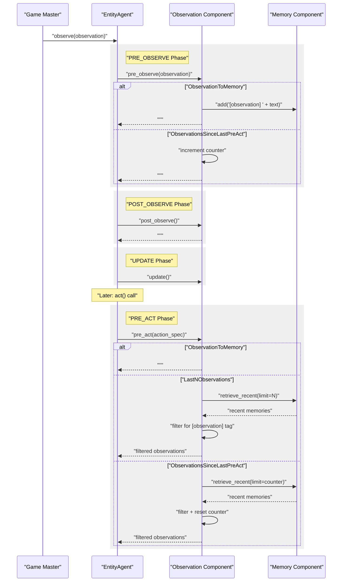
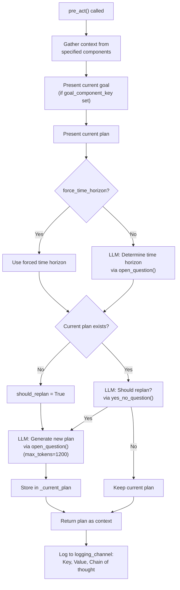
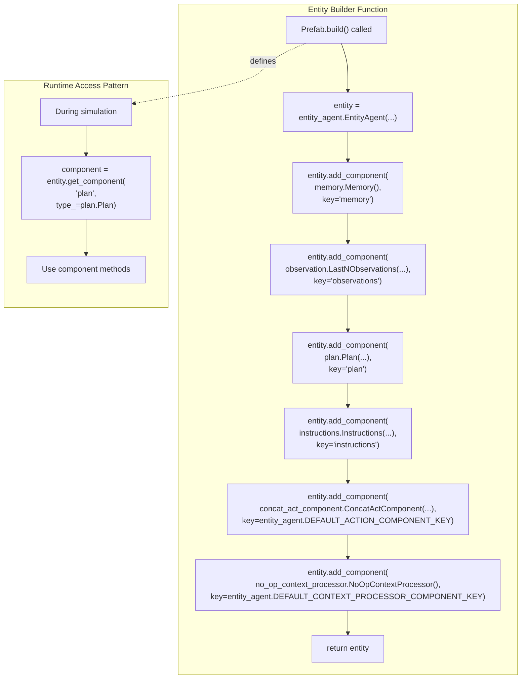
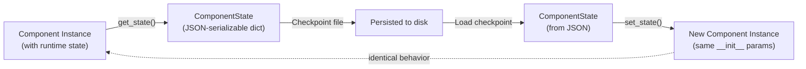
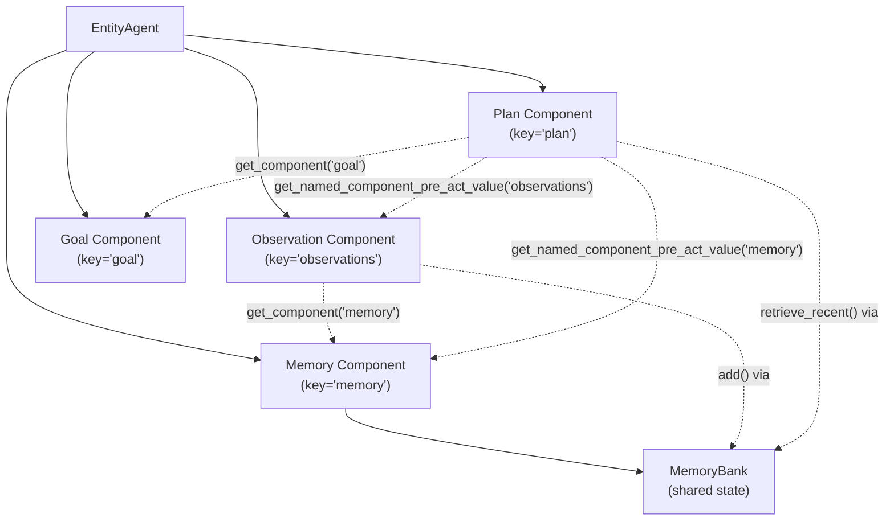

<!-- source: DeepWiki mcp.deepwiki.com · repo google-deepmind/concordia · extra page Agent Component Library · fetched 2026-10-26 -->

# Agent Components

<details>
<summary>Relevant source files</summary>

The following files were used as context for generating this wiki page:

- [concordia/agents/entity_agent.py](concordia/agents/entity_agent.py)
- [concordia/components/agent/observation.py](concordia/components/agent/observation.py)
- [concordia/components/agent/plan.py](concordia/components/agent/plan.py)

</details>


## Purpose and Scope

This document catalogs the available agent components in Concordia that can be composed to create EntityAgent instances. Agent components are modular, reusable building blocks that provide specific functionality such as memory management, observation processing, planning, reflection, and social reasoning. Each component plugs into the entity lifecycle (documented in [Component Types and Lifecycle](#2.1.2)) and can access the parent EntityAgent and other components.

For information about the EntityAgent class itself and how it manages components, see [EntityAgent](#2.1.1). For information about Game Master components, see [Game Master Components](#2.2.1).

**Sources:** [concordia/components/agent/__init__.py:1-29]()

---

## Component Architecture Overview

Agent components inherit from base classes defined in the entity component system. The three primary component types are:

| Component Type | Base Class | Primary Method | Purpose |
|---|---|---|---|
| **Context Components** | `ContextComponent` | `pre_act()`, `post_act()`, `pre_observe()`, `post_observe()`, `update()` | Provide context and react to entity lifecycle events |
| **Acting Components** | `ActingComponent` | `get_action_attempt()` | Generate the entity's action based on aggregated context |
| **Context Processor Components** | `ContextProcessorComponent` | `pre_act()`, `post_act()`, etc. | Process aggregated contexts from all components |

All components implement `get_state()` and `set_state()` for serialization and checkpointing.

**Sources:** [concordia/typing/entity_component.py:211-366]()

---

## Component Taxonomy

```mermaid
graph TB
    ROOT["Agent Component Library<br/>(concordia.components.agent)"]
    
    ROOT --> MEM["Memory Components"]
    ROOT --> OBS["Observation Components"]
    ROOT --> COG["Cognitive Components"]
    ROOT --> REFL["Reflection Components"]
    ROOT --> SOC["Social Components"]
    ROOT --> ACT["Acting Components"]
    ROOT --> UTIL["Utility Components"]
    
    MEM --> MEM1["memory.Memory"]
    MEM --> MEM2["memory.MemoryWithEmbedding"]
    MEM --> MEM3["all_similar_memories"]
    
    OBS --> OBS1["observation.ObservationToMemory"]
    OBS --> OBS2["observation.LastNObservations"]
    OBS --> OBS3["observation.ObservationsSinceLastPreAct"]
    
    COG --> COG1["plan.Plan"]
    COG --> COG2["instructions.Instructions"]
    COG --> COG3["question_of_recent_memories"]
    
    ACT --> ACT1["concat_act_component.ConcatActComponent"]
    ACT --> ACT2["scripted_act.ScriptedAct"]
    
    UTIL --> UTIL1["constant.Constant"]
    UTIL --> UTIL2["report_function.ReportFunction"]
    UTIL --> UTIL3["action_spec_ignored.ActionSpecIgnored"]
    UTIL --> UTIL4["no_op_context_processor.NoOpContextProcessor"]
```



**Component Taxonomy Diagram** - Shows the categorical organization of agent components

**Sources:** [concordia/components/agent/__init__.py:17-29]()

---

## Memory Components

Memory components manage the storage and retrieval of information for the agent. The primary memory component provides a unified interface for adding and querying memories.

### Memory Base Classes

**`memory.Memory`** - The foundational memory component that stores and retrieves textual memories. Located in `concordia/components/agent/memory.py`.

Key methods:
- `add(memory: str)` - Store a new memory
- `retrieve_recent(limit: int)` - Retrieve the N most recent memories
- `retrieve_by_regex(regex: str)` - Retrieve memories matching a pattern

**`memory.MemoryWithEmbedding`** - Extends `Memory` with semantic search capabilities using embeddings. Enables retrieval based on semantic similarity rather than recency or pattern matching.

**`all_similar_memories`** - A component that retrieves memories similar to a given query using embeddings. Typically used to provide relevant context based on the current situation.

### Memory Component Constants

**`memory.DEFAULT_MEMORY_COMPONENT_KEY`** - Standard key (`'memory'`) used to identify the memory component when retrieving it from an entity.

**Sources:** [concordia/components/agent/__init__.py:22](), [concordia/components/agent/observation.py:18-20]()

---

## Observation Components

Observation components handle the processing of observations that entities receive during the `observe()` lifecycle method. These components bridge the gap between raw observations and the agent's memory system.

### ObservationToMemory

**Class:** `observation.ObservationToMemory`

The simplest observation handler. Immediately adds all observations to the entity's memory component with an `[observation]` tag. Does not provide any context during `pre_act`.

```python
# Usage pattern:
observation_component = observation.ObservationToMemory(
    memory_component_key=memory_component.DEFAULT_MEMORY_COMPONENT_KEY
)
```

**Key behavior:**
- **`pre_observe()`**: Tags the observation with `OBSERVATION_TAG` (`'[observation]'`) and adds it to memory
- **`pre_act()`**: Returns empty string (does not provide context)

**Sources:** [concordia/components/agent/observation.py:29-62]()

---

### LastNObservations

**Class:** `observation.LastNObservations`

Retrieves the last N observations from memory during `pre_act`. Useful for agents that need to consider recent history when acting.

```python
# Usage pattern:
observation_component = observation.LastNObservations(
    history_length=5,
    memory_component_key=memory_component.DEFAULT_MEMORY_COMPONENT_KEY,
    pre_act_label='Observations (ordered from oldest to latest)'
)
```

**Parameters:**
- `history_length`: Maximum number of observations to retrieve
- `memory_component_key`: Name of the memory component to query (default: `DEFAULT_MEMORY_COMPONENT_KEY`)
- `pre_act_label`: Label prefix for the context output (default: `DEFAULT_OBSERVATION_PRE_ACT_LABEL`)

**Key behavior:**
- **`pre_act()`**: Retrieves `history_length` recent memories, filters for those containing `OBSERVATION_TAG`, and returns them as context
- Implements logging via `ComponentWithLogging`

**Sources:** [concordia/components/agent/observation.py:64-114]()

---

### ObservationsSinceLastPreAct

**Class:** `observation.ObservationsSinceLastPreAct`

Retrieves only observations received since the last `pre_act` call. Useful for agents that process observations incrementally.

**Key behavior:**
- **`pre_observe()`**: Increments a counter tracking observations since last `pre_act`
- **`pre_act()`**: Retrieves the counted number of recent observations, filters for observation tags, resets counter to 0
- **State management**: Tracks `_num_since_last_pre_act` in serializable state

**Sources:** [concordia/components/agent/observation.py:116-177]()

---

## Observation Component Lifecycle



**Observation Component Lifecycle Diagram** - Shows how different observation components interact with the entity lifecycle phases

**Sources:** [concordia/components/agent/observation.py:29-177]()

---

## Planning Components

### Plan

**Class:** `plan.Plan`

A cognitive component that generates and maintains a multi-step plan for the agent using LLM-driven reasoning. The component determines an appropriate time horizon and creates a step-by-step plan.

```python
# Usage pattern:
plan_component = plan.Plan(
    model=language_model,
    components=['memory', 'goal', 'observations'],
    goal_component_key='goal',
    force_time_horizon=False,
    pre_act_label='Plan'
)
```

**Parameters:**
- `model`: The `LanguageModel` instance to use for planning
- `components`: List of component keys to use as context for planning
- `goal_component_key`: Specific component key representing the agent's goal
- `force_time_horizon`: If set to a string, uses this fixed time horizon instead of asking the LLM to determine it
- `pre_act_label`: Context label (default: `'Plan'`)

**Key behavior:**
- Uses `InteractiveDocument` to construct a multi-step LLM conversation
- First determines the time horizon for planning (unless forced)
- Asks whether the current plan should be changed
- If replanning is needed, generates a new step-by-step plan
- Maintains `_current_plan` state across calls

**Sources:** [concordia/components/agent/plan.py:27-163]()

---

### Plan Component Reasoning Flow



**Plan Component Reasoning Flow Diagram** - Shows the decision tree for plan generation and updating

**Sources:** [concordia/components/agent/plan.py:74-152]()

---

## Instructions Component

**Class:** `instructions.Instructions`

A simple component that provides role-playing instructions to the agent, explaining that they are participating in a social science experiment and should act as realistically as possible.

```python
# Usage pattern:
instructions_component = instructions.Instructions(
    agent_name='Alice',
    pre_act_label='Role playing instructions'
)
```

**Inherits from:** `constant.Constant` - Returns the same text on every `pre_act()` call

**Generated instructions:**
- Explains the experiment setup (tabletop roleplaying format)
- Emphasizes realistic behavior
- Instructs use of third-person limited perspective
- Customized with the agent's name

**Sources:** [concordia/components/agent/instructions.py:22-44]()

---

## Acting Components

### ConcatActComponent

**Class:** `concat_act_component.ConcatActComponent`

The standard acting component that aggregates context from all components and uses an LLM to generate an action.

**Key method:**
- `get_action_attempt(context: ComponentContextMapping, action_spec: ActionSpec)` - Concatenates all context values, presents them to the LLM with the `call_to_action`, and returns the generated action

**Sources:** [concordia/components/agent/__init__.py:19]()

---

### ScriptedAct

**Class:** `scripted_act.ScriptedAct`

An acting component that returns pre-defined actions instead of using an LLM. Useful for testing or for agents with deterministic behavior.

**Sources:** [concordia/components/agent/__init__.py:28]()

---

## Utility Components

### ActionSpecIgnored

**Class:** `action_spec_ignored.ActionSpecIgnored`

A base class for context components that don't need to differentiate behavior based on the action spec. Provides convenience methods for standard component behavior.

**Key features:**
- Stores a `pre_act_label` that is returned by `get_pre_act_label()`
- Provides `get_named_component_pre_act_value()` helper to retrieve context from other components
- Abstract method `_make_pre_act_value()` that subclasses implement
- Automatically handles the `pre_act()` call by delegating to `_make_pre_act_value()`

**Common subclasses:** Most context components (observations, plan, etc.)

**Sources:** [concordia/components/agent/observation.py:18](), [concordia/components/agent/plan.py:19]()

---

### Constant

**Class:** `constant.Constant`

A simple component that returns the same constant text value on every `pre_act()` call. Used as a base class for components like `Instructions`.

**Usage:**
```python
constant_component = constant.Constant(
    state='This is constant information',
    pre_act_label='Fixed Context'
)
```

**Sources:** [concordia/components/agent/__init__.py:20](), [concordia/components/agent/instructions.py:17]()

---

### ReportFunction

**Class:** `report_function.ReportFunction`

A component that executes a custom function during `pre_act()` and returns its result as context. Allows injecting arbitrary Python functions into the component system.

**Sources:** [concordia/components/agent/__init__.py:27]()

---

### NoOpContextProcessor

**Class:** `no_op_context_processor.NoOpContextProcessor`

A context processor component that does nothing. Used when an entity requires a context processor but no processing is needed.

**Sources:** [concordia/components/agent/no_op_context_processor.py:20-22]()

---

## Component Composition Pattern



**Component Composition Pattern Diagram** - Shows typical pattern for building an entity with multiple components

**Sources:** [concordia/components/agent/__init__.py:17-29](), [concordia/typing/entity_component.py:186-198]()

---

## Component Registration and Keys

Components are registered with the entity using string keys. Standard key conventions include:

| Component Type | Standard Key | Constant |
|---|---|---|
| Memory | `'memory'` | `memory.DEFAULT_MEMORY_COMPONENT_KEY` |
| Observations | `'__observation__'` | `observation.DEFAULT_OBSERVATION_COMPONENT_KEY` |
| Acting | `'acting_component'` | `entity_agent.DEFAULT_ACTION_COMPONENT_KEY` |
| Context Processor | `'context_processor'` | `entity_agent.DEFAULT_CONTEXT_PROCESSOR_COMPONENT_KEY` |

Custom components can use any unique string key. Components can reference other components by key:

```python
# Pattern used in observation components
memory = self.get_entity().get_component(
    self._memory_component_key, 
    type_=memory_component.Memory
)
```

**Sources:** [concordia/components/agent/observation.py:22-25](), [concordia/components/agent/observation.py:34-36]()

---

## State Management and Serialization

All components implement `get_state()` and `set_state()` for checkpointing:



**State Management Flow Diagram** - Shows how component state is serialized and restored

**Key principles:**
- **State excludes initialization parameters** - Only runtime state is serialized (e.g., `_current_plan` in `Plan`, `_num_since_last_pre_act` in `ObservationsSinceLastPreAct`)
- **Deterministic restoration** - `set_state()` called on an instance with identical `__init__` parameters reproduces exact behavior
- **Empty state is valid** - Components with no runtime state return `{}` from `get_state()`

**Examples:**

```python
# Plan component state
def get_state(self) -> entity_component.ComponentState:
    with self._lock:
        return {'current_plan': self._current_plan}

# ObservationsSinceLastPreAct state  
def get_state(self) -> entity_component.ComponentState:
    with self._lock:
        return {'num_since_last_pre_act': self._num_since_last_pre_act}

# LastNObservations (stateless)
def get_state(self) -> entity_component.ComponentState:
    return {}
```

**Sources:** [concordia/components/agent/plan.py:154-162](), [concordia/components/agent/observation.py:107-177](), [concordia/typing/entity_component.py:118-162]()

---

## Component Logging

Components that inherit from `ComponentWithLogging` can emit structured log data:

```python
class ComponentWithLogging(BaseComponent):
    def set_logging_channel(self, logging_channel: LoggingChannel):
        """Sets the logging channel for the component."""
        self._logging_channel = logging_channel
```

**Logging pattern:**
```python
self._logging_channel({
    'Key': self.get_pre_act_label(),
    'Value': result,
    'Chain of thought': prompt.view().text().splitlines(),
})
```

Components emit logs during their lifecycle methods (typically in `pre_act()`). The logging system captures:
- Component key/label
- Generated values
- LLM prompts and reasoning chains
- Summary information

**Sources:** [concordia/typing/entity_component.py:165-175](), [concordia/components/agent/plan.py:146-150](), [concordia/components/agent/observation.py:101-103]()

---

## Component Dependencies and References

Components often reference other components to access shared state:



**Component Dependency Graph** - Shows typical inter-component references in a composed entity

**Access patterns:**

1. **Direct component access:**
```python
memory = self.get_entity().get_component(
    'memory', 
    type_=memory_component.Memory
)
```

2. **Pre-act value access:**
```python
value = self.get_named_component_pre_act_value('other_component')
```

3. **Component label access:**
```python
label = self.get_component_pre_act_label('other_component')
```

**Sources:** [concordia/components/agent/observation.py:51-53](), [concordia/components/agent/plan.py:60-72]()

---

## Common Usage Patterns

### Pattern 1: Basic Agent with Memory and Observations

```python
from concordia.components.agent import memory
from concordia.components.agent import observation
from concordia.components.agent import concat_act_component

# Create memory
mem = memory.Memory()

# Create observation handler
obs = observation.LastNObservations(
    history_length=10,
    memory_component_key=memory.DEFAULT_MEMORY_COMPONENT_KEY
)

# Create acting component
act = concat_act_component.ConcatActComponent(model=language_model)

# Add to entity
entity.add_component(mem, key='memory')
entity.add_component(obs, key='observations')
entity.add_component(act, key=entity_agent.DEFAULT_ACTION_COMPONENT_KEY)
```

### Pattern 2: Agent with Planning

```python
from concordia.components.agent import plan
from concordia.components.agent import instructions

# Add instructions
inst = instructions.Instructions(agent_name=entity.name)
entity.add_component(inst, key='instructions')

# Add planning component that references other components
plan_comp = plan.Plan(
    model=language_model,
    components=['memory', 'observations', 'instructions'],
    goal_component_key='goal'  # if you have a goal component
)
entity.add_component(plan_comp, key='plan')
```

### Pattern 3: Observation Accumulation

```python
# For agents that process observations as they arrive
obs_immediate = observation.ObservationToMemory()
entity.add_component(obs_immediate, key='observation_handler')

# For agents that batch process observations
obs_batch = observation.ObservationsSinceLastPreAct(
    memory_component_key='memory',
    pre_act_label='Recent observations'
)
entity.add_component(obs_batch, key='observation_batch')
```

**Sources:** [concordia/components/agent/observation.py:29-177](), [concordia/components/agent/plan.py:27-163](), [concordia/components/agent/instructions.py:22-44]()

---

