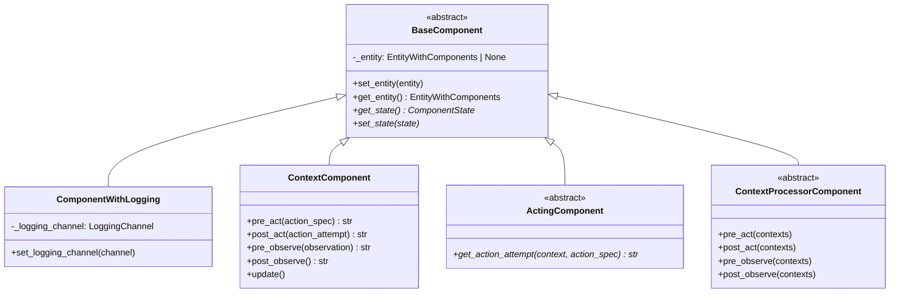
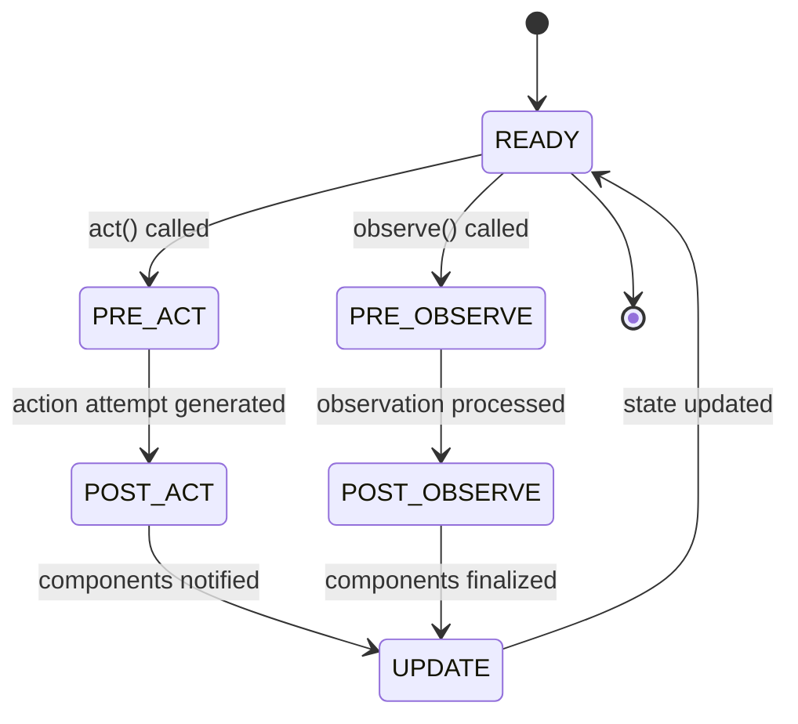
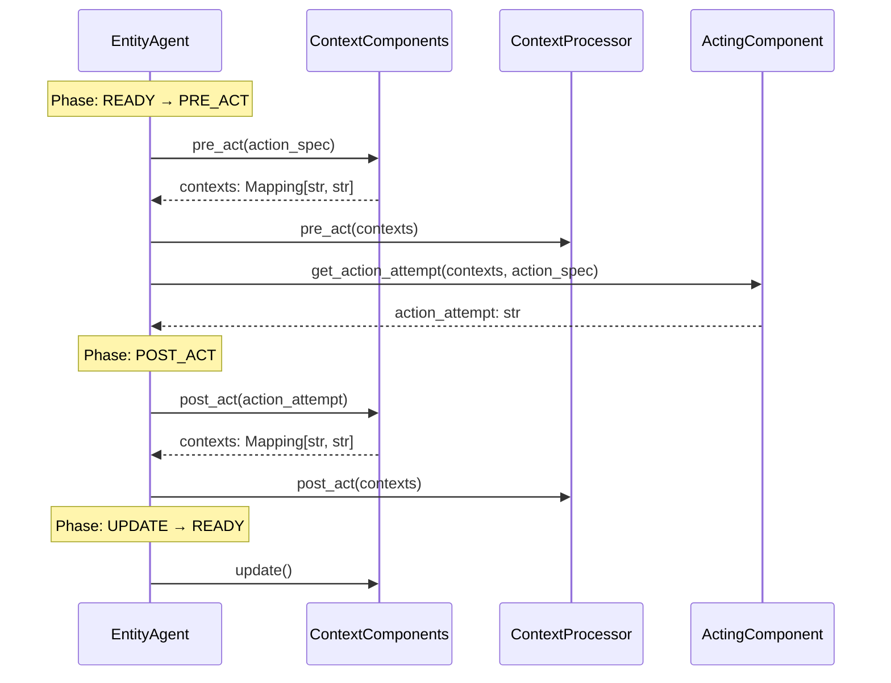
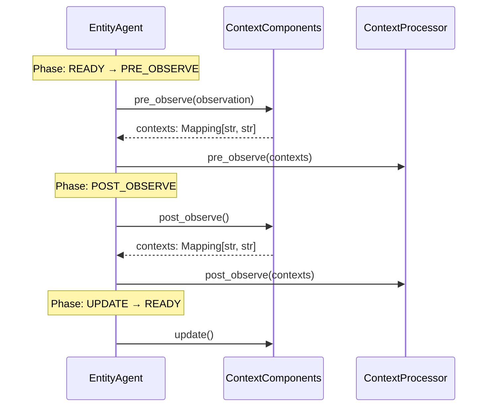
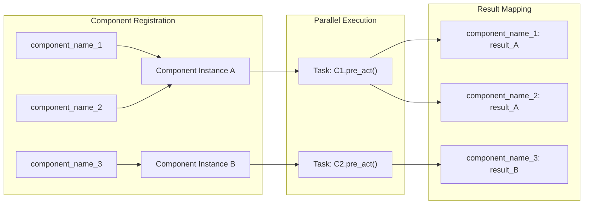

<!-- source: DeepWiki mcp.deepwiki.com · repo google-deepmind/concordia · extra page Component Base Classes and Lifecycle · fetched 2026-10-26 -->

# Component Types and Lifecycle

<details>
<summary>Relevant source files</summary>

The following files were used as context for generating this wiki page:

- [concordia/components/agent/__init__.py](concordia/components/agent/__init__.py)
- [concordia/components/agent/instructions.py](concordia/components/agent/instructions.py)
- [concordia/components/agent/no_op_context_processor.py](concordia/components/agent/no_op_context_processor.py)
- [concordia/typing/entity_component.py](concordia/typing/entity_component.py)
- [concordia/typing/logging.py](concordia/typing/logging.py)

</details>


## Purpose and Scope

This document describes the component base classes and lifecycle phases that form the foundation of Concordia's Entity Component System (ECS). It covers the three primary component types (`ContextComponent`, `ActingComponent`, `ContextProcessorComponent`), the phase-based execution model (`Phase` enum), and how components interact with `EntityAgent` throughout the agent lifecycle. 

For details on the `EntityAgent` class that orchestrates these components, see [2.1.1](#2.1.1). For specific component implementations like memory, planning, and reflection components, see [2.1.3](#2.1.3).

---

## Component Base Classes

All components in Concordia inherit from a hierarchy of base classes that define their interface and responsibilities. The component system is defined in [concordia/typing/entity_component.py]().

### Component Class Hierarchy



**Sources:** [concordia/typing/entity_component.py:90-366]()

### BaseComponent

`BaseComponent` is the root of the component hierarchy. All components must implement:

| Method | Purpose |
|--------|---------|
| `set_entity(entity)` | Associates the component with an `EntityWithComponents` instance |
| `get_entity()` | Retrieves the associated entity |
| `get_state()` | Returns serializable state for checkpointing |
| `set_state(state)` | Restores component state from a checkpoint |

The entity reference is stored in `_entity` and managed through `set_entity()`. This creates a bidirectional relationship: the entity owns the component, and the component can access the entity to retrieve other components or entity-level information.

**Sources:** [concordia/typing/entity_component.py:90-163]()

### ContextComponent

`ContextComponent` is the primary building block for agent functionality. These components provide context to the agent during different lifecycle phases and can maintain internal state. The key methods correspond to lifecycle phases:

| Method | Called During Phase | Returns | Purpose |
|--------|---------------------|---------|---------|
| `pre_act(action_spec)` | `PRE_ACT` | `str` | Provides context before action generation |
| `post_act(action_attempt)` | `POST_ACT` | `str` | Reacts to the attempted action |
| `pre_observe(observation)` | `PRE_OBSERVE` | `str` | Processes incoming observations |
| `post_observe()` | `POST_OBSERVE` | `str` | Provides context after observation processing |
| `update()` | `UPDATE` | None | Updates internal state and caches |

All methods return strings that are aggregated by the entity. The default implementations return empty strings, allowing components to opt-in to only the phases they need.

**Sources:** [concordia/typing/entity_component.py:211-296]()

### ActingComponent

`ActingComponent` is a privileged component type responsible for generating the agent's action. An `EntityAgent` must have exactly one `ActingComponent`. The single abstract method is:

```
get_action_attempt(
    context: ComponentContextMapping,
    action_spec: ActionSpec
) -> str
```

This method receives:
- `context`: A mapping of component names to the strings returned by their `pre_act()` methods
- `action_spec`: Specifications for the action format (free text, multiple choice, etc.)

The `ActingComponent` typically aggregates the context strings and uses a language model to generate the action attempt.

**Sources:** [concordia/typing/entity_component.py:298-322]()

### ContextProcessorComponent

`ContextProcessorComponent` provides a hook for processing the aggregated context from all `ContextComponent` instances. Unlike `ContextComponent`, which produces context, this component consumes context mappings:

| Method | Receives | Purpose |
|--------|----------|---------|
| `pre_act(contexts)` | `ComponentContextMapping` | Process contexts before action generation |
| `post_act(contexts)` | `ComponentContextMapping` | Process contexts after action attempt |
| `pre_observe(contexts)` | `ComponentContextMapping` | Process contexts during observation |
| `post_observe(contexts)` | `ComponentContextMapping` | Process contexts after observation |

The default implementation `NoOpContextProcessor` does nothing, making this component optional. Custom implementations might log context, validate consistency, or perform meta-reasoning.

**Sources:** [concordia/typing/entity_component.py:324-366](), [concordia/components/agent/no_op_context_processor.py]()

---

## Lifecycle Phases

The `Phase` enum defines a strict state machine governing component execution order. Each phase has a defined set of valid successor phases.

### Phase Enum Definition



**Sources:** [concordia/typing/entity_component.py:39-88]()

### Phase Descriptions

| Phase | Description | Valid Successors |
|-------|-------------|------------------|
| `READY` | Agent is idle, ready to observe or act | `PRE_ACT`, `PRE_OBSERVE` |
| `PRE_ACT` | Components gather context for action generation | `POST_ACT` |
| `POST_ACT` | Components process the generated action attempt | `UPDATE` |
| `PRE_OBSERVE` | Components process incoming observation | `POST_OBSERVE` |
| `POST_OBSERVE` | Components finalize observation processing | `UPDATE` |
| `UPDATE` | Components update internal state and caches | `READY` |

The phase transitions are validated at runtime using `Phase.check_successor()` [concordia/typing/entity_component.py:84-87](). Attempting an invalid transition raises a `ValueError`.

**Sources:** [concordia/typing/entity_component.py:39-88]()

---

## Component Method Invocation by Phase

The `EntityAgent` orchestrates component method calls based on the current phase. The following table maps phases to the methods invoked:

### Acting Lifecycle



| Phase | Component Type | Method Called | Input | Output |
|-------|---------------|---------------|-------|--------|
| `PRE_ACT` | `ContextComponent` | `pre_act(action_spec)` | `ActionSpec` | `str` |
| `PRE_ACT` | `ContextProcessorComponent` | `pre_act(contexts)` | `ComponentContextMapping` | None |
| `PRE_ACT` | `ActingComponent` | `get_action_attempt(contexts, action_spec)` | `ComponentContextMapping`, `ActionSpec` | `str` |
| `POST_ACT` | `ContextComponent` | `post_act(action_attempt)` | `str` | `str` |
| `POST_ACT` | `ContextProcessorComponent` | `post_act(contexts)` | `ComponentContextMapping` | None |
| `UPDATE` | `ContextComponent` | `update()` | None | None |

**Sources:** [concordia/agents/entity_agent.py:164-184]()

### Observing Lifecycle



| Phase | Component Type | Method Called | Input | Output |
|-------|---------------|---------------|-------|--------|
| `PRE_OBSERVE` | `ContextComponent` | `pre_observe(observation)` | `str` | `str` |
| `PRE_OBSERVE` | `ContextProcessorComponent` | `pre_observe(contexts)` | `ComponentContextMapping` | None |
| `POST_OBSERVE` | `ContextComponent` | `post_observe()` | None | `str` |
| `POST_OBSERVE` | `ContextProcessorComponent` | `post_observe(contexts)` | `ComponentContextMapping` | None |
| `UPDATE` | `ContextComponent` | `update()` | None | None |

**Sources:** [concordia/agents/entity_agent.py:187-200]()

---

## State Management

All components implement `get_state()` and `set_state()` for serialization and restoration. This enables checkpointing entire simulations.

### State Contract

The state contract follows these principles:

1. **Initialization Independence**: State does not include constructor arguments (e.g., memory bank references, component names). Components are restored by calling `__init__` with original parameters, then `set_state()` with saved state.

2. **Identical Behavior**: After state restoration, a component behaves identically to its state at the time of serialization.

3. **Serializable Types**: State is represented as nested mappings, sequences, and primitives (`str`, `int`, `float`, `None`).

```python
# Type definition from entity_component.py
_LeafT = str | int | float | None
_ValueT = _LeafT | Collection["_ValueT"] | Mapping[str, "_ValueT"]
ComponentState = Mapping[str, _ValueT]
```

**Sources:** [concordia/typing/entity_component.py:32-36]()

### Entity-Level State

`EntityAgent.get_state()` returns an `EntityState` containing:

```python
{
    'act_component': ComponentState,
    'context_processor': ComponentState,
    'context_components': {
        'component_name_1': ComponentState,
        'component_name_2': ComponentState,
        # ...
    }
}
```

Restoration via `EntityAgent.set_state()` calls `set_state()` on each component, wrapping exceptions to ensure partial restoration succeeds even if individual components fail.

**Sources:** [concordia/agents/entity_agent.py:202-251]()

---

## Component Orchestration in EntityAgent

The `EntityAgent` class implements the complete orchestration of components through lifecycle phases. Key implementation details:

### Parallel Execution

Components are called in parallel where possible to reduce latency. The `_parallel_call_()` method [concordia/agents/entity_agent.py:120-161]() handles this:

1. **Deduplication**: If a component instance is registered under multiple names, its method is called only once
2. **Thread Pool**: Uses `ThreadPoolExecutor` via `concurrency.run_tasks()`
3. **Result Mapping**: Maps single result back to all names under which the component is registered



**Sources:** [concordia/agents/entity_agent.py:120-161]()

### Thread Safety

Phase transitions are protected by locks:

- `_control_lock`: Ensures `act()` and `observe()` methods are not called concurrently
- `_phase_lock`: Protects reads and writes to the `_phase` attribute

This allows safe concurrent access to `get_phase()` while preventing race conditions during lifecycle transitions.

**Sources:** [concordia/agents/entity_agent.py:70-100]()

### Component Registration

Components are registered during `EntityAgent.__init__()`:

```python
def __init__(
    self,
    agent_name: str,
    act_component: ActingComponent,
    context_processor: ContextProcessorComponent | None = None,
    context_components: Mapping[str, ContextComponent] = ...,
):
```

Each component's `set_entity(self)` is called to establish the bidirectional relationship. If no `context_processor` is provided, a `NoOpContextProcessor` is used by default.

**Sources:** [concordia/agents/entity_agent.py:45-86]()

### Accessing Components

Components can be retrieved by name using `get_component()`:

```python
component = entity.get_component(
    'component_name',
    type_=SpecificComponentType
)
```

This enables components to access each other's functionality and state during execution. The optional `type_` parameter provides type safety through casting.

**Sources:** [concordia/agents/entity_agent.py:102-110]()

---

## Type Definitions

The following type aliases are defined in [concordia/typing/entity_component.py:27-36]():

| Type | Definition | Purpose |
|------|------------|---------|
| `ComponentName` | `str` | Key for component in mappings |
| `ComponentContext` | `str` | String returned by component lifecycle methods |
| `ComponentContextMapping` | `Mapping[ComponentName, ComponentContext]` | Aggregated contexts from all components |
| `ComponentState` | `Mapping[str, _ValueT]` | Serializable component state |
| `EntityState` | `Mapping[str, ComponentState \| Mapping[str, ComponentState]]` | Complete entity state with all components |

**Sources:** [concordia/typing/entity_component.py:27-36]()

---

