<!-- source: DeepWiki mcp.deepwiki.com · repo google-deepmind/concordia · extra page EntityAgent Implementation · fetched 2026-10-26 -->

# EntityAgent Implementation

<details>
<summary>Relevant source files</summary>

The following files were used as context for generating this wiki page:

- [concordia/agents/entity_agent.py](concordia/agents/entity_agent.py)

</details>


The `EntityAgent` class is the concrete orchestrator that implements the entity-component architecture in Concordia. It manages component lifecycle, coordinates parallel execution, and provides thread-safe state transitions for autonomous agents in generative simulations.

For information about Game Master entities that orchestrate simulations, see page 2.2. For details about the component base classes and phase system, see page 2.1.1. For the library of built-in components that EntityAgent orchestrates, see page 2.1.3.

## Class Structure and Responsibilities

The `EntityAgent` class in [concordia/agents/entity_agent.py:35-277]() serves as the concrete implementation of `EntityWithComponents` interface. It orchestrates component execution, manages phase transitions, and enforces thread safety through locking mechanisms.

### EntityAgent Internal State

```mermaid
graph TB
    subgraph "EntityAgent Class"
        CLASS["EntityAgent(EntityWithComponents)"]
        NAME["_agent_name: str"]
        CONTROL["_control_lock: threading.Lock"]
        PHASE_LOCK["_phase_lock: threading.Lock"]
        PHASE["_phase: entity_component.Phase"]
        ACT_COMP["_act_component: ActingComponent"]
        CTX_PROC["_context_processor: ContextProcessorComponent"]
        CTX_COMPS["_context_components: dict[str, ContextComponent]"]
    end
    
    subgraph "Public Methods"
        NAME_PROP["name: str (property)"]
        GET_PHASE["get_phase() -> Phase"]
        GET_COMP["get_component(name, type_) -> ComponentT"]
        GET_ACT["get_act_component() -> ActingComponent"]
        GET_ALL["get_all_context_components() -> Mapping"]
        ACT["act(action_spec) -> str"]
        OBSERVE["observe(observation) -> None"]
        GET_STATE["get_state() -> EntityState"]
        SET_STATE["set_state(EntityState) -> None"]
        STATELESS["stateless_act(action_spec) -> str"]
    end
    
    subgraph "Internal Methods"
        SET_PHASE["_set_phase(Phase) -> None"]
        PAR_CALL["_parallel_call_(method_name, *args) -> ComponentContextMapping"]
    end
    
    CLASS --> NAME
    CLASS --> CONTROL
    CLASS --> PHASE_LOCK
    CLASS --> PHASE
    CLASS --> ACT_COMP
    CLASS --> CTX_PROC
    CLASS --> CTX_COMPS
    
    CLASS --> NAME_PROP
    CLASS --> GET_PHASE
    CLASS --> GET_COMP
    CLASS --> GET_ACT
    CLASS --> GET_ALL
    CLASS --> ACT
    CLASS --> OBSERVE
    CLASS --> GET_STATE
    CLASS --> SET_STATE
    CLASS --> STATELESS
    CLASS --> SET_PHASE
    CLASS --> PAR_CALL
```

**Sources**: [concordia/agents/entity_agent.py:35-277]()

## Component Registration and Ownership

The `EntityAgent.__init__()` method establishes component ownership by calling `component.set_entity(self)` on all registered components. This bi-directional relationship allows components to access their parent entity for shared resources.

### Component Types and Requirements

| Component Type | Field Name | Required | Default |
|---|---|---|---|
| `ActingComponent` | `_act_component` | Yes | None |
| `ContextProcessorComponent` | `_context_processor` | No | `NoOpContextProcessor` |
| `ContextComponent` | `_context_components` (dict) | No | Empty dict |

### Component Initialization Flow

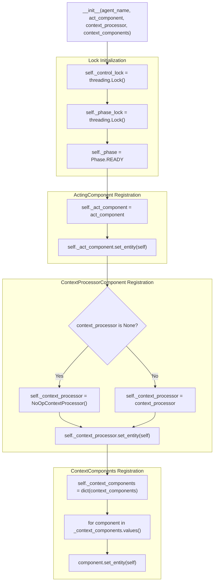

**Sources**: [concordia/agents/entity_agent.py:45-86](), [concordia/components/agent/no_op_context_processor.py]()

### Component Lookup Methods

The `EntityAgent` provides three methods for accessing registered components:

| Method | Return Type | Purpose |
|---|---|---|
| `get_component(name, type_)` | `ComponentT` | Retrieves a context component by name with type checking |
| `get_act_component()` | `ActingComponent` | Returns the acting component |
| `get_all_context_components()` | `Mapping[str, ContextComponent]` | Returns immutable mapping of all context components |

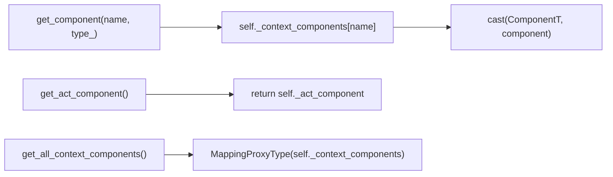

**Sources**: [concordia/agents/entity_agent.py:103-118]()

## Phase Transition Management

The `EntityAgent` enforces strict phase transitions using the `_phase` field and `_phase_lock` to maintain consistency. All transitions are validated through the `Phase.check_successor()` method.

### Phase State Machine

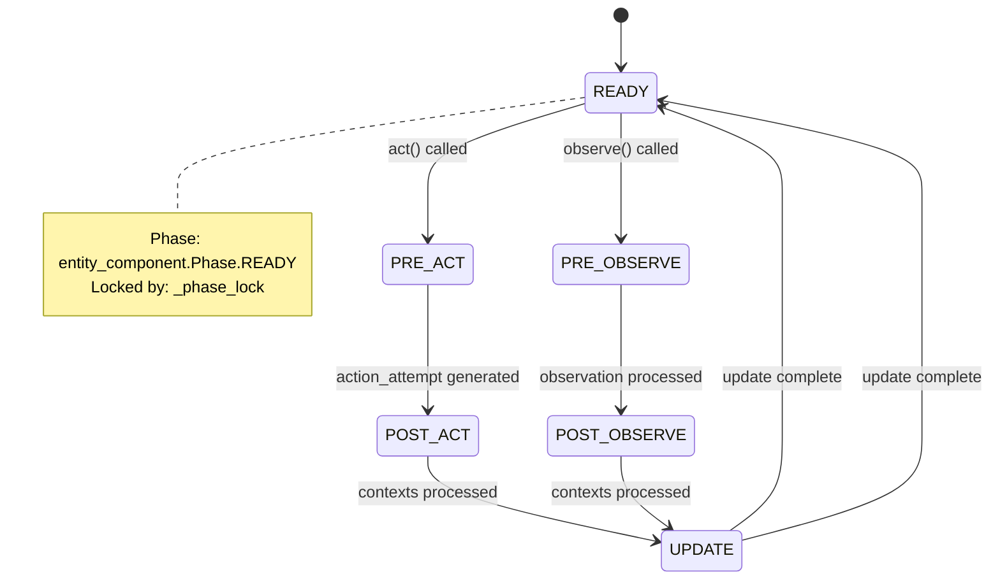

**Sources**: [concordia/agents/entity_agent.py:72](), [concordia/typing/entity_component.py]()

### Phase Transition Implementation

The `_set_phase()` method enforces valid transitions:

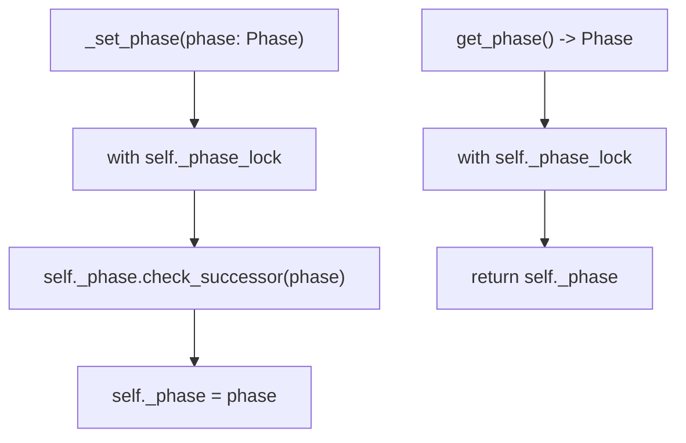

The `Phase.check_successor()` method raises an exception if an invalid transition is attempted (e.g., `READY` → `POST_ACT` without going through `PRE_ACT`).

**Sources**: [concordia/agents/entity_agent.py:93-100](), [concordia/typing/entity_component.py]()

## Parallel Component Execution

The `_parallel_call_()` method coordinates parallel execution of component methods while ensuring that each unique component instance is invoked exactly once, even if registered under multiple names.

### Deduplication and Parallelization Strategy

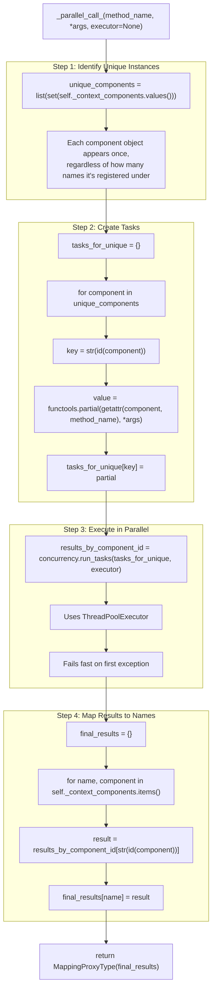

This deduplication is critical for performance: if the same component instance is registered as "observations", "memory", and "recent_context", its LLM-based methods are called only once, with the result shared across all three names.

**Sources**: [concordia/agents/entity_agent.py:120-162](), [concordia/utils/concurrency.py:112-143]()

### Thread Pool Execution

The `concurrency.run_tasks()` function manages the actual parallel execution:

| Feature | Implementation |
|---|---|
| Executor | `ThreadPoolExecutor` (created or reused) |
| Task submission | All tasks submitted before waiting |
| Result collection | `futures.as_completed()` |
| Error handling | First exception cancels remaining tasks |
| Return value | `dict[str, str]` mapping task key to result |

**Sources**: [concordia/utils/concurrency.py:112-143]()

## Act and Observe Methods

The `act()` and `observe()` methods implement the core `Entity` interface. Both methods acquire `_control_lock` to serialize execution, then orchestrate component calls through phase transitions.

### act() Method Implementation

The `act()` method at [concordia/agents/entity_agent.py:165-185]() implements the following sequence:

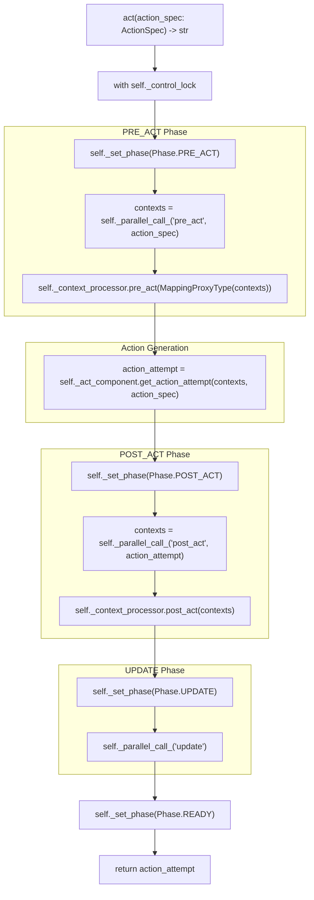

**Key Points**:
- The `_control_lock` ensures only one `act()` or `observe()` call executes at a time
- The `ActionSpec` parameter specifies constraints on the action (e.g., call-to-action, output_format)
- Context components contribute to decision-making in `PRE_ACT` phase
- The `ActingComponent` generates the final action string based on aggregated contexts
- Components can react to the generated action in `POST_ACT` phase

**Sources**: [concordia/agents/entity_agent.py:165-185]()

### observe() Method Implementation

The `observe()` method at [concordia/agents/entity_agent.py:187-201]() processes external observations:

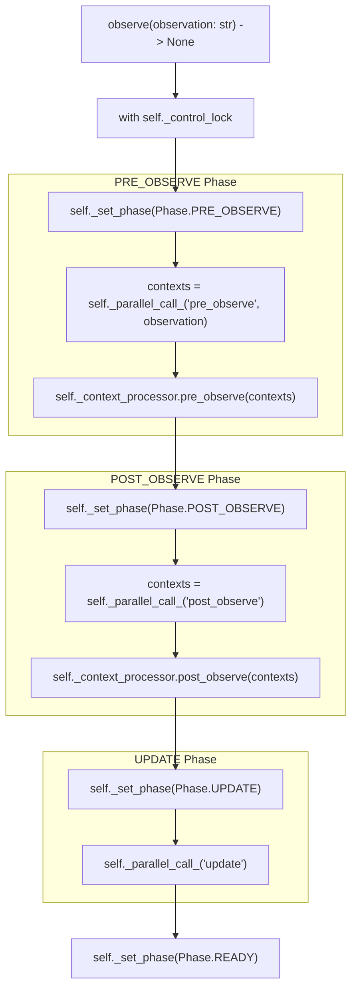

**Key Points**:
- Observations are typically strings describing events or state changes
- Components process observations in `PRE_OBSERVE` (e.g., `ObservationToMemory` stores them)
- No action generation occurs during observation processing
- The `UPDATE` phase allows components to synchronize state after observation

**Sources**: [concordia/agents/entity_agent.py:187-201]()

## State Serialization and Checkpointing

The `get_state()` and `set_state()` methods provide serialization support for simulation checkpointing and resumption.

### State Structure

The `EntityState` type (defined in [concordia/typing/entity_component.py]()) is a dictionary with this structure:

```python
{
    'act_component': dict,           # State from _act_component
    'context_processor': dict,       # State from _context_processor
    'context_components': {          # States from all context components
        'component_name_1': dict,
        'component_name_2': dict,
        ...
    }
}
```

### get_state() Implementation

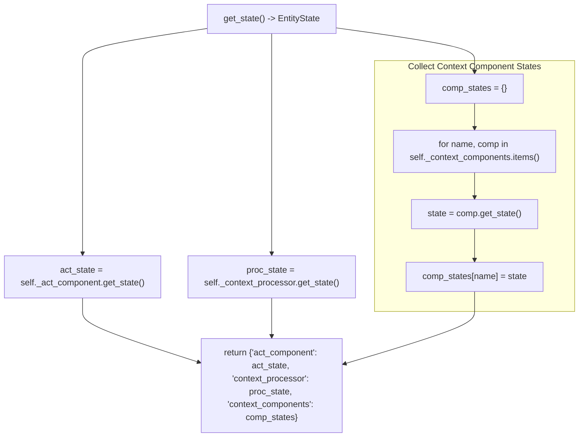

**Sources**: [concordia/agents/entity_agent.py:243-252]()

### set_state() Implementation with Error Handling

The `set_state()` method at [concordia/agents/entity_agent.py:203-241]() restores component states with graceful error handling:

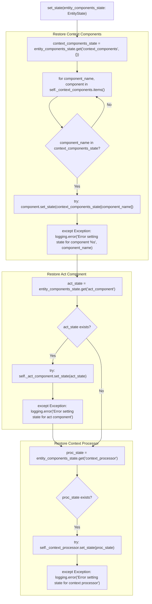

The error handling ensures that if one component's state restoration fails, the process continues for other components. This is critical for simulation robustness when loading checkpoints across different code versions.

**Sources**: [concordia/agents/entity_agent.py:203-241]()

## Specialized Methods

### stateless_act() for Parallel Questionnaires

The `stateless_act()` method at [concordia/agents/entity_agent.py:258-276]() provides an optimized path for parallel questionnaire execution.

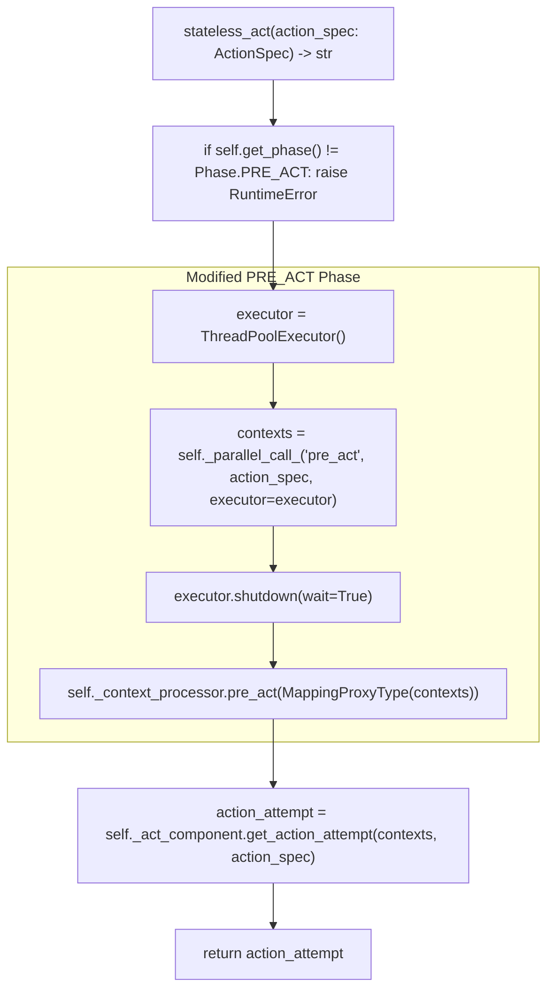

**Key Differences from `act()`**:
- Requires caller to set phase to `PRE_ACT` beforehand
- Does not transition through `POST_ACT` or `UPDATE` phases
- Creates its own `ThreadPoolExecutor` for the `_parallel_call_`
- Used by `ParallelQuestionnaireEngine` to collect responses in parallel

**Usage Pattern** (from [concordia/environment/engines/parallel.py:181-221]()):

```python
# Save original phases
original_phases = {entity: entity.get_phase() for entity in entities}

# Set all to PRE_ACT
for entity in entities:
    entity.set_phase(entity_component.Phase.PRE_ACT)

# Call stateless_act in parallel
answers = parallel_call(
    {entity.name: functools.partial(entity.stateless_act, action_spec)
     for entity in entities}
)

# Restore original phases
for entity in entities:
    entity.set_phase(original_phases[entity])
```

**Sources**: [concordia/agents/entity_agent.py:258-276](), [concordia/environment/engines/parallel.py:181-221]()

### set_phase() for External Phase Control

The `set_phase()` method at [concordia/agents/entity_agent.py:254-256]() allows external callers to directly set the phase without validation:

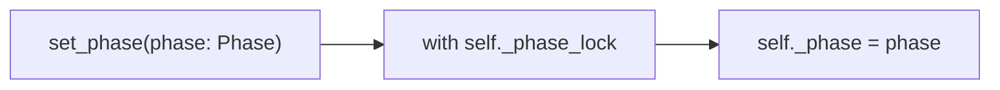

**Warning**: This method bypasses `Phase.check_successor()` validation and should only be used by simulation engines that manage phase coordination externally.

**Sources**: [concordia/agents/entity_agent.py:254-256]()

## Thread Safety and Concurrency

EntityAgent is designed for safe concurrent execution with multiple synchronization mechanisms:

| Lock | Purpose | Scope |
|---|---|---|
| `_control_lock` | Serializes `act()` and `observe()` calls | Method-level exclusion |
| `_phase_lock` | Protects phase transitions | Phase state consistency |
| Component isolation | Each component instance called once per phase | Prevents duplicate work |

The parallel execution system ensures that even when components are registered under multiple names, each unique component instance receives exactly one method call per phase, preventing expensive operations like LLM calls from being duplicated.

**Sources**: [concordia/agents/entity_agent.py:70-71](), [concordia/agents/entity_agent.py:144-154](), [concordia/utils/concurrency.py:112-143]()

---

