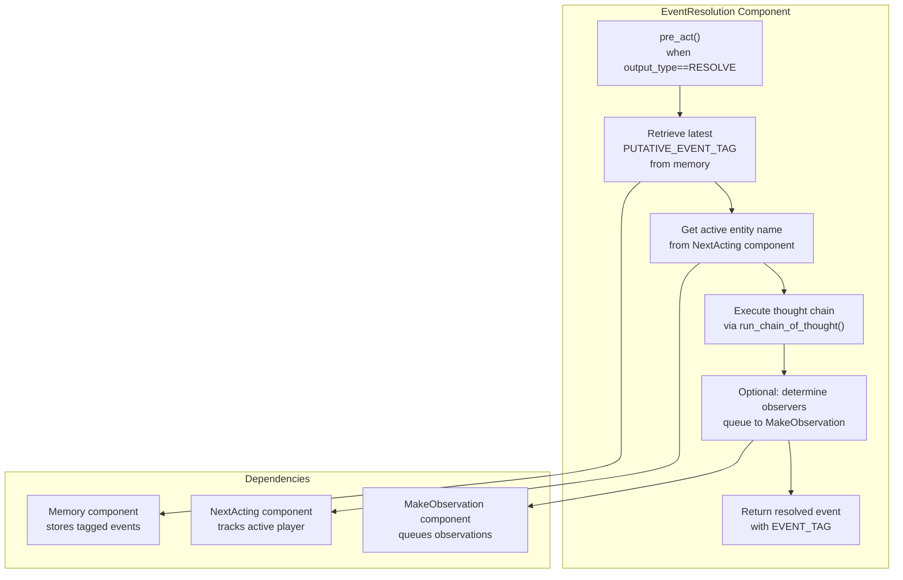
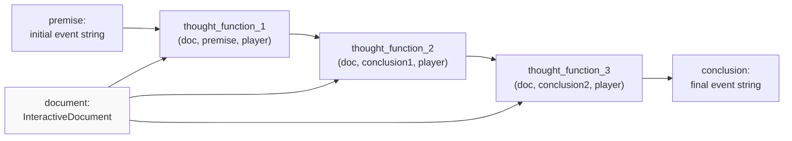
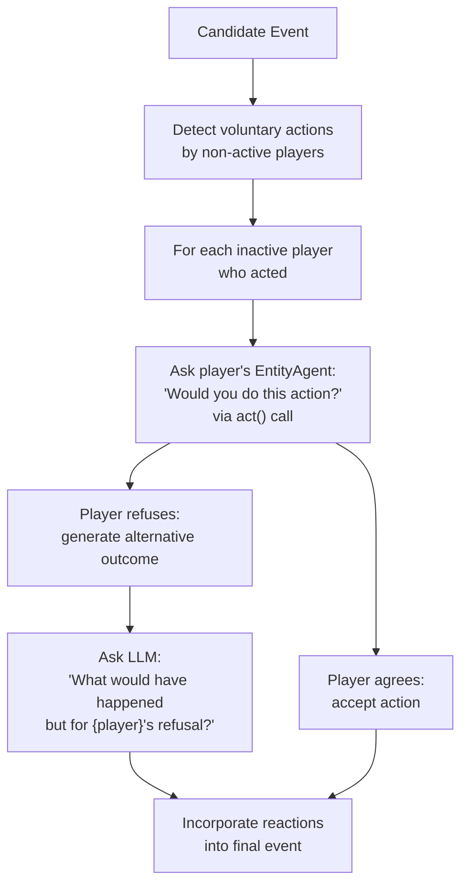
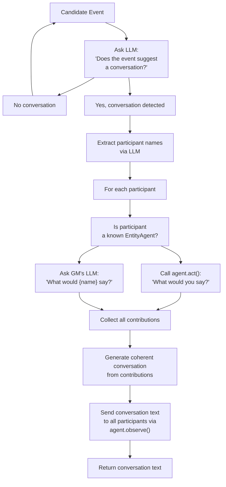
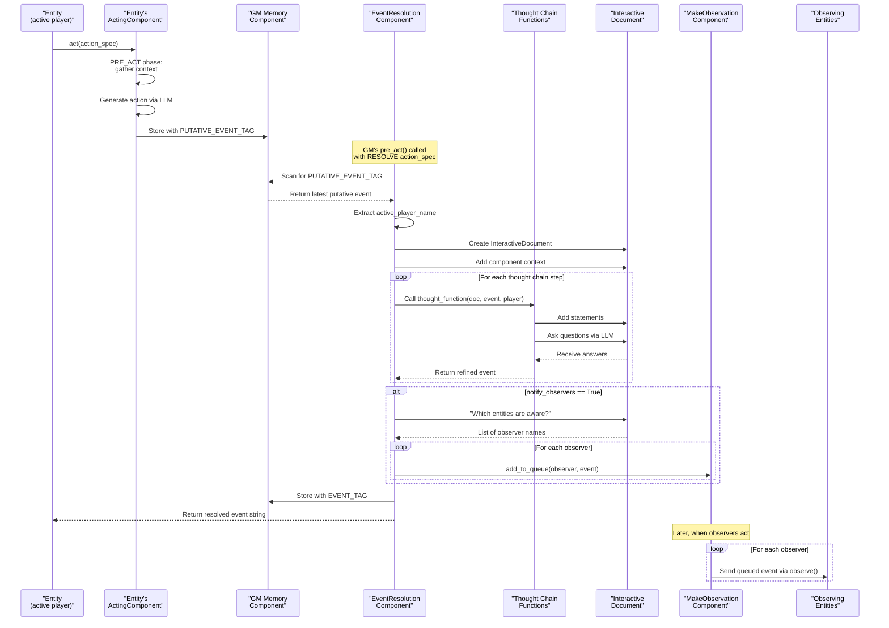

<!-- source: DeepWiki mcp.deepwiki.com · repo google-deepmind/concordia · extra page Event Resolution and Thought Chains · fetched 2026-10-26 -->

# Event Resolution and Thought Chains

<details>
<summary>Relevant source files</summary>

The following files were used as context for generating this wiki page:

- [concordia/components/agent/puppet_act_test.py](concordia/components/agent/puppet_act_test.py)
- [concordia/components/game_master/event_resolution.py](concordia/components/game_master/event_resolution.py)
- [concordia/components/game_master/event_resolution_test.py](concordia/components/game_master/event_resolution_test.py)
- [concordia/components/game_master/make_observation.py](concordia/components/game_master/make_observation.py)
- [concordia/components/game_master/payoff_matrix.py](concordia/components/game_master/payoff_matrix.py)
- [concordia/components/game_master/terminate.py](concordia/components/game_master/terminate.py)
- [concordia/prefabs/game_master/dialogic_and_dramaturgic.py](concordia/prefabs/game_master/dialogic_and_dramaturgic.py)
- [concordia/prefabs/game_master/game_theoretic_and_dramaturgic.py](concordia/prefabs/game_master/game_theoretic_and_dramaturgic.py)
- [concordia/prefabs/game_master/physically_situated_and_dramaturgic.py](concordia/prefabs/game_master/physically_situated_and_dramaturgic.py)
- [concordia/thought_chains/thought_chains.py](concordia/thought_chains/thought_chains.py)
- [concordia/typing/entity.py](concordia/typing/entity.py)

</details>


## Purpose and Scope

This page documents the event resolution system in Concordia, which converts putative events (action suggestions from entities) into canonical resolved events through a chain-of-thought reasoning process. Event resolution is a core responsibility of the Game Master and ensures that entity actions are validated, processed, and properly integrated into the simulation state.

For information about other Game Master components like observation generation and turn management, see [Game Master Components](#2.2.1). For specialized GM components that interact with event resolution (e.g., Inventory, Death), see [Specialized Game Master Components](#2.2.3).

## The EventResolution Component

The `EventResolution` component ([concordia/components/game_master/event_resolution.py:38-244]()) is a `ContextComponent` that transforms putative events into resolved events during the Game Master's action phase.

### Core Responsibilities

1. **Retrieve Putative Events**: Scans the Game Master's memory for events tagged with `PUTATIVE_EVENT_TAG`
2. **Execute Thought Chains**: Applies a sequence of reasoning steps to process the event
3. **Notify Observers**: Optionally determines which entities are aware of the resolved event and queues observations
4. **Tag Events**: Marks the resolved event with `EVENT_TAG` for future retrieval

### Event Tags

```python
PUTATIVE_EVENT_TAG = '[putative_event]'  # Marks action attempts
EVENT_TAG = '[event]'                    # Marks resolved canonical events
```

**Sources**: [concordia/components/game_master/event_resolution.py:34-35]()

### Component Architecture



**Sources**: [concordia/components/game_master/event_resolution.py:130-212]()

### Key Methods

| Method | Purpose | Returns |
|--------|---------|---------|
| `pre_act(action_spec)` | Main resolution logic, executes when `action_spec.output_type == RESOLVE` | Resolved event string |
| `get_active_entity_name()` | Returns name of entity whose action is being resolved | `str \| None` |
| `get_putative_action()` | Returns the raw putative action attempt | `str \| None` |
| `get_state()` / `set_state()` | Serialization for checkpointing | `ComponentState` |

**Sources**: [concordia/components/game_master/event_resolution.py:130-233]()

## Thought Chain Architecture

Thought chains are composable reasoning steps that transform events through sequential LLM-driven analysis. Each step refines the event description, validates constraints, or extracts information.

### Function Signature

All thought chain functions share a common signature:

```python
Callable[[interactive_document.InteractiveDocument, str, str], str]
#         ^--- working document              ^--- event   ^--- active player name
#                                                    returns: modified event
```

**Sources**: [concordia/thought_chains/thought_chains.py:777-804]()

### The run_chain_of_thought Function

The orchestration function that executes a sequence of thought steps:



Each thought function:
1. Receives the `InteractiveDocument` (accumulates reasoning context)
2. Processes the current event premise
3. Returns a modified event string (becomes input to next step)

**Sources**: [concordia/thought_chains/thought_chains.py:777-804]()

### InteractiveDocument Integration

Thought chains use `InteractiveDocument` to maintain reasoning context across steps. Each function can:
- Add statements: `document.statement(text)`
- Ask yes/no questions: `document.yes_no_question(question)`
- Ask open questions: `document.open_question(question, max_tokens=...)`
- Make multiple choice selections: `document.multiple_choice_question(question, answers)`

The document accumulates all prompts and responses, creating a traceable reasoning chain.

**Sources**: [concordia/thought_chains/thought_chains.py:28-804]()

## Basic Thought Chain Functions

These functions implement simple, composable reasoning steps.

### identity

Pass-through function that returns the premise unchanged. Useful for testing or as a placeholder.

```python
def identity(chain_of_thought, premise, active_player_name):
    return premise
```

**Sources**: [concordia/thought_chains/thought_chains.py:28-44]()

### determine_success_and_why

Evaluates whether an action attempt succeeds and provides reasoning.

**Logic**:
1. Ask yes/no: "Does the attempted action succeed?"
2. If no, ask: "Why did the attempt fail?"
3. Format result: "{action}, and was {successful|not successful}. However, {reason}"

**Sources**: [concordia/thought_chains/thought_chains.py:82-121]()

### result_to_causal_statement

Converts an event description into a clear cause-and-effect statement.

**Logic**:
1. Ask: "Because of that, what happens as a result?"
2. Rewrite to highlight cause and effect in one sentence
3. Remove uncertainty ("Francis released the demon" not "Francis could release")

**Sources**: [concordia/thought_chains/thought_chains.py:123-154]()

### attempt_to_result

Determines the direct result of an action attempt without explicit success/failure framing.

**Logic**:
1. Ask: "What happens as a result of the attempted action?"
2. Take into account location and status of each player
3. Format: "{action_attempt} Because of that, {result}"

**Sources**: [concordia/thought_chains/thought_chains.py:157-181]()

### attempt_to_most_likely_outcome

More comprehensive analysis that considers multiple possible outcomes.

**Logic**:
1. Ask: "Where is {active_player}?"
2. Ask: "What is {active_player} trying to do?"
3. Ask: "List at least 3 possible direct consequences"
4. Ask: "Which outcome is the most likely?"

**Sources**: [concordia/thought_chains/thought_chains.py:183-224]()

### extract_direct_quote

Extracts exact dialogue or written text from action attempts.

**Logic**:
1. Ask: "Did {active_player} explicitly say or write anything?"
2. If yes, ask: "Does the text state exactly what they said or wrote?"
3. If yes, extract: "What exactly did {active_player} say or write?"
4. Tag with `[direct quote]` for later restoration

**Sources**: [concordia/thought_chains/thought_chains.py:47-80]()

### restore_direct_quote

Re-incorporates direct quotes that may have been lost in subsequent processing steps.

**Logic**:
1. State the candidate event (potentially missing quotes)
2. Ask: "Incorporate the exact text of anything said or written by {active_player}"
3. Note that quotes are tagged with `[direct quote]`

**Sources**: [concordia/thought_chains/thought_chains.py:288-326]()

### Common Thought Chain Patterns

| Function | Input | Output | Use Case |
|----------|-------|--------|----------|
| `identity` | Any event | Same event | Testing, pass-through |
| `determine_success_and_why` | Action attempt | Success/failure + reason | Binary outcomes |
| `result_to_causal_statement` | Event | Cause-effect statement | Narrative clarity |
| `attempt_to_result` | Action attempt | Consequence | Direct results |
| `attempt_to_most_likely_outcome` | Action attempt | Most likely outcome | Complex scenarios |
| `result_to_who_what_where` | Event | Who/what/where summary | Structured extraction |
| `result_to_effect_caused_by_active_player` | Event | Active player effect | Attribution |

**Sources**: [concordia/thought_chains/thought_chains.py:28-697]()

## Complex Thought Chain Classes

### AccountForAgencyOfOthers

A sophisticated class that prevents entities from taking voluntary actions they wouldn't consent to. This is critical for maintaining agent autonomy and preventing "puppeting" where one player's action forces another player to act.



**Constructor Parameters**:
- `model`: Language model for reasoning
- `players`: Sequence of `EntityAgent` objects
- `verbose`: Enable debug output

**Key Logic** ([concordia/thought_chains/thought_chains.py:328-441]()):
1. Detect if candidate event implies voluntary actions by non-active players
2. Identify which inactive players took actions
3. For each, extract what they did in one sentence
4. Create an `ActionSpec` with their proposed action
5. Call `player.act(action_spec)` to ask "Would you do this?"
6. If "No", generate alternative outcome without their participation
7. Merge all refusals into final event

**Sources**: [concordia/thought_chains/thought_chains.py:328-441]()

### Conversation

Resolves conversational events by soliciting contributions from all participants and generating a coherent dialogue.



**Constructor Parameters**:
- `model`: Language model for NPC dialogue
- `players`: Sequence of `EntityAgent` objects
- `verbose`: Enable debug output

**Key Logic** ([concordia/thought_chains/thought_chains.py:443-526]()):
1. Check if event suggests a conversation
2. Extract participant names
3. For each participant:
   - If player entity: call `player.act()` with conversation context
   - If NPC: ask LLM what they would say
4. Generate coherent conversation from all contributions
5. Send conversation to all player participants via `player.observe()`
6. Return conversation text as resolved event

**Sources**: [concordia/thought_chains/thought_chains.py:443-526]()

### RemoveSpecificText

Simple utility class for text manipulation in thought chains.

**Constructor**:
```python
RemoveSpecificText(substring_to_remove: str)
```

**Behavior**: Returns `candidate_event.replace(substring_to_remove, '')`

**Common Use**: Remove boilerplate prefixes like "Putative event to resolve: " from events.

**Sources**: [concordia/thought_chains/thought_chains.py:528-546]()

## Advanced Thought Chain Functions

### get_action_category_and_player_capability

Inspired by tabletop RPG mechanics (specifically "Girl by moonlight"), categorizes actions into types and assesses player capability.

**Action Categories**:
- Confess: Expose inner thoughts/feelings
- Forgive: Show care despite mistakes
- Perceive: Observe without judgment
- Express: Communicate purposefully
- Defy: Face opposition courageously
- Empathize: Understand others intuitively
- Conceal: Hide true intentions
- Flow: Move with adaptability
- Analyze: Discover hidden information

**Logic**:
1. Present all 9 action categories with descriptions
2. Ask multiple choice: "What category does {player}'s action fall into?"
3. Ask: "Is {player} proficient in {category} and able to perform it? Why or why not?"

**Sources**: [concordia/thought_chains/thought_chains.py:548-637]()

### maybe_inject_narrative_push

Adds narrative complications if the story becomes repetitive.

**Logic**:
1. Ask: "Is the story traced out by events repetitive?"
2. If yes:
   - Ask: "Suggest 5 plausible events to move narrative forward"
   - Randomly select one complication
   - Combine with original event into composite outcome

**Sources**: [concordia/thought_chains/thought_chains.py:639-697]()

### maybe_cut_to_next_scene

Determines if the narrative should transition to a new scene.

**Logic**:
1. Ask: "What is the current scene about? What is its narrative function?"
2. Present criteria for ending a scene:
   - Resolution of immediate conflict
   - Pacing considerations (avoiding repetition)
   - Revelation of key information
   - Catalyst for future action
   - Establishment of setting/character
   - Emphasis of theme
   - Natural break points (e.g., characters go to sleep)
3. Ask: "Does the latest event constitute a good place to end the scene?"
4. If yes:
   - Ask: "What duration should pass? What will next scene be about?"
   - Append `[CUT TO NEXT SCENE]` tag with time duration

**Sources**: [concordia/thought_chains/thought_chains.py:699-775]()

## Configuring Event Resolution in Game Masters

Event resolution is configured when building a Game Master entity by specifying the `event_resolution_steps` parameter.

### Example: Dialogic Game Master

The dialogic game master uses minimal event resolution since conversations are handled differently:

```python
identity_without_prefix = thought_chains_lib.RemoveSpecificText(
    substring_to_remove='Putative event to resolve:  '
)

event_resolution = gm_components.event_resolution.EventResolution(
    model=model,
    event_resolution_steps=(identity_without_prefix,),
    notify_observers=False,
)
```

**Rationale**: Conversations are pass-through events with only prefix removal.

**Sources**: [concordia/prefabs/game_master/dialogic.py:207-217]()

### Example: Spaceship Game Master

The spaceship game master uses more complex resolution to determine physical outcomes:

```python
event_resolution_steps = [
    thought_chains_lib.result_to_effect_caused_by_active_player,
    thought_chains_lib.attempt_to_result,
]

# Optionally add extra steps from config
if extra_event_resolution_steps:
    for step in extra_event_resolution_steps:
        if step:
            event_resolution_steps.append(getattr(thought_chains_lib, step))

event_resolution = gm_components.event_resolution.EventResolution(
    model=model,
    event_resolution_steps=event_resolution_steps,
    components=event_resolution_components,
    notify_observers=True,
)
```

**Chain Composition**:
1. `result_to_effect_caused_by_active_player`: Attribute effects to active player
2. `attempt_to_result`: Determine what actually happens
3. Additional steps from configuration

**Sources**: [concordia/contrib/prefabs/game_master/space_ship.py:286-310]()

### Components Parameter

The `components` parameter specifies which GM components to include in the reasoning context:

```python
event_resolution_components = [
    'instructions',
    'player_characters',
    'relevant_memories',
    'display_events',
]
```

These components' `pre_act` values are concatenated and passed to the `InteractiveDocument`, providing context for LLM reasoning.

**Sources**: [concordia/contrib/prefabs/game_master/space_ship.py:295-310]()

### Notify Observers

When `notify_observers=True`, the EventResolution component:
1. Creates a copy of the reasoning document
2. Asks: "Which entities are aware of the event?"
3. Extracts comma-separated list of entity names
4. Calls `make_observation.add_to_queue(name, event)` for each aware entity

This ensures entities automatically observe events relevant to them without explicit observation calls.

**Sources**: [concordia/components/game_master/event_resolution.py:184-201]()

## Complete Event Resolution Flow

This diagram shows the full lifecycle of an event from action attempt to resolved observation:



**Sources**: [concordia/components/game_master/event_resolution.py:130-212](), [concordia/thought_chains/thought_chains.py:777-804]()

## DisplayEvents and SendEventToRelevantPlayers

Two helper components work with EventResolution to manage event visibility.

### DisplayEvents

Retrieves recent events from memory for display in reasoning context.

**Key Methods**:
- `_make_pre_act_value()`: Scans memory for `EVENT_TAG`, retrieves last N events, formats as numbered list

**Configuration**:
```python
display_events = gm_components.event_resolution.DisplayEvents(
    model=model,
    memory_component_key='__memory__',
    num_events_to_retrieve=100,
    pre_act_label='Recent events',
)
```

**Sources**: [concordia/components/game_master/event_resolution.py:246-310]()

### SendEventToRelevantPlayers

Automatically sends resolved events to relevant players during `post_act` phase.

**Logic**:
1. During `pre_act`: Store the action_spec
2. During `post_act`: If action_spec was RESOLVE:
   - For each player:
     - If `components` specified, ask LLM: "Is {player} aware of event?"
     - If yes (or components not specified), queue event to MakeObservation
   - Remove duplicate observations from previous turn

**Configuration**:
```python
send_events = gm_components.event_resolution.SendEventToRelevantPlayers(
    model=model,
    player_names=player_names,
    make_observation_component_key='__make_observation__',
    components=['display_events'],  # Optional: for awareness check
)
```

**Sources**: [concordia/components/game_master/event_resolution.py:312-469]()

## Integration with Specialized Components

Specialized game master components often interact with event resolution in their `post_act` phase.

### SpaceshipSystem Example

The `SpaceshipSystem` component checks if resolved events fix failing systems:

```python
def post_act(self, event: str) -> str:
    if self._is_failing:
        prompt = interactive_document.InteractiveDocument(self._model)
        # Add component context
        prompt.statement(f'System name: {self._system_name}')
        prompt.statement(f'Event: {event}')
        
        was_system_fixed = prompt.yes_no_question(
            'Given the context above, was the system fixed during the event?'
        )
        
        if was_system_fixed:
            self._current_health = self._system_max_health
            self._is_failing = False
            # Notify all players
            make_observation.add_to_queue('All', f'The {self._system_name} was fixed.')
```

**Sources**: [concordia/contrib/components/game_master/spaceship_system.py:166-213]()

### Death Component Example

The `Death` component checks if resolved events result in character death:

```python
def post_act(self, event: str) -> str:
    if self._last_action_spec.output_type != entity_lib.OutputType.RESOLVE:
        return ''
    
    prompt = interactive_document.InteractiveDocument(self._model)
    prompt.statement(f'Event: {event}')
    
    death_happened = prompt.yes_no_question(
        'Have any of the actors died or been killed as the result of this event?'
    )
    
    if death_happened:
        who_died_str = prompt.open_question('Who died? List their names...')
        # Remove deceased from next_acting sequence
        # Queue death notifications
```

**Sources**: [concordia/contrib/components/game_master/death.py:124-204]()

## Best Practices

### Composing Thought Chains

**Start Simple**: Begin with basic chains like `[attempt_to_result]`, then add complexity.

**Order Matters**: Place extraction steps (like `extract_direct_quote`) early, restoration steps (like `restore_direct_quote`) late.

**Validation Before Outcome**: Use `AccountForAgencyOfOthers` before determining final results to avoid forcing invalid actions.

**Example Progressive Chain**:
```python
event_resolution_steps = [
    extract_direct_quote,                    # Preserve dialogue
    AccountForAgencyOfOthers(model, players), # Validate agency
    determine_success_and_why,               # Assess outcome
    result_to_causal_statement,              # Clarify causation
    restore_direct_quote,                    # Restore dialogue
]
```

### Context Components

**Include Background**: Add `relevant_memories` or `display_events` to provide context for reasoning.

**Domain Knowledge**: Include domain-specific components (e.g., `locations`, `inventory`) when relevant to event validation.

**Performance**: More components = longer prompts. Include only what's necessary for the reasoning task.

### Debugging

**Enable Verbose Mode**: Classes like `AccountForAgencyOfOthers` and `Conversation` support `verbose=True` for terminal output.

**Check Logs**: The EventResolution component logs the full `InteractiveDocument` prompt and result via `_logging_channel`.

**Test Chains Individually**: Use `run_chain_of_thought` directly with test events to validate behavior.

**Sources**: [concordia/thought_chains/thought_chains.py:328-526](), [concordia/components/game_master/event_resolution.py:234-243]()

---

