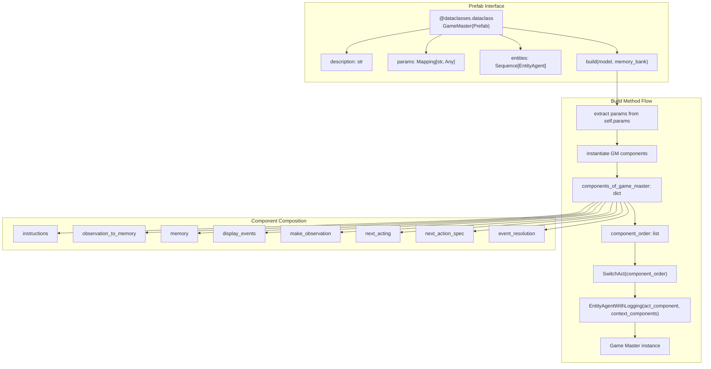
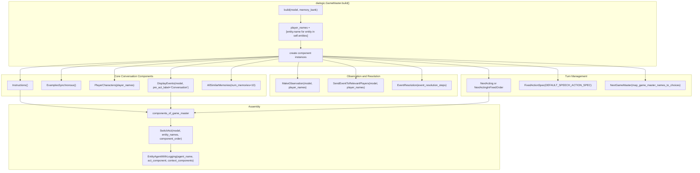
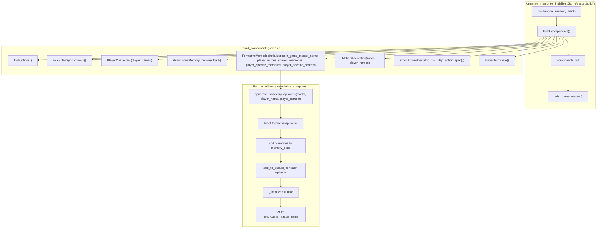
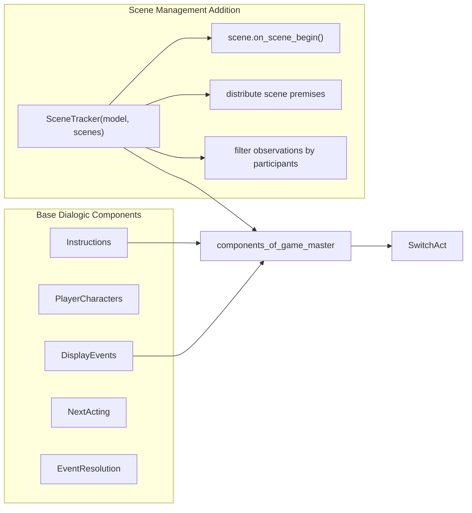
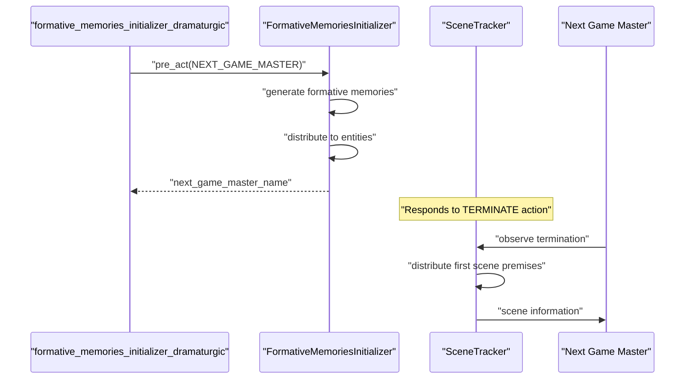
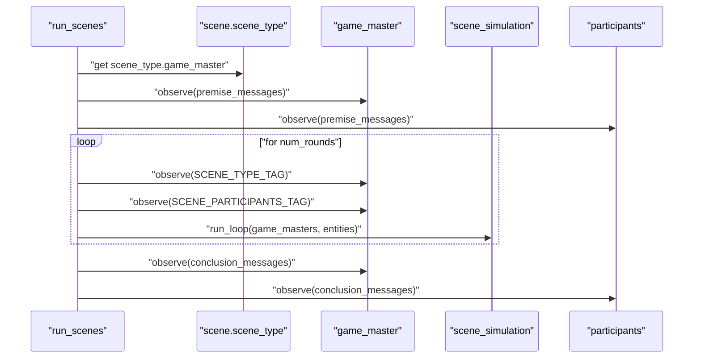

<!-- source: DeepWiki mcp.deepwiki.com · repo google-deepmind/concordia · extra page Game Master Prefabs · fetched 2026-10-26 -->

# Game Master Prefabs

Relevant source files

The following files were used as context for generating this wiki page:

- [concordia/prefabs/entity/conversational.py](concordia/prefabs/entity/conversational.py)
- [concordia/prefabs/game_master/__init__.py](concordia/prefabs/game_master/__init__.py)
- [concordia/prefabs/game_master/dialogic.py](concordia/prefabs/game_master/dialogic.py)
- [concordia/prefabs/game_master/formative_memories_initializer.py](concordia/prefabs/game_master/formative_memories_initializer.py)
- [concordia/prefabs/game_master/formative_memories_initializer_dramaturgic.py](concordia/prefabs/game_master/formative_memories_initializer_dramaturgic.py)
- [concordia/prefabs/game_master/game_master_prefabs_test.py](concordia/prefabs/game_master/game_master_prefabs_test.py)
- [concordia/prefabs/game_master/situated_in_time_and_place.py](concordia/prefabs/game_master/situated_in_time_and_place.py)

This document covers pre-configured Game Master types in Concordia. Game Master prefabs are recipes that compose components into complete Game Master entities specialized for different simulation patterns.

For detailed component documentation, see [Specialized Game Master Components](#2.2.4). For broader Game Master architecture, see [Game Master System](#2.2). For simulation framework details, see [Simulation Framework](#3).

## Overview

Game Master prefabs are pre-assembled configurations located in `concordia/prefabs/game_master/`. Each prefab implements the `Prefab` interface and provides a `build()` method that instantiates a complete `EntityAgentWithLogging` configured as a Game Master.

Prefabs compose individual components from `concordia/components/game_master/` into coherent Game Master behaviors:

| Prefab Module | Purpose | Key Features |
|---------------|---------|--------------|
| `dialogic` | Conversation management | Turn-taking, conversation termination |
| `formative_memories_initializer` | Entity initialization | Backstory generation, memory seeding |
| `situated_in_time_and_place` | Physical simulation | Time tracking, location management, world state |
| `scripted` | Fixed conversation scripts | Pre-defined dialogue sequences |
| `generic` | Baseline game master | Minimal configuration for basic simulations |
| `interviewer` | Structured interviews | Question-answer sequences |
| `marketplace` | Economic interactions | Trade and transaction management |
| `dialogic_and_dramaturgic` | Scene-based conversations | Conversation management with scene support |
| `game_theoretic_and_dramaturgic` | Game-theoretic scenarios | Decision-making with scene support |
| `physically_situated_and_dramaturgic` | Physical scenes | Location/time tracking with scene support |

**Sources:** [concordia/prefabs/game_master/__init__.py:1-31]()

## Prefab Architecture

All Game Master prefabs follow a common pattern defined by the `Prefab` interface:

**Prefab Interface and Build Pattern**

Key elements:
- `description`: Human-readable description of the prefab's purpose
- `params`: Configuration dictionary with default values
- `entities`: Reference to entity instances (used to extract player names)
- `build()`: Factory method that instantiates the configured Game Master

**Sources:** [concordia/prefabs/game_master/dialogic.py:30-51](), [concordia/prefabs/game_master/dialogic.py:55-255]()

## Dialogic Prefab

The `dialogic` prefab specializes in managing conversational interactions between entities. It handles turn-taking, conversation flow, and conversation termination.

**Dialogic Prefab Component Composition**

Configuration parameters (from `params`):
- `name`: Game master identifier (default: `'conversation rules'`)
- `next_game_master_name`: Transition target (default: `'default rules'`)
- `acting_order`: Turn selection method - `'fixed'`, `'random'`, or `'game_master_choice'`
- `can_terminate_simulation`: Whether this GM can end the simulation (default: `True`)

The prefab supports three turn-taking modes:
- **Fixed order**: `NextActingInFixedOrder(sequence=player_names)` - Predetermined rotation
- **Random order**: `NextActingInRandomOrder(player_names)` - Randomized selection
- **GM choice**: `NextActing(player_names)` - LLM-based selection

**Sources:** [concordia/prefabs/game_master/dialogic.py:30-255](), [concordia/prefabs/game_master/dialogic.py:156-170]()

## Formative Memories Initializer Prefab

The `formative_memories_initializer` prefab generates backstories and seeds initial memories for entities at simulation start. It operates as a transitional Game Master that hands control to another GM after initialization.

**Formative Memories Initializer Architecture**

Configuration parameters:
- `name`: Initializer identifier (default: `'initial setup rules'`)
- `next_game_master_name`: GM to transition to after initialization (default: `'default rules'`)
- `shared_memories`: List of memories given to all entities
- `player_specific_memories`: Mapping from player name to their unique memories
- `player_specific_context`: Mapping from player name to context used for backstory generation

The backstory generation process uses the LLM to create formative childhood episodes based on:
1. Player-specific context (personality traits, background)
2. Shared world context
3. Episodic structure with configurable sentences per episode

**Sources:** [concordia/prefabs/game_master/formative_memories_initializer.py:31-223](), [concordia/prefabs/game_master/formative_memories_initializer.py:163-223]()

## Situated in Time and Place Prefab

The `situated_in_time_and_place` prefab creates Game Masters that simulate physically grounded environments with time progression and location tracking.

**Situated in Time and Place Component Stack**

```mermaid
graph TB
    subgraph "Physical Simulation Components"
        ClockConstant["Constant(clock_description)"] --> ClockDesc["Clock description prompt"]
        LocationsConstant["Constant(location_descriptions)"] --> LocDesc["Locations prompt"]
        
        GenerativeClock["GenerativeClock(model, prompt, start_time)"] --> TimeState["Current time state"]
        Locations["Locations(model, entity_names, prompt)"] --> LocationState["Entity location state"]
        WorldState["WorldState(model)"] --> CombinedState["Combined world state"]
    end
    
    subgraph "Event Resolution Chain"
        AccountForAgency["AccountForAgencyOfOthers(model, players)"] --> EventChain["event_resolution_steps"]
        ResultToWhoWhatWhere["result_to_who_what_where"] --> EventChain
        ExtraSteps["extra_event_resolution_steps"] --> EventChain
        EventChain --> EventResolution["EventResolution(event_resolution_steps)"]
    end
    
    subgraph "Turn Management with Context"
        NextActing["NextActing(model, player_names)"] --> TurnDecision["Turn selection"]
        NextActionSpec["NextActionSpec(model, player_names)"] --> ActionFormat["Action format"]
        
        TurnDecision --> UseComponents["uses: instructions, player_characters, locations_constant, clock_constant, relevant_memories, display_events, generative_clock, locations, world_state"]
    end
    
    subgraph "Observation with Context"
        MakeObservation["MakeObservation(model, player_names)"] --> FormattedObs["Formatted observations"]
        MakeObservation --> ReformatStyle["reformat_observations_in_specified_style:<br/>'// date or time // situation description'"]
    end
```

Configuration parameters:
- `name`: Game master name (default: `'default rules'`)
- `clock_description`: How time is represented and tracked
- `start_time`: Initial clock setting
- `locations`: Description of available locations
- `extra_event_resolution_steps`: Additional thought chain steps (comma-separated string)
- `extra_components`: Additional component dictionary
- `extra_components_index`: Insertion positions for extra components

The prefab's event resolution chain includes:
1. `AccountForAgencyOfOthers`: Confirms entities would perform attributed actions
2. `result_to_who_what_where`: Structures events with actor, action, location
3. Optional extra steps from `thought_chains_lib`

**Sources:** [concordia/prefabs/game_master/situated_in_time_and_place.py:45-362](), [concordia/prefabs/game_master/situated_in_time_and_place.py:281-293]()

## Dramaturgic Prefab Variants

Several prefabs add scene management capabilities to base Game Master configurations. These "dramaturgic" variants integrate `SceneTracker` components for scene-based simulations.

### Dialogic and Dramaturgic

The `dialogic_and_dramaturgic` prefab extends the `dialogic` prefab with scene support:

**Dialogic and Dramaturgic Extension**

The `SceneTracker` component:
- Tracks current scene from a sequence of `SceneSpec` objects
- Distributes scene premises to participants at scene start
- Filters observations to scene-active participants
- Advances to next scene after completion

**Sources:** [concordia/prefabs/game_master/dialogic_and_dramaturgic.py:1-255]()

### Game Theoretic and Dramaturgic

The `game_theoretic_and_dramaturgic` prefab manages decision-making scenarios with scene structure:

| Feature | Configuration |
|---------|---------------|
| Action spec | `FixedActionSpec` or `SceneActionSpec` |
| Decision format | Multiple choice via `scene_type.action_spec.options` |
| Result tracking | `PayoffMatrix` component |
| Scene progression | Automatic after `scene.num_rounds` |

The prefab integrates `PayoffMatrix` to track entity choices across scenes, enabling game-theoretic analysis.

**Sources:** [concordia/prefabs/game_master/game_theoretic_and_dramaturgic.py:1-400]()

### Formative Memories Initializer Dramaturgic

The `formative_memories_initializer_dramaturgic` prefab extends the initializer with scene support:

**Initializer with Scene Tracking**

This prefab solves a specific problem: when transitioning from initialization to a scene-based Game Master, the first scene's premises must be distributed. The `SceneTracker` component responds to the initialization termination and properly sets up the first scene.

**Sources:** [concordia/prefabs/game_master/formative_memories_initializer_dramaturgic.py:15-117](), [concordia/prefabs/game_master/formative_memories_initializer_dramaturgic.py:38-46]()

## Scene Integration Components

### Scene Runner Integration

Game Master components integrate with the scene system through the `run_scenes` function, which coordinates scene execution:

**Scene Execution with Game Master Components**

Key scene-related constants:
- `_SCENE_TYPE_TAG`: `'[scene type]'` - Identifies scene type observations
- `_SCENE_PARTICIPANTS_TAG`: `'[scene participants]'` - Identifies participant lists
- `_PARTICIPANTS_DELIMITER`: `', '` - Separates participant names

**Sources:** [concordia/environment/scenes/runner.py:66-164](), [concordia/environment/scenes/runner.py:28-31](), [concordia/environment/scenes/runner.py:129-139]()

## Message Flow Integration

Game Master components handle three categories of scene-related messages through the `_get_interscene_messages` function:

### Premise Messages
- Delivered before scene execution begins
- Configure initial scene context for both Game Master and participants
- Support both static strings and dynamic message generation

### Conclusion Messages  
- Delivered after scene execution completes
- Provide closure and transition information
- Enable state persistence between scenes

### Runtime Observation
- Scene type and participant information injected during execution
- Enable Game Master context-awareness during action processing
- Support memory-based scene state queries

**Sources:** [concordia/environment/scenes/runner.py:33-63](), [concordia/environment/scenes/runner.py:114-152]()

---

