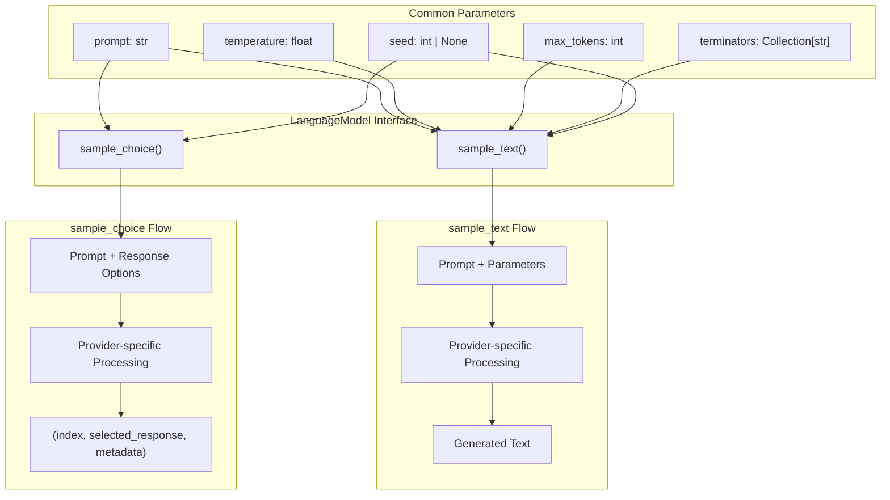
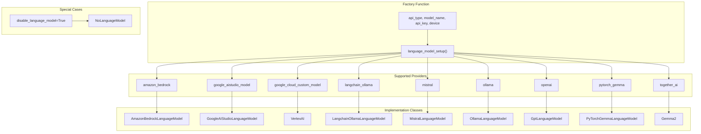
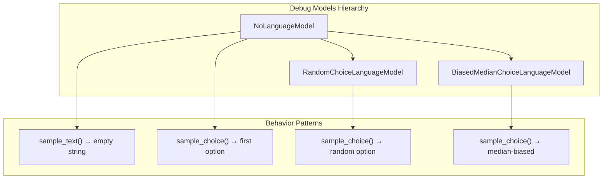
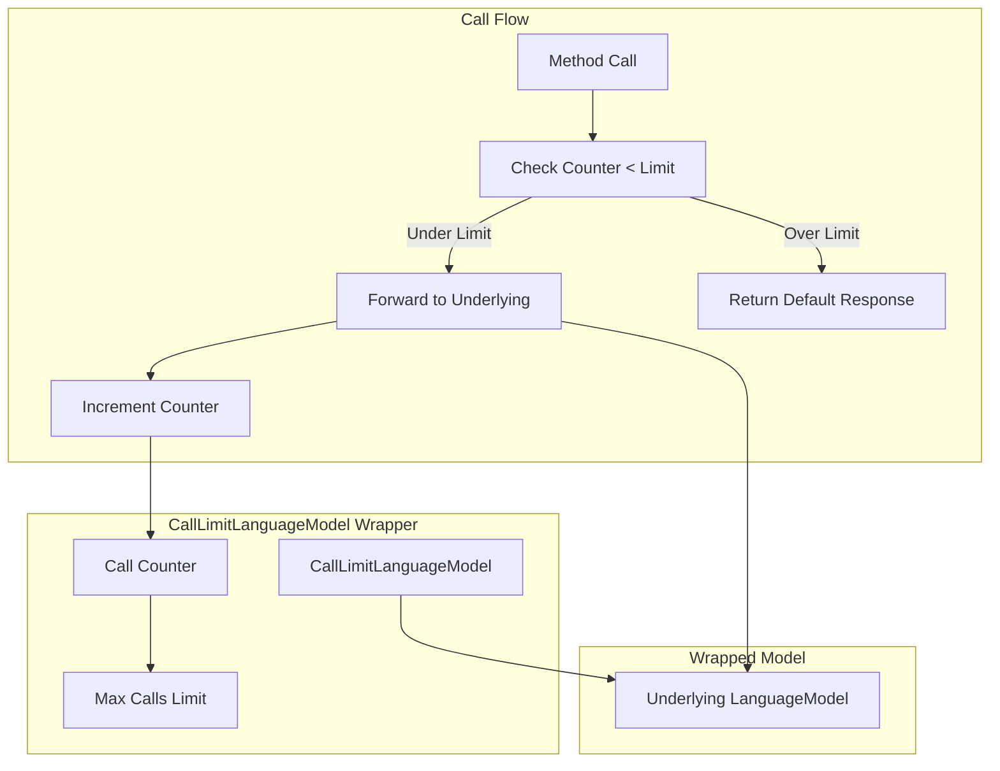

<!-- source: DeepWiki mcp.deepwiki.com · repo google-deepmind/concordia · extra page Language Model Interface and Wrappers · fetched 2026-10-26 -->

# Language Model Abstraction

Relevant source files

The following files were used as context for generating this wiki page:

- [concordia/document/interactive_document.py](concordia/document/interactive_document.py)
- [concordia/document/interactive_document_test.py](concordia/document/interactive_document_test.py)
- [concordia/language_model/call_limit_wrapper.py](concordia/language_model/call_limit_wrapper.py)
- [concordia/language_model/language_model.py](concordia/language_model/language_model.py)
- [concordia/language_model/no_language_model.py](concordia/language_model/no_language_model.py)
- [concordia/language_model/retry_wrapper.py](concordia/language_model/retry_wrapper.py)
- [concordia/testing/mock_model.py](concordia/testing/mock_model.py)

## Purpose and Scope

This document covers Concordia's language model abstraction layer, which provides a unified interface for integrating various language model providers into the simulation framework. The abstraction enables seamless switching between different language model backends while maintaining consistent behavior across agents and game masters.

For specific provider implementations, see [Provider Implementations](#2.4.2). For overall language model integration architecture, see [Language Model Integration](#2.4).

## Core Interface

The foundation of Concordia's language model abstraction is the `language_model.LanguageModel` interface, which defines two primary methods that all implementations must support:

| Method | Purpose | Returns |
|--------|---------|---------|
| `sample_text()` | Generate free-form text responses | `str` |
| `sample_choice()` | Select from predefined response options | `tuple[int, str, dict]` |

Both methods support configurable parameters for temperature, token limits, and seed values to ensure reproducible behavior when needed.

**Text Generation Flow**

Sources: [concordia/language_model/google_cloud_custom_model.py:116-217](), [concordia/language_model/no_language_model.py:35-56]()

## Factory System

The language model factory system provides a centralized mechanism for instantiating different provider implementations based on configuration parameters. The main entry point is the `language_model_setup()` function in the utils module.

**Factory Architecture**

The factory supports the following provider mappings:

| `api_type` Parameter | Implementation Class | Purpose |
|---------------------|---------------------|---------|
| `amazon_bedrock` | `AmazonBedrockLanguageModel` | AWS Bedrock models |
| `google_aistudio_model` | `GoogleAIStudioLanguageModel` | Google AI Studio API |
| `google_cloud_custom_model` | `VertexAI` | Google Cloud Vertex AI |
| `langchain_ollama` | `LangchainOllamaLanguageModel` | Ollama via LangChain |
| `mistral` | `MistralLanguageModel` | Mistral AI models |
| `ollama` | `OllamaLanguageModel` | Direct Ollama integration |
| `openai` | `GptLanguageModel` | OpenAI GPT models |
| `pytorch_gemma` | `PyTorchGemmaLanguageModel` | Local PyTorch Gemma |
| `together_ai` | `Gemma2` | Together AI platform |

Sources: [concordia/language_model/utils.py:30-82]()

## Debug and Testing Models

The abstraction includes specialized implementations for development and testing scenarios:

### NoLanguageModel
A minimal implementation that returns empty strings for `sample_text()` and the first option for `sample_choice()`. Useful for debugging simulation logic without language model dependencies.

### RandomChoiceLanguageModel
Extends `NoLanguageModel` but returns random choices in `sample_choice()`, enabling basic randomized behavior testing.

### BiasedMedianChoiceLanguageModel
Provides configurable bias toward median choices, with a `median_probability` parameter controlling the likelihood of selecting the middle option versus uniform random selection.

Sources: [concordia/language_model/no_language_model.py:26-117]()

## Wrapper Functionality

### CallLimitLanguageModel

The `CallLimitLanguageModel` wrapper provides call limiting functionality to prevent excessive API usage during development and testing. It wraps any `LanguageModel` implementation and tracks the number of calls made.

**Call Limiting Behavior:**
- Tracks total calls across both `sample_text()` and `sample_choice()` methods
- Once limit is reached, returns empty strings for text generation
- Returns first option for choice selection after limit
- Displays warning messages when limit is exceeded
- Default limit: 1200 calls

Sources: [concordia/language_model/call_limit_wrapper.py:24-96]()

## Implementation Patterns

### Provider-Specific Configuration

Each provider implementation follows consistent patterns for initialization and configuration:

1. **Authentication**: API keys, credentials, or endpoint configuration
2. **Model Selection**: Specific model names or IDs for the provider
3. **Parameter Mapping**: Translation of common parameters to provider-specific formats
4. **Error Handling**: Retry logic, rate limiting, and failure recovery

### Example: VertexAI Implementation

The `VertexAI` class demonstrates typical implementation patterns:

- **Initialization**: Requires `endpoint_id`, `project_id`, and `location` parameters
- **Client Setup**: Initializes provider-specific client with appropriate endpoints
- **Prompt Wrapping**: Uses `_wrap_prompt()` to format prompts for the specific model
- **Retry Logic**: Implements exponential backoff with jitter for rate limiting
- **Parameter Translation**: Maps common parameters to Vertex AI format

Sources: [concordia/language_model/google_cloud_custom_model.py:75-217]()

### Common Interface Compliance

All implementations must override the `@override` decorated methods from the base `LanguageModel` interface, ensuring consistent behavior across different providers while allowing for provider-specific optimizations and features.

---

