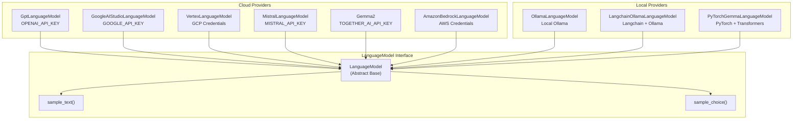
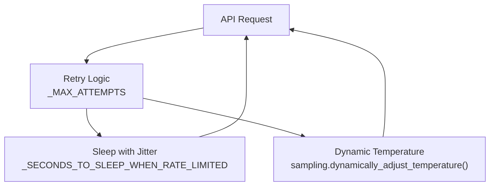

<!-- source: DeepWiki mcp.deepwiki.com · repo google-deepmind/concordia · extra page Provider Implementations · fetched 2026-10-26 -->

# Provider Implementations

Relevant source files

The following files were used as context for generating this wiki page:

- [.gitignore](.gitignore)
- [CHANGELOG.md](CHANGELOG.md)
- [setup.py](setup.py)

This page documents the concrete language model provider implementations available in Concordia. These implementations provide connectivity to various cloud-based and local language model services through a unified interface.

For information about the base language model interface and factory system, see [Language Model Abstraction](#2.4.1).

## Overview

Concordia supports multiple language model providers through dedicated implementation classes that conform to the `LanguageModel` interface. These providers can be categorized into cloud-based services requiring API authentication and local model implementations running on the host machine.

## Cloud Provider Implementations

### OpenAI GPT Models

The `GptLanguageModel` class provides access to OpenAI's GPT models through the OpenAI API.

**Class**: `GptLanguageModel` in [concordia/language_model/gpt_model.py:26-54]()

**Authentication**: Requires `OPENAI_API_KEY` environment variable or explicit API key parameter.

**Key Features**:
- Inherits from `BaseGPTModel` for shared GPT functionality
- Supports all OpenAI chat completion models
- Built-in retry logic and error handling

Sources: [concordia/language_model/gpt_model.py:26-54]()

### Google AI Studio Models

The `GoogleAIStudioLanguageModel` provides access to Google's Gemini models via the AI Studio API.

**Class**: `GoogleAIStudioLanguageModel` in [concordia/language_model/google_aistudio_model.py:95-230]()

**Authentication**: Requires `GOOGLE_API_KEY` environment variable or explicit API key parameter.

**Key Features**:
- Configurable safety settings for content filtering
- Built-in chat history management with examples [concordia/language_model/google_aistudio_model.py:32-72]()
- Optional periodic sleeping to manage rate limits

Sources: [concordia/language_model/google_aistudio_model.py:95-230]()

### Google Cloud Vertex AI Models

The `VertexLanguageModel` connects to Google's Vertex AI platform for enterprise deployments.

**Class**: `VertexLanguageModel` in [concordia/language_model/cloud_vertex_model.py:63-185]()

**Authentication**: Uses Google Cloud service account credentials.

**Key Features**:
- Enterprise-grade safety controls with `HarmBlockThreshold` settings
- Built-in conversation history with examples [concordia/language_model/cloud_vertex_model.py:33-60]()
- Configurable harm category blocking

Sources: [concordia/language_model/cloud_vertex_model.py:63-185]()

### Mistral AI Models

The `MistralLanguageModel` provides access to Mistral's language models with support for both chat and completion modes.

**Class**: `MistralLanguageModel` in [concordia/language_model/mistral_model.py:41-283]()

**Authentication**: Requires `MISTRAL_API_KEY` environment variable or explicit API key parameter.

**Key Features**:
- Dual mode support: chat completion and fill-in-the-middle completion [concordia/language_model/mistral_model.py:33-36]()
- Optional Codestral integration for choice sampling
- Dynamic mode selection based on model capabilities

Sources: [concordia/language_model/mistral_model.py:41-283]()

### Together AI Models

The `Gemma2` class provides access to Gemma models hosted on Together AI's platform.

**Class**: `Gemma2` in [concordia/language_model/together_ai.py:109-336]()

**Authentication**: Requires `TOGETHER_AI_API_KEY` environment variable or explicit API key parameter.

**Key Features**:
- Specialized prompt length management for Gemma-2 models [concordia/language_model/together_ai.py:74-106]()
- Logprobs support for choice sampling with concurrent execution
- Automatic prompt trimming with configurable token limits [concordia/language_model/together_ai.py:42-49]()

Sources: [concordia/language_model/together_ai.py:109-336]()

### Amazon Bedrock Models

The `AmazonBedrockLanguageModel` provides access to various models through AWS Bedrock.

**Class**: `AmazonBedrockLanguageModel` in [concordia/language_model/amazon_bedrock_model.py:56-214]()

**Authentication**: Uses AWS credentials via boto3 (environment variables, IAM roles, or AWS CLI configuration).

**Key Features**:
- Support for multiple model families (Claude, Llama, Titan, etc.)
- Model-specific token limits [concordia/language_model/amazon_bedrock_model.py:28-53]()
- Unified conversation interface across different model types

Sources: [concordia/language_model/amazon_bedrock_model.py:56-214]()

## Local Provider Implementations

### Ollama Models

Two Ollama implementations provide local model execution through different integration approaches.

#### Direct Ollama Integration

**Class**: `OllamaLanguageModel` in [concordia/language_model/ollama_model.py:42-162]()

**Features**:
- Direct integration with Ollama client
- JSON-formatted choice responses [concordia/language_model/ollama_model.py:113-127]()
- Configurable system messages

#### Langchain Ollama Integration

**Class**: `LangchainOllamaLanguageModel` in [concordia/language_model/langchain_ollama_model.py:41-140]()

**Features**:
- Integration through Langchain's Ollama wrapper
- Model-specific terminator handling for Llama3 models [concordia/language_model/langchain_ollama_model.py:65-67]()
- Temperature-based retry logic

Sources: [concordia/language_model/ollama_model.py:42-162](), [concordia/language_model/langchain_ollama_model.py:41-140]()

### PyTorch Gemma Models

The `PyTorchGemmaLanguageModel` enables local execution of Gemma models using PyTorch and Transformers.

**Class**: `PyTorchGemmaLanguageModel` in [concordia/language_model/pytorch_gemma_model.py:28-143]()

**Features**:
- Local model execution with CPU or CUDA support
- Direct Transformers integration for token generation
- Simple choice sampling using argmax selection [concordia/language_model/pytorch_gemma_model.py:119-129]()

Sources: [concordia/language_model/pytorch_gemma_model.py:28-143]()

## Implementation Architecture

Sources: All provider implementation files listed above

## Authentication and Configuration

### API Key Management

Most cloud providers follow a consistent pattern for API key configuration:

| Provider | Environment Variable | Constructor Parameter |
|----------|---------------------|----------------------|
| OpenAI | `OPENAI_API_KEY` | `api_key` |
| Google AI Studio | `GOOGLE_API_KEY` | `api_key` |
| Mistral | `MISTRAL_API_KEY` | `api_key` |
| Together AI | `TOGETHER_AI_API_KEY` | `api_key` |

### Credential Management

**AWS Bedrock**: Uses boto3's standard credential chain (environment variables, IAM roles, AWS CLI configuration) [concordia/language_model/amazon_bedrock_model.py:79-81]()

**Google Cloud Vertex**: Relies on Google Cloud service account credentials configured in the environment.

### Common Configuration Parameters

All providers support these standard parameters:

- `measurements`: Optional measurements object for usage tracking
- `channel`: Statistics channel name for measurements
- `model_name`: Specific model identifier for the provider

Sources: [concordia/language_model/gpt_model.py:29-46](), [concordia/language_model/mistral_model.py:44-75](), [concordia/language_model/amazon_bedrock_model.py:59-81]()

## Error Handling and Retry Logic

### Common Retry Patterns

Most cloud providers implement similar retry mechanisms for handling rate limits and transient errors:

### Retry Configuration

| Provider | Max Attempts | Sleep Duration | Retry Conditions |
|----------|-------------|---------------|------------------|
| Together AI | 20 attempts | 2 seconds + jitter | Rate limit, API errors |
| Mistral | 20 attempts | 10 seconds | SDK errors |
| Ollama | 20 attempts | Dynamic temperature | Choice extraction failures |

### Temperature Adjustment

The `dynamically_adjust_temperature()` function from [concordia/utils/sampling.py:43-54]() provides progressive temperature increases for choice sampling retries.

Sources: [concordia/language_model/together_ai.py:36-40](), [concordia/language_model/mistral_model.py:29-38](), [concordia/utils/sampling.py:43-54]()

## Choice Sampling Implementation

### Extraction Logic

All providers use the `extract_choice_response()` function from [concordia/utils/sampling.py:30-40]() to parse multiple choice responses from generated text.

### Provider-Specific Approaches

**Mistral**: Uses completion mode with structured prompts for choice questions [concordia/language_model/mistral_model.py:237-242]()

**Together AI**: Leverages logprobs with concurrent processing for choice scoring [concordia/language_model/together_ai.py:324-329]()

**Ollama**: Uses JSON format responses with template-based prompting [concordia/language_model/ollama_model.py:113-127]()

**PyTorch Gemma**: Implements direct argmax selection from model scores [concordia/language_model/pytorch_gemma_model.py:126-129]()

Sources: [concordia/utils/sampling.py:30-40](), [concordia/language_model/mistral_model.py:237-242](), [concordia/language_model/together_ai.py:324-329]()

---

