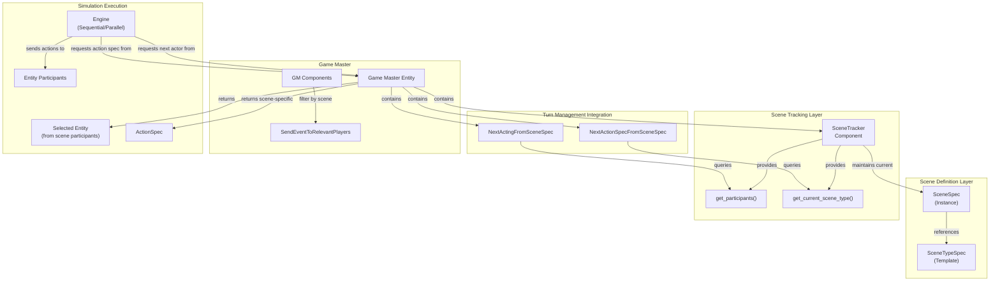
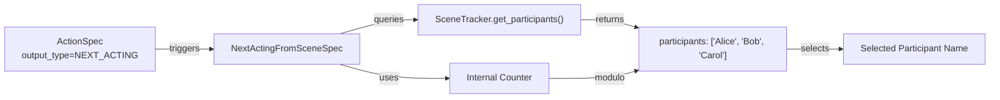
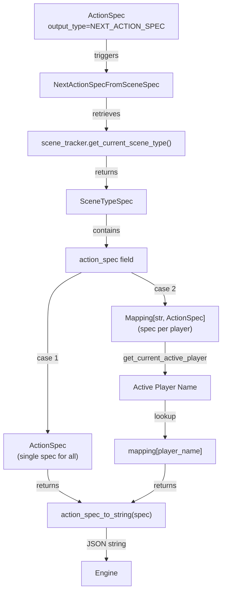
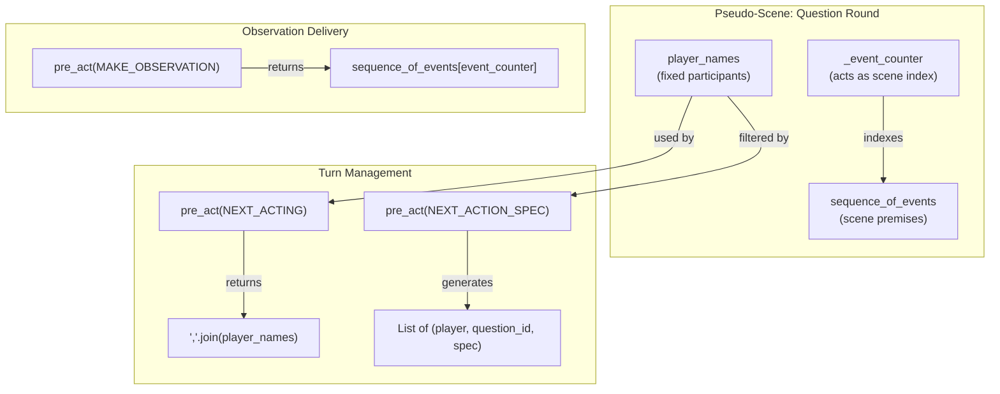
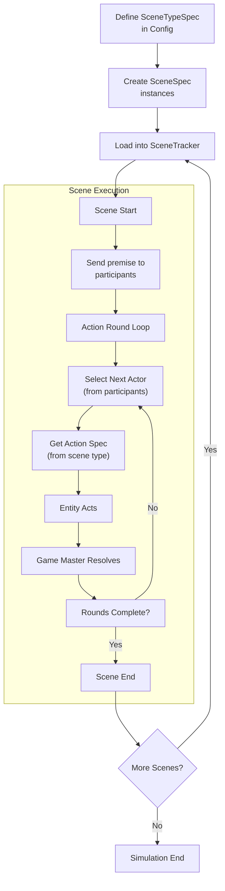

<!-- source: DeepWiki mcp.deepwiki.com · repo google-deepmind/concordia · extra page Scene Management · fetched 2026-10-26 -->

# Scene Management

<details>
<summary>Relevant source files</summary>

The following files were used as context for generating this wiki page:

- [concordia/components/game_master/next_acting.py](concordia/components/game_master/next_acting.py)
- [concordia/components/game_master/open_ended_questionnaire.py](concordia/components/game_master/open_ended_questionnaire.py)
- [concordia/components/game_master/questionnaire.py](concordia/components/game_master/questionnaire.py)
- [concordia/environment/engine.py](concordia/environment/engine.py)
- [concordia/environment/engine_test.py](concordia/environment/engine_test.py)
- [concordia/environment/engines/sequential_questionnaire.py](concordia/environment/engines/sequential_questionnaire.py)
- [concordia/prefabs/game_master/open_ended_interviewer.py](concordia/prefabs/game_master/open_ended_interviewer.py)
- [concordia/prefabs/simulation/questionnaire_simulation.py](concordia/prefabs/simulation/questionnaire_simulation.py)
- [concordia/typing/scene.py](concordia/typing/scene.py)

</details>


## Purpose and Scope

This document describes Concordia's scene management system, which enables structured organization of simulations into distinct phases with specific participants, action specifications, and rules. The scene system provides a declarative way to define simulation segments where different subsets of entities interact under different conditions.

Scene management is primarily used by the Game Master system (see [2.2](#2.2)) to control simulation flow. For information about how Game Masters use scenes to resolve events and generate observations, see [Event Resolution and Thought Chains](#2.2.2). For details on scene-aware termination conditions, see [Specialized Game Master Components](#2.2.4).

## Core Data Structures

The scene system is built on two primary dataclasses defined in [concordia/typing/scene.py]():

### SceneTypeSpec

`SceneTypeSpec` defines a reusable template for a category of scenes. It specifies the rules and configuration that apply to all scenes of this type.

| Attribute | Type | Purpose |
|-----------|------|---------|
| `name` | `str` | Identifier for this scene type |
| `game_master_name` | `str \| None` | Specific game master to use for this scene type |
| `default_premise` | `Mapping[str, Sequence[str \| Callable]]` | Default messages sent to participants before the scene starts |
| `action_spec` | `ActionSpec \| Mapping[str, ActionSpec]` | Action specification(s) for participant responses. Can be uniform for all participants or per-player |
| `possible_participants` | `Sequence[str] \| None` | Whitelist of entities eligible to participate in scenes of this type |

**Sources:** [concordia/typing/scene.py:25-58]()

### SceneSpec

`SceneSpec` defines a specific instance of a scene with concrete participants and timing.

| Attribute | Type | Purpose |
|-----------|------|---------|
| `scene_type` | `SceneTypeSpec` | Reference to the scene type template |
| `participants` | `Sequence[str]` | Entity names that participate in this scene instance |
| `num_rounds` | `int` | Number of action-resolution rounds for this scene |
| `start_time` | `datetime.datetime \| None` | Simulation time when the scene begins (can advance clock) |
| `premise` | `Mapping[str, Sequence[str \| Callable]]` | Scene-specific premises that override the scene type's defaults |

**Sources:** [concordia/typing/scene.py:60-80]()

## Scene Management Architecture



**Diagram: Scene Management System Architecture**

This diagram shows how scene specifications flow through the tracking layer to influence turn management and execution. The `SceneTracker` component maintains the current scene state and provides query methods used by turn management components to filter participants and select action specifications.

**Sources:** [concordia/typing/scene.py:1-80](), [concordia/components/game_master/next_acting.py:343-615]()

## SceneTracker Component

The `SceneTracker` component (referenced but not included in provided files) maintains the current scene state within a Game Master. It is accessed by other components through the Game Master's component system.

### Key Methods

Based on usage patterns in the codebase:

| Method | Return Type | Purpose |
|--------|-------------|---------|
| `get_participants()` | `Sequence[str]` | Returns names of entities participating in the current scene |
| `get_current_scene_type()` | `SceneTypeSpec` | Returns the type specification for the active scene |
| `get_state()` | `ComponentState` | Serializes scene state for checkpointing |
| `set_state()` | `None` | Restores scene state from checkpoint |

The tracker is typically accessed with the component key `DEFAULT_SCENE_TRACKER_COMPONENT_KEY` defined in the `scene_tracker` module.

**Sources:** [concordia/components/game_master/next_acting.py:352-356](), [concordia/components/game_master/next_acting.py:542-545](), [concordia/components/game_master/next_acting.py:385-389](), [concordia/components/game_master/next_acting.py:579-586]()

## Scene-Based Turn Management

Concordia provides specialized components that use scene information to control turn-taking and action specification selection.

### NextActingFromSceneSpec

This component determines the next acting entity by cycling through the scene's participants.



**Diagram: NextActingFromSceneSpec Selection Logic**

The component maintains an internal counter that increments with each call, cycling through participants in a round-robin fashion using modulo arithmetic.

**Implementation Details:**

- **Component Key:** `DEFAULT_NEXT_ACTING_COMPONENT_KEY`
- **Phase:** `PRE_ACT` phase with `OutputType.NEXT_ACTING`
- **State:** Maintains `_currently_active_player` and `_counter`
- **Behavior:** Returns `participants[counter % len(participants)]`

**Sources:** [concordia/components/game_master/next_acting.py:343-419]()

### NextActionSpecFromSceneSpec

This component retrieves action specifications from the scene type, supporting both uniform and per-player specs.



**Diagram: NextActionSpecFromSceneSpec Resolution Flow**

The component handles two patterns:
1. **Uniform Spec:** Single `ActionSpec` applies to all participants
2. **Per-Player Spec:** `Mapping[str, ActionSpec]` provides different specs per participant

**Implementation Details:**

- **Lines:** [concordia/components/game_master/next_acting.py:532-615]()
- **Per-Player Support:** Checks if `action_spec` is a `Mapping` (line 602)
- **Integration:** Uses `NextActingFromSceneSpec` via `_next_acting_component_key` to get current player (lines 588-592)
- **Output Format:** Returns JSON string via `engine_lib.action_spec_to_string()` (line 604)

**Sources:** [concordia/components/game_master/next_acting.py:532-615](), [concordia/environment/engine.py:173-175]()

## Scene-Aware Observation Delivery

While not explicitly shown in the provided files, the scene management system integrates with observation delivery to ensure events are only sent to relevant participants.

### Filtering Pattern

Scene-based filtering typically occurs in components like `SendEventToRelevantPlayers`, which can:

1. Query `SceneTracker` for current participants
2. Filter observation recipients to only those in the active scene
3. Prevent information leakage between simultaneous scenes

This pattern is referenced in the high-level architecture diagram (Diagram 5) where `SendEvent` can filter by `SceneTracker` for active participants.

**Sources:** High-level architecture context, [concordia/components/game_master/next_acting.py:343-419]()

## Integration Example: Questionnaire Simulation

The questionnaire simulation system demonstrates scene management principles without explicit `SceneSpec` usage. The `OpenEndedQuestionnaire` component implements scene-like behavior:



**Diagram: Questionnaire Pseudo-Scene Pattern**

The questionnaire component implements scene-like semantics where each element in `sequence_of_events` acts as a mini-scene with its own observation context.

**Key Methods:**

- **Next Acting:** Returns all player names (line 166)
- **Next Action Spec:** Returns JSON list of action specs for all unanswered questions (lines 168-181)
- **Make Observation:** Returns current event from sequence (lines 182-186)
- **Termination:** Triggers when `event_counter >= len(sequence_of_events)` (lines 156-162)

**Sources:** [concordia/components/game_master/open_ended_questionnaire.py:42-361]()

## Scene Lifecycle



**Diagram: Scene Execution Lifecycle**

A scene progresses through:
1. **Initialization:** SceneTracker loads SceneSpec
2. **Premise Delivery:** Participants receive context-setting messages
3. **Round Loop:** Entities take turns acting within scene constraints
4. **Termination:** Scene ends after completing specified rounds

**Sources:** [concordia/typing/scene.py:60-80](), [concordia/components/game_master/next_acting.py:343-419]()

## Configuration Example

A typical scene-based simulation configuration might look like:

```python
# Define scene types
meeting_scene = SceneTypeSpec(
    name="team_meeting",
    game_master_name="office_gm",
    default_premise={
        "all": ["You are in the conference room for the weekly team meeting."]
    },
    action_spec=ActionSpec(
        call_to_action="What do you say or do?",
        output_type=OutputType.FREE
    ),
    possible_participants=["Alice", "Bob", "Carol", "Dave"]
)

# Define specific scene instance
monday_meeting = SceneSpec(
    scene_type=meeting_scene,
    participants=["Alice", "Bob", "Carol"],  # Dave is absent
    num_rounds=5,
    start_time=datetime(2024, 1, 8, 9, 0),
    premise={
        "Alice": ["You are presenting the weekly status report."],
        "Bob": ["You have concerns about the timeline."],
        "Carol": ["You are taking notes."]
    }
)
```

**Usage Pattern:**

1. Game Master contains `SceneTracker` component
2. `SceneTracker` is initialized with a sequence of `SceneSpec` instances
3. `NextActingFromSceneSpec` uses tracker to select from current participants
4. `NextActionSpecFromSceneSpec` retrieves action specs from scene type
5. Engine executes rounds according to scene configuration

**Sources:** [concordia/typing/scene.py:25-80](), [concordia/components/game_master/next_acting.py:343-615]()

## Key Component Keys

The scene management system uses standardized component keys for integration:

| Constant | Module | Purpose |
|----------|--------|---------|
| `DEFAULT_SCENE_TRACKER_COMPONENT_KEY` | `scene_tracker` | Access the SceneTracker component |
| `DEFAULT_NEXT_ACTING_COMPONENT_KEY` | `next_acting` | Access turn selection component |
| `DEFAULT_NEXT_ACTION_SPEC_COMPONENT_KEY` | `next_acting` | Access action spec component |

These keys enable components to reference each other through the Game Master's component registry without hardcoded dependencies.

**Sources:** [concordia/components/game_master/next_acting.py:34-44](), [concordia/components/game_master/next_acting.py:352-356](), [concordia/components/game_master/next_acting.py:542-548]()

## State Management and Checkpointing

Scene-based components support serialization for simulation checkpointing:

**NextActingFromSceneSpec State:**
```python
{
    'currently_active_player': str,
    'counter': int
}
```

**NextActionSpecFromSceneSpec State:**
```python
{}  # Stateless - derives from SceneTracker
```

The `SceneTracker` component (not shown in provided files) would maintain:
- Current scene index
- Active `SceneSpec` instance
- Participant list
- Round counter

**Sources:** [concordia/components/game_master/next_acting.py:409-419](), [concordia/components/game_master/next_acting.py:609-615]()

---

