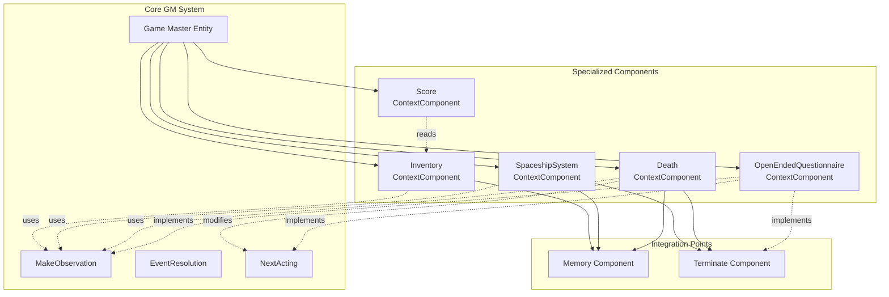
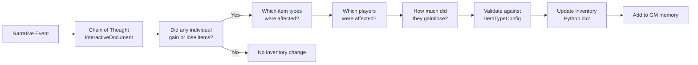
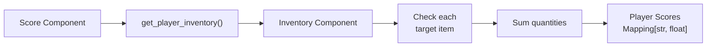
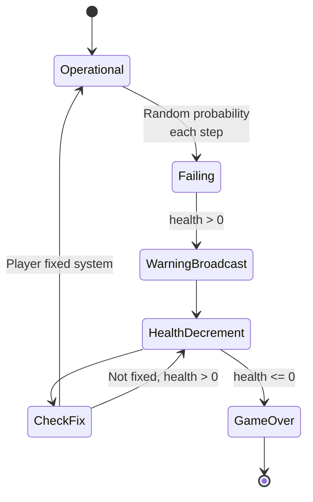
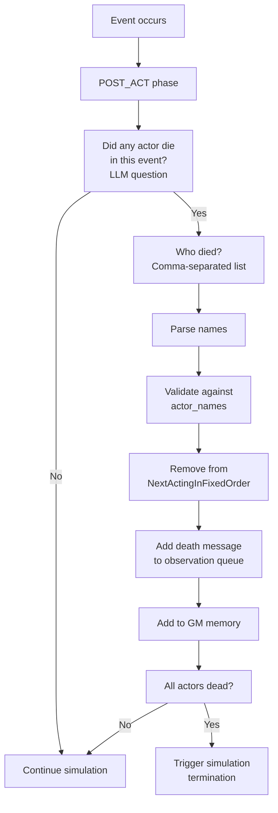
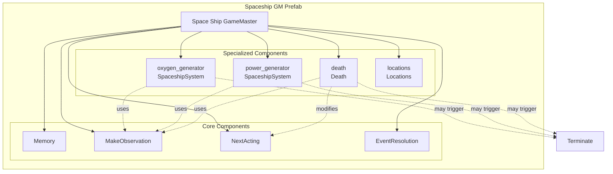
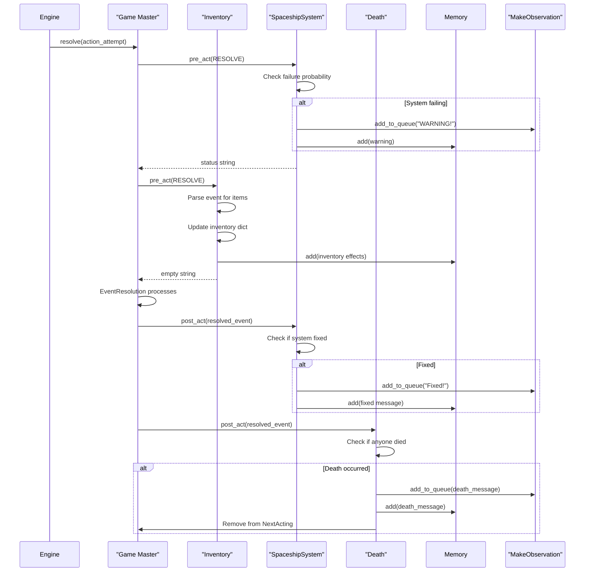

<!-- source: DeepWiki mcp.deepwiki.com · repo google-deepmind/concordia · extra page Specialized Game Master Components · fetched 2026-10-26 -->

# Specialized Game Master Components

<details>
<summary>Relevant source files</summary>

The following files were used as context for generating this wiki page:

- [concordia/components/game_master/__init__.py](concordia/components/game_master/__init__.py)
- [concordia/components/game_master/formative_memories_initializer.py](concordia/components/game_master/formative_memories_initializer.py)
- [concordia/components/game_master/gm_components_test.py](concordia/components/game_master/gm_components_test.py)
- [concordia/components/game_master/inventory.py](concordia/components/game_master/inventory.py)
- [concordia/components/game_master/next_game_master.py](concordia/components/game_master/next_game_master.py)
- [concordia/contrib/data/questionnaires/base_questionnaire.py](concordia/contrib/data/questionnaires/base_questionnaire.py)
- [concordia/contrib/data/questionnaires/depression_anxiety_stress_scale.py](concordia/contrib/data/questionnaires/depression_anxiety_stress_scale.py)
- [concordia/utils/helper_functions.py](concordia/utils/helper_functions.py)
- [concordia/utils/helper_functions_test.py](concordia/utils/helper_functions_test.py)
- [examples/questionnaire_example.ipynb](examples/questionnaire_example.ipynb)

</details>


## Purpose and Scope

This page documents specialized Game Master components that provide domain-specific functionality beyond the core orchestration components. While core GM components (see [Game Master Components](#2.2.1)) handle observation generation, turn selection, and event resolution, specialized components manage specific simulation aspects such as inventory tracking, questionnaires, system health, and death mechanics.

These components extend `entity_component.ContextComponent` and integrate with the Game Master's lifecycle to provide grounded state management, automated bookkeeping, and domain-specific rule enforcement.

## Overview of Specialized Components

The Concordia library provides several specialized GM components organized across two packages:

| Component | Location | Purpose |
|-----------|----------|---------|
| `Inventory` | `concordia/components/game_master/inventory.py` | Tracks item quantities per player using LLM-based reasoning |
| `Score` | `concordia/components/game_master/inventory.py` | Calculates scores based on inventory contents |
| `OpenEndedQuestionnaire` | `concordia/components/game_master/open_ended_questionnaire.py` | Administers questionnaires with embedding-based analysis |
| `SpaceshipSystem` | `concordia/contrib/components/game_master/spaceship_system.py` | Manages spaceship system health with failure mechanics |
| `Death` | `concordia/contrib/components/game_master/death.py` | Handles player death and removal from simulation |

Sources: [concordia/components/game_master/__init__.py:15-31](), [concordia/contrib/prefabs/game_master/__init__.py:15-17]()

## Component Architecture



Sources: [concordia/components/game_master/inventory.py:79-401](), [concordia/components/game_master/open_ended_questionnaire.py:40-348](), [concordia/contrib/components/game_master/spaceship_system.py:30-236](), [concordia/contrib/components/game_master/death.py:32-228]()

## Inventory System

### Inventory Component

The `Inventory` component provides grounded item tracking by maintaining a Python dictionary of item quantities per player and using LLM-based reasoning to determine inventory changes from narrative events.

**Key Features:**
- **Type-safe tracking**: `ItemTypeConfig` enforces constraints (min/max, integer-only)
- **LLM-driven updates**: Analyzes events using chain-of-thought to extract inventory changes
- **Automatic pluralization**: Handles count nouns vs mass nouns correctly
- **Never-increase mode**: Optional constraint preventing inventory growth



Sources: [concordia/components/game_master/inventory.py:79-401]()

### ItemTypeConfig

The `ItemTypeConfig` dataclass defines constraints for each tracked item type:

```python
@dataclasses.dataclass(frozen=True)
class ItemTypeConfig:
  name: str
  minimum: float = -np.inf
  maximum: float = np.inf
  force_integer: bool = False
```

**Configuration Example:**

| Parameter | Type | Description | Example |
|-----------|------|-------------|---------|
| `name` | `str` | Item type identifier | `"money"`, `"tokens"`, `"water"` |
| `minimum` | `float` | Lower bound for quantity | `0.0` (no negative amounts) |
| `maximum` | `float` | Upper bound for quantity | `100.0` (capacity limit) |
| `force_integer` | `bool` | Require whole number quantities | `True` for discrete items |

Sources: [concordia/components/game_master/inventory.py:54-69]()

### Inventory Initialization

The `Inventory` component is initialized with:

```python
inventory = Inventory(
    model=language_model,
    item_type_configs=[
        ItemTypeConfig(name='money', minimum=0, force_integer=False),
        ItemTypeConfig(name='tokens', minimum=0, maximum=10, force_integer=True),
    ],
    player_initial_endowments={
        'Alice': {'money': 100.0, 'tokens': 5},
        'Bob': {'money': 50.0, 'tokens': 3},
    },
    clock_now=lambda: datetime.datetime.now(),
    financial=True,  # Special handling for buy/sell transactions
    never_increase=False,  # Allow inventory to grow
    verbose=True,
)
```

Sources: [concordia/components/game_master/inventory.py:84-159]()

### Inventory Update Process

During the `PRE_ACT` phase with `OutputType.RESOLVE`, the component:

1. **Retrieves observations** from the observation component [concordia/components/game_master/inventory.py:186-190]()
2. **Builds chain-of-thought** with context about players, items, and the event [concordia/components/game_master/inventory.py:192-196]()
3. **Asks gating question**: Did any individual gain or lose items? [concordia/components/game_master/inventory.py:200-209]()
4. **For each item type**, if relevant:
   - Identifies affected players [concordia/components/game_master/inventory.py:226-237]()
   - Determines quantity change [concordia/components/game_master/inventory.py:250-259]()
   - Validates against constraints [concordia/components/game_master/inventory.py:278-284]()
   - Updates Python state [concordia/components/game_master/inventory.py:286-312]()
5. **Logs effects** to memory and returns [concordia/components/game_master/inventory.py:355-366]()

Sources: [concordia/components/game_master/inventory.py:175-366]()

### Score Component

The `Score` component calculates player scores by counting target items in their inventory:

```python
score = Score(
    inventory=inventory_component,
    player_names=['Alice', 'Bob'],
    targets={
        'Alice': ['tokens', 'rare_gems'],  # Score = tokens + rare_gems
        'Bob': ['money'],  # Score = money amount
    },
    verbose=True,
)
```

**Score Calculation:**



The `get_scores()` method returns a dictionary mapping player names to their cumulative scores [concordia/components/game_master/inventory.py:431-448]().

Sources: [concordia/components/game_master/inventory.py:403-468]()

## Questionnaire System

### OpenEndedQuestionnaire Component

The `OpenEndedQuestionnaire` component administers structured questionnaires to players and analyzes responses using embeddings. It is designed for use with the `ParallelQuestionnaireEngine` to conduct psychology experiments and surveys.

**Architecture:**

```mermaid
graph TB
    subgraph "Initialization"
        QConfig["Questionnaire Config<br/>QuestionnaireBase"]
        QConfig --> Parse["Parse questions<br/>by ID"]
        Parse --> QMap["questions_by_id<br/>Dict[str, Question]"]
    end
    
    subgraph "Execution Loop"
        Event["Sequence of Events"]
        Event --> NextAct["NEXT_ACTING<br/>Return all player names"]
        NextAct --> NextSpec["NEXT_ACTION_SPEC<br/>Generate ActionSpecs"]
        NextSpec --> MakeObs["MAKE_OBSERVATION<br/>Return event text"]
        MakeObs --> Agent["Agent responds"]
        Agent --> PreObs["PRE_OBSERVE<br/>Parse and store answer"]
        PreObs --> CheckDone["All questions answered?"]
        CheckDone -->|No| NextAct
        CheckDone -->|Yes| NextEvent["Next Event"]
    end
    
    subgraph "Analysis"
        Answers["Stored Answers"]
        Answers --> Embed["Compute embeddings"]
        Embed --> Similarity["Cosine similarity<br/>with choices"]
        Similarity --> Results["get_questionnaires_results()"]
    end
```



Sources: [concordia/components/game_master/open_ended_questionnaire.py:40-348]()

### Key Methods

| Method | Phase | Purpose |
|--------|-------|---------|
| `pre_act()` | Various | Routes based on `OutputType` to provide appropriate response |
| `pre_observe()` | Observation | Parses agent responses and updates answer tracking |
| `is_done()` | Check | Returns whether all players answered all questions |
| `get_answers()` | Analysis | Returns raw answer data structure |
| `get_questionnaires_results()` | Analysis | Returns pandas DataFrame with aggregated results |

Sources: [concordia/components/game_master/open_ended_questionnaire.py:147-327]()

### Question Processing

When an agent's action arrives as an observation, the component uses regex to extract:

1. **Player name** - Who answered
2. **Question ID** - Which question (format: `{questionnaire_name}_{index}`)
3. **Answer text** - The agent's response

For open-ended questions, it computes embeddings and similarity scores:

```python
answer_embedding = self._embedder(answer_text)
choice_similarities = []
for choice in current_question.choices:
    choice_embedding = self._embedder(choice)
    similarity = np.dot(answer_embedding, choice_embedding)
    choice_similarities.append({'choice': choice, 'similarity': similarity})
```

Sources: [concordia/components/game_master/open_ended_questionnaire.py:184-273]()

### ActionSpec Generation

The component implements multi-interface behavior. When `OutputType.NEXT_ACTION_SPEC` is requested, it generates a JSON list of action specifications:

```json
[
  {
    "player_name": "Alice",
    "question_id": "personality_0",
    "action_spec_str": "prompt: \"Rate your extraversion\";;type: choice;;options: Strongly Disagree,Disagree,Neutral,Agree,Strongly Agree"
  },
  {
    "player_name": "Alice", 
    "question_id": "personality_1",
    "action_spec_str": "prompt: \"Rate your conscientiousness\";;type: choice;;options: ..."
  }
]
```

Sources: [concordia/components/game_master/open_ended_questionnaire.py:163-176]()

## Game-Specific Components

### SpaceshipSystem Component

The `SpaceshipSystem` component simulates a degrading spaceship system that requires player intervention to maintain.

**System Lifecycle:**



**Configuration Parameters:**

| Parameter | Type | Purpose |
|-----------|------|---------|
| `system_name` | `str` | Display name (e.g., "Oxygen generator") |
| `system_max_health` | `int` | Maximum health points |
| `system_failure_probability` | `float` | Chance per step to start failing |
| `warning_message` | `str` | Message broadcast when failing |

Sources: [concordia/contrib/components/game_master/spaceship_system.py:30-236]()

### System Behavior

**During PRE_ACT (OutputType.RESOLVE):**
1. Check if system should start failing (random roll) [concordia/contrib/components/game_master/spaceship_system.py:122-126]()
2. If failing, broadcast warning message via `MakeObservation` [concordia/contrib/components/game_master/spaceship_system.py:137-147]()
3. Decrement health [concordia/contrib/components/game_master/spaceship_system.py:152]()
4. Log current state [concordia/contrib/components/game_master/spaceship_system.py:154-163]()

**During POST_ACT:**
1. Check if event fixed the system (LLM reasoning) [concordia/contrib/components/game_master/spaceship_system.py:182-186]()
2. If fixed, restore to full health [concordia/contrib/components/game_master/spaceship_system.py:188-204]()
3. If not fixed and health depleted, trigger termination [concordia/contrib/components/game_master/spaceship_system.py:206-211]()

Sources: [concordia/contrib/components/game_master/spaceship_system.py:115-213]()

### Death Component

The `Death` component tracks player survival and removes dead players from the simulation.

**Death Detection Flow:**



Sources: [concordia/contrib/components/game_master/death.py:32-228]()

### Death Configuration

```python
death = Death(
    model=language_model,
    pre_act_label='Death',
    actor_names=['Alice', 'Bob', 'Charlie'],
    death_message='{actor_name} has died.',  # Format string
    components=['instructions', 'player_characters'],  # Context for LLM
    verbose=True,
)
```

The component integrates with:
- **NextActingInFixedOrder**: Removes dead actors from turn sequence [concordia/contrib/components/game_master/death.py:176-179]()
- **MakeObservation**: Queues death notifications [concordia/contrib/components/game_master/death.py:181-188]()
- **Memory**: Records deaths [concordia/contrib/components/game_master/death.py:189-193]()
- **Terminate**: Ends simulation when all actors die [concordia/contrib/components/game_master/death.py:197-202]()

Sources: [concordia/contrib/components/game_master/death.py:37-86]()

## Integration in Game Master Prefabs

### Spaceship Game Master Example

The `space_ship.py` prefab demonstrates comprehensive integration of specialized components:



**Component Configuration:**

The oxygen generator system tracks life support health:
```python
oxygen_generator_system = SpaceshipSystem(
    model=model,
    system_name='Oxygen generator',
    system_max_health=10,
    system_failure_probability=0.7,
    warning_message='WARNING! Oxygen generator is failing! Fix immediately...',
    components=['instructions', 'player_characters'],
)
```

The power generator operates independently:
```python
power_generator_system = SpaceshipSystem(
    model=model,
    system_name='Power generator',
    system_max_health=10,
    system_failure_probability=0.7,
    warning_message='WARNING! Power generator is failing! Fix immediately...',
)
```

The death component handles player mortality:
```python
death = Death(
    model=model,
    actor_names=player_names,
    components=['instructions', 'player_characters'],
    memory_component_key=memory_component_key,
    terminator_component_key=terminator_key,
    observation_component_key=make_observation_key,
    fixed_order_next_acting_component_key=next_actor_key,
)
```

Sources: [concordia/contrib/prefabs/game_master/space_ship.py:224-280]()

### Component Ordering

The prefab defines explicit component ordering in the `component_order` list to control execution:

1. Instructions and examples (context setup)
2. Memory and observation components
3. Display events (history)
4. Locations tracking
5. **SpaceshipSystem components** (oxygen, power)
6. **Death component** (mortality tracking)
7. MakeObservation (generate observations)
8. NextActing and NextActionSpec (turn management)
9. EventResolution (process actions)

Sources: [concordia/contrib/prefabs/game_master/space_ship.py:312-344]()

### Dialogic Game Master Example

The `dialogic.py` prefab shows a simpler configuration for conversation-focused scenarios:

```python
conversation_game_master = EntityAgentWithLogging(
    agent_name='conversation rules',
    act_component=SwitchAct(model=model, entity_names=player_names, component_order=component_order),
    context_components={
        'instructions': instructions,
        'display_events': display_events,
        'make_observation': make_observation,
        'next_actor': next_actor,
        'next_action_spec': next_action_spec,
        'event_resolution': event_resolution,
        # No specialized components needed for basic conversation
    }
)
```

Sources: [concordia/prefabs/game_master/dialogic.py:250-255]()

## State Management

All specialized components implement the `get_state()` and `set_state()` methods for checkpointing:

### Inventory State

```python
def get_state(self) -> ComponentState:
    return {'inventories': self._inventories}

def set_state(self, state: ComponentState) -> None:
    with self._lock:
        self._inventories = state['inventories']
```

Sources: [concordia/components/game_master/inventory.py:393-400]()

### SpaceshipSystem State

```python
def get_state(self) -> ComponentState:
    return {
        'system_name': self._system_name,
        'current_health': self._current_health,
        'is_failing': self._is_failing,
        'step_counter': self._step_counter,
    }
```

Sources: [concordia/contrib/components/game_master/spaceship_system.py:215-225]()

### Death State

```python
def get_state(self) -> ComponentState:
    return {
        'actors_names': self._actors_names,
        'step_counter': self._step_counter,
        'last_action_spec': self._last_action_spec.to_dict() if self._last_action_spec else None,
    }
```

Sources: [concordia/contrib/components/game_master/death.py:206-214]()

## Component Interaction Pattern



Sources: [concordia/components/game_master/inventory.py:175-366](), [concordia/contrib/components/game_master/spaceship_system.py:115-213](), [concordia/contrib/components/game_master/death.py:124-204]()

## Best Practices

### Thread Safety

Components using shared state should employ locking:
```python
self._lock = threading.Lock()

def get_player_inventory(self, player_name: str) -> Mapping[str, float | int]:
    with self._lock:
        return copy.deepcopy(self._inventories[player_name])
```

Sources: [concordia/components/game_master/inventory.py:151](), [concordia/components/game_master/inventory.py:368-371]()

### Logging Integration

Specialized components should use `_logging_channel` to report state:
```python
self._logging_channel({
    'Key': self._pre_act_label,
    'Value': str(self._inventories),
    'Chain of thought': display_chain_of_thought,
})
```

Sources: [concordia/components/game_master/inventory.py:361-365]()

### Component Dependencies

When components depend on others, reference them by key:
```python
def __init__(
    self,
    terminator_component_key: str = DEFAULT_TERMINATE_COMPONENT_KEY,
    observation_component_key: str = DEFAULT_MAKE_OBSERVATION_COMPONENT_KEY,
):
    # Later access via:
    terminator = self.get_entity().get_component(
        self._terminator_component_key,
        type_=Terminate,
    )
```

Sources: [concordia/contrib/components/game_master/spaceship_system.py:46-51](), [concordia/contrib/components/game_master/spaceship_system.py:207-211]()

### LLM Context Management

Provide relevant context to LLM reasoning via `components` parameter:
```python
relevant_memories = AllSimilarMemories(
    model=model,
    components=['display_events', 'player_characters'],
    num_memories_to_retrieve=25,
)
```

Then access in the specialized component:
```python
component_states = '\n'.join(
    [self._component_pre_act_display(key) for key in self._components]
)
prompt.statement(f'{component_states}\n')
```

Sources: [concordia/contrib/components/game_master/spaceship_system.py:52](), [concordia/contrib/components/game_master/spaceship_system.py:173-176]()

---

