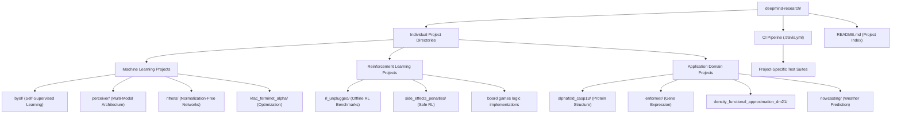
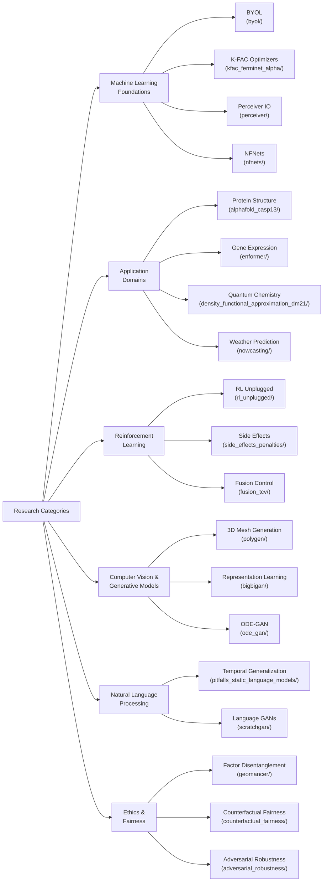

<!-- source: DeepWiki mcp.deepwiki.com · repo google-deepmind/deepmind-research · page 1 Overview · fetched 2026-10-26 -->

# Overview

Relevant source files

The following files were used as context for generating this wiki page:

- [.travis.yml](.travis.yml)
- [README.md](README.md)
- [continual_learning/README.md](continual_learning/README.md)
- [continual_learning/encoders_and_ensembles.ipynb](continual_learning/encoders_and_ensembles.ipynb)
- [neural_mip_solving/README.md](neural_mip_solving/README.md)
- [nfnets/run.sh](nfnets/run.sh)
- [nowcasting/Open_sourced_dataset_and_model_snapshot_for_precipitation_nowcasting.ipynb](nowcasting/Open_sourced_dataset_and_model_snapshot_for_precipitation_nowcasting.ipynb)
- [nowcasting/README.md](nowcasting/README.md)
- [pitfalls_static_language_models/README.md](pitfalls_static_language_models/README.md)

This document introduces the DeepMind Research repository, a collection of code implementations and research artifacts accompanying DeepMind's publications across diverse areas of artificial intelligence research.

## Purpose and Scope

The DeepMind Research repository contains implementations, code examples, and research artifacts that accompany DeepMind publications. Its primary purpose is to enable the broader research community to engage with DeepMind's work and build upon it, with the ultimate goal of accelerating scientific progress in artificial intelligence and related fields.

In addition to the projects in this repository, DeepMind also releases open-source environments, datasets, and code through other repositories, such as [Deep Q-Network](#), [Differential Neural Computer](#), [DeepMind Lab](#), and [StarCraft II](#).

For details about the repository structure and organization, see [Repository Structure](#1.1). For information on setting up and running examples, see [Getting Started](#1.2).

Sources: [README.md:1-23]()

## Repository Organization

The repository follows a simple flat organization where each project has its own top-level directory containing all the necessary code, documentation, and resources. The continuous integration pipeline (via Travis CI) ensures that selected projects remain functional across updates.

### Repository Structure Diagram

Sources: [README.md:25-95](), [.travis.yml:1-36]()

## Research Areas

The repository encompasses a wide range of AI research areas, organized into several major categories:

### Research Categories Overview

Sources: [README.md:25-95]()

## Major Project Categories

### Machine Learning Foundations

This category includes fundamental machine learning techniques, architectures, and training methodologies:

- **Bootstrap Your Own Latent (BYOL)**: A self-supervised learning method for pre-training visual representations without requiring negative examples
- **Perceiver IO**: A general architecture for processing structured inputs and outputs using attention mechanisms
- **Normalizer-Free Networks (NFNets)**: Techniques for training deep neural networks without normalization layers
- **K-FAC Optimizers**: Implementation of Kronecker-factored approximate curvature optimization for neural networks

Sources: [README.md:63-65](), [README.md:35-36](), [README.md:49-50](), [README.md:45-46]()

### Application Domains

Projects applying machine learning to scientific domains and real-world problems:

- **AlphaFold CASP13**: Protein structure prediction system used in the CASP13 competition
- **Enformer**: A model for gene expression prediction that integrates long-range interactions in genomic sequences
- **DM21 Functionals**: Density functional approximation methods for quantum chemistry
- **Nowcasting**: Deep generative models for precipitation forecasting

Sources: [README.md:75-76](), [README.md:47-48](), [README.md:28-29](), [README.md:31-32]()

### Reinforcement Learning

Algorithms, environments, and benchmarks for reinforcement learning research:

- **RL Unplugged**: Datasets and benchmarks for offline reinforcement learning
- **Side Effects Penalties**: Approaches to mitigating unintended side effects in reinforcement learning agents
- **Magnetic Tokamak Control**: Application of deep reinforcement learning to nuclear fusion plasma control

Sources: [README.md:66-67](), [README.md:84-85](), [README.md:27-28]()

### Computer Vision and Generative Models

Projects related to computer vision, image processing, and generative modeling:

- **PolyGen**: Autoregressive generative model for 3D meshes
- **BigBiGAN**: Large-scale adversarial representation learning
- **ODE-GAN**: Training GANs by solving ordinary differential equations

Sources: [README.md:62-63](), [README.md:82-83](), [README.md:55-56]()

### Natural Language Processing

Research on language models and text generation:

- **Temporal Generalization in Language Models**: Assessing how language models generalize to future data
- **ScratchGAN**: Methods for training language GANs from scratch

Sources: [README.md:29-30](), [README.md:78-79]()

### Ethics and Fairness

Research addressing fairness, interpretability, and ethical considerations in AI:

- **Geomancer**: Disentangling factors of variation using subspace diffusion
- **Counterfactual Fairness**: Methods for ensuring fairness in machine learning models
- **Adversarial Robustness**: Techniques for evaluating and improving model robustness against adversarial attacks

Sources: [README.md:67-68](), [README.md:70-71](), [README.md:50-51]()

## Project Integration and Relationships

The following diagram illustrates how different projects relate to each other and integrate across research domains:

```mermaid
graph TD
    Domains["Research Domains"] --> ML["Core ML Technology"]
    Domains --> Applications["Applied AI"]
    
    ML --> Techniques["Learning Techniques"]
    ML --> Architecture["Model Architectures"]
    ML --> Optimization["Optimization Methods"]
    
    Applications --> Scientific["Scientific Applications"]
    Applications --> Systems["System Design"]
    Applications --> Benchmarks["Benchmarks & Datasets"]
    
    Techniques --> BYOL["byol/\n(Self-Supervised Learning)"]
    Techniques --> ODE["ode_gan/\n(ODE-based Training)"]
    Techniques --> Geomancer["geomancer/\n(Disentanglement)"]
    
    Architecture --> Perceiver["perceiver/\n(Multi-Modal Processing)"]
    Architecture --> NFNets["nfnets/\n(Normalization-Free)"]
    Architecture --> MeshGraphNets["meshgraphnets/\n(Graph Networks)"]
    
    Optimization --> KFAC["kfac_ferminet_alpha/\n(K-FAC Optimizer)"]
    Optimization --> Adversarial["adversarial_robustness/\n(Robust Training)"]
    
    Scientific --> AlphaFold["alphafold_casp13/\n(Protein Structure)"]
    Scientific --> Enformer["enformer/\n(Genomics)"]
    Scientific --> DM21["density_functional_approximation_dm21/\n(Quantum Chemistry)"]
    Scientific --> Nowcasting["nowcasting/\n(Weather Prediction)"]
    
    Systems --> RLUnplugged["rl_unplugged/\n(Offline RL)"]
    Systems --> Fusion["fusion_tcv/\n(Plasma Control)"]
    
    Benchmarks --> Pitfalls["pitfalls_static_language_models/\n(NLP Evaluation)"]
    Benchmarks --> OGB["ogb_lsc/\n(Graph Benchmarks)"]
```

Sources: [README.md:25-95]()

## Disclaimer

As noted in the repository: "This is not an officially supported Google product."

Sources: [README.md:96-98]()

---

