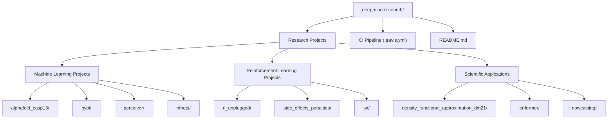
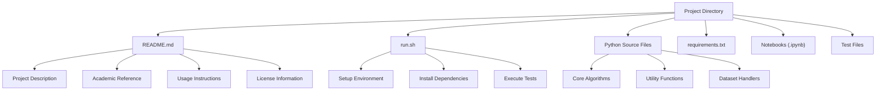
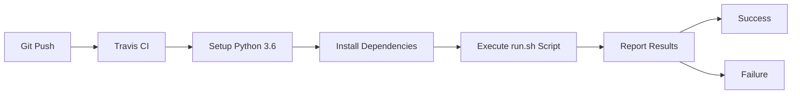

<!-- source: DeepWiki mcp.deepwiki.com · repo google-deepmind/deepmind-research · page 1.1 Repository Structure · fetched 2026-10-26 -->

# Repository Structure

<details>
<summary>Relevant source files</summary>

The following files were used as context for generating this wiki page:

- [.travis.yml](.travis.yml)
- [README.md](README.md)
- [continual_learning/README.md](continual_learning/README.md)
- [continual_learning/encoders_and_ensembles.ipynb](continual_learning/encoders_and_ensembles.ipynb)
- [neural_mip_solving/README.md](neural_mip_solving/README.md)
- [nfnets/run.sh](nfnets/run.sh)
- [nowcasting/Open_sourced_dataset_and_model_snapshot_for_precipitation_nowcasting.ipynb](nowcasting/Open_sourced_dataset_and_model_snapshot_for_precipitation_nowcasting.ipynb)
- [nowcasting/README.md](nowcasting/README.md)
- [pitfalls_static_language_models/README.md](pitfalls_static_language_models/README.md)

</details>


## Purpose and Scope

This document describes the structural organization of the DeepMind Research repository, including how individual projects are arranged, the continuous integration pipeline, and common patterns across projects. This page focuses on the technical layout of the codebase rather than its research content.

For information about how to set up and run the projects in this repository, see [Getting Started](#1.2).

Sources: [README.md:1-23]()

## Repository Overview

The DeepMind Research repository follows a flat organization structure containing multiple independent research projects, each residing in its own top-level directory.



The repository contains over 60 research projects covering various machine learning areas, from protein structure prediction (AlphaFold) to self-supervised learning (BYOL) and reinforcement learning techniques. Each directory encapsulates a distinct research project corresponding to a published paper.

The project README in the root directory provides a chronologically ordered list of all projects, each with a link to the project directory and its associated academic publication.

Sources: [README.md:25-95]()

## Project Structure

Individual projects generally follow a consistent directory structure, though the exact organization may vary based on project needs.



### Common Components in Projects

1. **README.md**: Each project includes documentation describing the project, linking to the corresponding research paper, and providing usage instructions.

2. **run.sh**: A shell script that sets up the environment, installs dependencies, and runs tests. This script is executed by the CI pipeline to verify project functionality.

3. **Python Source Files**: Implementation of algorithms and models from the research paper. These may be organized in different ways depending on project complexity.

4. **requirements.txt**: Lists the Python dependencies required to run the project.

5. **Jupyter Notebooks**: Many projects include notebooks that demonstrate how to use the code, such as in `nowcasting/Open_sourced_dataset_and_model_snapshot_for_precipitation_nowcasting.ipynb`.

Below is an example of a typical run.sh script from the nfnets project:

```bash
#!/bin/sh
# Set up a virtual environment
python3 -m venv /tmp/nfnets_venv
source /tmp/nfnets_venv/bin/activate
pip3 install --upgrade pip setuptools wheel
pip3 install -r nfnets/requirements.txt

# Run tests
python3 -m nfnets.test
```

Sources: [nowcasting/README.md:1-15](), [nfnets/run.sh:1-23](), [continual_learning/README.md:1-32]()

## Continuous Integration Pipeline

The repository employs Travis CI for continuous integration testing, configured through the `.travis.yml` file at the repository root.



The CI workflow for each project follows these steps:

1. **Environment Setup**: Configures a Python 3.6 environment on Ubuntu Trusty
2. **Dependency Installation**: Installs required packages via pip
3. **Test Execution**: Runs the project's `run.sh` script
4. **Result Reporting**: Reports success or failure of the tests

The `.travis.yml` file specifies which projects are tested in the CI pipeline:

```yaml
env:
  matrix:
    - PROJECT="adversarial_robustness"
    # - PROJECT="cs_gan"  # TODO(b/184845450): Fix and re-enable
    - PROJECT="gated_linear_networks"
    - PROJECT="geomancer"
    - PROJECT="hierarchical_probabilistic_unet"
    - PROJECT="iodine"
    - PROJECT="kfac_ferminet_alpha"
    - PROJECT="learning_to_simulate"
    - PROJECT="nfnets"
    - PROJECT="option_keyboard"
    - PROJECT="sketchy"
    - PROJECT="tandem_dqn"
    - PROJECT="transporter"
    - PROJECT="tvt"
    - PROJECT="unsupervised_adversarial_training"
    - PROJECT="meshgraphnets"
```

Not all projects are included in the CI pipeline; some may have more complex dependencies or test requirements, while others may be temporarily disabled due to issues (as noted in the commented-out entries).

Sources: [.travis.yml:1-36]()

## Dataset Management

Many projects in the repository work with datasets, which are typically handled in one of several ways:

1. **Reference to External Datasets**: Projects provide instructions for downloading datasets from external sources
2. **Dataset Loaders**: Code that automatically downloads and processes required datasets
3. **Cloud Storage References**: Links to datasets stored in Google Cloud Storage buckets

For example, the `nowcasting` project uses Google Cloud Storage for its dataset:

```python
# Example subset (publicly accessible)
EXAMPLE_DATASET_BUCKET_PATH = "gs://dm-nowcasting-example-data/datasets/nowcasting_open_source_osgb/nimrod_osgb_1000m_yearly_splits/radar/20200718"

# Full dataset (requester-pays)
FULL_DATASET_BUCKET_PATH = "gs://dm-nowcasting/datasets/nowcasting_open_source_osgb/nimrod_osgb_1000m_yearly_splits/radar/20200718"
```

Similarly, the `pitfalls_static_language_models` project provides dataset splits via Google Cloud Storage with detailed documentation on their structure and usage.

Each project that uses datasets typically includes documentation describing the dataset format, access methods, and any preprocessing steps required.

Sources: [nowcasting/Open_sourced_dataset_and_model_snapshot_for_precipitation_nowcasting.ipynb:158-171](), [neural_mip_solving/README.md:20-25](), [pitfalls_static_language_models/README.md:8-44]()

## Licensing Information

Projects in the repository generally use one of the following licenses:

1. **Apache License, Version 2.0**: For most code
2. **Creative Commons Attribution 4.0 International License**: For datasets and some model snapshots

Each project typically specifies its license in the README.md file. The repository itself contains a disclaimer noting: "This is not an official Google product."

Sources: [README.md:96-98](), [nowcasting/README.md:12-45](), [continual_learning/encoders_and_ensembles.ipynb:3-22]()

---

