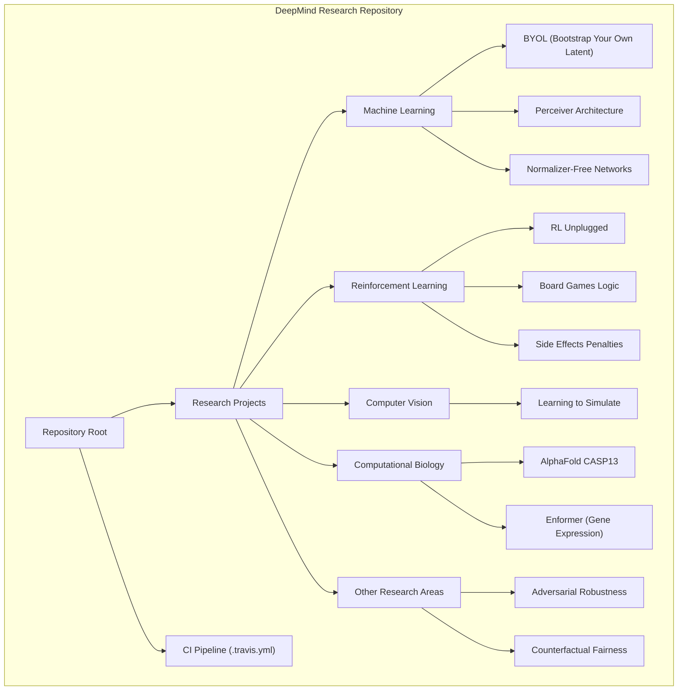
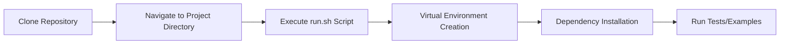
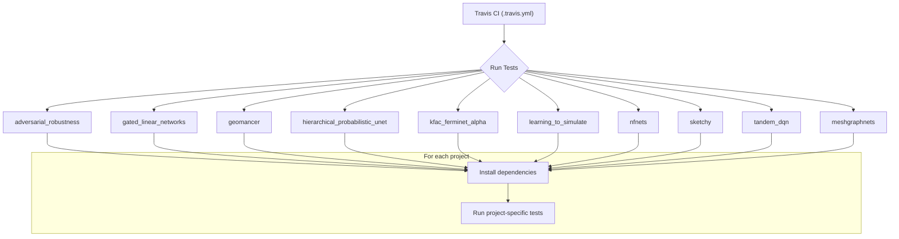

<!-- source: DeepWiki mcp.deepwiki.com · repo google-deepmind/deepmind-research · page 1.2 Getting Started · fetched 2026-10-26 -->

# Getting Started

<details>
<summary>Relevant source files</summary>

The following files were used as context for generating this wiki page:

- [.travis.yml](.travis.yml)
- [README.md](README.md)
- [adversarial_robustness/README.md](adversarial_robustness/README.md)
- [adversarial_robustness/iclrw2021data/README.md](adversarial_robustness/iclrw2021data/README.md)
- [adversarial_robustness/iclrw2021doing/README.md](adversarial_robustness/iclrw2021doing/README.md)
- [adversarial_robustness/jax/attacks.py](adversarial_robustness/jax/attacks.py)
- [adversarial_robustness/jax/datasets.py](adversarial_robustness/jax/datasets.py)
- [adversarial_robustness/jax/eval.py](adversarial_robustness/jax/eval.py)
- [adversarial_robustness/jax/experiment_test.py](adversarial_robustness/jax/experiment_test.py)
- [adversarial_robustness/jax/model_zoo.py](adversarial_robustness/jax/model_zoo.py)
- [adversarial_robustness/jax/train.py](adversarial_robustness/jax/train.py)
- [adversarial_robustness/pytorch/README.md](adversarial_robustness/pytorch/README.md)
- [adversarial_robustness/pytorch/eval.py](adversarial_robustness/pytorch/eval.py)
- [adversarial_robustness/pytorch/model_zoo.py](adversarial_robustness/pytorch/model_zoo.py)
- [adversarial_robustness/requirements.txt](adversarial_robustness/requirements.txt)
- [adversarial_robustness/run.sh](adversarial_robustness/run.sh)
- [continual_learning/README.md](continual_learning/README.md)
- [continual_learning/encoders_and_ensembles.ipynb](continual_learning/encoders_and_ensembles.ipynb)
- [neural_mip_solving/README.md](neural_mip_solving/README.md)
- [nfnets/run.sh](nfnets/run.sh)
- [nowcasting/Open_sourced_dataset_and_model_snapshot_for_precipitation_nowcasting.ipynb](nowcasting/Open_sourced_dataset_and_model_snapshot_for_precipitation_nowcasting.ipynb)
- [nowcasting/README.md](nowcasting/README.md)
- [pitfalls_static_language_models/README.md](pitfalls_static_language_models/README.md)

</details>


This page provides instructions for setting up and running the DeepMind Research repository, which contains implementations and illustrative code accompanying DeepMind publications. For information about the overall structure and organization of the repository, see [Repository Structure](#1.1).

## Prerequisites

Before you begin working with the DeepMind Research repository, ensure you have the following prerequisites installed:

- Python 3.6 or higher
- Git
- pip (Python package installer)

The repository contains multiple independent research projects, each with its own set of dependencies. Most projects use common machine learning libraries like TensorFlow, JAX, and PyTorch.

Sources: [README.md:1-23](), [adversarial_robustness/requirements.txt:1-64]()

## Repository Setup

### Cloning the Repository

To get started with DeepMind Research, clone the repository from GitHub:

```bash
git clone https://github.com/google-deepmind/deepmind-research.git
cd deepmind-research
```

### Project Structure

The DeepMind Research repository is organized as a collection of independent projects, each corresponding to a specific research paper or area.



Sources: [README.md:25-93](), [.travis.yml:1-36]()

## Running Examples

Most projects in the DeepMind Research repository follow a similar pattern for setup and execution. Each project typically contains:

1. A README.md file with project-specific instructions
2. A run.sh script that sets up the environment and runs tests
3. Python code implementing the research

### Using Project-Specific Run Scripts

Many projects include a `run.sh` script that creates a virtual environment, installs dependencies, and runs tests. Here's a typical workflow:



For example, to run the Adversarial Robustness project:

```bash
# Run from the parent directory
sh adversarial_robustness/run.sh
```

After running the setup script, you can activate the created virtual environment:

```bash
source /tmp/adversarial_robustness_venv/bin/activate
```

Sources: [adversarial_robustness/run.sh:1-44](), [nfnets/run.sh:1-23]()

### Manual Setup

If a project doesn't have a run.sh script, you can set up a virtual environment manually:

```bash
# Navigate to the project directory
cd project_name

# Create a virtual environment
python -m venv venv

# Activate the virtual environment
source venv/bin/activate  # On Windows: venv\Scripts\activate

# Install dependencies
pip install -r requirements.txt

# Run the project's main script
python main.py  # or other entry point
```

## Common Dependencies

The projects in the DeepMind Research repository use various dependencies, but some are common across many projects:

| Dependency | Purpose | Common Version |
|------------|---------|----------------|
| TensorFlow | Machine learning framework | 2.5.0 |
| JAX | Numerical computing with autodiff | 0.2.x |
| PyTorch | Deep learning framework | 1.9.0 |
| NumPy | Numerical computing | 1.19.x |
| Haiku | Neural network library (DeepMind) | 0.0.4 |
| Optax | Optimization library (DeepMind) | 0.0.8 |
| Chex | Testing utilities for JAX (DeepMind) | 0.0.7 |

Sources: [adversarial_robustness/requirements.txt:1-64]()

## Example Projects

The repository contains numerous research projects spanning different domains. Here's a selection of notable projects you can explore:

| Project | Description | Domain |
|---------|-------------|--------|
| AlphaFold CASP13 | Protein structure prediction | Computational Biology |
| Perceiver | General architecture for structured inputs & outputs | Machine Learning |
| BYOL | Self-supervised learning method | Computer Vision |
| RL Unplugged | Benchmarks for offline reinforcement learning | Reinforcement Learning |
| Adversarial Robustness | Improving model robustness against adversarial attacks | Security |
| NFNets | Normalizer-Free Networks for improved signal propagation | Machine Learning |
| Learning to Simulate | Graph-based approach to learning complex physics simulations | Physics |
| Enformer | Gene expression prediction model | Genomics |

Sources: [README.md:25-93]()

## Project-Specific Examples

### Adversarial Robustness Example

The Adversarial Robustness project provides pre-trained models and evaluation code for robust neural networks:

```bash
# After setting up the environment
cd adversarial_robustness/jax
python eval.py --ckpt=${PATH_TO_CHECKPOINT} --depth=70 --width=16 --dataset=cifar10
```

This will evaluate a pre-trained WideResNet model on the CIFAR-10 dataset.

Sources: [adversarial_robustness/README.md:30-99](), [adversarial_robustness/jax/eval.py:1-141]()

### Nowcasting Example

The Nowcasting project provides a precipitation prediction model:

```bash
# After setting up the environment
python -m nowcasting.Open_sourced_dataset_and_model_snapshot_for_precipitation_nowcasting
```

This will run the Colab notebook for precipitation nowcasting.

Sources: [nowcasting/README.md:1-46]()

## Continuous Integration

The repository uses Travis CI for continuous integration testing of key projects:



Sources: [.travis.yml:1-36]()

## Troubleshooting

Here are some common issues you might encounter when working with the repository:

1. **GPU Support**: Some projects may require GPU support for efficient training. You may need to install GPU-specific versions of libraries like JAX or TensorFlow.

2. **Dependencies Conflicts**: Due to the diverse nature of the projects, you might encounter dependency conflicts. It's recommended to use separate virtual environments for each project.

3. **Memory Issues**: Some models may require substantial memory. For such projects, consider using machines with adequate RAM or GPU memory.

## Next Steps

After setting up the repository and familiarizing yourself with its structure, here are some next steps:

1. Explore projects related to your research interests from the main README.md
2. Read the project-specific documentation in the respective directories
3. Run examples and modify them for your needs
4. Consider contributing to the repository if you make improvements

For specific research areas, you might want to check out:
- Machine Learning frameworks: [Major Projects](#2)
- Reinforcement Learning systems: [RL Systems](#3)
- Computational Biology applications: [Application Domains](#5)

Sources: [README.md:1-98]()

---

