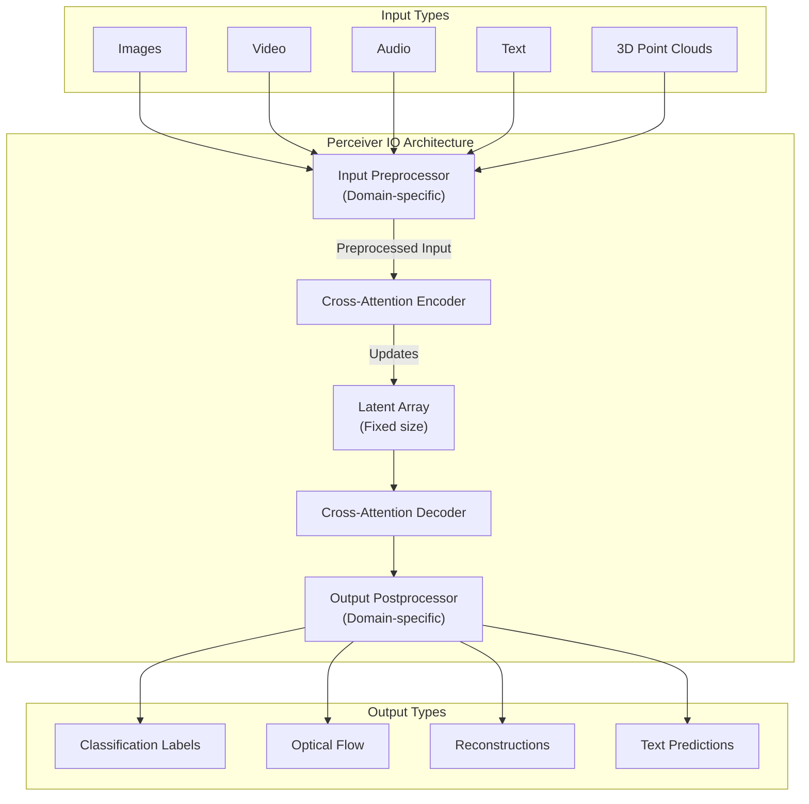
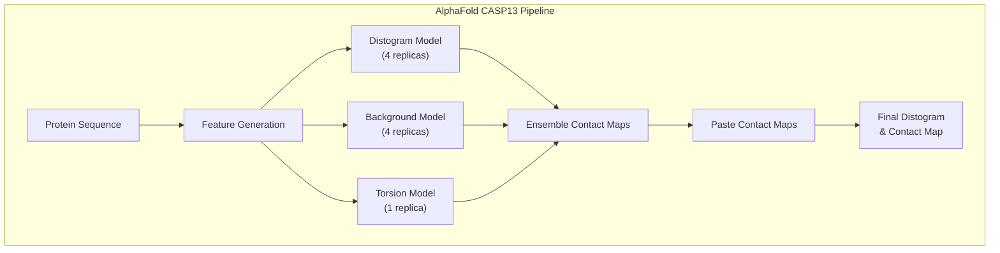
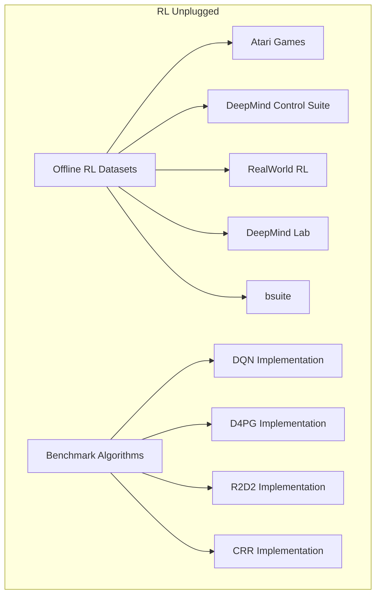
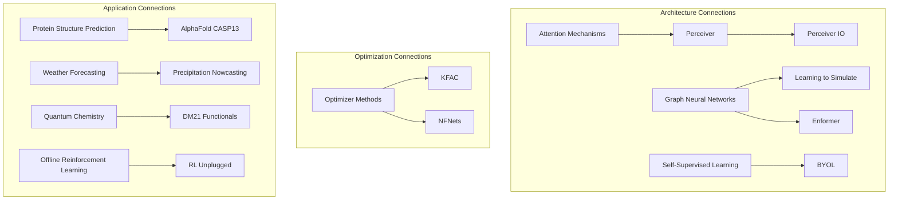
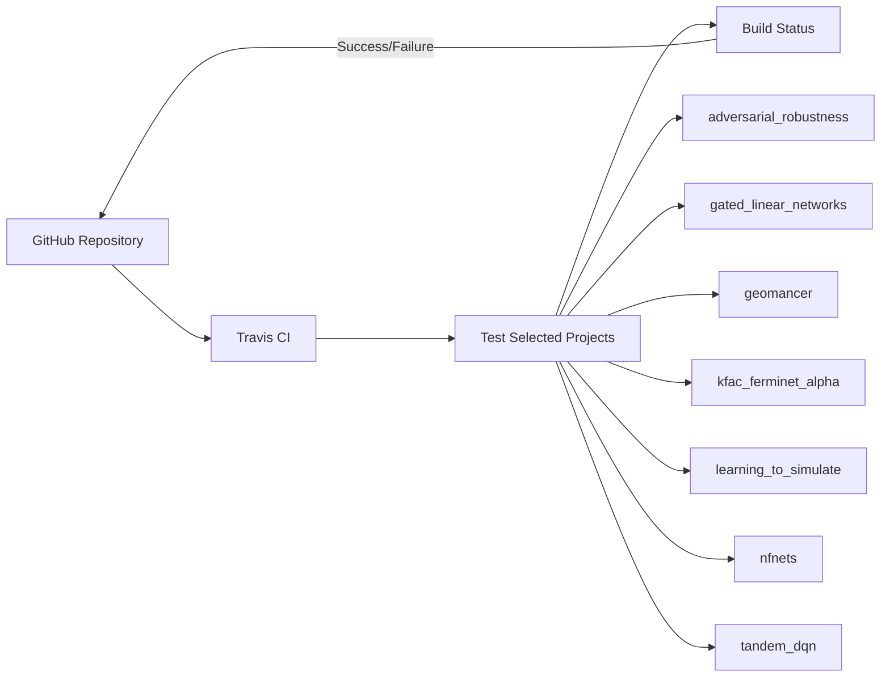

<!-- source: DeepWiki mcp.deepwiki.com · repo google-deepmind/deepmind-research · page 2 Major Projects · fetched 2026-10-26 -->

# Major Projects

Relevant source files

The following files were used as context for generating this wiki page:

- [.travis.yml](.travis.yml)
- [README.md](README.md)
- [alphafold_casp13/README.md](alphafold_casp13/README.md)
- [alphafold_casp13/run_eval.sh](alphafold_casp13/run_eval.sh)
- [continual_learning/README.md](continual_learning/README.md)
- [continual_learning/encoders_and_ensembles.ipynb](continual_learning/encoders_and_ensembles.ipynb)
- [neural_mip_solving/README.md](neural_mip_solving/README.md)
- [nfnets/run.sh](nfnets/run.sh)
- [nowcasting/Open_sourced_dataset_and_model_snapshot_for_precipitation_nowcasting.ipynb](nowcasting/Open_sourced_dataset_and_model_snapshot_for_precipitation_nowcasting.ipynb)
- [nowcasting/README.md](nowcasting/README.md)
- [perceiver/README.md](perceiver/README.md)
- [perceiver/colabs/imagenet_classification.ipynb](perceiver/colabs/imagenet_classification.ipynb)
- [perceiver/colabs/masked_language_modelling.ipynb](perceiver/colabs/masked_language_modelling.ipynb)
- [perceiver/colabs/optical_flow.ipynb](perceiver/colabs/optical_flow.ipynb)
- [perceiver/colabs/video_autoencoding.ipynb](perceiver/colabs/video_autoencoding.ipynb)
- [perceiver/requirements.txt](perceiver/requirements.txt)
- [perceiver/train/autoaugment.py](perceiver/train/autoaugment.py)
- [perceiver/train/dataset.py](perceiver/train/dataset.py)
- [perceiver/train/launch_local.sh](perceiver/train/launch_local.sh)
- [pitfalls_static_language_models/README.md](pitfalls_static_language_models/README.md)

This page provides an overview of the significant research projects in the DeepMind Research repository. These projects represent the core contributions across multiple domains including computer vision, natural language processing, reinforcement learning, protein structure prediction, and more. For information about getting started with the repository, see [Getting Started](#1.2).

## Repository Overview

The DeepMind Research repository contains implementations and illustrative code to accompany DeepMind publications. The projects span a wide range of machine learning approaches and applications, from fundamental research to domain-specific applications.

```mermaid
graph TD
    classDef primary stroke-width:2px
    classDef secondary stroke-width:1.5px

    Root["DeepMind Research"] --> MLFrameworks["Machine Learning Frameworks"]
    Root --> ApplicationDomains["Application Domains"] 
    Root --> RLSystems["Reinforcement Learning"]

    MLFrameworks --> SelfSupervised["Self-Supervised Learning"]
    MLFrameworks --> MultiModal["Multi-Modal Models"]
    MLFrameworks --> Optimization["Optimization Methods"]
    MLFrameworks --> Robustness["Robustness & Reliability"]

    SelfSupervised --> BYOL["Bootstrap Your Own Latent (BYOL)"]
    MultiModal --> Perceiver["Perceiver IO Architecture"]
    Optimization --> KFAC["K-FAC Optimizer"]
    Optimization --> NFNets["Normalizer-Free Networks"]
    Robustness --> AdvRobustness["Adversarial Robustness"]

    ApplicationDomains --> Genomics["Genomics"]
    ApplicationDomains --> ProteinStructure["Protein Structure Prediction"]
    ApplicationDomains --> QuantumChem["Quantum Chemistry"]
    ApplicationDomains --> Forecasting["Forecasting"]

    Genomics --> Enformer["Enformer: Gene Expression"]
    ProteinStructure --> AlphaFold["AlphaFold CASP13"]
    QuantumChem --> DM21["DM21 Functionals"]
    Forecasting --> Nowcasting["Precipitation Nowcasting"]

    RLSystems --> RLUnplugged["RL Unplugged"]
    RLSystems --> PhysicsSim["Physics Simulation"]
    RLSystems --> SideEffects["Side Effects Penalties"]

    PhysicsSim --> LearnSim["Learning to Simulate"]
    
    class AlphaFold,Perceiver,BYOL,DM21,RLUnplugged,Enformer,Nowcasting primary
    class NFNets,KFAC,LearnSim,AdvRobustness,SideEffects secondary
```

Sources: [README.md:1-98]()

## Key Projects by Category

### Self-Supervised Learning

#### Bootstrap Your Own Latent (BYOL)

BYOL is a self-supervised learning method that learns image representations without requiring labeled data. The approach uses two neural networks that learn from each other - an online network trained to predict the target network's representation, while the target network is an exponential moving average of the online network.

Sources: [README.md:63]()

### Multi-Modal Architectures

#### Perceiver and Perceiver IO

Perceiver is a general architecture designed to handle different kinds of data inputs including images, video, audio, 3D point clouds, and language. Unlike traditional Transformers that have quadratic complexity with input size, Perceiver maps inputs to a small latent space where processing is more efficient.

Perceiver IO extends this architecture to handle arbitrary outputs in addition to arbitrary inputs. This makes it suitable for tasks like classification, language modeling, optical flow prediction, and multimodal video autoencoding.

Perceiver IO application examples:
- Masked language modeling using byte-level inputs
- Optical flow prediction from video
- ImageNet classification
- Video autoencoding

Sources: [perceiver/README.md:1-116](), [perceiver/colabs/masked_language_modelling.ipynb:1-270](), [perceiver/colabs/optical_flow.ipynb:1-370](), [perceiver/colabs/imagenet_classification.ipynb:1-1096](), [perceiver/colabs/video_autoencoding.ipynb:1-361]()

### Optimization Methods

#### K-FAC (Kronecker-Factored Approximate Curvature)

K-FAC is an optimization technique that approximates the natural gradient using Kronecker-factored curvature matrices, allowing for more efficient optimization of deep neural networks.

Sources: [README.md:45]()

#### Normalizer-Free Networks (NFNets)

NFNets are deep learning architectures designed to close the performance gap in unnormalized ResNets by focusing on signal propagation characteristics. They enable training deep neural networks without normalization layers.

Sources: [README.md:49](), [nfnets/run.sh:1-23]()

### Genomics and Biological Applications

#### Enformer

Enformer is a model for gene expression prediction that integrates long-range interactions using attention mechanisms. It effectively models the relationship between DNA sequences and gene expression levels.

Sources: [README.md:47]()

#### AlphaFold CASP13

AlphaFold CASP13 is DeepMind's protein structure prediction system that participated in the CASP13 competition. It uses a deep learning approach to predict protein contact maps from sequence information.

The system consists of multiple components:
- Distogram prediction model (4 replicas)
- Background distogram model (4 replicas)
- Torsion prediction model
- Ensemble mechanism to combine predictions
- Contact map generation from distograms

Sources: [alphafold_casp13/README.md:1-438](), [alphafold_casp13/run_eval.sh:1-104]()

### Quantum Chemistry

#### DM21 Density Functionals

DM21 is a project focused on density functional approximation for quantum chemistry, providing interfaces to computational chemistry libraries like PySCF.

Sources: [README.md:28]()

### Forecasting Systems

#### Precipitation Nowcasting

This project uses deep generative models to forecast near-term precipitation patterns (nowcasting) from radar data. The system can generate realistic, physically plausible precipitation forecasts.

Sources: [nowcasting/README.md:1-46](), [nowcasting/Open_sourced_dataset_and_model_snapshot_for_precipitation_nowcasting.ipynb:1-361]()

### Reinforcement Learning Systems

#### RL Unplugged

RL Unplugged provides a collection of benchmarks and datasets for offline reinforcement learning research. It includes data from various environments like Atari games, DeepMind Control Suite, and more.

Sources: [README.md:66]()

#### Learning to Simulate

This project introduces a graph-based approach to learning complex physics simulations, enabling generalization to different physical systems and scenarios.

Sources: [README.md:60]()

#### Side Effects Penalties

This research explores methods to mitigate unintended side effects in reinforcement learning systems, by designing penalty functions that discourage behaviors with harmful side effects.

Sources: [README.md:84]()

## Timeline and Publication Impact

The table below summarizes key projects with their associated publications and impact:

| Project | Year | Related Publication | Key Contribution |
|---------|------|---------------------|------------------|
| AlphaFold CASP13 | 2020 | Nature | Revolutionary approach to protein structure prediction |
| BYOL | 2020 | NeurIPS | Self-supervised learning without negative pairs |
| Perceiver | 2021 | ICML | General perception architecture with iterative attention |
| Perceiver IO | 2021 | arXiv | Extended Perceiver with structured outputs |
| NFNets | 2021 | ICLR | Normalizer-free networks with improved performance |
| Enformer | 2021 | Nature Methods | Gene expression prediction with long-range interactions |
| Nowcasting | 2021 | Nature | Precipitation forecasting with deep generative models |
| DM21 | 2021 | Science | Pushing frontiers of density functionals |
| RL Unplugged | 2020 | - | Benchmarks for offline reinforcement learning |
| Learning to Simulate | 2020 | ICML | Graph networks for physics simulation |

Sources: [README.md:25-90]()

## Project Integration

Many of the projects in the repository are interconnected, sharing common approaches or building upon each other's results:

Sources: [README.md:1-98]()

## Continuous Integration and Testing

The repository includes a continuous integration setup using Travis CI, ensuring code quality and reproducibility:

The CI pipeline helps ensure that the main components of the repository remain functional and compatible.

Sources: [.travis.yml:1-36]()

## Development and Contribution Guidelines

The repository is designed to be accessible to researchers who want to build upon DeepMind's work. Each project typically includes:

1. A README file with an overview of the project
2. Code implementation of the core algorithms
3. Example scripts for running the algorithms
4. Where applicable, links to pre-trained models and datasets

For more details on how to use and contribute to the repository, see the [Repository Structure](#1.1) page.

Sources: [README.md:1-98]()

---

