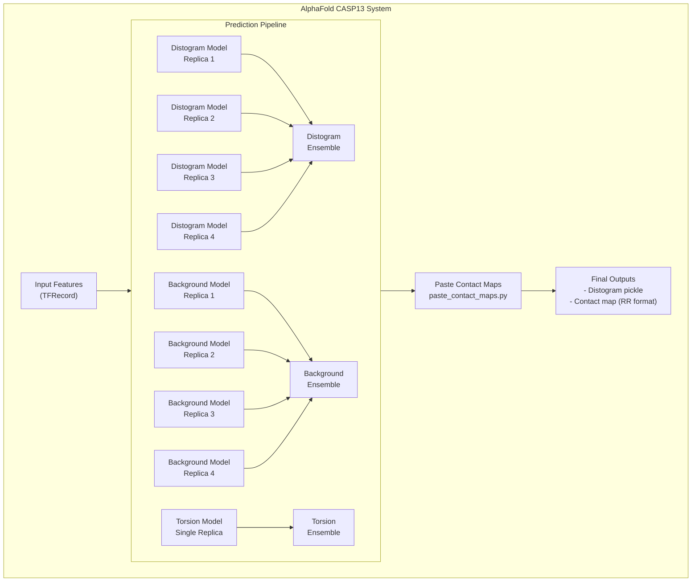
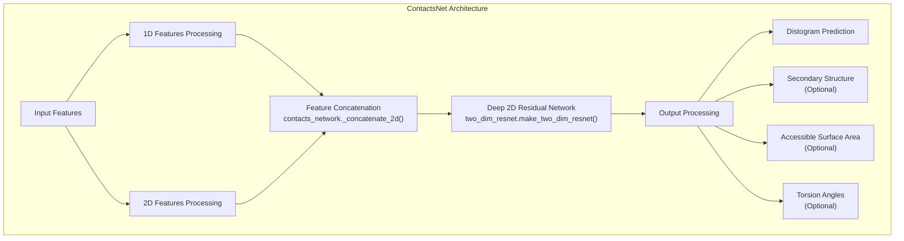
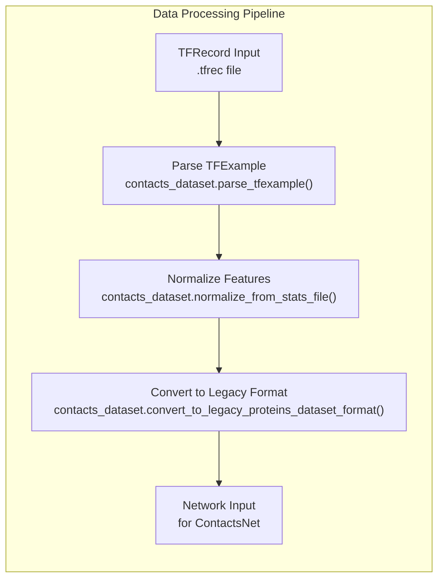
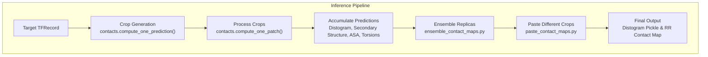
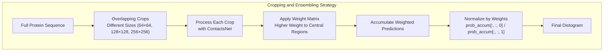
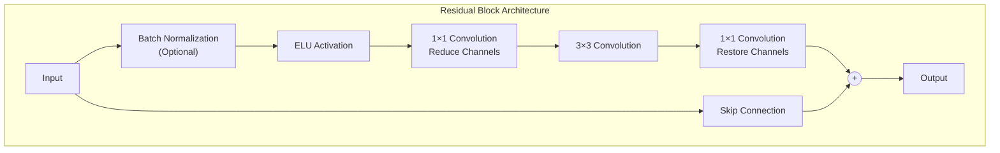
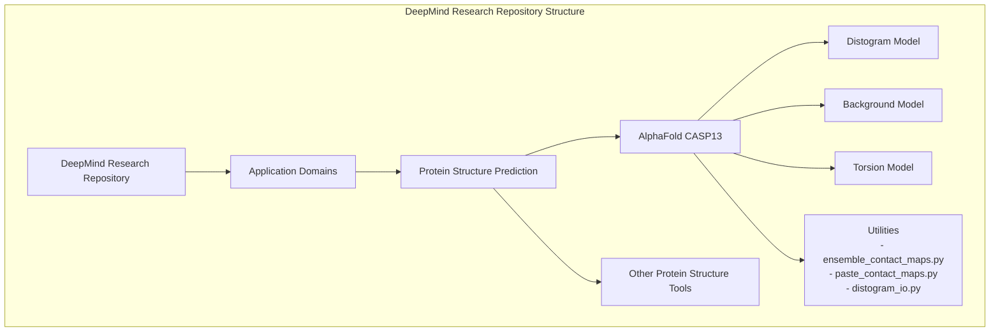

<!-- source: DeepWiki mcp.deepwiki.com · repo google-deepmind/deepmind-research · page 2.1 AlphaFold CASP13 · fetched 2026-10-26 -->

# AlphaFold CASP13

Relevant source files

The following files were used as context for generating this wiki page:

- [alphafold_casp13/README.md](alphafold_casp13/README.md)
- [alphafold_casp13/asa_output.py](alphafold_casp13/asa_output.py)
- [alphafold_casp13/contacts.py](alphafold_casp13/contacts.py)
- [alphafold_casp13/contacts_dataset.py](alphafold_casp13/contacts_dataset.py)
- [alphafold_casp13/contacts_experiment.py](alphafold_casp13/contacts_experiment.py)
- [alphafold_casp13/contacts_network.py](alphafold_casp13/contacts_network.py)
- [alphafold_casp13/distogram_io.py](alphafold_casp13/distogram_io.py)
- [alphafold_casp13/ensemble_contact_maps.py](alphafold_casp13/ensemble_contact_maps.py)
- [alphafold_casp13/parsers.py](alphafold_casp13/parsers.py)
- [alphafold_casp13/paste_contact_maps.py](alphafold_casp13/paste_contact_maps.py)
- [alphafold_casp13/run_eval.sh](alphafold_casp13/run_eval.sh)
- [alphafold_casp13/secstruct.py](alphafold_casp13/secstruct.py)
- [alphafold_casp13/two_dim_convnet.py](alphafold_casp13/two_dim_convnet.py)
- [alphafold_casp13/two_dim_resnet.py](alphafold_casp13/two_dim_resnet.py)

## Purpose and Scope

This document details the AlphaFold 1 system used in the CASP13 competition (2018), focusing on its contact prediction network. This is the original version of AlphaFold and is completely different from AlphaFold 2 used in CASP14 (2020). The system described here is designed specifically for predicting protein structures in the CASP13 dataset and **cannot be used to predict structure of arbitrary protein sequences**.

The document covers the architecture of the contact prediction network, the inference process, and how different model components work together to produce distance histograms (distograms) and contact maps.

Sources: [alphafold_casp13/README.md:1-18]()

## System Overview

AlphaFold CASP13 is a protein structure prediction system that uses deep learning to predict distograms (distance histograms between residue pairs) and then derives contact maps from these distograms. The system consists of three main neural network models:

1. **Distogram Model** - Predicts distributions over inter-residue distances
2. **Background Distogram Model** - Provides additional distogram predictions for ensembling
3. **Torsion Model** - Predicts torsion angles for residues

These models work together through an ensemble and paste methodology to produce the final contact prediction output.

Sources: [alphafold_casp13/README.md:123-178](), [alphafold_casp13/run_eval.sh:19-102]()

## Architecture Components

### ContactsNet: The Core Neural Network

The central prediction engine is `ContactsNet`, which processes protein features to generate distogram predictions. It employs deep residual networks with 2D convolutions to capture spatial relationships between residues.

Sources: [alphafold_casp13/contacts_network.py:41-439](), [alphafold_casp13/two_dim_resnet.py:119-201]()

### Input Features and Data Processing

The system uses a variety of protein features encoded in TFRecord format. Key features include:

- Amino acid sequence information (`aatype`, `sequence`)
- Evolutionary information (`hmm_profile`, `pseudolikelihood`, etc.)
- Position information (`residue_index`)
- Covariation signals (`gap_matrix`, `pseudo_frob`, etc.)

These features are normalized using statistics from a reference dataset before being fed into the neural network.

Sources: [alphafold_casp13/README.md:74-433](), [alphafold_casp13/contacts_dataset.py:143-363]()

## Inference Process

The inference process is orchestrated by the `run_eval.sh` script, which performs the following steps:

1. **Model Evaluation**: Run multiple replicas of the distogram, background, and torsion models
2. **Ensembling**: Combine outputs from different replicas using `ensemble_contact_maps.py`
3. **Pasting**: Integrate predictions from different crop sizes using `paste_contact_maps.py`
4. **Final Output**: Generate distogram pickle files and contact maps in RR format

During inference, the system divides the protein into crops of different sizes, processes each crop separately, and then combines the results to generate the full prediction.

Sources: [alphafold_casp13/contacts.py:93-370](), [alphafold_casp13/run_eval.sh:38-102]()

### Cropping and Ensembling Strategy

The system uses a cropping strategy to handle proteins of different lengths:

1. The protein is divided into overlapping crops of different sizes (64×64, 128×128, 256×256)
2. Each crop is processed independently by the neural network
3. Predictions from different crops are weighted and averaged
4. The final prediction is assembled by pasting these crops together

This approach enables the model to capture both local and global contexts while managing computational resources effectively.

Sources: [alphafold_casp13/contacts.py:172-288](), [alphafold_casp13/paste_contact_maps.py:15-201]()

## Distogram Output and Interpretation

The main output of the system is a distogram - a distance histogram for each pair of residues. Each histogram is discretized into bins representing different distance ranges.

The distogram is stored as a Python pickle file with the following structure:
- `min_range`: Minimum distance range in Angstroms
- `max_range`: Maximum distance range in Angstroms
- `num_bins`: Number of distance bins
- `sequence`: Amino acid sequence
- `domain`: Target name
- `probs`: A 3D array of shape `[L, L, num_bins]` containing the probabilities

Contact maps are derived from distograms by summing probabilities over bins corresponding to distances less than 8 Angstroms.

| Field | Description |
|-------|-------------|
| `min_range` | Minimum distance range in Angstroms |
| `max_range` | Maximum distance range in Angstroms |
| `num_bins` | Number of distance bins |
| `sequence` | Target amino acid sequence |
| `domain` | Target name |
| `probs` | 3D array with shape `[L, L, num_bins]` containing distance probabilities |

Sources: [alphafold_casp13/README.md:180-200](), [alphafold_casp13/distogram_io.py:57-84]()

## Neural Network Architecture Details

The neural network in AlphaFold CASP13 is a deep 2D convolutional network with residual connections. Its key components include:

### 1. Feature Processing

- **1D Features**: Sequence-based features processed per residue
- **2D Features**: Pairwise features between residues
- **Feature Concatenation**: Combines 1D and 2D features with positional encodings

### 2. Residual Blocks

The network uses separable residual blocks with the following structure:
1. Batch normalization (optional)
2. ELU activation
3. 1×1 convolution to reduce channel dimension
4. 3×3 convolution (standard or separable)
5. 1×1 convolution to restore channel dimension
6. Skip connection from input to output

Sources: [alphafold_casp13/two_dim_resnet.py:22-116](), [alphafold_casp13/two_dim_convnet.py:102-137]()

### 3. Output Layers

The network can produce multiple outputs:
- **Distogram**: Main output for distance prediction
- **Secondary Structure**: Optional prediction of 8-class secondary structure
- **Accessible Surface Area (ASA)**: Optional prediction of solvent accessibility
- **Torsion Angles**: Optional prediction of backbone torsion angles

Sources: [alphafold_casp13/contacts_network.py:431-438](), [alphafold_casp13/secstruct.py:44-64](), [alphafold_casp13/asa_output.py:19-33]()

## Integration with DeepMind Research Repository

AlphaFold CASP13 is a standalone component within the broader DeepMind Research repository. It represents the first generation of AlphaFold technology focused on contact prediction for protein structure determination.

## Running the System

To run AlphaFold CASP13 on a CASP13 dataset target:

1. **Setup Environment**: Install dependencies in a Python virtual environment
2. **Configure Models**: Set paths to the distogram, background, and torsion models
3. **Specify Target**: Set the target name and path to its TFRecord file
4. **Run Evaluation**: Execute the `run_eval.sh` script to generate predictions

The complete pipeline is automated in the `run_eval.sh` script, which runs all models in parallel, ensembles their outputs, and produces the final predictions.

Sources: [alphafold_casp13/README.md:20-58](), [alphafold_casp13/run_eval.sh:19-102]()

## Limitations

It's important to note the following limitations of the AlphaFold CASP13 system:

1. It can only be used to predict structures on the CASP13 dataset
2. The feature generation code is not included as it depends on DeepMind's internal infrastructure
3. The system is not compatible with arbitrary protein sequences
4. It only works on Linux operating systems
5. It requires TensorFlow 1.14 (not compatible with TensorFlow 2.0+)

Sources: [alphafold_casp13/README.md:20-29](), [alphafold_casp13/README.md:32-43]()

---

