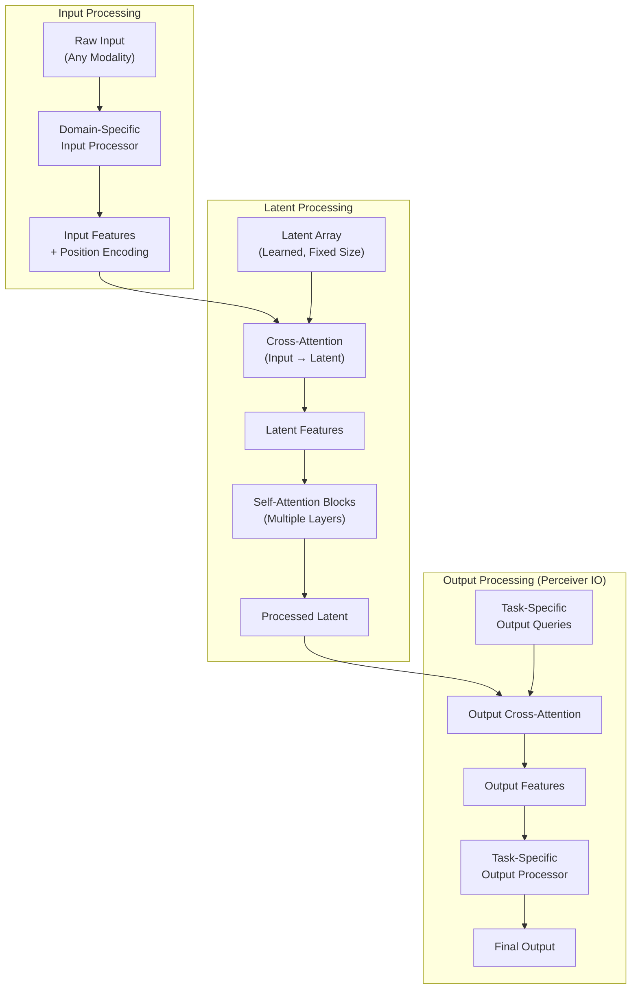
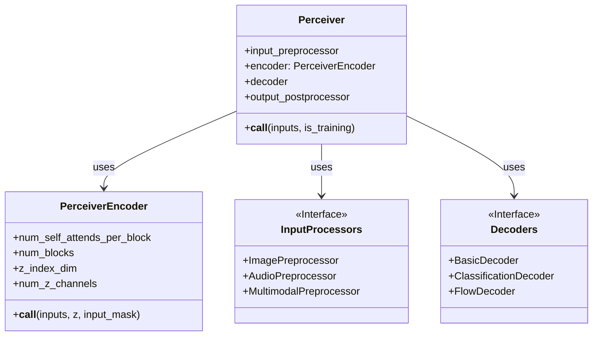
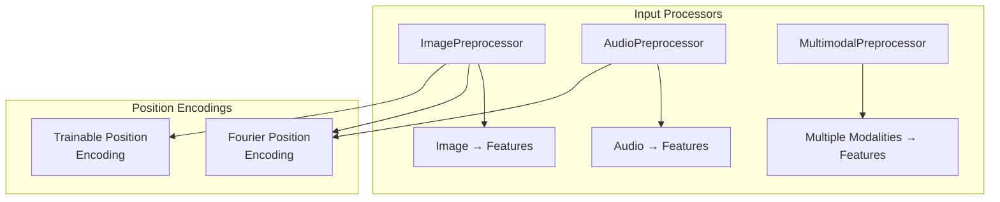

<!-- source: DeepWiki mcp.deepwiki.com · repo google-deepmind/deepmind-research · page 2.2 Perceiver Architecture · fetched 2026-10-26 -->

# Perceiver Architecture

<details>
<summary>Relevant source files</summary>

The following files were used as context for generating this wiki page:

- [perceiver/README.md](perceiver/README.md)
- [perceiver/colabs/imagenet_classification.ipynb](perceiver/colabs/imagenet_classification.ipynb)
- [perceiver/colabs/masked_language_modelling.ipynb](perceiver/colabs/masked_language_modelling.ipynb)
- [perceiver/colabs/optical_flow.ipynb](perceiver/colabs/optical_flow.ipynb)
- [perceiver/colabs/video_autoencoding.ipynb](perceiver/colabs/video_autoencoding.ipynb)
- [perceiver/requirements.txt](perceiver/requirements.txt)
- [perceiver/train/autoaugment.py](perceiver/train/autoaugment.py)
- [perceiver/train/dataset.py](perceiver/train/dataset.py)
- [perceiver/train/launch_local.sh](perceiver/train/launch_local.sh)

</details>


## Purpose and Scope

This document describes the Perceiver and Perceiver IO architecture, a general-purpose neural network design that can process many types of data (images, video, audio, 3D point clouds, language, multimodal combinations) with minimal domain-specific adaptations. Unlike Transformers, which have quadratic complexity in relation to input size, Perceiver achieves linear computational complexity by mapping inputs to a small latent space where processing becomes input-size independent.

The document covers:
- The core architecture of Perceiver and Perceiver IO
- Key components and their interactions
- Domain-specific processors for different data types
- Implementation details and configuration options
- Example applications

Sources: [perceiver/README.md:1-34]()

## Architecture Overview

Perceiver consists of three main components:

1. **Input Processing**: Domain-specific processors convert various input types into a format suitable for the model
2. **Latent Processing**: Cross-attention maps inputs to a fixed-size latent array, which is then processed by self-attention
3. **Output Processing** (Perceiver IO): Maps from the latent space to output formats using query-based decoding



Sources: [perceiver/README.md:3-34](), [perceiver/colabs/masked_language_modelling.ipynb:160-168](), [perceiver/colabs/optical_flow.ipynb:109-152]()

### Key Innovations

1. **Fixed-Size Latent Space**: By limiting computation to a fixed-size latent array, processing cost remains constant regardless of input size
2. **Cross-Attention for Input/Output Mapping**: Flexibly maps between arbitrary input/output spaces and the latent space
3. **Modality-Agnostic Processing**: The core latent processing remains constant regardless of input type
4. **Flexible Output Structure**: Perceiver IO can produce outputs with arbitrary structure through query-based decoding

Sources: [perceiver/README.md:10-25]()

## Code Structure and Components

The implementation is organized into two main files:



Sources: [perceiver/README.md:27-31]()

### Core Components

#### 1. The Main Perceiver Class

The `Perceiver` class is the main entry point for using the model. It combines an encoder, decoder, and optional input/output processors.

```python
class Perceiver:
  def __init__(self,
               encoder,
               decoder,
               input_preprocessor=None,
               output_postprocessor=None):
    # ...

  def __call__(self,
               inputs,
               is_training,
               subsampled_output_points=None,
               input_mask=None,
               query_mask=None):
    # ...
```

Sources: [perceiver/colabs/imagenet_classification.ipynb:212-224](), [perceiver/colabs/masked_language_modelling.ipynb:162-166]()

#### 2. Perceiver Encoder

The `PerceiverEncoder` maps inputs to the latent space and processes them using self-attention blocks:

```python
class PerceiverEncoder:
  def __init__(self,
               num_self_attends_per_block,
               num_blocks,
               z_index_dim,
               num_z_channels,
               num_cross_attend_heads,
               num_self_attend_heads,
               # other parameters...
               ):
    # ...
```

Key configuration parameters:
- `num_self_attends_per_block`: Number of self-attention layers per block
- `num_blocks`: Number of transformer blocks
- `z_index_dim`: Number of latent array indices
- `num_z_channels`: Number of channels in the latent array

Sources: [perceiver/colabs/optical_flow.ipynb:110-123](), [perceiver/colabs/masked_language_modelling.ipynb:95-108](), [perceiver/colabs/imagenet_classification.ipynb:110-120]()

#### 3. Input Processors

Input processors handle different data modalities and add appropriate position encodings:



Major input processors include:
- `ImagePreprocessor`: Handles images with options for position encoding and preprocessing
- `AudioPreprocessor`: Processes audio data, often using patch-based approaches
- `MultimodalPreprocessor`: Combines inputs from multiple modalities

Sources: [perceiver/colabs/optical_flow.ipynb:96-108](), [perceiver/colabs/video_autoencoding.ipynb:406-432](), [perceiver/colabs/imagenet_classification.ipynb:134-147]()

#### 4. Decoders (Perceiver IO)

Perceiver IO uses query-based decoding to generate outputs:

- `ClassificationDecoder`: For classification tasks (outputs class logits)
- `FlowDecoder`: For optical flow prediction (outputs flow fields)
- `BasicDecoder`: General decoder for various tasks

```python
# Example decoder configuration for ImageNet classification
decoder = ClassificationDecoder(
    num_classes=1000,  # Number of output classes
    num_z_channels=1024,  # Must match encoder's latent dimension
    use_query_residual=True,
)
```

Sources: [perceiver/colabs/imagenet_classification.ipynb:216-219](), [perceiver/colabs/optical_flow.ipynb:125-139]()

## Applications and Examples

The repository includes examples of Perceiver IO applied to various tasks:

### 1. Masked Language Modeling

Works directly with bytes rather than tokens, handling masked language modeling similar to BERT but on raw bytes.

```python
encoder_config = dict(
    num_self_attends_per_block=26,
    num_blocks=1,
    z_index_dim=256,
    num_z_channels=1280,
    # ...
)

decoder_config = dict(
    output_num_channels=1280,
    position_encoding_type='trainable',
    output_index_dims=MAX_SEQ_LEN,  # 2048
    # ...
)
```

Sources: [perceiver/colabs/masked_language_modelling.ipynb:94-124]()

### 2. Optical Flow

Predicts motion between video frames, demonstrating Perceiver's ability to handle spatial data.

```python
encoder = perceiver.PerceiverEncoder(
    num_self_attends_per_block=24,
    num_blocks=1,
    z_index_dim=2048,
    num_cross_attend_heads=1,
    # ...
)

decoder = perceiver.FlowDecoder(
    TRAIN_SIZE,
    rescale_factor=100.0,
    use_query_residual=False,
    output_num_channels=2,
    # ...
)
```

Sources: [perceiver/colabs/optical_flow.ipynb:110-139]()

### 3. Image Classification

Achieves competitive results on ImageNet classification with different preprocessing strategies:

- Learned position encoding with 1x1 convolution
- Fourier position encoding with raw pixels
- Fourier position encoding with convolutional preprocessing

```python
# Example model configurations
conv_maxpool_configs = dict(
    input_preprocessor=dict(
        position_encoding_type='fourier',
        fourier_position_encoding_kwargs=dict(
            concat_pos=True,
            max_resolution=(56, 56),
            num_bands=64,
            sine_only=False
        ),
        prep_type='conv',
    ),
    encoder=dict(
        # encoder configuration...
    ),
    decoder=dict(
        # decoder configuration...
    )
)
```

Sources: [perceiver/colabs/imagenet_classification.ipynb:91-204]()

### 4. Video Autoencoding with Audio

Demonstrates multimodal capabilities by processing both video and audio streams:

```python
input_preprocessor = io_processors.MultimodalPreprocessor(
    min_padding_size=4,
    modalities={
        'audio': io_processors.AudioPreprocessor(
            # audio preprocessor config...
        ),
        'image': io_processors.ImagePreprocessor(
            # image preprocessor config...
        ),
    }
)
```

Sources: [perceiver/colabs/video_autoencoding.ipynb:406-432]()

## Usage Guide

### Basic Usage Pattern

1. Select appropriate input processors for your data
2. Configure the encoder with desired parameters
3. Choose a decoder suitable for your task
4. Combine them into a Perceiver model
5. Apply the model to your inputs

```python
# Example for image classification
input_preprocessor = io_processors.ImagePreprocessor(
    position_encoding_type='fourier',
    prep_type='conv',
    # other parameters...
)

encoder = perceiver.PerceiverEncoder(
    num_self_attends_per_block=6,
    num_blocks=8,
    # other parameters...
)

decoder = perceiver.ClassificationDecoder(
    num_classes=1000,
    # other parameters...
)

model = perceiver.Perceiver(
    encoder=encoder,
    decoder=decoder,
    input_preprocessor=input_preprocessor
)

# Apply the model
outputs = model(inputs, is_training=False)
```

Sources: [perceiver/colabs/imagenet_classification.ipynb:212-224]()

### Installing and Running Examples

The repository includes several example notebooks (Colabs) demonstrating different applications:

1. Clone the repository and install dependencies:
```bash
git clone https://github.com/google-deepmind/deepmind-research.git
cd deepmind-research
pip install -r perceiver/requirements.txt
```

2. Run one of the provided examples:
   - Language modeling: `perceiver/colabs/masked_language_modelling.ipynb`
   - Optical flow: `perceiver/colabs/optical_flow.ipynb`
   - Image classification: `perceiver/colabs/imagenet_classification.ipynb`
   - Video autoencoding: `perceiver/colabs/video_autoencoding.ipynb`

3. Train a model using the provided script:
```bash
perceiver/train/launch_local.sh
```

Sources: [perceiver/README.md:36-78](), [perceiver/requirements.txt:1-20](), [perceiver/train/launch_local.sh:1-21]()

## Performance Considerations

- **Computational Efficiency**: Linear in input/output size, with most processing in the fixed-size latent space
- **Memory Usage**: Significantly lower than Transformers for large inputs
- **Configuration Trade-offs**:
  - Larger latent array (`z_index_dim`, `num_z_channels`) provides more capacity but requires more computation
  - More attention layers (`num_self_attends_per_block`, `num_blocks`) increase model capacity but also training time
  - Choice of position encoding affects model's ability to capture spatial/temporal relationships

Sources: [perceiver/README.md:19-25]()

## References

Perceiver and Perceiver IO are based on research papers:

1. Andrew Jaegle, et al. *Perceiver: General Perception with Iterative Attention*. ICML 2021.
   https://arxiv.org/abs/2103.03206

2. Andrew Jaegle, et al. *Perceiver IO: A General Architecture for Structured Inputs & Outputs*.
   arXiv, 2021.
   https://arxiv.org/abs/2107.14795

Sources: [perceiver/README.md:103-115]()

---

