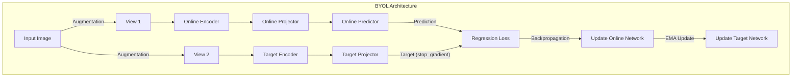
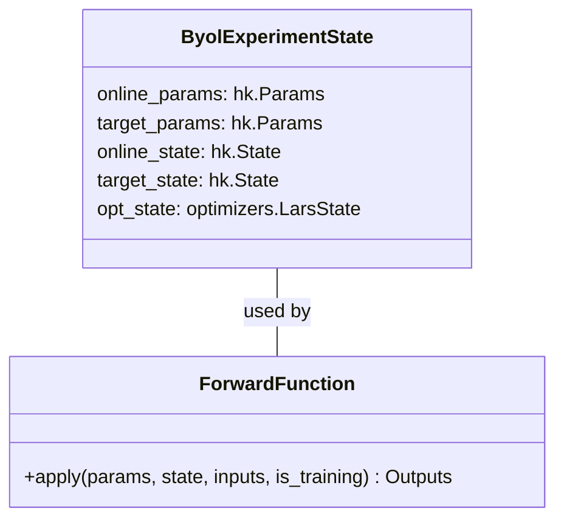
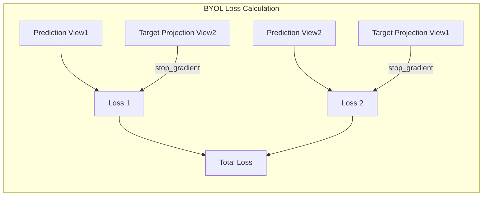
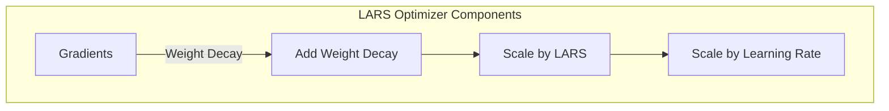
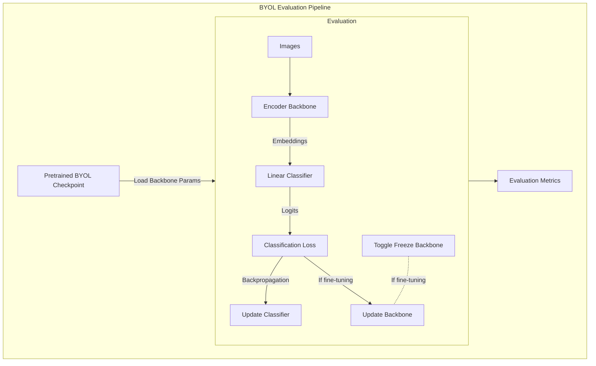

<!-- source: DeepWiki mcp.deepwiki.com · repo google-deepmind/deepmind-research · page 2.3 Bootstrap Your Own Latent (BYOL) · fetched 2026-10-26 -->

# Bootstrap Your Own Latent (BYOL)

<details>
<summary>Relevant source files</summary>

The following files were used as context for generating this wiki page:

- [adversarial_robustness/jax/utils.py](adversarial_robustness/jax/utils.py)
- [byol/byol_experiment.py](byol/byol_experiment.py)
- [byol/eval_experiment.py](byol/eval_experiment.py)
- [byol/utils/optimizers.py](byol/utils/optimizers.py)
- [perceiver/bytes_tokenizer.py](perceiver/bytes_tokenizer.py)
- [perceiver/io_processors.py](perceiver/io_processors.py)
- [perceiver/io_processors_test.py](perceiver/io_processors_test.py)
- [perceiver/train/experiment.py](perceiver/train/experiment.py)
- [perceiver/train/utils.py](perceiver/train/utils.py)
- [physics_inspired_models/integrators.py](physics_inspired_models/integrators.py)
- [physics_inspired_models/metrics.py](physics_inspired_models/metrics.py)

</details>


Bootstrap Your Own Latent (BYOL) is a self-supervised learning approach for training image representations without using negative samples. This document covers the implementation of BYOL in the DeepMind Research repository, focusing on the training method, architecture, and evaluation approaches.

## Overview and Purpose

BYOL learns high-quality visual representations by predicting the outputs of a target network from an online network, where both networks process differently augmented views of the same image. Unlike contrastive methods, BYOL doesn't require negative examples and still achieves competitive performance.

This implementation provides:
- A complete self-supervised pretraining pipeline for image representations 
- Linear evaluation and fine-tuning mechanisms to test the learned representations
- A specialized LARS optimizer for large-batch training

Sources: [byol/byol_experiment.py:16-19]()

## Architecture and Components

BYOL consists of two networks (online and target) that process different augmented views of the same images.



Key components:
1. **Encoder**: A backbone neural network (typically ResNet) that extracts representations from images
2. **Projector**: An MLP that maps encoder representations to a latent space
3. **Predictor**: An MLP that predicts the target network's projections
4. **Target Network**: Updated as an exponential moving average (EMA) of the online network

The network architecture is defined in the `_forward` method, which constructs the encoder, projector, and predictor:

Sources: [byol/byol_experiment.py:116-187]()

## BYOL State and Training Pipeline

### State Management

BYOL maintains a structured state containing all model parameters and optimization state:



Sources: [byol/byol_experiment.py:44-52]()

### Training Pipeline

The training process follows these steps:

1. Initialize online and target networks with different random seeds
2. For each batch:
   - Generate two augmented views of each image
   - Forward both views through respective networks
   - Compute representation loss between predictions and target projections
   - Update online network using gradients
   - Update target network using EMA of online parameters

The core training logic is in the `_update_fn` method:

Sources: [byol/byol_experiment.py:293-351]()

### Loss Function

BYOL uses a symmetric regression loss:



The loss computation is implemented in the `loss_fn` method:

Sources: [byol/byol_experiment.py:197-286]()

## LARS Optimizer

BYOL uses a Layer-wise Adaptive Rate Scaling (LARS) optimizer, which scales the learning rate per layer based on the ratio of weight norm to gradient norm. This enables stable training with large batch sizes.



The LARS optimizer implementation:

Sources: [byol/utils/optimizers.py:61-188]()

## Evaluation Mechanisms

BYOL provides two methods for evaluating learned representations:

1. **Linear Evaluation**: Freeze the backbone and train only a linear classifier
2. **Fine-tuning**: Train both the backbone and a linear classifier



The evaluation implementation is in the `EvalExperiment` class:

Sources: [byol/eval_experiment.py:51-477]()

## Implementation Details

### Target Network EMA Updates

The target network is updated using an EMA schedule that gradually increases the momentum parameter:

```python
tau = schedules.target_ema(
    global_step,
    base_ema=self._base_target_ema,
    max_steps=self._max_steps)
target_params = jax.tree_map(lambda x, y: x + (1 - tau) * (y - x),
                              target_params, online_params)
```

Sources: [byol/byol_experiment.py:338-343]()

### Learning Rate Schedule

BYOL uses a carefully designed learning rate schedule to ensure stable training:

```python
learning_rate = schedules.learning_schedule(
    global_step,
    batch_size=self._batch_size,
    total_steps=self._max_steps,
    **self._lr_schedule_config)
```

Sources: [byol/byol_experiment.py:327-332]()

## Usage Examples

### Training a BYOL Model

To train a new BYOL model:

1. Create a `ByolExperiment` instance with appropriate configuration
2. Run the training loop, calling `step()` for each iteration
3. Save checkpoints periodically

Example usage pattern:

```python
experiment = ByolExperiment(
    random_seed=42,
    num_classes=1000,
    batch_size=1024,
    max_steps=1000000,
    enable_double_transpose=True,
    base_target_ema=0.996,
    network_config={...},
    optimizer_config={...},
    lr_schedule_config={...},
    evaluation_config={...},
    checkpointing_config={...}
)

for step in range(max_steps):
    metrics = experiment.step(global_step=step, rng=rng)
    experiment.save_checkpoint(step, rng)
    
    # Periodically evaluate
    if step % eval_interval == 0:
        eval_metrics = experiment.evaluate(global_step=step)
```

Sources: [byol/byol_experiment.py:395-410]()

### Evaluating a Pretrained Model

To evaluate a pretrained BYOL model:

1. Create an `EvalExperiment` instance pointing to the checkpoint
2. Choose whether to freeze the backbone (linear evaluation) or allow fine-tuning
3. Train the evaluation model and assess performance

Example usage pattern:

```python
eval_experiment = EvalExperiment(
    random_seed=42,
    num_classes=1000,
    batch_size=256,
    max_steps=10000,
    enable_double_transpose=True,
    checkpoint_to_evaluate='/path/to/byol/checkpoint',
    allow_train_from_scratch=False,
    freeze_backbone=True,  # For linear evaluation
    network_config={...},
    optimizer_config={...},
    lr_schedule_config={...},
    evaluation_config={...},
    checkpointing_config={...}
)

for step in range(max_steps):
    metrics = eval_experiment.step(global_step=step, rng=rng)
    
# Final evaluation
final_metrics = eval_experiment.evaluate(global_step=step)
```

Sources: [byol/eval_experiment.py:161-186]()

## Performance Metrics

The implementation tracks several metrics during both training and evaluation:

- Representation loss: The core self-supervised objective
- Classification loss: From the auxiliary classifier during pretraining
- Top-1 and Top-5 accuracy: For evaluating representation quality

Sources: [byol/byol_experiment.py:276-283](), [byol/eval_experiment.py:435-442]()

---

