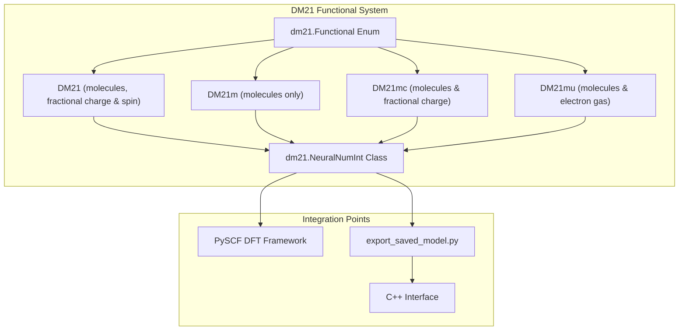
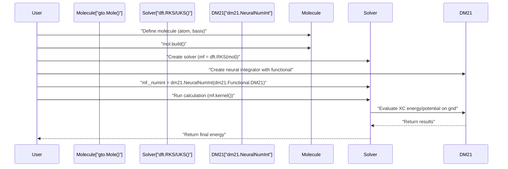
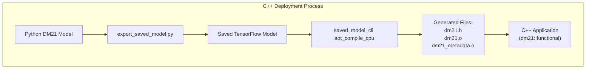

<!-- source: DeepWiki mcp.deepwiki.com · repo google-deepmind/deepmind-research · page 2.4 DM21 Functionals · fetched 2026-10-26 -->

# DM21 Functionals

<details>
<summary>Relevant source files</summary>

The following files were used as context for generating this wiki page:

- [density_functional_approximation_dm21/.bazelrc](density_functional_approximation_dm21/.bazelrc)
- [density_functional_approximation_dm21/.bazelversion](density_functional_approximation_dm21/.bazelversion)
- [density_functional_approximation_dm21/README.md](density_functional_approximation_dm21/README.md)
- [density_functional_approximation_dm21/WORKSPACE.bazel](density_functional_approximation_dm21/WORKSPACE.bazel)
- [density_functional_approximation_dm21/external/tf_bazel.patch](density_functional_approximation_dm21/external/tf_bazel.patch)
- [density_functional_approximation_dm21/requirements.txt](density_functional_approximation_dm21/requirements.txt)
- [density_functional_approximation_dm21/requirements_aot_compilation.txt](density_functional_approximation_dm21/requirements_aot_compilation.txt)

</details>


This document describes the DM21 (DeepMind 21) family of exchange-correlation functionals for quantum chemistry calculations, provided as a PySCF interface within the DeepMind Research repository. These functionals are implemented as neural networks and designed to address the fractional electron problem in density functional theory (DFT). For information about other quantum chemistry components, see [Quantum Chemistry](#5.2).

## Overview

The DM21 functionals represent a neural network-based approach to density functional approximation. They integrate with the PySCF quantum chemistry framework to enable accurate electronic structure calculations, particularly for systems where traditional functionals struggle with fractional electron behavior.



Sources: [density_functional_approximation_dm21/README.md:1-6]()

## Functional Variants

The DM21 system provides four neural network functional variants, each trained with different constraints:

| Functional | Training Dataset | Additional Constraints |
|------------|------------------|------------------------|
| `DM21`     | Molecules        | Fractional charge and fractional spin |
| `DM21m`    | Molecules only   | None |
| `DM21mc`   | Molecules        | Fractional charge |
| `DM21mu`   | Molecules        | Electron gas |

Each variant is accessible through the `dm21.Functional` enum in the interface.

Sources: [density_functional_approximation_dm21/README.md:103-109]()

## PySCF Integration

The DM21 functionals integrate with PySCF through a custom numerical integration class that handles the evaluation of exchange-correlation energy and potential over a real-space grid.



### Basic Usage

Unlike conventional functionals in PySCF that are specified using `mf.xc = 'functional_name'`, DM21 functionals require replacing the numerical integration object:

```python
import density_functional_approximation_dm21 as dm21
from pyscf import gto
from pyscf import dft

# Create the molecule
mol = gto.Mole()
mol.atom = 'Ne 0.0 0.0 0.0'
mol.basis = 'cc-pVDZ'
mol.build()

# Create DFT solver and insert DM21 functional
mf = dft.RKS(mol)
mf._numint = dm21.NeuralNumInt(dm21.Functional.DM21)

# Run calculation
mf.kernel()
```

Sources: [density_functional_approximation_dm21/README.md:50-96]()

### Best Practices

For optimal convergence with the neural functionals:

1. **Initialize with a conventional functional**: Start with a cheaper functional like B3LYP to get close to the solution
2. **Relax convergence tolerances**: Neural networks operate at single precision, making tight convergence difficult
3. **Use proper spin handling**: For open-shell systems, use UKS instead of RKS

Example implementation with best practices:

```python
# Create appropriate solver based on spin
if mol.spin == 0:
    mf = dft.RKS(mol)
else:
    mf = dft.UKS(mol)

# Start with B3LYP to get close to solution
mf.xc = 'B3LYP'
mf.run()
dm0 = mf.make_rdm1()

# Switch to DM21
mf._numint = dm21.NeuralNumInt(dm21.Functional.DM21)
# Relax convergence tolerances
mf.conv_tol = 1E-6
mf.conv_tol_grad = 1E-3
# Run with initial density from B3LYP
energy = mf.kernel(dm0=dm0)
```

Sources: [density_functional_approximation_dm21/README.md:116-189]()

## C++ Integration

The DM21 functionals can be used from C++ applications through two methods:

1. **TensorFlow C++ API**: Load the SavedModel using TensorFlow's C++ library
2. **Ahead-of-Time (AOT) Compilation**: Compile the model into a standalone library with fixed dimensions

The AOT compilation approach creates a more portable solution without runtime TensorFlow dependencies.



### Export Process

1. Export the functional and derivatives:
   ```bash
   export_saved_model.py --functional=DM21 \
                         --out_dir=/path/to/export/DM21 \
                         --batch_size=1000
   ```

2. Compile using `saved_model_cli`:
   ```bash
   saved_model_cli aot_compile_cpu \
                 --dir /path/to/export/DM21 \
                 --output_prefix /path/to/compiled/DM21/dm21 \
                 --cpp_class dm21::functional \
                 --tag_set '' \
                 --signature_def_key default
   ```

3. The compilation generates:
   - `dm21.h`: Header defining the C++ interface
   - `dm21_metadata.o`, `dm21.o`: Object files
   - `dm21_makefile.inc`: Makefile snippet with compilation flags

For building C++ applications that use the compiled functional, Bazel is the recommended build system.

Sources: [density_functional_approximation_dm21/README.md:191-203](), [density_functional_approximation_dm21/README.md:208-237]()

## Building from Source

The DM21 functionals can be installed as a Python package:

1. **Direct installation**:
   ```bash
   python3 -m venv ~/venv/DM21
   source ~/venv/DM21/bin/activate
   pip install git+git://github.com/deepmind/deepmind-research.git#subdirectory=density_functional_approximation_dm21
   ```

2. **Local installation** (after cloning the repository):
   ```bash
   git clone https://github.com/deepmind/deepmind-research.git
   cd deepmind-research/density_functional_approximation_dm21
   python3 -m venv ~/venv/DM21
   source ~/venv/DM21/bin/activate
   pip install .
   ```

3. **Run tests**:
   ```bash
   pip install '.[testing]'
   py.test
   ```

Note: Using PySCF 2.0 or later enables more efficient calculation of local Hartree-Fock features, resulting in significant speed improvements.

Sources: [density_functional_approximation_dm21/README.md:8-48](). [density_functional_approximation_dm21/requirements.txt:1-10]()

## Implementation Notes

The DM21 functionals:

1. Operate on grid points independently, which allows for fixed-dimension AOT compilation without restricting system size
2. Run in single precision, which is why relaxed convergence tolerances are recommended
3. Return results with D3 dispersion corrections when used for benchmarking
4. Are licensed under the Apache 2.0 License (code) and Creative Commons Attribution 4.0 International License (model parameters)

Sources: [density_functional_approximation_dm21/README.md:103-109](), [density_functional_approximation_dm21/README.md:296-302]()

---

