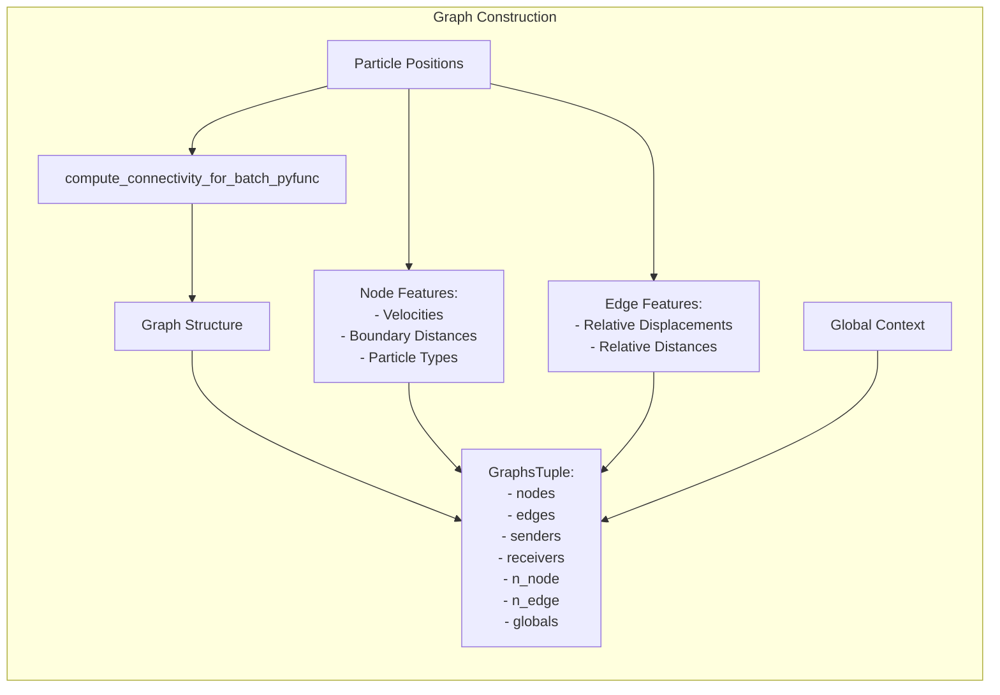
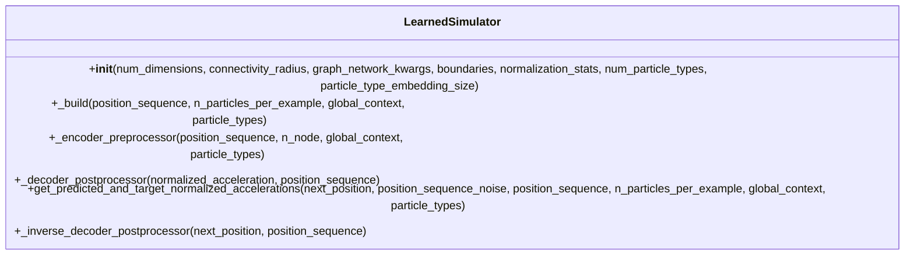
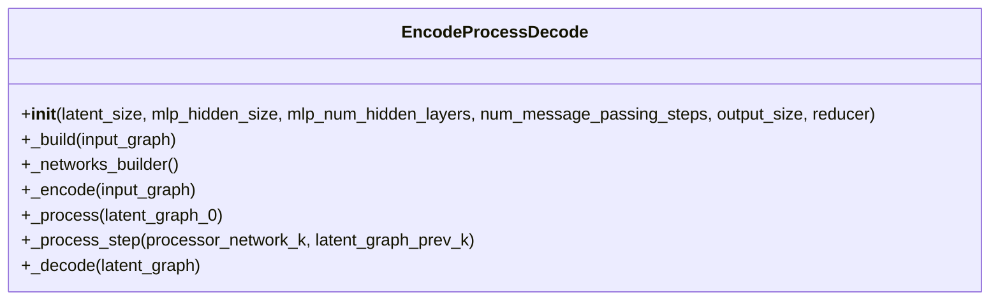
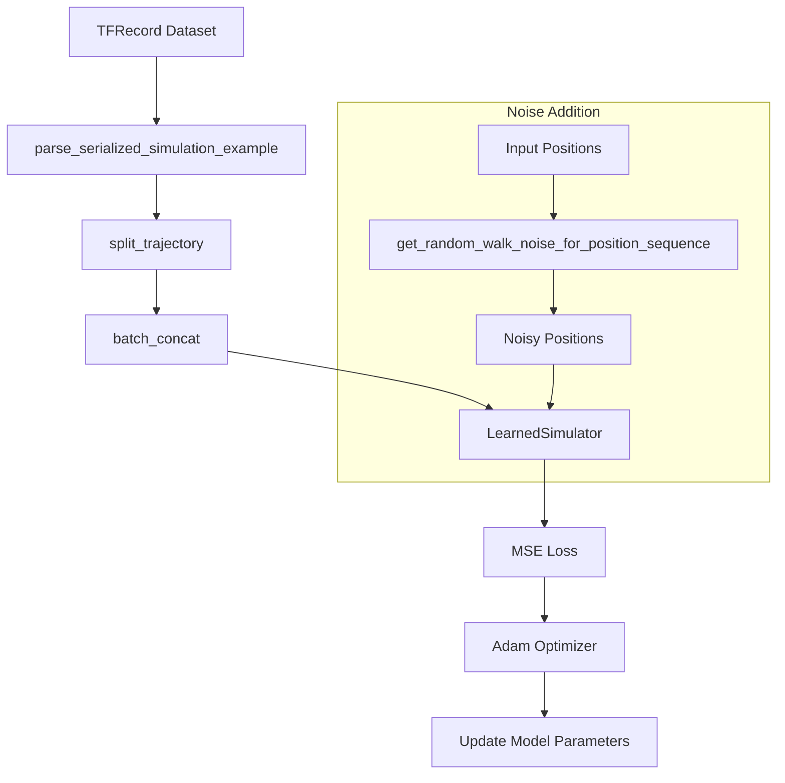
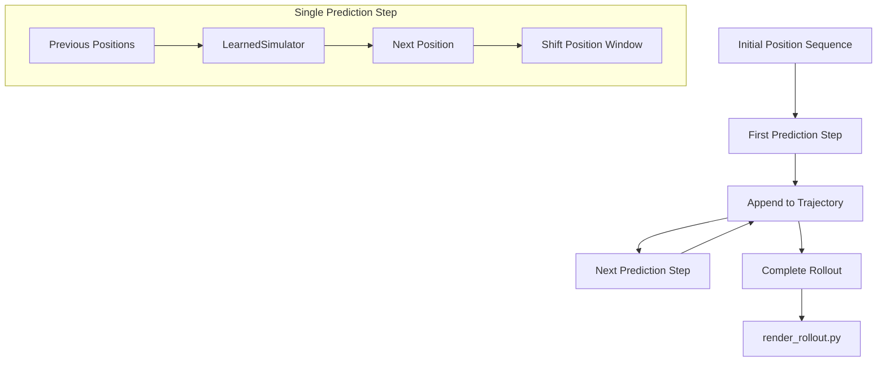

<!-- source: DeepWiki mcp.deepwiki.com · repo google-deepmind/deepmind-research · page 2.5 Learning to Simulate · fetched 2026-10-26 -->

# Learning to Simulate

<details>
<summary>Relevant source files</summary>

The following files were used as context for generating this wiki page:

- [learning_to_simulate/README.md](learning_to_simulate/README.md)
- [learning_to_simulate/connectivity_utils.py](learning_to_simulate/connectivity_utils.py)
- [learning_to_simulate/download_dataset.sh](learning_to_simulate/download_dataset.sh)
- [learning_to_simulate/graph_network.py](learning_to_simulate/graph_network.py)
- [learning_to_simulate/images/water_ramps_rollout.gif](learning_to_simulate/images/water_ramps_rollout.gif)
- [learning_to_simulate/learned_simulator.py](learning_to_simulate/learned_simulator.py)
- [learning_to_simulate/model_demo.py](learning_to_simulate/model_demo.py)
- [learning_to_simulate/noise_utils.py](learning_to_simulate/noise_utils.py)
- [learning_to_simulate/reading_utils.py](learning_to_simulate/reading_utils.py)
- [learning_to_simulate/render_rollout.py](learning_to_simulate/render_rollout.py)
- [learning_to_simulate/requirements.txt](learning_to_simulate/requirements.txt)
- [learning_to_simulate/run.sh](learning_to_simulate/run.sh)
- [learning_to_simulate/train.py](learning_to_simulate/train.py)
- [mmv/utils/ucf101_dataset.py](mmv/utils/ucf101_dataset.py)

</details>


This document explains the "Learning to Simulate" system, which uses graph neural networks to model complex physics simulations. The system is designed to learn physics directly from data rather than encoding physical laws explicitly, enabling simulation of materials like water, sand, and other complex substances.

For information about graph representation learning more broadly, see [Graph Representation Learning](#5.4).

## Overview

Learning to Simulate implements a graph-based physics simulation framework based on the paper ["Learning to Simulate Complex Physics with Graph Networks"](https://arxiv.org/abs/2002.09405) from ICML 2020. The system represents physical systems as graphs of particles, where nodes correspond to particles and edges represent their interactions within a specified radius. A graph neural network processes this representation to predict how these particles will move over time.

Key capabilities include:
- Learning physical dynamics from data without explicit physical laws
- Handling different material types in a unified framework
- Supporting both 2D and 3D simulations
- Generating rollout trajectories for visualization

## System Architecture

The system follows an encoder-processor-decoder architecture built around graph neural networks:

**System Architecture Diagram**

```mermaid
graph TD
    subgraph "Learning to Simulate Architecture"
        Input["Input Position Sequence"] --> Encoder["LearnedSimulator._encoder_preprocessor"]
        Encoder --> Graph["GraphsTuple Representation"]
        Graph --> Processor["EncodeProcessDecode"]
        Processor --> ProcessedGraph["Processed GraphsTuple"]
        ProcessedGraph --> Decoder["LearnedSimulator._decoder_postprocessor"]
        Decoder --> Output["Predicted Acceleration"]
        Output --> Integration["Euler Integration"]
        Integration --> NextPos["Next Position"]
    end
```


Sources: [learning_to_simulate/learned_simulator.py:38-246]()(learning_to_simulate/learned_simulator.py:38-246)(), [learning_to_simulate/graph_network.py:50-182]()

### Data Representation

Physical systems are modeled as collections of particles with the following properties:

- Position sequences (previous positions over multiple timesteps)
- Velocities (derived from position differences)
- Particle types (e.g., water, sand, boundary)
- Connectivity based on proximity

The input to the model is a sequence of positions for each particle, typically spanning 6 timesteps, with the model predicting the position at the next timestep.

Sources: [learning_to_simulate/learned_simulator.py:84-111]()(learning_to_simulate/learned_simulator.py:84-111)(), [learning_to_simulate/train.py:71-78]()

### Graph Construction

The system constructs a graph representation as follows:

**Graph Construction Diagram**


Sources: [learning_to_simulate/learned_simulator.py:114-186]()(learning_to_simulate/learned_simulator.py:114-186)(), [learning_to_simulate/connectivity_utils.py:24-118]()

## Core Components

### LearnedSimulator

The `LearnedSimulator` class serves as the central component that integrates all aspects of the simulation system:

**LearnedSimulator Components**


Key functionalities:
- `_encoder_preprocessor`: Converts particle data into a graph representation
- `_decoder_postprocessor`: Applies Euler integration to predict next positions
- `get_predicted_and_target_normalized_accelerations`: Handles noise addition and computes training targets

Sources: [learning_to_simulate/learned_simulator.py:37-260]()(learning_to_simulate/learned_simulator.py:37-260)()

### EncodeProcessDecode

The `EncodeProcessDecode` class implements the graph neural network that models particle interactions:

**EncodeProcessDecode Components**


Key steps:
1. `_encode`: Independently encodes node and edge features
2. `_process`: Performs multiple rounds of message passing
3. `_decode`: Maps node representations to output accelerations

Sources: [learning_to_simulate/graph_network.py:50-182]()(learning_to_simulate/graph_network.py:50-182)()

## Training Process

The training process has several key components:

**Training Process Diagram**


The key steps:
1. Load and parse trajectory data from TFRecord files
2. Split trajectories into windows of 7 timesteps (6 input + 1 target)
3. Add noise to positions using a random walk
4. Predict accelerations using the `LearnedSimulator`
5. Compute loss for non-kinematic (movable) particles
6. Update model parameters using Adam optimizer

Sources: [learning_to_simulate/train.py:173-383]()(learning_to_simulate/train.py:173-383)(), [learning_to_simulate/noise_utils.py:23-53]()

## Datasets

The system supports a variety of physics simulation datasets:

| Dataset | Description | Dimensionality |
|---------|-------------|----------------|
| WaterDrop | Water droplet simulation | 2D |
| Water | General water simulation | 2D |
| Sand | Granular material simulation | 2D |
| Goop | Viscous material simulation | 2D |
| MultiMaterial | Multiple materials interacting | 2D |
| WaterRamps, SandRamps | Simulations with obstacle ramps | 2D |
| FluidShake, FluidShakeBox | Fluid in shaking containers | 2D |
| Water-3D, Sand-3D, Goop-3D | Three-dimensional simulations | 3D |

Each dataset includes:
- Position trajectories for particles
- Particle type information
- Metadata with normalization statistics and simulation boundaries

Datasets can be downloaded using the provided script:
```bash
bash ./learning_to_simulate/download_dataset.sh [DATASET_NAME] [OUTPUT_DIR]
```

Sources: [learning_to_simulate/README.md:60-98]()(learning_to_simulate/README.md:60-98)(), [learning_to_simulate/download_dataset.sh:1-33]()

## Rollout Generation and Visualization

The system can generate rollout trajectories by repeatedly applying the learned model:

**Rollout Process Diagram**


Key steps:
1. Start with an initial sequence of positions
2. Predict the next position using the learned model
3. Update the input sequence by shifting the window and adding the new position
4. Repeat for the desired number of steps
5. Visualize the resulting trajectory

The `render_rollout.py` script provides visualization of the generated trajectories, showing the comparison between ground truth and model predictions.

Sources: [learning_to_simulate/train.py:219-269]()(learning_to_simulate/train.py:219-269)(), [learning_to_simulate/render_rollout.py:28-102]()

## Usage Examples

### Training a Model

```bash
python -m learning_to_simulate.train \
    --data_path=/tmp/datasets/WaterRamps \
    --model_path=/tmp/models/WaterRamps
```

### Generating Rollouts

```bash
python -m learning_to_simulate.train \
    --mode="eval_rollout" \
    --data_path=/tmp/datasets/WaterRamps \
    --model_path=/tmp/models/WaterRamps \
    --output_path=/tmp/rollouts/WaterRamps
```

### Visualizing Results

```bash
python -m learning_to_simulate.render_rollout \
    --rollout_path=/tmp/rollouts/WaterRamps/rollout_test_0.pkl
```

Sources: [learning_to_simulate/README.md:24-58]()(learning_to_simulate/README.md:24-58)()

## Implementation Details

### Connectivity Computation

The system computes connectivity between particles using:
- K-d tree for efficient nearest neighbor queries
- A specified connectivity radius
- Support for batched graphs

```python
senders, receivers, n_edge = connectivity_utils.compute_connectivity_for_batch_pyfunc(
    positions, n_node, connectivity_radius)
```

Sources: [learning_to_simulate/connectivity_utils.py:24-118]()(learning_to_simulate/connectivity_utils.py:24-118)()

### Noise Addition

During training, noise is added to the input positions to improve robustness:

```python
velocity_sequence_noise = tf.random.normal(
    tf.shape(velocity_sequence),
    stddev=noise_std_last_step / num_velocities ** 0.5,
    dtype=position_sequence.dtype)
velocity_sequence_noise = tf.cumsum(velocity_sequence_noise, axis=1)
```

The noise follows a random walk pattern, with the magnitude controlled by a noise standard deviation parameter.

Sources: [learning_to_simulate/noise_utils.py:23-53]()(learning_to_simulate/noise_utils.py:23-53)()

### Data Reading

The system reads data from TFRecord files containing serialized simulation examples:

```python
context, parsed_features = tf.io.parse_single_sequence_example(
    example_proto,
    context_features=_CONTEXT_FEATURES,
    sequence_features=feature_description)
```

Each example includes:
- Position trajectories
- Particle types
- Optional global context features

Sources: [learning_to_simulate/reading_utils.py:59-106]()(learning_to_simulate/reading_utils.py:59-106)())

## Conclusion

The Learning to Simulate system demonstrates how graph neural networks can be used to learn complex physics from data. By representing physical systems as graphs of interacting particles, the model captures both local and global dynamics, enabling accurate simulation of diverse materials and scenarios.

This approach offers advantages over traditional physics simulation methods, particularly for complex materials where analytical models are difficult to derive. The system's ability to handle different materials, 2D and 3D simulations, and complex scenarios makes it a versatile tool for physics-based machine learning applications.

---

