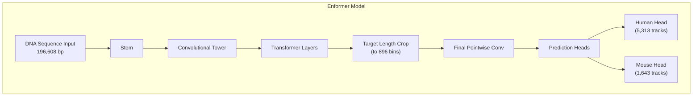
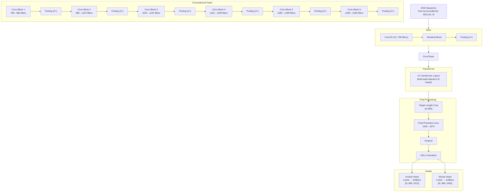
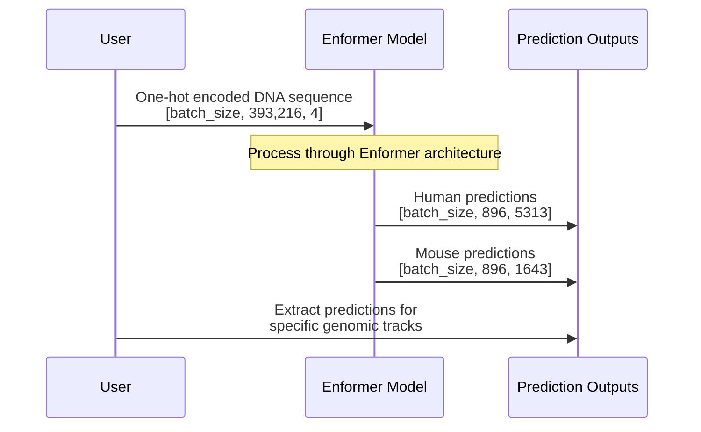
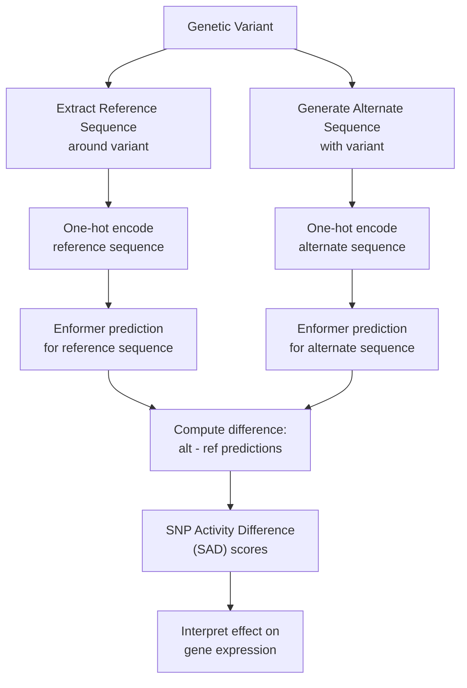

<!-- source: DeepWiki mcp.deepwiki.com · repo google-deepmind/deepmind-research · page 2.6 Enformer · fetched 2026-10-26 -->

# Enformer

<details>
<summary>Relevant source files</summary>

The following files were used as context for generating this wiki page:

- [enformer/README.md](enformer/README.md)
- [enformer/attention_module.py](enformer/attention_module.py)
- [enformer/enformer-training.ipynb](enformer/enformer-training.ipynb)
- [enformer/enformer-usage.ipynb](enformer/enformer-usage.ipynb)
- [enformer/enformer.py](enformer/enformer.py)
- [enformer/enformer_test.py](enformer/enformer_test.py)
- [enformer/requirements.txt](enformer/requirements.txt)
- [gated_linear_networks/colabs/README.md](gated_linear_networks/colabs/README.md)
- [gated_linear_networks/colabs/dendritic_gated_network.ipynb](gated_linear_networks/colabs/dendritic_gated_network.ipynb)

</details>


## Purpose and Scope

This document describes Enformer, a deep learning model for gene expression prediction that integrates long-range interactions in DNA sequences. Enformer is designed to predict gene expression levels from DNA sequence by capturing regulatory elements up to 100kb away from genes, providing a significant improvement over previous models with more limited receptive fields.

The document covers the model architecture, implementation details, usage for inference, and applications like variant effect prediction. For information about training the model, see the training notebook included in the repository.

Sources: [enformer/README.md:1-15](), [enformer/enformer.py:14-27]()

## Overview

Enformer ("Enhanced Performer") is a sequence-to-function model that predicts gene expression and chromatin profiles from DNA sequence. It was developed to address the limitations of previous models by incorporating a larger receptive field to capture distal regulatory elements that influence gene expression.

Key capabilities of Enformer include:
- Gene expression prediction from DNA sequences
- Chromatin accessibility and histone mark profile prediction
- Variant effect prediction to assess the impact of genetic variants on gene expression

The model takes a 196,608 base pair DNA sequence as input and makes predictions for the central 114,688 base pairs, with outputs corresponding to 128 base pair windows.

Sources: [enformer/README.md:3-14](), [enformer/enformer.py:37-40](), [enformer/README.md:79-101]()

## System Architecture

The Enformer architecture combines convolutional neural networks for local feature extraction with Transformer layers for capturing long-range interactions.

### Enformer Architecture Diagram



### Key Components

- **Input**: One-hot encoded DNA sequence (A,C,G,T) of length 393,216 bp
- **Processing Core**: Stem + Convolutional Tower + Transformer
- **Output**: Predictions for 896 bins (each representing 128 bp) for both human and mouse
  - Human output shape: [batch_size, 896, 5313]
  - Mouse output shape: [batch_size, 896, 1643]

The model is optimized to make predictions for the central region of the input sequence, allowing it to incorporate context from flanking regions.

Sources: [enformer/enformer.py:42-177](), [enformer/README.md:79-101]()

## Detailed Architecture



Sources: [enformer/enformer.py:42-177](), [enformer/attention_module.py:66-101](), [enformer/README.md:97-101]()

## Model Components in Detail

### 1. Input Processing

Enformer takes a one-hot encoded DNA sequence as input. The sequence has length 393,216 base pairs, with each position encoded as a 4-element vector representing the nucleotides (A, C, G, T). However, only the central 196,608 base pairs are processed by the model, with the rest being cropped internally.

```
Input shape: [batch_size, 393,216, 4]
```

Sources: [enformer/README.md:79-101](), [enformer/enformer.py:37-40]()

### 2. Stem and Convolutional Tower

The stem consists of:
- Initial 1D convolution with kernel size 15 and 768 filters
- Residual block with pointwise convolution
- Pooling operation (max or attention-based)

The convolutional tower contains 6 blocks, each with:
- 1D convolution with kernel size 5
- Residual connection with pointwise convolution 
- Pooling operation that reduces sequence length by 2×

The number of filters increases exponentially through the tower (768→896→1024→1152→1280→1408→1536).

Sources: [enformer/enformer.py:100-115](), [enformer/enformer.py:233-241]()

### 3. Transformer Module

The transformer module consists of 11 transformer layers, each with:
- Multi-head attention (8 heads) with relative positional encodings
- Layer normalization
- MLP with ReLU activation and dropout

The transformer enables the model to capture long-range interactions between distant parts of the sequence, which is crucial for modeling the effects of distal regulatory elements.

Sources: [enformer/enformer.py:117-137](), [enformer/attention_module.py:104-280]()

### 4. Target Length Crop and Final Processing

After the transformer, the sequence is cropped to the target length of 896 positions:
- Each position represents a 128bp window
- A final pointwise convolution doubles the channel dimension
- GELU activation is applied

Sources: [enformer/enformer.py:139-144](), [enformer/enformer.py:186-204]()

### 5. Prediction Heads

The model has two separate prediction heads:
- Human head: Predicts 5,313 regulatory tracks
- Mouse head: Predicts 1,643 regulatory tracks

Each head consists of a linear projection followed by a softplus activation function.

Sources: [enformer/enformer.py:154-160](), [enformer/README.md:97-117]()

## Data Flow for Inference



Sources: [enformer/README.md:79-101](), [enformer/enformer.py:171-183]()

## Running Inference

The simplest way to perform inference is to load the model via TensorFlow Hub and provide a properly formatted input sequence:

```python
import tensorflow as tf
import tensorflow_hub as hub

enformer = hub.Module('https://tfhub.dev/deepmind/enformer/1')

SEQ_LENGTH = 393_216

# Numpy array [batch_size, SEQ_LENGTH, 4] one hot encoded in order 'ACGT'
inputs = tf.zeros((1, SEQ_LENGTH, 4), dtype=tf.float32)
predictions = enformer.predict_on_batch(inputs)
predictions['human'].shape  # [batch_size, 896, 5313]
predictions['mouse'].shape  # [batch_size, 896, 1643]
```

The `one_hot_encode` function provided in `enformer.py` can be used to convert DNA sequences into the required format:

```python
# Example using one_hot_encode
sequence = "ACGTACGT..." # DNA sequence string
one_hot = enformer.one_hot_encode(sequence)
```

Sources: [enformer/README.md:77-101](), [enformer/enformer.py:171-183](), [enformer/enformer.py:313-325]()

## Output Interpretation

For each 128bp window in the central region, Enformer predicts values for every track. The mapping from track index to track name is found in the corresponding targets file from the Basenji dataset.

```python
import pandas as pd
targets_txt = 'https://raw.githubusercontent.com/calico/basenji/0.5/manuscripts/cross2020/targets_human.txt'
df_targets = pd.read_csv(targets_txt, sep='\t')
df_targets.shape  # (5313, 8) With rows matching output shape
```

The target files contain metadata for each track, including:
- Tissue/cell type
- Experiment type (e.g., DNase-seq, ChIP-seq)
- Description

Sources: [enformer/README.md:104-117]()

## Variant Effect Prediction

Enformer can predict the effect of genetic variants on gene expression by comparing predictions for reference and alternate sequences:

### Variant Effect Analysis Flow



Pre-computed variant effect scores for frequent variants (MAF>0.5%) from the 1000 Genomes Project are available for download.

Sources: [enformer/README.md:38-77](), [enformer/enformer-usage.ipynb]()

## Requirements and Dependencies

To run Enformer, you need the following dependencies:
- dm-sonnet (2.0.0)
- kipoiseq (0.5.2)
- numpy (1.19.5)
- pandas (1.2.3)
- tensorflow (2.4.1)
- tensorflow-hub (0.11.0)

Sources: [enformer/README.md:16-27](), [enformer/requirements.txt:1-7]()

## Additional Resources

For further examples and detailed usage, refer to the following notebooks:

1. **enformer-usage.ipynb**: Shows how to:
   - Make predictions with pre-trained Enformer
   - Compute contribution scores
   - Predict the effect of genetic variants
   - Score multiple variants in a VCF

2. **enformer-training.ipynb**: Shows how to:
   - Set up training data
   - Train the model
   - Evaluate the model
   - Restore the model from a checkpoint for fine-tuning

Sources: [enformer/README.md:127-148]()

---

