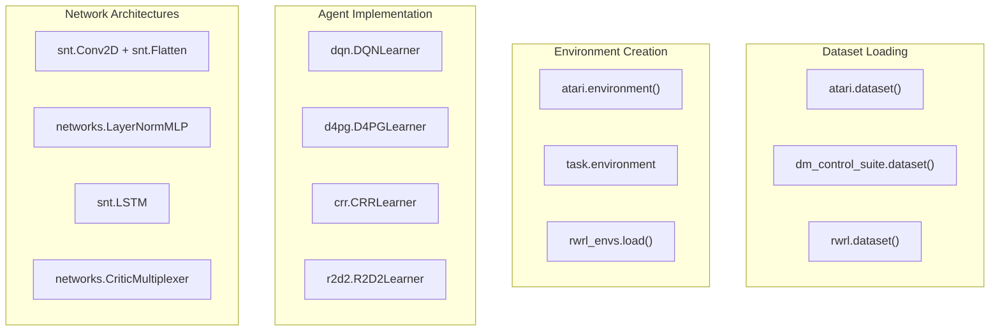
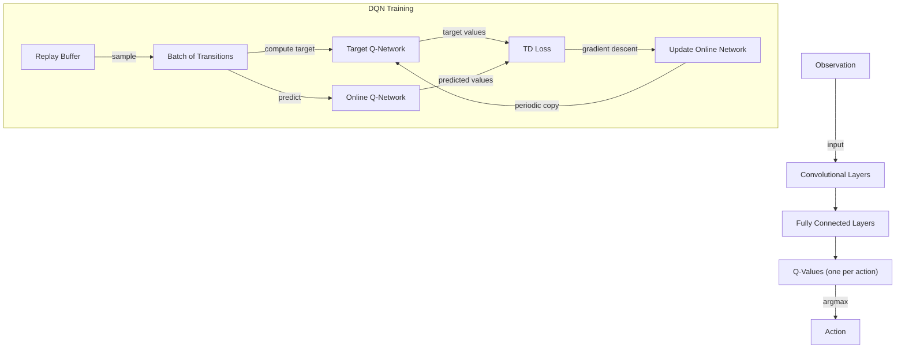
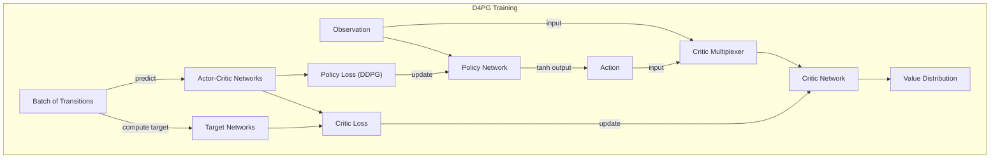

<!-- source: DeepWiki mcp.deepwiki.com · repo google-deepmind/deepmind-research · page 3 Reinforcement Learning Systems · fetched 2026-10-26 -->

# Reinforcement Learning Systems

<details>
<summary>Relevant source files</summary>

The following files were used as context for generating this wiki page:

- [rl_unplugged/README.md](rl_unplugged/README.md)
- [rl_unplugged/atari.py](rl_unplugged/atari.py)
- [rl_unplugged/atari_dqn.ipynb](rl_unplugged/atari_dqn.ipynb)
- [rl_unplugged/atari_example.py](rl_unplugged/atari_example.py)
- [rl_unplugged/bsuite.ipynb](rl_unplugged/bsuite.ipynb)
- [rl_unplugged/dm_control_suite.py](rl_unplugged/dm_control_suite.py)
- [rl_unplugged/dm_control_suite_crr.ipynb](rl_unplugged/dm_control_suite_crr.ipynb)
- [rl_unplugged/dm_control_suite_d4pg.ipynb](rl_unplugged/dm_control_suite_d4pg.ipynb)
- [rl_unplugged/dm_control_suite_example.py](rl_unplugged/dm_control_suite_example.py)
- [rl_unplugged/dmlab_r2d2.ipynb](rl_unplugged/dmlab_r2d2.ipynb)
- [rl_unplugged/images/tasks.png](rl_unplugged/images/tasks.png)
- [rl_unplugged/networks.py](rl_unplugged/networks.py)
- [rl_unplugged/requirements.txt](rl_unplugged/requirements.txt)
- [rl_unplugged/rwrl.py](rl_unplugged/rwrl.py)
- [rl_unplugged/rwrl_d4pg.ipynb](rl_unplugged/rwrl_d4pg.ipynb)
- [rl_unplugged/rwrl_example.py](rl_unplugged/rwrl_example.py)
- [scratchgan/experiment.py](scratchgan/experiment.py)
- [scratchgan/generators.py](scratchgan/generators.py)
- [scratchgan/losses.py](scratchgan/losses.py)
- [scratchgan/reader.py](scratchgan/reader.py)
- [scratchgan/utils.py](scratchgan/utils.py)

</details>


This document provides a technical overview of reinforcement learning systems in the DeepMind Research repository, focusing on the RL Unplugged suite of benchmarks for offline reinforcement learning. Offline RL refers to learning from fixed datasets without additional environment interaction during training.

## Overview of RL Unplugged

RL Unplugged is a collection of benchmark datasets designed to facilitate research on offline reinforcement learning across diverse domains. It addresses several key challenges in reinforcement learning:

- High-dimensional action spaces (e.g., 56-dimensional actions in humanoid locomotion)
- High-dimensional observations
- Partial observability with egocentric vision
- Exploration difficulty using state-of-the-art algorithms to generate data
- Real-world challenges including stochasticity and constraints

```mermaid
graph TD
    RLUnplugged["RL Unplugged Benchmark Suite"] --> Datasets
    RLUnplugged --> Environments
    RLUnplugged --> Algorithms
    
    Datasets --> AtariDS["Atari Datasets"]
    Datasets --> ControlSuiteDS["DM Control Suite Datasets"]
    Datasets --> LocomotionDS["DM Locomotion Datasets"]
    Datasets --> RWRLDS["Real World RL Datasets"]
    Datasets --> DMLabDS["DeepMind Lab Datasets"]
    Datasets --> BsuiteDS["Bsuite Datasets"]
    
    Environments --> AtariEnv["Atari Environments"]
    Environments --> ControlSuiteEnv["DM Control Suite Environments"]
    Environments --> RWRLEnv["Real World RL Environments"]
    Environments --> DMLabEnv["DeepMind Lab Environments"]
    Environments --> BsuiteEnv["Bsuite Environments"]
    
    Algorithms --> DQN["DQN (Discrete Actions)"]
    Algorithms --> D4PG["D4PG (Continuous Actions)"]
    Algorithms --> CRR["CRR (Continuous Actions)"]
    Algorithms --> R2D2["R2D2 (Memory-Based)"]
```



Sources: [rl_unplugged/README.md:1-125](rl_unplugged/README.md:1-125)

## Dataset Structure and Components

### Available Datasets

The RL Unplugged suite includes:

| Dataset | Description | Action Space | Key Challenges |
|---------|-------------|--------------|----------------|
| Atari | 46 Atari games, data from DQN training | Discrete | High-dimensional observations |
| DM Control Suite | 9 continuous control tasks | Continuous | Standard benchmark tasks |
| DM Locomotion | Humanoid and rodent tasks | Continuous (56D for humanoid) | High-DoF control with rich observations |
| Real World RL | Tasks with real-world challenges | Continuous | Stochasticity, delays, constraints |
| DeepMind Lab | 3D navigation tasks | Discrete | Partial observability, memory |
| Bsuite | Simple diagnostic tasks | Discrete | Controlled stochasticity levels |

Sources: [rl_unplugged/README.md:29-123](rl_unplugged/README.md:29-123), [rl_unplugged/dm_control_suite.py:1-50](rl_unplugged/dm_control_suite.py:1-50)

### Data Format

Datasets are stored as TFRecord files containing serialized TensorFlow Examples. The structure varies slightly between domains but typically follows either:

- **SARS format**: (State, Action, Reward, Next State)
- **SARSA format**: (State, Action, Reward, Next State, Next Action)

For example, Atari datasets contain:
```
o_t: Observation at time t (84x84x4 stacked frames)
a_t: Action at time t
r_t: Reward after a_t
d_t: Discount factor
o_tp1: Observation at time t+1
a_tp1: Action at time t+1
```

Sources: [rl_unplugged/atari.py:14-37](rl_unplugged/atari.py:14-37)

## Core System Architecture

The RL Unplugged system has a consistent architecture across different domains:

```mermaid
graph LR
    TFRecords["TFRecord Files"] --> |"parse_examples"| DatasetFuncs["Dataset Loading Functions"]
    DatasetFuncs --> |"map/batch"| TFDataset["TF Dataset Objects"]
    TFDataset --> |"convert to Reverb"| ReverbSamples["Replay Samples"]
    ReverbSamples --> Learner["RL Agent Learner"]
    
    Environment --> |"observation/action specs"| Learner
    Learner --> |"update"| Networks["Policy/Value Networks"]
    Networks --> Actor["Evaluation Actor"]
    Environment --> |"observations"| Actor
    Actor --> |"actions"| Environment
```



Sources: [rl_unplugged/atari_dqn.ipynb:89-187](rl_unplugged/atari_dqn.ipynb:89-187), [rl_unplugged/dm_control_suite_d4pg.ipynb:184-221](rl_unplugged/dm_control_suite_d4pg.ipynb:184-221)

### Code Entity Mapping

The following diagram maps conceptual entities to actual code components:



Sources: [rl_unplugged/atari_dqn.ipynb:239-251](rl_unplugged/atari_dqn.ipynb:239-251), [rl_unplugged/dm_control_suite_d4pg.ipynb:304-347](rl_unplugged/dm_control_suite_d4pg.ipynb:304-347)

## Key Components

### Environment Wrappers

Environment wrappers provide a standardized interface across different domains:

```python
# Atari environment
environment = atari.environment(game='Pong')

# Control Suite environment
task = dm_control_suite.ControlSuite(task_name='cartpole_swingup')
environment = task.environment

# RWRL environment
environment = rwrl_envs.load(domain_name='cartpole', 
                            task_name='realworld_swingup')
```

These wrappers handle observations, actions, and rewards consistently across different environments.

Sources: [rl_unplugged/atari.py:247-253](rl_unplugged/atari.py:247-253), [rl_unplugged/dm_control_suite.py:504-516](rl_unplugged/dm_control_suite.py:504-516)

### Dataset Loading

Each domain has a corresponding dataset loading function that:
1. Reads TFRecord files
2. Parses serialized examples
3. Converts data to the appropriate format (e.g., Reverb replay samples)
4. Batches data for training

```python
# Atari dataset loading
dataset = atari.dataset(path='/tmp/atari', 
                       game='Pong', 
                       run=1, 
                       num_shards=1)

# Control Suite dataset loading
dataset = dm_control_suite.dataset(
    root_path='/tmp',
    data_path=task.data_path,
    shapes=task.shapes,
    uint8_features=task.uint8_features,
    num_shards=num_shards)
```

Sources: [rl_unplugged/atari.py:188-204](rl_unplugged/atari.py:188-204), [rl_unplugged/dm_control_suite.py:785-830](rl_unplugged/dm_control_suite.py:785-830)

### Network Architectures

The system supports various neural network architectures for different domains:

- **Discrete Actions (Atari)**:
  - Convolutional networks for image processing
  - MLP heads for Q-value prediction

- **Continuous Control**:
  - Actor networks with tanh output scaling
  - Critic networks with action-conditioned value prediction
  - Distributional value representations

Sources: [rl_unplugged/atari_dqn.ipynb:239-251](rl_unplugged/atari_dqn.ipynb:239-251), [rl_unplugged/dm_control_suite_d4pg.ipynb:304-323](rl_unplugged/dm_control_suite_d4pg.ipynb:304-323)

### Agent Implementations

RL Unplugged includes implementations of several offline RL algorithms:

| Algorithm | Purpose | Key Features |
|-----------|---------|--------------|
| DQN | Discrete action spaces | Q-learning with target networks |
| D4PG | Continuous control | Distributional critic, deterministic policy |
| CRR | Continuous control | Critic-regularized regression |
| R2D2 | Memory-dependent tasks | Recurrent networks with experience replay |

Sources: [rl_unplugged/atari_dqn.ipynb:263-275](rl_unplugged/atari_dqn.ipynb:263-275), [rl_unplugged/dm_control_suite_d4pg.ipynb:339-347](rl_unplugged/dm_control_suite_d4pg.ipynb:339-347)

## Training and Evaluation Pipeline

The training and evaluation pipeline follows a standard pattern:

1. **Load Dataset**:
   ```python
   dataset = domain_module.dataset(...)
   ```

2. **Create Environment**:
   ```python
   environment = domain_module.environment(...)
   ```

3. **Define Networks**:
   ```python
   network = snt.Sequential([...])
   ```

4. **Create Learner**:
   ```python
   learner = algorithm.Learner(network=network, dataset=dataset, ...)
   ```

5. **Train Agent**:
   ```python
   for _ in range(num_steps):
       learner.step()
   ```

6. **Evaluate Policy**:
   ```python
   actor = actors.FeedForwardActor(policy_network)
   loop = acme.EnvironmentLoop(environment, actor, logger)
   loop.run(num_episodes)
   ```

Sources: [rl_unplugged/atari_dqn.ipynb:286-323](rl_unplugged/atari_dqn.ipynb:286-323), [rl_unplugged/dm_control_suite_d4pg.ipynb:353-385](rl_unplugged/dm_control_suite_d4pg.ipynb:353-385)

## Reinforcement Learning Algorithms

### Deep Q-Network (DQN)



Sources: [rl_unplugged/atari_dqn.ipynb:239-251](rl_unplugged/atari_dqn.ipynb:239-251), [rl_unplugged/atari_dqn.ipynb:263-275](rl_unplugged/atari_dqn.ipynb:263-275)

### Distributed Distributional DDPG (D4PG)



Sources: [rl_unplugged/dm_control_suite_d4pg.ipynb:304-323](rl_unplugged/dm_control_suite_d4pg.ipynb:304-323), [rl_unplugged/dm_control_suite_d4pg.ipynb:339-347](rl_unplugged/dm_control_suite_d4pg.ipynb:339-347)

## Examples and Usage

### Atari DQN Example

```python
# Load dataset
dataset = atari.dataset(path='/tmp/atari', game='Pong', run=1, num_shards=1)
dataset = dataset.map(discard_extras).batch(batch_size)

# Create environment
environment = atari.environment(game='Pong')

# Create network
network = snt.Sequential([
    lambda x: tf.image.convert_image_dtype(x, tf.float32),
    snt.Conv2D(32, [8, 8], [4, 4]),
    tf.nn.relu,
    snt.Conv2D(64, [4, 4], [2, 2]),
    tf.nn.relu,
    snt.Conv2D(64, [3, 3], [1, 1]),
    tf.nn.relu,
    snt.Flatten(),
    snt.nets.MLP([512, num_actions])
])

# Create learner
learner = dqn.DQNLearner(
    network=network,
    target_network=copy.deepcopy(network),
    discount=0.99,
    learning_rate=3e-4,
    dataset=dataset)

# Train and evaluate
for _ in range(num_steps):
    learner.step()

policy_network = snt.Sequential([
    network,
    lambda q: tf.argmax(q, axis=-1),
])
actor = actors.FeedForwardActor(policy_network)
loop = acme.EnvironmentLoop(environment, actor, logger)
loop.run(num_episodes)
```

Sources: [rl_unplugged/atari_dqn.ipynb:155-187](rl_unplugged/atari_dqn.ipynb:155-187), [rl_unplugged/atari_dqn.ipynb:239-251](rl_unplugged/atari_dqn.ipynb:239-251), [rl_unplugged/atari_dqn.ipynb:263-275](rl_unplugged/atari_dqn.ipynb:263-275), [rl_unplugged/atari_dqn.ipynb:286-323](rl_unplugged/atari_dqn.ipynb:286-323)

### Control Suite D4PG Example

```python
# Load dataset
task = dm_control_suite.ControlSuite(task_name='cartpole_swingup')
environment = task.environment
dataset = dm_control_suite.dataset(
    root_path='/tmp',
    data_path=task.data_path,
    shapes=task.shapes,
    uint8_features=task.uint8_features,
    num_shards=num_shards)
dataset = dataset.map(discard_extras).batch(batch_size)

# Create networks
action_spec = environment_spec.actions
policy_network = snt.Sequential([
    tf2_utils.batch_concat,
    networks.LayerNormMLP(layer_sizes=(300, 200, action_size)),
    networks.TanhToSpec(spec=action_spec)])

critic_network = snt.Sequential([
    networks.CriticMultiplexer(
        observation_network=tf2_utils.batch_concat,
        action_network=tf.identity,
        critic_network=networks.LayerNormMLP(
            layer_sizes=(400, 300),
            activate_final=True)),
    networks.DiscreteValuedHead(vmin=-150., vmax=150., num_atoms=51)])

# Create learner
learner = d4pg.D4PGLearner(
    policy_network=policy_network,
    critic_network=critic_network,
    target_policy_network=copy.deepcopy(policy_network),
    target_critic_network=copy.deepcopy(critic_network),
    dataset=dataset,
    discount=0.99,
    target_update_period=100)

# Train and evaluate
for _ in range(num_steps):
    learner.step()

actor = actors.FeedForwardActor(policy_network)
loop = acme.EnvironmentLoop(environment, actor, logger)
loop.run(num_episodes)
```

Sources: [rl_unplugged/dm_control_suite_d4pg.ipynb:257-283](rl_unplugged/dm_control_suite_d4pg.ipynb:257-283), [rl_unplugged/dm_control_suite_d4pg.ipynb:304-323](rl_unplugged/dm_control_suite_d4pg.ipynb:304-323), [rl_unplugged/dm_control_suite_d4pg.ipynb:339-347](rl_unplugged/dm_control_suite_d4pg.ipynb:339-347), [rl_unplugged/dm_control_suite_d4pg.ipynb:367-385](rl_unplugged/dm_control_suite_d4pg.ipynb:367-385)

## Summary

RL Unplugged provides a comprehensive suite of benchmarks for offline reinforcement learning research. It includes datasets from diverse domains, environment implementations, and reference algorithm implementations. The unified interface makes it easy to compare different algorithms and adapt them to new tasks.

Sources: [rl_unplugged/README.md:4-26](rl_unplugged/README.md:4-26)

---

